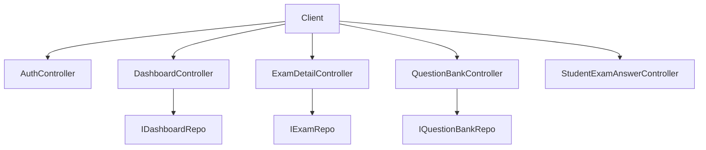
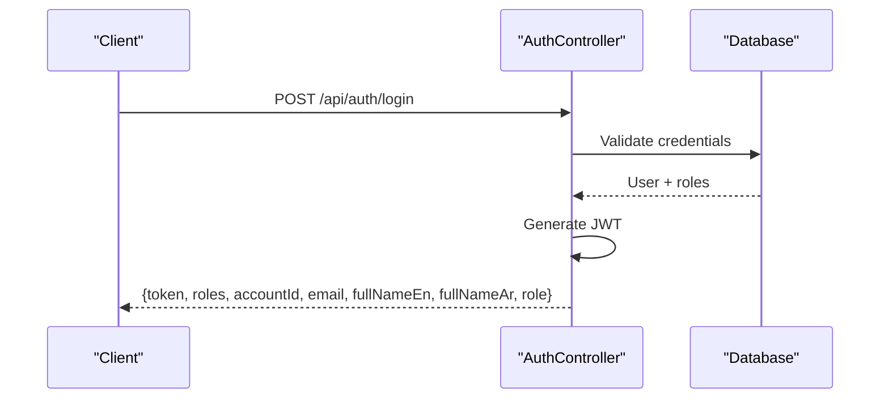
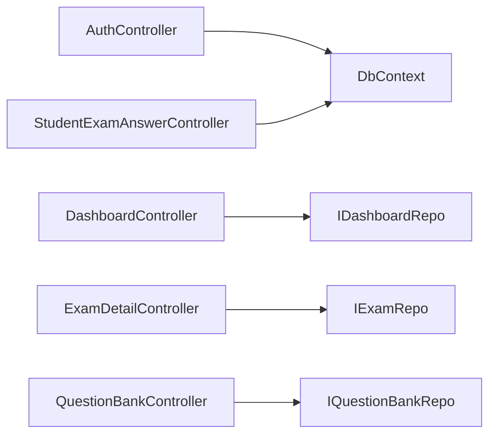
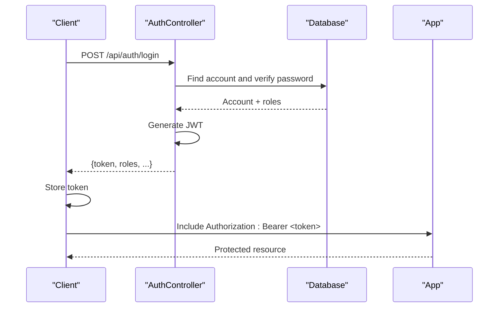

# API Reference

<cite>
**Referenced Files in This Document**
- [AuthController.cs](file://server/Api/Controllers/AuthController.cs)
- [DashboardController.cs](file://server/Api/Controllers/DashboardController.cs)
- [ExamDetailController.cs](file://server/Api/Controllers/ExamDetailController.cs)
- [QuestionBankController.cs](file://server/Api/Controllers/QuestionBankController.cs)
- [StudentExamAnswerController.cs](file://server/Api/Controllers/StudentExamAnswerController.cs)
- [Program.cs](file://server/Api/Program.cs)
- [appsettings.json](file://server/Api/appsettings.json)
- [DashboardDTOs.cs](file://server/Api/DTOs/DashboardDTOs.cs)
- [ExamCreateDto.cs](file://server/Api/DTOs/ExamCreateDto.cs)
- [QuestionBankCreateDto.cs](file://server/Api/DTOs/QuestionBankCreateDto.cs)
- [QuestionUploadResultDto.cs](file://server/Api/DTOs/QuestionUploadResultDto.cs)
</cite>

## Table of Contents
1. [Introduction](#introduction)
2. [Project Structure](#project-structure)
3. [Core Components](#core-components)
4. [Architecture Overview](#architecture-overview)
5. [Detailed Component Analysis](#detailed-component-analysis)
6. [Dependency Analysis](#dependency-analysis)
7. [Performance Considerations](#performance-considerations)
8. [Troubleshooting Guide](#troubleshooting-guide)
9. [Conclusion](#conclusion)
10. [Appendices](#appendices)

## Introduction
This document provides a comprehensive API reference for the Exam-Hub RESTful API. It covers all public endpoints across authentication, dashboard, exam detail, question bank, and student exam answer domains. For each endpoint, you will find HTTP methods, URL patterns, request/response schemas, authentication requirements, parameter descriptions, example payloads, error codes, and troubleshooting guidance.

The API is built on ASP.NET Core with JWT-based authentication and role-based authorization. Responses use camelCase JSON properties by default.

## Project Structure
The server exposes five primary controllers:
- Authentication (AuthController)
- Dashboard (DashboardController)
- Exam Detail (ExamDetailController)
- Question Bank (QuestionBankController)
- Student Exam Answer (StudentExamAnswerController)

**Diagram sources**
- [Program.cs:104-107](file://server/Api/Program.cs#L104-L107)
- [DashboardController.cs:11-22](file://server/Api/Controllers/DashboardController.cs#L11-L22)
- [ExamDetailController.cs:11-22](file://server/Api/Controllers/ExamDetailController.cs#L11-L22)
- [QuestionBankController.cs:10-19](file://server/Api/Controllers/QuestionBankController.cs#L10-L19)

**Section sources**
- [Program.cs:17-33](file://server/Api/Program.cs#L17-L33)
- [Program.cs:43-81](file://server/Api/Program.cs#L43-L81)
- [Program.cs:111-125](file://server/Api/Program.cs#L111-L125)

## Core Components
- Authentication: Register, login, SSO token issuance, profile read/update, JWT generation.
- Dashboard: Lookup data, student/teacher/superadmin dashboards, leaderboards, exam stats, teacher/student lists.
- Exam Detail: CRUD for exams, subjects lookup, class-scoped access control.
- Question Bank: CRUD for questions, Excel upload, template download.
- Student Exam Answer: Submit answers, retrieve student’s completed exams and per-exam answers.

Authentication and Authorization:
- JWT Bearer tokens are required for protected endpoints.
- Roles include Student, Teacher, Superadmin, Admin, Board.
- Some endpoints enforce specific roles via attributes.

JSON Conventions:
- Property naming policy is camelCase.

**Section sources**
- [Program.cs:20-24](file://server/Api/Program.cs#L20-L24)
- [Program.cs:43-81](file://server/Api/Program.cs#L43-L81)
- [Program.cs:83-90](file://server/Api/Program.cs#L83-L90)

## Architecture Overview
The API uses controller-based routing with attribute routes. Controllers depend on repository interfaces resolved via dependency injection. Data access is performed through Entity Framework against a SQL Server database.

**Diagram sources**
- [AuthController.cs:118-249](file://server/Api/Controllers/AuthController.cs#L118-L249)
- [AuthController.cs:381-420](file://server/Api/Controllers/AuthController.cs#L381-L420)

## Detailed Component Analysis

### Authentication API
Base path: /api/auth

Endpoints:
- POST /api/auth/register
  - Purpose: Create a new account with a validated password and assign a role.
  - Auth: None
  - Request body:
    - email: string (required)
    - password: string (required; min 8 chars, uppercase, lowercase, digit)
    - role: string (optional; defaults to Student; Admin/Superadmin mapped to Board)
    - fullNameEn: string (optional)
    - fullNameAr: string (optional)
  - Success response:
    - message: string
    - accountId: number
  - Errors:
    - 400 Bad Request: missing fields, invalid role, weak password
    - 409 Conflict: email already exists
- POST /api/auth/login
  - Purpose: Authenticate user and return JWT.
  - Auth: None
  - Request body:
    - email: string (required)
    - password: string (required)
    - businessEntity: string (optional; defaults to Exams)
  - Success response:
    - token: string
    - roles: array of strings
    - accountId: number
    - email: string
    - fullNameEn: string
    - fullNameAr: string
    - role: string (first entity-specific role)
  - Errors:
    - 401 Unauthorized: invalid credentials
    - 500 Internal Server Error: unexpected errors
- POST /api/auth/sso-token
  - Purpose: Issue a JWT for an existing active account (SSO flow).
  - Auth: None
  - Request body:
    - email: string (required)
    - businessEntity: string (optional)
  - Success response: same shape as login
  - Errors:
    - 404 Not Found: account not found
    - 500 Internal Server Error
- GET /api/auth/profile/{id}
  - Purpose: Retrieve profile by account ID.
  - Auth: Required (JWT)
  - Path param: id (number)
  - Success response:
    - id: number
    - email: string
    - fullNameEn: string
    - fullNameAr: string
    - phone: string?
    - isActive: boolean
    - createdAt: datetime
    - updatedAt: datetime
  - Errors:
    - 404 Not Found
    - 500 Internal Server Error
- PUT /api/auth/profile/{id}
  - Purpose: Update profile fields.
  - Auth: Required (JWT)
  - Path param: id (number)
  - Request body:
    - fullNameEn: string?
    - fullNameAr: string?
    - email: string?
    - phone: string?
  - Success response: updated profile object
  - Errors:
    - 404 Not Found
    - 500 Internal Server Error

Notes:
- Password validation enforces minimum length and complexity.
- Login supports BCrypt, legacy SHA256, and plaintext fallback for compatibility.
- JWT claims include sub (account ID), email, and role(s). Token lifetime is configured at generation time.

Example requests/responses:
- Register
  - Request: { "email": "user@example.com", "password": "Str0ngPass", "role": "Teacher" }
  - Response: { "message": "Account created", "accountId": 123 }
- Login
  - Request: { "email": "user@example.com", "password": "Str0ngPass" }
  - Response: { "token": "...", "roles": ["Teacher"], "accountId": 123, "email": "user@example.com", "fullNameEn": "User Name", "fullNameAr": "اسم المستخدم", "role": "Teacher" }

Usage pattern:
- Include Authorization: Bearer <token> header on subsequent requests.

**Section sources**
- [AuthController.cs:28-116](file://server/Api/Controllers/AuthController.cs#L28-L116)
- [AuthController.cs:118-249](file://server/Api/Controllers/AuthController.cs#L118-L249)
- [AuthController.cs:251-313](file://server/Api/Controllers/AuthController.cs#L251-L313)
- [AuthController.cs:315-379](file://server/Api/Controllers/AuthController.cs#L315-L379)
- [AuthController.cs:381-420](file://server/Api/Controllers/AuthController.cs#L381-L420)
- [AuthController.cs:422-449](file://server/Api/Controllers/AuthController.cs#L422-L449)

### Dashboard API
Base path: /api/dashboard

Endpoints:
- GET /api/dashboard/lookup-data
  - Purpose: Return lookup data for grades, classes, subjects, and exams.
  - Auth: Required (JWT)
  - Success response:
    - grades: array of { id: number, gradeName: string }
    - classes: array of { id: number, className: string, gradeId: number }
    - subjects: array of { id: number, statusName: string }
    - exams: array of { examId: number, title: string, gradeId: number, classId: string?, classes: array<number> }
- GET /api/dashboard/student/{id}
  - Purpose: Get student dashboard with statistics and leaderboard.
  - Auth: Required (JWT)
  - Path param: id (number)
  - Query params:
    - gradeId: number?
    - classId: number?
    - examId: number?
    - startDate: datetime?
    - endDate: datetime?
  - Success response: StudentDashboardDto
  - Errors:
    - 400 Bad Request: invalid date range
    - 404 Not Found: student not found
    - 500 Internal Server Error
- GET /api/dashboard/teacher/{id}
  - Purpose: Get teacher dashboard with performance metrics.
  - Auth: Required (JWT)
  - Path param: id (number)
  - Query params: same as student endpoint
  - Success response: TeacherDashboardDto
  - Errors: same as student endpoint
- GET /api/dashboard/superadmin
  - Purpose: Global dashboard for superadmin/admin/board.
  - Auth: Required (JWT); roles: Superadmin, Admin, Board
  - Query params: same as above
  - Success response: SuperadminDashboardDto
  - Errors:
    - 400 Bad Request: invalid date range
    - 500 Internal Server Error
- GET /api/dashboard/leaderboard/{examId}
  - Purpose: Leaderboard for a specific exam with optional filters.
  - Auth: Required (JWT)
  - Path param: examId (number)
  - Query params:
    - gradeId: number?
    - classId: number?
    - examIdParam: number? (overrides path examId if provided)
    - startDate: datetime?
    - endDate: datetime?
    - groupBy: string? (default "Student")
  - Success response: LeaderboardDto
  - Errors:
    - 400 Bad Request: invalid date range
    - 404 Not Found: exam not found
    - 500 Internal Server Error
- GET /api/dashboard/leaderboard/combined
  - Purpose: Combined leaderboard across exams with filters.
  - Auth: Required (JWT)
  - Query params: same as single-exam leaderboard
  - Success response: LeaderboardDto
  - Errors:
    - 500 Internal Server Error
- GET /api/dashboard/exam/{examId}/stats
  - Purpose: Statistics for a specific exam.
  - Auth: Required (JWT)
  - Path param: examId (number)
  - Success response: ExamStatsDto
  - Errors:
    - 404 Not Found: exam not found
    - 500 Internal Server Error
- GET /api/dashboard/teachers
  - Purpose: List teachers (restricted).
  - Auth: Required (JWT); roles: Superadmin, Admin, Board
  - Success response: array of TeacherAccountDto
  - Errors:
    - 500 Internal Server Error
- GET /api/dashboard/students
  - Purpose: List students with performance data.
  - Auth: Required (JWT)
  - Success response: array of StudentPerformanceDto
  - Errors:
    - 500 Internal Server Error

Response models:
- StudentDashboardDto, TeacherDashboardDto, SuperadminDashboardDto, LeaderboardDto, LeaderboardEntryDto, ExamStatsDto, TeacherAccountDto, StudentPerformanceDto are defined in DTOs.

Example responses:
- LeaderboardDto
  - { "examId": 1, "examTitle": "Math Midterm", "subjectName": "Mathematics", "topStudents": [...], "highlightedStudents": [...], "totalParticipants": 45 }

Date validation:
- If both startDate and endDate are provided, startDate must be less than or equal to endDate.

**Section sources**
- [DashboardController.cs:24-78](file://server/Api/Controllers/DashboardController.cs#L24-L78)
- [DashboardController.cs:80-136](file://server/Api/Controllers/DashboardController.cs#L80-L136)
- [DashboardController.cs:138-195](file://server/Api/Controllers/DashboardController.cs#L138-L195)
- [DashboardController.cs:197-234](file://server/Api/Controllers/DashboardController.cs#L197-L234)
- [DashboardController.cs:236-285](file://server/Api/Controllers/DashboardController.cs#L236-L285)
- [DashboardController.cs:287-320](file://server/Api/Controllers/DashboardController.cs#L287-L320)
- [DashboardController.cs:322-344](file://server/Api/Controllers/DashboardController.cs#L322-L344)
- [DashboardController.cs:346-374](file://server/Api/Controllers/DashboardController.cs#L346-L374)
- [DashboardDTOs.cs:3-169](file://server/Api/DTOs/DashboardDTOs.cs#L3-L169)

### Exam Detail API
Base path: /api/examdetail

Endpoints:
- GET /api/examdetail
  - Purpose: List exams with role-based filtering.
  - Auth: Optional (JWT improves filtering)
  - Behavior:
    - If authenticated as a student with a class assignment, only exams assigned to that class are returned.
    - Teachers can see all exams.
    - Admin/Board/Superadmin can see all exams.
  - Success response: array of ExamReadDto
- GET /api/examdetail/{id}
  - Purpose: Get a single exam by ID.
  - Auth: Optional (JWT improves access checks)
  - Path param: id (number)
  - Access control: Students can only access exams assigned to their class.
  - Success response: ExamReadDto
  - Errors:
    - 403 Forbidden: student does not have access
    - 404 Not Found
- POST /api/examdetail
  - Purpose: Create an exam and link multiple questions and classes.
  - Auth: Required (JWT)
  - Request body: ExamCreateDto
  - Validation:
    - At least one class must be selected (supports ClassIds and backward-compatible ClassId).
    - Account ID is derived from JWT claim or DTO fields.
  - Success response: ExamReadDto (created)
  - Errors:
    - 400 Bad Request: missing class, invalid account
    - 500 Internal Server Error
- PUT /api/examdetail/{id}
  - Purpose: Update an exam and its linked questions/classes.
  - Auth: Required (JWT)
  - Path param: id (number)
  - Request body: ExamUpdateDto
  - Success response: ExamReadDto
  - Errors:
    - 404 Not Found
    - 500 Internal Server Error
- DELETE /api/examdetail/{id}
  - Purpose: Delete an exam.
  - Auth: Required (JWT)
  - Path param: id (number)
  - Success response: 204 No Content
- GET /api/examdetail/subjects
  - Purpose: Get subjects for exams.
  - Auth: Optional
  - Success response: array of { id: number, statusName: string }

Request schema:
- ExamCreateDto includes Title, SubjectId, ExamSubject (compatibility), ExamDescription, GradeId, Grade (compatibility), ClassId (compatibility), ClassIds (multiple), StartDate, EndDate, CreatedBy_AccID, CreatedBy (compatibility), QuestionIds.

Access control details:
- Students’ visibility is restricted by their assigned class.
- Teachers can view all exams.
- Admin/Board/Superadmin can view all exams.

Example request:
- Create exam
  - { "title": "Physics Final", "subjectId": 2, "examDescription": "Final exam", "gradeId": 10, "classIds": [1, 2], "startDate": "2025-06-01T00:00:00Z", "endDate": "2025-06-05T23:59:59Z", "questionIds": [101, 102] }

Example response:
- ExamReadDto
  - { "examId": 1, "title": "Physics Final", "subjectName": "Physics", "examDescription": "Final exam", "gradeId": 10, "subjectId": 2, "classId": "1,2", "startDate": "2025-06-01T00:00:00Z", "endDate": "2025-06-05T23:59:59Z", "questions": [...], "totalMarks": 100 }

**Section sources**
- [ExamDetailController.cs:24-69](file://server/Api/Controllers/ExamDetailController.cs#L24-L69)
- [ExamDetailController.cs:71-108](file://server/Api/Controllers/ExamDetailController.cs#L71-L108)
- [ExamDetailController.cs:110-198](file://server/Api/Controllers/ExamDetailController.cs#L110-L198)
- [ExamDetailController.cs:200-245](file://server/Api/Controllers/ExamDetailController.cs#L200-L245)
- [ExamDetailController.cs:247-253](file://server/Api/Controllers/ExamDetailController.cs#L247-L253)
- [ExamDetailController.cs:255-299](file://server/Api/Controllers/ExamDetailController.cs#L255-L299)
- [ExamCreateDto.cs:1-19](file://server/Api/DTOs/ExamCreateDto.cs#L1-L19)

### Question Bank API
Base path: /api/questionbank

Endpoints:
- GET /api/questionbank
  - Purpose: List all questions.
  - Auth: Optional
  - Success response: array of QuestionBankReadDto
- GET /api/questionbank/{id}
  - Purpose: Get a single question by ID.
  - Auth: Optional
  - Path param: id (number)
  - Success response: QuestionBankReadDto
  - Errors:
    - 404 Not Found
- POST /api/questionbank
  - Purpose: Create a single question.
  - Auth: Optional (AccountId inferred from JWT when available)
  - Request body: QuestionBankCreateDto
  - Validation:
    - QuestionTitle is required
  - Success response: QuestionBankReadDto (created)
  - Errors:
    - 400 Bad Request: missing title
    - 500 Internal Server Error
- POST /api/questionbank/upload
  - Purpose: Upload .xlsx file to bulk-create questions.
  - Auth: Optional (AccountId inferred from JWT when available)
  - Multipart/form-data:
    - file: .xlsx
  - Query params:
    - gradeId: number?
    - classId: number?
  - Success response: QuestionUploadResultDto
  - Errors:
    - 400 Bad Request: empty file, invalid format, empty sheet
    - 500 Internal Server Error
- PUT /api/questionbank/{id}
  - Purpose: Update a question.
  - Auth: Optional
  - Path param: id (number)
  - Request body: QuestionBankUpdateDto
  - Validation:
    - QuestionTitle is required
  - Success response: 204 No Content
  - Errors:
    - 404 Not Found
    - 400 Bad Request: missing title
    - 500 Internal Server Error
- DELETE /api/questionbank/{id}
  - Purpose: Delete a question.
  - Auth: Optional
  - Path param: id (number)
  - Success response: 204 No Content
- GET /api/questionbank/template
  - Purpose: Download Excel template for question uploads.
  - Auth: Optional
  - Success response: application/vnd.openxmlformats-officedocument.spreadsheetml.sheet

Upload result schema:
- QuestionUploadResultDto includes TotalProcessed, SuccessCount, FailureCount, Errors (array of strings), AddedQuestions (array of QuestionBankReadDto).

Example upload request:
- multipart/form-data
  - file: Questions_Template.xlsx
  - gradeId: 10
  - classId: 1

Example upload response:
- { "totalProcessed": 10, "successCount": 9, "failureCount": 1, "errors": ["Row 5: Missing Correct Answer"], "addedQuestions": [...] }

**Section sources**
- [QuestionBankController.cs:21-48](file://server/Api/Controllers/QuestionBankController.cs#L21-L48)
- [QuestionBankController.cs:50-79](file://server/Api/Controllers/QuestionBankController.cs#L50-L79)
- [QuestionBankController.cs:81-143](file://server/Api/Controllers/QuestionBankController.cs#L81-L143)
- [QuestionBankController.cs:145-271](file://server/Api/Controllers/QuestionBankController.cs#L145-L271)
- [QuestionBankController.cs:272-327](file://server/Api/Controllers/QuestionBankController.cs#L272-L327)
- [QuestionBankController.cs:329-386](file://server/Api/Controllers/QuestionBankController.cs#L329-L386)
- [QuestionBankCreateDto.cs:1-24](file://server/Api/DTOs/QuestionBankCreateDto.cs#L1-L24)
- [QuestionUploadResultDto.cs:1-15](file://server/Api/DTOs/QuestionUploadResultDto.cs#L1-L15)

### Student Exam Answer API
Base path: /api/studentexamanswer

Endpoints:
- GET /api/studentexamanswer/student/{accountId}/exams
  - Purpose: Retrieve exams for which the student has submitted complete answers, including scores and per-question details.
  - Auth: Optional
  - Path param: accountId (number)
  - Success response: array of objects containing ExamId, Title, SubjectName, ExamDescription, StartDate, EndDate, TotalMarks, EarnedMarks, Score, Questions (with user answers and correctness).
- GET /api/studentexamanswer/student/{accountId}/exam/{examId}
  - Purpose: Retrieve answers for a specific exam for a student.
  - Auth: Optional
  - Path params: accountId (number), examId (number)
  - Success response: object with exam details, total marks, earned marks, score, and questions with user answers and correctness.
- POST /api/studentexamanswer/submit
  - Purpose: Submit answers for an exam.
  - Auth: Optional (AccountId inferred from JWT or DTO)
  - Request body: StudentAnswerSubmitDto
    - examId: number (required)
    - accountId: number (optional; used if JWT claim is absent)
    - answers: array of AnswerDto
      - questionId: number
      - answer: string/object
  - Validation:
    - Account must exist
    - Exam must exist
    - All submitted question IDs must belong to the exam
    - Duplicate submission for the same exam/account is rejected
  - Success response:
    - message: string
    - examId: number
    - totalMarks: number
    - earnedMarks: number
    - score: number (percentage)
  - Errors:
    - 400 Bad Request: invalid inputs, duplicate submission, invalid question IDs
    - 404 Not Found: exam not found
    - 500 Internal Server Error

Scoring logic:
- Correctness is determined by comparing the chosen answer to the correct answer. For MCQs, letter-based correct answers map to options A-D.

Example submit request:
- { "examId": 1, "accountId": 123, "answers": [{ "questionId": 101, "answer": "B" }, { "questionId": 102, "answer": "Paris" }] }

Example submit response:
- { "message": "Answers submitted successfully.", "examId": 1, "totalMarks": 100, "earnedMarks": 80, "score": 80.0 }

**Section sources**
- [StudentExamAnswerController.cs:22-43](file://server/Api/Controllers/StudentExamAnswerController.cs#L22-L43)
- [StudentExamAnswerController.cs:45-126](file://server/Api/Controllers/StudentExamAnswerController.cs#L45-L126)
- [StudentExamAnswerController.cs:128-197](file://server/Api/Controllers/StudentExamAnswerController.cs#L128-L197)
- [StudentExamAnswerController.cs:199-332](file://server/Api/Controllers/StudentExamAnswerController.cs#L199-L332)

## Dependency Analysis
Controllers rely on repository interfaces for data operations. The DI container wires implementations at startup.

**Diagram sources**
- [Program.cs:104-107](file://server/Api/Program.cs#L104-L107)
- [DashboardController.cs:15-22](file://server/Api/Controllers/DashboardController.cs#L15-L22)
- [ExamDetailController.cs:15-22](file://server/Api/Controllers/ExamDetailController.cs#L15-L22)
- [QuestionBankController.cs:14-19](file://server/Api/Controllers/QuestionBankController.cs#L14-L19)

**Section sources**
- [Program.cs:104-107](file://server/Api/Program.cs#L104-L107)

## Performance Considerations
- Use pagination for large datasets (e.g., leaderboard, exam lists) to reduce payload size.
- Cache static lookups (grades, classes, subjects) using in-memory cache where appropriate.
- Avoid N+1 queries by batching data retrieval and using efficient joins in repositories.
- Limit date ranges in dashboard queries to improve query performance.
- Prefer returning minimal DTOs to clients to reduce serialization overhead.

[No sources needed since this section provides general guidance]

## Troubleshooting Guide
Common issues and resolutions:
- 401 Unauthorized: Ensure Authorization header contains a valid Bearer token. Verify token issuer, audience, and signing key configuration.
- 403 Forbidden: Check role requirements for the endpoint. Some endpoints require specific roles (e.g., Superadmin, Admin, Board).
- 400 Bad Request: Validate input fields (e.g., required titles, dates, class selections). Ensure passwords meet complexity rules.
- 404 Not Found: Confirm resource IDs exist and are accessible based on your role and class assignments.
- 500 Internal Server Error: Review server logs for stack traces and inner exception messages.

Authentication troubleshooting:
- Verify Jwt:Key, Jwt:Issuer, and Jwt:Audience settings in appsettings.
- Ensure tokens include Role and AccountId claims; mapping occurs during token validation.

Rate limiting:
- No explicit rate limiting is configured in the application. Implement middleware or reverse proxy rate limiting if needed.

API versioning:
- No explicit versioning strategy is implemented. Base paths do not include version segments. Introduce versioning (e.g., /api/v1/...) when introducing breaking changes.

Backward compatibility:
- Some DTOs accept legacy fields (e.g., ExamSubject, Grade, Class, CreatedBy) alongside modern equivalents to maintain compatibility.

Deprecation policy:
- Not defined. Plan deprecation notices and migration windows before removing legacy fields or endpoints.

**Section sources**
- [Program.cs:48-81](file://server/Api/Program.cs#L48-L81)
- [appsettings.json:1-18](file://server/Api/appsettings.json#L1-L18)
- [ExamCreateDto.cs:1-19](file://server/Api/DTOs/ExamCreateDto.cs#L1-L19)

## Conclusion
The Exam-Hub API provides a robust set of endpoints for authentication, dashboards, exam management, question banks, and student answer submissions. It leverages JWT-based authentication and role-based authorization, with flexible access controls tied to class assignments. Clients should handle standard HTTP status codes, validate inputs, and manage tokens securely. For production deployments, consider adding rate limiting, explicit API versioning, and structured error responses.

[No sources needed since this section summarizes without analyzing specific files]

## Appendices

### Authentication Flow Example

**Diagram sources**
- [AuthController.cs:118-249](file://server/Api/Controllers/AuthController.cs#L118-L249)
- [AuthController.cs:381-420](file://server/Api/Controllers/AuthController.cs#L381-L420)
- [Program.cs:48-81](file://server/Api/Program.cs#L48-L81)

### Client Implementation Guidelines
- Always attach Authorization: Bearer <token> for protected endpoints.
- Handle 401 by refreshing or re-authenticating.
- Respect role-based restrictions; some endpoints require specific roles.
- Validate dates and required fields before sending requests.
- For file uploads, use multipart/form-data and ensure .xlsx format.

[No sources needed since this section provides general guidance]