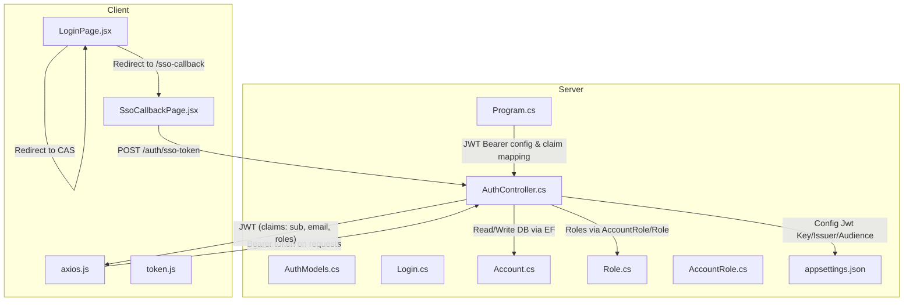
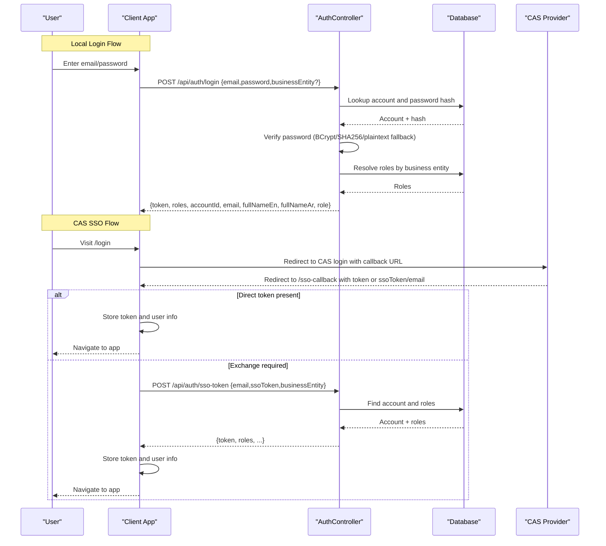
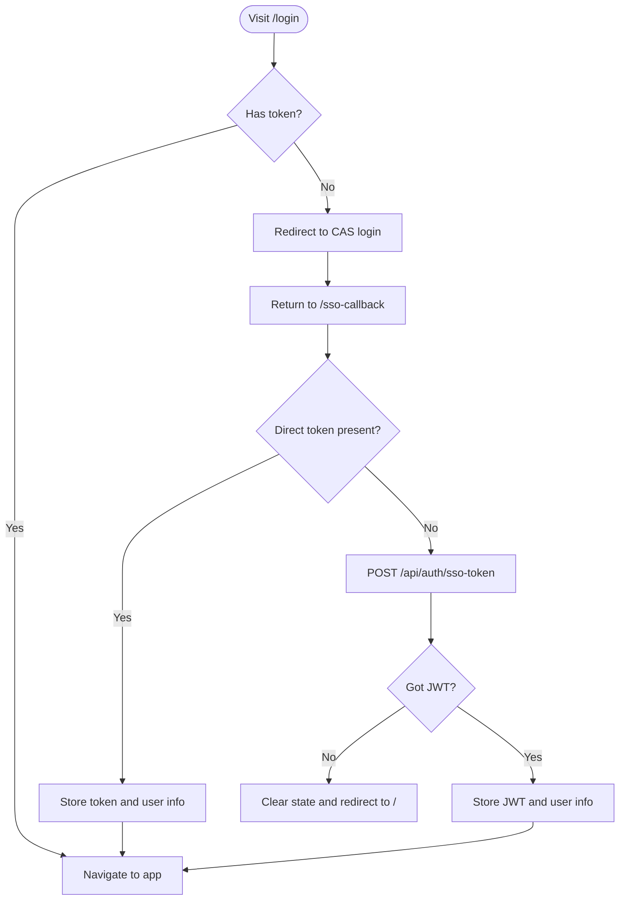
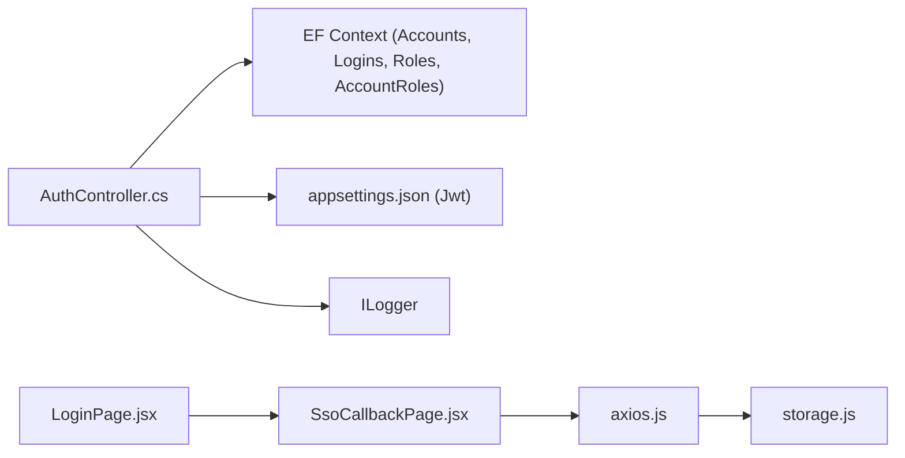

# Authentication APIs

<cite>
**Referenced Files in This Document**
- [AuthController.cs](file://server/Api/Controllers/AuthController.cs)
- [AuthModels.cs](file://server/Api/Models/AuthModels.cs)
- [Login.cs](file://server/Api/Models/Login.cs)
- [Account.cs](file://server/Api/Models/Account.cs)
- [Role.cs](file://server/Api/Models/Role.cs)
- [AccountRole.cs](file://server/Api/Models/AccountRole.cs)
- [appsettings.json](file://server/Api/appsettings.json)
- [Program.cs](file://server/Api/Program.cs)
- [LoginPage.jsx](file://client/src/pages/LoginPage.jsx)
- [SsoCallbackPage.jsx](file://client/src/pages/SsoCallbackPage.jsx)
- [axios.js](file://client/src/api/axios.js)
- [token.js](file://client/src/utils/token.js)
</cite>

## Table of Contents
1. Introduction
2. Project Structure
3. Core Components
4. Architecture Overview
5. Detailed Component Analysis
6. Dependency Analysis
7. Performance Considerations
8. Troubleshooting Guide
9. Conclusion

## Introduction
This document provides detailed API documentation for authentication endpoints focused on user login, logout, and token management. It covers:
- POST /api/auth/login: request/response schemas, username/password validation, JWT generation, and role-based claims
- SSO integration via CAS with token exchange and callback handling
- Token usage patterns and error responses
- Security considerations, password policies, and session management
- Notes on multi-factor authentication support and account lockout mechanisms based on current implementation

## Project Structure
The authentication feature spans server-side controllers/models and client-side pages/utilities:
- Server: ASP.NET Core controller implementing login, SSO token exchange, profile operations, and JWT issuance
- Client: React pages for login redirection to CAS and callback handling, Axios interceptors for token injection and 401 handling, and utilities for token parsing

**Diagram sources**
- [AuthController.cs:118-313](file://server/Api/Controllers/AuthController.cs#L118-L313)
- [AuthModels.cs:1-21](file://server/Api/Models/AuthModels.cs#L1-L21)
- [Login.cs:6-21](file://server/Api/Models/Login.cs#L6-L21)
- [Account.cs:6-33](file://server/Api/Models/Account.cs#L6-L33)
- [Role.cs:6-17](file://server/Api/Models/Role.cs#L6-L17)
- [AccountRole.cs:6-15](file://server/Api/Models/AccountRole.cs#L6-L15)
- [appsettings.json:5-9](file://server/Api/appsettings.json#L5-L9)
- [Program.cs:59-75](file://server/Api/Program.cs#L59-L75)
- [LoginPage.jsx:9-28](file://client/src/pages/LoginPage.jsx#L9-L28)
- [SsoCallbackPage.jsx:10-47](file://client/src/pages/SsoCallbackPage.jsx#L10-L47)
- [axios.js:12-45](file://client/src/api/axios.js#L12-L45)

**Section sources**
- [AuthController.cs:118-313](file://server/Api/Controllers/AuthController.cs#L118-L313)
- [LoginPage.jsx:9-28](file://client/src/pages/LoginPage.jsx#L9-L28)
- [SsoCallbackPage.jsx:10-47](file://client/src/pages/SsoCallbackPage.jsx#L10-L47)
- [axios.js:12-45](file://client/src/api/axios.js#L12-L45)

## Core Components
- AuthController: Implements login, SSO token exchange, profile read/update, and JWT generation
- Models: Request/response DTOs and domain entities used by the controller
- Client Pages: Handle CAS redirect and callback flow, store tokens, and navigate
- Axios Interceptors: Inject Authorization header and handle 401 redirects to CAS
- Token Utilities: Parse JWT payloads and extract user identifiers

Key responsibilities:
- Validate inputs and enforce password policy during registration
- Authenticate users via multiple hash strategies (BCrypt, SHA256 fallback, plaintext fallback)
- Resolve roles scoped by business entity and issue JWTs with standard and custom claims
- Support CAS SSO by exchanging an external token/email for a local JWT

**Section sources**
- [AuthController.cs:28-116](file://server/Api/Controllers/AuthController.cs#L28-L116)
- [AuthController.cs:118-313](file://server/Api/Controllers/AuthController.cs#L118-L313)
- [AuthModels.cs:1-21](file://server/Api/Models/AuthModels.cs#L1-L21)
- [SsoCallbackPage.jsx:10-47](file://client/src/pages/SsoCallbackPage.jsx#L10-L47)
- [axios.js:12-45](file://client/src/api/axios.js#L12-L45)

## Architecture Overview
The authentication architecture combines local credential-based login and CAS Single Sign-On:
- Local Login: Client calls POST /api/auth/login with email/password; server validates credentials, resolves roles, and returns a signed JWT
- CAS SSO: Client redirects to CAS; upon return, client either stores a direct token from CAS or exchanges it via POST /api/auth/sso-token to obtain a local JWT
- Protected Requests: Axios attaches Bearer token to all requests; 401 triggers logout and re-authentication via CAS

**Diagram sources**
- [AuthController.cs:118-313](file://server/Api/Controllers/AuthController.cs#L118-L313)
- [LoginPage.jsx:9-28](file://client/src/pages/LoginPage.jsx#L9-L28)
- [SsoCallbackPage.jsx:10-47](file://client/src/pages/SsoCallbackPage.jsx#L10-L47)
- [axios.js:12-45](file://client/src/api/axios.js#L12-L45)

## Detailed Component Analysis

### POST /api/auth/login
Purpose: Authenticate a user with email/password and return a JWT containing identity and role claims.

Request schema:
- Body type: JSON object
- Fields:
  - email: string (required)
  - password: string (required)
  - businessEntity: string (optional; defaults to "Exams")

Response schema (success):
- token: string (JWT)
- roles: array of strings
- accountId: number
- email: string
- fullNameEn: string
- fullNameAr: string
- role: string (first role resolved for the business entity)

Error responses:
- 400 Bad Request: Missing or invalid fields (e.g., empty email/password)
- 401 Unauthorized: Invalid credentials
- 500 Internal Server Error: Unexpected server error

Behavior notes:
- Password verification supports BCrypt, SHA256 fallback, and plaintext fallback for legacy data
- Roles are resolved first by business entity, then globally if none found
- JWT includes:
  - Standard claims: sub (user id), email
  - Role claims: one per distinct role
  - Expiration: 8 hours
  - Issuer/Audience configured via settings

Security considerations:
- Passwords stored using BCrypt when registering; legacy hashes supported for compatibility
- No rate limiting or account lockout implemented in this endpoint
- Logging records attempts and failures without sensitive details

Example request:
- Method: POST
- URL: /api/auth/login
- Headers: Content-Type: application/json
- Body: {"email":"user@example.com","password":"StrongPass1"}

Example response:
- Status: 200 OK
- Body: {"token":"...","roles":["Student"],"accountId":1,"email":"user@example.com","fullNameEn":"Jane Doe","fullNameAr":"جane دو","role":"Student"}

**Section sources**
- [AuthController.cs:118-249](file://server/Api/Controllers/AuthController.cs#L118-L249)
- [AuthModels.cs:10-15](file://server/Api/Models/AuthModels.cs#L10-L15)
- [appsettings.json:5-9](file://server/Api/appsettings.json#L5-L9)

### POST /api/auth/sso-token
Purpose: Exchange an external SSO token or email for a local JWT after CAS authentication.

Request schema:
- Body type: JSON object
- Fields:
  - email: string (required)
  - ssoToken: string (optional; provided by CAS)
  - businessEntity: string (optional; defaults to "Exams")

Response schema (success):
- token: string (JWT)
- roles: array of strings
- accountId: number
- email: string
- fullNameEn: string
- fullNameAr: string
- role: string (first role resolved for the business entity)

Error responses:
- 400 Bad Request: Missing email
- 404 Not Found: Account not found in system
- 500 Internal Server Error: Unexpected server error

Behavior notes:
- Resolves account from primary or fallback tables
- Resolves roles by business entity, otherwise global, defaulting to "Student" if none found
- Issues JWT identical to login flow

Example request:
- Method: POST
- URL: /api/auth/sso-token
- Headers: Content-Type: application/json
- Body: {"email":"user@example.com","ssoToken":"cas-token-here","businessEntity":"Exams"}

Example response:
- Status: 200 OK
- Body: {"token":"...","roles":["Teacher"],"accountId":2,"email":"user@example.com","fullNameEn":"John Doe","fullNameAr":"john دو","role":"Teacher"}

**Section sources**
- [AuthController.cs:251-313](file://server/Api/Controllers/AuthController.cs#L251-L313)
- [AuthModels.cs:17-21](file://server/Api/Models/AuthModels.cs#L17-L21)

### CAS Integration and Callback Handling
Flow overview:
- Client redirects to CAS login with a callback URL
- On return, client either stores a direct token or exchanges it via /api/auth/sso-token
- After obtaining a local JWT, client stores token and navigates to the app

Client behavior:
- LoginPage redirects to CAS and handles query parameters
- SsoCallbackPage processes token or ssoToken/email, stores user info, and navigates
- Axios interceptor injects Bearer token and handles 401 by clearing state and re-authenticating via CAS

**Diagram sources**
- [LoginPage.jsx:9-28](file://client/src/pages/LoginPage.jsx#L9-L28)
- [SsoCallbackPage.jsx:10-47](file://client/src/pages/SsoCallbackPage.jsx#L10-L47)
- [axios.js:29-45](file://client/src/api/axios.js#L29-L45)

**Section sources**
- [LoginPage.jsx:9-28](file://client/src/pages/LoginPage.jsx#L9-L28)
- [SsoCallbackPage.jsx:10-47](file://client/src/pages/SsoCallbackPage.jsx#L10-L47)
- [axios.js:29-45](file://client/src/api/axios.js#L29-L45)

### Logout and Session Management
Current implementation:
- There is no explicit server-side logout endpoint in the authentication controller
- Client clears local storage and can call CAS logout via utility function when encountering 401 or explicitly logging out
- Tokens are stored in localStorage and attached to requests via Axios interceptor

Recommendations:
- Implement server-side token revocation or short-lived tokens with refresh flows if needed
- Add a dedicated logout endpoint that clears server-side sessions or blacklists tokens

**Section sources**
- [axios.js:29-45](file://client/src/api/axios.js#L29-L45)
- [storage.js:49-87](file://client/src/utils/storage.js#L49-L87)

### Token Usage Patterns
- The client automatically attaches the Bearer token to all requests via Axios interceptor
- On 401, the client clears stored tokens and redirects to CAS login
- Token payload parsing utilities support decoding and extracting user IDs from various claim names

Best practices:
- Always validate tokens on the server side using JWT bearer middleware
- Use HTTPS for all authentication endpoints
- Rotate signing keys periodically and manage secrets securely

**Section sources**
- [axios.js:12-45](file://client/src/api/axios.js#L12-L45)
- [token.js:1-31](file://client/src/utils/token.js#L1-L31)

### Security Considerations
- Password Policy: Registration enforces minimum length and complexity requirements
- Hashing: BCrypt used for new passwords; legacy SHA256 and plaintext fallbacks exist for compatibility
- JWT Claims: Includes sub, email, and role claims; expiration set to 8 hours
- Configuration: Signing key, issuer, and audience are loaded from configuration
- Claim Mapping: Program maps common claim names to standard types for authorization

Recommendations:
- Remove plaintext and SHA256 fallbacks once migration is complete
- Enforce HTTPS everywhere
- Implement rate limiting and account lockout policies
- Consider adding MFA support at login or SSO level

**Section sources**
- [AuthController.cs:28-116](file://server/Api/Controllers/AuthController.cs#L28-L116)
- [AuthController.cs:381-420](file://server/Api/Controllers/AuthController.cs#L381-L420)
- [appsettings.json:5-9](file://server/Api/appsettings.json#L5-L9)
- [Program.cs:59-75](file://server/Api/Program.cs#L59-L75)

### Multi-Factor Authentication (MFA)
Current status:
- No MFA logic is implemented in the authentication controller or client pages

Recommended approach:
- Integrate MFA at the CAS provider level or add a second factor step in the login flow
- Store MFA status in user profile and enforce challenge before issuing JWT

[No sources needed since this section describes future enhancements not present in code]

### Account Lockout Mechanisms
Current status:
- No account lockout or throttling is implemented in the login endpoint

Recommended approach:
- Track failed login attempts per account and temporarily lock accounts
- Implement exponential backoff and alerting for suspicious activity

[No sources needed since this section describes future enhancements not present in code]

## Dependency Analysis
Core dependencies and relationships:
- AuthController depends on:
  - Database context for Account, Login, Role, AccountRole
  - Configuration for JWT settings
  - Logging for audit and diagnostics
- Client depends on:
  - Axios for HTTP with interceptors
  - Storage utilities for token persistence
  - Environment variables for CAS and API URLs

**Diagram sources**
- [AuthController.cs:16-26](file://server/Api/Controllers/AuthController.cs#L16-L26)
- [appsettings.json:5-9](file://server/Api/appsettings.json#L5-L9)
- [axios.js:1-10](file://client/src/api/axios.js#L1-10)
- [SsoCallbackPage.jsx:1-10](file://client/src/pages/SsoCallbackPage.jsx#L1-L10)
- [LoginPage.jsx:1-10](file://client/src/pages/LoginPage.jsx#L1-L10)

**Section sources**
- [AuthController.cs:16-26](file://server/Api/Controllers/AuthController.cs#L16-L26)
- [axios.js:1-10](file://client/src/api/axios.js#L1-10)

## Performance Considerations
- Database queries:
  - Login performs two lookups (primary and fallback) and role resolution; ensure indexes on Email and BusinessEntityName
- JWT generation:
  - Minimal overhead; keep token size small by including only necessary claims
- Client-side:
  - Avoid unnecessary re-renders in callback pages; cache parsed token payload if needed

Optimization tips:
- Cache role resolutions where appropriate
- Use connection pooling and efficient EF queries
- Monitor logs for slow queries and adjust as needed

[No sources needed since this section provides general guidance]

## Troubleshooting Guide
Common issues and resolutions:
- Invalid credentials:
  - Ensure email exists and password matches stored hash; check logs for hash mismatch
- 401 Unauthorized:
  - Token missing or expired; client will clear state and redirect to CAS
- Account not found in SSO flow:
  - Verify account exists and is active; check business entity scoping for roles
- JWT configuration errors:
  - Ensure Jwt:Key, Issuer, and Audience are set correctly in configuration

Debugging steps:
- Inspect request/response payloads in browser dev tools
- Review server logs for login attempts and errors
- Validate environment variables for CAS and API URLs

**Section sources**
- [AuthController.cs:118-249](file://server/Api/Controllers/AuthController.cs#L118-L249)
- [AuthController.cs:251-313](file://server/Api/Controllers/AuthController.cs#L251-L313)
- [axios.js:29-45](file://client/src/api/axios.js#L29-L45)

## Conclusion
The authentication system supports both local credential-based login and CAS SSO integration. It issues JWTs with identity and role claims, manages token lifecycle on the client, and integrates with CAS for single sign-on. While robust, it lacks some advanced security features such as MFA and account lockout, which can be added to enhance protection. Following the recommended best practices will improve security, performance, and maintainability.

[No sources needed since this section summarizes without analyzing specific files]