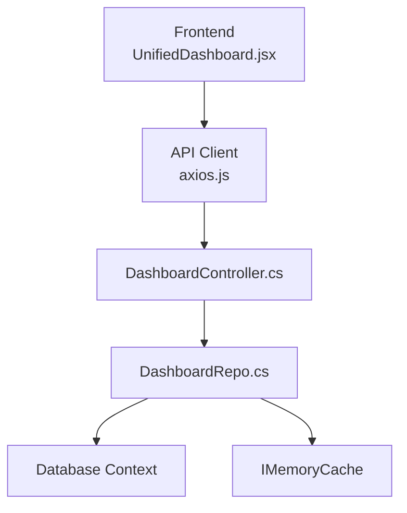
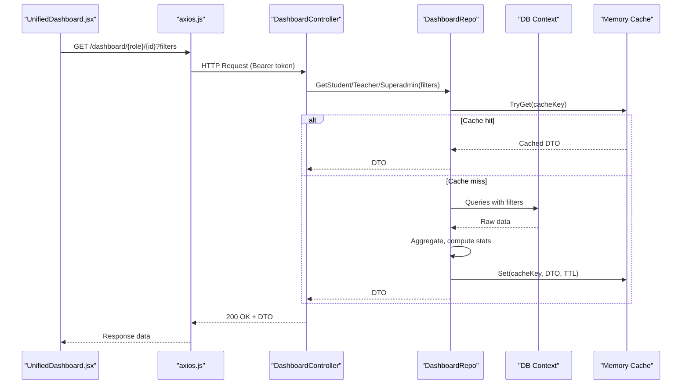
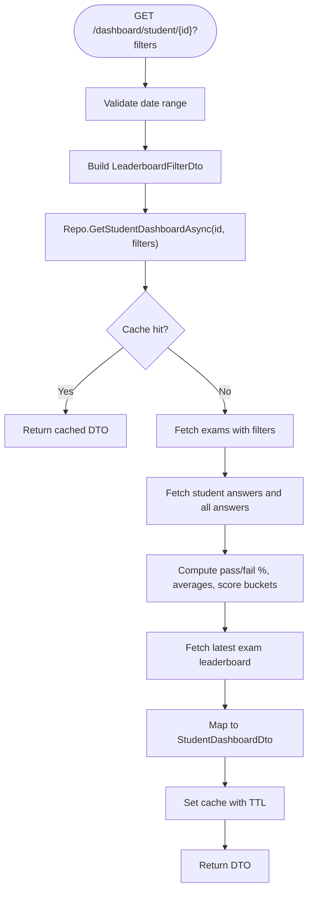
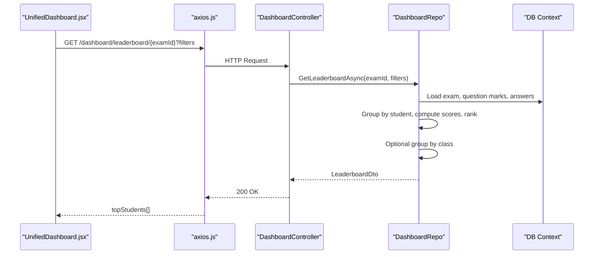
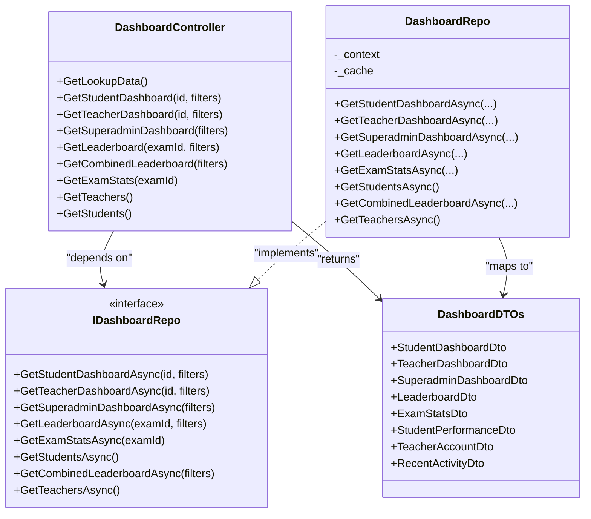

# Dashboard & Analytics APIs

<cite>
**Referenced Files in This Document**
- [DashboardController.cs](file://server/Api/Controllers/DashboardController.cs)
- [DashboardDTOs.cs](file://server/Api/DTOs/DashboardDTOs.cs)
- [DashboardRepo.cs](file://server/Api/Repositories/Implementation/DashboardRepo.cs)
- [IDashboardRepo.cs](file://server/Api/Repositories/Interfaces/IDashboardRepo.cs)
- [UnifiedDashboard.jsx](file://client/src/components/UnifiedDashboard.jsx)
- [DashboardCharts.jsx](file://client/src/components/DashboardCharts.jsx)
- [DashboardLeaderboard.jsx](file://client/src/components/DashboardLeaderboard.jsx)
- [axios.js](file://client/src/api/axios.js)
</cite>

## Table of Contents
1. Introduction
2. Project Structure
3. Core Components
4. Architecture Overview
5. Detailed Component Analysis
6. Dependency Analysis
7. Performance Considerations
8. Troubleshooting Guide
9. Conclusion

## Introduction
This document provides comprehensive API documentation for dashboard and analytics endpoints focused on performance metrics, statistics, and reporting data. It covers GET endpoints for student performance analytics, exam completion rates, and system-wide metrics. It includes query parameter specifications for date ranges, filters, and aggregation options; response schemas for charts data, leaderboard information, and statistical summaries; and guidance on real-time updates, caching strategies, and performance optimization techniques for large datasets.

## Project Structure
The dashboard and analytics feature is implemented as a REST API with role-based endpoints:
- Controller layer exposes HTTP endpoints under /api/dashboard
- Repository layer implements data access, filtering, aggregation, and caching
- DTOs define request/response contracts
- Frontend consumes the APIs via an axios client and renders dashboards, leaderboards, and charts

**Diagram sources**
- [UnifiedDashboard.jsx:1-505](file://client/src/components/UnifiedDashboard.jsx#L1-L505)
- [axios.js:1-62](file://client/src/api/axios.js#L1-L62)
- [DashboardController.cs:1-376](file://server/Api/Controllers/DashboardController.cs#L1-L376)
- [DashboardRepo.cs:1-871](file://server/Api/Repositories/Implementation/DashboardRepo.cs#L1-L871)

**Section sources**
- [DashboardController.cs:1-376](file://server/Api/Controllers/DashboardController.cs#L1-L376)
- [DashboardRepo.cs:1-871](file://server/Api/Repositories/Implementation/DashboardRepo.cs#L1-L871)
- [UnifiedDashboard.jsx:1-505](file://client/src/components/UnifiedDashboard.jsx#L1-L505)
- [axios.js:1-62](file://client/src/api/axios.js#L1-L62)

## Core Components
- Role-based dashboards: Student, Teacher, Superadmin/Admin
- Leaderboards: Per-exam and combined (aggregated across exams)
- Exam statistics: Pass/fail rates, average scores
- Lookup data: Grades, classes, subjects, exams mapping
- Filters: Grade, class, subject, date range, search term, grouping

Key responsibilities:
- Controller: Authorization, input validation, routing to repository
- Repository: Query building, filtering, aggregation, caching, DTO mapping
- DTOs: Strongly typed request/response models

**Section sources**
- [DashboardController.cs:24-376](file://server/Api/Controllers/DashboardController.cs#L24-L376)
- [DashboardDTOs.cs:1-169](file://server/Api/DTOs/DashboardDTOs.cs#L1-L169)
- [IDashboardRepo.cs:1-46](file://server/Api/Repositories/Interfaces/IDashboardRepo.cs#L1-L46)

## Architecture Overview
The API follows a layered architecture:
- Controllers expose REST endpoints with authorization guards
- Repositories encapsulate EF Core queries and business logic
- Memory cache reduces database load for frequently accessed dashboard data
- Frontend composes UI from returned DTOs and handles filter state

**Diagram sources**
- [DashboardController.cs:80-376](file://server/Api/Controllers/DashboardController.cs#L80-L376)
- [DashboardRepo.cs:109-800](file://server/Api/Repositories/Implementation/DashboardRepo.cs#L109-L800)
- [UnifiedDashboard.jsx:88-296](file://client/src/components/UnifiedDashboard.jsx#L88-L296)
- [axios.js:1-62](file://client/src/api/axios.js#L1-L62)

## Detailed Component Analysis

### Endpoints Overview
All endpoints are GET and require authentication unless otherwise noted. Base path: /api/dashboard

- GET /api/dashboard/lookup-data
  - Purpose: Reference data for filters (grades, classes, subjects, exams mapping)
  - Auth: Requires authentication
  - Query params: None
  - Response: { grades[], classes[], subjects[], exams[] }

- GET /api/dashboard/student/{id}
  - Purpose: Student dashboard with recent exams, pass/fail percentages, score distribution, latest exam leaderboard
  - Auth: Requires authentication
  - Path param: id (long)
  - Query params: gradeId?, classId?, examId?, startDate?, endDate?
  - Response: StudentDashboardDto

- GET /api/dashboard/teacher/{id}
  - Purpose: Teacher dashboard with created exams, student performance, score distribution
  - Auth: Requires authentication
  - Path param: id (long)
  - Query params: gradeId?, classId?, examId?, startDate?, endDate?
  - Response: TeacherDashboardDto

- GET /api/dashboard/superadmin
  - Purpose: System-wide metrics, top students, recent activity, exam breakdown
  - Auth: Requires roles Superadmin, Admin, or Board
  - Query params: gradeId?, classId?, examId?, startDate?, endDate?
  - Response: SuperadminDashboardDto

- GET /api/dashboard/leaderboard/{examId}
  - Purpose: Leaderboard for a specific exam with optional filters and grouping
  - Auth: Requires authentication
  - Path param: examId (long)
  - Query params: gradeId?, classId?, examId?, startDate?, endDate?, groupBy="Student"|"Class"
  - Response: LeaderboardDto

- GET /api/dashboard/leaderboard/combined
  - Purpose: Combined leaderboard aggregated across exams, filtered by grade/class/date
  - Auth: Requires authentication
  - Query params: gradeId?, classId?, examId?, startDate?, endDate?, groupBy="Student"|"Class"
  - Response: LeaderboardDto

- GET /api/dashboard/exam/{examId}/stats
  - Purpose: Exam statistics including pass/fail counts and average score
  - Auth: Requires authentication
  - Path param: examId (long)
  - Response: ExamStatsDto

- GET /api/dashboard/teachers
  - Purpose: List teachers with account info and total exams
  - Auth: Requires roles Superadmin, Admin, or Board
  - Response: List<TeacherAccountDto>

- GET /api/dashboard/students
  - Purpose: List students with performance snapshots per exam
  - Auth: Requires authentication
  - Response: List<StudentPerformanceDto>

Notes:
- Date validation: If both startDate and endDate are provided, startDate must be less than or equal to endDate; otherwise returns 400 Bad Request.
- Role checks: Some endpoints enforce role-based authorization.

**Section sources**
- [DashboardController.cs:24-376](file://server/Api/Controllers/DashboardController.cs#L24-L376)

### Query Parameters and Filters
Common query parameters used across endpoints:
- gradeId: long? — Filter by grade ID
- classId: long? — Filter by class ID (supports exact match and comma-separated lists)
- examId: long? — Filter by exam ID
- startDate: DateTime? — Start of date range (inclusive)
- endDate: DateTime? — End of date range (inclusive, end-of-day)
- subjectId: long? — Filter by subject ID
- searchTerm: string? — Search exam titles
- groupBy: string? — For leaderboards: "Student" (default) or "Class"

Filtering behavior:
- Date range applied to exam start/end dates
- ClassId matching supports multiple formats (exact, comma-separated, JSON-like)
- SubjectId filters exams by subject association

**Section sources**
- [DashboardController.cs:80-376](file://server/Api/Controllers/DashboardController.cs#L80-L376)
- [DashboardRepo.cs:670-705](file://server/Api/Repositories/Implementation/DashboardRepo.cs#L670-L705)

### Response Schemas

- StudentDashboardDto
  - Fields: StudentId, StudentName, TotalExamsTaken, PassPercentage, FailPercentage, LatestExamLeaderboard, StudentRankInLatestExam, RecentExams[], ScoreDistribution[]
  - RecentExam fields: ExamId, Title, SubjectName, StudentScore, AverageScore, Date
  - ChartDataPoint fields: Name, Value

- TeacherDashboardDto
  - Fields: TeacherId, TeacherName, TotalExamsCreated, AveragePassPercentage, AverageFailPercentage, TotalStudentsWhoTookExams, ExamBreakdown[], LatestExamLeaderboard, RecentExams[], ScoreDistribution[]
  - ExamSelection fields: ExamId, Title

- SuperadminDashboardDto
  - Fields: TotalExams, TotalStudents, TotalTeachers, OverallPassPercentage, OverallFailPercentage, TopPerformingStudents[], TopPerformingTeachers[], RecentActivity[], RecentExams[], ScoreDistribution[], ExamBreakdown[]

- LeaderboardDto
  - Fields: ExamId, ExamTitle, SubjectName, TopStudents[], HighlightedStudents[], TotalParticipants
  - LeaderboardEntry fields: StudentId, StudentName, Score, Rank, TotalMarks, EarnedMarks

- ExamStatsDto
  - Fields: ExamId, ExamTitle, SubjectName, TotalStudents, PassedStudents, FailedStudents, PassPercentage, FailPercentage, AverageScore

- StudentPerformanceDto
  - Fields: Id, Name, Email, Initials, Grade, Class, QuizScores (dictionary of examId -> score%)

- TeacherAccountDto
  - Fields: Id, FullNameEn, FullNameAr, Email, IsActive, TotalExams

- RecentActivityDto
  - Fields: ActivityType, Description, Timestamp, RelatedExamId, RelatedAccountId

These DTOs are defined centrally and consumed by controllers and frontend components.

**Section sources**
- [DashboardDTOs.cs:1-169](file://server/Api/DTOs/DashboardDTOs.cs#L1-L169)

### Data Flows and Processing Logic

#### Student Dashboard Flow

**Diagram sources**
- [DashboardController.cs:80-136](file://server/Api/Controllers/DashboardController.cs#L80-L136)
- [DashboardRepo.cs:109-246](file://server/Api/Repositories/Implementation/DashboardRepo.cs#L109-L246)

#### Leaderboard Flow

**Diagram sources**
- [DashboardController.cs:236-285](file://server/Api/Controllers/DashboardController.cs#L236-L285)
- [DashboardRepo.cs:505-565](file://server/Api/Repositories/Implementation/DashboardRepo.cs#L505-L565)
- [UnifiedDashboard.jsx:201-296](file://client/src/components/UnifiedDashboard.jsx#L201-L296)

### Real-Time Updates and Polling Strategy
- The frontend triggers data refreshes when filters change, exam selection changes, or grade slider updates.
- There is no server-side push mechanism; updates are achieved by re-fetching endpoints with updated query parameters.
- Recommended approach: Debounce filter changes and use optimistic UI updates while loading indicators show progress.

**Section sources**
- [UnifiedDashboard.jsx:38-57](file://client/src/components/UnifiedDashboard.jsx#L38-L57)
- [UnifiedDashboard.jsx:88-296](file://client/src/components/UnifiedDashboard.jsx#L88-L296)

### Caching Strategies
- In-memory caching with a 2-minute TTL is used for dashboard endpoints to reduce database load.
- Cache keys include version prefix, endpoint type, IDs, and normalized filter values (including date parts).
- Empty results are also cached to avoid repeated queries for non-existent data.

Best practices:
- Use appropriate cache keys to invalidate based on filter changes
- Monitor cache hit ratios and adjust TTL if necessary
- Consider cache warming for popular dashboards during peak hours

**Section sources**
- [DashboardRepo.cs:10-26](file://server/Api/Repositories/Implementation/DashboardRepo.cs#L10-L26)
- [DashboardRepo.cs:109-246](file://server/Api/Repositories/Implementation/DashboardRepo.cs#L109-L246)
- [DashboardRepo.cs:248-391](file://server/Api/Repositories/Implementation/DashboardRepo.cs#L248-L391)
- [DashboardRepo.cs:393-503](file://server/Api/Repositories/Implementation/DashboardRepo.cs#L393-L503)
- [DashboardRepo.cs:505-565](file://server/Api/Repositories/Implementation/DashboardRepo.cs#L505-L565)

### Performance Optimization Techniques
- AsNoTracking for read-only queries to improve EF Core performance
- Batch fetching of related entities (e.g., question marks, answers) to minimize round trips
- Efficient grouping and aggregation in memory after minimal data retrieval
- Filtering at the database level where possible (grade, class, subject, date range)
- Pagination not currently implemented; consider adding limit/top-N for large datasets

Recommendations:
- Add pagination for leaderboard and student lists
- Index frequently filtered columns (GradeId, ClassId, ExamId, SubjectId)
- Consider materialized views for complex aggregations if dataset grows significantly

**Section sources**
- [DashboardRepo.cs:50-107](file://server/Api/Repositories/Implementation/DashboardRepo.cs#L50-L107)
- [DashboardRepo.cs:141-165](file://server/Api/Repositories/Implementation/DashboardRepo.cs#L141-L165)
- [DashboardRepo.cs:276-320](file://server/Api/Repositories/Implementation/DashboardRepo.cs#L276-L320)
- [DashboardRepo.cs:414-447](file://server/Api/Repositories/Implementation/DashboardRepo.cs#L414-L447)

## Dependency Analysis
The following diagram shows key dependencies between controller, repository, DTOs, and frontend consumption.

**Diagram sources**
- [DashboardController.cs:11-376](file://server/Api/Controllers/DashboardController.cs#L11-L376)
- [IDashboardRepo.cs:1-46](file://server/Api/Repositories/Interfaces/IDashboardRepo.cs#L1-L46)
- [DashboardRepo.cs:9-871](file://server/Api/Repositories/Implementation/DashboardRepo.cs#L9-L871)
- [DashboardDTOs.cs:1-169](file://server/Api/DTOs/DashboardDTOs.cs#L1-L169)

**Section sources**
- [DashboardController.cs:11-376](file://server/Api/Controllers/DashboardController.cs#L11-L376)
- [IDashboardRepo.cs:1-46](file://server/Api/Repositories/Interfaces/IDashboardRepo.cs#L1-L46)
- [DashboardRepo.cs:9-871](file://server/Api/Repositories/Implementation/DashboardRepo.cs#L9-L871)
- [DashboardDTOs.cs:1-169](file://server/Api/DTOs/DashboardDTOs.cs#L1-L169)

## Performance Considerations
- Use AsNoTracking for read-heavy operations to avoid change tracking overhead
- Minimize N+1 queries by batching joins and using ToDictionary lookups
- Apply server-side filtering early to reduce payload sizes
- Leverage in-memory caching with short TTLs for dashboard endpoints
- Consider adding pagination and indexing for large result sets

[No sources needed since this section provides general guidance]

## Troubleshooting Guide
Common issues and resolutions:
- Authentication failures: Ensure Bearer token is present and valid; unauthorized requests redirect to CAS login
- Invalid date ranges: Ensure startDate <= endDate; otherwise endpoint returns 400
- Missing user ID: Frontend resolves userId from token claims; ensure token contains required claims
- Empty results: Check filters and verify data exists; empty results are cached to prevent repeated queries

Error handling patterns:
- Controller wraps calls in try/catch and returns 500 with error messages on exceptions
- Not found responses return 404 with descriptive messages
- Frontend displays errors and offers retry actions

**Section sources**
- [DashboardController.cs:95-136](file://server/Api/Controllers/DashboardController.cs#L95-L136)
- [DashboardController.cs:153-195](file://server/Api/Controllers/DashboardController.cs#L153-L195)
- [DashboardController.cs:210-234](file://server/Api/Controllers/DashboardController.cs#L210-L234)
- [axios.js:29-58](file://client/src/api/axios.js#L29-L58)

## Conclusion
The Dashboard & Analytics APIs provide robust, role-based endpoints for student performance analytics, exam completion rates, and system-wide metrics. With well-defined DTOs, flexible filtering, and efficient caching, the system supports scalable reporting for educational institutions. The frontend integrates seamlessly with these endpoints to deliver interactive dashboards, leaderboards, and charts. Future enhancements may include pagination, advanced aggregations, and real-time updates via websockets or server-sent events.

[No sources needed since this section summarizes without analyzing specific files]