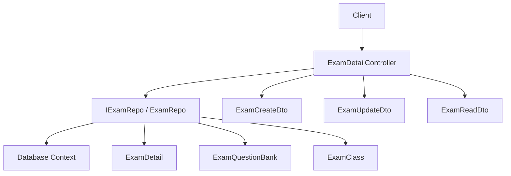
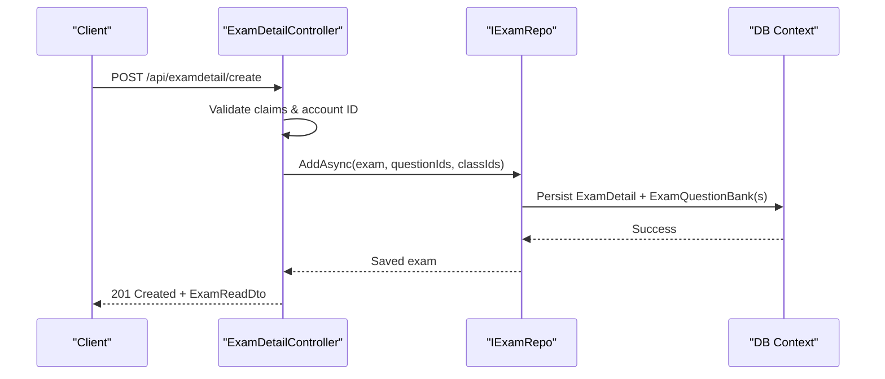
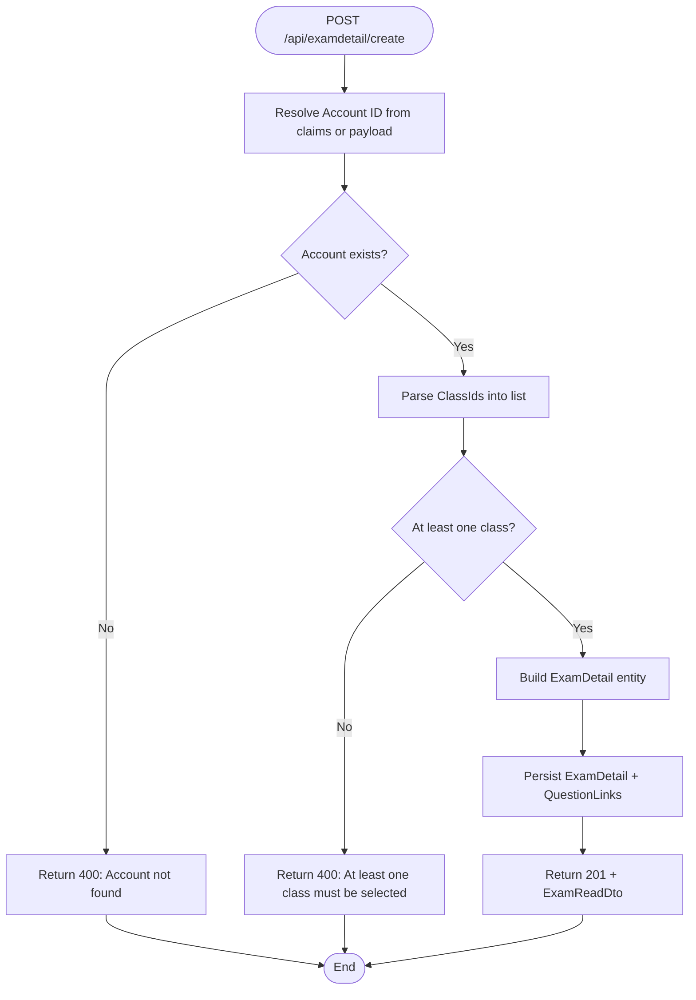
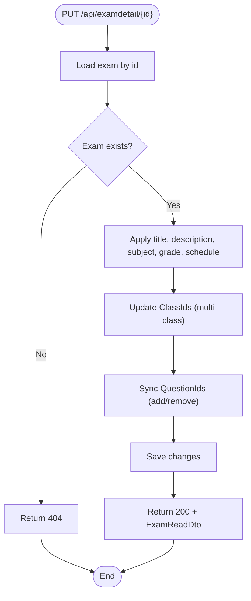
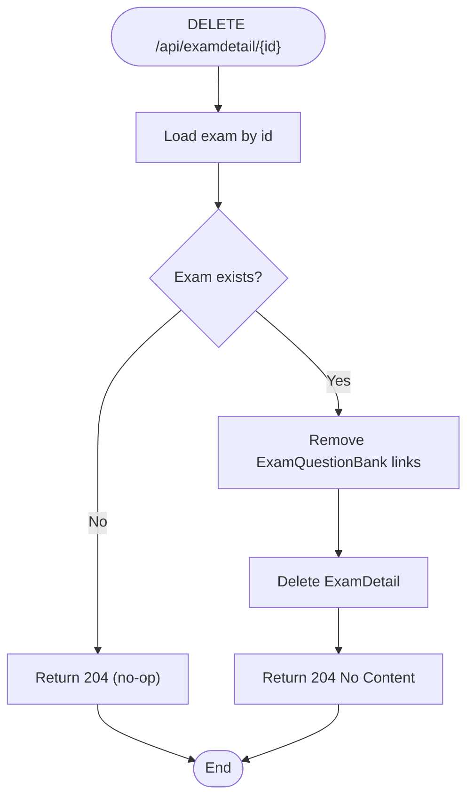
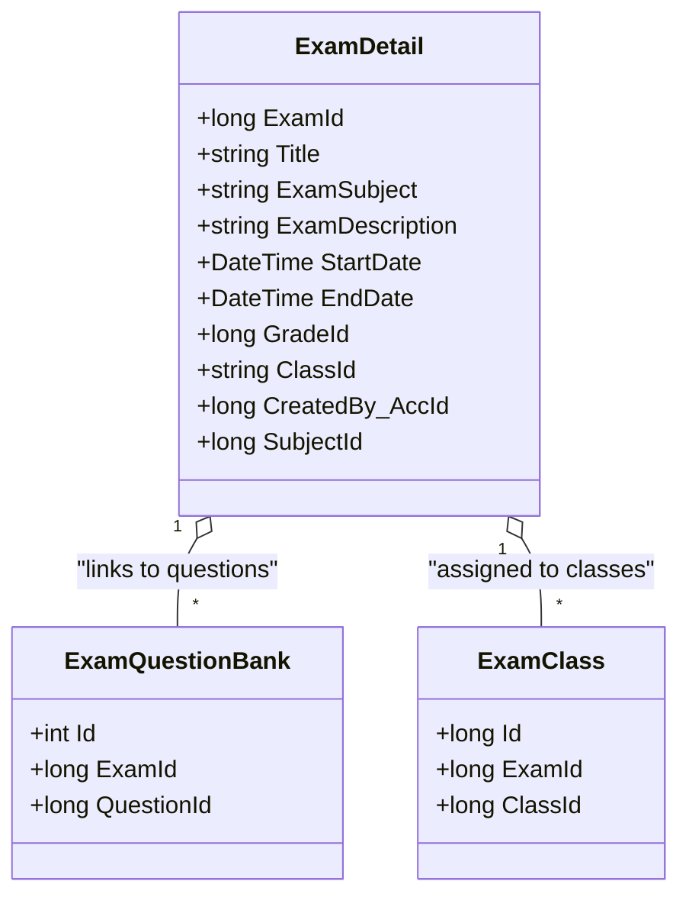
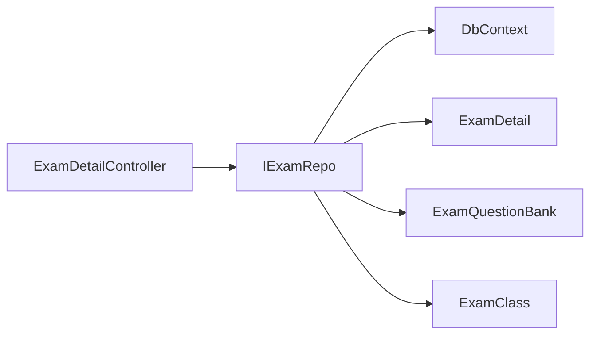

# Exam Management APIs

<cite>
**Referenced Files in This Document**
- [ExamDetailController.cs](file://server/Api/Controllers/ExamDetailController.cs)
- [ExamCreateDto.cs](file://server/Api/DTOs/ExamCreateDto.cs)
- [ExamUpdateDto.cs](file://server/Api/DTOs/ExamUpdateDto.cs)
- [ExamReadDTO.cs](file://server/Api/DTOs/ExamReadDTO.cs)
- [ExamDetail.cs](file://server/Api/Models/ExamDetail.cs)
- [ExamClass.cs](file://server/Api/Models/ExamClass.cs)
- [ExamQuestionBank.cs](file://server/Api/Models/ExamQuestionBank.cs)
- [IExamRepo.cs](file://server/Api/Repositories/Interfaces/IExamRepo.cs)
- [ExamRepo.cs](file://server/Api/Repositories/Implementation/ExamRepo.cs)
</cite>

## Table of Contents
1. [Introduction](#introduction)
2. [Project Structure](#project-structure)
3. [Core Components](#core-components)
4. [Architecture Overview](#architecture-overview)
5. [Detailed Component Analysis](#detailed-component-analysis)
6. [Dependency Analysis](#dependency-analysis)
7. [Performance Considerations](#performance-considerations)
8. [Troubleshooting Guide](#troubleshooting-guide)
9. [Conclusion](#conclusion)

## Introduction
This document provides detailed API documentation for exam management endpoints focused on CRUD operations for academic examinations. It covers:
- Creating exams with scheduling, question assignment, and configuration parameters
- Updating existing exams
- Deleting exams
- Exam distribution to classes and student enrollment via access control
- Request/response schemas for metadata, scheduling, and status fields

The implementation is a .NET Web API using controllers, DTOs, domain models, and repository abstractions.

## Project Structure
The exam management feature spans the following layers:
- Controllers: HTTP endpoints for exam CRUD
- DTOs: Request/response contracts for create/update/read
- Models: Domain entities for exams, class associations, and question links
- Repositories: Data access logic for persistence and synchronization

**Diagram sources**
- [ExamDetailController.cs:10-300](file://server/Api/Controllers/ExamDetailController.cs#L10-L300)
- [ExamRepo.cs:6-139](file://server/Api/Repositories/Implementation/ExamRepo.cs#L6-L139)
- [ExamDetail.cs:6-30](file://server/Api/Models/ExamDetail.cs#L6-L30)
- [ExamQuestionBank.cs:6-13](file://server/Api/Models/ExamQuestionBank.cs#L6-L13)
- [ExamClass.cs:6-24](file://server/Api/Models/ExamClass.cs#L6-L24)
- [ExamCreateDto.cs:1-19](file://server/Api/DTOs/ExamCreateDto.cs#L1-L19)
- [ExamUpdateDto.cs:1-19](file://server/Api/DTOs/ExamUpdateDto.cs#L1-L19)
- [ExamReadDTO.cs:5-19](file://server/Api/DTOs/ExamReadDTO.cs#L5-L19)

**Section sources**
- [ExamDetailController.cs:10-300](file://server/Api/Controllers/ExamDetailController.cs#L10-L300)
- [ExamRepo.cs:6-139](file://server/Api/Repositories/Implementation/ExamRepo.cs#L6-L139)

## Core Components
- ExamDetailController: Exposes HTTP endpoints for listing, retrieving, creating, updating, and deleting exams. Implements role-based and class-based access control for students.
- DTOs:
  - ExamCreateDto: Input schema for creating an exam, including scheduling, subject/grade/class assignments, and question IDs.
  - ExamUpdateDto: Input schema for modifying an exam’s metadata, scheduling, class distribution, and question set.
  - ExamReadDto: Output schema for exam details, including questions and total marks.
- Models:
  - ExamDetail: Core exam entity with scheduling, subject, grade, class distribution (multi-class), and creator.
  - ExamQuestionBank: Junction table linking exams to questions from the question bank.
  - ExamClass: Explicit junction table for assigning exams to classes (used by migrations).
- Repository:
  - IExamRepo: Abstraction for exam data operations.
  - ExamRepo: Implementation handling persistence, question link synchronization, and multi-class assignment encoding.

**Section sources**
- [ExamDetailController.cs:10-300](file://server/Api/Controllers/ExamDetailController.cs#L10-L300)
- [ExamCreateDto.cs:1-19](file://server/Api/DTOs/ExamCreateDto.cs#L1-L19)
- [ExamUpdateDto.cs:1-19](file://server/Api/DTOs/ExamUpdateDto.cs#L1-L19)
- [ExamReadDTO.cs:5-19](file://server/Api/DTOs/ExamReadDTO.cs#L5-L19)
- [ExamDetail.cs:6-30](file://server/Api/Models/ExamDetail.cs#L6-L30)
- [ExamQuestionBank.cs:6-13](file://server/Api/Models/ExamQuestionBank.cs#L6-L13)
- [ExamClass.cs:6-24](file://server/Api/Models/ExamClass.cs#L6-L24)
- [IExamRepo.cs:5-13](file://server/Api/Repositories/Interfaces/IExamRepo.cs#L5-L13)
- [ExamRepo.cs:6-139](file://server/Api/Repositories/Implementation/ExamRepo.cs#L6-L139)

## Architecture Overview
The exam management flow follows a layered architecture:
- HTTP layer: Controller validates input, enforces authorization, and maps DTOs to domain models.
- Business layer: Repository encapsulates data operations and synchronizes related entities (questions, classes).
- Data layer: Entity Framework context persists changes to the database.

**Diagram sources**
- [ExamDetailController.cs:110-198](file://server/Api/Controllers/ExamDetailController.cs#L110-L198)
- [ExamRepo.cs:66-87](file://server/Api/Repositories/Implementation/ExamRepo.cs#L66-L87)

## Detailed Component Analysis

### Endpoint: Create Exam
- Method: POST
- Route: /api/examdetail/create
- Purpose: Create a new exam with scheduling, subject/grade/class configuration, and question assignment. Supports multi-class distribution.

Request body schema (ExamCreateDto):
- Title: string (required)
- SubjectId: long? (optional; preferred over ExamSubject)
- ExamSubject: string? (optional; backward compatibility)
- ExamDescription: string (required)
- GradeId: long? (optional; preferred over Grade)
- Grade: string? (optional; backward compatibility)
- ClassId: long? (optional; backward compatibility)
- Class: string? (optional; backward compatibility)
- ClassIds: List<object> (optional; supports multiple class IDs or names)
- StartDate: DateTime (required)
- EndDate: DateTime (required)
- CreatedBy_AccID: long (required)
- CreatedBy: long? (optional; backward compatibility)
- QuestionIds: List<long> (optional; IDs from QuestionBank)

Behavior highlights:
- Account resolution: Uses authenticated user claim if available; otherwise falls back to request-provided fields.
- Validation: Ensures at least one class is selected; returns 400 if none provided.
- Multi-class support: Stores comma-separated class IDs in a delimited format for efficient filtering.
- Question assignment: Links provided QuestionIds to the newly created exam.

Response:
- 201 Created with ExamReadDto
- 400 Bad Request for validation errors
- 500 Internal Server Error for unexpected exceptions

**Diagram sources**
- [ExamDetailController.cs:110-198](file://server/Api/Controllers/ExamDetailController.cs#L110-L198)
- [ExamRepo.cs:66-87](file://server/Api/Repositories/Implementation/ExamRepo.cs#L66-L87)

**Section sources**
- [ExamDetailController.cs:110-198](file://server/Api/Controllers/ExamDetailController.cs#L110-L198)
- [ExamCreateDto.cs:1-19](file://server/Api/DTOs/ExamCreateDto.cs#L1-L19)
- [ExamRepo.cs:66-87](file://server/Api/Repositories/Implementation/ExamRepo.cs#L66-L87)

### Endpoint: Update Exam
- Method: PUT
- Route: /api/examdetail/{id}
- Purpose: Modify exam metadata, scheduling, class distribution, and question set.

Request body schema (ExamUpdateDto):
- Title: string (required)
- SubjectId: long? (optional)
- ExamSubject: string? (optional)
- ExamDescription: string (optional)
- GradeId: long? (optional)
- Grade: string? (optional)
- ClassId: long? (optional)
- Class: string? (optional)
- ClassIds: List<long> (optional; replaces previous single-class field)
- StartDate: DateTime (required)
- EndDate: DateTime (required)
- CreatedBy_AccID: long (required)
- CreatedBy: long? (optional)
- QuestionIds: List<long> (optional; replaces previous question set)

Behavior highlights:
- Access: Returns 404 if exam does not exist.
- Class distribution: Updates multi-class assignment when ClassIds are provided.
- Question synchronization: Adds missing questions and removes removed ones based on provided QuestionIds.

Response:
- 200 OK with updated ExamReadDto
- 404 Not Found if exam does not exist
- 500 Internal Server Error for unexpected exceptions

**Diagram sources**
- [ExamDetailController.cs:200-245](file://server/Api/Controllers/ExamDetailController.cs#L200-L245)
- [ExamRepo.cs:89-120](file://server/Api/Repositories/Implementation/ExamRepo.cs#L89-L120)

**Section sources**
- [ExamDetailController.cs:200-245](file://server/Api/Controllers/ExamDetailController.cs#L200-L245)
- [ExamUpdateDto.cs:1-19](file://server/Api/DTOs/ExamUpdateDto.cs#L1-L19)
- [ExamRepo.cs:89-120](file://server/Api/Repositories/Implementation/ExamRepo.cs#L89-L120)

### Endpoint: Delete Exam
- Method: DELETE
- Route: /api/examdetail/{id}
- Purpose: Remove an exam and its associated question links.

Behavior highlights:
- Deletes linked ExamQuestionBank entries before removing the exam.
- Returns 204 No Content on success.

Response:
- 204 No Content on successful deletion
- 500 Internal Server Error for unexpected exceptions

**Diagram sources**
- [ExamDetailController.cs:247-253](file://server/Api/Controllers/ExamDetailController.cs#L247-L253)
- [ExamRepo.cs:122-133](file://server/Api/Repositories/Implementation/ExamRepo.cs#L122-L133)

**Section sources**
- [ExamDetailController.cs:247-253](file://server/Api/Controllers/ExamDetailController.cs#L247-L253)
- [ExamRepo.cs:122-133](file://server/Api/Repositories/Implementation/ExamRepo.cs#L122-L133)

### Response Schema: ExamReadDto
- ExamId: long
- Title: string
- SubjectName: string? (resolved from Status if available)
- ExamDescription: string
- StartDate: DateTime (UTC)
- EndDate: DateTime (UTC)
- GradeId: long?
- SubjectId: long?
- ClassId: string? (comma-delimited multi-class representation)
- Questions: List<QuestionBankReadDto>
- TotalMarks: decimal (sum of question marks)

Notes:
- Dates are normalized to UTC in responses.
- Questions include full option sets and correct answer metadata.

**Section sources**
- [ExamReadDTO.cs:5-19](file://server/Api/DTOs/ExamReadDTO.cs#L5-L19)
- [ExamDetailController.cs:255-289](file://server/Api/Controllers/ExamDetailController.cs#L255-L289)

### Exam Distribution to Classes and Student Enrollment
- Multi-class assignment:
  - The controller accepts ClassIds (multiple) and stores them as a comma-delimited string in ExamDetail.ClassId for efficient filtering.
  - The ExamClass model defines an explicit junction table for exam-to-class relationships used by migrations.
- Student enrollment and access control:
  - Students are identified via StudentExtensions.AccountId and their assigned ClassId.
  - When listing or retrieving exams, the controller filters results to only those where the student’s class matches any of the exam’s assigned classes.
  - If a student has no class assigned, they see no exams.
  - Teachers can view all exams; administrators (Superadmin/Admin/Board) also have broad visibility.

**Diagram sources**
- [ExamDetail.cs:6-30](file://server/Api/Models/ExamDetail.cs#L6-L30)
- [ExamQuestionBank.cs:6-13](file://server/Api/Models/ExamQuestionBank.cs#L6-L13)
- [ExamClass.cs:6-24](file://server/Api/Models/ExamClass.cs#L6-L24)

**Section sources**
- [ExamDetailController.cs:24-108](file://server/Api/Controllers/ExamDetailController.cs#L24-L108)
- [ExamRepo.cs:66-94](file://server/Api/Repositories/Implementation/ExamRepo.cs#L66-L94)

## Dependency Analysis
- Controller depends on:
  - IExamRepo for data operations
  - Database context for reading auxiliary data (e.g., subjects, student extensions)
- Repository depends on:
  - Database context for querying and persisting entities
- Models define relationships:
  - ExamDetail to ExamQuestionBank (many-to-many via junction)
  - ExamDetail to ExamClass (explicit junction table)

**Diagram sources**
- [ExamDetailController.cs:10-300](file://server/Api/Controllers/ExamDetailController.cs#L10-L300)
- [IExamRepo.cs:5-13](file://server/Api/Repositories/Interfaces/IExamRepo.cs#L5-L13)
- [ExamRepo.cs:6-139](file://server/Api/Repositories/Implementation/ExamRepo.cs#L6-L139)
- [ExamDetail.cs:6-30](file://server/Api/Models/ExamDetail.cs#L6-L30)
- [ExamQuestionBank.cs:6-13](file://server/Api/Models/ExamQuestionBank.cs#L6-L13)
- [ExamClass.cs:6-24](file://server/Api/Models/ExamClass.cs#L6-L24)

**Section sources**
- [ExamDetailController.cs:10-300](file://server/Api/Controllers/ExamDetailController.cs#L10-L300)
- [IExamRepo.cs:5-13](file://server/Api/Repositories/Interfaces/IExamRepo.cs#L5-L13)
- [ExamRepo.cs:6-139](file://server/Api/Repositories/Implementation/ExamRepo.cs#L6-L139)

## Performance Considerations
- Eager loading: Subjects are included in queries to avoid N+1 issues.
- Manual population of question links: The repository manually populates ExamQuestionBanks and associated questions to ensure complete DTO payloads.
- Delimited class storage: Storing multiple class IDs as a comma-delimited string simplifies filtering but may impact query performance; consider leveraging the explicit ExamClass junction table for complex scenarios.
- Batch operations: Adding/removing question links uses range operations to minimize round trips.

[No sources needed since this section provides general guidance]

## Troubleshooting Guide
Common issues and resolutions:
- Unable to determine account ID: Ensure authentication headers contain a valid NameIdentifier/sub/id claim or provide CreatedBy_AccID in the request.
- No classes selected: Provide at least one ClassId or populate ClassIds array.
- Account not found: Verify that the account ID exists in the system before creating/updating exams.
- Unauthorized access for students: Confirm that the student’s class is assigned and matches the exam’s ClassId distribution.
- Unexpected server errors: Check inner exception messages logged by the controller for detailed diagnostics.

**Section sources**
- [ExamDetailController.cs:110-198](file://server/Api/Controllers/ExamDetailController.cs#L110-L198)
- [ExamDetailController.cs:200-245](file://server/Api/Controllers/ExamDetailController.cs#L200-L245)

## Conclusion
The Exam Management APIs provide robust CRUD capabilities for academic examinations with flexible scheduling, question assignment, and multi-class distribution. Role-based and class-based access controls ensure appropriate visibility for teachers, administrators, and students. The layered architecture promotes maintainability and scalability while offering clear request/response contracts for integration.

[No sources needed since this section summarizes without analyzing specific files]