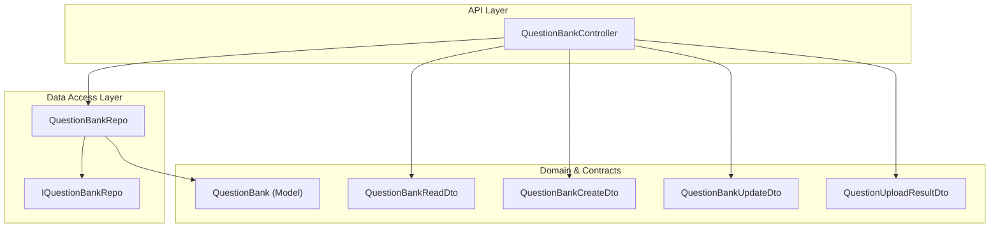
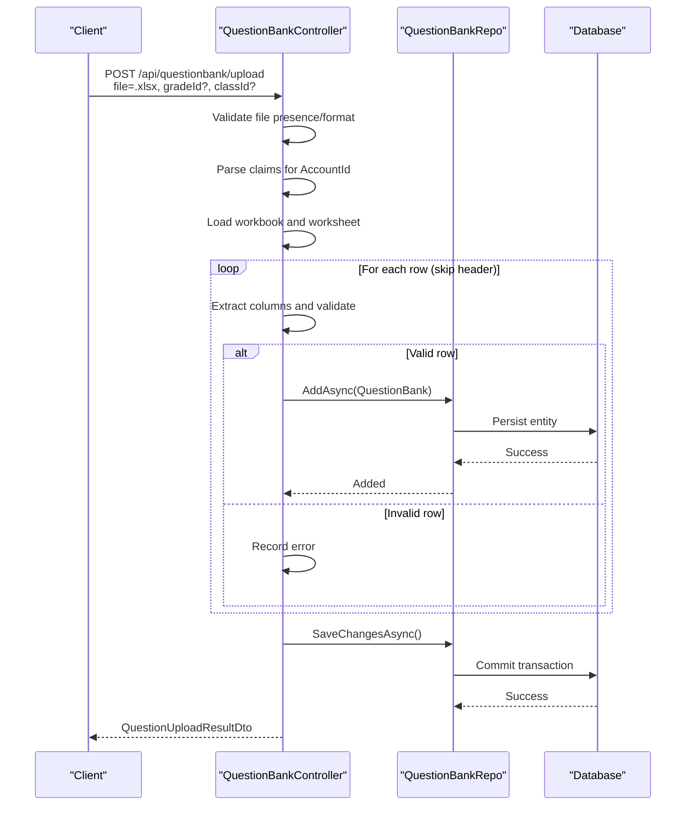
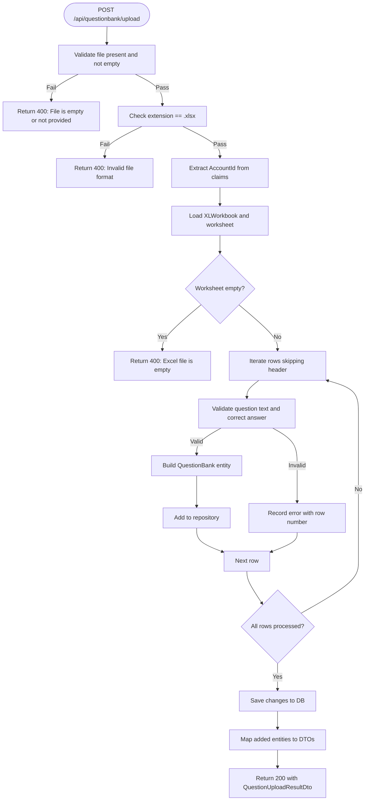
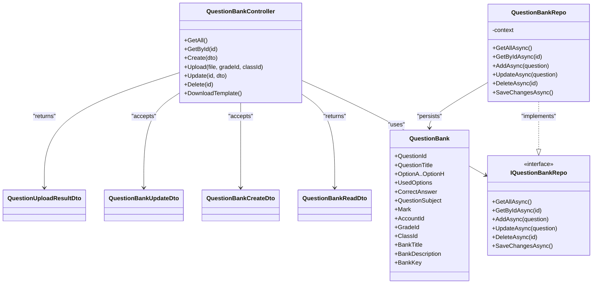

# Question Bank APIs

<cite>
**Referenced Files in This Document**
- [QuestionBankController.cs](file://server/Api/Controllers/QuestionBankController.cs)
- [QuestionUploadResultDto.cs](file://server/Api/DTOs/QuestionUploadResultDto.cs)
- [QuestionBankReadDto.cs](file://server/Api/DTOs/QuestionBankReadDto.cs)
- [QuestionBankCreateDto.cs](file://server/Api/DTOs/QuestionBankCreateDto.cs)
- [QuestionBankUpdateDto.cs](file://server/Api/DTOs/QuestionBankUpdateDto.cs)
- [QuestionBank.cs](file://server/Api/Models/QuestionBank.cs)
- [QuestionBankRepo.cs](file://server/Api/Repositories/Implementation/QuestionBankRepo.cs)
- [IQuestionBankRepo.cs](file://server/Api/Repositories/Interfaces/IQuestionBankRepo.cs)
- [FILE_UPLOAD_GUIDE.md](file://client/FILE_UPLOAD_GUIDE.md)
</cite>

## Table of Contents
1. [Introduction](#introduction)
2. [Project Structure](#project-structure)
3. [Core Components](#core-components)
4. [Architecture Overview](#architecture-overview)
5. [Detailed Component Analysis](#detailed-component-analysis)
6. [Dependency Analysis](#dependency-analysis)
7. [Performance Considerations](#performance-considerations)
8. [Troubleshooting Guide](#troubleshooting-guide)
9. [Conclusion](#conclusion)

## Introduction
This document provides comprehensive API documentation for question bank management endpoints, focusing on:
- File upload processing via POST /api/questionbank/upload for Excel (.xlsx) files with batch import and validation
- GET endpoints for retrieving questions and metadata
- Data schemas for questions, categories, difficulty levels (as modeled), and metadata
- File format requirements, size limitations, and processing status tracking

The backend is implemented in .NET Core using a controller-repository pattern with Entity Framework data access. The client-side file upload guide complements the server’s Excel template and processing behavior.

## Project Structure
The relevant parts of the project structure for this documentation are:
- Controllers: REST endpoints for question bank operations
- DTOs: Request/response contracts for API consumers
- Models: Domain entities persisted to the database
- Repositories: Data access abstractions and implementations
- Client documentation: File upload guidance and expected formats

**Diagram sources**
- [QuestionBankController.cs:10-19](file://server/Api/Controllers/QuestionBankController.cs#L10-L19)
- [QuestionBankRepo.cs:7-14](file://server/Api/Repositories/Implementation/QuestionBankRepo.cs#L7-L14)
- [IQuestionBankRepo.cs:3-11](file://server/Api/Repositories/Interfaces/IQuestionBankRepo.cs#L3-L11)
- [QuestionBank.cs:7-46](file://server/Api/Models/QuestionBank.cs#L7-L46)
- [QuestionBankReadDto.cs:3-25](file://server/Api/DTOs/QuestionBankReadDto.cs#L3-L25)
- [QuestionBankCreateDto.cs:3-24](file://server/Api/DTOs/QuestionBankCreateDto.cs#L3-L24)
- [QuestionBankUpdateDto.cs:3-24](file://server/Api/DTOs/QuestionBankUpdateDto.cs#L3-L24)
- [QuestionUploadResultDto.cs:6-13](file://server/Api/DTOs/QuestionUploadResultDto.cs#L6-L13)

**Section sources**
- [QuestionBankController.cs:10-19](file://server/Api/Controllers/QuestionBankController.cs#L10-L19)
- [QuestionBankRepo.cs:7-14](file://server/Api/Repositories/Implementation/QuestionBankRepo.cs#L7-L14)
- [IQuestionBankRepo.cs:3-11](file://server/Api/Repositories/Interfaces/IQuestionBankRepo.cs#L3-L11)
- [QuestionBank.cs:7-46](file://server/Api/Models/QuestionBank.cs#L7-L46)
- [QuestionBankReadDto.cs:3-25](file://server/Api/DTOs/QuestionBankReadDto.cs#L3-L25)
- [QuestionBankCreateDto.cs:3-24](file://server/Api/DTOs/QuestionBankCreateDto.cs#L3-L24)
- [QuestionBankUpdateDto.cs:3-24](file://server/Api/DTOs/QuestionBankUpdateDto.cs#L3-L24)
- [QuestionUploadResultDto.cs:6-13](file://server/Api/DTOs/QuestionUploadResultDto.cs#L6-L13)

## Core Components
- QuestionBankController exposes REST endpoints for CRUD operations and file upload.
- QuestionBankRepo implements data access methods over EF Core context.
- DTOs define request/response shapes for clients.
- QuestionBank model represents the persisted entity.

Key responsibilities:
- Upload endpoint validates and processes Excel files, mapping rows to QuestionBank entities.
- Read endpoints return mapped DTOs for consistent API responses.
- Repository abstracts persistence operations.

**Section sources**
- [QuestionBankController.cs:21-48](file://server/Api/Controllers/QuestionBankController.cs#L21-L48)
- [QuestionBankController.cs:145-271](file://server/Api/Controllers/QuestionBankController.cs#L145-L271)
- [QuestionBankRepo.cs:16-46](file://server/Api/Repositories/Implementation/QuestionBankRepo.cs#L16-L46)
- [QuestionBank.cs:7-46](file://server/Api/Models/QuestionBank.cs#L7-L46)

## Architecture Overview
The upload workflow reads an Excel workbook, iterates rows, validates required fields, constructs domain entities, persists them, and returns a structured result including success/failure counts and added question details.

**Diagram sources**
- [QuestionBankController.cs:145-271](file://server/Api/Controllers/QuestionBankController.cs#L145-L271)
- [QuestionBankRepo.cs:26-46](file://server/Api/Repositories/Implementation/QuestionBankRepo.cs#L26-L46)

## Detailed Component Analysis

### Endpoints

#### POST /api/questionbank/upload
- Purpose: Batch import questions from an Excel file into the question bank.
- Authentication: Reads user identity from claims; expects a valid account identifier.
- Parameters:
  - file: multipart/form-data, required, must be .xlsx
  - gradeId: optional query parameter
  - classId: optional query parameter
- Validation rules:
  - File must be present and non-empty
  - File extension must be .xlsx
  - Each row requires a non-empty question text and a correct answer
  - Marks default to 1 if missing or zero
- Processing behavior:
  - Skips header row
  - Maps columns to QuestionBank fields
  - Sets UsedOptions to 4 by default during import
  - Sets QuestionSubject to "Uploaded" by default during import
  - Persists all successfully parsed rows in one save operation
- Response:
  - 200 OK with QuestionUploadResultDto containing:
    - TotalProcessed, SuccessCount, FailureCount
    - Errors list with per-row messages
    - AddedQuestions list of QuestionBankReadDto
- Error handling:
  - 400 Bad Request for invalid file or empty file
  - 500 Internal Server Error for unexpected exceptions with message details

**Diagram sources**
- [QuestionBankController.cs:145-271](file://server/Api/Controllers/QuestionBankController.cs#L145-L271)

**Section sources**
- [QuestionBankController.cs:145-271](file://server/Api/Controllers/QuestionBankController.cs#L145-L271)
- [QuestionUploadResultDto.cs:6-13](file://server/Api/DTOs/QuestionUploadResultDto.cs#L6-L13)

#### GET /api/questionbank
- Purpose: Retrieve all questions.
- Response: Array of QuestionBankReadDto.

**Section sources**
- [QuestionBankController.cs:21-48](file://server/Api/Controllers/QuestionBankController.cs#L21-L48)

#### GET /api/questionbank/{id}
- Purpose: Retrieve a single question by ID.
- Response: QuestionBankReadDto or 404 Not Found.

**Section sources**
- [QuestionBankController.cs:50-79](file://server/Api/Controllers/QuestionBankController.cs#L50-L79)

#### Additional endpoints (for completeness)
- POST /api/questionbank: Create a new question.
- PUT /api/questionbank/{id}: Update an existing question.
- DELETE /api/questionbank/{id}: Delete a question.
- GET /api/questionbank/template: Download an Excel template for uploads.

**Section sources**
- [QuestionBankController.cs:81-143](file://server/Api/Controllers/QuestionBankController.cs#L81-L143)
- [QuestionBankController.cs:272-327](file://server/Api/Controllers/QuestionBankController.cs#L272-L327)
- [QuestionBankController.cs:329-386](file://server/Api/Controllers/QuestionBankController.cs#L329-L386)

### Data Schemas

#### Question Object (QuestionBankReadDto)
- Fields:
  - QuestionId: long
  - QuestionTitle: string
  - OptionA..OptionH: strings (some nullable)
  - UsedOptions: int
  - CorrectAnswer: string
  - QuestionSubject: string
  - Mark: decimal
  - BankTitle, BankDescription, BankKey: strings (nullable)
  - GradeId, AccountId, ClassId: longs (nullable)

Notes:
- UsedOptions defaults to 4 when reading if null.
- Mark defaults to 0 when reading if null.

**Section sources**
- [QuestionBankReadDto.cs:3-25](file://server/Api/DTOs/QuestionBankReadDto.cs#L3-L25)
- [QuestionBankController.cs:21-48](file://server/Api/Controllers/QuestionBankController.cs#L21-L48)

#### Category and Difficulty Levels
- Categories: Represented by QuestionSubject (string). No dedicated category table is exposed in these endpoints.
- Difficulty levels: Not modeled in the current schema; no difficulty field exists in QuestionBank or DTOs.

**Section sources**
- [QuestionBank.cs:33-33](file://server/Api/Models/QuestionBank.cs#L33-L33)
- [QuestionBankReadDto.cs:17-17](file://server/Api/DTOs/QuestionBankReadDto.cs#L17-L17)

#### Metadata
- BankTitle, BankDescription, BankKey: Optional metadata associated with a question.
- GradeId, ClassId: Optional educational context identifiers.
- AccountId: Owner identifier derived from authentication claims.

**Section sources**
- [QuestionBank.cs:37-45](file://server/Api/Models/QuestionBank.cs#L37-L45)
- [QuestionBankReadDto.cs:19-24](file://server/Api/DTOs/QuestionBankReadDto.cs#L19-L24)

### File Format Requirements and Template
- Supported format: .xlsx (enforced by server)
- Expected columns (Excel template):
  - Column A: Question Type (MCQ, True/False, Fill Blank)
  - Column B: Question Text
  - Column C: Correct Answer
  - Column D: Marks (defaults to 1 if missing)
  - Columns E-H: Option A through Option D
- Template download: GET /api/questionbank/template returns a pre-formatted Excel file.

Notes:
- The client-side guide mentions additional formats (.xls, .csv), but the server enforces .xlsx only.
- Rows without a question text are skipped.
- Empty worksheets are rejected.

**Section sources**
- [QuestionBankController.cs:145-152](file://server/Api/Controllers/QuestionBankController.cs#L145-L152)
- [QuestionBankController.cs:184-189](file://server/Api/Controllers/QuestionBankController.cs#L184-L189)
- [QuestionBankController.cs:329-386](file://server/Api/Controllers/QuestionBankController.cs#L329-L386)
- [FILE_UPLOAD_GUIDE.md:17-29](file://client/FILE_UPLOAD_GUIDE.md#L17-L29)

### Processing Status Tracking
- QuestionUploadResultDto fields:
  - TotalProcessed: total rows attempted
  - SuccessCount: successfully added
  - FailureCount: failed rows
  - Errors: list of error messages per row
  - AddedQuestions: list of created QuestionBankReadDto entries

**Section sources**
- [QuestionUploadResultDto.cs:6-13](file://server/Api/DTOs/QuestionUploadResultDto.cs#L6-L13)
- [QuestionBankController.cs:176-264](file://server/Api/Controllers/QuestionBankController.cs#L176-L264)

## Dependency Analysis
The controller depends on the repository abstraction, which in turn depends on the EF Core context. DTOs decouple API payloads from domain models.

**Diagram sources**
- [QuestionBankController.cs:10-19](file://server/Api/Controllers/QuestionBankController.cs#L10-L19)
- [IQuestionBankRepo.cs:3-11](file://server/Api/Repositories/Interfaces/IQuestionBankRepo.cs#L3-L11)
- [QuestionBankRepo.cs:7-14](file://server/Api/Repositories/Implementation/QuestionBankRepo.cs#L7-L14)
- [QuestionBank.cs:7-46](file://server/Api/Models/QuestionBank.cs#L7-L46)
- [QuestionBankReadDto.cs:3-25](file://server/Api/DTOs/QuestionBankReadDto.cs#L3-L25)
- [QuestionBankCreateDto.cs:3-24](file://server/Api/DTOs/QuestionBankCreateDto.cs#L3-L24)
- [QuestionBankUpdateDto.cs:3-24](file://server/Api/DTOs/QuestionBankUpdateDto.cs#L3-L24)
- [QuestionUploadResultDto.cs:6-13](file://server/Api/DTOs/QuestionUploadResultDto.cs#L6-L13)

**Section sources**
- [QuestionBankController.cs:10-19](file://server/Api/Controllers/QuestionBankController.cs#L10-L19)
- [IQuestionBankRepo.cs:3-11](file://server/Api/Repositories/Interfaces/IQuestionBankRepo.cs#L3-L11)
- [QuestionBankRepo.cs:7-14](file://server/Api/Repositories/Implementation/QuestionBankRepo.cs#L7-L14)
- [QuestionBank.cs:7-46](file://server/Api/Models/QuestionBank.cs#L7-L46)

## Performance Considerations
- Batch persistence: All successful rows are added before a single SaveChangesAsync call, reducing round trips.
- Memory usage: Workbook is loaded into memory; large files may increase memory consumption.
- Row-level error isolation: Individual row failures do not abort the entire import; errors are collected and reported.
- Default values: UsedOptions and QuestionSubject are set programmatically during import to simplify parsing.

[No sources needed since this section provides general guidance]

## Troubleshooting Guide
Common issues and resolutions:
- Empty or missing file: Ensure a file is attached and not empty.
- Invalid file format: Only .xlsx is accepted; convert other formats accordingly.
- Empty worksheet: Provide at least one data row after the header.
- Missing required fields: Ensure Question Text and Correct Answer are present for each row.
- Claims/account issues: Verify authentication token includes a valid numeric AccountId claim.

Server error responses:
- 400 Bad Request: Validation failures (empty file, wrong extension, empty sheet).
- 500 Internal Server Error: Unexpected exceptions with detailed messages.

**Section sources**
- [QuestionBankController.cs:145-152](file://server/Api/Controllers/QuestionBankController.cs#L145-L152)
- [QuestionBankController.cs:184-189](file://server/Api/Controllers/QuestionBankController.cs#L184-L189)
- [QuestionBankController.cs:230-234](file://server/Api/Controllers/QuestionBankController.cs#L230-L234)
- [QuestionBankController.cs:266-270](file://server/Api/Controllers/QuestionBankController.cs#L266-L270)

## Conclusion
The Question Bank APIs provide robust endpoints for managing questions and bulk importing them via Excel. The upload endpoint enforces strict file format validation, performs row-level validation, and returns detailed processing results. While categories are represented by a simple subject string and difficulty levels are not modeled, the system supports essential metadata and contextual identifiers. Clients should use the provided template and adhere to the documented column structure for reliable imports.