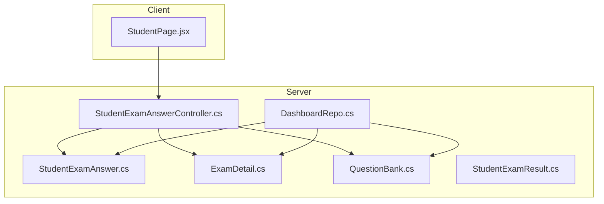
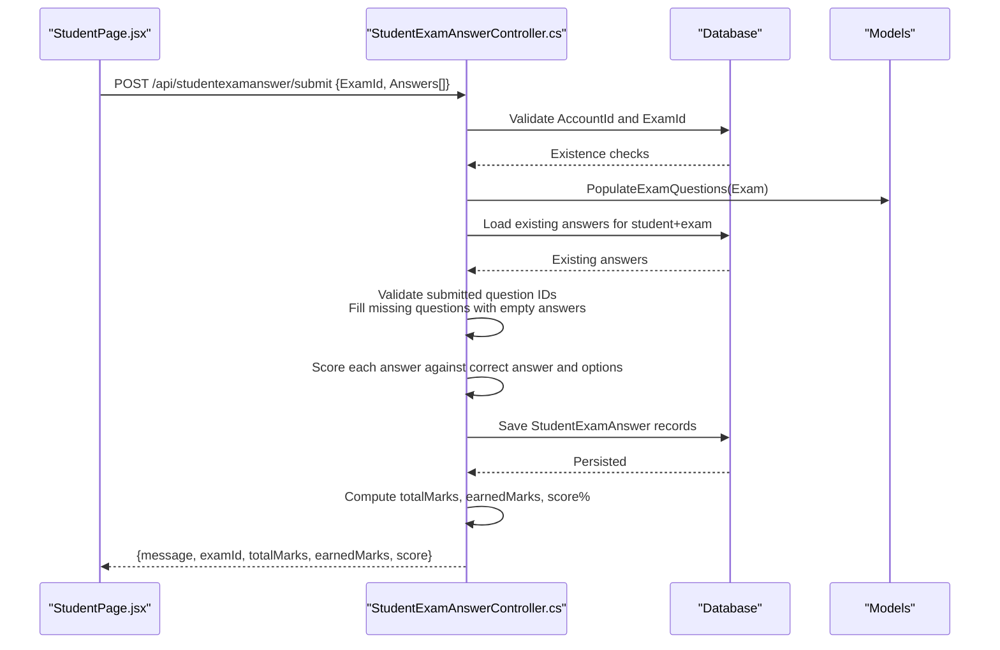
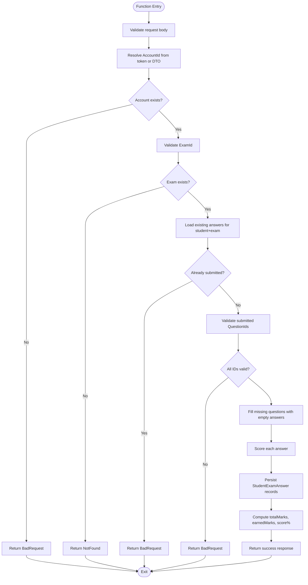
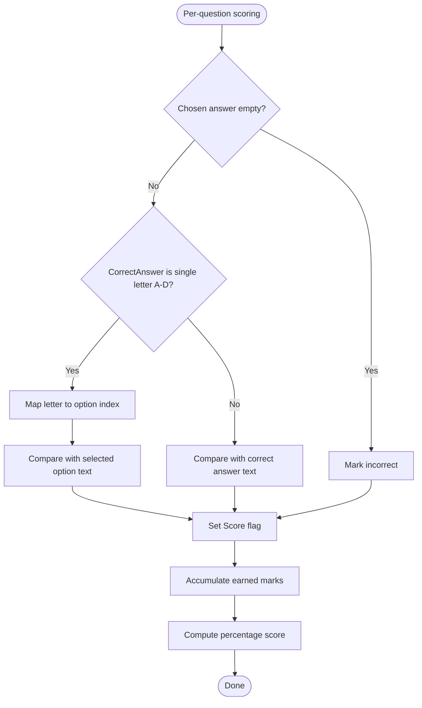
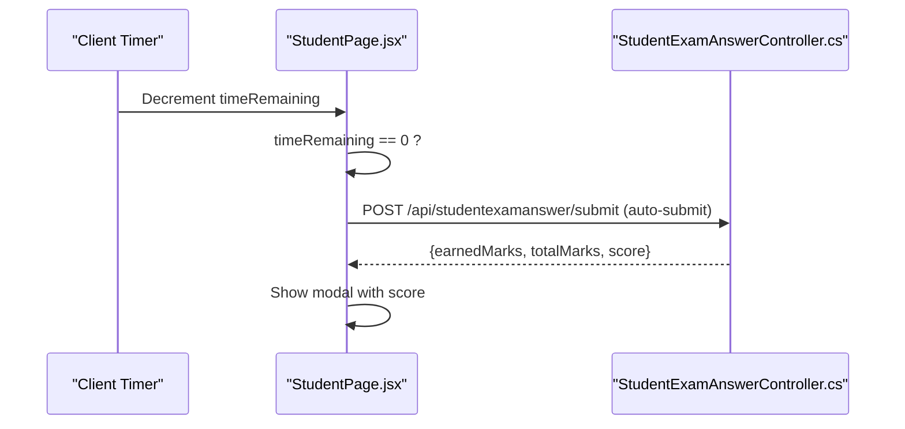
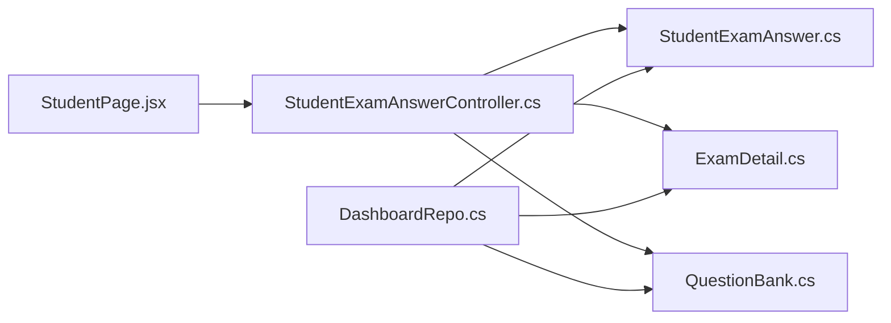

# Student Answer APIs

<cite>
**Referenced Files in This Document**
- [StudentExamAnswerController.cs](file://server/Api/Controllers/StudentExamAnswerController.cs)
- [StudentExamAnswer.cs](file://server/Api/Models/StudentExamAnswer.cs)
- [StudentExamResult.cs](file://server/Api/Models/StudentExamResult.cs)
- [ExamDetail.cs](file://server/Api/Models/ExamDetail.cs)
- [QuestionBank.cs](file://server/Api/Models/QuestionBank.cs)
- [DashboardRepo.cs](file://server/Api/Repositories/Implementation/DashboardRepo.cs)
- [StudentPage.jsx](file://client/src/pages/StudentPage.jsx)
</cite>

## Table of Contents
1. [Introduction](#introduction)
2. [Project Structure](#project-structure)
3. [Core Components](#core-components)
4. [Architecture Overview](#architecture-overview)
5. [Detailed Component Analysis](#detailed-component-analysis)
6. [Dependency Analysis](#dependency-analysis)
7. [Performance Considerations](#performance-considerations)
8. [Troubleshooting Guide](#troubleshooting-guide)
9. [Conclusion](#conclusion)

## Introduction
This document provides detailed API documentation for student answer submission and scoring endpoints focused on exam taking workflows and result processing. It covers:
- POST /api/studentexamanswer/submit for answer submission with question-response mapping, automatic scoring, and partial submission handling.
- GET endpoints for retrieving student answers, exam results, and performance analytics.
- Comprehensive schemas for answer objects, scoring algorithms, and result calculations.
- Real-time answer validation patterns and grade computation logic.

The backend is implemented in ASP.NET Core, while the client-side exam UI demonstrates timing behavior and auto-submission flows.

## Project Structure
Relevant parts of the project structure for this documentation:
- Server API controllers define REST endpoints for submitting and retrieving student answers and exam results.
- Data models represent student answers, exam details, and questions.
- Repository code computes aggregated analytics and pass/fail metrics.
- Client-side pages implement exam timing and auto-submit behavior.

**Diagram sources**
- [StudentPage.jsx:322-353](file://client/src/pages/StudentPage.jsx#L322-L353)
- [StudentExamAnswerController.cs:45-126](file://server/Api/Controllers/StudentExamAnswerController.cs#L45-L126)
- [StudentExamAnswerController.cs:128-197](file://server/Api/Controllers/StudentExamAnswerController.cs#L128-L197)
- [StudentExamAnswerController.cs:199-332](file://server/Api/Controllers/StudentExamAnswerController.cs#L199-L332)
- [DashboardRepo.cs:180-209](file://server/Api/Repositories/Implementation/DashboardRepo.cs#L180-L209)
- [StudentExamAnswer.cs:6-26](file://server/Api/Models/StudentExamAnswer.cs#L6-L26)
- [ExamDetail.cs:6-30](file://server/Api/Models/ExamDetail.cs#L6-L30)
- [QuestionBank.cs:7-46](file://server/Api/Models/QuestionBank.cs#L7-L46)
- [StudentExamResult.cs:6-19](file://server/Api/Models/StudentExamResult.cs#L6-L19)

**Section sources**
- [StudentExamAnswerController.cs:45-126](file://server/Api/Controllers/StudentExamAnswerController.cs#L45-L126)
- [StudentExamAnswerController.cs:128-197](file://server/Api/Controllers/StudentExamAnswerController.cs#L128-L197)
- [StudentExamAnswerController.cs:199-332](file://server/Api/Controllers/StudentExamAnswerController.cs#L199-L332)
- [DashboardRepo.cs:180-209](file://server/Api/Repositories/Implementation/DashboardRepo.cs#L180-L209)
- [StudentPage.jsx:322-353](file://client/src/pages/StudentPage.jsx#L322-L353)

## Core Components
- StudentExamAnswerController exposes:
  - GET /api/studentexamanswer/student/{accountId}/exams: Returns all exams for a student with answers and computed scores.
  - GET /api/studentexamanswer/student/{accountId}/exam/{examId}: Returns a specific exam’s questions and answers for a student.
  - POST /api/studentexamanswer/submit: Submits answers, validates inputs, maps to questions, scores automatically, and returns totals and percentage score.
- Data models:
  - StudentExamAnswer: Stores per-question responses and correctness flags.
  - ExamDetail: Defines exam metadata including start/end windows.
  - QuestionBank: Defines question text, options, correct answer, and mark weight.
  - StudentExamResult: Represents subject-level scores (not used by the submit endpoint).
- DashboardRepo: Computes aggregated analytics and pass/fail thresholds based on earned marks vs maximum marks.

Key responsibilities:
- Input validation and access control for submissions.
- Partial submission support by filling missing questions with empty answers.
- Automatic scoring using question weights and correct answer matching.
- Result calculation returning total marks, earned marks, and percentage score.

**Section sources**
- [StudentExamAnswerController.cs:45-126](file://server/Api/Controllers/StudentExamAnswerController.cs#L45-L126)
- [StudentExamAnswerController.cs:128-197](file://server/Api/Controllers/StudentExamAnswerController.cs#L128-L197)
- [StudentExamAnswerController.cs:199-332](file://server/Api/Controllers/StudentExamAnswerController.cs#L199-L332)
- [StudentExamAnswer.cs:6-26](file://server/Api/Models/StudentExamAnswer.cs#L6-L26)
- [ExamDetail.cs:6-30](file://server/Api/Models/ExamDetail.cs#L6-L30)
- [QuestionBank.cs:7-46](file://server/Api/Models/QuestionBank.cs#L7-L46)
- [StudentExamResult.cs:6-19](file://server/Api/Models/StudentExamResult.cs#L6-L19)
- [DashboardRepo.cs:180-209](file://server/Api/Repositories/Implementation/DashboardRepo.cs#L180-L209)

## Architecture Overview
The submission flow integrates client-side timing and server-side validation/scoring:

**Diagram sources**
- [StudentPage.jsx:322-353](file://client/src/pages/StudentPage.jsx#L322-L353)
- [StudentExamAnswerController.cs:199-332](file://server/Api/Controllers/StudentExamAnswerController.cs#L199-L332)
- [StudentExamAnswerController.cs:22-43](file://server/Api/Controllers/StudentExamAnswerController.cs#L22-L43)
- [StudentExamAnswer.cs:6-26](file://server/Api/Models/StudentExamAnswer.cs#L6-L26)
- [ExamDetail.cs:6-30](file://server/Api/Models/ExamDetail.cs#L6-L30)
- [QuestionBank.cs:7-46](file://server/Api/Models/QuestionBank.cs#L7-L46)

## Detailed Component Analysis

### Endpoint: POST /api/studentexamanswer/submit
Purpose:
- Accepts a list of question-response mappings for an exam.
- Validates account and exam existence.
- Ensures submitted question IDs are valid for the exam.
- Supports partial submissions by adding missing questions with empty answers.
- Scores answers automatically and persists them.
- Returns total marks, earned marks, and percentage score.

Request schema:
- Body type: StudentAnswerSubmitDto
  - ExamId: long
  - AccountId: long (optional; token may be used if present)
  - Answers: array of AnswerDto
    - QuestionId: long
    - Answer: object (string or option value)

Response schema:
- message: string
- examId: long
- totalMarks: decimal
- earnedMarks: decimal
- score: number (percentage rounded to two decimals)

Validation rules:
- Request body required.
- AccountId must exist; falls back to token claim if provided.
- ExamId must exist.
- At least one answer must be submitted.
- All submitted QuestionIds must belong to the exam.
- Missing questions are filled with empty answers before scoring.

Scoring algorithm:
- For each answer:
  - If the chosen answer is non-empty:
    - If CorrectAnswer is a single letter A-D and options are available:
      - Map letter to index and compare with selected option text.
    - Else:
      - Compare chosen answer with CorrectAnswer case-insensitively.
  - Mark Score true if match; otherwise false.
- Total marks = sum of marks of all questions in the exam.
- Earned marks = sum of marks for questions where Score is true.
- Percentage score = (earnedMarks / totalMarks) * 100, rounded to two decimals.

Partial submission handling:
- If the client submits fewer than the total number of questions, the controller adds entries for missing questions with empty answers.
- Empty answers do not contribute to earned marks.

Error handling:
- Bad request for invalid or missing data.
- Not found when exam does not exist.
- Conflict prevention: prevents duplicate submissions for the same exam by the same student.
- Internal server error with details if persistence fails.

**Diagram sources**
- [StudentExamAnswerController.cs:199-332](file://server/Api/Controllers/StudentExamAnswerController.cs#L199-L332)

**Section sources**
- [StudentExamAnswerController.cs:199-332](file://server/Api/Controllers/StudentExamAnswerController.cs#L199-L332)

### Endpoint: GET /api/studentexamanswer/student/{accountId}/exams
Purpose:
- Retrieves all exams for a given student that have complete sets of answers.
- Includes exam metadata, total marks, earned marks, percentage score, and per-question details.

Response schema:
- Array of exam summaries:
  - ExamId: long
  - Title: string
  - SubjectName: string
  - ExamDescription: string
  - StartDate: datetime (UTC)
  - EndDate: datetime (UTC)
  - TotalMarks: decimal
  - EarnedMarks: decimal
  - Score: number (percentage)
  - Questions: array of question objects:
    - QuestionId: long
    - QuestionTitle: string
    - OptionA/B/C/D: string
    - CorrectAnswer: string
    - Mark: decimal
    - UserAnswer: string
    - IsCorrect: boolean

Filtering rule:
- Only exams where the student has answered all questions are included.

**Section sources**
- [StudentExamAnswerController.cs:45-126](file://server/Api/Controllers/StudentExamAnswerController.cs#L45-L126)

### Endpoint: GET /api/studentexamanswer/student/{accountId}/exam/{examId}
Purpose:
- Retrieves a specific exam’s questions and answers for a student.
- Includes exam metadata, total marks, earned marks, percentage score, and per-question details.

Access control:
- Teachers and admins can view any exam’s answers without restriction by creator.

Response schema:
- Single exam object:
  - ExamId: long
  - Title: string
  - SubjectName: string
  - ExamDescription: string
  - StartDate: datetime (UTC)
  - EndDate: datetime (UTC)
  - TotalMarks: decimal
  - EarnedMarks: decimal
  - Score: number (percentage)
  - Questions: array of question objects (same as above)

**Section sources**
- [StudentExamAnswerController.cs:128-197](file://server/Api/Controllers/StudentExamAnswerController.cs#L128-L197)

### Data Models and Schemas

#### StudentExamAnswer
Fields:
- Id: long
- AccountId: long
- ExamQuestionId: long?
- ExamDetailsId: long?
- ChoosedAnswer: string
- Score: bool
- QuestionBankId: long?

Relationships:
- Account
- ExamDetail
- QuestionBank

Usage:
- Stores per-question responses and correctness flags after submission.

**Section sources**
- [StudentExamAnswer.cs:6-26](file://server/Api/Models/StudentExamAnswer.cs#L6-L26)

#### ExamDetail
Fields:
- ExamId: long
- Title: string?
- ExamSubject: string?
- ExamDescription: string?
- StartDate: DateTime?
- EndDate: DateTime?
- GradeId: long?
- ClassId: string?
- CreatedBy_AccId: long?
- SubjectId: long?
- Subject: Status?

Usage:
- Provides exam metadata and time window boundaries.

**Section sources**
- [ExamDetail.cs:6-30](file://server/Api/Models/ExamDetail.cs#L6-L30)

#### QuestionBank
Fields:
- QuestionId: long
- QuestionTitle: string?
- OptionA through OptionH: string?
- UsedOptions: int?
- CorrectAnswer: string?
- QuestionSubject: string?
- Mark: decimal?
- AccountId: long?
- GradeId: long?
- BankDescription: string?
- BankKey: string?
- BankTitle: string?

Usage:
- Defines question content, options, correct answer, and mark weight.

**Section sources**
- [QuestionBank.cs:7-46](file://server/Api/Models/QuestionBank.cs#L7-L46)

#### StudentExamResult
Fields:
- AccountId: long
- ExamArabicScore: int
- ExamEnglishScore: int
- ExamMathScore: int
- ExamSoftwareScore: int

Usage:
- Represents subject-level scores; not directly used by the submit endpoint.

**Section sources**
- [StudentExamResult.cs:6-19](file://server/Api/Models/StudentExamResult.cs#L6-L19)

### Scoring Algorithms and Result Calculations

Automatic scoring:
- Compares chosen answer with correct answer:
  - If correct answer is a single letter A-D and options are present, map letter to option index and compare with selected option text.
  - Otherwise, compare chosen answer with correct answer case-insensitively.
- Marks Score true for matches; false otherwise.

Grade computation:
- Total marks = sum of marks across all questions in the exam.
- Earned marks = sum of marks for questions marked correct.
- Percentage score = (earnedMarks / totalMarks) * 100, rounded to two decimals.

Analytics aggregation:
- Aggregates per-student earned marks across exams.
- Computes average scores and pass/fail counts based on a pass threshold.

**Diagram sources**
- [StudentExamAnswerController.cs:258-307](file://server/Api/Controllers/StudentExamAnswerController.cs#L258-L307)
- [StudentExamAnswerController.cs:320-331](file://server/Api/Controllers/StudentExamAnswerController.cs#L320-L331)
- [DashboardRepo.cs:180-209](file://server/Api/Repositories/Implementation/DashboardRepo.cs#L180-L209)

**Section sources**
- [StudentExamAnswerController.cs:258-307](file://server/Api/Controllers/StudentExamAnswerController.cs#L258-L307)
- [StudentExamAnswerController.cs:320-331](file://server/Api/Controllers/StudentExamAnswerController.cs#L320-L331)
- [DashboardRepo.cs:180-209](file://server/Api/Repositories/Implementation/DashboardRepo.cs#L180-L209)

### Timing Validation and Auto-Submission
Client-side behavior:
- The client tracks remaining time and triggers auto-submission when time reaches zero.
- On auto-submit, it calls the same submit endpoint and displays the resulting score.

Server-side behavior:
- The submit endpoint does not enforce timing constraints; it only validates presence of answers and duplicates.
- Time window enforcement should be handled at the client or via additional server checks if needed.

**Diagram sources**
- [StudentPage.jsx:322-353](file://client/src/pages/StudentPage.jsx#L322-L353)
- [StudentPage.jsx:549-563](file://client/src/pages/StudentPage.jsx#L549-L563)
- [StudentExamAnswerController.cs:199-332](file://server/Api/Controllers/StudentExamAnswerController.cs#L199-L332)

**Section sources**
- [StudentPage.jsx:322-353](file://client/src/pages/StudentPage.jsx#L322-L353)
- [StudentPage.jsx:549-563](file://client/src/pages/StudentPage.jsx#L549-L563)

## Dependency Analysis
Component relationships:
- StudentExamAnswerController depends on:
  - Database context for reading/writing StudentExamAnswer, ExamDetail, QuestionBank.
  - Models for data structures.
- DashboardRepo depends on:
  - StudentExamAnswer and ExamDetail for analytics aggregation.
- Client depends on:
  - Submit endpoint for saving answers and receiving scores.

**Diagram sources**
- [StudentExamAnswerController.cs:45-126](file://server/Api/Controllers/StudentExamAnswerController.cs#L45-L126)
- [StudentExamAnswerController.cs:128-197](file://server/Api/Controllers/StudentExamAnswerController.cs#L128-L197)
- [StudentExamAnswerController.cs:199-332](file://server/Api/Controllers/StudentExamAnswerController.cs#L199-L332)
- [DashboardRepo.cs:180-209](file://server/Api/Repositories/Implementation/DashboardRepo.cs#L180-L209)
- [StudentPage.jsx:322-353](file://client/src/pages/StudentPage.jsx#L322-L353)

**Section sources**
- [StudentExamAnswerController.cs:45-126](file://server/Api/Controllers/StudentExamAnswerController.cs#L45-L126)
- [StudentExamAnswerController.cs:128-197](file://server/Api/Controllers/StudentExamAnswerController.cs#L128-L197)
- [StudentExamAnswerController.cs:199-332](file://server/Api/Controllers/StudentExamAnswerController.cs#L199-L332)
- [DashboardRepo.cs:180-209](file://server/Api/Repositories/Implementation/DashboardRepo.cs#L180-L209)
- [StudentPage.jsx:322-353](file://client/src/pages/StudentPage.jsx#L322-L353)

## Performance Considerations
- Batch operations:
  - Use AddRangeAsync to persist multiple answers efficiently.
- Query optimization:
  - Preload related entities (e.g., questions) to reduce N+1 queries.
- Avoid redundant computations:
  - Cache total marks and per-question marks where possible.
- Indexing:
  - Ensure indexes on AccountId, ExamDetailsId, and QuestionBankId for faster lookups.
- Client-side caching:
  - Cache exam metadata and questions to minimize repeated requests.

[No sources needed since this section provides general guidance]

## Troubleshooting Guide
Common issues and resolutions:
- Duplicate submission:
  - Error: “You have already submitted answers for this exam.”
  - Resolution: Prevent re-submission on the client; clear local state after successful submission.
- Invalid question IDs:
  - Error: “Invalid answers. IDs valid: ...”
  - Resolution: Ensure the client sends only question IDs present in the exam’s question set.
- Missing answers:
  - Behavior: Missing questions are filled with empty answers automatically.
  - Resolution: Encourage clients to send all questions to avoid penalties for unanswered items.
- Network errors:
  - Client handles network failures and shows user-friendly messages.
  - Resolution: Retry logic and offline storage can improve resilience.

**Section sources**
- [StudentExamAnswerController.cs:229-252](file://server/Api/Controllers/StudentExamAnswerController.cs#L229-L252)
- [StudentPage.jsx:564-575](file://client/src/pages/StudentPage.jsx#L564-L575)

## Conclusion
The Student Answer APIs provide robust mechanisms for submitting exam answers, validating inputs, scoring automatically, and computing results. They support partial submissions and integrate with client-side timing for auto-submission. The design emphasizes clear validation, consistent scoring logic, and accessible result retrieval for both students and teachers. Analytics capabilities further enable performance insights and pass/fail determination.

[No sources needed since this section summarizes without analyzing specific files]