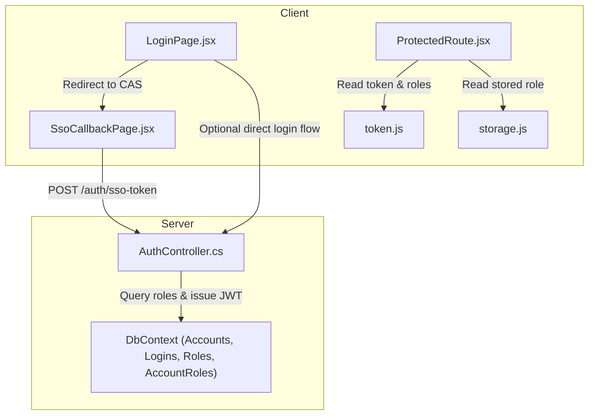
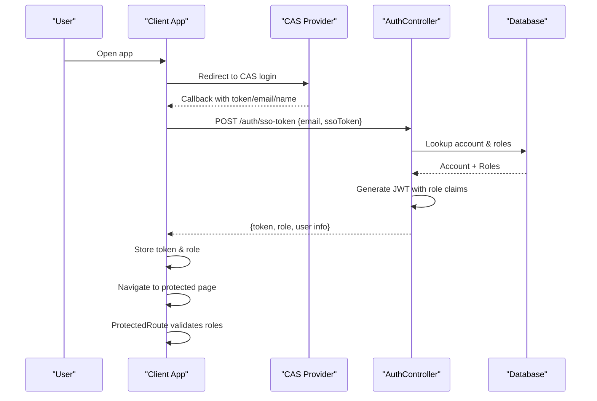
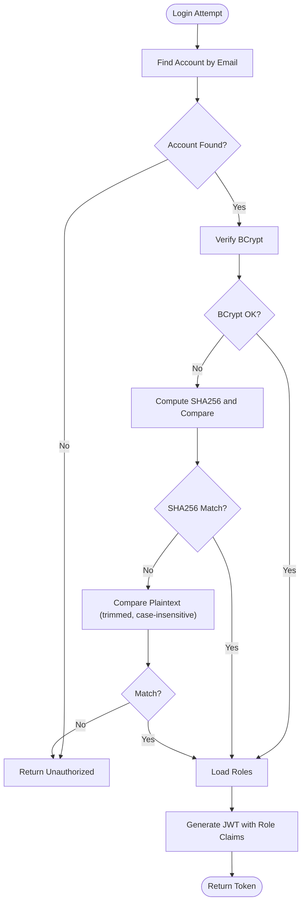
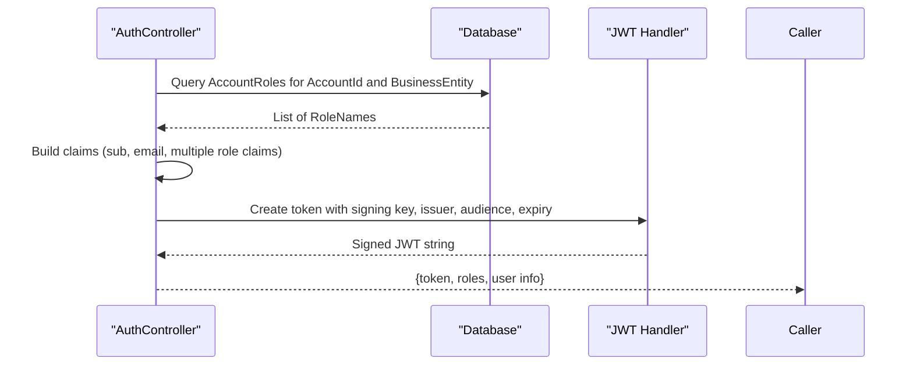
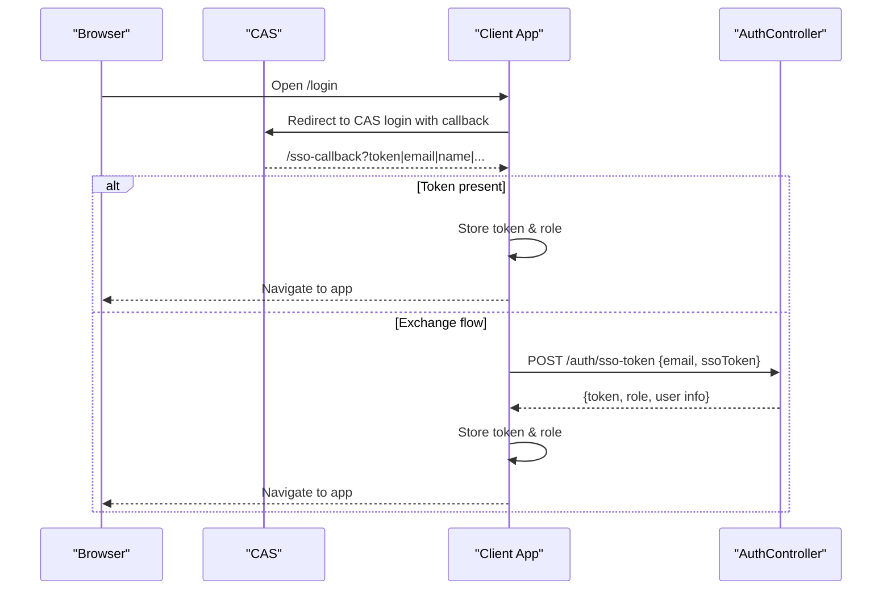
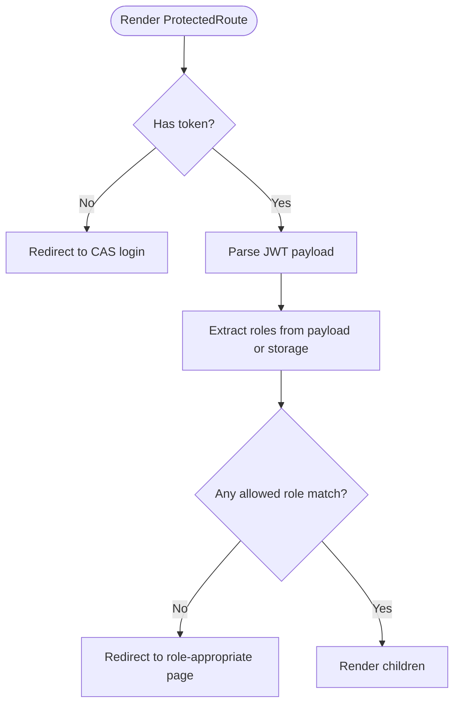
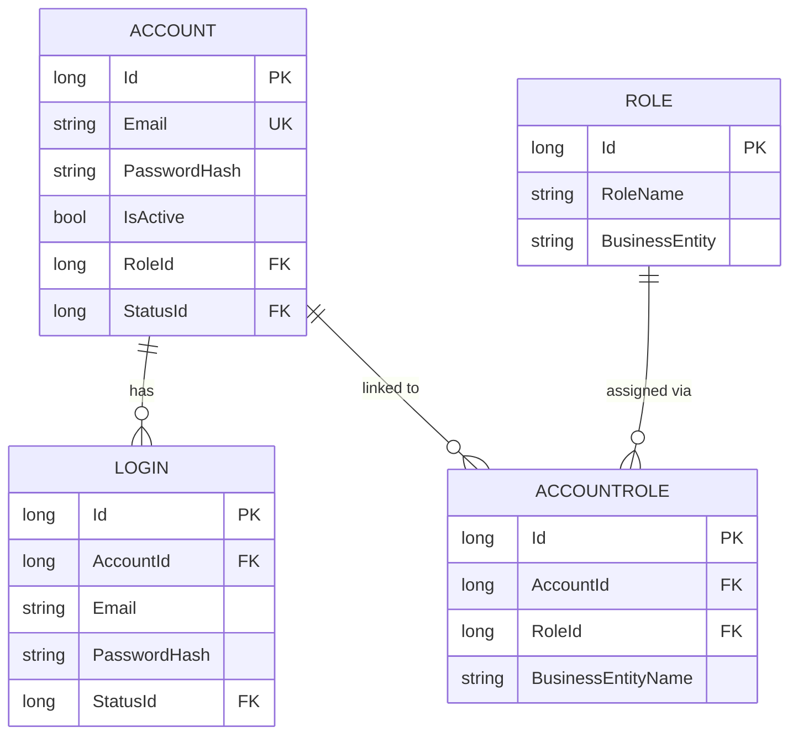
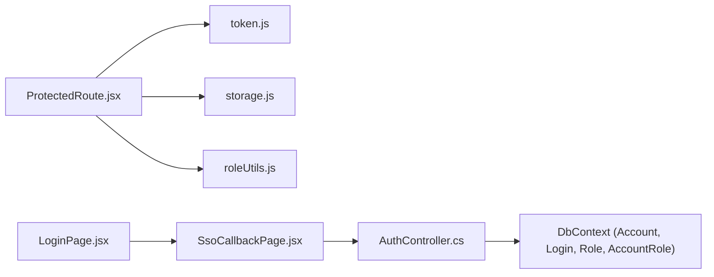

# Authentication & Security

<cite>
**Referenced Files in This Document**
- [AuthController.cs](file://server/Api/Controllers/AuthController.cs)
- [AuthModels.cs](file://server/Api/Models/AuthModels.cs)
- [Account.cs](file://server/Api/Models/Account.cs)
- [Login.cs](file://server/Api/Models/Login.cs)
- [Role.cs](file://server/Api/Models/Role.cs)
- [AccountRole.cs](file://server/Api/Models/AccountRole.cs)
- [ElsewedySchoolSysDbDevContext.cs](file://server/Api/Models/ElsewedySchoolSysDbDevContext.cs)
- [LoginPage.jsx](file://client/src/pages/LoginPage.jsx)
- [SsoCallbackPage.jsx](file://client/src/pages/SsoCallbackPage.jsx)
- [ProtectedRoute.jsx](file://client/src/components/ProtectedRoute.jsx)
- [token.js](file://client/src/utils/token.js)
- [storage.js](file://client/src/utils/storage.js)
- [roleUtils.js](file://client/src/utils/roleUtils.js)
</cite>

## Table of Contents
1. Introduction
2. Project Structure
3. Core Components
4. Architecture Overview
5. Detailed Component Analysis
6. Dependency Analysis
7. Performance Considerations
8. Troubleshooting Guide
9. Conclusion

## Introduction
This document explains the authentication and security design of the Exam-Hub system with a focus on:
- JWT-based authentication for local login and CAS Single Sign-On integration
- Multi-layer password validation using BCrypt, SHA256, and plaintext fallback
- Role claims in JWT tokens and client-side role verification for protected routes
- Token management strategies and best practices
- Concrete examples from the codebase showing authentication flows, token handling, and authorization checks

## Project Structure
The authentication flow spans both server and client:
- Server exposes an Auth API that handles registration, login, SSO token exchange, profile operations, and JWT generation
- Client redirects to CAS for SSO, exchanges credentials for a local JWT, stores tokens securely, and enforces route-level access control based on roles

**Diagram sources**
- [LoginPage.jsx:9-28](file://client/src/pages/LoginPage.jsx#L9-L28)
- [SsoCallbackPage.jsx:10-47](file://client/src/pages/SsoCallbackPage.jsx#L10-L47)
- [ProtectedRoute.jsx:5-89](file://client/src/components/ProtectedRoute.jsx#L5-L89)
- [token.js:6-30](file://client/src/utils/token.js#L6-L30)
- [storage.js:8-67](file://client/src/utils/storage.js#L8-L67)
- [AuthController.cs:118-313](file://server/Api/Controllers/AuthController.cs#L118-L313)
- [ElsewedySchoolSysDbDevContext.cs:154-190](file://server/Api/Models/ElsewedySchoolSysDbDevContext.cs#L154-L190)

**Section sources**
- [LoginPage.jsx:9-28](file://client/src/pages/LoginPage.jsx#L9-L28)
- [SsoCallbackPage.jsx:10-47](file://client/src/pages/SsoCallbackPage.jsx#L10-L47)
- [ProtectedRoute.jsx:5-89](file://client/src/components/ProtectedRoute.jsx#L5-L89)
- [AuthController.cs:118-313](file://server/Api/Controllers/AuthController.cs#L118-L313)

## Core Components
- AuthController: Implements register, login, SSO token exchange, profile endpoints, and JWT issuance
- Models: Account, Login, Role, AccountRole define identity and RBAC data structures
- Client pages: LoginPage orchestrates CAS redirect; SsoCallbackPage exchanges CAS info for a local JWT
- Client utilities: ProtectedRoute enforces role-based access; token.js decodes JWT payloads; storage.js manages token persistence and logout

Key responsibilities:
- Password validation and migration support during login
- Role resolution per business entity and inclusion in JWT claims
- Client-side protection of routes based on token roles or stored role fallback

**Section sources**
- [AuthController.cs:28-116](file://server/Api/Controllers/AuthController.cs#L28-L116)
- [AuthController.cs:118-313](file://server/Api/Controllers/AuthController.cs#L118-L313)
- [AuthModels.cs:1-30](file://server/Api/Models/AuthModels.cs#L1-L30)
- [Account.cs:6-33](file://server/Api/Models/Account.cs#L6-L33)
- [Login.cs:6-21](file://server/Api/Models/Login.cs#L6-L21)
- [Role.cs:6-17](file://server/Api/Models/Role.cs#L6-L17)
- [AccountRole.cs:6-15](file://server/Api/Models/AccountRole.cs#L6-L15)
- [LoginPage.jsx:9-28](file://client/src/pages/LoginPage.jsx#L9-L28)
- [SsoCallbackPage.jsx:10-47](file://client/src/pages/SsoCallbackPage.jsx#L10-L47)
- [ProtectedRoute.jsx:5-89](file://client/src/components/ProtectedRoute.jsx#L5-L89)
- [token.js:6-30](file://client/src/utils/token.js#L6-L30)
- [storage.js:8-67](file://client/src/utils/storage.js#L8-L67)

## Architecture Overview
The system uses a hybrid authentication model:
- Local login: Validates credentials via multi-layer hashing and issues a signed JWT with role claims
- CAS SSO: Redirects users to CAS, then exchanges CAS information for a local JWT via a dedicated endpoint
- Authorization: Client-side ProtectedRoute reads roles from the JWT payload or stored role and enforces access

**Diagram sources**
- [LoginPage.jsx:23-28](file://client/src/pages/LoginPage.jsx#L23-L28)
- [SsoCallbackPage.jsx:10-47](file://client/src/pages/SsoCallbackPage.jsx#L10-L47)
- [AuthController.cs:251-313](file://server/Api/Controllers/AuthController.cs#L251-L313)
- [ProtectedRoute.jsx:5-89](file://client/src/components/ProtectedRoute.jsx#L5-L89)

## Detailed Component Analysis

### Password Validation and Migration Strategy
- Registration enforces strong passwords and hashes with BCrypt
- Login supports a layered verification strategy:
  - Try BCrypt first
  - Fallback to legacy SHA256 comparison
  - Final fallback to plaintext comparison (trimmed, case-insensitive) for legacy test accounts
- This ensures backward compatibility while encouraging modern hashing

**Diagram sources**
- [AuthController.cs:118-249](file://server/Api/Controllers/AuthController.cs#L118-L249)
- [AuthController.cs:422-449](file://server/Api/Controllers/AuthController.cs#L422-L449)

**Section sources**
- [AuthController.cs:28-116](file://server/Api/Controllers/AuthController.cs#L28-L116)
- [AuthController.cs:118-249](file://server/Api/Controllers/AuthController.cs#L118-L249)
- [AuthController.cs:422-449](file://server/Api/Controllers/AuthController.cs#L422-L449)

### JWT Token Generation and Role Claims
- Tokens include standard claims (subject, email) plus role claims derived from AccountRoles filtered by business entity
- Signing uses HMAC-SHA256 with a configured key; issuer, audience, and expiration are set via configuration
- The same method is used for both local login and SSO token exchange

**Diagram sources**
- [AuthController.cs:214-242](file://server/Api/Controllers/AuthController.cs#L214-L242)
- [AuthController.cs:381-420](file://server/Api/Controllers/AuthController.cs#L381-L420)

**Section sources**
- [AuthController.cs:214-242](file://server/Api/Controllers/AuthController.cs#L214-L242)
- [AuthController.cs:381-420](file://server/Api/Controllers/AuthController.cs#L381-L420)

### CAS Single Sign-On Integration
- Client redirects to CAS login URL with a callback parameter
- On callback, the client either:
  - Stores a token directly if provided by CAS
  - Exchanges email and/or ssoToken for a local JWT via /auth/sso-token
- The server resolves the account and roles, then returns a local JWT for continued use within the application

**Diagram sources**
- [LoginPage.jsx:23-28](file://client/src/pages/LoginPage.jsx#L23-L28)
- [SsoCallbackPage.jsx:10-47](file://client/src/pages/SsoCallbackPage.jsx#L10-L47)
- [AuthController.cs:251-313](file://server/Api/Controllers/AuthController.cs#L251-L313)

**Section sources**
- [LoginPage.jsx:23-28](file://client/src/pages/LoginPage.jsx#L23-L28)
- [SsoCallbackPage.jsx:10-47](file://client/src/pages/SsoCallbackPage.jsx#L10-L47)
- [AuthController.cs:251-313](file://server/Api/Controllers/AuthController.cs#L251-L313)

### Protected Routes and Client-Side Role Verification
- ProtectedRoute checks for a stored token; if missing, it redirects to CAS
- It parses the JWT payload to extract roles from multiple claim formats and falls back to a stored role when needed
- If the user lacks required roles, they are redirected to the appropriate dashboard based on their actual role

**Diagram sources**
- [ProtectedRoute.jsx:5-89](file://client/src/components/ProtectedRoute.jsx#L5-L89)
- [token.js:6-30](file://client/src/utils/token.js#L6-L30)
- [storage.js:8-67](file://client/src/utils/storage.js#L8-L67)

**Section sources**
- [ProtectedRoute.jsx:5-89](file://client/src/components/ProtectedRoute.jsx#L5-L89)
- [token.js:6-30](file://client/src/utils/token.js#L6-L30)
- [storage.js:8-67](file://client/src/utils/storage.js#L8-L67)

### Data Model Relationships Relevant to Authentication
- Account holds user identity and hashed password
- Login provides an additional lookup path for credentials
- Role defines available roles per business entity
- AccountRole links accounts to roles scoped by business entity

**Diagram sources**
- [Account.cs:6-33](file://server/Api/Models/Account.cs#L6-L33)
- [Login.cs:6-21](file://server/Api/Models/Login.cs#L6-L21)
- [Role.cs:6-17](file://server/Api/Models/Role.cs#L6-L17)
- [AccountRole.cs:6-15](file://server/Api/Models/AccountRole.cs#L6-L15)
- [ElsewedySchoolSysDbDevContext.cs:154-190](file://server/Api/Models/ElsewedySchoolSysDbDevContext.cs#L154-L190)

**Section sources**
- [Account.cs:6-33](file://server/Api/Models/Account.cs#L6-L33)
- [Login.cs:6-21](file://server/Api/Models/Login.cs#L6-L21)
- [Role.cs:6-17](file://server/Api/Models/Role.cs#L6-L17)
- [AccountRole.cs:6-15](file://server/Api/Models/AccountRole.cs#L6-L15)
- [ElsewedySchoolSysDbDevContext.cs:154-190](file://server/Api/Models/ElsewedySchoolSysDbDevContext.cs#L154-L190)

## Dependency Analysis
- AuthController depends on DbContext to query Accounts, Logins, Roles, and AccountRoles
- Client components depend on:
  - token.js for safe JWT decoding
  - storage.js for persistent token and role storage
  - roleUtils.js for helper checks (used elsewhere in UI)
- ProtectedRoute integrates with both token parsing and stored role fallback to ensure resilience

**Diagram sources**
- [ProtectedRoute.jsx:5-89](file://client/src/components/ProtectedRoute.jsx#L5-L89)
- [token.js:6-30](file://client/src/utils/token.js#L6-L30)
- [storage.js:8-67](file://client/src/utils/storage.js#L8-L67)
- [roleUtils.js:1-21](file://client/src/utils/roleUtils.js#L1-L21)
- [SsoCallbackPage.jsx:10-47](file://client/src/pages/SsoCallbackPage.jsx#L10-L47)
- [LoginPage.jsx:23-28](file://client/src/pages/LoginPage.jsx#L23-L28)
- [AuthController.cs:214-313](file://server/Api/Controllers/AuthController.cs#L214-L313)
- [ElsewedySchoolSysDbDevContext.cs:154-190](file://server/Api/Models/ElsewedySchoolSysDbDevContext.cs#L154-L190)

**Section sources**
- [ProtectedRoute.jsx:5-89](file://client/src/components/ProtectedRoute.jsx#L5-L89)
- [token.js:6-30](file://client/src/utils/token.js#L6-L30)
- [storage.js:8-67](file://client/src/utils/storage.js#L8-L67)
- [roleUtils.js:1-21](file://client/src/utils/roleUtils.js#L1-L21)
- [SsoCallbackPage.jsx:10-47](file://client/src/pages/SsoCallbackPage.jsx#L10-L47)
- [LoginPage.jsx:23-28](file://client/src/pages/LoginPage.jsx#L23-L28)
- [AuthController.cs:214-313](file://server/Api/Controllers/AuthController.cs#L214-L313)

## Performance Considerations
- Prefer querying only necessary fields and avoid eager loading unrelated relationships during login
- Cache frequently accessed role mappings at the application level where appropriate
- Ensure database indexes exist on commonly queried columns such as Email and RoleName
- Keep JWT payloads minimal to reduce network overhead and parsing cost

[No sources needed since this section provides general guidance]

## Troubleshooting Guide
Common issues and resolutions:
- Invalid credentials:
  - Verify account exists and is active
  - Confirm password hash format; the system tries BCrypt, then SHA256, then plaintext
  - Check logs for mismatch details
- Missing roles:
  - Ensure AccountRole entries exist for the correct business entity
  - Validate RoleName values and scoping
- CAS callback failures:
  - Confirm callback URL matches CAS configuration
  - Ensure environment variables for CAS URLs are set correctly
- Token parsing errors:
  - Validate JWT structure and base64 decoding
  - Fall back to stored role if token is malformed

Operational tips:
- Use the profile endpoints to verify account state
- Clear stored tokens via storage utility when troubleshooting session issues
- Review error responses from AuthController for detailed diagnostics

**Section sources**
- [AuthController.cs:118-249](file://server/Api/Controllers/AuthController.cs#L118-L249)
- [AuthController.cs:251-313](file://server/Api/Controllers/AuthController.cs#L251-L313)
- [storage.js:69-85](file://client/src/utils/storage.js#L69-L85)

## Conclusion
Exam-Hub implements a robust, multi-layered authentication system combining local login with CAS SSO. Password verification gracefully supports legacy formats while enforcing modern standards. JWT tokens carry role claims enabling fine-grained, client-side authorization through ProtectedRoute. The design balances security, usability, and maintainability, with clear extension points for future enhancements such as refresh tokens, centralized policy enforcement, and enhanced audit logging.

[No sources needed since this section summarizes without analyzing specific files]