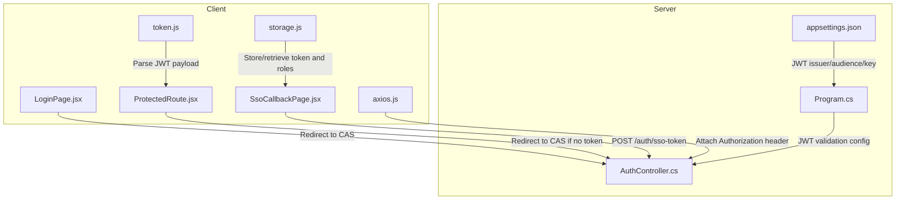
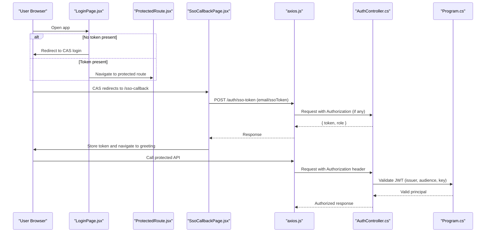
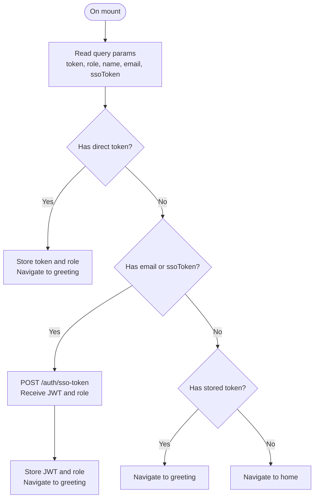
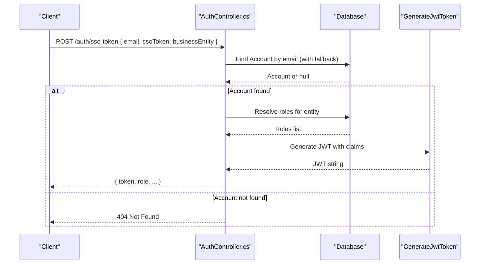
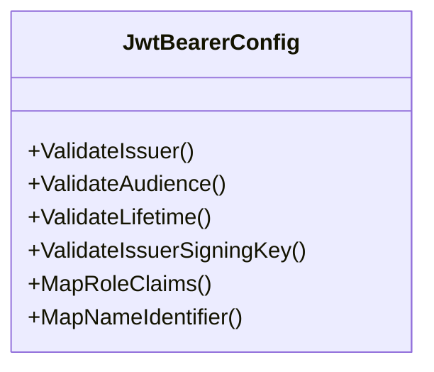
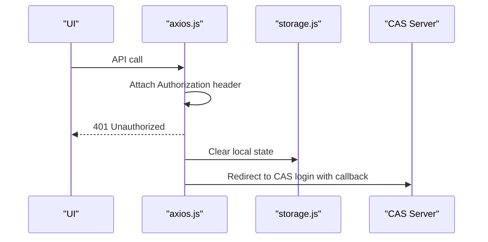
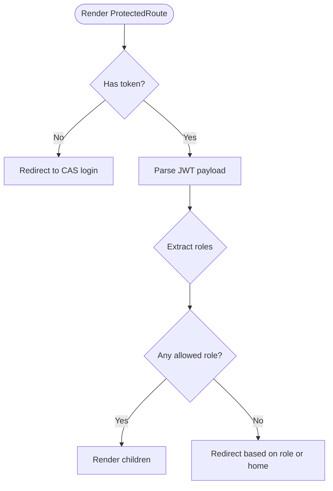
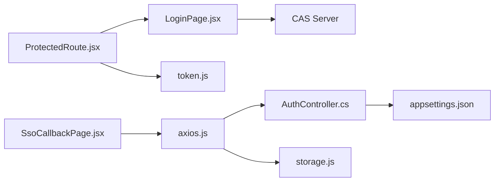

# CAS Single Sign-On Integration

<cite>
**Referenced Files in This Document**
- [SsoCallbackPage.jsx](file://client/src/pages/SsoCallbackPage.jsx)
- [LoginPage.jsx](file://client/src/pages/LoginPage.jsx)
- [axios.js](file://client/src/api/axios.js)
- [storage.js](file://client/src/utils/storage.js)
- [ProtectedRoute.jsx](file://client/src/components/ProtectedRoute.jsx)
- [token.js](file://client/src/utils/token.js)
- [AuthController.cs](file://server(Api)/Controllers/AuthController.cs)
- [Program.cs](file://server(Api)/Program.cs)
- [appsettings.json](file://server(Api)/appsettings.json)
</cite>

## Table of Contents
1. Introduction
2. Project Structure
3. Core Components
4. Architecture Overview
5. Detailed Component Analysis
6. Dependency Analysis
7. Performance Considerations
8. Troubleshooting Guide
9. Conclusion

## Introduction
This document explains how Exam-Hub integrates with a Central Authentication Service (CAS) for Single Sign-On (SSO). It covers the end-to-end flow from user login via CAS to obtaining an application JWT, how the callback mechanism works, configuration requirements, fallback behavior when CAS is unavailable, and security considerations. The integration uses a client-side redirect to CAS, a callback page that exchanges credentials or tokens for an application JWT, and server-side token validation using JWT Bearer authentication.

## Project Structure
The SSO integration spans both client and server:
- Client redirects unauthenticated users to CAS and handles the callback to obtain and store an application JWT.
- Server validates incoming requests using JWT Bearer tokens and provides an endpoint to exchange CAS information for an application JWT.

**Diagram sources**
- [LoginPage.jsx:9-28](file://client/src/pages/LoginPage.jsx#L9-L28)
- [ProtectedRoute.jsx:5-14](file://client/src/components/ProtectedRoute.jsx#L5-L14)
- [SsoCallbackPage.jsx:10-47](file://client/src/pages/SsoCallbackPage.jsx#L10-L47)
- [axios.js:12-44](file://client/src/api/axios.js#L12-L44)
- [storage.js:69-85](file://client/src/utils/storage.js#L69-L85)
- [token.js:6-30](file://client/src/utils/token.js#L6-L30)
- [AuthController.cs:251-313](file://server(Api)/Controllers/AuthController.cs#L251-L313)
- [Program.cs:43-81](file://server(Api)/Program.cs#L43-L81)
- [appsettings.json:5-9](file://server(Api)/appsettings.json#L5-L9)

**Section sources**
- [LoginPage.jsx:9-28](file://client/src/pages/LoginPage.jsx#L9-L28)
- [ProtectedRoute.jsx:5-14](file://client/src/components/ProtectedRoute.jsx#L5-L14)
- [SsoCallbackPage.jsx:10-47](file://client/src/pages/SsoCallbackPage.jsx#L10-L47)
- [axios.js:12-44](file://client/src/api/axios.js#L12-L44)
- [storage.js:69-85](file://client/src/utils/storage.js#L69-L85)
- [token.js:6-30](file://client/src/utils/token.js#L6-L30)
- [AuthController.cs:251-313](file://server(Api)/Controllers/AuthController.cs#L251-L313)
- [Program.cs:43-81](file://server(Api)/Program.cs#L43-L81)
- [appsettings.json:5-9](file://server(Api)/appsettings.json#L5-L9)

## Core Components
- Login redirection and protection:
  - LoginPage.jsx redirects to CAS when no token exists or when a token is passed directly.
  - ProtectedRoute.jsx redirects to CAS if there is no token and enforces role-based access by parsing the JWT.
- Callback handling:
  - SsoCallbackPage.jsx processes CAS parameters, stores tokens and roles locally, and calls the backend to exchange CAS info for an application JWT.
- API client:
  - axios.js attaches the Authorization header on every request and triggers CAS login on 401 responses.
- Storage utilities:
  - storage.js persists tokens and roles and supports CAS logout.
- Token utilities:
  - token.js decodes JWT payloads safely for role checks.
- Server authentication:
  - AuthController.cs exposes /auth/sso-token to issue an application JWT after verifying the user’s account and roles.
  - Program.cs configures JWT Bearer authentication and role claim mapping.
- Configuration:
  - appsettings.json defines JWT issuer, audience, and signing key used by the server.

**Section sources**
- [LoginPage.jsx:9-28](file://client/src/pages/LoginPage.jsx#L9-L28)
- [ProtectedRoute.jsx:5-14](file://client/src/components/ProtectedRoute.jsx#L5-L14)
- [SsoCallbackPage.jsx:10-47](file://client/src/pages/SsoCallbackPage.jsx#L10-L47)
- [axios.js:12-44](file://client/src/api/axios.js#L12-L44)
- [storage.js:69-85](file://client/src/utils/storage.js#L69-L85)
- [token.js:6-30](file://client/src/utils/token.js#L6-L30)
- [AuthController.cs:251-313](file://server(Api)/Controllers/AuthController.cs#L251-L313)
- [Program.cs:43-81](file://server(Api)/Program.cs#L43-L81)
- [appsettings.json:5-9](file://server(Api)/appsettings.json#L5-L9)

## Architecture Overview
The system uses a hybrid SSO approach:
- Client redirects to CAS for authentication.
- On successful CAS login, the client either receives a direct token or exchanges CAS identity for an application JWT via the backend.
- All subsequent API calls include the application JWT, which the server validates using JWT Bearer middleware.

**Diagram sources**
- [LoginPage.jsx:9-28](file://client/src/pages/LoginPage.jsx#L9-L28)
- [ProtectedRoute.jsx:5-14](file://client/src/components/ProtectedRoute.jsx#L5-L14)
- [SsoCallbackPage.jsx:10-47](file://client/src/pages/SsoCallbackPage.jsx#L10-L47)
- [axios.js:12-44](file://client/src/api/axios.js#L12-L44)
- [AuthController.cs:251-313](file://server(Api)/Controllers/AuthController.cs#L251-L313)
- [Program.cs:43-81](file://server(Api)/Program.cs#L43-L81)

## Detailed Component Analysis

### SSO Callback Flow (SsoCallbackPage.jsx)
- Reads query parameters from CAS:
  - Direct token path: If a token is provided, it stores the token and role locally and navigates to the greeting page.
  - Exchange path: If email or ssoToken is provided, it calls the backend /auth/sso-token to obtain an application JWT, then stores it and navigates.
- Fallback: If a stored token exists, it navigates to the greeting; otherwise, it returns to the home page.

**Diagram sources**
- [SsoCallbackPage.jsx:10-47](file://client/src/pages/SsoCallbackPage.jsx#L10-L47)

**Section sources**
- [SsoCallbackPage.jsx:10-47](file://client/src/pages/SsoCallbackPage.jsx#L10-L47)

### Backend SSO Token Endpoint (AuthController.cs)
- Validates input and resolves the business entity context.
- Finds the user account by email across multiple tables with fallback logic.
- Resolves roles scoped to the business entity; defaults to Student if none found.
- Generates and returns an application JWT containing claims for subject, email, and roles.

**Diagram sources**
- [AuthController.cs:251-313](file://server(Api)/Controllers/AuthController.cs#L251-L313)
- [AuthController.cs:381-420](file://server(Api)/Controllers/AuthController.cs#L381-L420)

**Section sources**
- [AuthController.cs:251-313](file://server(Api)/Controllers/AuthController.cs#L251-L313)
- [AuthController.cs:381-420](file://server(Api)/Controllers/AuthController.cs#L381-L420)

### JWT Validation and Role Mapping (Program.cs)
- Configures JWT Bearer authentication with issuer, audience, and signing key from configuration.
- Maps additional claims (Role/role to standard role claim; AccountId/sub/nameid to NameIdentifier) to support authorization policies.

**Diagram sources**
- [Program.cs:43-81](file://server(Api)/Program.cs#L43-L81)

**Section sources**
- [Program.cs:43-81](file://server(Api)/Program.cs#L43-L81)

### Client Authentication Helpers (axios.js, storage.js, token.js)
- axios.js:
  - Attaches Authorization header automatically.
  - On 401, clears local state and redirects to CAS login with the current origin as the callback URL.
- storage.js:
  - Persists token, role, and user info.
  - Provides CAS logout helper that calls the CAS API to revoke session.
- token.js:
  - Safely parses JWT payloads and extracts user identifiers.

**Diagram sources**
- [axios.js:12-44](file://client/src/api/axios.js#L12-L44)
- [storage.js:69-85](file://client/src/utils/storage.js#L69-L85)

**Section sources**
- [axios.js:12-44](file://client/src/api/axios.js#L12-L44)
- [storage.js:69-85](file://client/src/utils/storage.js#L69-L85)
- [token.js:6-30](file://client/src/utils/token.js#L6-L30)

### Route Protection and Role Enforcement (ProtectedRoute.jsx)
- If no token is present, redirects to CAS login.
- Parses the JWT to determine roles and enforces allowed roles; otherwise, redirects to appropriate pages or home.

**Diagram sources**
- [ProtectedRoute.jsx:5-14](file://client/src/components/ProtectedRoute.jsx#L5-L14)
- [ProtectedRoute.jsx:16-88](file://client/src/components/ProtectedRoute.jsx#L16-L88)

**Section sources**
- [ProtectedRoute.jsx:5-14](file://client/src/components/ProtectedRoute.jsx#L5-L14)
- [ProtectedRoute.jsx:16-88](file://client/src/components/ProtectedRoute.jsx#L16-L88)

## Dependency Analysis
- Client dependencies:
  - LoginPage.jsx and ProtectedRoute.jsx depend on environment variables for CAS URL and redirect handling.
  - SsoCallbackPage.jsx depends on axios.js to call the backend and storage.js to persist session data.
  - axios.js depends on storage.js for token retrieval and CAS logout.
- Server dependencies:
  - AuthController.cs depends on database access and configuration for JWT generation.
  - Program.cs configures JWT validation using settings from appsettings.json.

**Diagram sources**
- [LoginPage.jsx:9-28](file://client/src/pages/LoginPage.jsx#L9-L28)
- [ProtectedRoute.jsx:5-14](file://client/src/components/ProtectedRoute.jsx#L5-L14)
- [SsoCallbackPage.jsx:10-47](file://client/src/pages/SsoCallbackPage.jsx#L10-L47)
- [axios.js:12-44](file://client/src/api/axios.js#L12-L44)
- [AuthController.cs:251-313](file://server(Api)/Controllers/AuthController.cs#L251-L313)
- [appsettings.json:5-9](file://server(Api)/appsettings.json#L5-L9)
- [token.js:6-30](file://client/src/utils/token.js#L6-L30)
- [storage.js:69-85](file://client/src/utils/storage.js#L69-L85)

**Section sources**
- [LoginPage.jsx:9-28](file://client/src/pages/LoginPage.jsx#L9-L28)
- [ProtectedRoute.jsx:5-14](file://client/src/components/ProtectedRoute.jsx#L5-L14)
- [SsoCallbackPage.jsx:10-47](file://client/src/pages/SsoCallbackPage.jsx#L10-L47)
- [axios.js:12-44](file://client/src/api/axios.js#L12-L44)
- [AuthController.cs:251-313](file://server(Api)/Controllers/AuthController.cs#L251-L313)
- [appsettings.json:5-9](file://server(Api)/appsettings.json#L5-L9)
- [token.js:6-30](file://client/src/utils/token.js#L6-L30)
- [storage.js:69-85](file://client/src/utils/storage.js#L69-L85)

## Performance Considerations
- Minimize network calls during SSO callback by handling direct token paths when available.
- Use role caching on the client side to avoid repeated role checks.
- Ensure JWT expiration is reasonable to balance security and performance.
- Avoid excessive retries on CAS errors; implement exponential backoff if needed.

[No sources needed since this section provides general guidance]

## Troubleshooting Guide
Common issues and resolutions:
- 401 Unauthorized on API calls:
  - Cause: Missing or expired token.
  - Resolution: Ensure storage contains a valid token; axios will redirect to CAS on 401.
- CAS redirect loop:
  - Cause: Incorrect callback URL or missing parameters.
  - Resolution: Verify VITE_CAS_URL and ensure /sso-callback is registered and accessible.
- Token not stored:
  - Cause: Callback did not receive token or exchange failed.
  - Resolution: Inspect SsoCallbackPage.jsx logic and /auth/sso-token response.
- Role mismatch:
  - Cause: JWT does not contain expected role claims.
  - Resolution: Confirm role mapping in Program.cs and roles assigned in the database.
- CAS logout not working:
  - Cause: CAS API unreachable or invalid token.
  - Resolution: Check storage.js logoutFromCas implementation and CAS API availability.

**Section sources**
- [axios.js:29-44](file://client/src/api/axios.js#L29-L44)
- [SsoCallbackPage.jsx:10-47](file://client/src/pages/SsoCallbackPage.jsx#L10-L47)
- [AuthController.cs:251-313](file://server(Api)/Controllers/AuthController.cs#L251-L313)
- [Program.cs:43-81](file://server(Api)/Program.cs#L43-L81)
- [storage.js:69-85](file://client/src/utils/storage.js#L69-L85)

## Conclusion
Exam-Hub integrates CAS SSO by redirecting unauthenticated users to CAS, handling the callback to obtain an application JWT, and enforcing access control via JWT Bearer authentication. The backend provides a secure endpoint to exchange CAS identity for an application JWT, while the frontend manages redirects, token storage, and role-based navigation. Proper configuration of JWT settings and robust error handling ensures a reliable and secure SSO experience.

[No sources needed since this section summarizes without analyzing specific files]