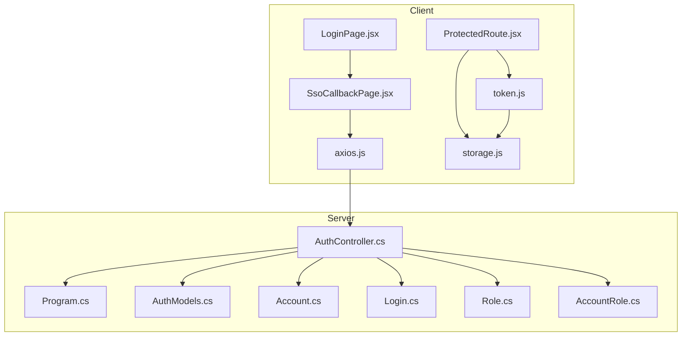
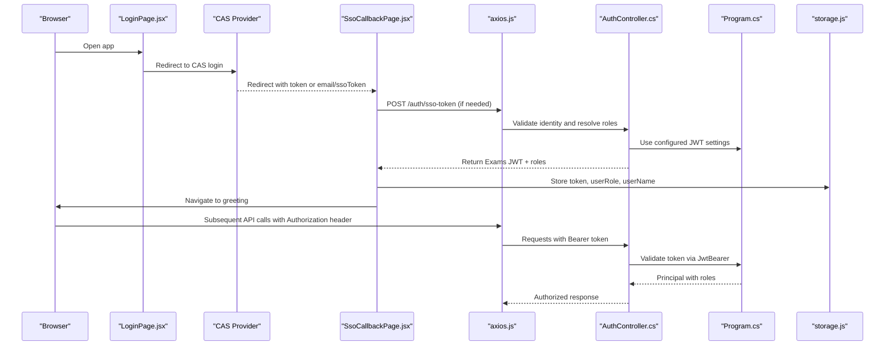
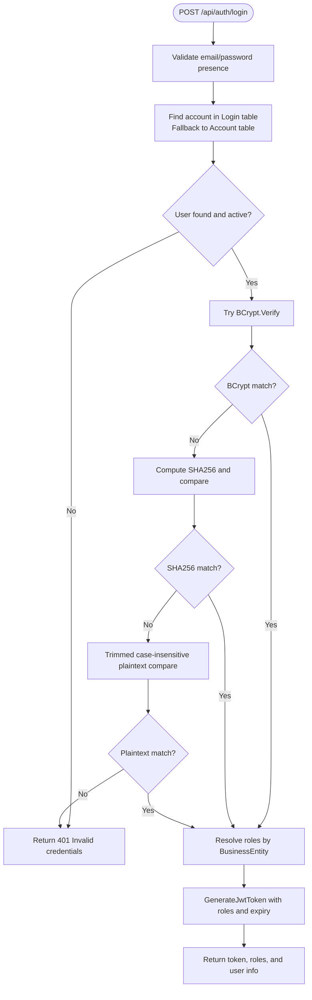
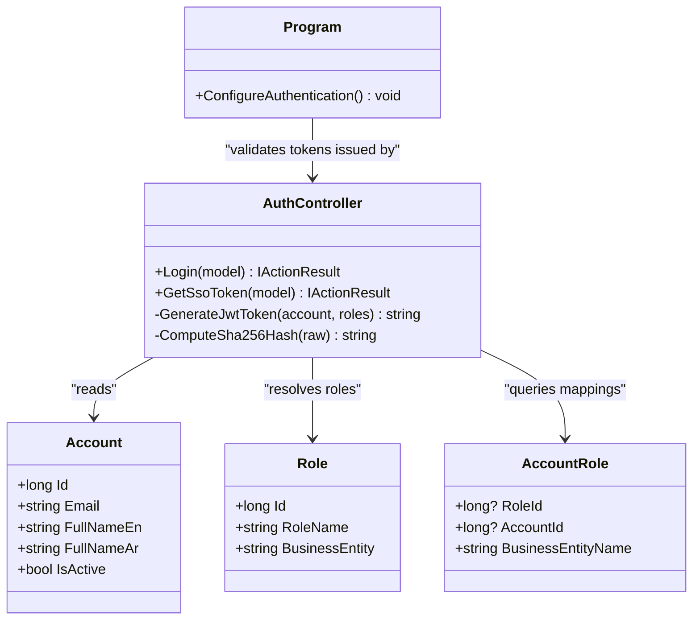
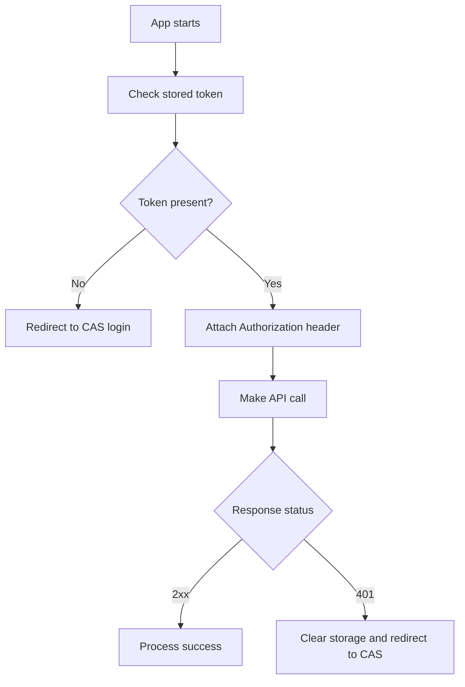
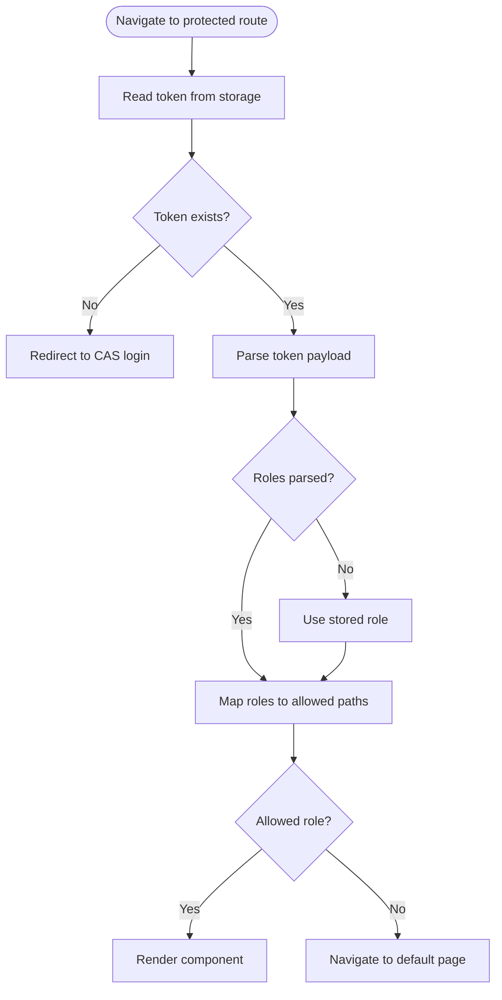
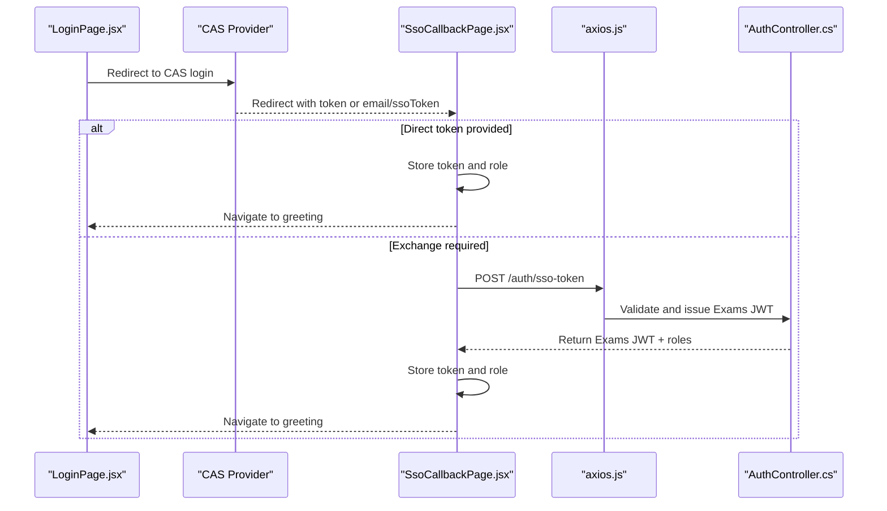
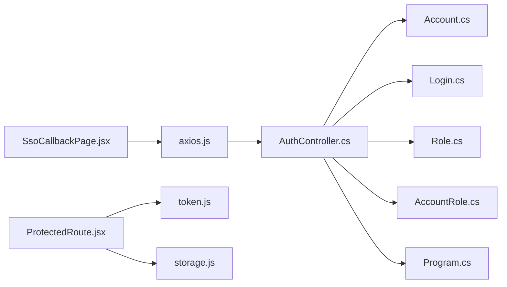

# JWT Authentication Flow

<cite>
**Referenced Files in This Document**
- [AuthController.cs](file://server/Api/Controllers/AuthController.cs)
- [Program.cs](file://server/Api/Program.cs)
- [AuthModels.cs](file://server/Api/Models/AuthModels.cs)
- [Account.cs](file://server/Api/Models/Account.cs)
- [Login.cs](file://server/Api/Models/Login.cs)
- [Role.cs](file://server/Api/Models/Role.cs)
- [AccountRole.cs](file://server/Api/Models/AccountRole.cs)
- [token.js](file://client/src/utils/token.js)
- [storage.js](file://client/src/utils/storage.js)
- [axios.js](file://client/src/api/axios.js)
- [LoginPage.jsx](file://client/src/pages/LoginPage.jsx)
- [SsoCallbackPage.jsx](file://client/src/pages/SsoCallbackPage.jsx)
- [ProtectedRoute.jsx](file://client/src/components/ProtectedRoute.jsx)
</cite>

## Table of Contents
1. [Introduction](#introduction)
2. [Project Structure](#project-structure)
3. [Core Components](#core-components)
4. [Architecture Overview](#architecture-overview)
5. [Detailed Component Analysis](#detailed-component-analysis)
6. [Dependency Analysis](#dependency-analysis)
7. [Performance Considerations](#performance-considerations)
8. [Troubleshooting Guide](#troubleshooting-guide)
9. [Conclusion](#conclusion)

## Introduction
This document explains the complete JWT authentication lifecycle in Exam-Hub, from login request to token validation and client-side management. It covers:
- Multi-layer password verification using BCrypt, SHA256, and plaintext fallback in AuthController.cs
- JWT generation with role claims and expiration handling
- Client-side token storage and parsing in token.js and storage.js
- API call flow, error handling, and SSO integration points
- Security implications and troubleshooting guidance

## Project Structure
The authentication system spans server controllers, models, ASP.NET configuration, and React client utilities and pages.

**Diagram sources**
- [LoginPage.jsx:1-76](file://client/src/pages/LoginPage.jsx#L1-L76)
- [SsoCallbackPage.jsx:1-67](file://client/src/pages/SsoCallbackPage.jsx#L1-L67)
- [axios.js:1-62](file://client/src/api/axios.js#L1-L62)
- [token.js:1-31](file://client/src/utils/token.js#L1-L31)
- [storage.js:1-87](file://client/src/utils/storage.js#L1-L87)
- [ProtectedRoute.jsx:1-89](file://client/src/components/ProtectedRoute.jsx#L1-L89)
- [AuthController.cs:1-451](file://server/Api/Controllers/AuthController.cs#L1-L451)
- [Program.cs:1-146](file://server/Api/Program.cs#L1-L146)
- [AuthModels.cs:1-30](file://server/Api/Models/AuthModels.cs#L1-L30)
- [Account.cs:1-82](file://server/Api/Models/Account.cs#L1-L82)
- [Login.cs:1-22](file://server/Api/Models/Login.cs#L1-L22)
- [Role.cs:1-18](file://server/Api/Models/Role.cs#L1-L18)
- [AccountRole.cs:1-16](file://server/Api/Models/AccountRole.cs#L1-L16)

**Section sources**
- [LoginPage.jsx:1-76](file://client/src/pages/LoginPage.jsx#L1-L76)
- [SsoCallbackPage.jsx:1-67](file://client/src/pages/SsoCallbackPage.jsx#L1-L67)
- [AuthController.cs:1-451](file://server/Api/Controllers/AuthController.cs#L1-L451)
- [Program.cs:1-146](file://server/Api/Program.cs#L1-L146)

## Core Components
- Server authentication controller: handles registration, login, SSO token exchange, profile operations, and JWT issuance.
- ASP.NET JWT configuration: validates tokens, maps claims, and enforces authorization policies.
- Client utilities: parse JWT payloads, extract user identifiers, manage persistent or session storage, and attach tokens to requests.
- Pages and routes: handle CAS redirect, callback processing, protected route enforcement, and navigation based on roles.

Key responsibilities:
- Password verification layers (BCrypt → SHA256 → plaintext fallback)
- Role resolution and claim assignment
- Token creation with issuer, audience, signing key, and expiration
- Client-side token persistence and automatic Authorization header injection
- Global 401 handling and CAS re-authentication

**Section sources**
- [AuthController.cs:118-249](file://server/Api/Controllers/AuthController.cs#L118-L249)
- [AuthController.cs:381-420](file://server/Api/Controllers/AuthController.cs#L381-L420)
- [Program.cs:43-90](file://server/Api/Program.cs#L43-L90)
- [token.js:1-31](file://client/src/utils/token.js#L1-L31)
- [storage.js:1-87](file://client/src/utils/storage.js#L1-L87)
- [axios.js:1-62](file://client/src/api/axios.js#L1-L62)

## Architecture Overview
The authentication architecture integrates a CAS-based SSO entry point with an internal JWT issuing service. The client stores the resulting JWT and uses it for subsequent API calls.

**Diagram sources**
- [LoginPage.jsx:1-76](file://client/src/pages/LoginPage.jsx#L1-L76)
- [SsoCallbackPage.jsx:1-67](file://client/src/pages/SsoCallbackPage.jsx#L1-L67)
- [axios.js:1-62](file://client/src/api/axios.js#L1-L62)
- [AuthController.cs:118-249](file://server/Api/Controllers/AuthController.cs#L118-L249)
- [Program.cs:43-90](file://server/Api/Program.cs#L43-L90)
- [storage.js:1-87](file://client/src/utils/storage.js#L1-L87)

## Detailed Component Analysis

### Login and Password Verification Flow
The login endpoint performs layered password verification to support legacy data while encouraging modern hashing:
1. BCrypt verification against stored hash
2. SHA256 fallback for legacy hashes
3. Plaintext fallback for testing or legacy entries

After successful verification, the controller resolves roles scoped by business entity and generates a JWT.

**Diagram sources**
- [AuthController.cs:118-249](file://server/Api/Controllers/AuthController.cs#L118-L249)
- [AuthController.cs:442-449](file://server/Api/Controllers/AuthController.cs#L442-L449)

**Section sources**
- [AuthController.cs:118-249](file://server/Api/Controllers/AuthController.cs#L118-L249)
- [AuthModels.cs:10-15](file://server/Api/Models/AuthModels.cs#L10-L15)

### JWT Generation and Claims
The JWT is generated with:
- Subject and email claims
- One or more role claims derived from resolved roles
- Issuer, audience, and symmetric signing key from configuration
- Expiration set to 8 hours from current UTC time

**Diagram sources**
- [AuthController.cs:381-420](file://server/Api/Controllers/AuthController.cs#L381-L420)
- [Program.cs:43-90](file://server/Api/Program.cs#L43-L90)
- [Account.cs:1-82](file://server/Api/Models/Account.cs#L1-L82)
- [Role.cs:1-18](file://server/Api/Models/Role.cs#L1-L18)
- [AccountRole.cs:1-16](file://server/Api/Models/AccountRole.cs#L1-L16)

**Section sources**
- [AuthController.cs:381-420](file://server/Api/Controllers/AuthController.cs#L381-L420)
- [Program.cs:43-90](file://server/Api/Program.cs#L43-L90)

### Client-Side Token Storage and Management
- token.js provides safe JWT payload decoding, handling URL-safe base64 without padding and mapping multiple known claim names for user ID extraction.
- storage.js abstracts localStorage vs sessionStorage based on a persist flag, clears auth-related keys, and supports CAS logout.
- axios.js attaches the stored token to every request and handles 401 responses by clearing local state and redirecting to CAS for re-authentication.

**Diagram sources**
- [token.js:1-31](file://client/src/utils/token.js#L1-L31)
- [storage.js:1-87](file://client/src/utils/storage.js#L1-L87)
- [axios.js:1-62](file://client/src/api/axios.js#L1-L62)

**Section sources**
- [token.js:1-31](file://client/src/utils/token.js#L1-L31)
- [storage.js:1-87](file://client/src/utils/storage.js#L1-L87)
- [axios.js:1-62](file://client/src/api/axios.js#L1-L62)

### Protected Routes and Role Enforcement
- ProtectedRoute.jsx parses the token to determine roles and redirects users to appropriate dashboards.
- If token parsing fails, it falls back to stored role values.
- Program.cs defines authorization policies for StudentOnly, TeacherOnly, SuperadminOnly, and TeacherOrAdmin.

**Diagram sources**
- [ProtectedRoute.jsx:1-89](file://client/src/components/ProtectedRoute.jsx#L1-L89)
- [Program.cs:83-90](file://server/Api/Program.cs#L83-L90)

**Section sources**
- [ProtectedRoute.jsx:1-89](file://client/src/components/ProtectedRoute.jsx#L1-L89)
- [Program.cs:83-90](file://server/Api/Program.cs#L83-L90)

### SSO Integration Points
- LoginPage.jsx redirects to CAS and forwards prompt parameters when present.
- SsoCallbackPage.jsx processes either a direct token or exchanges email/ssoToken for an Exams JWT via /auth/sso-token.
- On success, it stores token, role, and user name, then navigates to the greeting page.

**Diagram sources**
- [LoginPage.jsx:1-76](file://client/src/pages/LoginPage.jsx#L1-L76)
- [SsoCallbackPage.jsx:1-67](file://client/src/pages/SsoCallbackPage.jsx#L1-L67)
- [AuthController.cs:251-313](file://server/Api/Controllers/AuthController.cs#L251-L313)

**Section sources**
- [LoginPage.jsx:1-76](file://client/src/pages/LoginPage.jsx#L1-L76)
- [SsoCallbackPage.jsx:1-67](file://client/src/pages/SsoCallbackPage.jsx#L1-L67)
- [AuthController.cs:251-313](file://server/Api/Controllers/AuthController.cs#L251-L313)

## Dependency Analysis
The authentication flow depends on several modules:
- AuthController.cs depends on database models (Account, Login, Role, AccountRole) and configuration for JWT settings.
- Program.cs configures JWT validation and authorization policies.
- Client components depend on token.js and storage.js for parsing and persistence, and axios.js for HTTP transport.

**Diagram sources**
- [AuthController.cs:1-451](file://server/Api/Controllers/AuthController.cs#L1-L451)
- [Account.cs:1-82](file://server/Api/Models/Account.cs#L1-L82)
- [Login.cs:1-22](file://server/Api/Models/Login.cs#L1-L22)
- [Role.cs:1-18](file://server/Api/Models/Role.cs#L1-L18)
- [AccountRole.cs:1-16](file://server/Api/Models/AccountRole.cs#L1-L16)
- [Program.cs:1-146](file://server/Api/Program.cs#L1-L146)
- [SsoCallbackPage.jsx:1-67](file://client/src/pages/SsoCallbackPage.jsx#L1-L67)
- [axios.js:1-62](file://client/src/api/axios.js#L1-L62)
- [ProtectedRoute.jsx:1-89](file://client/src/components/ProtectedRoute.jsx#L1-L89)
- [token.js:1-31](file://client/src/utils/token.js#L1-L31)
- [storage.js:1-87](file://client/src/utils/storage.js#L1-L87)

**Section sources**
- [AuthController.cs:1-451](file://server/Api/Controllers/AuthController.cs#L1-L451)
- [Program.cs:1-146](file://server/Api/Program.cs#L1-L146)
- [SsoCallbackPage.jsx:1-67](file://client/src/pages/SsoCallbackPage.jsx#L1-L67)
- [axios.js:1-62](file://client/src/api/axios.js#L1-L62)
- [ProtectedRoute.jsx:1-89](file://client/src/components/ProtectedRoute.jsx#L1-L89)
- [token.js:1-31](file://client/src/utils/token.js#L1-L31)
- [storage.js:1-87](file://client/src/utils/storage.js#L1-L87)

## Performance Considerations
- Database queries during login include role resolution; ensure indexes exist on Email, AccountId, RoleId, and BusinessEntityName columns to reduce lookup times.
- BCrypt verification is computationally expensive; consider caching frequently accessed accounts if login volume is high.
- Avoid unnecessary includes; only load related entities when needed.
- Client-side token parsing is lightweight but should be used judiciously to avoid repeated computations.

[No sources needed since this section provides general guidance]

## Troubleshooting Guide
Common issues and resolutions:
- Invalid credentials: Occurs when none of the password verification layers succeed. Check whether stored hashes are BCrypt, SHA256, or plaintext. Ensure the input matches the expected format.
- Missing JWT configuration: If Jwt:Key, Jwt:Issuer, or Jwt:Audience are missing, token generation will fail. Verify application configuration.
- Role not found: Registration requires a valid role for the target business entity. Confirm that the requested role exists and is mapped correctly.
- 401 Unauthorized on API calls: The client clears storage and redirects to CAS. Ensure the token is present and not expired. Check CORS and network connectivity.
- Token parsing errors: Malformed or non-JWT strings return null from parseToken. Validate the token format and ensure URL-safe base64 handling.

Operational checks:
- Inspect logs for login attempts, hash mismatches, and token generation errors.
- Validate that the client’s axios interceptor attaches the Authorization header.
- Confirm that ProtectedRoute correctly maps roles to allowed paths.

**Section sources**
- [AuthController.cs:118-249](file://server/Api/Controllers/AuthController.cs#L118-L249)
- [AuthController.cs:381-420](file://server/Api/Controllers/AuthController.cs#L381-L420)
- [axios.js:27-58](file://client/src/api/axios.js#L27-L58)
- [ProtectedRoute.jsx:1-89](file://client/src/components/ProtectedRoute.jsx#L1-L89)
- [token.js:1-31](file://client/src/utils/token.js#L1-L31)

## Conclusion
Exam-Hub implements a robust JWT authentication flow combining CAS SSO with internal token issuance. The multi-layer password verification ensures compatibility with legacy data while supporting secure hashing. Role-based access control is enforced both at the client and server levels. Proper configuration of JWT settings and careful handling of token storage and parsing are essential for reliable operation.

[No sources needed since this section summarizes without analyzing specific files]