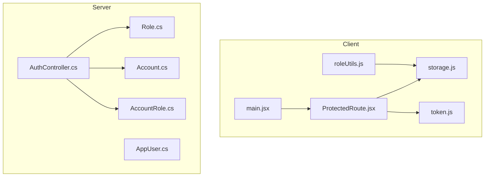
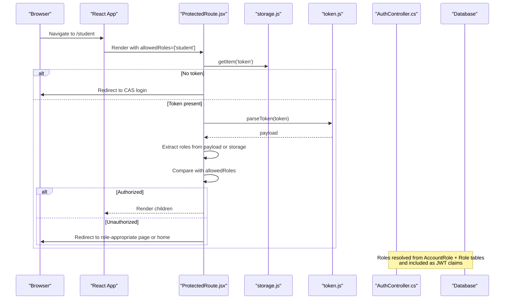
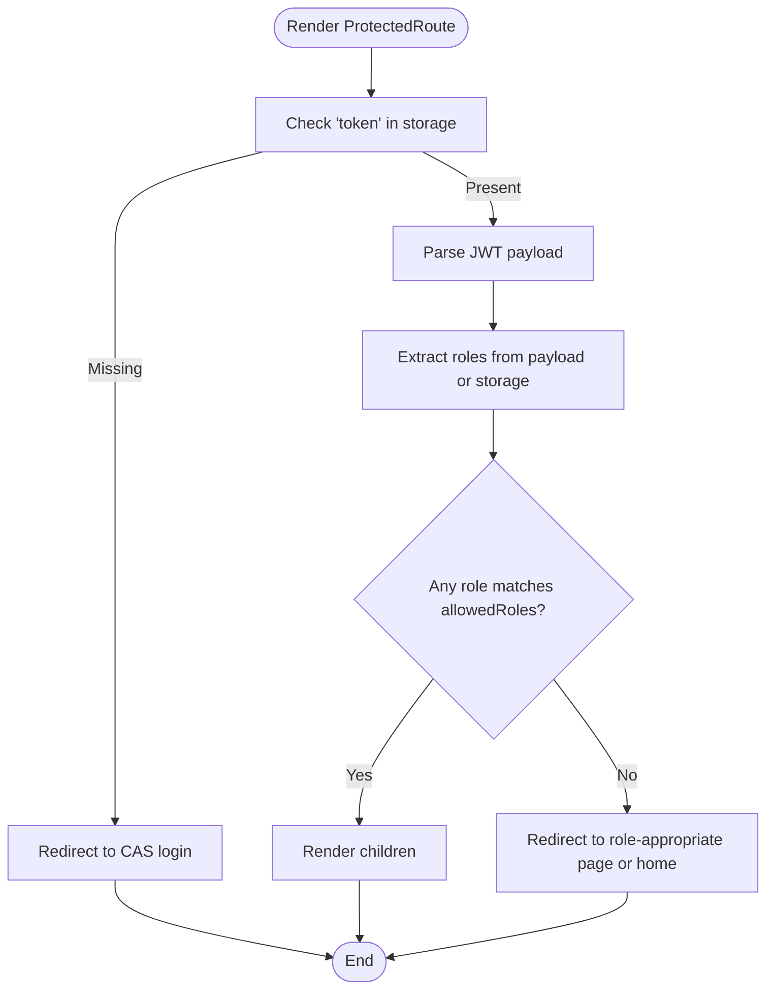
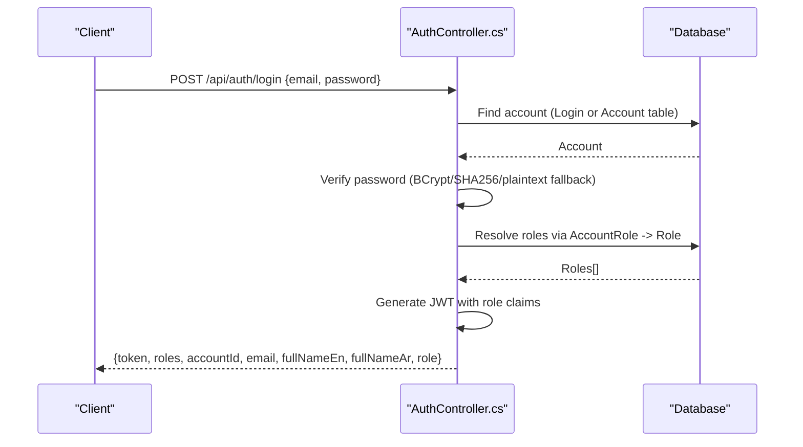
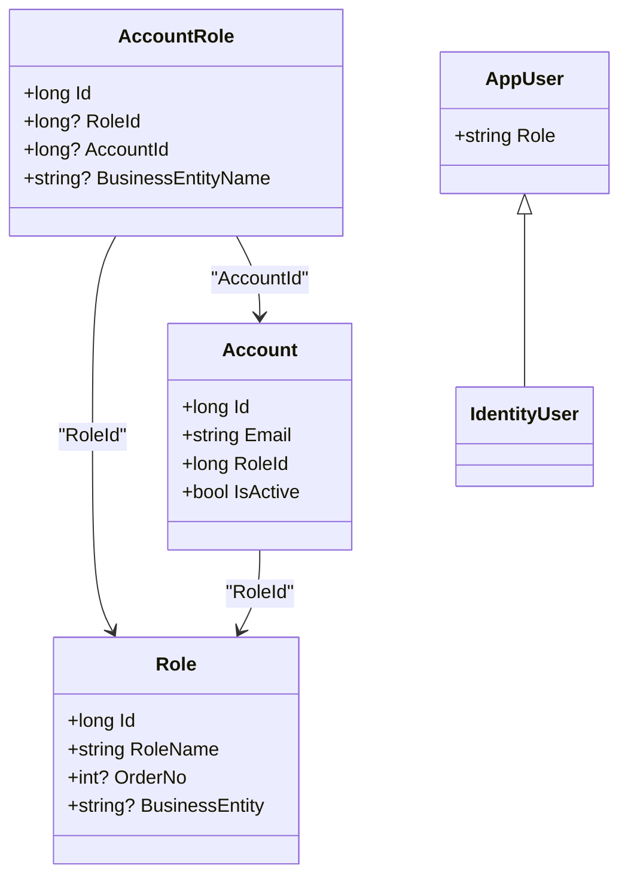
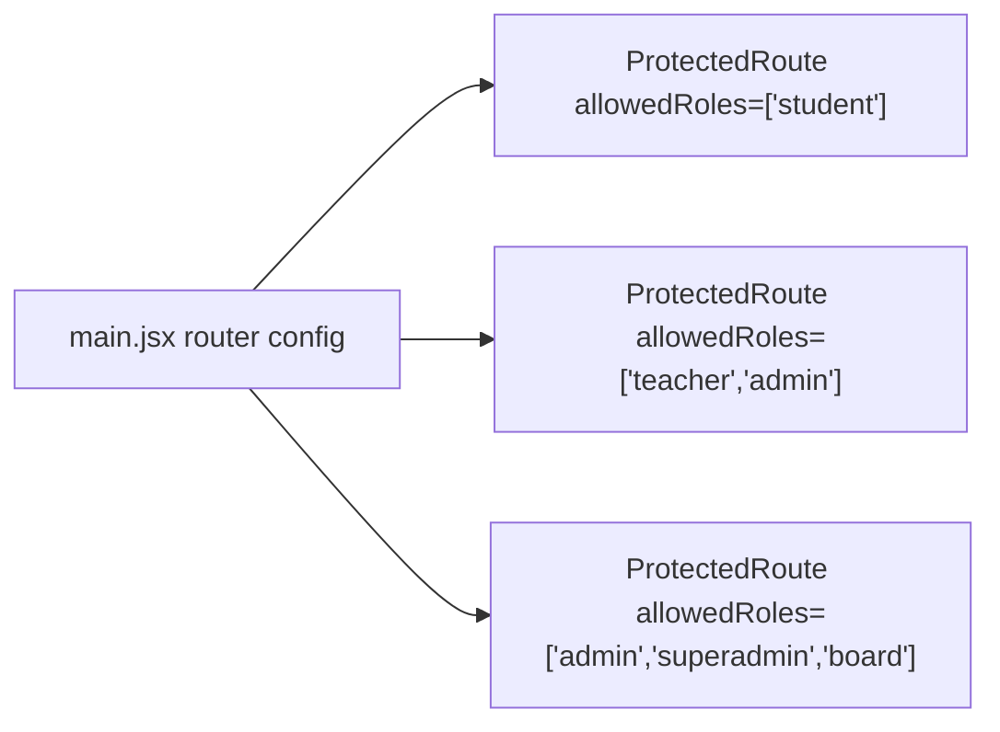
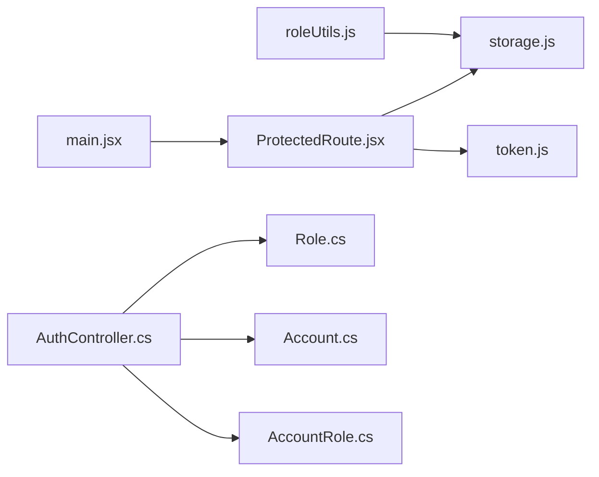

# Role-Based Access Control

<cite>
**Referenced Files in This Document**
- [ProtectedRoute.jsx](file://client/src/components/ProtectedRoute.jsx)
- [roleUtils.js](file://client/src/utils/roleUtils.js)
- [storage.js](file://client/src/utils/storage.js)
- [token.js](file://client/src/utils/token.js)
- [main.jsx](file://client/src/main.jsx)
- [AuthController.cs](file://server/Api/Controllers/AuthController.cs)
- [Role.cs](file://server/Api/Models/Role.cs)
- [AppUser.cs](file://server/Api/Models/AppUser.cs)
- [Account.cs](file://server/Api/Models/Account.cs)
- [AccountRole.cs](file://server/Api/Models/AccountRole.cs)
</cite>

## Table of Contents
1. [Introduction](#introduction)
2. [Project Structure](#project-structure)
3. [Core Components](#core-components)
4. [Architecture Overview](#architecture-overview)
5. [Detailed Component Analysis](#detailed-component-analysis)
6. [Dependency Analysis](#dependency-analysis)
7. [Performance Considerations](#performance-considerations)
8. [Troubleshooting Guide](#troubleshooting-guide)
9. [Conclusion](#conclusion)
10. [Appendices](#appendices)

## Introduction
This document explains the role-based access control (RBAC) system in Exam-Hub, covering both client-side and server-side implementations. It details how the ProtectedRoute component validates user roles before granting access to protected routes, how role utility functions integrate with authentication, and how server-side models define roles and permissions. It also provides examples for implementing protected routes, checking roles in components, handling unauthorized access, and best practices for defining new roles and managing assignments across the application.

## Project Structure
The RBAC implementation spans the React frontend and ASP.NET Core backend:
- Client-side:
  - Route protection via ProtectedRoute
  - Role checks via roleUtils
  - Token parsing and storage utilities
  - Router configuration using main.jsx
- Server-side:
  - Authentication controller issuing JWTs with role claims
  - Data models for roles, accounts, and account-role mappings

**Diagram sources**
- [ProtectedRoute.jsx:1-89](file://client/src/components/ProtectedRoute.jsx#L1-L89)
- [roleUtils.js:1-21](file://client/src/utils/roleUtils.js#L1-L21)
- [storage.js:1-88](file://client/src/utils/storage.js#L1-L88)
- [token.js:1-31](file://client/src/utils/token.js#L1-L31)
- [main.jsx:17-56](file://client/src/main.jsx#L17-L56)
- [AuthController.cs:118-249](file://server/Api/Controllers/AuthController.cs#L118-L249)
- [Role.cs:6-17](file://server/Api/Models/Role.cs#L6-L17)
- [AppUser.cs:5-8](file://server/Api/Models/AppUser.cs#L5-L8)
- [Account.cs:6-81](file://server/Api/Models/Account.cs#L6-L81)
- [AccountRole.cs:6-15](file://server/Api/Models/AccountRole.cs#L6-L15)

**Section sources**
- [ProtectedRoute.jsx:1-89](file://client/src/components/ProtectedRoute.jsx#L1-L89)
- [roleUtils.js:1-21](file://client/src/utils/roleUtils.js#L1-L21)
- [storage.js:1-88](file://client/src/utils/storage.js#L1-L88)
- [token.js:1-31](file://client/src/utils/token.js#L1-L31)
- [main.jsx:17-56](file://client/src/main.jsx#L17-L56)
- [AuthController.cs:118-249](file://server/Api/Controllers/AuthController.cs#L118-L249)
- [Role.cs:6-17](file://server/Api/Models/Role.cs#L6-L17)
- [AppUser.cs:5-8](file://server/Api/Models/AppUser.cs#L5-L8)
- [Account.cs:6-81](file://server/Api/Models/Account.cs#L6-L81)
- [AccountRole.cs:6-15](file://server/Api/Models/AccountRole.cs#L6-L15)

## Core Components
- ProtectedRoute (client): Validates presence of a token, parses roles from JWT or fallback storage, compares against allowedRoles, and redirects appropriately when unauthorized.
- roleUtils (client): Provides helper predicates like isStudent, isTeacher, isSuperAdmin for UI-level role checks.
- storage and token (client): Utilities for reading/writing tokens and roles, and decoding JWT payloads safely.
- AuthController (server): Authenticates users, resolves roles from database, issues JWTs with role claims, and supports SSO flows.
- Models (server): Role, Account, AccountRole define the data model for roles and their assignment to accounts; AppUser extends IdentityUser with a Role field.

**Section sources**
- [ProtectedRoute.jsx:5-88](file://client/src/components/ProtectedRoute.jsx#L5-L88)
- [roleUtils.js:1-21](file://client/src/utils/roleUtils.js#L1-L21)
- [storage.js:8-67](file://client/src/utils/storage.js#L8-L67)
- [token.js:6-30](file://client/src/utils/token.js#L6-L30)
- [AuthController.cs:118-249](file://server/Api/Controllers/AuthController.cs#L118-L249)
- [Role.cs:6-17](file://server/Api/Models/Role.cs#L6-L17)
- [Account.cs:6-81](file://server/Api/Models/Account.cs#L6-L81)
- [AccountRole.cs:6-15](file://server/Api/Models/AccountRole.cs#L6-L15)
- [AppUser.cs:5-8](file://server/Api/Models/AppUser.cs#L5-L8)

## Architecture Overview
The RBAC flow integrates CAS Single Sign-On, JWT issuance, and client-side route protection:

**Diagram sources**
- [ProtectedRoute.jsx:5-88](file://client/src/components/ProtectedRoute.jsx#L5-L88)
- [storage.js:8-67](file://client/src/utils/storage.js#L8-L67)
- [token.js:6-30](file://client/src/utils/token.js#L6-L30)
- [AuthController.cs:118-249](file://server/Api/Controllers/AuthController.cs#L118-L249)

## Detailed Component Analysis

### Client-Side ProtectedRoute
ProtectedRoute enforces access control at the route level:
- If no token exists, it redirects to CAS Single Sign-On.
- It parses the JWT payload to extract roles from multiple claim formats (roles array, single role, or Microsoft identity schema).
- It falls back to stored role if needed.
- It compares extracted roles against allowedRoles and renders children only on success.
- On failure, it redirects to the most appropriate page based on the user’s actual role or to the home page.

**Diagram sources**
- [ProtectedRoute.jsx:5-88](file://client/src/components/ProtectedRoute.jsx#L5-L88)

**Section sources**
- [ProtectedRoute.jsx:5-88](file://client/src/components/ProtectedRoute.jsx#L5-L88)

### Client-Side Role Utilities
roleUtils provides simple predicates for common roles:
- isStudent(user): true if user has student role.
- isTeacher(user): true if user has teacher role.
- isSuperAdmin(user): true if user has superadmin or admin role.
- Fallback helpers for other roles return false by default.

These are intended for UI logic such as showing/hiding menu items or features.

**Section sources**
- [roleUtils.js:1-21](file://client/src/utils/roleUtils.js#L1-L21)

### Client-Side Token and Storage Utilities
- storage.js:
  - Manages persistence between localStorage and sessionStorage.
  - Provides getItem/setItem/clear and isAuthenticated helpers.
  - Clears auth-related keys including token and userRole.
- token.js:
  - Safely decodes JWT payloads without external libraries.
  - Supports extracting user IDs from various claim names.

These utilities support ProtectedRoute and other parts of the app that need to read tokens and roles.

**Section sources**
- [storage.js:8-67](file://client/src/utils/storage.js#L8-L67)
- [token.js:6-30](file://client/src/utils/token.js#L6-L30)

### Server-Side Authentication and Role Resolution
AuthController handles:
- Registration with role resolution and mapping (e.g., Admin/Superadmin mapped to Board for Exams entity).
- Login flow that verifies credentials and retrieves roles from AccountRole joined with Role.
- SSO token generation for existing accounts.
- JWT generation that includes role claims for each distinct role.

**Diagram sources**
- [AuthController.cs:118-249](file://server/Api/Controllers/AuthController.cs#L118-L249)

**Section sources**
- [AuthController.cs:118-249](file://server/Api/Controllers/AuthController.cs#L118-L249)

### Server-Side Role Models and Hierarchy
- Role.cs: Defines role metadata (Id, RoleName, OrderNo, BusinessEntity) and its relationship to Accounts.
- Account.cs: Represents an account with RoleId and relationships to many entities.
- AccountRole.cs: Junction table linking Account and Role with optional BusinessEntityName.
- AppUser.cs: Extends IdentityUser with a Role string field.

Role hierarchy and permissions:
- The application uses logical roles such as student, teacher, admin, superadmin, board.
- During registration, Admin/Superadmin are mapped to Board for the Exams business entity.
- At login/SSO, roles are resolved per business entity and included as JWT claims.
- The client treats admin/board/superadmin as higher privileges than teacher, which is higher than student.

**Diagram sources**
- [Role.cs:6-17](file://server/Api/Models/Role.cs#L6-L17)
- [Account.cs:6-81](file://server/Api/Models/Account.cs#L6-L81)
- [AccountRole.cs:6-15](file://server/Api/Models/AccountRole.cs#L6-L15)
- [AppUser.cs:5-8](file://server/Api/Models/AppUser.cs#L5-L8)

**Section sources**
- [Role.cs:6-17](file://server/Api/Models/Role.cs#L6-L17)
- [Account.cs:6-81](file://server/Api/Models/Account.cs#L6-L81)
- [AccountRole.cs:6-15](file://server/Api/Models/AccountRole.cs#L6-L15)
- [AppUser.cs:5-8](file://server/Api/Models/AppUser.cs#L5-L8)

### Example: Implementing Protected Routes
In main.jsx, routes are wrapped with ProtectedRoute and assigned allowedRoles arrays:
- /student requires student role.
- /teacher requires teacher or admin roles.
- /superadmin and /student-details require admin, superadmin, or board roles.

**Diagram sources**
- [main.jsx:17-56](file://client/src/main.jsx#L17-L56)

**Section sources**
- [main.jsx:17-56](file://client/src/main.jsx#L17-L56)

### Example: Checking User Roles in Components
Use roleUtils predicates to conditionally render UI elements:
- Show student-only features when isStudent(user) is true.
- Show teacher-only features when isTeacher(user) is true.
- Show admin/superadmin features when isSuperAdmin(user) is true.

Best practice:
- Keep role checks close to UI boundaries.
- Avoid duplicating role strings; centralize them in roleUtils.

**Section sources**
- [roleUtils.js:1-21](file://client/src/utils/roleUtils.js#L1-L21)

### Handling Unauthorized Access Scenarios
- Missing token: ProtectedRoute redirects to CAS login.
- Invalid token: Falls back to stored role; if still unauthorized, redirects to the most appropriate page or home.
- Wrong role: Redirects to the page matching the user’s actual role (superadmin/teacher/student), otherwise to home.

Recommendations:
- Always ensure a valid token is present after successful login/SSO.
- Clear stale tokens via storage.clear() during logout.
- Provide user-friendly messages for unauthorized attempts.

**Section sources**
- [ProtectedRoute.jsx:5-88](file://client/src/components/ProtectedRoute.jsx#L5-L88)
- [storage.js:47-67](file://client/src/utils/storage.js#L47-L67)

## Dependency Analysis
The following diagram shows key dependencies among RBAC components:

**Diagram sources**
- [main.jsx:17-56](file://client/src/main.jsx#L17-L56)
- [ProtectedRoute.jsx:1-89](file://client/src/components/ProtectedRoute.jsx#L1-L89)
- [storage.js:1-88](file://client/src/utils/storage.js#L1-L88)
- [token.js:1-31](file://client/src/utils/token.js#L1-L31)
- [AuthController.cs:118-249](file://server/Api/Controllers/AuthController.cs#L118-L249)
- [Role.cs:6-17](file://server/Api/Models/Role.cs#L6-L17)
- [Account.cs:6-81](file://server/Api/Models/Account.cs#L6-L81)
- [AccountRole.cs:6-15](file://server/Api/Models/AccountRole.cs#L6-L15)

**Section sources**
- [main.jsx:17-56](file://client/src/main.jsx#L17-L56)
- [ProtectedRoute.jsx:1-89](file://client/src/components/ProtectedRoute.jsx#L1-L89)
- [storage.js:1-88](file://client/src/utils/storage.js#L1-L88)
- [token.js:1-31](file://client/src/utils/token.js#L1-L31)
- [AuthController.cs:118-249](file://server/Api/Controllers/AuthController.cs#L118-L249)
- [Role.cs:6-17](file://server/Api/Models/Role.cs#L6-L17)
- [Account.cs:6-81](file://server/Api/Models/Account.cs#L6-L81)
- [AccountRole.cs:6-15](file://server/Api/Models/AccountRole.cs#L6-L15)

## Performance Considerations
- Client-side:
  - Parsing JWT payloads is lightweight; avoid repeated parsing by caching parsed roles where appropriate.
  - Use roleUtils to keep role checks concise and consistent.
- Server-side:
  - Role resolution queries join AccountRole and Role; ensure indexes exist on RoleId and AccountId columns for performance.
  - Limit role claims to necessary roles to keep JWT size small.

[No sources needed since this section provides general guidance]

## Troubleshooting Guide
Common issues and resolutions:
- Token missing or expired:
  - Ensure login/SSO flow sets token in storage.
  - ProtectedRoute will redirect to CAS if token is absent.
- Role not recognized:
  - Verify that roles are correctly resolved from AccountRole and Role tables.
  - Confirm that JWT includes role claims and that client extracts roles from expected claim fields.
- Unauthorized redirection loops:
  - Check that allowedRoles match the roles issued by the server.
  - Validate that fallback storage contains a valid userRole when JWT parsing fails.

Operational tips:
- Log errors when token parsing fails.
- Use storage.clear() during logout to remove stale tokens and roles.

**Section sources**
- [ProtectedRoute.jsx:75-88](file://client/src/components/ProtectedRoute.jsx#L75-L88)
- [storage.js:47-67](file://client/src/utils/storage.js#L47-L67)
- [AuthController.cs:381-420](file://server/Api/Controllers/AuthController.cs#L381-L420)

## Conclusion
Exam-Hub’s RBAC system combines server-side role resolution and JWT issuance with client-side route protection and role utilities. ProtectedRoute ensures that only authorized users can access specific routes, while roleUtils simplifies UI-level role checks. The server models and AuthController provide a clear mapping between accounts and roles, supporting multi-entity scenarios through business entity scoping. Following the best practices outlined here will help maintain secure, scalable access control across the application.

[No sources needed since this section summarizes without analyzing specific files]

## Appendices

### Best Practices for Defining New Roles
- Define roles consistently in the database (Role table) with meaningful RoleName and OrderNo.
- Map legacy or administrative roles to canonical roles for the business entity (e.g., Admin/Superadmin to Board for Exams).
- Assign roles via AccountRole with explicit BusinessEntityName to scope permissions.
- Update server-side role resolution to include new roles in JWT claims.
- Add corresponding allowedRoles entries in ProtectedRoute usage and update roleUtils if needed.

**Section sources**
- [AuthController.cs:44-58](file://server/Api/Controllers/AuthController.cs#L44-L58)
- [AuthController.cs:214-242](file://server/Api/Controllers/AuthController.cs#L214-L242)
- [main.jsx:22-53](file://client/src/main.jsx#L22-L53)
- [roleUtils.js:1-21](file://client/src/utils/roleUtils.js#L1-L21)