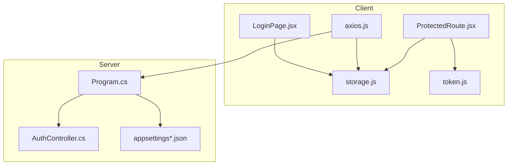
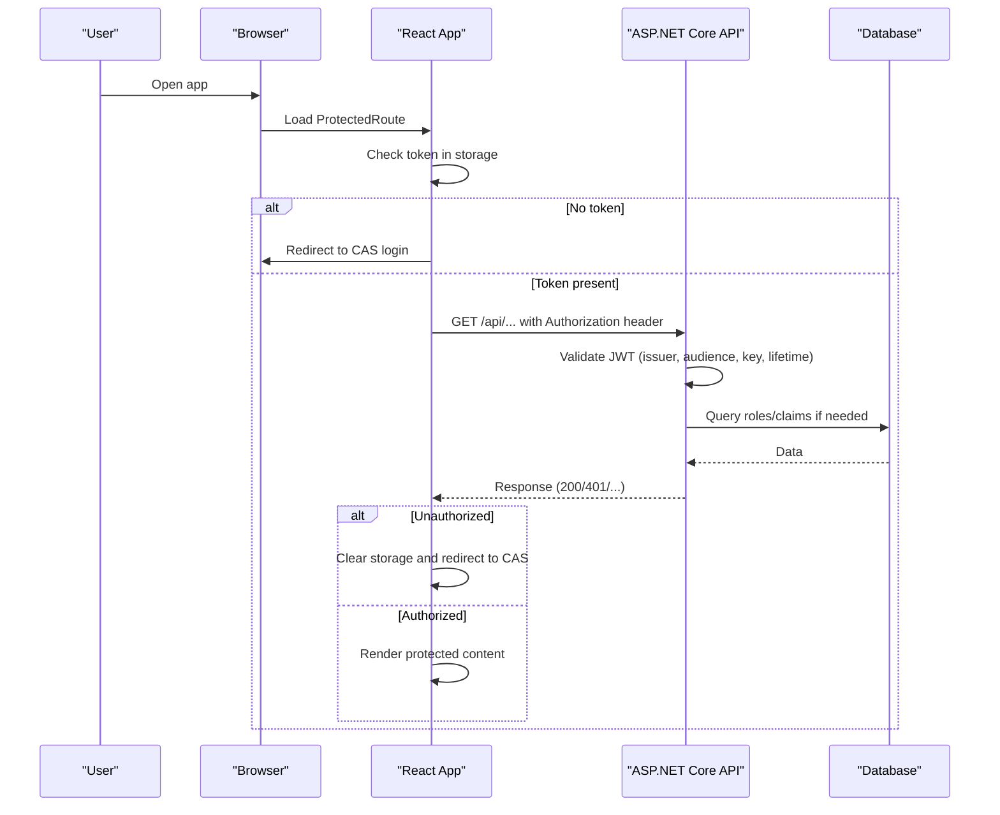
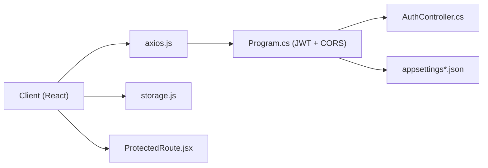

# Security Best Practices

<cite>
**Referenced Files in This Document**
- [storage.js](file://client/src/utils/storage.js)
- [token.js](file://client/src/utils/token.js)
- [axios.js](file://client/src/api/axios.js)
- [ProtectedRoute.jsx](file://client/src/components/ProtectedRoute.jsx)
- [LoginPage.jsx](file://client/src/pages/LoginPage.jsx)
- [Program.cs](file://server(Api\Program.cs)
- [appsettings.json](file://server\Api\appsettings.json)
- [appsettings.Development.json](file://server\Api\appsettings.Development.json)
- [appsettings.Production.json](file://server\Api\appsettings.Production.json)
- [AuthController.cs](file://server\Api\Controllers\AuthController.cs)
</cite>

## Table of Contents
1. Introduction
2. Project Structure
3. Core Components
4. Architecture Overview
5. Detailed Component Analysis
6. Dependency Analysis
7. Performance Considerations
8. Troubleshooting Guide
9. Conclusion
10. Appendices

## Introduction
This document provides comprehensive security best practices for Exam-Hub, focusing on secure token storage, environment-specific configuration, input validation, SQL injection prevention, CORS policy, secure API communication, password policies, session management, OWASP Top 10 compliance, and security testing and monitoring strategies. It is intended for developers and operators who need to harden the application across client and server layers.

## Project Structure
Exam-Hub consists of a React-based client and an ASP.NET Core API server:
- Client-side security focuses on token handling, safe storage selection (localStorage vs sessionStorage), CSRF/XSS mitigations via transport and headers, and role-based route protection.
- Server-side security centers on JWT authentication, strict token validation, authorization policies, CORS configuration, logging, and database access patterns.

**Diagram sources**
- [ProtectedRoute.jsx:1-90](file://client/src/components/ProtectedRoute.jsx#L1-L90)
- [storage.js:1-88](file://client/src/utils/storage.js#L1-L88)
- [token.js:1-31](file://client/src/utils/token.js#L1-L31)
- [axios.js:1-62](file://client/src/api/axios.js#L1-L62)
- [LoginPage.jsx:1-76](file://client/src/pages/LoginPage.jsx#L1-L76)
- [Program.cs:1-146](file://server(Api\Program.cs#L1-L146)
- [AuthController.cs:1-451](file://server\Api\Controllers\AuthController.cs#L1-L451)
- [appsettings.json:1-18](file://server\Api\appsettings.json#L1-L18)
- [appsettings.Development.json:1-12](file://server\Api\appsettings.Development.json#L1-L12)
- [appsettings.Production.json:1-11](file://server\Api\appsettings.Production.json#L1-L11)

**Section sources**
- [storage.js:1-88](file://client/src/utils/storage.js#L1-L88)
- [Program.cs:1-146](file://server(Api\Program.cs#L1-L146)
- [AppSettings files:1-18](file://server\Api\appsettings.json#L1-L18)

## Core Components
- Secure token storage abstraction: Centralizes decisions between localStorage and sessionStorage based on a persist flag and ensures consistent cleanup.
- Token parsing utilities: Safely decode JWT payloads and extract user identifiers from multiple claim names.
- API client interceptors: Attach Authorization headers and handle unauthorized responses by clearing local state and redirecting to SSO.
- Route-level protection: Enforce presence of a valid token and role checks before rendering protected UI.
- Server authentication pipeline: Configure JWT bearer authentication, token validation parameters, role mapping, and authorization policies.
- Environment configuration: Manage connection strings, JWT settings, and logging levels per environment.

**Section sources**
- [storage.js:1-88](file://client/src/utils/storage.js#L1-L88)
- [token.js:1-31](file://client/src/utils/token.js#L1-L31)
- [axios.js:1-62](file://client/src/api/axios.js#L1-L62)
- [ProtectedRoute.jsx:1-90](file://client/src/components/ProtectedRoute.jsx#L1-L90)
- [Program.cs:1-146](file://server(Api\Program.cs#L1-L146)
- [AuthController.cs:1-451](file://server\Api\Controllers\AuthController.cs#L1-L451)
- [appsettings.json:1-18](file://server\Api\appsettings.json#L1-L18)
- [appsettings.Development.json:1-12](file://server\Api\appsettings.Development.json#L1-L12)
- [appsettings.Production.json:1-11](file://server\Api\appsettings.Production.json#L1-L11)

## Architecture Overview
The security architecture integrates client-side token handling with server-side JWT validation and role-based authorization. The client stores tokens securely, attaches them to requests, and enforces route-level protections. The server validates tokens, maps claims to roles, and applies authorization policies.

**Diagram sources**
- [ProtectedRoute.jsx:1-90](file://client/src/components/ProtectedRoute.jsx#L1-L90)
- [storage.js:1-88](file://client/src/utils/storage.js#L1-L88)
- [axios.js:1-62](file://client/src/api/axios.js#L1-L62)
- [Program.cs:1-146](file://server(Api\Program.cs#L1-L146)
- [AuthController.cs:1-451](file://server\Api\Controllers\AuthController.cs#L1-L451)

## Detailed Component Analysis

### Secure Token Storage Strategies (storage.js)
- Persistent vs ephemeral storage:
  - Uses a persist flag to choose between localStorage (persistent) and sessionStorage (ephemeral).
  - Ensures no duplicates by removing keys from both storages before writing.
- Cleanup and logout:
  - Clears all auth-related keys from both storages during logout.
  - Supports remote logout via CAS when available.
- XSS considerations:
  - Tokens are stored in browser storage; ensure the client enforces HTTPS-only APIs and avoids injecting tokens into untrusted contexts.
  - Avoid storing sensitive data beyond what is necessary; prefer short-lived tokens and server-side sessions where possible.

Recommendations:
- Prefer sessionStorage for sensitive tokens in shared environments to reduce exposure after tab closure.
- Implement Content Security Policy (CSP) to mitigate XSS risks that could read storage.
- Sanitize any user-supplied data rendered in the UI to prevent XSS.

**Section sources**
- [storage.js:1-88](file://client/src/utils/storage.js#L1-L88)

### Token Parsing and Claim Handling (token.js)
- Robust JWT payload decoding:
  - Handles URL-safe base64 encoding and padding normalization.
  - Returns null on malformed tokens to avoid runtime errors.
- Flexible claim extraction:
  - Supports multiple claim names for user IDs to accommodate different identity providers.

Recommendations:
- Always validate token structure before use.
- Treat parsed payloads as untrusted; do not rely solely on client-side claims for authorization decisions.

**Section sources**
- [token.js:1-31](file://client/src/utils/token.js#L1-L31)

### Secure API Communication (axios.js)
- Authorization header injection:
  - Automatically attaches Bearer token from storage to outgoing requests.
- Global error handling:
  - On 401 Unauthorized, clears local storage and redirects to CAS login flow.
- Base URL and timeouts:
  - Configurable base URL via environment variables; reasonable timeout set.

Recommendations:
- Enforce HTTPS endpoints only in production.
- Add request/response logging with sensitive data redaction for auditability.
- Consider adding CSRF protection if using cookies for sessions.

**Section sources**
- [axios.js:1-62](file://client/src/api/axios.js#L1-L62)

### Route-Level Protection (ProtectedRoute.jsx)
- Presence check:
  - Redirects to CAS login if no token is found.
- Role enforcement:
  - Parses token to determine roles and navigates users to appropriate pages based on allowed roles.
- Fallback behavior:
  - Gracefully handles invalid tokens by falling back to stored roles or redirecting to login.

Recommendations:
- Combine client-side guards with server-side authorization for defense-in-depth.
- Normalize roles consistently and enforce least privilege.

**Section sources**
- [ProtectedRoute.jsx:1-90](file://client/src/components/ProtectedRoute.jsx#L1-L90)

### Login Flow and SSO Integration (LoginPage.jsx)
- Automatic redirection:
  - Detects token in query string and routes to SSO callback.
  - Redirects authenticated users away from login page.
  - Sends users to CAS login when no token exists.

Recommendations:
- Ensure callback URLs are validated and registered with the identity provider.
- Use prompt=login to force re-authentication when required.

**Section sources**
- [LoginPage.jsx:1-76](file://client/src/pages/LoginPage.jsx#L1-L76)

### Server Authentication and Authorization (Program.cs)
- JWT Bearer setup:
  - Validates issuer, audience, lifetime, and signing key.
  - Maps custom claims to standard claim types for role-based authorization.
- Authorization policies:
  - Defines policies for StudentOnly, TeacherOnly, SuperadminOnly, and TeacherOrAdmin.
- CORS policy:
  - Currently allows any origin, header, and method; tighten this for production.
- Pipeline ordering:
  - Enables Swagger in development, configures CORS, authentication, and authorization before mapping controllers.

Recommendations:
- Restrict CORS to specific trusted origins in production.
- Enable HTTPS redirection.
- Rotate JWT signing keys regularly and store secrets securely.

**Section sources**
- [Program.cs:1-146](file://server(Api\Program.cs#L1-L146)

### Environment-Specific Security Configuration (appsettings.json, Development, Production)
- Connection strings:
  - Hardcoded credentials present in configuration files; move secrets to secure secret managers (e.g., Azure Key Vault, AWS Secrets Manager).
  - Disable encryption flags in connection strings; enable TLS/SSL for database connections.
- JWT settings:
  - Issuer, audience, and key should be managed per environment and never committed to source control.
- Logging:
  - Adjust log levels per environment; avoid logging sensitive data.

Recommendations:
- Use environment variables or external secret stores for sensitive values.
- Separate dev/test/prod configurations and enforce least privilege for service accounts.

**Section sources**
- [appsettings.json:1-18](file://server\Api\appsettings.json#L1-L18)
- [appsettings.Development.json:1-12](file://server\Api\appsettings.Development.json#L1-L12)
- [appsettings.Production.json:1-11](file://server\Api\appsettings.Production.json#L1-L11)

### Input Validation and Password Policies (AuthController.cs)
- Registration:
  - Validates email and password presence.
  - Enforces minimum length and complexity requirements.
  - Hashes passwords using BCrypt.Net.
- Login:
  - Supports BCrypt verification with fallbacks to legacy hashing methods for migration scenarios.
  - Logs warnings for plaintext comparisons; remove plaintext support in production.
- Role resolution:
  - Resolves entity-specific roles and defaults appropriately.

Recommendations:
- Remove plaintext password comparison paths in production.
- Enforce strong password policies consistently across registration and profile updates.
- Rate-limit login attempts to mitigate brute-force attacks.

**Section sources**
- [AuthController.cs:1-451](file://server\Api\Controllers\AuthController.cs#L1-L451)

### SQL Injection Prevention
- Entity Framework usage:
  - Parameterized queries via EF Core reduce SQL injection risk.
- Model constraints:
  - Migrations define column lengths and types, limiting excessive input sizes.

Recommendations:
- Avoid raw SQL; if unavoidable, use parameterized commands and strict input validation.
- Apply principle of least privilege to database accounts.

**Section sources**
- [AuthController.cs:1-451](file://server\Api\Controllers\AuthController.cs#L1-L451)

### CORS Configuration
- Current policy:
  - Allows any origin, header, and method; suitable for development but risky in production.
- Usage:
  - Middleware applied globally; ensure it is only enabled for trusted origins in production.

Recommendations:
- Whitelist specific frontend domains.
- Limit allowed headers and methods to the minimum required.

**Section sources**
- [Program.cs:1-146](file://server(Api\Program.cs#L1-L146)

## Dependency Analysis
Security-critical dependencies include JWT libraries, EF Core, and HTTP clients. Misconfiguration in these can lead to authentication bypass, data leakage, or injection vulnerabilities.

**Diagram sources**
- [axios.js:1-62](file://client/src/api/axios.js#L1-L62)
- [storage.js:1-88](file://client/src/utils/storage.js#L1-L88)
- [ProtectedRoute.jsx:1-90](file://client/src/components/ProtectedRoute.jsx#L1-L90)
- [Program.cs:1-146](file://server(Api\Program.cs#L1-L146)
- [AuthController.cs:1-451](file://server\Api\Controllers\AuthController.cs#L1-L451)
- [appsettings.json:1-18](file://server\Api\appsettings.json#L1-L18)

**Section sources**
- [Program.cs:1-146](file://server(Api\Program.cs#L1-L146)
- [AuthController.cs:1-451](file://server\Api\Controllers\AuthController.cs#L1-L451)

## Performance Considerations
- Token parsing overhead:
  - Keep token payloads minimal to reduce parsing costs on the client.
- Database access:
  - Use AsNoTracking for read-only queries to improve performance without compromising security.
- Logging:
  - Avoid verbose logging in production to reduce I/O overhead and protect sensitive information.

[No sources needed since this section provides general guidance]

## Troubleshooting Guide
Common issues and resolutions:
- Unauthorized redirects loop:
  - Verify CORS policy allows the frontend domain and that the Authorization header is attached correctly.
  - Ensure JWT issuer, audience, and key match between server configuration and identity provider.
- Invalid token errors:
  - Confirm token format and expiration; implement refresh logic if needed.
- Legacy password mismatches:
  - Migration path includes BCrypt and SHA256 fallbacks; plan to retire plaintext comparisons.

**Section sources**
- [axios.js:1-62](file://client/src/api/axios.js#L1-L62)
- [Program.cs:1-146](file://server(Api\Program.cs#L1-L146)
- [AuthController.cs:1-451](file://server\Api\Controllers\AuthController.cs#L1-L451)

## Conclusion
Exam-Hub implements core security controls including JWT-based authentication, role-based authorization, and client-side token handling. To strengthen security:
- Tighten CORS and enforce HTTPS redirection.
- Move secrets out of configuration files and rotate keys.
- Remove plaintext password comparisons and enforce strong password policies.
- Adopt CSP and sanitize inputs to mitigate XSS.
- Integrate centralized logging and monitoring for threat detection.

[No sources needed since this section summarizes without analyzing specific files]

## Appendices

### OWASP Top 10 Compliance Checklist
- A01 Broken Access Control:
  - Enforce server-side authorization policies; validate roles on every endpoint.
- A02 Cryptographic Failures:
  - Use HTTPS everywhere; manage secrets securely; rotate JWT keys.
- A03 Injection:
  - Rely on EF Core parameterization; avoid raw SQL; validate inputs.
- A04 Insecure Design:
  - Follow least privilege; minimize token scope; prefer short-lived tokens.
- A05 Security Misconfiguration:
  - Restrict CORS; disable debug features in production; secure headers.
- A06 Vulnerable and Outdated Components:
  - Regularly update dependencies; monitor advisories.
- A07 Identification and Authentication Failures:
  - Enforce strong passwords; rate-limit login; integrate SSO securely.
- A08 Software and Data Integrity Failures:
  - Validate code signatures; verify third-party packages.
- A09 Security Logging and Monitoring Failures:
  - Centralize logs; alert on anomalies; retain logs per policy.
- A10 Server-Side Request Forgery (SSRF):
  - Validate outbound requests; restrict allowed hosts.

[No sources needed since this section provides general guidance]

### Security Testing Methodologies
- Static analysis:
  - Run SAST tools on client and server codebases.
- Dynamic analysis:
  - Perform DAST scans against staging environments.
- Penetration testing:
  - Engage external testers to simulate real-world attacks.
- Dependency scanning:
  - Use dependency checkers to identify known vulnerabilities.

[No sources needed since this section provides general guidance]

### Monitoring Approaches for Threat Detection
- Log aggregation:
  - Collect structured logs with correlation IDs; redact sensitive fields.
- Alerting:
  - Set alerts for repeated 401/403 responses, unusual login patterns, and high error rates.
- Metrics:
  - Track token issuance, validation failures, and API latency.
- Incident response:
  - Define playbooks for credential leaks, account takeover, and data exfiltration.

[No sources needed since this section provides general guidance]