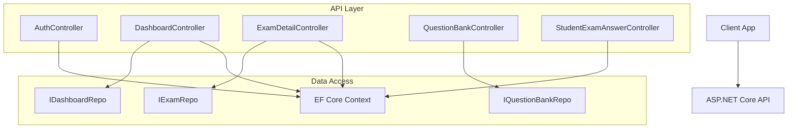
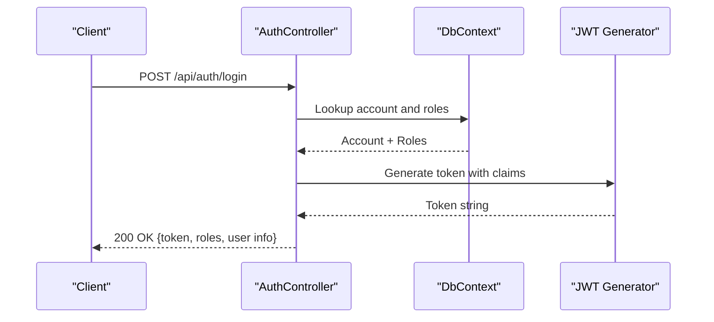
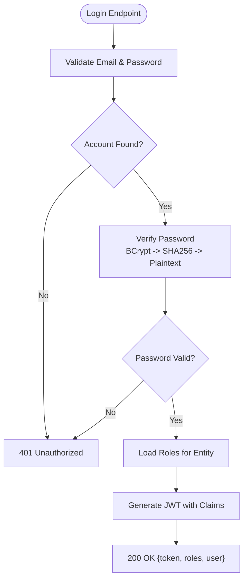
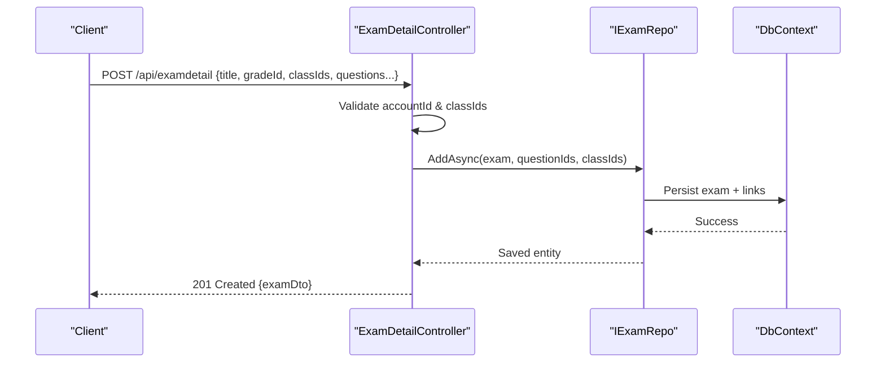
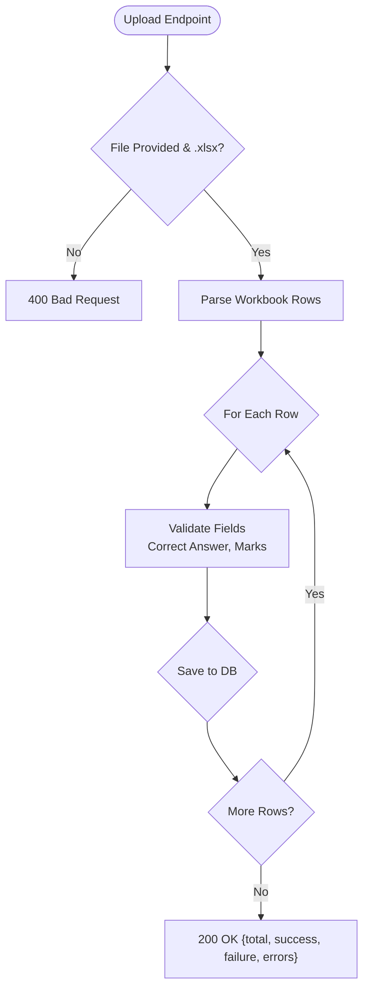
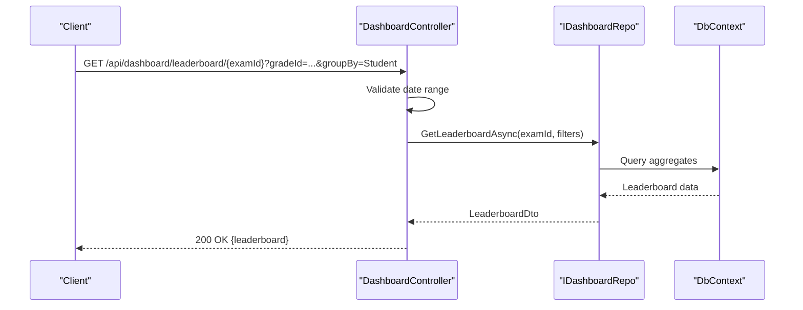
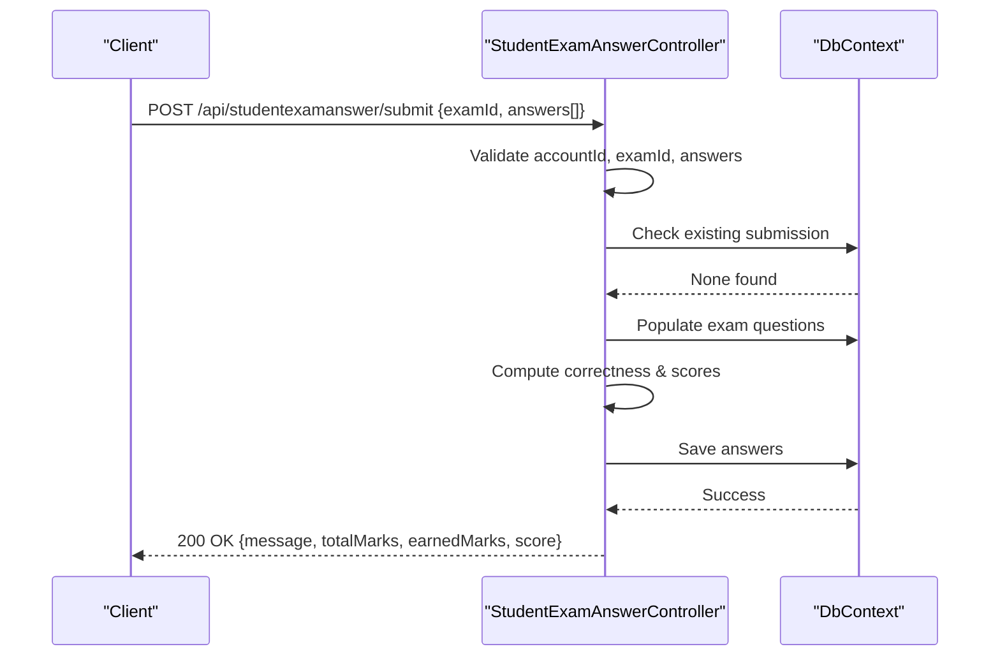
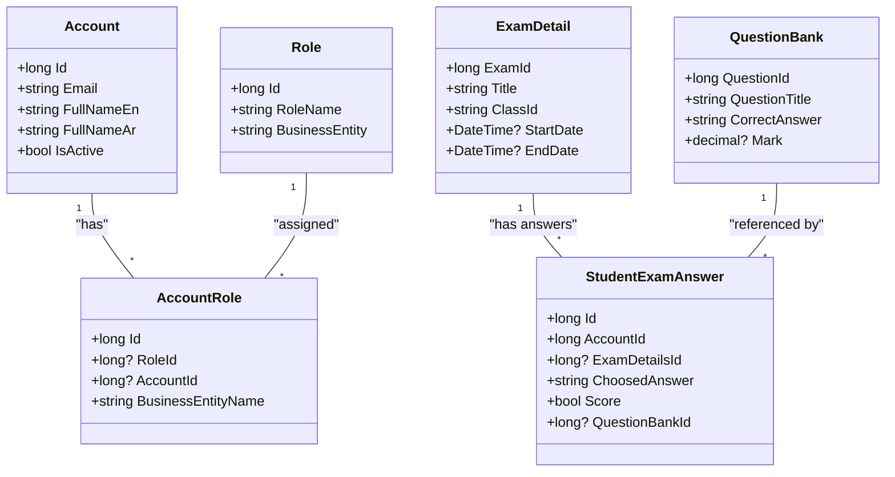

# API Design Principles

<cite>
**Referenced Files in This Document**
- [AuthController.cs](file://server/Api/Controllers/AuthController.cs)
- [DashboardController.cs](file://server/Api/Controllers/DashboardController.cs)
- [ExamDetailController.cs](file://server/Api/Controllers/ExamDetailController.cs)
- [QuestionBankController.cs](file://server/Api/Controllers/QuestionBankController.cs)
- [StudentExamAnswerController.cs](file://server/Api/Controllers/StudentExamAnswerController.cs)
- [AuthModels.cs](file://server/Api/Models/AuthModels.cs)
- [AppUser.cs](file://server/Api/Models/AppUser.cs)
- [Role.cs](file://server/Api/Models/Role.cs)
- [Account.cs](file://server/Api/Models/Account.cs)
- [Login.cs](file://server/Api/Models/Login.cs)
- [AccountRole.cs](file://server/Api/Models/AccountRole.cs)
- [Status.cs](file://server/Api/Models/Status.cs)
- [StudentExtension.cs](file://server/Api/Models/StudentExtension.cs)
- [ExamDetail.cs](file://server/Api/Models/ExamDetail.cs)
- [QuestionBank.cs](file://server/Api/Models/QuestionBank.cs)
- [StudentExamAnswer.cs](file://server/Api/Models/StudentExamAnswer.cs)
</cite>

## Table of Contents
1. Introduction
2. Project Structure
3. Core Components
4. Architecture Overview
5. Detailed Component Analysis
6. Dependency Analysis
7. Performance Considerations
8. Troubleshooting Guide
9. Conclusion

## Introduction
This document explains the RESTful API design principles implemented in the Exam-Hub backend. It covers HTTP method conventions, URL naming patterns, status code usage, request/response formats, error handling patterns, authentication and authorization requirements, versioning strategy, backward compatibility considerations, and security practices such as input validation, sanitization, rate limiting, and CORS configuration. Examples are provided by referencing actual controller endpoints to demonstrate proper REST practices.

## Project Structure
The backend is an ASP.NET Core Web API organized around feature-based controllers:
- Authentication and user profile management: AuthController
- Dashboard analytics and leaderboards: DashboardController
- Exams CRUD and access control: ExamDetailController
- Question bank management and bulk upload: QuestionBankController
- Student exam answers submission and retrieval: StudentExamAnswerController

All controllers use attribute routing under a common base path pattern. Controllers depend on repositories or EF Core DbContext for data access and return standardized JSON responses with appropriate HTTP status codes.

**Diagram sources**
- [AuthController.cs:12-26](file://server/Api/Controllers/AuthController.cs#L12-L26)
- [DashboardController.cs:11-22](file://server/Api/Controllers/DashboardController.cs#L11-L22)
- [ExamDetailController.cs:11-22](file://server/Api/Controllers/ExamDetailController.cs#L11-L22)
- [QuestionBankController.cs:10-19](file://server/Api/Controllers/QuestionBankController.cs#L10-L19)
- [StudentExamAnswerController.cs:11-20](file://server/Api/Controllers/StudentExamAnswerController.cs#L11-L20)

**Section sources**
- [AuthController.cs:12-26](file://server/Api/Controllers/AuthController.cs#L12-L26)
- [DashboardController.cs:11-22](file://server/Api/Controllers/DashboardController.cs#L11-L22)
- [ExamDetailController.cs:11-22](file://server/Api/Controllers/ExamDetailController.cs#L11-L22)
- [QuestionBankController.cs:10-19](file://server/Api/Controllers/QuestionBankController.cs#L10-L19)
- [StudentExamAnswerController.cs:11-20](file://server/Api/Controllers/StudentExamAnswerController.cs#L11-L20)

## Core Components
- Authentication and Authorization
  - JWT-based authentication via token generation and claims (roles).
  - Role-based access control using roles like Student, Teacher, Admin, Board, Superadmin.
  - SSO token issuance endpoint for external systems.
- Resource Controllers
  - Exams: full CRUD with class-scoped access control for students.
  - Questions: CRUD and Excel-based bulk upload with validation and error reporting.
  - Dashboard: read-only analytics endpoints with role restrictions.
  - Answers: submit and retrieve student answers with scoring logic.

Key design patterns observed:
- Consistent base route: api/[controller]
- Standard HTTP methods: GET, POST, PUT, DELETE
- Status codes: 200 OK, 201 Created, 204 No Content, 400 Bad Request, 401 Unauthorized, 403 Forbidden, 404 Not Found, 500 Internal Server Error
- Centralized error shape: { message, optional details }
- Input validation at controller boundaries before persistence
- Claims-based authorization with [Authorize] and role constraints

**Section sources**
- [AuthController.cs:28-116](file://server/Api/Controllers/AuthController.cs#L28-L116)
- [AuthController.cs:118-249](file://server/Api/Controllers/AuthController.cs#L118-L249)
- [AuthController.cs:251-313](file://server/Api/Controllers/AuthController.cs#L251-L313)
- [DashboardController.cs:24-78](file://server/Api/Controllers/DashboardController.cs#L24-L78)
- [DashboardController.cs:85-136](file://server/Api/Controllers/DashboardController.cs#L85-L136)
- [DashboardController.cs:143-195](file://server/Api/Controllers/DashboardController.cs#L143-L195)
- [DashboardController.cs:201-234](file://server/Api/Controllers/DashboardController.cs#L201-L234)
- [DashboardController.cs:245-285](file://server/Api/Controllers/DashboardController.cs#L245-L285)
- [DashboardController.cs:292-320](file://server/Api/Controllers/DashboardController.cs#L292-L320)
- [DashboardController.cs:327-344](file://server/Api/Controllers/DashboardController.cs#L327-L344)
- [ExamDetailController.cs:24-69](file://server/Api/Controllers/ExamDetailController.cs#L24-L69)
- [ExamDetailController.cs:71-108](file://server/Api/Controllers/ExamDetailController.cs#L71-L108)
- [ExamDetailController.cs:110-198](file://server/Api/Controllers/ExamDetailController.cs#L110-L198)
- [ExamDetailController.cs:200-253](file://server/Api/Controllers/ExamDetailController.cs#L200-L253)
- [QuestionBankController.cs:21-48](file://server/Api/Controllers/QuestionBankController.cs#L21-L48)
- [QuestionBankController.cs:50-79](file://server/Api/Controllers/QuestionBankController.cs#L50-L79)
- [QuestionBankController.cs:81-143](file://server/Api/Controllers/QuestionBankController.cs#L81-L143)
- [QuestionBankController.cs:145-271](file://server/Api/Controllers/QuestionBankController.cs#L145-L271)
- [QuestionBankController.cs:272-327](file://server/Api/Controllers/QuestionBankController.cs#L272-L327)
- [StudentExamAnswerController.cs:45-126](file://server/Api/Controllers/StudentExamAnswerController.cs#L45-L126)
- [StudentExamAnswerController.cs:128-197](file://server/Api/Controllers/StudentExamAnswerController.cs#L128-L197)
- [StudentExamAnswerController.cs:199-332](file://server/Api/Controllers/StudentExamAnswerController.cs#L199-L332)

## Architecture Overview
The API follows a layered architecture:
- Controllers handle HTTP requests, validate inputs, enforce authorization, and map to DTOs.
- Repositories encapsulate domain-specific data operations where present.
- EF Core DbContext provides database access.
- Models represent entities; DTOs define stable request/response contracts.

**Diagram sources**
- [AuthController.cs:118-249](file://server/Api/Controllers/AuthController.cs#L118-L249)
- [AuthController.cs:381-420](file://server/Api/Controllers/AuthController.cs#L381-L420)

**Section sources**
- [AuthController.cs:118-249](file://server/Api/Controllers/AuthController.cs#L118-L249)
- [AuthController.cs:381-420](file://server/Api/Controllers/AuthController.cs#L381-L420)

## Detailed Component Analysis

### Authentication and Authorization (AuthController)
- Endpoints:
  - Register: POST /api/auth/register
  - Login: POST /api/auth/login
  - SSO Token: POST /api/auth/sso-token
  - Profile: GET /api/auth/profile/{id}, PUT /api/auth/profile/{id}
- HTTP Methods and Status Codes:
  - POST returns 200 OK on success, 400 Bad Request for validation errors, 409 Conflict for duplicate email, 401 Unauthorized for invalid credentials, 404 Not Found for missing accounts, 500 Internal Server Error on exceptions.
- Request/Response Format:
  - Requests use JSON bodies defined by models (RegisterModel, LoginModel, SsoTokenModel, UpdateProfileModel).
  - Responses include consistent shapes with message fields and typed payloads (e.g., token, roles, user info).
- Authentication Requirements:
  - Login and SSO endpoints are public; profile endpoints require valid tokens for identity resolution.
  - Roles are embedded in JWT claims and used downstream for authorization.
- Security:
  - Password strength validation and hashing (BCrypt with fallback support).
  - Secure token generation with issuer, audience, signing key, and expiration configured via settings.

**Diagram sources**
- [AuthController.cs:118-249](file://server/Api/Controllers/AuthController.cs#L118-L249)
- [AuthController.cs:381-420](file://server/Api/Controllers/AuthController.cs#L381-L420)

**Section sources**
- [AuthController.cs:28-116](file://server/Api/Controllers/AuthController.cs#L28-L116)
- [AuthController.cs:118-249](file://server/Api/Controllers/AuthController.cs#L118-L249)
- [AuthController.cs:251-313](file://server/Api/Controllers/AuthController.cs#L251-L313)
- [AuthController.cs:315-379](file://server/Api/Controllers/AuthController.cs#L315-L379)
- [AuthModels.cs:1-30](file://server/Api/Models/AuthModels.cs#L1-L30)

### Exams (ExamDetailController)
- Endpoints:
  - GET /api/examdetail (list exams with role/class filtering)
  - GET /api/examdetail/{id} (single exam with access control)
  - POST /api/examdetail (create exam with multi-class assignment)
  - PUT /api/examdetail/{id} (update exam)
  - DELETE /api/examdetail/{id} (delete exam)
  - GET /api/examdetail/subjects (lookup subjects)
- HTTP Methods and Status Codes:
  - GET returns 200 OK; NotFound when resource missing.
  - POST returns 201 Created with Location header pointing to GetById.
  - PUT returns 200 OK; DELETE returns 204 No Content.
  - Validation errors return 400 Bad Request; unauthorized access returns 403 Forbidden for students not assigned to class.
- Request/Response Format:
  - Uses DTOs (ExamCreateDto, ExamUpdateDto, ExamReadDto) for stable contracts.
  - Dates normalized to UTC in responses.
- Authorization:
  - Students see only exams assigned to their class; teachers/admin/board can view all.
  - Access checks enforced per resource.

**Diagram sources**
- [ExamDetailController.cs:110-198](file://server/Api/Controllers/ExamDetailController.cs#L110-L198)

**Section sources**
- [ExamDetailController.cs:24-69](file://server/Api/Controllers/ExamDetailController.cs#L24-L69)
- [ExamDetailController.cs:71-108](file://server/Api/Controllers/ExamDetailController.cs#L71-L108)
- [ExamDetailController.cs:110-198](file://server/Api/Controllers/ExamDetailController.cs#L110-L198)
- [ExamDetailController.cs:200-253](file://server/Api/Controllers/ExamDetailController.cs#L200-L253)
- [ExamDetailController.cs:291-299](file://server/Api/Controllers/ExamDetailController.cs#L291-L299)

### Question Bank (QuestionBankController)
- Endpoints:
  - GET /api/questionbank (list)
  - GET /api/questionbank/{id} (single)
  - POST /api/questionbank (create)
  - PUT /api/questionbank/{id} (update)
  - DELETE /api/questionbank/{id} (delete)
  - POST /api/questionbank/upload (bulk upload .xlsx)
  - GET /api/questionbank/template (download template)
- HTTP Methods and Status Codes:
  - Standard CRUD codes; upload returns 200 OK with result summary including success/failure counts and errors.
- Request/Response Format:
  - Create/Update use DTOs; Upload accepts multipart/form-data file and query parameters (gradeId, classId).
  - Template returns Excel file content.
- Validation and Sanitization:
  - File type validation (.xlsx), empty file check, row-level parsing with graceful error accumulation.
  - Numeric parsing for marks with defaults; required fields validated.

**Diagram sources**
- [QuestionBankController.cs:145-271](file://server/Api/Controllers/QuestionBankController.cs#L145-L271)

**Section sources**
- [QuestionBankController.cs:21-48](file://server/Api/Controllers/QuestionBankController.cs#L21-L48)
- [QuestionBankController.cs:50-79](file://server/Api/Controllers/QuestionBankController.cs#L50-L79)
- [QuestionBankController.cs:81-143](file://server/Api/Controllers/QuestionBankController.cs#L81-L143)
- [QuestionBankController.cs:145-271](file://server/Api/Controllers/QuestionBankController.cs#L145-L271)
- [QuestionBankController.cs:272-327](file://server/Api/Controllers/QuestionBankController.cs#L272-L327)
- [QuestionBankController.cs:329-386](file://server/Api/Controllers/QuestionBankController.cs#L329-L386)

### Dashboard (DashboardController)
- Endpoints:
  - GET /api/dashboard/lookup-data (public lookup data)
  - GET /api/dashboard/student/{id} (student dashboard)
  - GET /api/dashboard/teacher/{id} (teacher dashboard)
  - GET /api/dashboard/superadmin (superadmin dashboard)
  - GET /api/dashboard/leaderboard/{examId} (per-exam leaderboard)
  - GET /api/dashboard/leaderboard/combined (aggregated leaderboard)
  - GET /api/dashboard/exam/{examId}/stats (exam statistics)
  - GET /api/dashboard/teachers (restricted list)
  - GET /api/dashboard/students (authenticated list)
- HTTP Methods and Status Codes:
  - All GET endpoints return 200 OK; 400 Bad Request for invalid date ranges; 404 Not Found for missing resources; 500 Internal Server Error on exceptions.
- Authorization:
  - Most endpoints require [Authorize]; superadmin endpoints restrict to specific roles.
- Query Parameters:
  - Optional filters: gradeId, classId, examId, startDate, endDate, groupBy.

**Diagram sources**
- [DashboardController.cs:245-285](file://server/Api/Controllers/DashboardController.cs#L245-L285)

**Section sources**
- [DashboardController.cs:24-78](file://server/Api/Controllers/DashboardController.cs#L24-L78)
- [DashboardController.cs:85-136](file://server/Api/Controllers/DashboardController.cs#L85-L136)
- [DashboardController.cs:143-195](file://server/Api/Controllers/DashboardController.cs#L143-L195)
- [DashboardController.cs:201-234](file://server/Api/Controllers/DashboardController.cs#L201-L234)
- [DashboardController.cs:245-285](file://server/Api/Controllers/DashboardController.cs#L245-L285)
- [DashboardController.cs:292-320](file://server/Api/Controllers/DashboardController.cs#L292-L320)
- [DashboardController.cs:327-344](file://server/Api/Controllers/DashboardController.cs#L327-L344)
- [DashboardController.cs:346-374](file://server/Api/Controllers/DashboardController.cs#L346-L374)

### Student Exam Answers (StudentExamAnswerController)
- Endpoints:
  - GET /api/studentexamanswer/student/{accountId}/exams (answers overview)
  - GET /api/studentexamanswer/student/{accountId}/exam/{examId} (detailed answers)
  - POST /api/studentexamanswer/submit (submit answers)
- HTTP Methods and Status Codes:
  - GET returns 200 OK; 404 Not Found if exam missing.
  - POST returns 200 OK with score summary; 400 Bad Request for validation failures (duplicate submission, invalid answers).
- Business Logic:
  - Validates submitted answers against exam questions; computes correctness and scores.
  - Enforces single submission per exam per student.

**Diagram sources**
- [StudentExamAnswerController.cs:199-332](file://server/Api/Controllers/StudentExamAnswerController.cs#L199-L332)

**Section sources**
- [StudentExamAnswerController.cs:45-126](file://server/Api/Controllers/StudentExamAnswerController.cs#L45-L126)
- [StudentExamAnswerController.cs:128-197](file://server/Api/Controllers/StudentExamAnswerController.cs#L128-L197)
- [StudentExamAnswerController.cs:199-332](file://server/Api/Controllers/StudentExamAnswerController.cs#L199-L332)

## Dependency Analysis
- Controller-to-Repository Dependencies:
  - DashboardController depends on IDashboardRepo and DbContext.
  - ExamDetailController depends on IExamRepo and DbContext.
  - QuestionBankController depends on IQuestionBankRepo and DbContext.
  - StudentExamAnswerController uses DbContext directly.
- Model Relationships:
  - Account, Role, AccountRole form the RBAC foundation.
  - ExamDetail links to Subject (Status) and has many StudentExamAnswers.
  - QuestionBank is referenced by ExamDetail through ExamQuestionBanks.
  - StudentExamAnswer ties Account, ExamDetail, and QuestionBank.

**Diagram sources**
- [Account.cs:6-82](file://server/Api/Models/Account.cs#L6-L82)
- [Role.cs:6-18](file://server/Api/Models/Role.cs#L6-L18)
- [AccountRole.cs:6-16](file://server/Api/Models/AccountRole.cs#L6-L16)
- [ExamDetail.cs:6-31](file://server/Api/Models/ExamDetail.cs#L6-L31)
- [QuestionBank.cs:7-47](file://server/Api/Models/QuestionBank.cs#L7-L47)
- [StudentExamAnswer.cs:6-27](file://server/Api/Models/StudentExamAnswer.cs#L6-L27)

**Section sources**
- [DashboardController.cs:11-22](file://server/Api/Controllers/DashboardController.cs#L11-L22)
- [ExamDetailController.cs:11-22](file://server/Api/Controllers/ExamDetailController.cs#L11-L22)
- [QuestionBankController.cs:10-19](file://server/Api/Controllers/QuestionBankController.cs#L10-L19)
- [StudentExamAnswerController.cs:11-20](file://server/Api/Controllers/StudentExamAnswerController.cs#L11-L20)

## Performance Considerations
- Use AsNoTracking for read-only queries to reduce change tracking overhead.
- Select only needed fields in projections to minimize payload size.
- Avoid N+1 queries by batching loads (e.g., loading questions once and mapping).
- Normalize dates to UTC to prevent timezone-related issues.
- For bulk uploads, process rows in memory and persist in batches where possible.

[No sources needed since this section provides general guidance]

## Troubleshooting Guide
Common issues and resolutions:
- Invalid credentials: Ensure correct email/password; verify password hashing strategy (BCrypt vs legacy).
- Duplicate registration: Handle 409 Conflict by checking email uniqueness.
- Missing roles: Confirm AccountRole entries exist for the target business entity.
- Date range validation: Ensure start date is not after end date; return 400 with clear messages.
- Upload errors: Validate file format and content; inspect error arrays in upload results.
- Submission conflicts: Prevent duplicate submissions per exam; return 400 with descriptive message.

**Section sources**
- [AuthController.cs:118-249](file://server/Api/Controllers/AuthController.cs#L118-L249)
- [DashboardController.cs:85-136](file://server/Api/Controllers/DashboardController.cs#L85-L136)
- [QuestionBankController.cs:145-271](file://server/Api/Controllers/QuestionBankController.cs#L145-L271)
- [StudentExamAnswerController.cs:199-332](file://server/Api/Controllers/StudentExamAnswerController.cs#L199-L332)

## Conclusion
The Exam-Hub backend implements a coherent RESTful API with consistent HTTP conventions, robust authentication and authorization, and clear error handling. Controllers enforce resource-level access controls and provide well-defined request/response contracts via DTOs. The design supports extensibility through repository abstractions and maintains backward compatibility by avoiding breaking changes in routes and response shapes. Security measures include password hashing, JWT-based tokens, and input validation. To further harden the API, consider adding explicit rate limiting and CORS policies at the application level.

[No sources needed since this section summarizes without analyzing specific files]