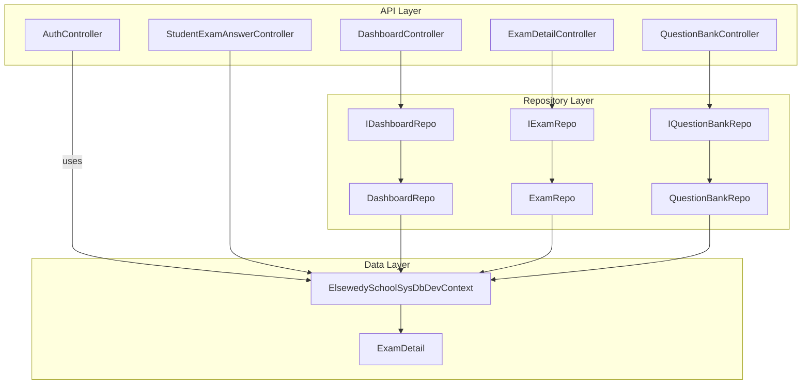
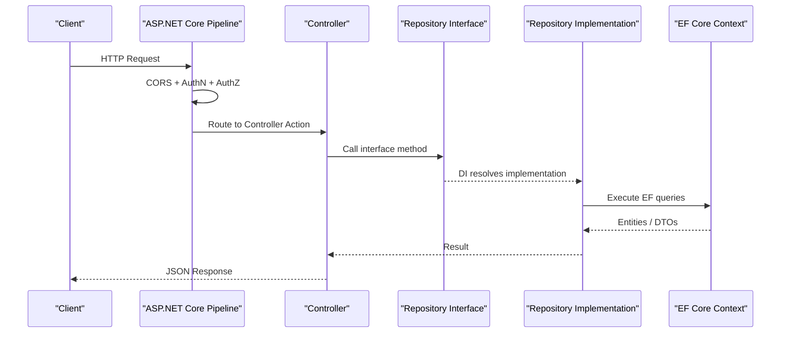
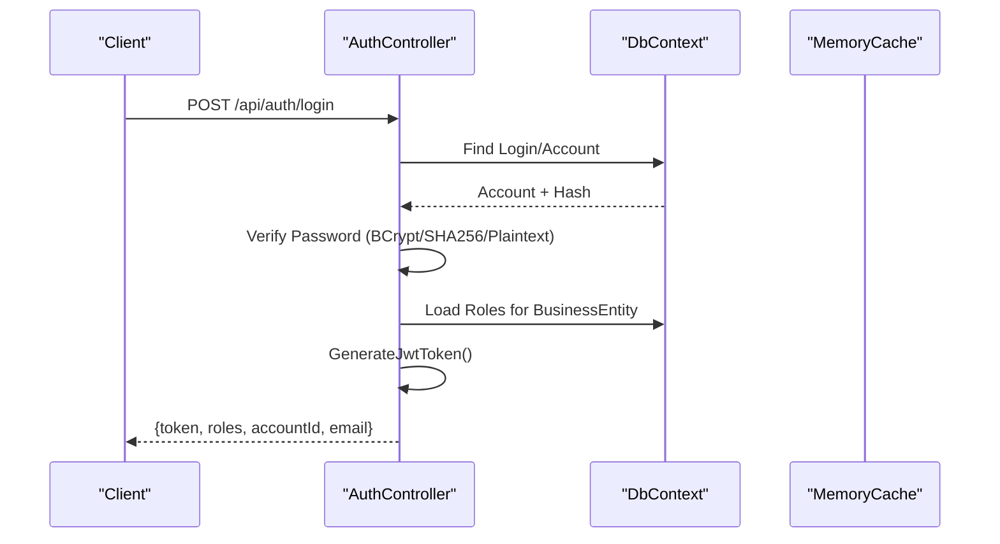
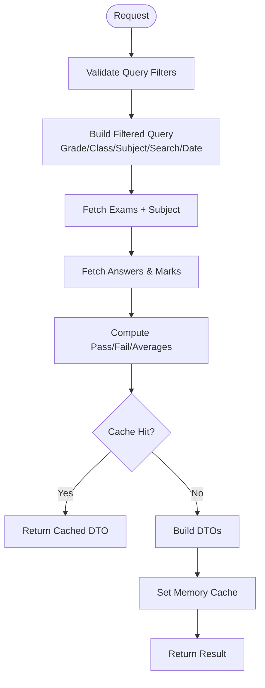
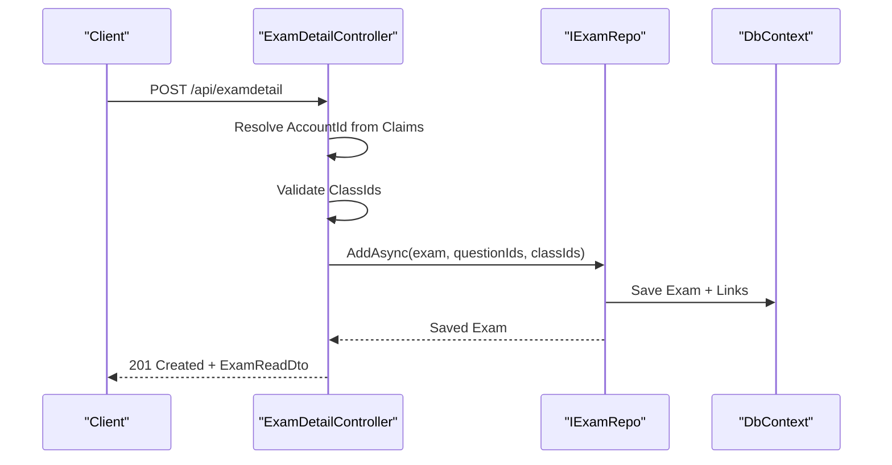
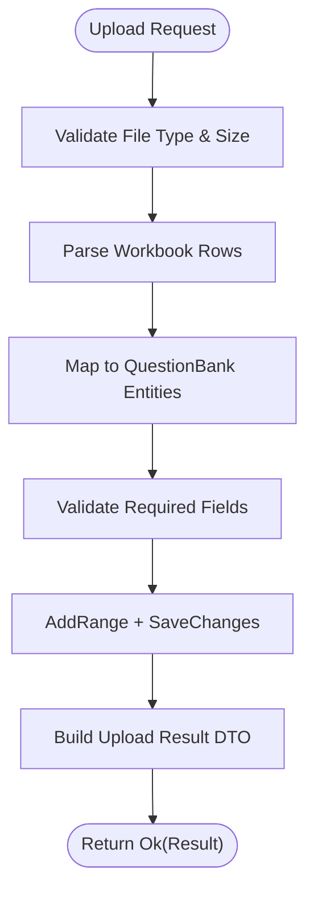
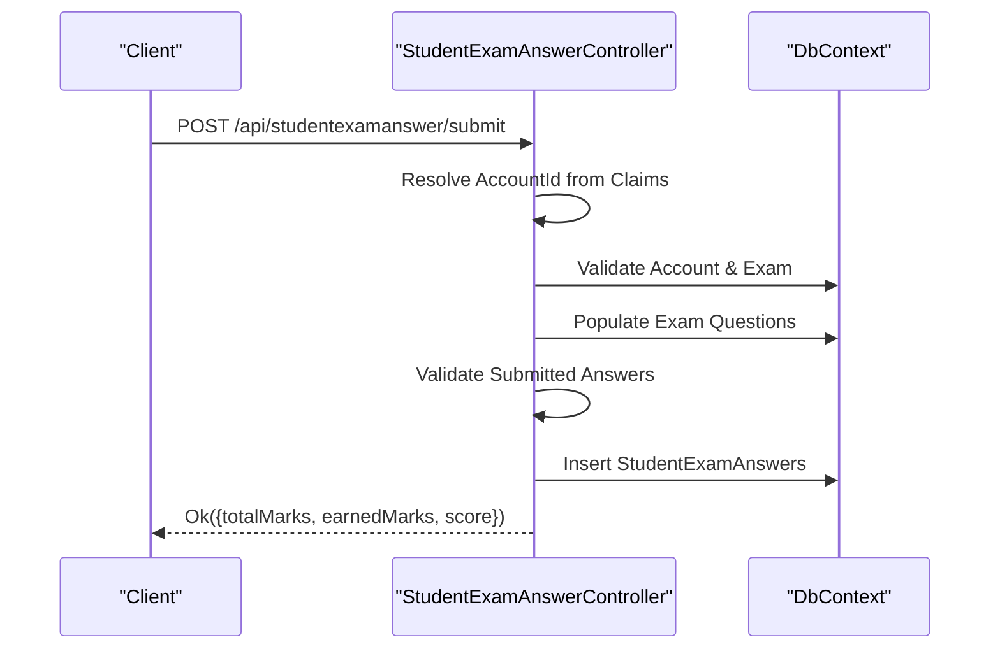
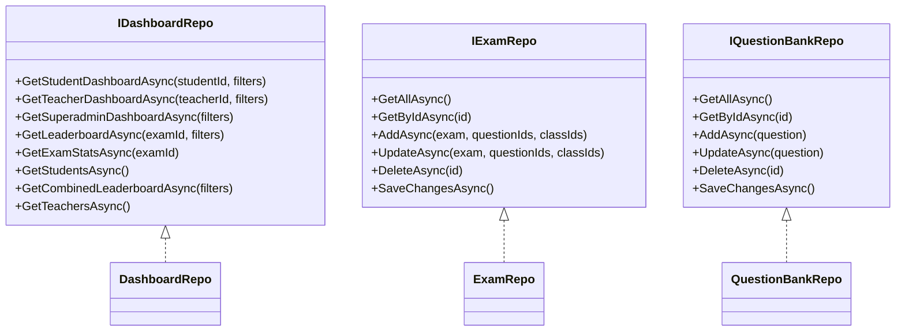
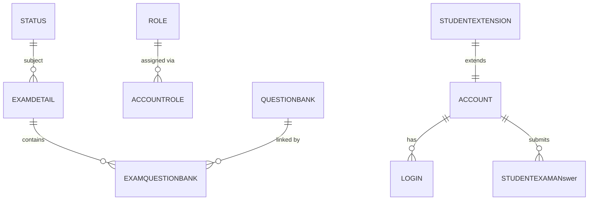
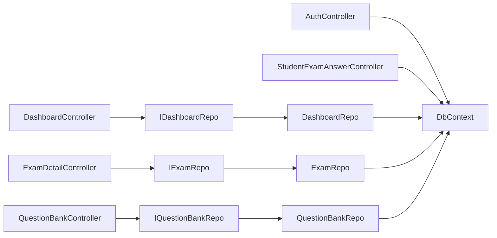

# Backend Architecture

<cite>
**Referenced Files in This Document**
- [Program.cs](file://server/Api/Program.cs)
- [appsettings.json](file://server/Api/appsettings.json)
- [AuthController.cs](file://server/Api/Controllers/AuthController.cs)
- [DashboardController.cs](file://server/Api/Controllers/DashboardController.cs)
- [ExamDetailController.cs](file://server/Api/Controllers/ExamDetailController.cs)
- [QuestionBankController.cs](file://server/Api/Controllers/QuestionBankController.cs)
- [StudentExamAnswerController.cs](file://server/Api/Controllers/StudentExamAnswerController.cs)
- [IDashboardRepo.cs](file://server/Api/Repositories/Interfaces/IDashboardRepo.cs)
- [IExamRepo.cs](file://server/Api/Repositories/Interfaces/IExamRepo.cs)
- [IQuestionBankRepo.cs](file://server/Api/Repositories/Interfaces/IQuestionBankRepo.cs)
- [DashboardRepo.cs](file://server/Api/Repositories/Implementation/DashboardRepo.cs)
- [ExamRepo.cs](file://server/Api/Repositories/Implementation/ExamRepo.cs)
- [QuestionBankRepo.cs](file://server/Api/Repositories/Implementation/QuestionBankRepo.cs)
- [ElsewedySchoolSysDbDevContext.cs](file://server/Api/Models/ElsewedySchoolSysDbDevContext.cs)
- [ExamDetail.cs](file://server/Api/Models/ExamDetail.cs)
</cite>

## Table of Contents
1. [Introduction](#introduction)
2. [Project Structure](#project-structure)
3. [Core Components](#core-components)
4. [Architecture Overview](#architecture-overview)
5. [Detailed Component Analysis](#detailed-component-analysis)
6. [Dependency Analysis](#dependency-analysis)
7. [Performance Considerations](#performance-considerations)
8. [Troubleshooting Guide](#troubleshooting-guide)
9. [Conclusion](#conclusion)

## Introduction
This document describes the backend architecture of the Exam-Hub .NET Core API using a layered design with controllers, repositories, and data models. It explains RESTful API design principles, feature-based controller organization, repository pattern implementation for loose coupling and testability, Entity Framework Core usage (context configuration, relationships, migrations), middleware configuration, dependency injection setup, service registration, API versioning strategies, error handling patterns, and performance considerations.

## Project Structure
The server project follows a clear separation of concerns:
- Controllers under Api/Controllers implement REST endpoints organized by feature domains (Authentication, Dashboard, Exams, Question Bank, Student Answers).
- Repositories under Api/Repositories define interfaces and implementations that encapsulate data access logic.
- Models under Api/Models include EF Core entities and the database context.
- Configuration is centralized in appsettings.json and Program.cs.

**Diagram sources**
- [Program.cs:104-107](file://server/Api/Program.cs#L104-L107)
- [DashboardController.cs:15-22](file://server/Api/Controllers/DashboardController.cs#L15-L22)
- [ExamDetailController.cs:15-22](file://server/Api/Controllers/ExamDetailController.cs#L15-L22)
- [QuestionBankController.cs:14-19](file://server/Api/Controllers/QuestionBankController.cs#L14-L19)
- [StudentExamAnswerController.cs:15-20](file://server/Api/Controllers/StudentExamAnswerController.cs#L15-L20)
- [IDashboardRepo.cs:5-45](file://server/Api/Repositories/Interfaces/IDashboardRepo.cs#L5-L45)
- [IExamRepo.cs:5-13](file://server/Api/Repositories/Interfaces/IExamRepo.cs#L5-L13)
- [IQuestionBankRepo.cs:3-11](file://server/Api/Repositories/Interfaces/IQuestionBankRepo.cs#L3-L11)
- [ElsewedySchoolSysDbDevContext.cs:7-137](file://server/Api/Models/ElsewedySchoolSysDbDevContext.cs#L7-L137)
- [ExamDetail.cs:6-30](file://server/Api/Models/ExamDetail.cs#L6-L30)

**Section sources**
- [Program.cs:15-146](file://server/Api/Program.cs#L15-L146)
- [appsettings.json:1-18](file://server/Api/appsettings.json#L1-L18)

## Core Components
- Controllers: Feature-focused HTTP endpoints implementing REST conventions (GET/POST/PUT/DELETE), authorization via JWT roles, and input validation.
- Repositories: Interfaces abstracting data operations; concrete implementations encapsulate EF Core queries and manual relationship population where needed.
- Data Models: EF Core entities mapped to SQL Server tables; context configures relationships and constraints.

Key responsibilities:
- AuthController handles registration, login, SSO token issuance, and profile management.
- DashboardController exposes dashboard and leaderboard endpoints backed by IDashboardRepo.
- ExamDetailController manages exam CRUD and class-scoped visibility.
- QuestionBankController provides question CRUD and Excel upload/download.
- StudentExamAnswerController handles answer submission and retrieval.

**Section sources**
- [AuthController.cs:12-451](file://server/Api/Controllers/AuthController.cs#L12-L451)
- [DashboardController.cs:11-376](file://server/Api/Controllers/DashboardController.cs#L11-L376)
- [ExamDetailController.cs:11-302](file://server/Api/Controllers/ExamDetailController.cs#L11-L302)
- [QuestionBankController.cs:10-389](file://server/Api/Controllers/QuestionBankController.cs#L10-L389)
- [StudentExamAnswerController.cs:11-348](file://server/Api/Controllers/StudentExamAnswerController.cs#L11-L348)

## Architecture Overview
The application uses ASP.NET Core MVC/Web API with:
- Authentication: JWT Bearer tokens configured in Program.cs.
- Authorization: Role-based policies defined and enforced via attributes on controllers/actions.
- Dependency Injection: Controllers depend on repository interfaces; repositories depend on the EF Core context.
- Data Access: EF Core with SQL Server; relationships are configured in the context.

**Diagram sources**
- [Program.cs:19-107](file://server/Api/Program.cs#L19-L107)
- [DashboardController.cs:15-22](file://server/Api/Controllers/DashboardController.cs#L15-L22)
- [ExamDetailController.cs:15-22](file://server/Api/Controllers/ExamDetailController.cs#L15-L22)
- [QuestionBankController.cs:14-19](file://server/Api/Controllers/QuestionBankController.cs#L14-L19)
- [ElsewedySchoolSysDbDevContext.cs:7-137](file://server/Api/Models/ElsewedySchoolSysDbDevContext.cs#L7-L137)

## Detailed Component Analysis

### Authentication Flow (JWT)
- Registration validates password strength, ensures uniqueness, maps roles, creates Account/Login entries, and persists via context.
- Login verifies credentials (BCrypt, SHA256 fallback, plaintext fallback), retrieves roles, and issues a JWT token.
- SSO token endpoint returns a JWT for an existing account.
- Profile endpoints allow read/update of user profile.

**Diagram sources**
- [AuthController.cs:118-249](file://server/Api/Controllers/AuthController.cs#L118-L249)
- [AuthController.cs:381-420](file://server/Api/Controllers/AuthController.cs#L381-L420)
- [Program.cs:43-81](file://server/Api/Program.cs#L43-L81)

**Section sources**
- [AuthController.cs:28-116](file://server/Api/Controllers/AuthController.cs#L28-L116)
- [AuthController.cs:118-249](file://server/Api/Controllers/AuthController.cs#L118-L249)
- [AuthController.cs:251-313](file://server/Api/Controllers/AuthController.cs#L251-L313)
- [AuthController.cs:315-379](file://server/Api/Controllers/AuthController.cs#L315-L379)
- [AuthController.cs:381-449](file://server/Api/Controllers/AuthController.cs#L381-L449)

### Dashboard Endpoints
- Lookup data aggregates grades, classes, subjects, and exams.
- Student/Teacher/Superadmin dashboards return aggregated statistics and recent activity.
- Leaderboard endpoints support per-exam and combined views with optional filters.

**Diagram sources**
- [DashboardController.cs:24-78](file://server/Api/Controllers/DashboardController.cs#L24-L78)
- [DashboardController.cs:85-136](file://server/Api/Controllers/DashboardController.cs#L85-L136)
- [DashboardController.cs:143-195](file://server/Api/Controllers/DashboardController.cs#L143-L195)
- [DashboardController.cs:201-234](file://server/Api/Controllers/DashboardController.cs#L201-L234)
- [DashboardController.cs:245-285](file://server/Api/Controllers/DashboardController.cs#L245-L285)
- [DashboardController.cs:292-320](file://server/Api/Controllers/DashboardController.cs#L292-L320)
- [DashboardRepo.cs:23-26](file://server/Api/Repositories/Implementation/DashboardRepo.cs#L23-L26)
- [DashboardRepo.cs:109-246](file://server/Api/Repositories/Implementation/DashboardRepo.cs#L109-L246)
- [DashboardRepo.cs:248-391](file://server/Api/Repositories/Implementation/DashboardRepo.cs#L248-L391)
- [DashboardRepo.cs:393-503](file://server/Api/Repositories/Implementation/DashboardRepo.cs#L393-L503)
- [DashboardRepo.cs:505-565](file://server/Api/Repositories/Implementation/DashboardRepo.cs#L505-L565)
- [DashboardRepo.cs:670-705](file://server/Api/Repositories/Implementation/DashboardRepo.cs#L670-L705)

**Section sources**
- [DashboardController.cs:11-376](file://server/Api/Controllers/DashboardController.cs#L11-L376)
- [IDashboardRepo.cs:5-45](file://server/Api/Repositories/Interfaces/IDashboardRepo.cs#L5-L45)
- [DashboardRepo.cs:9-21](file://server/Api/Repositories/Implementation/DashboardRepo.cs#L9-L21)
- [DashboardRepo.cs:109-246](file://server/Api/Repositories/Implementation/DashboardRepo.cs#L109-L246)
- [DashboardRepo.cs:248-391](file://server/Api/Repositories/Implementation/DashboardRepo.cs#L248-L391)
- [DashboardRepo.cs:393-503](file://server/Api/Repositories/Implementation/DashboardRepo.cs#L393-L503)
- [DashboardRepo.cs:505-565](file://server/Api/Repositories/Implementation/DashboardRepo.cs#L505-L565)
- [DashboardRepo.cs:670-705](file://server/Api/Repositories/Implementation/DashboardRepo.cs#L670-L705)

### Exam Management
- GET all/exam by id with role-based filtering and class-scoped access control.
- POST create supports multi-class assignment and linking questions.
- PUT update synchronizes question links and class assignments.
- DELETE removes exam and related links.

**Diagram sources**
- [ExamDetailController.cs:110-198](file://server/Api/Controllers/ExamDetailController.cs#L110-L198)
- [ExamRepo.cs:66-87](file://server/Api/Repositories/Implementation/ExamRepo.cs#L66-L87)

**Section sources**
- [ExamDetailController.cs:24-69](file://server/Api/Controllers/ExamDetailController.cs#L24-L69)
- [ExamDetailController.cs:71-108](file://server/Api/Controllers/ExamDetailController.cs#L71-L108)
- [ExamDetailController.cs:110-198](file://server/Api/Controllers/ExamDetailController.cs#L110-L198)
- [ExamDetailController.cs:200-253](file://server/Api/Controllers/ExamDetailController.cs#L200-L253)
- [IExamRepo.cs:5-13](file://server/Api/Repositories/Interfaces/IExamRepo.cs#L5-L13)
- [ExamRepo.cs:15-39](file://server/Api/Repositories/Implementation/ExamRepo.cs#L15-L39)
- [ExamRepo.cs:41-64](file://server/Api/Repositories/Implementation/ExamRepo.cs#L41-L64)
- [ExamRepo.cs:66-87](file://server/Api/Repositories/Implementation/ExamRepo.cs#L66-L87)
- [ExamRepo.cs:89-120](file://server/Api/Repositories/Implementation/ExamRepo.cs#L89-L120)
- [ExamRepo.cs:122-138](file://server/Api/Repositories/Implementation/ExamRepo.cs#L122-L138)

### Question Bank Management
- CRUD operations for questions with DTO mapping.
- Excel upload parses rows, validates fields, and bulk inserts questions.
- Template download generates an XLSX template.

**Diagram sources**
- [QuestionBankController.cs:145-271](file://server/Api/Controllers/QuestionBankController.cs#L145-L271)
- [QuestionBankRepo.cs:26-46](file://server/Api/Repositories/Implementation/QuestionBankRepo.cs#L26-L46)

**Section sources**
- [QuestionBankController.cs:21-48](file://server/Api/Controllers/QuestionBankController.cs#L21-L48)
- [QuestionBankController.cs:50-79](file://server/Api/Controllers/QuestionBankController.cs#L50-L79)
- [QuestionBankController.cs:81-143](file://server/Api/Controllers/QuestionBankController.cs#L81-L143)
- [QuestionBankController.cs:145-271](file://server/Api/Controllers/QuestionBankController.cs#L145-L271)
- [QuestionBankController.cs:272-327](file://server/Api/Controllers/QuestionBankController.cs#L272-L327)
- [QuestionBankController.cs:329-386](file://server/Api/Controllers/QuestionBankController.cs#L329-L386)
- [IQuestionBankRepo.cs:3-11](file://server/Api/Repositories/Interfaces/IQuestionBankRepo.cs#L3-L11)
- [QuestionBankRepo.cs:16-46](file://server/Api/Repositories/Implementation/QuestionBankRepo.cs#L16-L46)

### Student Exam Answers
- Retrieve student’s completed exams with answers and scores.
- Submit answers with validation against allowed questions and correct answer matching.

**Diagram sources**
- [StudentExamAnswerController.cs:199-332](file://server/Api/Controllers/StudentExamAnswerController.cs#L199-L332)

**Section sources**
- [StudentExamAnswerController.cs:22-43](file://server/Api/Controllers/StudentExamAnswerController.cs#L22-L43)
- [StudentExamAnswerController.cs:45-126](file://server/Api/Controllers/StudentExamAnswerController.cs#L45-L126)
- [StudentExamAnswerController.cs:128-197](file://server/Api/Controllers/StudentExamAnswerController.cs#L128-L197)
- [StudentExamAnswerController.cs:199-332](file://server/Api/Controllers/StudentExamAnswerController.cs#L199-L332)

### Repository Pattern and Relationships

**Diagram sources**
- [IDashboardRepo.cs:5-45](file://server/Api/Repositories/Interfaces/IDashboardRepo.cs#L5-L45)
- [IExamRepo.cs:5-13](file://server/Api/Repositories/Interfaces/IExamRepo.cs#L5-L13)
- [IQuestionBankRepo.cs:3-11](file://server/Api/Repositories/Interfaces/IQuestionBankRepo.cs#L3-L11)
- [DashboardRepo.cs:9-21](file://server/Api/Repositories/Implementation/DashboardRepo.cs#L9-L21)
- [ExamRepo.cs:6-13](file://server/Api/Repositories/Implementation/ExamRepo.cs#L6-L13)
- [QuestionBankRepo.cs:7-14](file://server/Api/Repositories/Implementation/QuestionBankRepo.cs#L7-L14)

**Section sources**
- [IDashboardRepo.cs:5-45](file://server/Api/Repositories/Interfaces/IDashboardRepo.cs#L5-L45)
- [IExamRepo.cs:5-13](file://server/Api/Repositories/Interfaces/IExamRepo.cs#L5-L13)
- [IQuestionBankRepo.cs:3-11](file://server/Api/Repositories/Interfaces/IQuestionBankRepo.cs#L3-L11)
- [DashboardRepo.cs:9-21](file://server/Api/Repositories/Implementation/DashboardRepo.cs#L9-L21)
- [ExamRepo.cs:6-13](file://server/Api/Repositories/Implementation/ExamRepo.cs#L6-L13)
- [QuestionBankRepo.cs:7-14](file://server/Api/Repositories/Implementation/QuestionBankRepo.cs#L7-L14)

### Entity Framework Core Usage
- Database context declares DbSets for all entities and configures relationships and constraints in OnModelCreating.
- Key relationships include Account-Role, Status, ExamDetail-Subject, ExamQuestionBank link table, StudentExamAnswer relations, and StudentExtension.
- Migrations exist under Api/Migrations for schema evolution.

**Diagram sources**
- [ElsewedySchoolSysDbDevContext.cs:140-800](file://server/Api/Models/ElsewedySchoolSysDbDevContext.cs#L140-L800)

**Section sources**
- [ElsewedySchoolSysDbDevContext.cs:7-137](file://server/Api/Models/ElsewedySchoolSysDbDevContext.cs#L7-L137)
- [ElsewedySchoolSysDbDevContext.cs:140-800](file://server/Api/Models/ElsewedySchoolSysDbDevContext.cs#L140-L800)
- [ExamDetail.cs:6-30](file://server/Api/Models/ExamDetail.cs#L6-L30)

## Dependency Analysis
- Controllers depend on repository interfaces (except AuthController and StudentExamAnswerController which directly use DbContext).
- Repositories depend on the EF Core context.
- Program.cs wires DI for controllers and repositories and registers authentication, authorization, CORS, and memory cache.

**Diagram sources**
- [Program.cs:104-107](file://server/Api/Program.cs#L104-L107)
- [DashboardController.cs:15-22](file://server/Api/Controllers/DashboardController.cs#L15-L22)
- [ExamDetailController.cs:15-22](file://server/Api/Controllers/ExamDetailController.cs#L15-L22)
- [QuestionBankController.cs:14-19](file://server/Api/Controllers/QuestionBankController.cs#L14-L19)
- [StudentExamAnswerController.cs:15-20](file://server/Api/Controllers/StudentExamAnswerController.cs#L15-L20)

**Section sources**
- [Program.cs:104-107](file://server/Api/Program.cs#L104-L107)

## Performance Considerations
- In-memory caching for dashboard endpoints reduces repeated heavy queries; cache keys incorporate filters and versioning.
- AsNoTracking used extensively in read-heavy queries to avoid change tracking overhead.
- Batched queries and dictionary lookups minimize N+1 problems when populating related data.
- Avoid unnecessary includes; populate only required navigation properties.

Recommendations:
- Centralize caching strategy behind a cache abstraction for easier testing and swapping providers.
- Introduce pagination for large lists (e.g., students, teachers).
- Use projection to DTOs earlier in queries to reduce payload size.
- Monitor query execution plans and add appropriate indexes on frequently filtered columns (e.g., ExamDetails.StartDate/EndDate, StudentExamAnswer.ExamDetailsId).

[No sources needed since this section provides general guidance]

## Troubleshooting Guide
Common issues and resolutions:
- Authentication failures:
  - Ensure Jwt:Key, Issuer, Audience are correctly set in configuration.
  - Verify role claim mapping in TokenValidationParameters events.
- Unauthorized or forbidden responses:
  - Confirm user roles match policy requirements on endpoints.
- Not found errors:
  - Validate IDs passed to endpoints exist in the database.
- Validation errors:
  - Check request payloads for required fields and formats (e.g., password strength, file type).
- Database constraint violations:
  - Review foreign key constraints and ensure referenced entities exist before insert/update.

Operational tips:
- Enable detailed logging for auth flows and repository operations during development.
- Use Swagger UI to validate endpoints and payloads.
- Inspect migration history and ensure the database schema matches the latest migrations.

**Section sources**
- [Program.cs:43-81](file://server/Api/Program.cs#L43-L81)
- [appsettings.json:1-18](file://server/Api/appsettings.json#L1-L18)
- [AuthController.cs:381-420](file://server/Api/Controllers/AuthController.cs#L381-L420)

## Conclusion
The Exam-Hub backend implements a clean layered architecture with feature-based controllers, repository abstractions, and EF Core data access. JWT-based authentication and role-based authorization secure the API. The repository layer promotes loose coupling and testability, while EF Core models and context configure the relational schema. Performance is addressed through caching and efficient querying patterns. For future enhancements, consider adding API versioning, centralized exception handling, and comprehensive integration tests.

[No sources needed since this section summarizes without analyzing specific files]