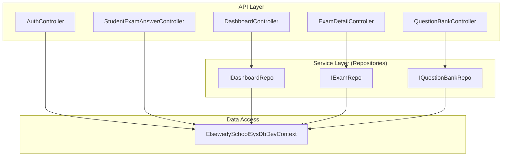
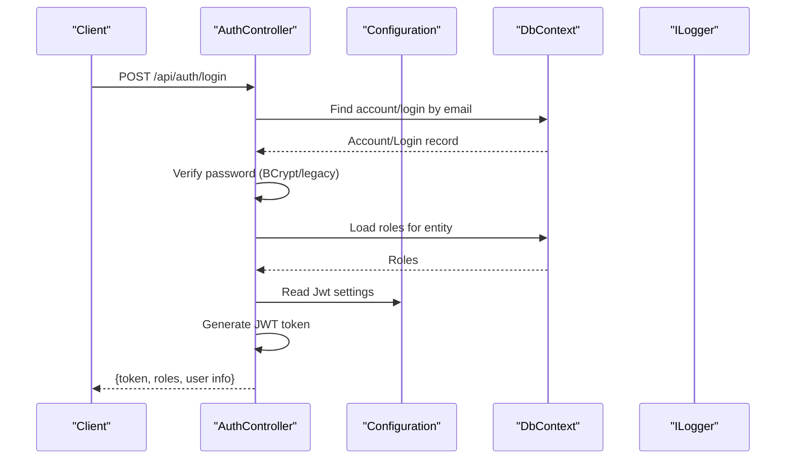
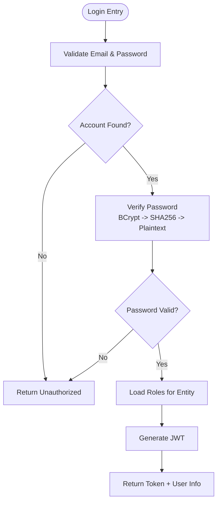
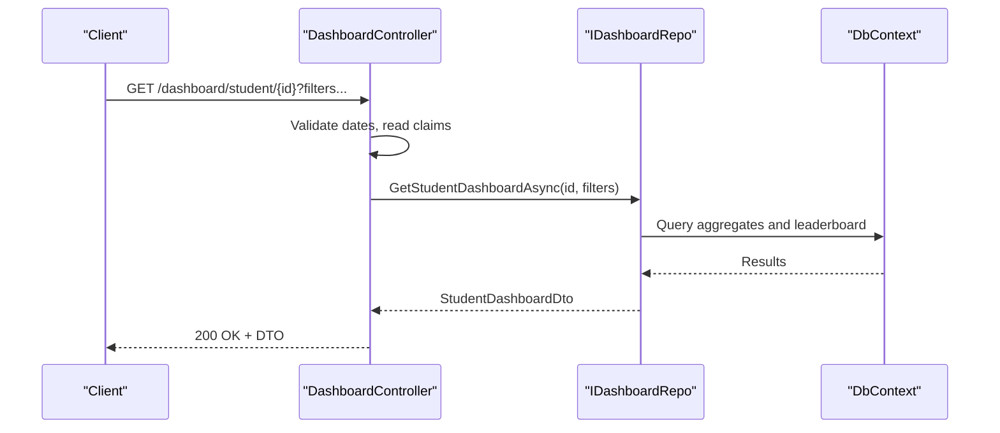
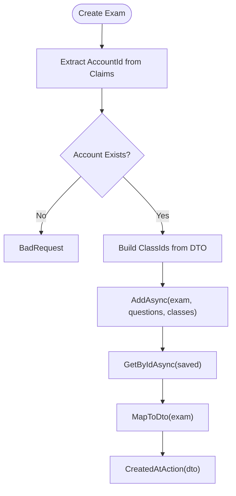
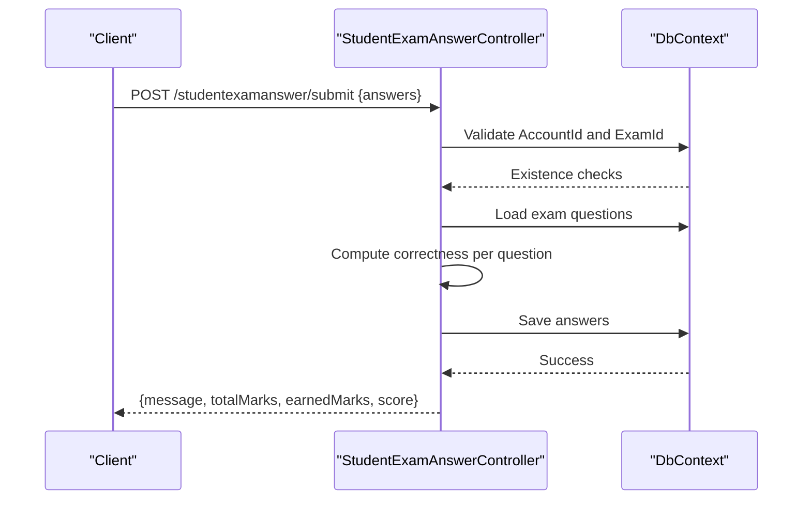
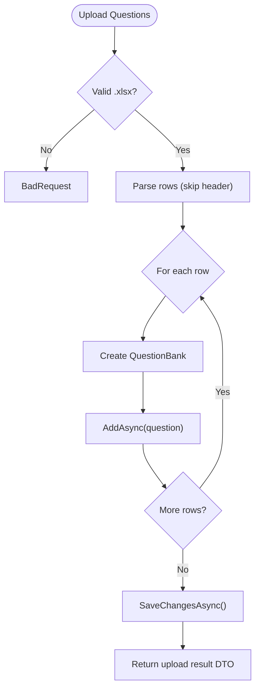
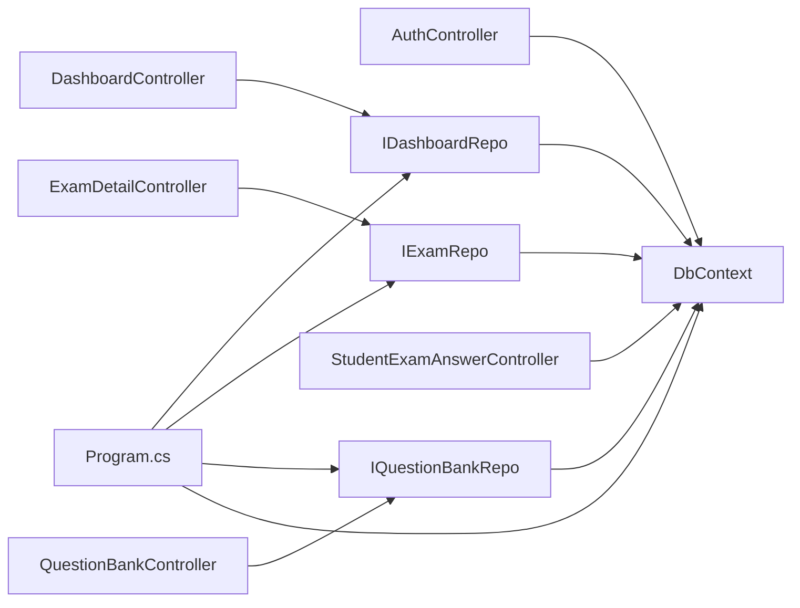

# Controller Organization

<cite>
**Referenced Files in This Document**
- [AuthController.cs](file://server/Api/Controllers/AuthController.cs)
- [DashboardController.cs](file://server/Api/Controllers/DashboardController.cs)
- [ExamDetailController.cs](file://server/Api/Controllers/ExamDetailController.cs)
- [StudentExamAnswerController.cs](file://server/Api/Controllers/StudentExamAnswerController.cs)
- [QuestionBankController.cs](file://server/Api/Controllers/QuestionBankController.cs)
- [IDashboardRepo.cs](file://server/Api/Repositories/Interfaces/IDashboardRepo.cs)
- [IExamRepo.cs](file://server/Api/Repositories/Interfaces/IExamRepo.cs)
- [IQuestionBankRepo.cs](file://server/Api/Repositories/Interfaces/IQuestionBankRepo.cs)
- [Program.cs](file://server/Api/Program.cs)
- [DashboardDTOs.cs](file://server/Api/DTOs/DashboardDTOs.cs)
- [QuestionBankReadDto.cs](file://server/Api/DTOs/QuestionBankReadDto.cs)
</cite>

## Table of Contents
1. Introduction
2. Project Structure
3. Core Components
4. Architecture Overview
5. Detailed Component Analysis
6. Dependency Analysis
7. Performance Considerations
8. Troubleshooting Guide
9. Conclusion
10. Appendices

## Introduction
This document explains the controller organization pattern used in the Exam-Hub backend. Controllers are organized by feature domains: Auth, Dashboard, ExamDetail, StudentExamAnswer, and QuestionBank. Each controller encapsulates HTTP concerns (routing, parameter binding, authorization, validation, response shaping) while delegating business logic to repository interfaces. The application uses ASP.NET Core minimal API conventions with attribute routing, dependency injection for services/repositories, and JWT-based authentication and authorization.

## Project Structure
The server API is structured around feature folders under Api/Controllers, with supporting layers:
- Controllers: One per feature domain
- Repositories: Interfaces and implementations under Api/Repositories
- DTOs: Request/response models under Api/DTOs
- Models: Domain entities under Api/Models
- Program: Application startup, DI registration, authentication, CORS, Swagger

**Diagram sources**
- [AuthController.cs:12-26](file://server/Api/Controllers/AuthController.cs#L12-L26)
- [DashboardController.cs:11-22](file://server/Api/Controllers/DashboardController.cs#L11-L22)
- [ExamDetailController.cs:11-22](file://server/Api/Controllers/ExamDetailController.cs#L11-L22)
- [StudentExamAnswerController.cs:11-20](file://server/Api/Controllers/StudentExamAnswerController.cs#L11-L20)
- [QuestionBankController.cs:10-19](file://server/Api/Controllers/QuestionBankController.cs#L10-L19)
- [IDashboardRepo.cs:5-45](file://server/Api/Repositories/Interfaces/IDashboardRepo.cs#L5-L45)
- [IExamRepo.cs:5-13](file://server/Api/Repositories/Interfaces/IExamRepo.cs#L5-L13)
- [IQuestionBankRepo.cs:3-11](file://server/Api/Repositories/Interfaces/IQuestionBankRepo.cs#L3-L11)

**Section sources**
- [Program.cs:17-125](file://server/Api/Program.cs#L17-L125)

## Core Components
- Feature-domain controllers:
  - AuthController: Authentication, profile management, JWT issuance
  - DashboardController: Role-scoped dashboards, leaderboards, statistics
  - ExamDetailController: CRUD for exams with class scoping and question linking
  - StudentExamAnswerController: Submitting and retrieving student answers
  - QuestionBankController: CRUD and bulk upload for questions
- Repository interfaces:
  - IDashboardRepo, IExamRepo, IQuestionBankRepo define service contracts consumed by controllers
- DTOs:
  - Strongly typed request/response models such as LeaderboardFilterDto, QuestionBankReadDto

Key responsibilities:
- Controllers handle HTTP concerns: routing, parameter binding, authorization checks, input validation, error responses
- Repositories encapsulate data access and business operations
- DTOs decouple internal models from API contracts

**Section sources**
- [AuthController.cs:12-26](file://server/Api/Controllers/AuthController.cs#L12-L26)
- [DashboardController.cs:11-22](file://server/Api/Controllers/DashboardController.cs#L11-L22)
- [ExamDetailController.cs:11-22](file://server/Api/Controllers/ExamDetailController.cs#L11-L22)
- [StudentExamAnswerController.cs:11-20](file://server/Api/Controllers/StudentExamAnswerController.cs#L11-L20)
- [QuestionBankController.cs:10-19](file://server/Api/Controllers/QuestionBankController.cs#L10-L19)
- [IDashboardRepo.cs:5-45](file://server/Api/Repositories/Interfaces/IDashboardRepo.cs#L5-L45)
- [IExamRepo.cs:5-13](file://server/Api/Repositories/Interfaces/IExamRepo.cs#L5-L13)
- [IQuestionBankRepo.cs:3-11](file://server/Api/Repositories/Interfaces/IQuestionBankRepo.cs#L3-L11)
- [DashboardDTOs.cs:137-148](file://server/Api/DTOs/DashboardDTOs.cs#L137-L148)
- [QuestionBankReadDto.cs:3-25](file://server/Api/DTOs/QuestionBankReadDto.cs#L3-L25)

## Architecture Overview
The application follows a layered architecture:
- Presentation layer: Controllers with attribute routing and action methods
- Service layer: Repository interfaces abstracting data access
- Data access: Entity Framework context for queries and mutations
- Cross-cutting: JWT authentication/authorization, CORS, Swagger

**Diagram sources**
- [AuthController.cs:118-249](file://server/Api/Controllers/AuthController.cs#L118-L249)
- [AuthController.cs:381-420](file://server/Api/Controllers/AuthController.cs#L381-L420)
- [Program.cs:43-81](file://server/Api/Program.cs#L43-L81)

**Section sources**
- [Program.cs:17-125](file://server/Api/Program.cs#L17-L125)

## Detailed Component Analysis

### AuthController
Responsibilities:
- Register accounts with role mapping and status handling
- Login with multi-strategy password verification and JWT issuance
- SSO token generation
- Profile retrieval and update

Routing and endpoints:
- POST /api/auth/register
- POST /api/auth/login
- POST /api/auth/sso-token
- GET /api/auth/profile/{id}
- PUT /api/auth/profile/{id}

Dependency injection:
- DbContext, IConfiguration, ILogger injected via constructor

Action organization and parameter binding:
- Model binding from JSON bodies for register/login/profile updates
- Route parameters for profile endpoints
- Authorization not enforced on auth endpoints; other endpoints use [Authorize]

Response handling:
- Consistent success/failure responses with messages and status codes
- JWT payload includes roles and user identity

Error handling:
- Validation errors return BadRequest
- Not found returns NotFound
- Exceptions caught and returned as 500 with message

**Diagram sources**
- [AuthController.cs:118-249](file://server/Api/Controllers/AuthController.cs#L118-L249)
- [AuthController.cs:381-420](file://server/Api/Controllers/AuthController.cs#L381-L420)

**Section sources**
- [AuthController.cs:12-26](file://server/Api/Controllers/AuthController.cs#L12-L26)
- [AuthController.cs:28-116](file://server/Api/Controllers/AuthController.cs#L28-L116)
- [AuthController.cs:118-249](file://server/Api/Controllers/AuthController.cs#L118-L249)
- [AuthController.cs:251-313](file://server/Api/Controllers/AuthController.cs#L251-L313)
- [AuthController.cs:315-379](file://server/Api/Controllers/AuthController.cs#L315-L379)
- [AuthController.cs:381-420](file://server/Api/Controllers/AuthController.cs#L381-L420)

### DashboardController
Responsibilities:
- Provide lookup data for UI filters
- Serve role-specific dashboards: student, teacher, superadmin
- Expose leaderboards and exam statistics

Routing and endpoints:
- GET /api/dashboard/lookup-data
- GET /api/dashboard/student/{id}
- GET /api/dashboard/teacher/{id}
- GET /api/dashboard/superadmin
- GET /api/dashboard/leaderboard/{examId}
- GET /api/dashboard/leaderboard/combined
- GET /api/dashboard/exam/{examId}/stats
- GET /api/dashboard/teachers
- GET /api/dashboard/students

Dependency injection:
- IDashboardRepo and DbContext injected via constructor

Authorization:
- [Authorize] on most endpoints
- Role-based policies on specific endpoints (e.g., Superadmin, Admin, Board)

Parameter binding:
- Route parameters for IDs
- Query parameters for filters (gradeId, classId, examId, date ranges, groupBy)

Response handling:
- Returns strongly-typed DTOs defined in DashboardDTOs

Error handling:
- Validates date ranges and returns BadRequest when invalid
- NotFound for missing resources
- Generic 500 for unexpected exceptions

**Diagram sources**
- [DashboardController.cs:85-136](file://server/Api/Controllers/DashboardController.cs#L85-L136)
- [IDashboardRepo.cs:7-15](file://server/Api/Repositories/Interfaces/IDashboardRepo.cs#L7-L15)
- [DashboardDTOs.cs:3-15](file://server/Api/DTOs/DashboardDTOs.cs#L3-L15)

**Section sources**
- [DashboardController.cs:11-22](file://server/Api/Controllers/DashboardController.cs#L11-L22)
- [DashboardController.cs:24-78](file://server/Api/Controllers/DashboardController.cs#L24-L78)
- [DashboardController.cs:85-136](file://server/Api/Controllers/DashboardController.cs#L85-L136)
- [DashboardController.cs:143-195](file://server/Api/Controllers/DashboardController.cs#L143-L195)
- [DashboardController.cs:201-234](file://server/Api/Controllers/DashboardController.cs#L201-L234)
- [DashboardController.cs:245-285](file://server/Api/Controllers/DashboardController.cs#L245-L285)
- [DashboardController.cs:292-320](file://server/Api/Controllers/DashboardController.cs#L292-L320)
- [DashboardController.cs:327-344](file://server/Api/Controllers/DashboardController.cs#L327-L344)
- [DashboardController.cs:346-374](file://server/Api/Controllers/DashboardController.cs#L346-L374)

### ExamDetailController
Responsibilities:
- List, get, create, update, delete exams
- Enforce class-based access control for students
- Map entities to DTOs

Routing and endpoints:
- GET /api/examdetail
- GET /api/examdetail/{id}
- POST /api/examdetail
- PUT /api/examdetail/{id}
- DELETE /api/examdetail/{id}
- GET /api/examdetail/subjects

Dependency injection:
- IExamRepo and DbContext injected via constructor

Access control:
- Reads claims to determine student vs teacher/admin
- Filters exams by student’s class if present

Parameter binding:
- Route parameters for IDs
- JSON body for create/update with class lists and question sets

Response handling:
- Returns mapped DTOs including questions and totals
- CreatedAtAction for successful creation

Error handling:
- NotFound for missing exams
- BadRequest for invalid inputs or account issues
- 500 with detailed messages on failures

**Diagram sources**
- [ExamDetailController.cs:110-198](file://server/Api/Controllers/ExamDetailController.cs#L110-L198)
- [IExamRepo.cs:7-12](file://server/Api/Repositories/Interfaces/IExamRepo.cs#L7-L12)

**Section sources**
- [ExamDetailController.cs:11-22](file://server/Api/Controllers/ExamDetailController.cs#L11-L22)
- [ExamDetailController.cs:24-69](file://server/Api/Controllers/ExamDetailController.cs#L24-L69)
- [ExamDetailController.cs:71-108](file://server/Api/Controllers/ExamDetailController.cs#L71-L108)
- [ExamDetailController.cs:110-198](file://server/Api/Controllers/ExamDetailController.cs#L110-L198)
- [ExamDetailController.cs:200-253](file://server/Api/Controllers/ExamDetailController.cs#L200-L253)
- [ExamDetailController.cs:255-299](file://server/Api/Controllers/ExamDetailController.cs#L255-L299)

### StudentExamAnswerController
Responsibilities:
- Retrieve exams and answers for a student
- Retrieve answers for a specific exam
- Submit student answers with scoring

Routing and endpoints:
- GET /api/studentexamanswer/student/{accountId}/exams
- GET /api/studentexamanswer/student/{accountId}/exam/{examId}
- POST /api/studentexamanswer/submit

Dependency injection:
- DbContext injected via constructor

Parameter binding:
- Route parameters for accountId and examId
- JSON body for answer submission

Response handling:
- Aggregates total marks, earned marks, score percentage
- Returns question-level details with user answers and correctness

Error handling:
- Validates existence of account and exam
- Prevents duplicate submissions
- Handles save errors with detailed messages

**Diagram sources**
- [StudentExamAnswerController.cs:199-332](file://server/Api/Controllers/StudentExamAnswerController.cs#L199-L332)

**Section sources**
- [StudentExamAnswerController.cs:11-20](file://server/Api/Controllers/StudentExamAnswerController.cs#L11-L20)
- [StudentExamAnswerController.cs:22-43](file://server/Api/Controllers/StudentExamAnswerController.cs#L22-L43)
- [StudentExamAnswerController.cs:45-126](file://server/Api/Controllers/StudentExamAnswerController.cs#L45-L126)
- [StudentExamAnswerController.cs:128-197](file://server/Api/Controllers/StudentExamAnswerController.cs#L128-L197)
- [StudentExamAnswerController.cs:199-332](file://server/Api/Controllers/StudentExamAnswerController.cs#L199-L332)

### QuestionBankController
Responsibilities:
- CRUD operations for questions
- Bulk upload from Excel (.xlsx)
- Download template for uploads

Routing and endpoints:
- GET /api/questionbank
- GET /api/questionbank/{id}
- POST /api/questionbank
- POST /api/questionbank/upload
- PUT /api/questionbank/{id}
- DELETE /api/questionbank/{id}
- GET /api/questionbank/template

Dependency injection:
- IQuestionBankRepo injected via constructor

Parameter binding:
- Route parameters for IDs
- Form file and query parameters for upload
- JSON body for create/update

Response handling:
- Returns created resource location for create
- Upload result DTO with counts and errors
- Template download as file stream

Error handling:
- Validates file type and content
- Per-row error accumulation during upload
- General 500 with inner exception details

**Diagram sources**
- [QuestionBankController.cs:145-271](file://server/Api/Controllers/QuestionBankController.cs#L145-L271)
- [IQuestionBankRepo.cs:3-11](file://server/Api/Repositories/Interfaces/IQuestionBankRepo.cs#L3-L11)

**Section sources**
- [QuestionBankController.cs:10-19](file://server/Api/Controllers/QuestionBankController.cs#L10-L19)
- [QuestionBankController.cs:21-48](file://server/Api/Controllers/QuestionBankController.cs#L21-L48)
- [QuestionBankController.cs:50-79](file://server/Api/Controllers/QuestionBankController.cs#L50-L79)
- [QuestionBankController.cs:81-143](file://server/Api/Controllers/QuestionBankController.cs#L81-L143)
- [QuestionBankController.cs:145-271](file://server/Api/Controllers/QuestionBankController.cs#L145-L271)
- [QuestionBankController.cs:272-327](file://server/Api/Controllers/QuestionBankController.cs#L272-L327)
- [QuestionBankController.cs:329-386](file://server/Api/Controllers/QuestionBankController.cs#L329-L386)

## Dependency Analysis
- Controllers depend on repository interfaces for data operations, enabling testability and separation of concerns
- Program registers repositories as scoped services
- DbContext is registered as a scoped service for database operations
- Authentication middleware validates JWT tokens and maps claims for authorization

**Diagram sources**
- [Program.cs:104-108](file://server/Api/Program.cs#L104-L108)
- [IDashboardRepo.cs:5-45](file://server/Api/Repositories/Interfaces/IDashboardRepo.cs#L5-L45)
- [IExamRepo.cs:5-13](file://server/Api/Repositories/Interfaces/IExamRepo.cs#L5-L13)
- [IQuestionBankRepo.cs:3-11](file://server/Api/Repositories/Interfaces/IQuestionBankRepo.cs#L3-L11)

**Section sources**
- [Program.cs:17-125](file://server/Api/Program.cs#L17-L125)

## Performance Considerations
- Use AsNoTracking for read-only queries where appropriate to reduce change tracking overhead
- Batch operations where possible (e.g., AddRangeAsync for answer submissions)
- Avoid N+1 queries by loading related data in single queries (as seen in PopulateExamQuestions)
- Cache static lookups (grades, classes, subjects) using MemoryCache configured in Program
- Validate inputs early to fail fast and reduce unnecessary processing

[No sources needed since this section provides general guidance]

## Troubleshooting Guide
Common issues and resolutions:
- Authentication failures: Ensure JWT configuration matches issuer/audience/key; verify claim mapping in Program
- Authorization errors: Confirm roles are present in token and policies are correctly configured
- Database constraints: Validate foreign keys and required fields before inserts (e.g., AccountId in QuestionBank)
- Duplicate submissions: Check existing answers before saving to prevent conflicts
- File upload errors: Validate file extension and content; handle per-row exceptions gracefully

**Section sources**
- [Program.cs:43-81](file://server/Api/Program.cs#L43-L81)
- [StudentExamAnswerController.cs:229-233](file://server/Api/Controllers/StudentExamAnswerController.cs#L229-L233)
- [QuestionBankController.cs:145-153](file://server/Api/Controllers/QuestionBankController.cs#L145-L153)

## Conclusion
The Exam-Hub backend organizes controllers by feature domains to achieve clear separation of concerns. Controllers focus on HTTP concerns while delegating business logic to repository interfaces. Dependency injection enables testable design, and consistent routing and parameter binding patterns simplify endpoint discovery and maintenance. The approach supports scalability and maintainability across features like authentication, dashboards, exams, answers, and question banks.

[No sources needed since this section summarizes without analyzing specific files]

## Appendices

### Routing Configuration and Endpoint Mapping Strategies
- Attribute routing with [Route("api/[controller]")] standardizes base paths
- Action methods decorated with HTTP verbs map directly to RESTful endpoints
- Query parameters used for filtering and optional inputs
- Route parameters used for resource identifiers

**Section sources**
- [AuthController.cs:12-14](file://server/Api/Controllers/AuthController.cs#L12-L14)
- [DashboardController.cs:11-13](file://server/Api/Controllers/DashboardController.cs#L11-L13)
- [ExamDetailController.cs:11-13](file://server/Api/Controllers/ExamDetailController.cs#L11-L13)
- [StudentExamAnswerController.cs:11-13](file://server/Api/Controllers/StudentExamAnswerController.cs#L11-L13)
- [QuestionBankController.cs:10-12](file://server/Api/Controllers/QuestionBankController.cs#L10-L12)

### Controller Lifecycle and Dependency Injection Usage
- Controllers are instantiated per request by ASP.NET Core
- Constructor injection resolves dependencies (DbContext, repositories, configuration, logging)
- Scoped lifetime ensures one DbContext instance per request

**Section sources**
- [Program.cs:17-24](file://server/Api/Program.cs#L17-L24)
- [Program.cs:30-36](file://server/Api/Program.cs#L30-L36)
- [Program.cs:104-108](file://server/Api/Program.cs#L104-L108)

### Service Layer Integration
- Controllers call repository methods that encapsulate data access
- DTOs provide stable contracts between controllers and clients
- Complex queries and aggregations are implemented in repositories

**Section sources**
- [DashboardController.cs:15-22](file://server/Api/Controllers/DashboardController.cs#L15-L22)
- [IDashboardRepo.cs:5-45](file://server/Api/Repositories/Interfaces/IDashboardRepo.cs#L5-L45)
- [DashboardDTOs.cs:137-148](file://server/Api/DTOs/DashboardDTOs.cs#L137-L148)

### Examples of Controller Methods
- Parameter binding:
  - Route parameters: [DashboardController.cs:85-93](file://server/Api/Controllers/DashboardController.cs#L85-L93)
  - Query parameters: [DashboardController.cs:247-254](file://server/Api/Controllers/DashboardController.cs#L247-L254)
  - JSON bodies: [AuthController.cs:28-39](file://server/Api/Controllers/AuthController.cs#L28-L39), [QuestionBankController.cs:81-143](file://server/Api/Controllers/QuestionBankController.cs#L81-L143)
- Response handling:
  - Success responses: [ExamDetailController.cs:188-190](file://server/Api/Controllers/ExamDetailController.cs#L188-L190)
  - Error responses: [AuthController.cs:33-39](file://server/Api/Controllers/AuthController.cs#L33-L39), [StudentExamAnswerController.cs:218-225](file://server/Api/Controllers/StudentExamAnswerController.cs#L218-L225)

### Controller Testing Approaches and Mocking Strategies
- Unit test controllers by mocking repository interfaces (IDashboardRepo, IExamRepo, IQuestionBankRepo)
- Inject mocks into controller constructors to isolate behavior
- Assert HTTP results (Ok, NotFound, BadRequest) based on mocked repository outputs
- Validate authorization logic by supplying mock claims or bypassing middleware in tests

[No sources needed since this section provides general guidance]