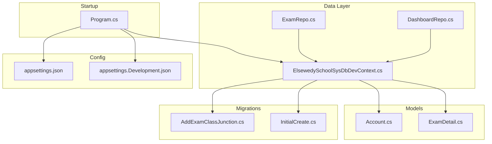
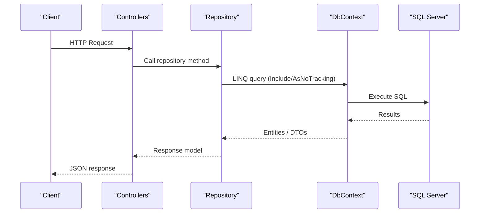
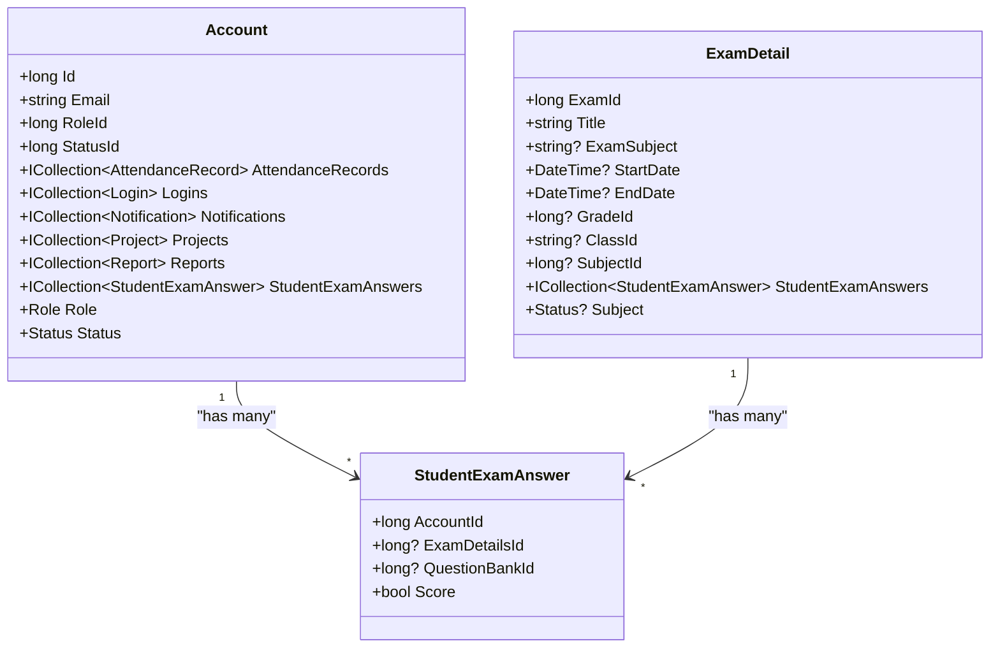
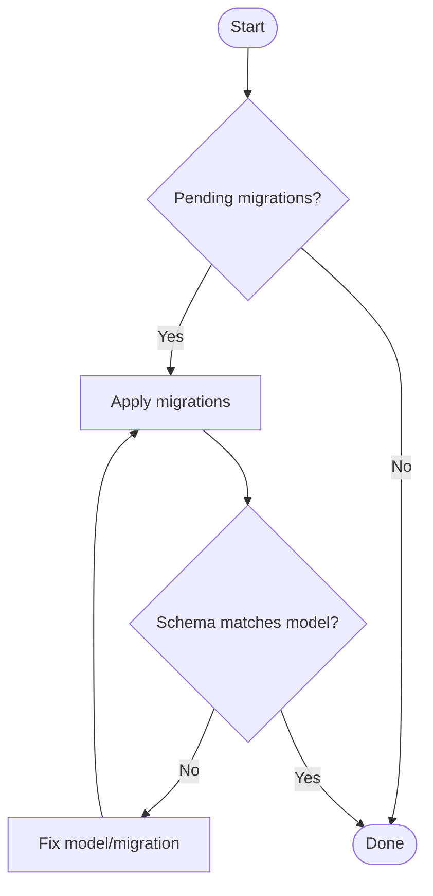
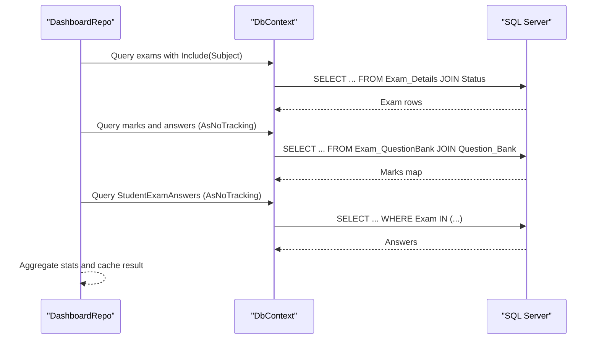
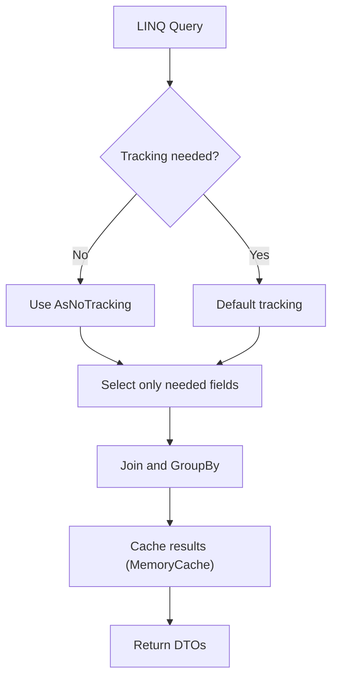
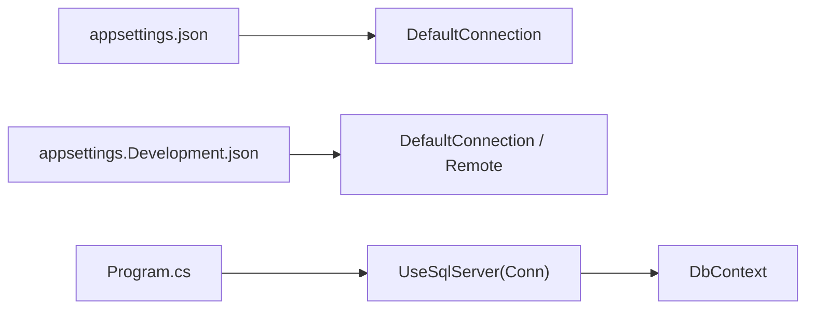
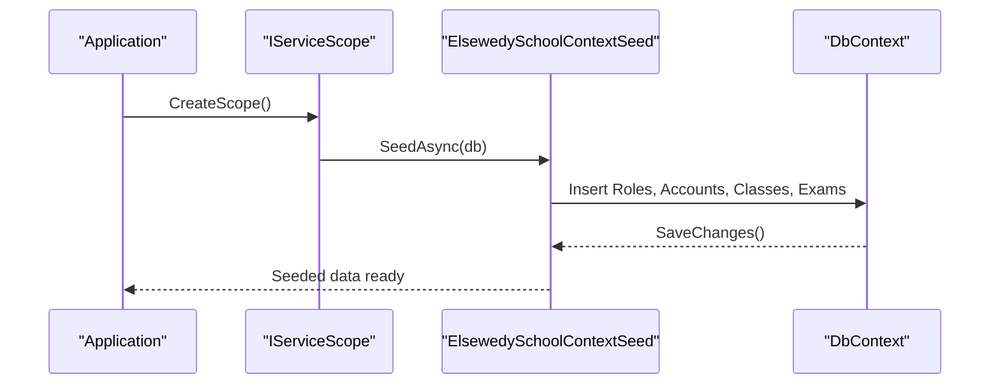
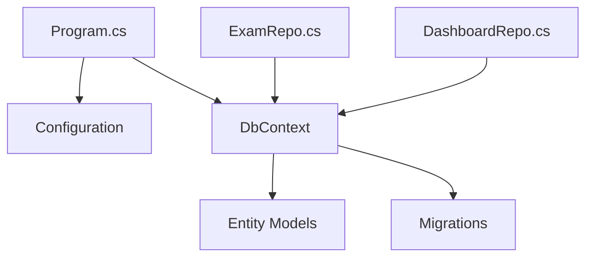

# Entity Framework Core Usage

<cite>
**Referenced Files in This Document**
- [Program.cs](file://server/Api/Program.cs)
- [appsettings.json](file://server/Api/appsettings.json)
- [appsettings.Development.json](file://server/Api/appsettings.Development.json)
- [ElsewedySchoolSysDbDevContext.cs](file://server/Api/Models/ElsewedySchoolSysDbDevContext.cs)
- [Account.cs](file://server/Api/Models/Account.cs)
- [ExamDetail.cs](file://server/Api/Models/ExamDetail.cs)
- [ExamRepo.cs](file://server/Api/Repositories/Implementation/ExamRepo.cs)
- [DashboardRepo.cs](file://server/Api/Repositories/Implementation/DashboardRepo.cs)
- [ElsewedySchoolContextSeed.cs](file://server/Api/Models/ElsewedySchoolContextSeed.cs)
- [20260117231344_AddExamClassJunction.cs](file://server/Api/Migrations/20260117231344_AddExamClassJunction.cs)
- [20260123184911_InitialCreate.cs](file://server/Api/Migrations/20260123184911_InitialCreate.cs)
</cite>

## Table of Contents
1. Introduction
2. Project Structure
3. Core Components
4. Architecture Overview
5. Detailed Component Analysis
6. Dependency Analysis
7. Performance Considerations
8. Troubleshooting Guide
9. Conclusion
10. Appendices

## Introduction
This document explains how Entity Framework Core is used in the Exam-Hub backend to configure the database context, map entities and relationships, generate and manage migrations, execute LINQ queries with eager loading, optimize performance, seed data, and debug EF Core usage. It focuses on the DbContext configuration, entity relationship mappings, migration management, query patterns, and environment-specific settings.

## Project Structure
The EF Core implementation centers around:
- A DbContext that declares DbSets and configures entity mappings and relationships.
- Repository classes that encapsulate LINQ queries and unit-of-work operations.
- Program startup that registers the DbContext and seeds initial data.
- Configuration files for connection strings and environment-specific options.
- Migrations that evolve the database schema over time.

**Diagram sources**
- [Program.cs:30-33](file://server/Api/Program.cs#L30-L33)
- [ElsewedySchoolSysDbDevContext.cs:140-142](file://server/Api/Models/ElsewedySchoolSysDbDevContext.cs#L140-L142)
- [appsettings.json:1-4](file://server/Api/appsettings.json#L1-L4)
- [appsettings.Development.json:1-5](file://server/Api/appsettings.Development.json#L1-L5)
- [20260117231344_AddExamClassJunction.cs:11-48](file://server/Api/Migrations/20260117231344_AddExamClassJunction.cs#L11-L48)
- [20260123184911_InitialCreate.cs:11-55](file://server/Api/Migrations/20260123184911_InitialCreate.cs#L11-L55)

**Section sources**
- [Program.cs:30-33](file://server/Api/Program.cs#L30-L33)
- [appsettings.json:1-4](file://server/Api/appsettings.json#L1-L4)
- [appsettings.Development.json:1-5](file://server/Api/appsettings.Development.json#L1-L5)

## Core Components
- DbContext: Declares all DbSets and configures entity-to-table mappings, keys, indexes, constraints, and relationships via OnModelCreating.
- Repositories: Encapsulate read/write operations using LINQ against the DbContext, including Include for eager loading and AsNoTracking for read-only scenarios.
- Startup: Registers DbContext with a SQL Server provider and connection string from configuration; seeds roles and test accounts at application start.
- Configuration: Connection strings are provided per environment; development includes both local and remote connection strings.
- Migrations: Versioned changes to the database schema, including table creation, column renames, index updates, and constraint adjustments.

Key responsibilities:
- DbContext: Central mapping hub for entities and relationships.
- Repositories: Query composition, caching integration, and transactional boundaries (SaveChanges).
- Program: Service registration, middleware pipeline, and seeding.

**Section sources**
- [ElsewedySchoolSysDbDevContext.cs:18-137](file://server/Api/Models/ElsewedySchoolSysDbDevContext.cs#L18-L137)
- [ElsewedySchoolSysDbDevContext.cs:140-800](file://server/Api/Models/ElsewedySchoolSysDbDevContext.cs#L140-L800)
- [ExamRepo.cs:15-138](file://server/Api/Repositories/Implementation/ExamRepo.cs#L15-L138)
- [DashboardRepo.cs:109-503](file://server/Api/Repositories/Implementation/DashboardRepo.cs#L109-L503)
- [Program.cs:30-33](file://server/Api/Program.cs#L30-L33)
- [Program.cs:127-140](file://server/Api/Program.cs#L127-L140)

## Architecture Overview
The application uses ASP.NET Core with EF Core as the ORM. The DbContext is registered as scoped and consumed by repositories. Queries use LINQ with Include for eager loading and AsNoTracking for performance. Data seeding runs once at startup.

**Diagram sources**
- [Program.cs:30-33](file://server/Api/Program.cs#L30-L33)
- [ExamRepo.cs:15-64](file://server/Api/Repositories/Implementation/ExamRepo.cs#L15-L64)
- [DashboardRepo.cs:109-161](file://server/Api/Repositories/Implementation/DashboardRepo.cs#L109-L161)

## Detailed Component Analysis

### DbContext Configuration and Entity Mapping
- Provider and collation: SQL Server provider is configured in Program; Arabic collation is set globally in OnModelCreating.
- DbSet declarations: All major entities are exposed as DbSets for querying.
- Entity configurations: Keys, table names, property names, default values, types, unique indexes, and foreign key relationships are defined in OnModelCreating.
- Relationship examples:
  - Account has many AttendanceRecords, Logins, Notifications, Projects, Reports, StudentExamAnswers, etc., and belongs to Role and Status.
  - ExamDetail has a one-to-many relationship with StudentExamAnswer and references Subject via a foreign key.

**Diagram sources**
- [Account.cs:6-81](file://server/Api/Models/Account.cs#L6-L81)
- [ExamDetail.cs:6-30](file://server/Api/Models/ExamDetail.cs#L6-L30)
- [ElsewedySchoolSysDbDevContext.cs:154-181](file://server/Api/Models/ElsewedySchoolSysDbDevContext.cs#L154-L181)
- [ElsewedySchoolSysDbDevContext.cs:375-391](file://server/Api/Models/ElsewedySchoolSysDbDevContext.cs#L375-L391)
- [ElsewedySchoolSysDbDevContext.cs:717-738](file://server/Api/Models/ElsewedySchoolSysDbDevContext.cs#L717-L738)

**Section sources**
- [ElsewedySchoolSysDbDevContext.cs:18-137](file://server/Api/Models/ElsewedySchoolSysDbDevContext.cs#L18-L137)
- [ElsewedySchoolSysDbDevContext.cs:140-800](file://server/Api/Models/ElsewedySchoolSysDbDevContext.cs#L140-L800)
- [Account.cs:6-81](file://server/Api/Models/Account.cs#L6-L81)
- [ExamDetail.cs:6-30](file://server/Api/Models/ExamDetail.cs#L6-L30)

### Database Schema Generation and Migration Management
- Migrations exist under server/Api/Migrations and reflect schema changes such as adding junction tables, renaming columns, altering types, and creating unique indexes.
- Example changes:
  - AddExamClassJunction creates an Exam_Class junction table with unique constraints and indexes.
  - InitialCreate adjusts StudentExamAnswer structure, renames columns, adds new columns, alters types, and creates filtered unique indexes.

Migration workflow:
- Create: Use EF Core CLI to add a migration when models or DbContext change.
- Apply: Apply pending migrations to the target database.
- Rollback: Revert to a previous migration if needed.
- Verify: Inspect generated SQL and ensure constraints/indexes match expectations.

[No sources needed since this diagram shows conceptual workflow, not actual code structure]

**Section sources**
- [20260117231344_AddExamClassJunction.cs:11-48](file://server/Api/Migrations/20260117231344_AddExamClassJunction.cs#L11-L48)
- [20260123184911_InitialCreate.cs:11-55](file://server/Api/Migrations/20260123184911_InitialCreate.cs#L11-L55)

### LINQ to SQL Query Patterns and Eager Loading
- Eager loading: Repositories use Include to load related entities in a single round-trip where appropriate.
- Read-only optimization: AsNoTracking is used extensively in dashboard queries to avoid change tracking overhead.
- Complex queries: DashboardRepo composes multiple queries, joins, groupings, and aggregations to compute statistics efficiently.

Examples:
- ExamRepo includes Subject and manually populates related ExamQuestionBanks and Questions for exam details.
- DashboardRepo uses AsNoTracking across large datasets and performs batched fetching to minimize N+1 issues.

**Diagram sources**
- [DashboardRepo.cs:109-161](file://server/Api/Repositories/Implementation/DashboardRepo.cs#L109-L161)
- [DashboardRepo.cs:248-391](file://server/Api/Repositories/Implementation/DashboardRepo.cs#L248-L391)
- [ExamRepo.cs:15-64](file://server/Api/Repositories/Implementation/ExamRepo.cs#L15-L64)

**Section sources**
- [ExamRepo.cs:15-64](file://server/Api/Repositories/Implementation/ExamRepo.cs#L15-L64)
- [DashboardRepo.cs:109-161](file://server/Api/Repositories/Implementation/DashboardRepo.cs#L109-L161)
- [DashboardRepo.cs:248-391](file://server/Api/Repositories/Implementation/DashboardRepo.cs#L248-L391)

### Performance Optimization Techniques
- AsNoTracking: Used throughout dashboard queries to reduce memory and change tracking costs.
- Selective projection: Only necessary fields are selected to reduce payload size.
- Batched fetching: Grouping IDs and performing bulk queries to avoid N+1 queries.
- In-memory caching: MemoryCache stores computed dashboard results for short durations to reduce repeated database work.
- Efficient joins and grouping: LINQ joins and GroupBy are used to compute aggregates in memory after minimal data retrieval.

**Diagram sources**
- [DashboardRepo.cs:109-161](file://server/Api/Repositories/Implementation/DashboardRepo.cs#L109-L161)
- [DashboardRepo.cs:248-391](file://server/Api/Repositories/Implementation/DashboardRepo.cs#L248-L391)
- [Program.cs:35-36](file://server/Api/Program.cs#L35-L36)

**Section sources**
- [DashboardRepo.cs:109-161](file://server/Api/Repositories/Implementation/DashboardRepo.cs#L109-L161)
- [DashboardRepo.cs:248-391](file://server/Api/Repositories/Implementation/DashboardRepo.cs#L248-L391)
- [Program.cs:35-36](file://server/Api/Program.cs#L35-L36)

### Database Connection Configuration and Environment-Specific Settings
- Connection strings: Defined in appsettings.json and overridden in appsettings.Development.json.
- Registration: Program registers DbContext with UseSqlServer and reads the DefaultConnection string from configuration.
- Environments: Development enables Swagger UI and logging levels suitable for debugging.

**Diagram sources**
- [appsettings.json:1-4](file://server/Api/appsettings.json#L1-L4)
- [appsettings.Development.json:1-5](file://server/Api/appsettings.Development.json#L1-L5)
- [Program.cs:30-33](file://server/Api/Program.cs#L30-L33)

**Section sources**
- [appsettings.json:1-4](file://server/Api/appsettings.json#L1-L4)
- [appsettings.Development.json:1-5](file://server/Api/appsettings.Development.json#L1-L5)
- [Program.cs:30-33](file://server/Api/Program.cs#L30-L33)

### Data Seeding Strategies
- Seed execution: At application startup, Program creates a scope and calls the seed method, catching exceptions to avoid blocking startup.
- Seed content: Creates roles, status entries, sample accounts, account roles, classes, student extensions, and example exams for testing visibility and dashboards.

**Diagram sources**
- [Program.cs:127-140](file://server/Api/Program.cs#L127-L140)
- [ElsewedySchoolContextSeed.cs:10-168](file://server/Api/Models/ElsewedySchoolContextSeed.cs#L10-L168)

**Section sources**
- [Program.cs:127-140](file://server/Api/Program.cs#L127-L140)
- [ElsewedySchoolContextSeed.cs:10-168](file://server/Api/Models/ElsewedySchoolContextSeed.cs#L10-L168)

## Dependency Analysis
- Program depends on configuration for connection strings and JWT settings.
- Repositories depend on DbContext for data access.
- DbContext depends on entity models for mapping.
- Migrations depend on DbContext and models to generate schema changes.

**Diagram sources**
- [Program.cs:30-33](file://server/Api/Program.cs#L30-L33)
- [ExamRepo.cs:1-138](file://server/Api/Repositories/Implementation/ExamRepo.cs#L1-L138)
- [DashboardRepo.cs:1-503](file://server/Api/Repositories/Implementation/DashboardRepo.cs#L1-L503)
- [ElsewedySchoolSysDbDevContext.cs:18-137](file://server/Api/Models/ElsewedySchoolSysDbDevContext.cs#L18-L137)

**Section sources**
- [Program.cs:30-33](file://server/Api/Program.cs#L30-L33)
- [ExamRepo.cs:1-138](file://server/Api/Repositories/Implementation/ExamRepo.cs#L1-L138)
- [DashboardRepo.cs:1-503](file://server/Api/Repositories/Implementation/DashboardRepo.cs#L1-L503)
- [ElsewedySchoolSysDbDevContext.cs:18-137](file://server/Api/Models/ElsewedySchoolSysDbDevContext.cs#L18-L137)

## Performance Considerations
- Prefer AsNoTracking for read-heavy endpoints to reduce memory pressure.
- Use Include judiciously to avoid loading unnecessary graphs; consider manual population when relationships are complex or not mapped.
- Project only required fields to minimize network and memory usage.
- Cache expensive computations with MemoryCache for dashboard endpoints.
- Avoid N+1 queries by batching ID lookups and using ToDictionary for fast in-memory joins.
- Monitor generated SQL for inefficient queries and adjust LINQ accordingly.

[No sources needed since this section provides general guidance]

## Troubleshooting Guide
Common issues and remedies:
- Connection failures: Verify DefaultConnection string in configuration and ensure the server/database credentials are correct.
- Missing relationships: Ensure foreign keys and navigation properties are configured in OnModelCreating; check constraint names and delete behaviors.
- N+1 queries: Replace lazy loads with Include or manual batched fetching; use AsNoTracking for read-only paths.
- Slow dashboards: Add caching, project only needed fields, and precompute aggregates in memory after minimal data retrieval.
- Migration conflicts: Align models with existing migrations; review Up/Down methods to ensure schema consistency.

Debugging techniques:
- Enable detailed logging for EF Core to inspect generated SQL and execution plans.
- Use Swagger in development to test endpoints and validate responses.
- Validate seeded data by checking roles, accounts, classes, and exams created at startup.

**Section sources**
- [Program.cs:112-116](file://server/Api/Program.cs#L112-L116)
- [ElsewedySchoolContextSeed.cs:10-168](file://server/Api/Models/ElsewedySchoolContextSeed.cs#L10-L168)
- [DashboardRepo.cs:109-161](file://server/Api/Repositories/Implementation/DashboardRepo.cs#L109-L161)

## Conclusion
The Exam-Hub backend leverages EF Core effectively through a well-structured DbContext, clear entity mappings, and repository-based query patterns. Performance is optimized with AsNoTracking, selective projections, batched fetching, and caching. Migrations provide controlled schema evolution, and seeding ensures a consistent baseline for development and testing. Following the practices outlined here will help maintain efficient, reliable data access across the application.

## Appendices

### Entity Definitions and Navigation Properties
- Account: Central identity entity with numerous relationships to attendance, logins, notifications, projects, reports, and exam answers.
- ExamDetail: Represents exam metadata and links to subjects and student answers.

**Section sources**
- [Account.cs:6-81](file://server/Api/Models/Account.cs#L6-L81)
- [ExamDetail.cs:6-30](file://server/Api/Models/ExamDetail.cs#L6-L30)

### Complex Query Examples
- Dashboard endpoints compute pass/fail rates, average scores, and leaderboards by joining question banks, marks, and student answers, then aggregating in memory.

**Section sources**
- [DashboardRepo.cs:109-161](file://server/Api/Repositories/Implementation/DashboardRepo.cs#L109-L161)
- [DashboardRepo.cs:248-391](file://server/Api/Repositories/Implementation/DashboardRepo.cs#L248-L391)
- [DashboardRepo.cs:505-565](file://server/Api/Repositories/Implementation/DashboardRepo.cs#L505-L565)