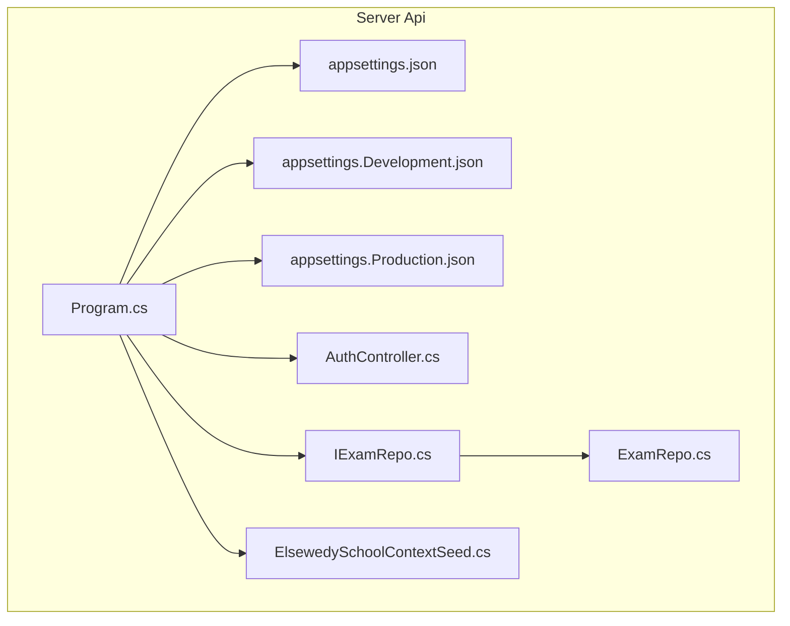
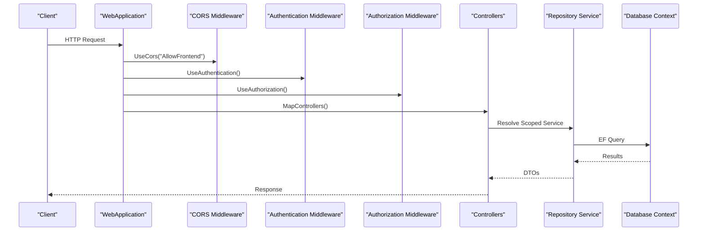
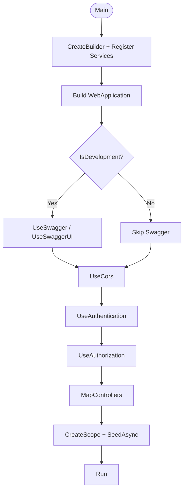
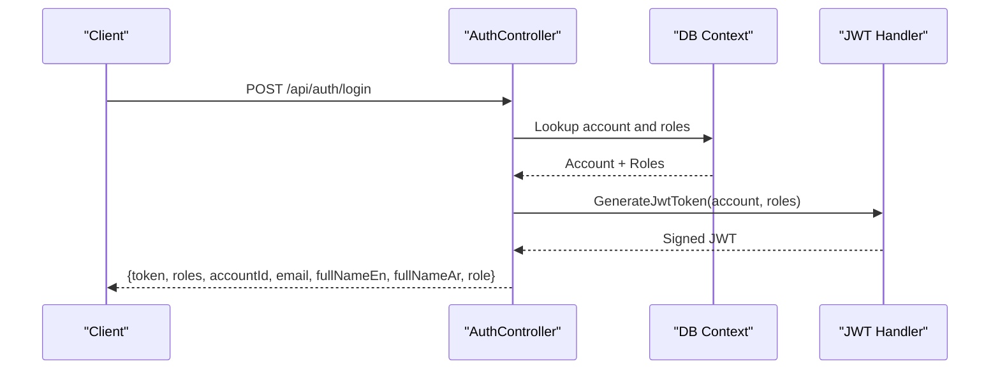
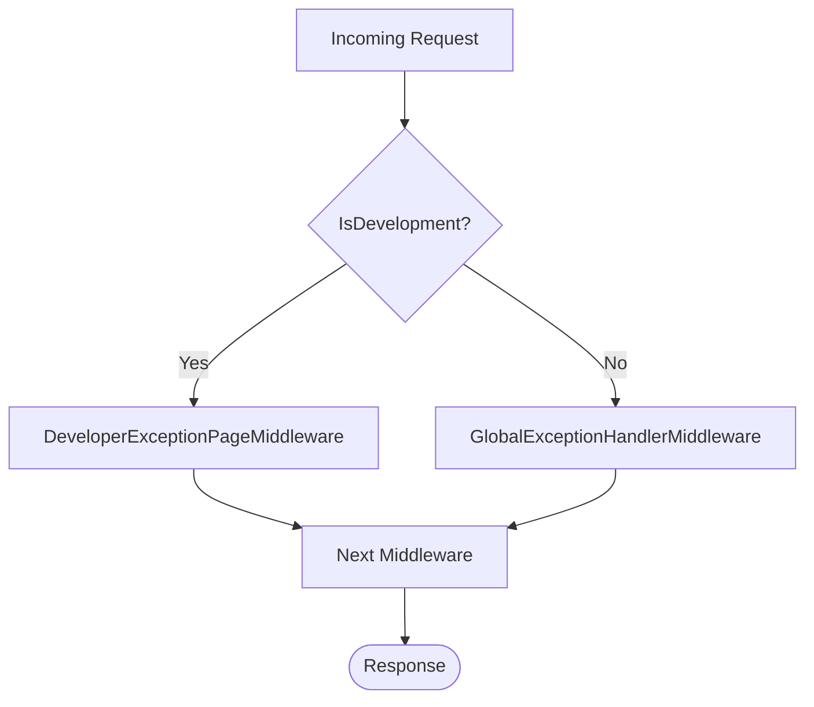
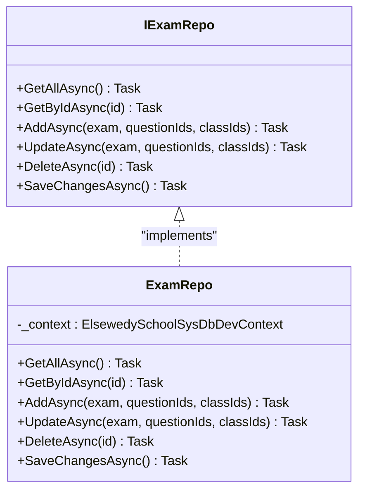
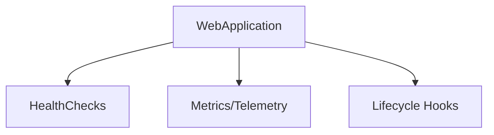
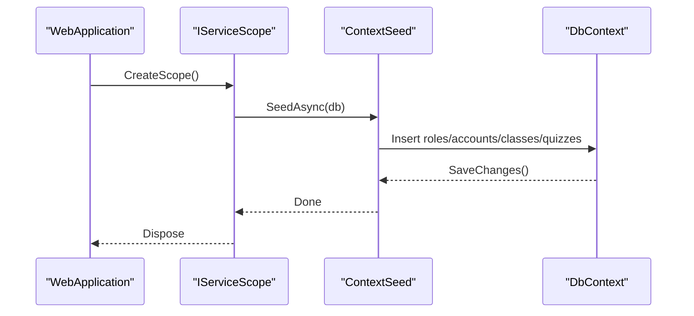
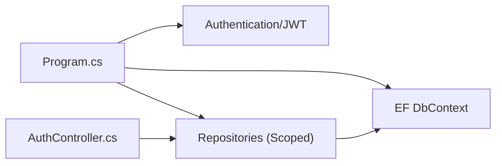

# Middleware & Services Configuration

<cite>
**Referenced Files in This Document**
- [Program.cs](file://server/Api/Program.cs)
- [appsettings.json](file://server/Api/appsettings.json)
- [appsettings.Development.json](file://server/Api/appsettings.Development.json)
- [appsettings.Production.json](file://server/Api/appsettings.Production.json)
- [AuthController.cs](file://server/Api/Controllers/AuthController.cs)
- [IExamRepo.cs](file://server/Api/Repositories/Interfaces/IExamRepo.cs)
- [ExamRepo.cs](file://server/Api/Repositories/Implementation/ExamRepo.cs)
- [ElsewedySchoolContextSeed.cs](file://server/Api/Models/ElsewedySchoolContextSeed.cs)
</cite>

## Table of Contents
1. Introduction
2. Project Structure
3. Core Components
4. Architecture Overview
5. Detailed Component Analysis
6. Dependency Analysis
7. Performance Considerations
8. Troubleshooting Guide
9. Conclusion

## Introduction
This document explains how the Exam-Hub backend configures middleware and services, focusing on application startup in Program.cs, dependency injection setup, service lifetimes, configuration binding from appsettings files, authentication and authorization, CORS, logging, and seed data execution. It also provides guidance for extending the pipeline with custom middleware, adding health checks and monitoring, and managing environment-specific settings.

## Project Structure
The backend is an ASP.NET Core Web API under server/Api. The key files for this documentation are:
- Program.cs: Application builder, service registration, and request pipeline configuration
- appsettings*.json: Configuration values (connection strings, JWT, logging)
- Controllers/AuthController.cs: Authentication endpoints and token generation
- Repositories/*: Data access abstractions and implementations registered via DI
- Models/ElsewedySchoolContextSeed.cs: Database seeding executed at startup

**Diagram sources**
- [Program.cs:17-109](file://server/Api/Program.cs#L17-L109)
- [appsettings.json:1-18](file://server/Api/appsettings.json#L1-L18)
- [appsettings.Development.json:1-12](file://server/Api/appsettings.Development.json#L1-L12)
- [appsettings.Production.json:1-11](file://server/Api/appsettings.Production.json#L1-L11)
- [AuthController.cs:12-26](file://server/Api/Controllers/AuthController.cs#L12-L26)
- [IExamRepo.cs:5-13](file://server/Api/Repositories/Interfaces/IExamRepo.cs#L5-L13)
- [ExamRepo.cs:6-13](file://server/Api/Repositories/Implementation/ExamRepo.cs#L6-L13)
- [ElsewedySchoolContextSeed.cs:8-10](file://server/Api/Models/ElsewedySchoolContextSeed.cs#L8-L10)

**Section sources**
- [Program.cs:17-146](file://server/Api/Program.cs#L17-L146)
- [appsettings.json:1-18](file://server/Api/appsettings.json#L1-L18)
- [appsettings.Development.json:1-12](file://server/Api/appsettings.Development.json#L1-L12)
- [appsettings.Production.json:1-11](file://server/Api/appsettings.Production.json#L1-L11)

## Core Components
- Application builder and service container:
  - Adds controllers with JSON naming policy
  - Registers Swagger/OpenAPI
  - Configures Entity Framework DbContext with SQL Server connection string
  - Adds in-memory cache
  - Registers repositories as scoped services
- Authentication and Authorization:
  - JWT Bearer scheme configured with issuer, audience, signing key, and claim mapping
  - Role-based policies defined for Student, Teacher, Superadmin, and combined roles
- CORS:
  - Policy allowing any origin, header, and method
- Request pipeline:
  - Development-only Swagger UI
  - CORS, Authentication, Authorization, then MVC controllers
- Startup seeding:
  - Executes database seeding within a scope after building the app

**Section sources**
- [Program.cs:17-109](file://server/Api/Program.cs#L17-L109)
- [Program.cs:112-142](file://server/Api/Program.cs#L112-L142)

## Architecture Overview
The application follows the standard ASP.NET Core pipeline:
- Builder phase: register services and configure options
- Build phase: create the WebApplication
- Configure phase: add middleware in order
- Run phase: handle requests through the pipeline

**Diagram sources**
- [Program.cs:109-125](file://server/Api/Program.cs#L109-L125)
- [IExamRepo.cs:5-13](file://server/Api/Repositories/Interfaces/IExamRepo.cs#L5-L13)
- [ExamRepo.cs:6-13](file://server/Api/Repositories/Implementation/ExamRepo.cs#L6-L13)

## Detailed Component Analysis

### Application Startup Pipeline (Program.cs)
- Service registration order:
  1. AddControllers with JSON options
  2. AddEndpointsApiExplorer and AddSwaggerGen
  3. AddDbContext for SQL Server using configuration
  4. AddMemoryCache
  5. AddAuthentication with JwtBearer options
  6. AddAuthorization with role policies
  7. AddCors with named policy
  8. Register repository interfaces to implementations (Scoped)
- Pipeline configuration order:
  1. Swagger UI (development only)
  2. UseCors
  3. UseAuthentication
  4. UseAuthorization
  5. MapControllers
- Post-build actions:
  - CreateScope and run database seeding with error handling

**Diagram sources**
- [Program.cs:17-109](file://server/Api/Program.cs#L17-L109)
- [Program.cs:112-142](file://server/Api/Program.cs#L112-L142)

**Section sources**
- [Program.cs:17-146](file://server/Api/Program.cs#L17-L146)

### Dependency Injection Container and Service Lifetimes
- DbContext:
  - Registered with AddDbContext; lifetime managed by framework (per-scope per request)
- Memory Cache:
  - Added via AddMemoryCache; singleton-backed cache accessible across scopes
- Repositories:
  - IExamRepo, IQuestionBankRepo, IDashboardRepo registered as Scoped
- Controllers:
  - Transient by default; resolved per request
- Logging:
  - ILogger<T> injected into controllers and Program

Lifetime summary:
- Transient: Controllers
- Scoped: DbContext, Repository implementations
- Singleton: Memory cache infrastructure

**Section sources**
- [Program.cs:30-36](file://server/Api/Program.cs#L30-L36)
- [Program.cs:104-107](file://server/Api/Program.cs#L104-L107)
- [AuthController.cs:12-26](file://server/Api/Controllers/AuthController.cs#L12-L26)

### Configuration Binding and Environment-Specific Settings
- appsettings.json:
  - ConnectionStrings.DefaultConnection
  - Jwt.Key, Jwt.Issuer, Jwt.Audience
  - Logging.LogLevel defaults
- appsettings.Development.json:
  - Overrides DefaultConnection and adds DefaultConnection_Remote
  - Logging overrides
- appsettings.Production.json:
  - Overrides DefaultConnection and Logging

Binding usage:
- Program reads connection string via Configuration.GetConnectionString("DefaultConnection")
- JWT parameters read via Configuration["Jwt:*"]

Best practices:
- Keep secrets out of source control; use environment variables or secret managers
- Validate required keys at startup and fail fast if missing

**Section sources**
- [appsettings.json:1-18](file://server/Api/appsettings.json#L1-L18)
- [appsettings.Development.json:1-12](file://server/Api/appsettings.Development.json#L1-L12)
- [appsettings.Production.json:1-11](file://server/Api/appsettings.Production.json#L1-L11)
- [Program.cs:32-33](file://server/Api/Program.cs#L32-L33)
- [Program.cs:56-58](file://server/Api/Program.cs#L56-L58)

### Authentication and Authorization
- Scheme:
  - JWT Bearer with default authenticate/challenge schemes set
- Token validation:
  - Validates issuer, audience, lifetime, and signing key
  - Maps claims:
    - Role/role → ClaimTypes.Role
    - AccountId/accountId/sub/nameid → ClaimTypes.NameIdentifier
- Policies:
  - StudentOnly, TeacherOnly, SuperadminOnly, TeacherOrAdmin

**Diagram sources**
- [AuthController.cs:118-249](file://server/Api/Controllers/AuthController.cs#L118-L249)
- [AuthController.cs:381-419](file://server/Api/Controllers/AuthController.cs#L381-L419)

**Section sources**
- [Program.cs:43-90](file://server/Api/Program.cs#L43-L90)
- [AuthController.cs:118-249](file://server/Api/Controllers/AuthController.cs#L118-L249)
- [AuthController.cs:381-419](file://server/Api/Controllers/AuthController.cs#L381-L419)

### CORS Configuration
- Named policy AllowFrontend allows any origin, header, and method
- Applied before authentication/authorization so preflight requests pass

Recommendations:
- Restrict origins to known frontends in production
- Limit allowed headers/methods to reduce attack surface

**Section sources**
- [Program.cs:92-102](file://server/Api/Program.cs#L92-L102)
- [Program.cs:120-123](file://server/Api/Program.cs#L120-L123)

### Logging Setup
- Global log levels configured in appsettings
- Controllers receive ILogger<T> for structured logging
- Program logs warnings when seeding fails

Enhancements:
- Add Serilog or Application Insights for richer telemetry
- Correlation IDs for request tracing

**Section sources**
- [appsettings.json:11-16](file://server/Api/appsettings.json#L11-L16)
- [AuthController.cs:18-26](file://server/Api/Controllers/AuthController.cs#L18-L26)
- [Program.cs:135-139](file://server/Api/Program.cs#L135-L139)

### Error Handling Middleware
Current state:
- No global exception handler middleware is added in Program.cs
- Controllers return explicit error responses and log exceptions

Recommended addition:
- Use developer exception page in development
- Add a global exception handler in production that returns standardized errors and logs details

[No sources needed since this diagram shows conceptual workflow, not actual code structure]

### Custom Middleware Implementation
To add custom middleware:
- Implement a class with Invoke(HttpContext)
- Register it in the pipeline via app.UseYourMiddleware()
- Place it according to concern (e.g., before CORS for request normalization, after authentication for user context enrichment)

Example pattern:
- Class name: YourCustomMiddleware
- Registration: app.UseYourCustomMiddleware()
- Typical responsibilities: request/response logging, correlation IDs, feature flags, rate limiting

[No sources needed since this section doesn't analyze specific files]

### Custom Service Registration Example
- Interface: IExamRepo
- Implementation: ExamRepo
- Lifetime: Scoped
- Usage: Injected into controllers or other services

**Diagram sources**
- [IExamRepo.cs:5-13](file://server/Api/Repositories/Interfaces/IExamRepo.cs#L5-L13)
- [ExamRepo.cs:6-13](file://server/Api/Repositories/Implementation/ExamRepo.cs#L6-L13)

**Section sources**
- [Program.cs:104-107](file://server/Api/Program.cs#L104-L107)
- [IExamRepo.cs:5-13](file://server/Api/Repositories/Interfaces/IExamRepo.cs#L5-L13)
- [ExamRepo.cs:6-13](file://server/Api/Repositories/Implementation/ExamRepo.cs#L6-L13)

### Configuration Validation
- Validate required configuration keys at startup (e.g., Jwt.Key, Jwt.Issuer, Jwt.Audience, DefaultConnection)
- Fail fast if missing to avoid runtime surprises
- Provide meaningful error messages indicating which setting is invalid

[No sources needed since this section doesn't analyze specific files]

### Monitoring, Health Checks, and Lifecycle Events
- Current state:
  - No health check endpoints or monitoring middleware are configured
- Recommended additions:
  - Add health checks for DB connectivity and external dependencies
  - Expose /health and /ready endpoints
  - Integrate with Azure Monitor/Application Insights for metrics and traces
  - Subscribe to application lifecycle events (OnApplicationStarted, OnApplicationStopping) for graceful shutdown and resource cleanup

[No sources needed since this diagram shows conceptual workflow, not actual code structure]

### Database Seeding and Application Lifecycle
- Seeding runs after the app is built, inside a service scope
- Uses ElsewedySchoolContextSeed.SeedAsync to insert roles, accounts, classes, and sample quizzes
- Errors during seeding are logged and do not crash the application

**Diagram sources**
- [Program.cs:127-140](file://server/Api/Program.cs#L127-L140)
- [ElsewedySchoolContextSeed.cs:10-168](file://server/Api/Models/ElsewedySchoolContextSeed.cs#L10-L168)

**Section sources**
- [Program.cs:127-140](file://server/Api/Program.cs#L127-L140)
- [ElsewedySchoolContextSeed.cs:10-168](file://server/Api/Models/ElsewedySchoolContextSeed.cs#L10-L168)

## Dependency Analysis
- Program.cs depends on:
  - Microsoft.AspNetCore.Authentication.JwtBearer
  - Microsoft.EntityFrameworkCore
  - Microsoft.IdentityModel.Tokens
  - QuizesApi.Models and Repositories
- Controllers depend on:
  - DbContext, IConfiguration, ILogger
- Repositories depend on:
  - DbContext and domain models

**Diagram sources**
- [Program.cs:1-8](file://server/Api/Program.cs#L1-L8)
- [Program.cs:30-36](file://server/Api/Program.cs#L30-L36)
- [Program.cs:104-107](file://server/Api/Program.cs#L104-L107)
- [AuthController.cs:12-26](file://server/Api/Controllers/AuthController.cs#L12-L26)

**Section sources**
- [Program.cs:1-109](file://server/Api/Program.cs#L1-L109)
- [AuthController.cs:12-26](file://server/Api/Controllers/AuthController.cs#L12-L26)

## Performance Considerations
- Use scoped DbContext per request to avoid contention and memory leaks
- Prefer async methods in repositories and controllers
- Avoid N+1 queries; batch operations where possible
- Cache static or infrequently changing data with IMemoryCache
- Enable response compression and minimal JSON payloads
- Profile hot paths with diagnostics and adjust query shapes

[No sources needed since this section provides general guidance]

## Troubleshooting Guide
- Authentication failures:
  - Verify Jwt.Key, Jwt.Issuer, Jwt.Audience match the token issuer
  - Ensure Role and AccountId claims are present and mapped correctly
- CORS errors:
  - Confirm the client origin matches the policy (currently allows any origin)
- Database issues:
  - Check connection string and network reachability
  - Review seeding logs for constraint violations
- Logging:
  - Inspect controller logs for login attempts and token generation
  - Increase log level temporarily for detailed diagnostics

**Section sources**
- [Program.cs:56-58](file://server/Api/Program.cs#L56-L58)
- [Program.cs:62-80](file://server/Api/Program.cs#L62-L80)
- [Program.cs:135-139](file://server/Api/Program.cs#L135-L139)
- [AuthController.cs:118-249](file://server/Api/Controllers/AuthController.cs#L118-L249)

## Conclusion
The Exam-Hub backend uses a clear, standard ASP.NET Core startup pattern: register services, build the app, configure middleware in strict order, and run. Authentication is JWT-based with role policies, CORS is open for development, and repositories are registered as scoped services. To harden and extend the system, add global error handling, validate configuration at startup, implement health checks and monitoring, and tighten CORS for production environments.