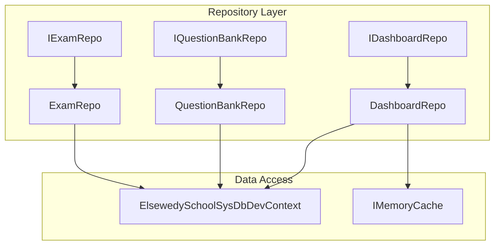
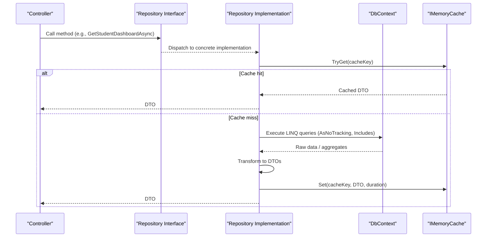
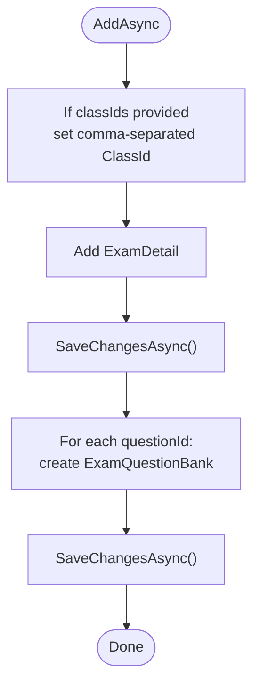
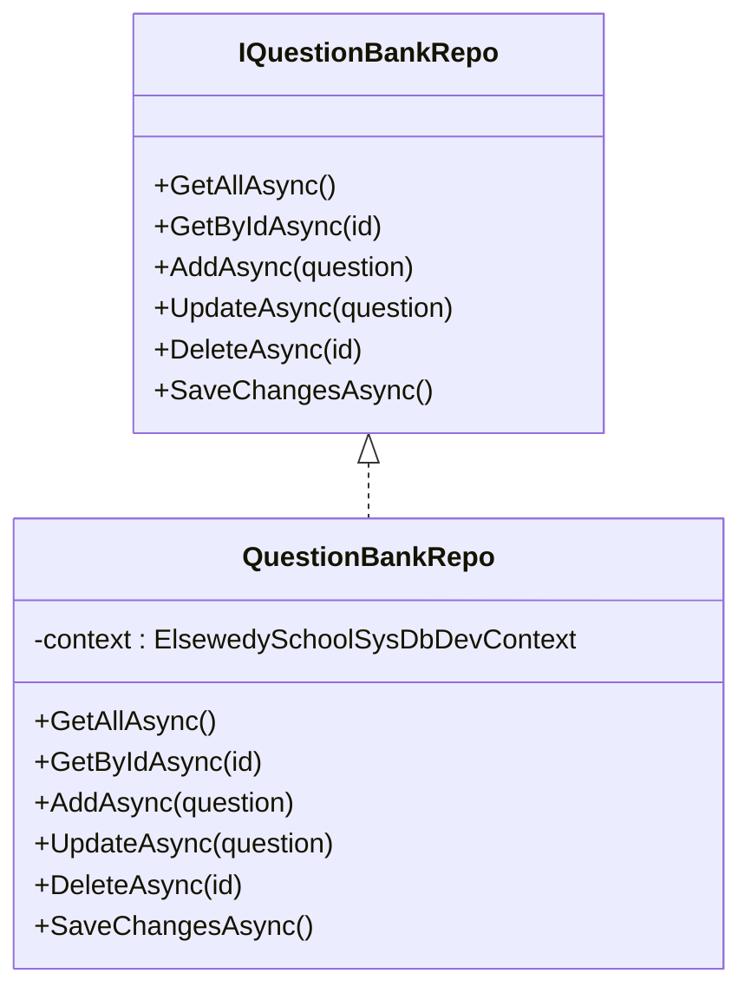
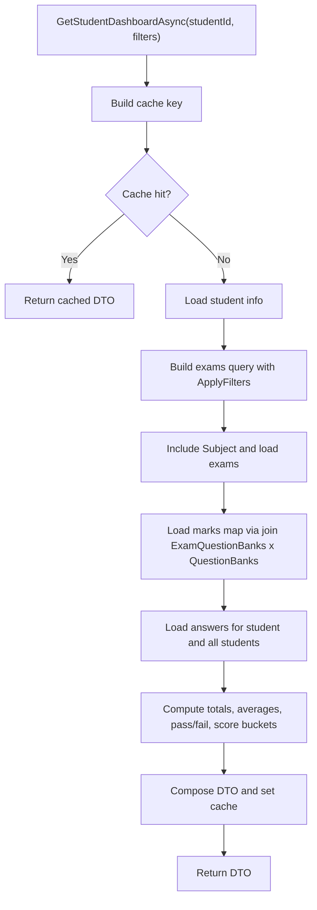
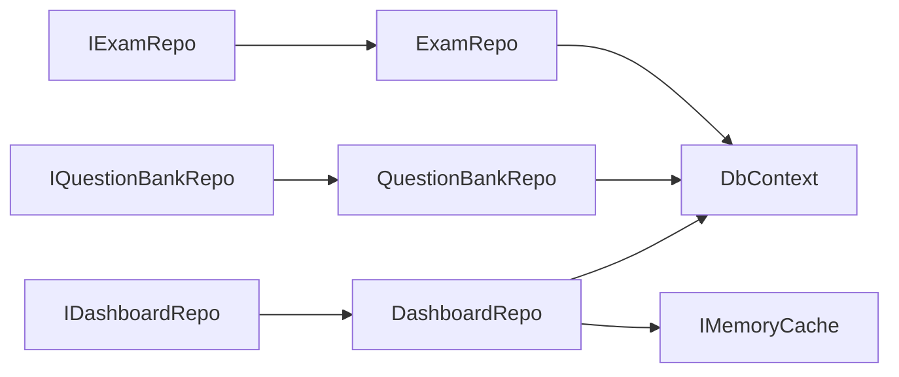

# Repository Pattern Implementation

<cite>
**Referenced Files in This Document**
- [IExamRepo.cs](file://server/Api/Repositories/Interfaces/IExamRepo.cs)
- [IQuestionBankRepo.cs](file://server/Api/Repositories/Interfaces/IQuestionBankRepo.cs)
- [IDashboardRepo.cs](file://server/Api/Repositories/Interfaces/IDashboardRepo.cs)
- [ExamRepo.cs](file://server/Api/Repositories/Implementation/ExamRepo.cs)
- [QuestionBankRepo.cs](file://server/Api/Repositories/Implementation/QuestionBankRepo.cs)
- [DashboardRepo.cs](file://server/Api/Repositories/Implementation/DashboardRepo.cs)
</cite>

## Table of Contents
1. [Introduction](#introduction)
2. [Project Structure](#project-structure)
3. [Core Components](#core-components)
4. [Architecture Overview](#architecture-overview)
5. [Detailed Component Analysis](#detailed-component-analysis)
6. [Dependency Analysis](#dependency-analysis)
7. [Performance Considerations](#performance-considerations)
8. [Troubleshooting Guide](#troubleshooting-guide)
9. [Conclusion](#conclusion)

## Introduction
This document explains the repository pattern implementation in the Exam-Hub backend, focusing on the interface-based design and concrete implementations for exams, question banks, and dashboard analytics. It covers how repositories encapsulate data access, LINQ query patterns, transactional boundaries, and performance strategies such as caching and query optimization. The goal is to make the architecture understandable for both technical and non-technical readers while providing actionable guidance for maintainability and testability.

## Project Structure
The repository layer resides under server/Api/Repositories with a clear separation between interfaces and implementations:
- Interfaces define contracts for data operations (CRUD and domain-specific queries).
- Implementations use Entity Framework Core to interact with the database context.
- DashboardRepo additionally integrates in-memory caching for read-heavy analytics endpoints.

**Diagram sources**
- [IExamRepo.cs:5-13](file://server/Api/Repositories/Interfaces/IExamRepo.cs#L5-L13)
- [IQuestionBankRepo.cs:3-10](file://server/Api/Repositories/Interfaces/IQuestionBankRepo.cs#L3-L10)
- [IDashboardRepo.cs:5-45](file://server/Api/Repositories/Interfaces/IDashboardRepo.cs#L5-L45)
- [ExamRepo.cs:6-13](file://server/Api/Repositories/Implementation/ExamRepo.cs#L6-L13)
- [QuestionBankRepo.cs:7-14](file://server/Api/Repositories/Implementation/QuestionBankRepo.cs#L7-L14)
- [DashboardRepo.cs:9-21](file://server/Api/Repositories/Implementation/DashboardRepo.cs#L9-L21)

**Section sources**
- [IExamRepo.cs:1-15](file://server/Api/Repositories/Interfaces/IExamRepo.cs#L1-L15)
- [IQuestionBankRepo.cs:1-12](file://server/Api/Repositories/Interfaces/IQuestionBankRepo.cs#L1-L12)
- [IDashboardRepo.cs:1-46](file://server/Api/Repositories/Interfaces/IDashboardRepo.cs#L1-L46)
- [ExamRepo.cs:1-140](file://server/Api/Repositories/Implementation/ExamRepo.cs#L1-L140)
- [QuestionBankRepo.cs:1-49](file://server/Api/Repositories/Implementation/QuestionBankRepo.cs#L1-L49)
- [DashboardRepo.cs:1-871](file://server/Api/Repositories/Implementation/DashboardRepo.cs#L1-L871)

## Core Components
- IExamRepo: Defines CRUD and persistence methods for exam entities, including association management with questions and optional class filtering.
- IQuestionBankRepo: Provides basic CRUD for question bank items.
- IDashboardRepo: Exposes analytics and leaderboard APIs for students, teachers, superadmins, and combined views, with optional filters.

Key benefits of this abstraction:
- Testability: Controllers can depend on interfaces and be unit-tested with in-memory or mock implementations.
- Maintainability: Data access logic is centralized; changes to EF queries or schema are isolated within repositories.
- Data source independence: Contracts remain stable even if underlying storage or ORM changes.

**Section sources**
- [IExamRepo.cs:5-13](file://server/Api/Repositories/Interfaces/IExamRepo.cs#L5-L13)
- [IQuestionBankRepo.cs:3-10](file://server/Api/Repositories/Interfaces/IQuestionBankRepo.cs#L3-L10)
- [IDashboardRepo.cs:5-45](file://server/Api/Repositories/Interfaces/IDashboardRepo.cs#L5-L45)

## Architecture Overview
The repository layer sits between controllers/services and the database context. Read-heavy dashboards leverage IMemoryCache to reduce database load. Queries are expressed using LINQ with AsNoTracking for read scenarios and Include/AsNoTracking combinations for efficient graph loading.

**Diagram sources**
- [DashboardRepo.cs:17-26](file://server/Api/Repositories/Implementation/DashboardRepo.cs#L17-L26)
- [DashboardRepo.cs:109-112](file://server/Api/Repositories/Implementation/DashboardRepo.cs#L109-L112)
- [DashboardRepo.cs:244-245](file://server/Api/Repositories/Implementation/DashboardRepo.cs#L244-L245)

## Detailed Component Analysis

### IExamRepo and ExamRepo
Responsibilities:
- Fetch all exams with subject and associated questions.
- Fetch a single exam by id with related questions.
- Create/update/delete exams and manage many-to-many links to questions and optional class associations.
- Provide SaveChangesAsync for explicit transaction boundaries.

LINQ and data access patterns:
- Use Include to eagerly load Subject.
- Manual population of ExamQuestionBanks and QuestionBanks via separate queries to avoid N+1 issues.
- Update synchronizes link collections by computing additions/removals.

Transaction management:
- AddAsync performs two SaveChangesAsync calls: first to persist ExamDetail and obtain Id, then to persist ExamQuestionBanks.
- DeleteAsync removes related links before removing the exam.
- SaveChangesAsync exposes a commit point for callers to group multiple operations.

**Diagram sources**
- [ExamRepo.cs:66-87](file://server/Api/Repositories/Implementation/ExamRepo.cs#L66-L87)

Complexity considerations:
- GetAllAsync loads all exams and then fetches all links and questions once, mapping them in memory. This avoids per-exam round-trips but may be heavy for large datasets.
- GetByIdAsync uses FindAsync per question; consider batching for very large question sets.

Optimization opportunities:
- Batch question loading in GetByIdAsync using ToDictionaryAsync over a filtered set.
- Consider explicit transactions around multi-step updates to ensure consistency.

**Section sources**
- [IExamRepo.cs:5-13](file://server/Api/Repositories/Interfaces/IExamRepo.cs#L5-L13)
- [ExamRepo.cs:15-39](file://server/Api/Repositories/Implementation/ExamRepo.cs#L15-L39)
- [ExamRepo.cs:41-64](file://server/Api/Repositories/Implementation/ExamRepo.cs#L41-L64)
- [ExamRepo.cs:66-139](file://server/Api/Repositories/Implementation/ExamRepo.cs#L66-L139)

### IQuestionBankRepo and QuestionBankRepo
Responsibilities:
- Basic CRUD for QuestionBank entities.
- Simple queries without complex joins.

LINQ and data access patterns:
- Direct DbSet operations with AsNoTracking not required here due to simplicity.
- DeleteAsync retrieves entity by id before removal.

Transaction management:
- SaveChangesAsync exposed for callers to commit changes after multiple operations.

**Diagram sources**
- [IQuestionBankRepo.cs:3-10](file://server/Api/Repositories/Interfaces/IQuestionBankRepo.cs#L3-L10)
- [QuestionBankRepo.cs:7-46](file://server/Api/Repositories/Implementation/QuestionBankRepo.cs#L7-L46)

**Section sources**
- [IQuestionBankRepo.cs:1-12](file://server/Api/Repositories/Interfaces/IQuestionBankRepo.cs#L1-L12)
- [QuestionBankRepo.cs:1-49](file://server/Api/Repositories/Implementation/QuestionBankRepo.cs#L1-L49)

### IDashboardRepo and DashboardRepo
Responsibilities:
- Provide role-based dashboards: student, teacher, superadmin.
- Compute leaderboards, statistics, score distributions, and recent activity.
- Support filtering by grade, class, subject, search term, date range, and grouping by class.

Caching strategy:
- Uses IMemoryCache with versioned cache keys that include filter parameters.
- Cache duration is short-lived (minutes) to balance freshness and performance.

LINQ and data access patterns:
- Extensive use of AsNoTracking for read-only queries.
- Efficient joins between ExamQuestionBanks and QuestionBanks to compute per-question marks.
- GroupBy aggregations to compute averages, pass/fail counts, and score buckets.
- PopulateExamQuestions helper methods batch-load related questions to avoid N+1.

Filtering pipeline:
- ApplyFilters composes IQueryable conditions for grade, exam, subject, search, class, and date ranges.

**Diagram sources**
- [DashboardRepo.cs:109-112](file://server/Api/Repositories/Implementation/DashboardRepo.cs#L109-L112)
- [DashboardRepo.cs:121-126](file://server/Api/Repositories/Implementation/DashboardRepo.cs#L121-L126)
- [DashboardRepo.cs:142-165](file://server/Api/Repositories/Implementation/DashboardRepo.cs#L142-L165)
- [DashboardRepo.cs:197-245](file://server/Api/Repositories/Implementation/DashboardRepo.cs#L197-L245)

Complexity and performance characteristics:
- Aggregations are performed in-memory after fetching necessary raw data from DB.
- Avoids EF thread-safety issues by sequential fetching where needed.
- Uses ToDictionaryAsync for efficient lookups during transformations.

Transaction management:
- DashboardRepo is read-only; no SaveChangesAsync usage.

Error handling and edge cases:
- Returns empty DTOs when no data matches filters.
- Handles nulls gracefully in name fields and missing relationships.

**Section sources**
- [IDashboardRepo.cs:5-45](file://server/Api/Repositories/Interfaces/IDashboardRepo.cs#L5-L45)
- [DashboardRepo.cs:9-21](file://server/Api/Repositories/Implementation/DashboardRepo.cs#L9-L21)
- [DashboardRepo.cs:23-26](file://server/Api/Repositories/Implementation/DashboardRepo.cs#L23-L26)
- [DashboardRepo.cs:50-107](file://server/Api/Repositories/Implementation/DashboardRepo.cs#L50-L107)
- [DashboardRepo.cs:109-245](file://server/Api/Repositories/Implementation/DashboardRepo.cs#L109-L245)
- [DashboardRepo.cs:248-391](file://server/Api/Repositories/Implementation/DashboardRepo.cs#L248-L391)
- [DashboardRepo.cs:393-503](file://server/Api/Repositories/Implementation/DashboardRepo.cs#L393-L503)
- [DashboardRepo.cs:505-565](file://server/Api/Repositories/Implementation/DashboardRepo.cs#L505-L565)
- [DashboardRepo.cs:567-604](file://server/Api/Repositories/Implementation/DashboardRepo.cs#L567-L604)
- [DashboardRepo.cs:606-668](file://server/Api/Repositories/Implementation/DashboardRepo.cs#L606-L668)
- [DashboardRepo.cs:670-705](file://server/Api/Repositories/Implementation/DashboardRepo.cs#L670-L705)
- [DashboardRepo.cs:707-791](file://server/Api/Repositories/Implementation/DashboardRepo.cs#L707-L791)
- [DashboardRepo.cs:793-871](file://server/Api/Repositories/Implementation/DashboardRepo.cs#L793-L871)

## Dependency Analysis
Coupling and cohesion:
- Each repository implements a single interface, promoting high cohesion.
- Dependencies are limited to DbContext and, for DashboardRepo, IMemoryCache.
- No cross-repository dependencies among implementations, reducing coupling.

External dependencies:
- Microsoft.EntityFrameworkCore for data access.
- Microsoft.Extensions.Caching.Memory for in-memory caching.

Potential circular dependencies:
- None observed; interfaces are independent and implementations do not reference each other.

**Diagram sources**
- [IExamRepo.cs:5-13](file://server/Api/Repositories/Interfaces/IExamRepo.cs#L5-L13)
- [IQuestionBankRepo.cs:3-10](file://server/Api/Repositories/Interfaces/IQuestionBankRepo.cs#L3-L10)
- [IDashboardRepo.cs:5-45](file://server/Api/Repositories/Interfaces/IDashboardRepo.cs#L5-L45)
- [ExamRepo.cs:6-13](file://server/Api/Repositories/Implementation/ExamRepo.cs#L6-L13)
- [QuestionBankRepo.cs:7-14](file://server/Api/Repositories/Implementation/QuestionBankRepo.cs#L7-L14)
- [DashboardRepo.cs:9-21](file://server/Api/Repositories/Implementation/DashboardRepo.cs#L9-L21)

**Section sources**
- [ExamRepo.cs:1-140](file://server/Api/Repositories/Implementation/ExamRepo.cs#L1-L140)
- [QuestionBankRepo.cs:1-49](file://server/Api/Repositories/Implementation/QuestionBankRepo.cs#L1-L49)
- [DashboardRepo.cs:1-871](file://server/Api/Repositories/Implementation/DashboardRepo.cs#L1-L871)

## Performance Considerations
Query optimization:
- Use AsNoTracking for read-only queries to avoid change tracking overhead.
- Prefer Include for small graphs and manual batched loading for larger associations to prevent N+1 queries.
- Use ToDictionaryAsync for efficient in-memory lookups after bulk queries.
- Compose filters into IQueryable to push predicates to the database.

Connection pooling:
- Rely on EF Core’s default connection pooling; ensure appropriate connection string settings and lifetime management in DI.

Caching strategies:
- Short-lived in-memory cache for dashboard endpoints reduces repeated expensive computations.
- Versioned cache keys incorporate filter parameters to avoid stale data across different queries.

Scalability tips:
- For very large datasets, consider pagination at the API layer and streaming results where applicable.
- Evaluate moving heavy aggregations to the database via stored procedures or materialized views if needed.

[No sources needed since this section provides general guidance]

## Troubleshooting Guide
Common issues and resolutions:
- Stale dashboard data: Verify cache key generation includes all filter parameters; adjust cache duration if data changes frequently.
- N+1 query problems: Ensure related entities are loaded via Include or batched manual population; check PopulateExamQuestions helpers.
- Inconsistent state after updates: Wrap multi-step operations in explicit transactions; call SaveChangesAsync once after all changes.
- Empty results with filters: Validate ApplyFilters logic for class matching and date ranges; confirm ClassId format and JSON/comma-separated formats.

**Section sources**
- [DashboardRepo.cs:23-26](file://server/Api/Repositories/Implementation/DashboardRepo.cs#L23-L26)
- [DashboardRepo.cs:670-705](file://server/Api/Repositories/Implementation/DashboardRepo.cs#L670-L705)
- [ExamRepo.cs:66-139](file://server/Api/Repositories/Implementation/ExamRepo.cs#L66-L139)

## Conclusion
The repository pattern in Exam-Hub cleanly separates concerns, enabling testable, maintainable, and scalable data access. Interfaces define stable contracts, while implementations encapsulate EF Core queries and business-specific data transformations. DashboardRepo demonstrates advanced patterns like caching, filtering, and aggregation. Following the recommended optimizations—batched loading, AsNoTracking, and judicious caching—will further improve performance and reliability.

[No sources needed since this section summarizes without analyzing specific files]