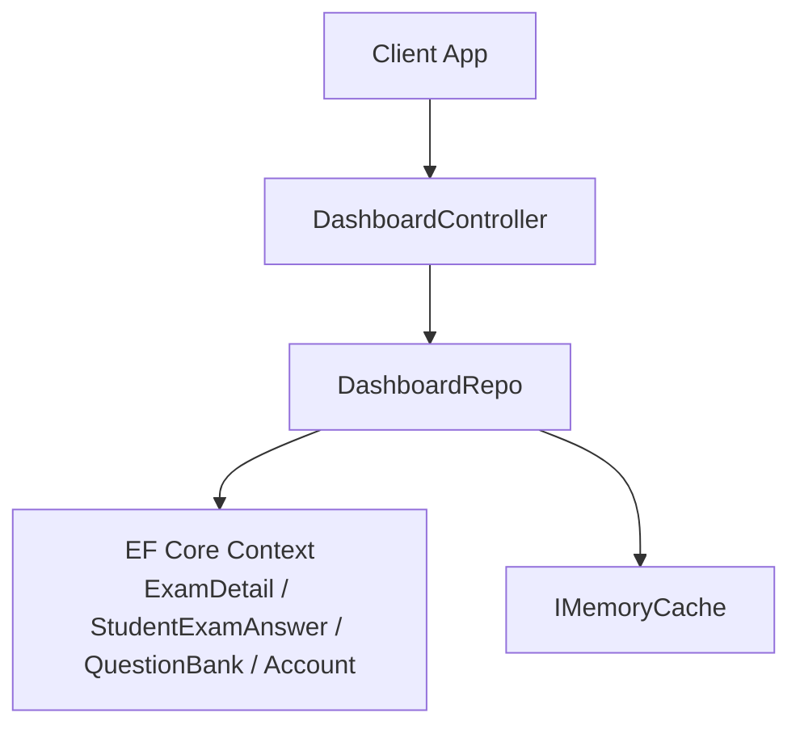
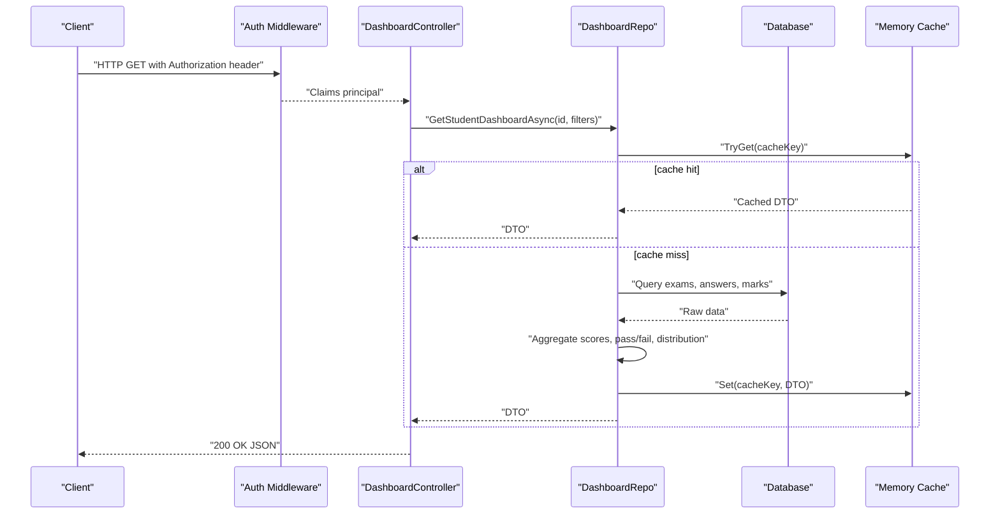
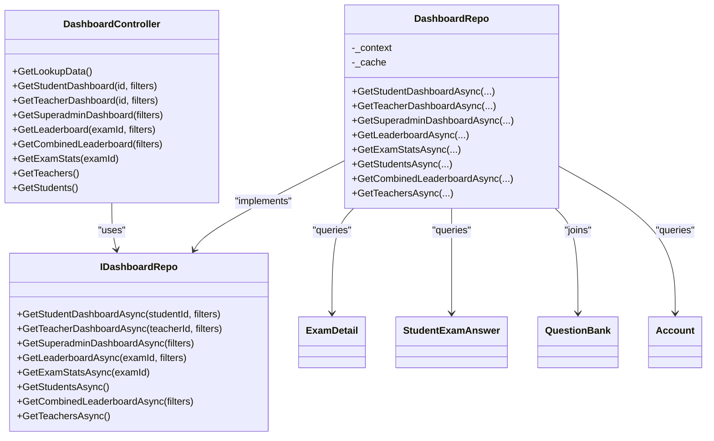

# Analytics APIs

<cite>
**Referenced Files in This Document**
- [DashboardController.cs](file://server/Api/Controllers/DashboardController.cs)
- [DashboardDTOs.cs](file://server/Api/DTOs/DashboardDTOs.cs)
- [IDashboardRepo.cs](file://server/Api/Repositories/Interfaces/IDashboardRepo.cs)
- [DashboardRepo.cs](file://server/Api/Repositories/Implementation/DashboardRepo.cs)
- [ExamDetail.cs](file://server/Api/Models/ExamDetail.cs)
- [StudentExamAnswer.cs](file://server/Api/Models/StudentExamAnswer.cs)
- [QuestionBank.cs](file://server/Api/Models/QuestionBank.cs)
- [Account.cs](file://server/Api/Models/Account.cs)
- [Program.cs](file://server/Api/Program.cs)
</cite>

## Table of Contents
1. [Introduction](#introduction)
2. [Project Structure](#project-structure)
3. [Core Components](#core-components)
4. [Architecture Overview](#architecture-overview)
5. [Detailed Component Analysis](#detailed-component-analysis)
6. [Dependency Analysis](#dependency-analysis)
7. [Performance Considerations](#performance-considerations)
8. [Troubleshooting Guide](#troubleshooting-guide)
9. [Conclusion](#conclusion)

## Introduction
This document provides API documentation for analytics endpoints that power the Exam-Hub dashboard. It covers HTTP methods, URL patterns, request/response schemas, and authentication requirements for retrieving performance metrics, student statistics, and exam analytics. It also explains DTO structures, query parameters for filtering and grouping, response formats for charts, and implementation details such as caching strategies, query optimization, and error handling.

## Project Structure
The analytics feature is implemented across controllers, repositories, DTOs, and domain models:
- Controllers expose REST endpoints under a common route prefix.
- Repositories implement data access and aggregation logic using Entity Framework Core.
- DTOs define request filters and response shapes consumed by the frontend.
- Models represent database entities used in joins and aggregations.

**Diagram sources**
- [DashboardController.cs:11-22](file://server/Api/Controllers/DashboardController.cs#L11-L22)
- [DashboardRepo.cs:9-21](file://server/Api/Repositories/Implementation/DashboardRepo.cs#L9-L21)

**Section sources**
- [DashboardController.cs:11-22](file://server/Api/Controllers/DashboardController.cs#L11-L22)
- [DashboardRepo.cs:9-21](file://server/Api/Repositories/Implementation/DashboardRepo.cs#L9-L21)

## Core Components
- DashboardController: Exposes authenticated endpoints for student, teacher, superadmin dashboards, leaderboards, exam stats, and lists of students/teachers.
- IDashboardRepo and DashboardRepo: Implement filtering, joins, aggregations, and caching for analytics queries.
- DTOs: Define filter inputs (LeaderboardFilterDto) and response payloads (e.g., StudentDashboardDto, TeacherDashboardDto, SuperadminDashboardDto, LeaderboardDto, ExamStatsDto).
- Models: Provide schema context for joins and aggregations (ExamDetail, StudentExamAnswer, QuestionBank, Account).

Key responsibilities:
- Controller validates inputs, applies authorization, maps query parameters to filters, and returns standardized responses.
- Repository performs efficient data retrieval, computes pass/fail rates, averages, distributions, and ranks, and caches results.

**Section sources**
- [DashboardController.cs:24-375](file://server/Api/Controllers/DashboardController.cs#L24-L375)
- [IDashboardRepo.cs:5-45](file://server/Api/Repositories/Interfaces/IDashboardRepo.cs#L5-L45)
- [DashboardDTOs.cs:3-169](file://server/Api/DTOs/DashboardDTOs.cs#L3-L169)

## Architecture Overview
The analytics pipeline follows a layered approach:
- Authentication and authorization are enforced via ASP.NET Core policies and role-based attributes.
- Controllers accept query parameters and map them to filter objects.
- Repositories use EF Core with AsNoTracking for read-only performance, perform joins across ExamDetail, StudentExamAnswer, QuestionBank, and Account, and compute aggregates in memory after fetching minimal datasets.
- Results are cached briefly to reduce repeated heavy computations.

**Diagram sources**
- [DashboardController.cs:85-136](file://server/Api/Controllers/DashboardController.cs#L85-L136)
- [DashboardRepo.cs:109-246](file://server/Api/Repositories/Implementation/DashboardRepo.cs#L109-L246)
- [Program.cs:59-75](file://server/Api/Program.cs#L59-L75)

## Detailed Component Analysis

### Authentication and Authorization
- All analytics endpoints require authentication via Bearer token. Some endpoints restrict roles to Superadmin/Admin/Board.
- The application configures JWT bearer events to normalize claims (e.g., mapping Role and AccountId claims), enabling role checks and user identification.

Authentication flow highlights:
- Token validation and claim mapping occur in middleware before controller execution.
- Controllers enforce per-endpoint authorization using attributes and optional role constraints.

**Section sources**
- [DashboardController.cs:24-26](file://server/Api/Controllers/DashboardController.cs#L24-L26)
- [DashboardController.cs:85-87](file://server/Api/Controllers/DashboardController.cs#L85-L87)
- [DashboardController.cs:143-145](file://server/Api/Controllers/DashboardController.cs#L143-L145)
- [DashboardController.cs:201-203](file://server/Api/Controllers/DashboardController.cs#L201-L203)
- [Program.cs:59-75](file://server/Api/Program.cs#L59-L75)

### Endpoints Reference

#### Lookup Data
- Method: GET
- URL: /api/dashboard/lookup-data
- Auth: Required
- Purpose: Returns lookup data for grades, classes, subjects, and exams to populate UI filters.
- Response: Object containing arrays for grades, classes, subjects, and mapped exams.

**Section sources**
- [DashboardController.cs:24-78](file://server/Api/Controllers/DashboardController.cs#L24-L78)

#### Student Dashboard
- Method: GET
- URL: /api/dashboard/student/{id}
- Query Parameters:
  - gradeId: long?
  - classId: long?
  - examId: long?
  - startDate: DateTime?
  - endDate: DateTime?
- Auth: Required
- Response: StudentDashboardDto
- Notes: Validates date range; supports optional filters; returns 404 if student not found.

**Section sources**
- [DashboardController.cs:80-136](file://server/Api/Controllers/DashboardController.cs#L80-L136)
- [DashboardRepo.cs:109-246](file://server/Api/Repositories/Implementation/DashboardRepo.cs#L109-L246)

#### Teacher Dashboard
- Method: GET
- URL: /api/dashboard/teacher/{id}
- Query Parameters: Same as Student Dashboard
- Auth: Required
- Response: TeacherDashboardDto
- Notes: Filters apply to exams created by the teacher; supports class/grade filters on answers.

**Section sources**
- [DashboardController.cs:138-195](file://server/Api/Controllers/DashboardController.cs#L138-L195)
- [DashboardRepo.cs:248-391](file://server/Api/Repositories/Implementation/DashboardRepo.cs#L248-L391)

#### Superadmin Dashboard
- Method: GET
- URL: /api/dashboard/superadmin
- Query Parameters: Same as above
- Auth: Required (Roles: Superadmin, Admin, Board)
- Response: SuperadminDashboardDto
- Notes: Aggregates global stats, top performers, recent activity, and exam breakdown.

**Section sources**
- [DashboardController.cs:197-234](file://server/Api/Controllers/DashboardController.cs#L197-L234)
- [DashboardRepo.cs:393-503](file://server/Api/Repositories/Implementation/DashboardRepo.cs#L393-L503)

#### Leaderboard (Per Exam)
- Method: GET
- URL: /api/dashboard/leaderboard/{examId}
- Query Parameters:
  - gradeId: long?
  - classId: long?
  - examIdParam: long? (overrides path parameter when provided)
  - startDate: DateTime?
  - endDate: DateTime?
  - groupBy: string ("Student" or "Class")
- Auth: Required
- Response: LeaderboardDto
- Notes: Supports grouping by class; calculates ranks and top entries.

**Section sources**
- [DashboardController.cs:236-285](file://server/Api/Controllers/DashboardController.cs#L236-L285)
- [DashboardRepo.cs:505-565](file://server/Api/Repositories/Implementation/DashboardRepo.cs#L505-L565)

#### Combined Leaderboard (Aggregated Across Exams)
- Method: GET
- URL: /api/dashboard/leaderboard/combined
- Query Parameters: Same as Leaderboard
- Auth: Required
- Response: LeaderboardDto
- Notes: Computes average score per student across multiple exams; supports class grouping.

**Section sources**
- [DashboardController.cs:287-320](file://server/Api/Controllers/DashboardController.cs#L287-L320)
- [DashboardRepo.cs:793-858](file://server/Api/Repositories/Implementation/DashboardRepo.cs#L793-L858)

#### Exam Statistics
- Method: GET
- URL: /api/dashboard/exam/{examId}/stats
- Query Parameters: None
- Auth: Required
- Response: ExamStatsDto
- Notes: Calculates pass/fail counts, percentages, and average score for an exam.

**Section sources**
- [DashboardController.cs:322-344](file://server/Api/Controllers/DashboardController.cs#L322-L344)
- [DashboardRepo.cs:567-604](file://server/Api/Repositories/Implementation/DashboardRepo.cs#L567-L604)

#### Teachers List
- Method: GET
- URL: /api/dashboard/teachers
- Query Parameters: None
- Auth: Required (Roles: Superadmin, Admin, Board)
- Response: List<TeacherAccountDto>

**Section sources**
- [DashboardController.cs:346-359](file://server/Api/Controllers/DashboardController.cs#L346-L359)
- [DashboardRepo.cs:860-869](file://server/Api/Repositories/Implementation/DashboardRepo.cs#L860-L869)

#### Students List
- Method: GET
- URL: /api/dashboard/students
- Query Parameters: None
- Auth: Required
- Response: List<StudentPerformanceDto>

**Section sources**
- [DashboardController.cs:361-374](file://server/Api/Controllers/DashboardController.cs#L361-L374)
- [DashboardRepo.cs:707-791](file://server/Api/Repositories/Implementation/DashboardRepo.cs#L707-L791)

### Request and Response Schemas

#### Filter Model
- LeaderboardFilterDto fields:
  - GradeId: long?
  - ClassId: long?
  - ExamId: long?
  - SubjectId: long?
  - SearchTerm: string?
  - StartDate: DateTime?
  - EndDate: DateTime?
  - GroupBy: string ("Student" or "Class")

#### Common Responses
- StudentDashboardDto:
  - StudentId, StudentName, TotalExamsTaken, PassPercentage, FailPercentage
  - LatestExamLeaderboard (LeaderboardDto?)
  - StudentRankInLatestExam (int?)
  - RecentExams (List<StudentRecentExamDto>)
  - ScoreDistribution (List<ChartDataPointDto>)

- TeacherDashboardDto:
  - TeacherId, TeacherName, TotalExamsCreated, AveragePassPercentage, AverageFailPercentage
  - TotalStudentsWhoTookExams
  - ExamBreakdown (List<ExamStatsDto>)
  - LatestExamLeaderboard (LeaderboardDto?)
  - RecentExams (List<ExamSelectionDto>)
  - ScoreDistribution (List<ChartDataPointDto>)

- SuperadminDashboardDto:
  - TotalExams, TotalStudents, TotalTeachers, OverallPassPercentage, OverallFailPercentage
  - TopPerformingStudents (List<LeaderboardEntryDto>)
  - TopPerformingTeachers (List<TopTeacherDto>)
  - RecentActivity (List<RecentActivityDto>)
  - RecentExams (List<ExamSelectionDto>)
  - ScoreDistribution (List<ChartDataPointDto>)
  - ExamBreakdown (List<ExamStatsDto>)

- LeaderboardDto:
  - ExamId, ExamTitle, SubjectName
  - TopStudents (List<LeaderboardEntryDto>)
  - HighlightedStudents (List<LeaderboardEntryDto>)
  - TotalParticipants

- LeaderboardEntryDto:
  - StudentId, StudentName, Score, Rank, TotalMarks, EarnedMarks

- ExamStatsDto:
  - ExamId, ExamTitle, SubjectName
  - TotalStudents, PassedStudents, FailedStudents
  - PassPercentage, FailPercentage, AverageScore

- ChartDataPointDto:
  - Name (string), Value (double)

- StudentRecentExamDto:
  - ExamId, Title, SubjectName, StudentScore, AverageScore, Date

- ExamSelectionDto:
  - ExamId, Title

- RecentActivityDto:
  - ActivityType, Description, Timestamp, RelatedExamId, RelatedAccountId

- StudentPerformanceDto:
  - Id, Name, Email, Initials, Grade, Class, QuizScores (Dictionary<string,double>)

- TeacherAccountDto:
  - Id, FullNameEn, FullNameAr, Email, IsActive, TotalExams

**Section sources**
- [DashboardDTOs.cs:3-169](file://server/Api/DTOs/DashboardDTOs.cs#L3-L169)

### Filtering and Pagination
- Filtering:
  - By grade, class, exam, subject, search term, and date range.
  - ClassId matching supports exact IDs and comma-separated or JSON-like strings stored in ExamDetail.ClassId.
- Pagination:
  - No explicit pagination parameters are exposed; results are limited internally (e.g., top N leaderboard entries, recent items).

**Section sources**
- [DashboardController.cs:88-93](file://server/Api/Controllers/DashboardController.cs#L88-L93)
- [DashboardController.cs:147-151](file://server/Api/Controllers/DashboardController.cs#L147-L151)
- [DashboardController.cs:204-208](file://server/Api/Controllers/DashboardController.cs#L204-L208)
- [DashboardController.cs:249-254](file://server/Api/Controllers/DashboardController.cs#L249-L254)
- [DashboardRepo.cs:670-705](file://server/Api/Repositories/Implementation/DashboardRepo.cs#L670-L705)

### Data Transformation Logic
- Score calculation:
  - For each student answer group per exam, sum marks of answered questions from QuestionBank via ExamQuestionBanks links.
  - Normalize to percentage using total max marks per exam.
- Pass/Fail thresholds:
  - Uses a constant threshold (e.g., 50%) to determine pass/fail status.
- Aggregations:
  - Per-exam averages, overall pass/fail percentages, score distribution buckets, and combined averages across exams.
- Rankings:
  - Assigns rank based on descending score order; supports grouping by class where applicable.

**Section sources**
- [DashboardRepo.cs:141-228](file://server/Api/Repositories/Implementation/DashboardRepo.cs#L141-L228)
- [DashboardRepo.cs:276-365](file://server/Api/Repositories/Implementation/DashboardRepo.cs#L276-L365)
- [DashboardRepo.cs:414-478](file://server/Api/Repositories/Implementation/DashboardRepo.cs#L414-L478)
- [DashboardRepo.cs:513-563](file://server/Api/Repositories/Implementation/DashboardRepo.cs#L513-L563)
- [DashboardRepo.cs:572-603](file://server/Api/Repositories/Implementation/DashboardRepo.cs#L572-L603)
- [DashboardRepo.cs:826-854](file://server/Api/Repositories/Implementation/DashboardRepo.cs#L826-L854)

### Caching Strategy
- In-memory cache with short TTL (e.g., 2 minutes) for dashboard and leaderboard endpoints.
- Cache keys incorporate version, endpoint prefix, identifiers, and all filter values to ensure correctness.
- Empty results are also cached to avoid repeated queries.

**Section sources**
- [DashboardRepo.cs:13-26](file://server/Api/Repositories/Implementation/DashboardRepo.cs#L13-L26)
- [DashboardRepo.cs:111-136](file://server/Api/Repositories/Implementation/DashboardRepo.cs#L111-L136)
- [DashboardRepo.cs:244-245](file://server/Api/Repositories/Implementation/DashboardRepo.cs#L244-L245)
- [DashboardRepo.cs:389-390](file://server/Api/Repositories/Implementation/DashboardRepo.cs#L389-L390)
- [DashboardRepo.cs:496-502](file://server/Api/Repositories/Implementation/DashboardRepo.cs#L496-L502)
- [DashboardRepo.cs:507-563](file://server/Api/Repositories/Implementation/DashboardRepo.cs#L507-L563)
- [DashboardRepo.cs:795-857](file://server/Api/Repositories/Implementation/DashboardRepo.cs#L795-L857)

### Error Handling Patterns
- Input validation:
  - Date range validation returns BadRequest with a message when start date exceeds end date.
- Not Found:
  - Returns 404 with a message when entity (student, teacher, exam) is not found.
- Server Errors:
  - Catches exceptions and returns 500 with a generic message and error details.

**Section sources**
- [DashboardController.cs:97-101](file://server/Api/Controllers/DashboardController.cs#L97-L101)
- [DashboardController.cs:127-135](file://server/Api/Controllers/DashboardController.cs#L127-L135)
- [DashboardController.cs:155-159](file://server/Api/Controllers/DashboardController.cs#L155-L159)
- [DashboardController.cs:186-194](file://server/Api/Controllers/DashboardController.cs#L186-L194)
- [DashboardController.cs:212-216](file://server/Api/Controllers/DashboardController.cs#L212-L216)
- [DashboardController.cs:227-233](file://server/Api/Controllers/DashboardController.cs#L227-L233)
- [DashboardController.cs:258-262](file://server/Api/Controllers/DashboardController.cs#L258-L262)
- [DashboardController.cs:276-284](file://server/Api/Controllers/DashboardController.cs#L276-L284)
- [DashboardController.cs:333-343](file://server/Api/Controllers/DashboardController.cs#L333-L343)
- [DashboardController.cs:350-358](file://server/Api/Controllers/DashboardController.cs#L350-L358)
- [DashboardController.cs:365-373](file://server/Api/Controllers/DashboardController.cs#L365-L373)

## Dependency Analysis
The analytics stack depends on:
- Controllers depend on repository interfaces and DbContext for DI.
- Repositories depend on EF Core context and IMemoryCache.
- Queries join across ExamDetail, StudentExamAnswer, QuestionBank, and Account models.

**Diagram sources**
- [DashboardController.cs:11-22](file://server/Api/Controllers/DashboardController.cs#L11-L22)
- [IDashboardRepo.cs:5-45](file://server/Api/Repositories/Interfaces/IDashboardRepo.cs#L5-L45)
- [DashboardRepo.cs:9-21](file://server/Api/Repositories/Implementation/DashboardRepo.cs#L9-L21)
- [ExamDetail.cs:6-30](file://server/Api/Models/ExamDetail.cs#L6-L30)
- [StudentExamAnswer.cs:6-26](file://server/Api/Models/StudentExamAnswer.cs#L6-L26)
- [QuestionBank.cs:7-46](file://server/Api/Models/QuestionBank.cs#L7-L46)
- [Account.cs:6-81](file://server/Api/Models/Account.cs#L6-L81)

**Section sources**
- [DashboardController.cs:11-22](file://server/Api/Controllers/DashboardController.cs#L11-L22)
- [IDashboardRepo.cs:5-45](file://server/Api/Repositories/Interfaces/IDashboardRepo.cs#L5-L45)
- [DashboardRepo.cs:9-21](file://server/Api/Repositories/Implementation/DashboardRepo.cs#L9-L21)

## Performance Considerations
- Read-only queries use AsNoTracking to avoid change tracking overhead.
- Joins are performed efficiently by selecting only needed fields and grouping in memory after fetching minimal datasets.
- Short-lived in-memory cache reduces repeated heavy computations for dashboard and leaderboard endpoints.
- Complex filters (grade/class/date) are applied early in queries to minimize dataset size.
- Avoid N+1 queries by batching lookups (e.g., collecting exam IDs first, then fetching related data).

[No sources needed since this section provides general guidance]

## Troubleshooting Guide
Common issues and resolutions:
- Invalid date range: Ensure startDate <= endDate; otherwise, expect a BadRequest response.
- Missing entities: If a student, teacher, or exam is not found, expect a NotFound response.
- Unexpected empty results: Check filters (gradeId, classId, examId, date range) and verify data exists for those scopes.
- Performance degradation: Review cache usage and consider reducing filter complexity or increasing cache duration if appropriate.

**Section sources**
- [DashboardController.cs:97-101](file://server/Api/Controllers/DashboardController.cs#L97-L101)
- [DashboardController.cs:127-135](file://server/Api/Controllers/DashboardController.cs#L127-L135)
- [DashboardController.cs:155-159](file://server/Api/Controllers/DashboardController.cs#L155-L159)
- [DashboardController.cs:186-194](file://server/Api/Controllers/DashboardController.cs#L186-L194)
- [DashboardController.cs:212-216](file://server/Api/Controllers/DashboardController.cs#L212-L216)
- [DashboardController.cs:227-233](file://server/Api/Controllers/DashboardController.cs#L227-L233)
- [DashboardController.cs:258-262](file://server/Api/Controllers/DashboardController.cs#L258-L262)
- [DashboardController.cs:276-284](file://server/Api/Controllers/DashboardController.cs#L276-L284)
- [DashboardController.cs:333-343](file://server/Api/Controllers/DashboardController.cs#L333-L343)
- [DashboardController.cs:350-358](file://server/Api/Controllers/DashboardController.cs#L350-L358)
- [DashboardController.cs:365-373](file://server/Api/Controllers/DashboardController.cs#L365-L373)

## Conclusion
The analytics APIs provide comprehensive dashboard capabilities for students, teachers, and administrators. They support robust filtering, accurate scoring and ranking, and efficient caching. The layered architecture ensures clear separation of concerns, while consistent error handling and authentication protect data integrity and access control.

[No sources needed since this section summarizes without analyzing specific files]