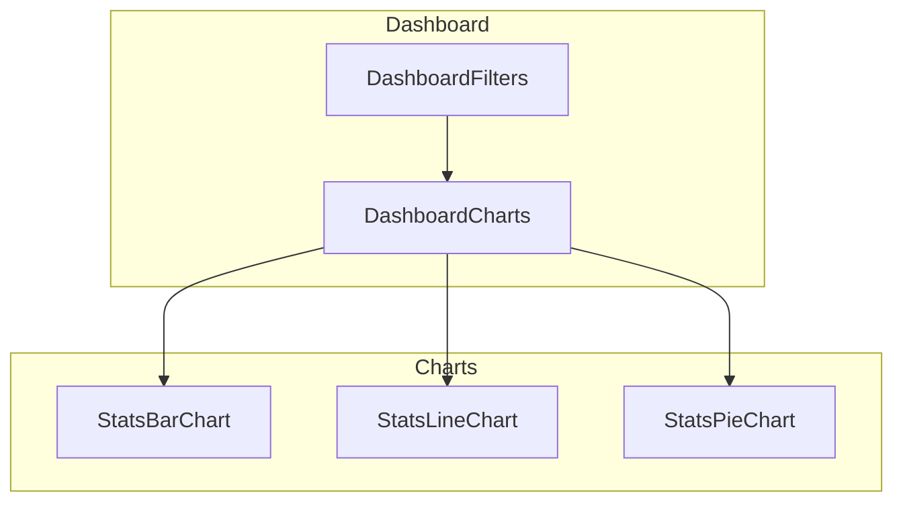
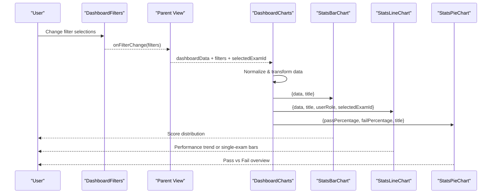
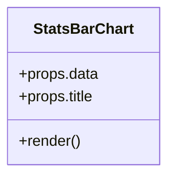
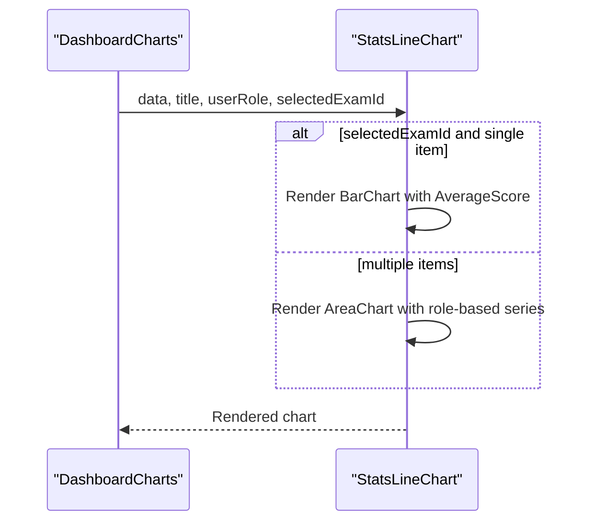
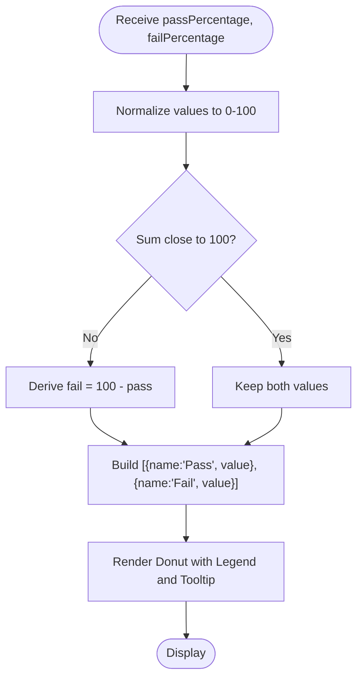
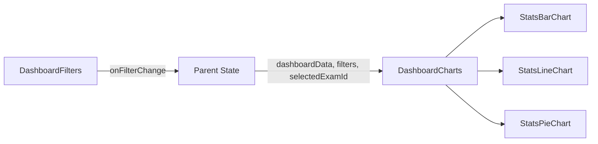

# Chart Visualizations

<cite>
**Referenced Files in This Document**
- [StatsBarChart.jsx](file://client/src/components/charts/StatsBarChart.jsx)
- [StatsLineChart.jsx](file://client/src/components/charts/StatsLineChart.jsx)
- [StatsPieChart.jsx](file://client/src/components/charts/StatsPieChart.jsx)
- [DashboardCharts.jsx](file://client/src/components/DashboardCharts.jsx)
- [DashboardFilters.jsx](file://client/src/components/DashboardFilters.jsx)
</cite>

## Table of Contents
1. [Introduction](#introduction)
2. [Project Structure](#project-structure)
3. [Core Components](#core-components)
4. [Architecture Overview](#architecture-overview)
5. [Detailed Component Analysis](#detailed-component-analysis)
6. [Dependency Analysis](#dependency-analysis)
7. [Performance Considerations](#performance-considerations)
8. [Troubleshooting Guide](#troubleshooting-guide)
9. [Conclusion](#conclusion)

## Introduction
This document explains the chart visualization components used in the Exam-Hub dashboard. It covers three Recharts-based components:
- StatsBarChart for exam score distributions
- StatsLineChart for performance trends over time
- StatsPieChart for categorical pass/fail representation

It documents prop interfaces, customization options, styling, responsive behavior, data transformation pipelines, color schemes, animation settings, accessibility features, integration with dashboard filters, handling large datasets, interactive features (tooltips), and performance optimization techniques for rendering multiple charts simultaneously.

## Project Structure
The charting layer is organized under client/src/components/charts with a parent container DashboardCharts that normalizes backend data and composes the three chart components. Filters are provided by DashboardFilters and influence the data shown in charts via parent state and props.

**Diagram sources**
- [DashboardCharts.jsx:1-127](file://client/src/components/DashboardCharts.jsx#L1-L127)
- [DashboardFilters.jsx:1-321](file://client/src/components/DashboardFilters.jsx#L1-L321)
- [StatsBarChart.jsx:1-107](file://client/src/components/charts/StatsBarChart.jsx#L1-L107)
- [StatsLineChart.jsx:1-182](file://client/src/components/charts/StatsLineChart.jsx#L1-L182)
- [StatsPieChart.jsx:1-134](file://client/src/components/charts/StatsPieChart.jsx#L1-L134)

**Section sources**
- [DashboardCharts.jsx:1-127](file://client/src/components/DashboardCharts.jsx#L1-L127)
- [DashboardFilters.jsx:1-321](file://client/src/components/DashboardFilters.jsx#L1-L321)

## Core Components
- StatsBarChart: Renders a bar chart for score distribution using Recharts BarChart. Uses gradients per bar, responsive sizing, tooltips, and empty-state fallback when no data is present.
- StatsLineChart: Renders an area chart for performance trends or a bar chart for a single selected exam. Supports role-based series (student vs teacher/admin), legends, tooltips, and domain constraints.
- StatsPieChart: Renders a donut-style pie chart for pass/fail percentages with normalized values, legend, tooltip, and center text overlay.

Key shared behaviors:
- ResponsiveContainer ensures charts adapt to container size.
- Tooltips styled consistently across charts.
- Empty states provide clear messaging when data is missing.
- CSS variables drive theme colors and backgrounds.

**Section sources**
- [StatsBarChart.jsx:1-107](file://client/src/components/charts/StatsBarChart.jsx#L1-L107)
- [StatsLineChart.jsx:1-182](file://client/src/components/charts/StatsLineChart.jsx#L1-L182)
- [StatsPieChart.jsx:1-134](file://client/src/components/charts/StatsPieChart.jsx#L1-L134)

## Architecture Overview
Data flows from the backend into DashboardCharts, which normalizes field names and computes derived metrics before passing clean data to each chart component. Filters from DashboardFilters influence the dataset via parent state and selectedExamId, enabling dynamic updates.

**Diagram sources**
- [DashboardFilters.jsx:1-321](file://client/src/components/DashboardFilters.jsx#L1-L321)
- [DashboardCharts.jsx:1-127](file://client/src/components/DashboardCharts.jsx#L1-L127)
- [StatsBarChart.jsx:1-107](file://client/src/components/charts/StatsBarChart.jsx#L1-L107)
- [StatsLineChart.jsx:1-182](file://client/src/components/charts/StatsLineChart.jsx#L1-L182)
- [StatsPieChart.jsx:1-134](file://client/src/components/charts/StatsPieChart.jsx#L1-L134)

## Detailed Component Analysis

### StatsBarChart
Purpose: Visualize score distribution across buckets.

Props:
- data: Array of objects with Name and Value fields.
- title: String displayed as chart heading.

Behavior:
- Uses ResponsiveContainer for responsive layout.
- Applies vertical grid lines only, with subtle dashed style.
- XAxis uses Name; YAxis disables decimals and sets tick count.
- Tooltip provides contextual info on hover.
- Bars use rounded top corners and maxBarSize to avoid overlap.
- Each bar cell gets a gradient fill cycling through predefined gradients.
- Empty state shows placeholder icon and message when data is absent.

Styling:
- Background, border radius, padding, and shadow follow design tokens.
- Colors rely on CSS variables for theme consistency.

Accessibility:
- Title is rendered as a visible heading.
- Tooltips provide additional context on interaction.

Responsiveness:
- ResponsiveContainer adapts width/height to parent container.

Animation:
- No explicit animation configuration; relies on Recharts defaults.

Large datasets:
- maxBarSize limits visual clutter; consider slicing data upstream if many categories exist.

Integration:
- Consumed by DashboardCharts with normalized distribution data.

**Section sources**
- [StatsBarChart.jsx:1-107](file://client/src/components/charts/StatsBarChart.jsx#L1-L107)

#### Class Diagram

**Diagram sources**
- [StatsBarChart.jsx:1-107](file://client/src/components/charts/StatsBarChart.jsx#L1-L107)

### StatsLineChart
Purpose: Show performance trends over time or average scores per exam; switches to bar view for a single selected exam.

Props:
- data: Array of objects with Title and either StudentScore/AverageScore (for student) or AverageScore (for teachers/admins).
- title: Chart heading.
- userRole: 'student' or other roles to toggle series visibility.
- selectedExamId: When set and data length equals one, renders a bar chart instead of area chart.

Behavior:
- Single exam mode: renders BarChart with fixed domain 0–100 and gradient-filled bars.
- Multi-exam mode: renders AreaChart with two areas for students (My Score and Class Avg) or one area for others (Average Score).
- Legend displays series names; tooltips show detailed values.
- Domain constraints ensure consistent Y-axis scaling.

Styling:
- Gradients for area fills; dashed line for class average in student mode.
- Consistent tooltip styling and margins.

Accessibility:
- Visible legend and tooltips aid understanding.
- Clear labels for axes and series.

Responsiveness:
- ResponsiveContainer adapts to container size.

Animation:
- No explicit animation configuration; uses Recharts defaults.

Large datasets:
- DashboardCharts slices to latest ~20 entries to limit points.

Integration:
- Receives transformed data from DashboardCharts based on role and backend DTO shape.

**Section sources**
- [StatsLineChart.jsx:1-182](file://client/src/components/charts/StatsLineChart.jsx#L1-L182)

#### Sequence Diagram

**Diagram sources**
- [DashboardCharts.jsx:59-78](file://client/src/components/DashboardCharts.jsx#L59-L78)
- [StatsLineChart.jsx:33-160](file://client/src/components/charts/StatsLineChart.jsx#L33-L160)

### StatsPieChart
Purpose: Display pass vs fail percentages as a donut chart.

Props:
- passPercentage: Number between 0 and 100.
- failPercentage: Number between 0 and 100; if inconsistent, normalized to complement passPercentage.
- title: Chart heading.

Behavior:
- Normalizes inputs to ensure both segments sum to approximately 100%.
- Renders a donut with innerRadius and outerRadius.
- Provides legend and tooltip.
- Center overlay shows pass percentage prominently.

Styling:
- Gradient fills for pass and fail segments.
- Consistent card styling with background, border radius, and shadow.

Accessibility:
- Legend and tooltip convey category meanings.
- Center text highlights key metric.

Responsiveness:
- ResponsiveContainer adapts to container size.

Animation:
- No explicit animation configuration; uses Recharts defaults.

Large datasets:
- Not applicable; always two categories.

Integration:
- Receives computed pass/fail percentages from DashboardCharts.

**Section sources**
- [StatsPieChart.jsx:1-134](file://client/src/components/charts/StatsPieChart.jsx#L1-L134)

#### Flowchart

**Diagram sources**
- [StatsPieChart.jsx:4-21](file://client/src/components/charts/StatsPieChart.jsx#L4-L21)

### Data Transformation Pipeline in DashboardCharts
DashboardCharts normalizes backend DTOs and prepares data for each chart:
- Extracts pass/fail percentages with case-insensitive key lookup.
- Normalizes scoreDistribution to consistent Name/Value fields.
- Computes display pass/fail ensuring they sum to 100% or derives from distribution buckets.
- Builds lineChartData:
  - For students: recent exams mapped to Title, StudentScore, AverageScore, limited to last 20.
  - For teachers/admins: examBreakdown mapped to Title, AverageScore, limited to last 20.
- Passes normalized arrays to respective chart components.

This pipeline ensures robustness against varying backend naming conventions and keeps chart components simple.

**Section sources**
- [DashboardCharts.jsx:10-92](file://client/src/components/DashboardCharts.jsx#L10-L92)

## Dependency Analysis
- DashboardCharts depends on:
  - StatsBarChart, StatsLineChart, StatsPieChart for rendering.
  - Props from parent: dashboardData, userRole, selectedExamId, filters.
- DashboardFilters emits filter changes via onFilterChange, influencing parent state and thus dashboardData and selectedExamId passed to DashboardCharts.
- Chart components depend on Recharts primitives (BarChart/AreaChart/PieChart, Tooltip, ResponsiveContainer, etc.).

**Diagram sources**
- [DashboardFilters.jsx:1-321](file://client/src/components/DashboardFilters.jsx#L1-L321)
- [DashboardCharts.jsx:1-127](file://client/src/components/DashboardCharts.jsx#L1-L127)

**Section sources**
- [DashboardFilters.jsx:1-321](file://client/src/components/DashboardFilters.jsx#L1-L321)
- [DashboardCharts.jsx:1-127](file://client/src/components/DashboardCharts.jsx#L1-L127)

## Performance Considerations
- Data slicing: DashboardCharts limits line chart data to the latest ~20 entries to reduce render cost.
- Max bar size: StatsBarChart uses maxBarSize to prevent overlapping bars when many categories exist.
- ResponsiveContainer: Ensures efficient re-rendering on resize without manual measurements.
- Minimal animations: No custom animation configurations; relying on Recharts defaults reduces overhead.
- Conditional rendering: Empty states avoid unnecessary chart computations when data is absent.
- Debounced filters: DashboardFilters debounces filter changes (400ms) to reduce frequent re-renders and API calls.

Recommendations:
- If score distribution grows beyond typical bucket counts, consider aggregating low-frequency categories or virtualizing labels.
- For very large time series, consider downsampling or server-side aggregation before passing to StatsLineChart.
- Memoize expensive transformations in DashboardCharts if dashboardData changes frequently.

[No sources needed since this section provides general guidance]

## Troubleshooting Guide
Common issues and resolutions:
- Missing or inconsistent pass/fail percentages:
  - DashboardCharts normalizes and derives complementary values; verify backend DTO keys and ensure at least one non-zero value exists.
  - Reference: [DashboardCharts.jsx:19-57](file://client/src/components/DashboardCharts.jsx#L19-L57)
- Empty charts:
  - Ensure data arrays are non-empty; charts render empty states otherwise.
  - Verify field names in dashboardData match expected keys (case-insensitive mapping is implemented).
  - Reference: [DashboardCharts.jsx:22-24](file://client/src/components/DashboardCharts.jsx#L22-L24)
- Filter not affecting charts:
  - Confirm onFilterChange propagates filters to parent state and that selectedExamId is updated accordingly.
  - Reference: [DashboardFilters.jsx:27-69](file://client/src/components/DashboardFilters.jsx#L27-L69)
- Tooltip not showing:
  - Ensure Tooltip is present and data keys match chart definitions.
  - Reference: [StatsBarChart.jsx:65-76](file://client/src/components/charts/StatsBarChart.jsx#L65-L76), [StatsLineChart.jsx:102-113](file://client/src/components/charts/StatsLineChart.jsx#L102-L113), [StatsPieChart.jsx:76-87](file://client/src/components/charts/StatsPieChart.jsx#L76-L87)
- Axis scaling issues:
  - YAxis domains are constrained to 0–100 for meaningful comparisons; adjust only if necessary.
  - Reference: [StatsLineChart.jsx:52-57](file://client/src/components/charts/StatsLineChart.jsx#L52-L57), [StatsLineChart.jsx:96-101](file://client/src/components/charts/StatsLineChart.jsx#L96-L101)

**Section sources**
- [DashboardCharts.jsx:19-57](file://client/src/components/DashboardCharts.jsx#L19-L57)
- [DashboardCharts.jsx:22-24](file://client/src/components/DashboardCharts.jsx#L22-L24)
- [DashboardFilters.jsx:27-69](file://client/src/components/DashboardFilters.jsx#L27-L69)
- [StatsBarChart.jsx:65-76](file://client/src/components/charts/StatsBarChart.jsx#L65-L76)
- [StatsLineChart.jsx:102-113](file://client/src/components/charts/StatsLineChart.jsx#L102-L113)
- [StatsPieChart.jsx:76-87](file://client/src/components/charts/StatsPieChart.jsx#L76-L87)
- [StatsLineChart.jsx:52-57](file://client/src/components/charts/StatsLineChart.jsx#L52-L57)
- [StatsLineChart.jsx:96-101](file://client/src/components/charts/StatsLineChart.jsx#L96-L101)

## Conclusion
The Exam-Hub dashboard’s charting layer provides clear, responsive, and accessible visualizations for score distributions, performance trends, and pass/fail ratios. DashboardCharts centralizes data normalization and transformation, while individual chart components focus on presentation and interactivity. Integration with DashboardFilters enables dynamic filtering with debounced updates. Performance considerations such as data slicing, max bar sizes, and minimal animations help maintain smooth rendering even with multiple charts. The result is a cohesive, user-friendly analytics experience aligned with the application’s design system.

[No sources needed since this section summarizes without analyzing specific files]