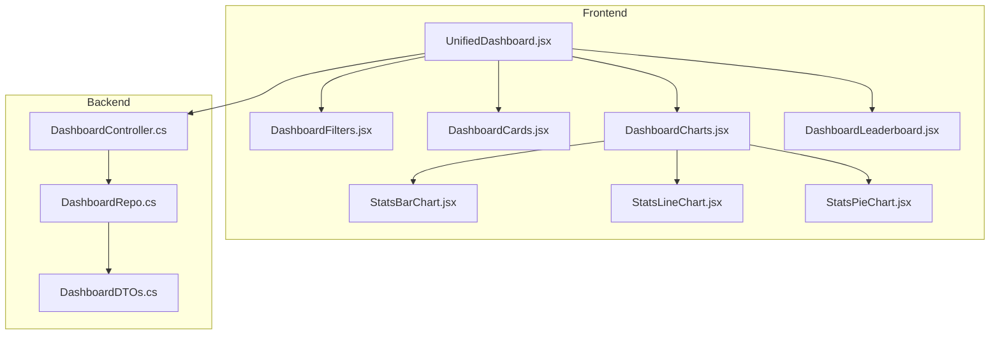
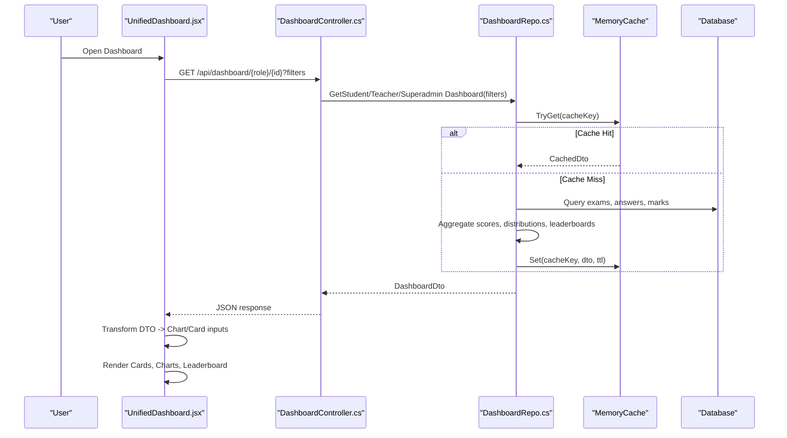
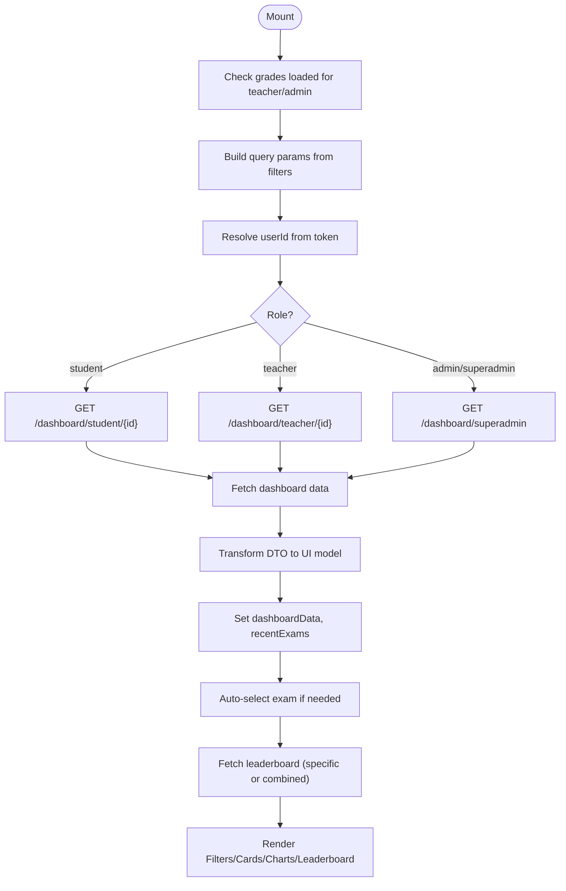
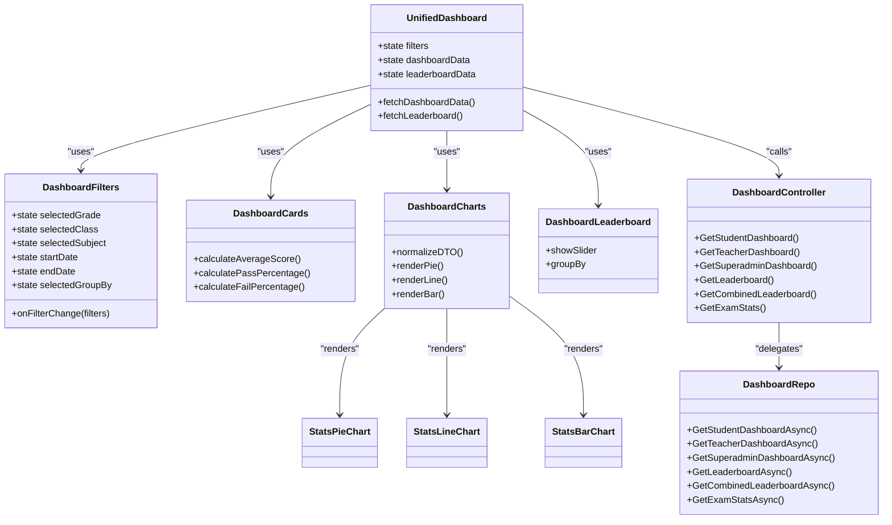

# Dashboard & Analytics

<cite>
**Referenced Files in This Document**
- [UnifiedDashboard.jsx](file://client/src/components/UnifiedDashboard.jsx)
- [DashboardCharts.jsx](file://client/src/components/DashboardCharts.jsx)
- [StatsBarChart.jsx](file://client/src/components/charts/StatsBarChart.jsx)
- [StatsLineChart.jsx](file://client/src/components/charts/StatsLineChart.jsx)
- [StatsPieChart.jsx](file://client/src/components/charts/StatsPieChart.jsx)
- [DashboardCards.jsx](file://client/src/components/DashboardCards.jsx)
- [DashboardFilters.jsx](file://client/src/components/DashboardFilters.jsx)
- [DashboardLeaderboard.jsx](file://client/src/components/DashboardLeaderboard.jsx)
- [DashboardController.cs](file://server/Api/Controllers/DashboardController.cs)
- [DashboardRepo.cs](file://server/Api/Repositories/Implementation/DashboardRepo.cs)
- [IDashboardRepo.cs](file://server/Api/Repositories/Interfaces/IDashboardRepo.cs)
- [DashboardDTOs.cs](file://server/Api/DTOs/DashboardDTOs.cs)
</cite>

## Table of Contents
1. [Introduction](#introduction)
2. [Project Structure](#project-structure)
3. [Core Components](#core-components)
4. [Architecture Overview](#architecture-overview)
5. [Detailed Component Analysis](#detailed-component-analysis)
6. [Dependency Analysis](#dependency-analysis)
7. [Performance Considerations](#performance-considerations)
8. [Troubleshooting Guide](#troubleshooting-guide)
9. [Conclusion](#conclusion)
10. [Appendices](#appendices)

## Introduction
This document explains the Exam-Hub dashboard and analytics system focused on real-time performance monitoring and reporting. It covers:
- The React-based dashboard architecture with Recharts visualizations
- Data aggregation strategies and caching on the server
- Role-based views for students, teachers, and administrators
- API endpoints for analytics data retrieval, filtering, and report generation
- Custom chart configurations, data transformation pipelines, and optimization techniques
- Real-time-like updates through filter-driven re-fetching and leaderboard refreshes

## Project Structure
The dashboard spans a React frontend and an ASP.NET Core backend:
- Frontend components orchestrate filters, cards, charts, and leaderboards
- Backend controllers expose REST endpoints that aggregate exam results and rankings
- Repository layer computes metrics, applies filters, and caches results

**Diagram sources**
- [UnifiedDashboard.jsx:1-505](file://client/src/components/UnifiedDashboard.jsx#L1-L505)
- [DashboardCharts.jsx:1-127](file://client/src/components/DashboardCharts.jsx#L1-L127)
- [StatsBarChart.jsx:1-107](file://client/src/components/charts/StatsBarChart.jsx#L1-L107)
- [StatsLineChart.jsx:1-182](file://client/src/components/charts/StatsLineChart.jsx#L1-L182)
- [StatsPieChart.jsx:1-134](file://client/src/components/charts/StatsPieChart.jsx#L1-L134)
- [DashboardController.cs:1-376](file://server/Api/Controllers/DashboardController.cs#L1-L376)
- [DashboardRepo.cs:1-871](file://server/Api/Repositories/Implementation/DashboardRepo.cs#L1-L871)
- [DashboardDTOs.cs:1-169](file://server/Api/DTOs/DashboardDTOs.cs#L1-L169)

**Section sources**
- [UnifiedDashboard.jsx:1-505](file://client/src/components/UnifiedDashboard.jsx#L1-L505)
- [DashboardController.cs:1-376](file://server/Api/Controllers/DashboardController.cs#L1-L376)

## Core Components
- UnifiedDashboard: Orchestrates role-based data fetching, filter state, leaderboard selection, and composes cards, charts, and leaderboard UI.
- DashboardFilters: Debounced filter UI (grade, class, subject, date range, group-by, selected exam).
- DashboardCards: Animated KPI cards (total exams, pass/fail %, average score) with fallback logic when specific exam is selected.
- DashboardCharts: Normalizes backend DTOs to chart inputs; renders pie, line/area, and bar charts.
- StatsPieChart: Donut-style pass vs fail visualization with normalized percentages.
- StatsLineChart: Area chart for trends; switches to bar chart for single-exam view.
- StatsBarChart: Score distribution across buckets.
- DashboardLeaderboard: Ranked list with optional grade slider and “See All” navigation.
- DashboardController: REST endpoints for student/teacher/superadmin dashboards, leaderboards, and stats.
- DashboardRepo: Aggregation logic, filtering, caching, and leaderboard computation.
- DashboardDTOs: Contract types for responses and filters.

**Section sources**
- [UnifiedDashboard.jsx:1-505](file://client/src/components/UnifiedDashboard.jsx#L1-L505)
- [DashboardFilters.jsx:1-321](file://client/src/components/DashboardFilters.jsx#L1-L321)
- [DashboardCards.jsx:1-414](file://client/src/components/DashboardCards.jsx#L1-L414)
- [DashboardCharts.jsx:1-127](file://client/src/components/DashboardCharts.jsx#L1-L127)
- [StatsPieChart.jsx:1-134](file://client/src/components/charts/StatsPieChart.jsx#L1-L134)
- [StatsLineChart.jsx:1-182](file://client/src/components/charts/StatsLineChart.jsx#L1-L182)
- [StatsBarChart.jsx:1-107](file://client/src/components/charts/StatsBarChart.jsx#L1-L107)
- [DashboardLeaderboard.jsx:1-502](file://client/src/components/DashboardLeaderboard.jsx#L1-L502)
- [DashboardController.cs:1-376](file://server/Api/Controllers/DashboardController.cs#L1-L376)
- [DashboardRepo.cs:1-871](file://server/Api/Repositories/Implementation/DashboardRepo.cs#L1-L871)
- [DashboardDTOs.cs:1-169](file://server/Api/DTOs/DashboardDTOs.cs#L1-L169)

## Architecture Overview
The dashboard follows a layered architecture:
- Presentation Layer: React components render interactive UI and handle user interactions.
- API Layer: Controllers validate inputs, enforce roles, and delegate to repositories.
- Data Access Layer: Repositories compute metrics, apply filters, and cache results.
- Domain Models: DTOs define contracts between layers.

**Diagram sources**
- [UnifiedDashboard.jsx:88-199](file://client/src/components/UnifiedDashboard.jsx#L88-L199)
- [DashboardController.cs:85-234](file://server/Api/Controllers/DashboardController.cs#L85-L234)
- [DashboardRepo.cs:109-246](file://server/Api/Repositories/Implementation/DashboardRepo.cs#L109-L246)

## Detailed Component Analysis

### UnifiedDashboard (Orchestrator)
Responsibilities:
- Role-based endpoint selection and query parameter building
- Auto-selection of meaningful exam when aggregated leaderboard is empty
- Fetching dashboard data and leaderboard data with debounced filter changes
- Composing UI sections: filters, cards, leaderboard, charts

Key behaviors:
- Builds URLSearchParams from active filters (gradeId, classId, subjectId, startDate, endDate, examId)
- Resolves userId from token if missing
- Transforms backend DTO fields to consistent names for UI consumption
- Triggers leaderboard fetch based on selected exam or combined grade view

**Diagram sources**
- [UnifiedDashboard.jsx:38-199](file://client/src/components/UnifiedDashboard.jsx#L38-L199)
- [UnifiedDashboard.jsx:201-296](file://client/src/components/UnifiedDashboard.jsx#L201-L296)

**Section sources**
- [UnifiedDashboard.jsx:1-505](file://client/src/components/UnifiedDashboard.jsx#L1-L505)

### DashboardFilters (Debounce + Filter State)
Responsibilities:
- Manage local state for grade, class, subject, date range, group-by, and selected exam
- Debounce filter changes to reduce network calls
- Compute active filters summary for UX clarity
- Provide filtered options for classes and exams based on current selections

Optimization:
- 400ms debounce before emitting filter changes
- Conditional disabling of class selector until grade is chosen
- Smart exam filtering by grade/class compatibility

**Section sources**
- [DashboardFilters.jsx:1-321](file://client/src/components/DashboardFilters.jsx#L1-L321)

### DashboardCards (Animated KPIs)
Responsibilities:
- Display total exams, pass %, fail %, and average score
- Animate number transitions using requestAnimationFrame
- Derive values from selected exam breakdown or overall aggregates
- Fallback calculations when backend lacks explicit fields

Key logic:
- If a specific exam is selected, use its average score and pass percentage
- Otherwise, compute weighted averages across exams or derive from score distribution
- Ensure fail % = 100 - pass % for consistency

**Section sources**
- [DashboardCards.jsx:1-414](file://client/src/components/DashboardCards.jsx#L1-L414)

### DashboardCharts (Normalization + Rendering)
Responsibilities:
- Normalize case-insensitive DTO properties into chart-ready arrays
- Compute display pass/fail percentages ensuring they sum to 100%
- Prepare line chart data: student trend vs class average or exam average trend
- Prepare bar chart data for score distribution buckets

Customization:
- Pass/fail normalization handles inconsistent backend values
- Limits recent exams to last 20 entries for performance

**Section sources**
- [DashboardCharts.jsx:1-127](file://client/src/components/DashboardCharts.jsx#L1-L127)

### StatsPieChart (Pass vs Fail)
Features:
- Donut chart with center text showing pass rate
- Normalizes pass/fail to ensure both segments exist and sum to ~100%
- Graceful empty state when no data available

**Section sources**
- [StatsPieChart.jsx:1-134](file://client/src/components/charts/StatsPieChart.jsx#L1-L134)

### StatsLineChart (Trends and Single-Exam View)
Features:
- For multiple exams: area chart comparing student score vs class average (student role) or average score trend (teacher/admin)
- For single exam: switches to bar chart for clarity
- Responsive tooltips and legends

**Section sources**
- [StatsLineChart.jsx:1-182](file://client/src/components/charts/StatsLineChart.jsx#L1-L182)

### StatsBarChart (Score Distribution)
Features:
- Displays bucketed score distribution with gradient bars
- Empty state handling and responsive container

**Section sources**
- [StatsBarChart.jsx:1-107](file://client/src/components/charts/StatsBarChart.jsx#L1-L107)

### DashboardLeaderboard (Rankings and Grade Slider)
Features:
- Shows top students or classes depending on group-by
- Optional grade slider for teacher/admin/superadmin to switch between Junior/Wheeler/Senior
- Highlights current user and top three ranks with medals
- “See All” button navigates to full scores view

Real-time-like behavior:
- Refreshes leaderboard when filters or selected exam change
- Smooth slide animations when switching grades

**Section sources**
- [DashboardLeaderboard.jsx:1-502](file://client/src/components/DashboardLeaderboard.jsx#L1-L502)

### Backend: DashboardController (REST Endpoints)
Endpoints:
- GET /api/dashboard/lookup-data: Grades, classes, subjects, exams mapping
- GET /api/dashboard/student/{id}: Student dashboard with filters
- GET /api/dashboard/teacher/{id}: Teacher dashboard with filters
- GET /api/dashboard/superadmin: Global dashboard with filters
- GET /api/dashboard/leaderboard/{examId}: Specific exam leaderboard with filters
- GET /api/dashboard/leaderboard/combined: Combined leaderboard by grade with filters
- GET /api/dashboard/exam/{examId}/stats: Exam statistics
- GET /api/dashboard/teachers: Teacher accounts
- GET /api/dashboard/students: Student performance list

Security:
- Authorize attribute enforces authentication
- Role-based access for superadmin endpoints

Validation:
- Date range validation ensures start <= end
- Null guards for user identity resolution

**Section sources**
- [DashboardController.cs:1-376](file://server/Api/Controllers/DashboardController.cs#L1-L376)

### Backend: DashboardRepo (Aggregation, Filtering, Caching)
Responsibilities:
- Implement IDashboardRepo methods for each role’s dashboard
- Apply filters (grade, class, subject, search term, date range)
- Compute pass/fail thresholds, score distributions, and averages
- Build leaderboards per exam or combined by grade
- Cache results with versioned keys and TTL

Caching strategy:
- In-memory cache with 2-minute TTL
- Keys include version, prefix, id, and all filter dimensions
- Reduces repeated heavy aggregations during filter changes

Filter application:
- Supports exact matches and comma-separated class lists
- Date boundaries inclusive of end-of-day for endDate

Leaderboard grouping:
- GroupBy Student or Class
- Computes class averages when grouped by class

Top performers and recent activity:
- Aggregates top students across exams
- Generates recent activity feed combining exam creation and completion events

**Section sources**
- [DashboardRepo.cs:1-871](file://server/Api/Repositories/Implementation/DashboardRepo.cs#L1-L871)
- [IDashboardRepo.cs:1-46](file://server/Api/Repositories/Interfaces/IDashboardRepo.cs#L1-L46)

### DTOs (Contracts)
Key types:
- StudentDashboardDto, TeacherDashboardDto, SuperadminDashboardDto
- LeaderboardDto, LeaderboardEntryDto
- ExamStatsDto, StudentRecentExamDto, ExamSelectionDto
- ChartDataPointDto, RecentActivityDto
- LeaderboardFilterDto (shared filter contract)

These types standardize payloads between controller and repository and guide frontend transformations.

**Section sources**
- [DashboardDTOs.cs:1-169](file://server/Api/DTOs/DashboardDTOs.cs#L1-L169)

## Dependency Analysis
Component relationships:
- UnifiedDashboard depends on DashboardFilters, DashboardCards, DashboardCharts, DashboardLeaderboard
- DashboardCharts composes StatsPieChart, StatsLineChart, StatsBarChart
- UnifiedDashboard calls DashboardController endpoints
- DashboardController delegates to DashboardRepo
- DashboardRepo uses DbContext and IMemoryCache

**Diagram sources**
- [UnifiedDashboard.jsx:1-505](file://client/src/components/UnifiedDashboard.jsx#L1-L505)
- [DashboardCharts.jsx:1-127](file://client/src/components/DashboardCharts.jsx#L1-L127)
- [DashboardController.cs:1-376](file://server/Api/Controllers/DashboardController.cs#L1-L376)
- [DashboardRepo.cs:1-871](file://server/Api/Repositories/Implementation/DashboardRepo.cs#L1-L871)

**Section sources**
- [UnifiedDashboard.jsx:1-505](file://client/src/components/UnifiedDashboard.jsx#L1-L505)
- [DashboardController.cs:1-376](file://server/Api/Controllers/DashboardController.cs#L1-L376)

## Performance Considerations
- Client-side optimizations:
  - Debounced filter changes to limit API calls
  - Limiting line chart data to last 20 entries
  - Using responsive containers and conditional rendering for large datasets
- Server-side optimizations:
  - In-memory caching with versioned keys and TTL reduces repeated aggregations
  - AsNoTracking queries to avoid EF tracking overhead
  - Sequential fetching where necessary to prevent EF thread-safety issues
  - Efficient grouping and dictionary lookups for score computations
- Real-time-like updates:
  - Leaderboard refreshes on filter or exam selection changes
  - Optimistic UI with loading indicators and smooth transitions

[No sources needed since this section provides general guidance]

## Troubleshooting Guide
Common issues and resolutions:
- Missing user ID:
  - Symptom: Error message about unable to resolve user ID
  - Cause: Token parsing failed or missing claims
  - Resolution: Ensure login flow sets token and claims correctly; verify getUserIdFromToken logic
- No leaderboard data:
  - Symptom: Empty leaderboard or auto-selected exam not applied
  - Cause: Aggregated view returns no data for current filters
  - Resolution: Adjust filters or allow auto-selection to pick first non-empty exam
- Incorrect pass/fail percentages:
  - Symptom: Pie chart shows unexpected ratios
  - Cause: Backend DTO inconsistencies
  - Resolution: DashboardCharts normalizes pass/fail to sum to 100%; verify backend sends consistent values
- Cache staleness:
  - Symptom: Dashboard data not updating after filters change
  - Cause: Cache key includes filters but TTL may be too long
  - Resolution: Adjust CacheDuration or invalidate cache on significant data mutations
- Date range validation errors:
  - Symptom: BadRequest when start > end
  - Resolution: Enforce client-side constraints or correct input order

**Section sources**
- [UnifiedDashboard.jsx:122-140](file://client/src/components/UnifiedDashboard.jsx#L122-L140)
- [UnifiedDashboard.jsx:193-198](file://client/src/components/UnifiedDashboard.jsx#L193-L198)
- [DashboardController.cs:97-101](file://server/Api/Controllers/DashboardController.cs#L97-L101)
- [DashboardController.cs:155-159](file://server/Api/Controllers/DashboardController.cs#L155-L159)
- [DashboardController.cs:212-216](file://server/Api/Controllers/DashboardController.cs#L212-L216)

## Conclusion
The Exam-Hub dashboard delivers a comprehensive analytics experience:
- Role-aware views with tailored metrics and leaderboards
- Rich visualizations powered by Recharts with robust normalization
- Efficient data aggregation and caching for responsive interactions
- Flexible filtering and export-ready data structures for reporting

Future enhancements could include:
- Export capabilities (CSV/PDF) for leaderboard and chart data
- WebSocket-based real-time updates for live exam sessions
- Advanced drill-downs from charts to detailed student records

[No sources needed since this section summarizes without analyzing specific files]

## Appendices

### API Endpoints Summary
- Lookup data: GET /api/dashboard/lookup-data
- Student dashboard: GET /api/dashboard/student/{id}?gradeId&classId&subjectId&startDate&endDate&examId
- Teacher dashboard: GET /api/dashboard/teacher/{id}?gradeId&classId&subjectId&startDate&endDate&examId
- Superadmin dashboard: GET /api/dashboard/superadmin?gradeId&classId&subjectId&startDate&endDate&examId
- Leaderboard (specific): GET /api/dashboard/leaderboard/{examId}?gradeId&classId&subjectId&startDate&endDate&groupBy
- Leaderboard (combined): GET /api/dashboard/leaderboard/combined?gradeId&classId&subjectId&startDate&endDate&groupBy
- Exam stats: GET /api/dashboard/exam/{examId}/stats
- Teachers list: GET /api/dashboard/teachers
- Students list: GET /api/dashboard/students

Authentication:
- Most endpoints require [Authorize]; superadmin endpoints restrict to Superadmin/Admin/Board roles

Filter parameters:
- gradeId, classId, subjectId, startDate, endDate, examId, groupBy (Student/Class)

**Section sources**
- [DashboardController.cs:24-78](file://server/Api/Controllers/DashboardController.cs#L24-L78)
- [DashboardController.cs:85-234](file://server/Api/Controllers/DashboardController.cs#L85-L234)
- [DashboardController.cs:245-374](file://server/Api/Controllers/DashboardController.cs#L245-L374)