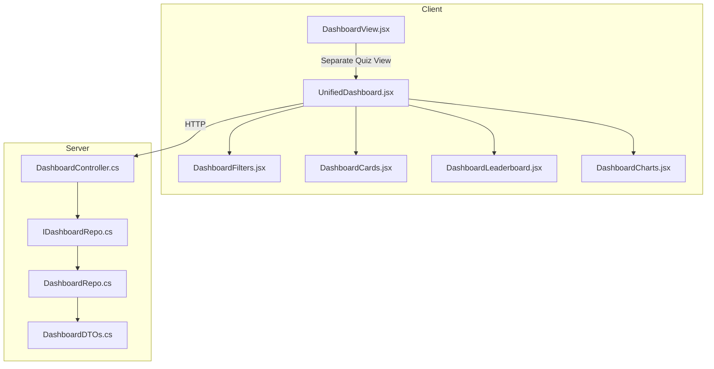
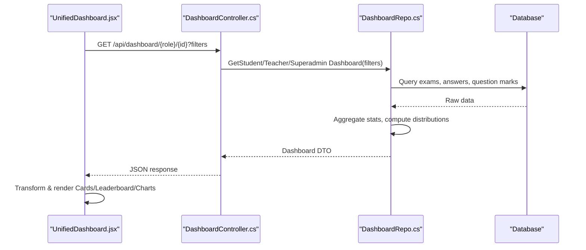
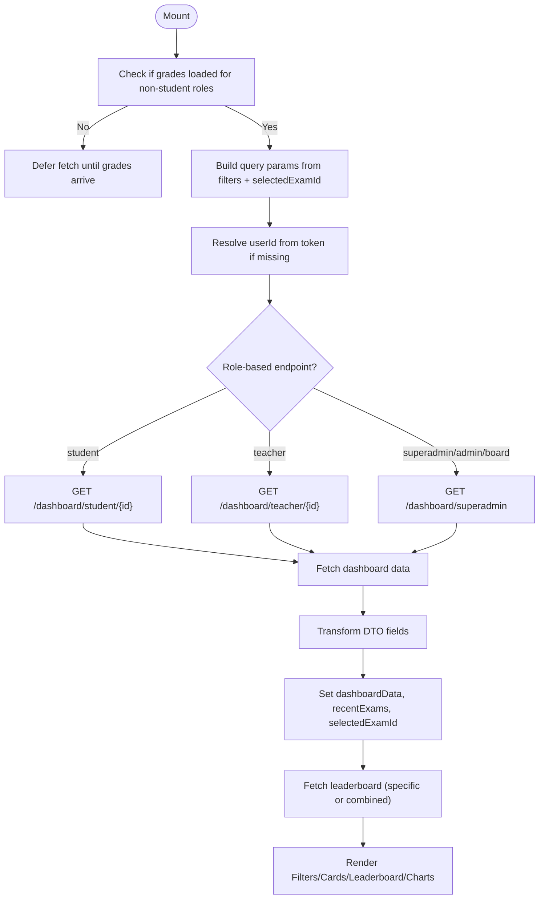
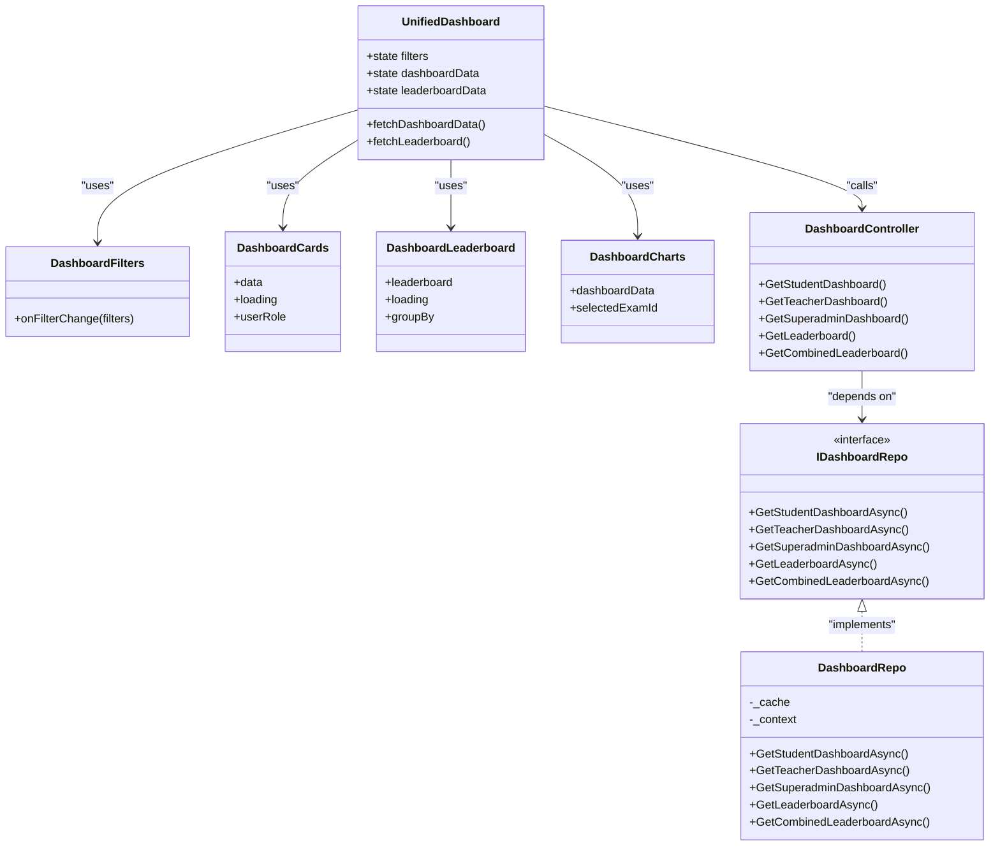

# Dashboard Architecture

<cite>
**Referenced Files in This Document**   
- [UnifiedDashboard.jsx](file://client/src/components/UnifiedDashboard.jsx)
- [DashboardView.jsx](file://client/src/components/DashboardView.jsx)
- [DashboardFilters.jsx](file://client/src/components/DashboardFilters.jsx)
- [DashboardCards.jsx](file://client/src/components/DashboardCards.jsx)
- [DashboardLeaderboard.jsx](file://client/src/components/DashboardLeaderboard.jsx)
- [DashboardCharts.jsx](file://client/src/components/DashboardCharts.jsx)
- [DashboardController.cs](file://server/Api/Controllers/DashboardController.cs)
- [IDashboardRepo.cs](file://server/Api/Repositories/Interfaces/IDashboardRepo.cs)
- [DashboardRepo.cs](file://server/Api/Repositories/Implementation/DashboardRepo.cs)
- [DashboardDTOs.cs](file://server/Api/DTOs/DashboardDTOs.cs)
</cite>

## Table of Contents
1. [Introduction](#introduction)
2. [Project Structure](#project-structure)
3. [Core Components](#core-components)
4. [Architecture Overview](#architecture-overview)
5. [Detailed Component Analysis](#detailed-component-analysis)
6. [Dependency Analysis](#dependency-analysis)
7. [Performance Considerations](#performance-considerations)
8. [Troubleshooting Guide](#troubleshooting-guide)
9. [Conclusion](#conclusion)

## Introduction
This document explains the Exam-Hub dashboard architecture across frontend and backend layers. It focuses on:
- React component hierarchy: UnifiedDashboard, DashboardView, and supporting components
- Data fetching and state management patterns
- Backend orchestration via DashboardController and repository layer
- Caching strategies and performance optimizations
- Data flow from database queries to UI rendering
- Role-based access control and authentication integration
- Error handling, loading states, and real-time update considerations

## Project Structure
The dashboard spans two main areas:
- Client (React): UnifiedDashboard orchestrates filters, data fetching, and composes subcomponents for cards, leaderboard, and charts. A separate DashboardView renders a quiz listing experience.
- Server (.NET): DashboardController exposes REST endpoints for student, teacher, superadmin dashboards, leaderboards, and lookup data. The repository layer performs analytics aggregation with caching.

**Diagram sources**
- [UnifiedDashboard.jsx:1-505](file://client/src/components/UnifiedDashboard.jsx#L1-L505)
- [DashboardController.cs:1-376](file://server/Api/Controllers/DashboardController.cs#L1-L376)
- [IDashboardRepo.cs:1-46](file://server/Api/Repositories/Interfaces/IDashboardRepo.cs#L1-L46)
- [DashboardRepo.cs:1-871](file://server/Api/Repositories/Implementation/DashboardRepo.cs#L1-L871)
- [DashboardDTOs.cs:1-169](file://server/Api/DTOs/DashboardDTOs.cs#L1-L169)

**Section sources**
- [UnifiedDashboard.jsx:1-505](file://client/src/components/UnifiedDashboard.jsx#L1-L505)
- [DashboardController.cs:1-376](file://server/Api/Controllers/DashboardController.cs#L1-L376)

## Core Components
- UnifiedDashboard: Central React component that manages role-aware data fetching, filter state, exam selection, and composes child components for cards, leaderboard, and charts.
- DashboardView: Standalone view for displaying available quizzes with interactive cards and timers.
- DashboardFilters: Debounced filter UI for grade, class, subject, date range, group-by, and selected exam.
- DashboardCards: Animated KPI cards showing totals, pass/fail rates, and average scores.
- DashboardLeaderboard: Ranked list of students or classes with animations and optional grade slider.
- DashboardCharts: Aggregated visualizations including pie, line, and bar charts.

**Section sources**
- [UnifiedDashboard.jsx:1-505](file://client/src/components/UnifiedDashboard.jsx#L1-L505)
- [DashboardView.jsx:1-186](file://client/src/components/DashboardView.jsx#L1-L186)
- [DashboardFilters.jsx:1-321](file://client/src/components/DashboardFilters.jsx#L1-L321)
- [DashboardCards.jsx:1-414](file://client/src/components/DashboardCards.jsx#L1-L414)
- [DashboardLeaderboard.jsx:1-502](file://client/src/components/DashboardLeaderboard.jsx#L1-L502)
- [DashboardCharts.jsx:1-127](file://client/src/components/DashboardCharts.jsx#L1-L127)

## Architecture Overview
The dashboard follows a layered architecture:
- Presentation Layer (React): UnifiedDashboard coordinates user interactions and composes subcomponents.
- API Layer (.NET): DashboardController validates inputs, enforces authorization, and delegates to repositories.
- Repository Layer: DashboardRepo implements complex analytics, joins multiple tables, computes aggregates, and caches results.
- Data Models: DTOs define contracts between controller and client.

**Diagram sources**
- [UnifiedDashboard.jsx:88-199](file://client/src/components/UnifiedDashboard.jsx#L88-L199)
- [DashboardController.cs:80-234](file://server/Api/Controllers/DashboardController.cs#L80-L234)
- [DashboardRepo.cs:109-503](file://server/Api/Repositories/Implementation/DashboardRepo.cs#L109-L503)

## Detailed Component Analysis

### UnifiedDashboard (Frontend Orchestrator)
Responsibilities:
- Role-aware endpoint selection: student, teacher, superadmin/admin/board
- Filter construction and query string building
- User ID resolution from token when missing
- Auto-selection of meaningful exam for students when needed
- Fetching dashboard data and leaderboard data
- Error handling and loading states
- Composing child components: DashboardFilters, DashboardCards, DashboardLeaderboard, DashboardCharts

Key behaviors:
- Defers fetch until grades lookup data is available for teachers/admins/superadmins
- Builds URLSearchParams dynamically based on active filters
- Normalizes backend DTO fields for consistent consumption
- Handles leaderboard fallbacks: specific exam vs combined leaderboard by grade

**Diagram sources**
- [UnifiedDashboard.jsx:38-78](file://client/src/components/UnifiedDashboard.jsx#L38-L78)
- [UnifiedDashboard.jsx:88-199](file://client/src/components/UnifiedDashboard.jsx#L88-L199)
- [UnifiedDashboard.jsx:201-296](file://client/src/components/UnifiedDashboard.jsx#L201-L296)

**Section sources**
- [UnifiedDashboard.jsx:1-505](file://client/src/components/UnifiedDashboard.jsx#L1-L505)

### DashboardView (Quiz Listing View)
Responsibilities:
- Renders a grid of quiz cards with status indicators (expired, starts soon, time left)
- Provides click handlers to start quizzes
- Displays empty state when no quizzes are available

Design notes:
- Uses inline styles for responsive grid layout
- Computes countdowns and statuses per quiz card
- Emits onStartQuiz callback for parent navigation

**Section sources**
- [DashboardView.jsx:1-186](file://client/src/components/DashboardView.jsx#L1-L186)

### DashboardFilters (Filter UI)
Responsibilities:
- Debounced filter application to avoid excessive re-renders
- Grade/class/subject/date/group-by controls
- Active filters summary display
- Exam selection dropdown filtered by grade/class

Behavior highlights:
- Debounces changes by 400ms before calling onFilterChange
- Resets class selection when grade changes
- Supports both legacy and array-based class mappings for exams

**Section sources**
- [DashboardFilters.jsx:1-321](file://client/src/components/DashboardFilters.jsx#L1-L321)

### DashboardCards (KPI Cards)
Responsibilities:
- Animated counters for total exams, pass %, fail %, average score
- Role-specific labels and values
- Fallback calculations using leaderboard or score distribution when breakdown is missing

Logic highlights:
- Calculates average score from examBreakdown or leaderboard
- Ensures pass + fail = 100% consistency
- Animates number transitions using requestAnimationFrame

**Section sources**
- [DashboardCards.jsx:1-414](file://client/src/components/DashboardCards.jsx#L1-L414)

### DashboardLeaderboard (Ranked List)
Responsibilities:
- Displays top students or classes with rank badges and medals
- Optional grade slider with animated transitions
- Highlights current user row and provides “See All” action

Features:
- Shimmer loading only on initial load
- Responsive arrow controls for desktop/mobile
- Group-by toggle affects displayed metrics

**Section sources**
- [DashboardLeaderboard.jsx:1-502](file://client/src/components/DashboardLeaderboard.jsx#L1-L502)

### DashboardCharts (Visualizations)
Responsibilities:
- Pie chart for pass vs fail overview
- Line chart for performance trends (students vs class averages)
- Bar chart for score distribution buckets

Normalization:
- Case-insensitive field access for backend DTOs
- Derives pass/fail percentages from scoreDistribution when needed

**Section sources**
- [DashboardCharts.jsx:1-127](file://client/src/components/DashboardCharts.jsx#L1-L127)

### DashboardController (Backend Orchestration)
Endpoints:
- Lookup data: grades, classes, subjects, mapped exams
- Student dashboard: GET /api/dashboard/student/{id}
- Teacher dashboard: GET /api/dashboard/teacher/{id}
- Superadmin dashboard: GET /api/dashboard/superadmin
- Leaderboard: GET /api/dashboard/leaderboard/{examId}
- Combined leaderboard: GET /api/dashboard/leaderboard/combined
- Exam stats: GET /api/dashboard/exam/{examId}/stats
- Teachers/students lists: GET /api/dashboard/teachers, GET /api/dashboard/students

Security:
- Authorize attribute on all endpoints
- Role-based access for superadmin/admin/board endpoints
- Optional identity claim validation for self-access checks

Error handling:
- Validates date ranges
- Returns BadRequest for invalid inputs
- Wraps exceptions in standardized error responses

**Section sources**
- [DashboardController.cs:1-376](file://server/Api/Controllers/DashboardController.cs#L1-L376)

### IDashboardRepo (Repository Interface)
Contract:
- Methods for student, teacher, superadmin dashboards
- Leaderboard retrieval and combined leaderboard
- Exam statistics
- Students and teachers lists

**Section sources**
- [IDashboardRepo.cs:1-46](file://server/Api/Repositories/Interfaces/IDashboardRepo.cs#L1-L46)

### DashboardRepo (Analytics & Caching)
Responsibilities:
- Complex aggregations across exams, answers, and question marks
- Score bucketing and pass/fail thresholds
- Top performers and recent activity generation
- Filtering by grade/class/subject/date/search term
- In-memory caching with versioned keys

Caching strategy:
- CacheDuration set to 2 minutes
- CacheVersion constant for cache invalidation
- Key includes prefix, id, and filter parameters

Query optimization:
- AsNoTracking for read-only queries
- Sequential fetching to avoid EF Core thread-safety issues
- Efficient grouping and dictionary lookups

**Section sources**
- [DashboardRepo.cs:1-871](file://server/Api/Repositories/Implementation/DashboardRepo.cs#L1-L871)

### DashboardDTOs (Data Contracts)
Contracts include:
- StudentDashboardDto, TeacherDashboardDto, SuperadminDashboardDto
- LeaderboardDto, LeaderboardEntryDto
- ExamStatsDto, ChartDataPointDto
- LeaderboardFilterDto, RecentActivityDto, etc.

These DTOs standardize payloads between controller and client.

**Section sources**
- [DashboardDTOs.cs:1-169](file://server/Api/DTOs/DashboardDTOs.cs#L1-L169)

## Dependency Analysis
Component relationships:
- UnifiedDashboard depends on DashboardFilters, DashboardCards, DashboardLeaderboard, DashboardCharts
- UnifiedDashboard calls API endpoints exposed by DashboardController
- DashboardController depends on IDashboardRepo interface implemented by DashboardRepo
- DashboardRepo uses DbContext and IMemoryCache

**Diagram sources**
- [UnifiedDashboard.jsx:1-505](file://client/src/components/UnifiedDashboard.jsx#L1-L505)
- [DashboardController.cs:1-376](file://server/Api/Controllers/DashboardController.cs#L1-L376)
- [IDashboardRepo.cs:1-46](file://server/Api/Repositories/Interfaces/IDashboardRepo.cs#L1-L46)
- [DashboardRepo.cs:1-871](file://server/Api/Repositories/Implementation/DashboardRepo.cs#L1-L871)

**Section sources**
- [UnifiedDashboard.jsx:1-505](file://client/src/components/UnifiedDashboard.jsx#L1-L505)
- [DashboardController.cs:1-376](file://server/Api/Controllers/DashboardController.cs#L1-L376)

## Performance Considerations
- Frontend debouncing: DashboardFilters debounces filter changes to reduce unnecessary re-renders and API calls.
- Optimistic UI: UnifiedDashboard shows content while background refreshes occur, with a subtle progress bar.
- Caching: DashboardRepo uses IMemoryCache with a 2-minute TTL and versioned keys to minimize repeated computations.
- Query efficiency: Use of AsNoTracking, grouped aggregations, and dictionary lookups reduces overhead.
- Conditional fetching: UnifiedDashboard defers fetches until required lookup data (grades) is available for non-student roles.

Recommendations:
- Consider adding pagination for large datasets (e.g., leaderboard, recent exams).
- Introduce server-side caching headers where appropriate.
- Monitor cache hit ratios and adjust TTL based on data volatility.

[No sources needed since this section provides general guidance]

## Troubleshooting Guide
Common issues and resolutions:
- Missing user ID: UnifiedDashboard resolves userId from token; if unavailable, it sets an error message prompting re-login.
- Empty leaderboard: UnifiedDashboard falls back to combined leaderboard by grade when no specific exam is selected.
- Date validation errors: DashboardController returns BadRequest if startDate > endDate.
- No data available: DashboardLeaderboard displays an empty state with helpful messaging.
- Loading states: UnifiedDashboard and DashboardCards show shimmer placeholders during initial loads.

Debugging tips:
- Inspect console logs in UnifiedDashboard for API responses and transformations.
- Verify filter parameters in network requests to ensure correct query strings.
- Check cached data keys in DashboardRepo to confirm cache invalidation behavior.

**Section sources**
- [UnifiedDashboard.jsx:122-140](file://client/src/components/UnifiedDashboard.jsx#L122-L140)
- [UnifiedDashboard.jsx:307-351](file://client/src/components/UnifiedDashboard.jsx#L307-L351)
- [DashboardController.cs:97-101](file://server/Api/Controllers/DashboardController.cs#L97-L101)
- [DashboardLeaderboard.jsx:253-267](file://client/src/components/DashboardLeaderboard.jsx#L253-L267)

## Conclusion
The Exam-Hub dashboard architecture combines a modular React frontend with a robust .NET backend. UnifiedDashboard orchestrates data fetching and composition, while DashboardController and DashboardRepo handle analytics aggregation and caching. The system supports role-based views, responsive layouts, and comprehensive error handling. With careful attention to performance and data normalization, the dashboard delivers a smooth, informative experience across student, teacher, and admin roles.

[No sources needed since this section summarizes without analyzing specific files]