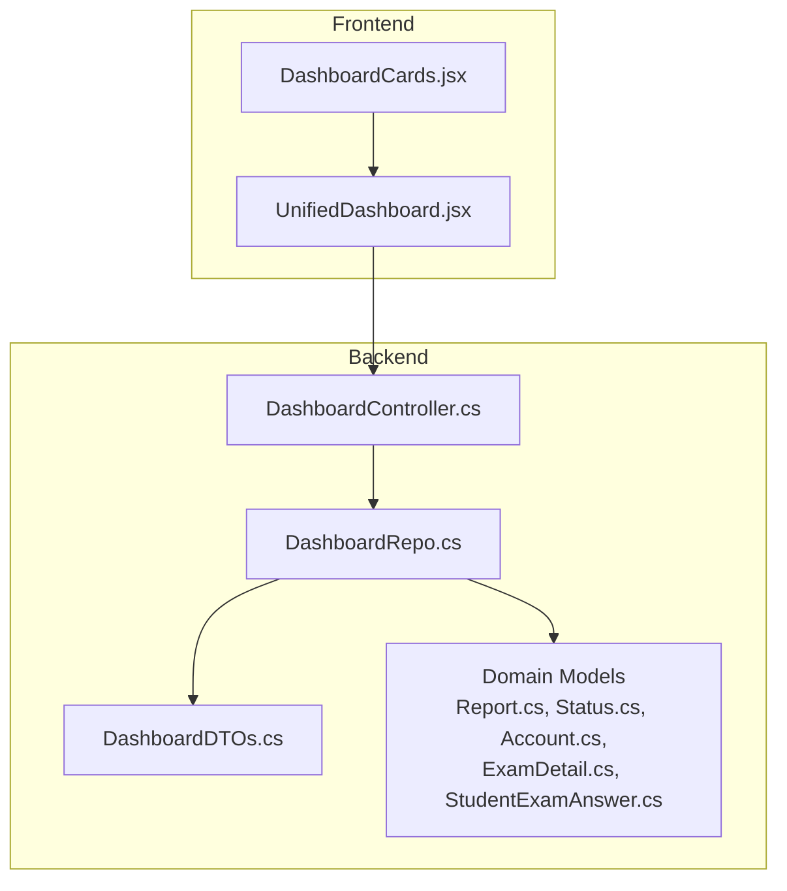
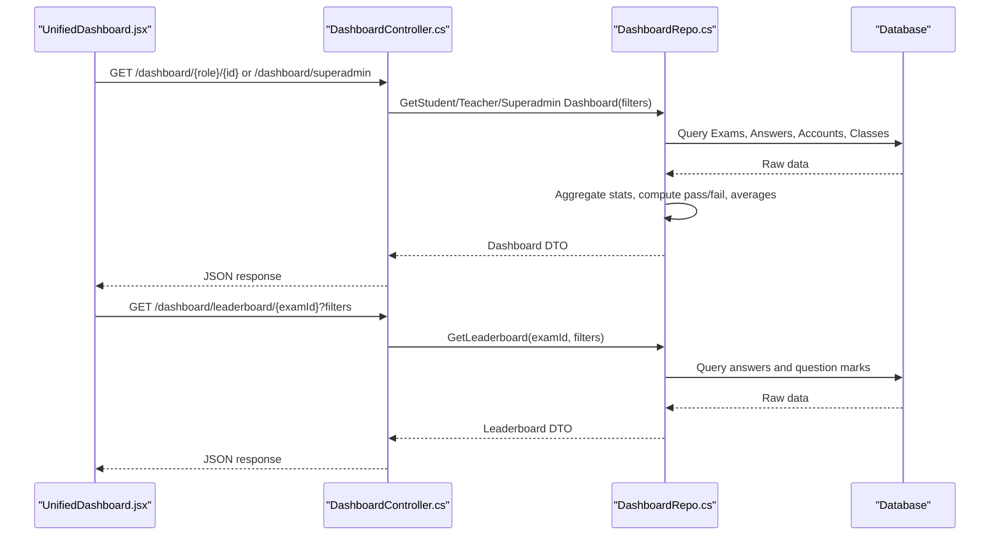
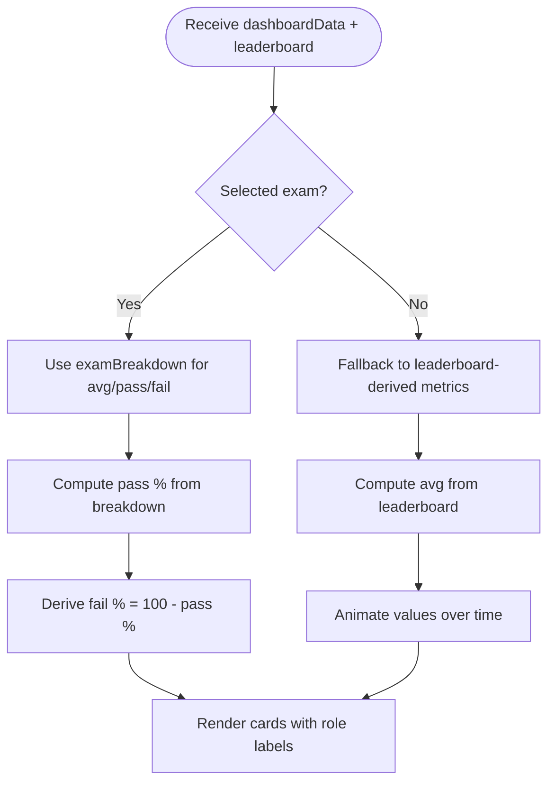
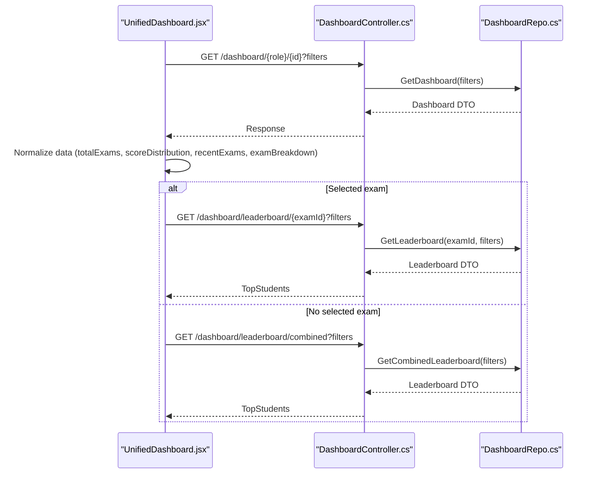
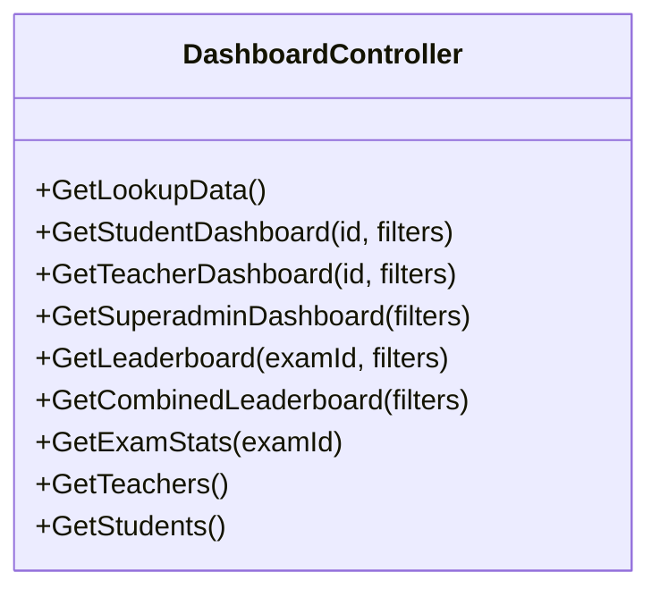
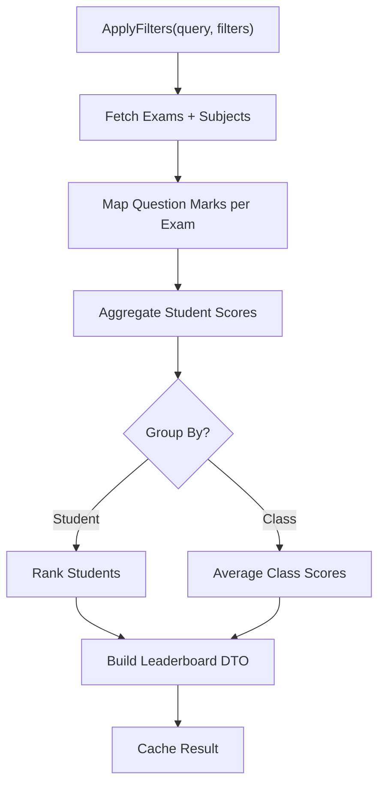
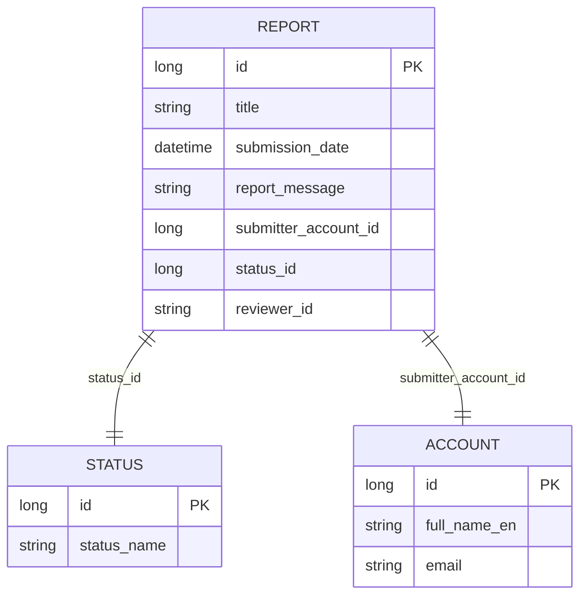
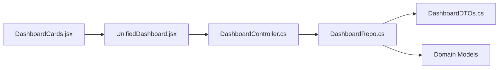

# Reporting Features

<cite>
**Referenced Files in This Document**
- [DashboardController.cs](file://server/Api/Controllers/DashboardController.cs)
- [DashboardRepo.cs](file://server/Api/Repositories/Implementation/DashboardRepo.cs)
- [Report.cs](file://server/Api/Models/Report.cs)
- [DashboardDTOs.cs](file://server/Api/DTOs/DashboardDTOs.cs)
- [Status.cs](file://server/Api/Models/Status.cs)
- [Account.cs](file://server/Api/Models/Account.cs)
- [ExamDetail.cs](file://server/Api/Models/ExamDetail.cs)
- [StudentExamAnswer.cs](file://server/Api/Models/StudentExamAnswer.cs)
- [DashboardCards.jsx](file://client/src/components/DashboardCards.jsx)
- [UnifiedDashboard.jsx](file://client/src/components/UnifiedDashboard.jsx)
</cite>

## Table of Contents
1. [Introduction](#introduction)
2. [Project Structure](#project-structure)
3. [Core Components](#core-components)
4. [Architecture Overview](#architecture-overview)
5. [Detailed Component Analysis](#detailed-component-analysis)
6. [Dependency Analysis](#dependency-analysis)
7. [Performance Considerations](#performance-considerations)
8. [Troubleshooting Guide](#troubleshooting-guide)
9. [Conclusion](#conclusion)
10. [Appendices](#appendices)

## Introduction
This document explains the reporting and export capabilities within the Exam-Hub dashboard. It focuses on:
- Statistical cards that display key performance indicators (KPIs) such as pass/fail rates, average scores, and exam counts
- Automated report generation via server-side endpoints and repository logic
- Data export readiness for CSV/Excel formats
- The Report model structure and its relationships
- Role-based permissions for accessing reports and dashboards
- Guidance for extending reporting features, including scheduling, branding, and compliance considerations

The goal is to provide both a high-level understanding and detailed code-level insights so you can extend or customize reporting functionality confidently.

## Project Structure
Reporting-related functionality spans both backend and frontend layers:
- Backend API controllers expose endpoints for dashboard data and leaderboards
- Repository layer computes statistics, aggregates results, and applies filters
- Frontend components render KPI cards, charts, and leaderboards based on fetched data
- Domain models define core entities like Report, Status, Account, ExamDetail, and StudentExamAnswer

**Diagram sources**
- [UnifiedDashboard.jsx:1-505](file://client/src/components/UnifiedDashboard.jsx#L1-L505)
- [DashboardCards.jsx:1-414](file://client/src/components/DashboardCards.jsx#L1-L414)
- [DashboardController.cs:1-376](file://server/Api/Controllers/DashboardController.cs#L1-L376)
- [DashboardRepo.cs:1-871](file://server/Api/Repositories/Implementation/DashboardRepo.cs#L1-L871)
- [DashboardDTOs.cs](file://server/Api/DTOs/DashboardDTOs.cs)
- [Report.cs:1-26](file://server/Api/Models/Report.cs#L1-L26)
- [Status.cs](file://server/Api/Models/Status.cs)
- [Account.cs](file://server/Api/Models/Account.cs)
- [ExamDetail.cs](file://server/Api/Models/ExamDetail.cs)
- [StudentExamAnswer.cs](file://server/Api/Models/StudentExamAnswer.cs)

**Section sources**
- [UnifiedDashboard.jsx:1-505](file://client/src/components/UnifiedDashboard.jsx#L1-L505)
- [DashboardCards.jsx:1-414](file://client/src/components/DashboardCards.jsx#L1-L414)
- [DashboardController.cs:1-376](file://server/Api/Controllers/DashboardController.cs#L1-L376)
- [DashboardRepo.cs:1-871](file://server/Api/Repositories/Implementation/DashboardRepo.cs#L1-L871)

## Core Components
- DashboardController exposes REST endpoints for student, teacher, superadmin dashboards, leaderboard, and exam statistics. These endpoints are the primary entry points for generating report data.
- DashboardRepo implements the business logic for computing KPIs, aggregating exam stats, building leaderboards, and applying filters. It also uses in-memory caching to optimize repeated queries.
- UnifiedDashboard orchestrates data fetching and state management on the client side, normalizing responses and coordinating between dashboard data and leaderboard requests.
- DashboardCards renders animated KPI cards with role-specific labels and derived metrics from dashboard data and leaderboard entries.
- Report model defines the schema for persisted reports, including submission metadata, status, and submitter/reviewer references.

Key responsibilities:
- Compute pass/fail percentages, average scores, and total exams per role
- Provide leaderboard data grouped by student or class
- Support filtering by grade, class, subject, date range, and search terms
- Cache dashboard and leaderboard results for performance

**Section sources**
- [DashboardController.cs:24-376](file://server/Api/Controllers/DashboardController.cs#L24-L376)
- [DashboardRepo.cs:10-871](file://server/Api/Repositories/Implementation/DashboardRepo.cs#L10-L871)
- [UnifiedDashboard.jsx:13-505](file://client/src/components/UnifiedDashboard.jsx#L13-L505)
- [DashboardCards.jsx:1-414](file://client/src/components/DashboardCards.jsx#L1-L414)
- [Report.cs:6-25](file://server/Api/Models/Report.cs#L6-L25)

## Architecture Overview
The reporting pipeline flows from the frontend through the controller to the repository, which queries domain models and returns DTOs consumed by the UI.

**Diagram sources**
- [UnifiedDashboard.jsx:88-296](file://client/src/components/UnifiedDashboard.jsx#L88-L296)
- [DashboardController.cs:80-344](file://server/Api/Controllers/DashboardController.cs#L80-L344)
- [DashboardRepo.cs:109-604](file://server/Api/Repositories/Implementation/DashboardRepo.cs#L109-L604)

## Detailed Component Analysis

### Statistical Cards (KPIs)
The statistical cards component calculates and animates KPIs:
- Total exams (context-aware: selected exam vs overall)
- Pass percentage (derived from exam breakdown or score distribution)
- Fail percentage (complementary to pass percentage)
- Average score (weighted by students when available)

It supports role-specific labels and integrates with leaderboard data to derive metrics when needed.

**Diagram sources**
- [DashboardCards.jsx:9-135](file://client/src/components/DashboardCards.jsx#L9-L135)
- [DashboardCards.jsx:145-219](file://client/src/components/DashboardCards.jsx#L145-L219)
- [DashboardCards.jsx:221-339](file://client/src/components/DashboardCards.jsx#L221-L339)

**Section sources**
- [DashboardCards.jsx:1-414](file://client/src/components/DashboardCards.jsx#L1-L414)

### Dashboard Orchestration (UnifiedDashboard)
UnifiedDashboard coordinates:
- Fetching role-specific dashboard data with filters
- Auto-selecting meaningful exams when needed
- Fetching specific or combined leaderboards based on selection and role
- Normalizing API responses into consistent shapes for cards and charts

**Diagram sources**
- [UnifiedDashboard.jsx:88-296](file://client/src/components/UnifiedDashboard.jsx#L88-L296)
- [DashboardController.cs:80-344](file://server/Api/Controllers/DashboardController.cs#L80-L344)
- [DashboardRepo.cs:505-604](file://server/Api/Repositories/Implementation/DashboardRepo.cs#L505-L604)

**Section sources**
- [UnifiedDashboard.jsx:13-505](file://client/src/components/UnifiedDashboard.jsx#L13-L505)

### Server-Side Reporting Endpoints
Endpoints exposed by DashboardController:
- Student dashboard: GET /dashboard/student/{id}
- Teacher dashboard: GET /dashboard/teacher/{id}
- Superadmin dashboard: GET /dashboard/superadmin
- Leaderboard: GET /dashboard/leaderboard/{examId}
- Combined leaderboard: GET /dashboard/leaderboard/combined
- Exam statistics: GET /dashboard/exam/{examId}/stats

All endpoints accept optional filters (gradeId, classId, examId, startDate, endDate, groupBy). Authentication and authorization are enforced via attributes.

**Diagram sources**
- [DashboardController.cs:24-376](file://server/Api/Controllers/DashboardController.cs#L24-L376)

**Section sources**
- [DashboardController.cs:24-376](file://server/Api/Controllers/DashboardController.cs#L24-L376)

### Repository Logic and Aggregations
DashboardRepo implements:
- Filtering by grade, class, subject, search term, and date ranges
- Computation of pass/fail thresholds and averages
- Leaderboard ranking and grouping by student or class
- Caching of dashboard and leaderboard results using IMemoryCache

**Diagram sources**
- [DashboardRepo.cs:670-705](file://server/Api/Repositories/Implementation/DashboardRepo.cs#L670-L705)
- [DashboardRepo.cs:505-604](file://server/Api/Repositories/Implementation/DashboardRepo.cs#L505-L604)

**Section sources**
- [DashboardRepo.cs:10-871](file://server/Api/Repositories/Implementation/DashboardRepo.cs#L10-L871)

### Report Model Structure
The Report model captures report submissions with fields for title, submission date, message, submitter account, status, and optional reviewer identifier. It includes navigation properties to Status and Account.

**Diagram sources**
- [Report.cs:6-25](file://server/Api/Models/Report.cs#L6-L25)
- [Status.cs](file://server/Api/Models/Status.cs)
- [Account.cs](file://server/Api/Models/Account.cs)

**Section sources**
- [Report.cs:6-25](file://server/Api/Models/Report.cs#L6-L25)

### Data Export Readiness
While explicit CSV/Excel export endpoints are not present in the analyzed files, the repository provides structured DTOs and aggregated datasets suitable for export:
- Dashboard DTOs include exam breakdowns, score distributions, and top performers
- Leaderboard DTOs contain ranked entries with scores and totals
- Student performance lists include quiz scores keyed by exam IDs

To implement exports:
- Add new controller endpoints returning CSV/Excel streams
- Serialize DTOs from repository methods (e.g., GetStudentsAsync, GetLeaderboardAsync)
- Apply filters consistently with existing query patterns

[No sources needed since this section provides general guidance]

### Automated Report Generation
Automated generation can be implemented by:
- Creating scheduled jobs that call repository aggregation methods
- Persisting generated reports via the Report model
- Sending notifications or emails upon completion

Current repository methods provide the necessary data; extension points include:
- New repository methods for custom analytical views
- Controller endpoints to trigger generation
- Background services for scheduling

[No sources needed since this section provides general guidance]

### Scheduling Mechanisms
Scheduling can be achieved using:
- .NET background services or hosted tasks
- Cron-like schedulers integrated with the application lifecycle
- External job queues (e.g., Hangfire, Quartz.NET)

Integration points:
- Trigger repository methods to compute reports
- Store results in Report table
- Notify users via email or system messages

[No sources needed since this section provides general guidance]

### Role-Based Reporting Permissions
Access control is enforced at the controller level:
- Student and teacher endpoints require authentication
- Superadmin endpoint restricts access to roles: Superadmin, Admin, Board
- Optional checks allow self-access for students/teachers

Recommendations:
- Enforce strict authorization checks where commented out
- Introduce granular permissions for report generation/export actions
- Log access attempts for auditability

**Section sources**
- [DashboardController.cs:80-344](file://server/Api/Controllers/DashboardController.cs#L80-L344)

### Custom Analytical Views
Custom views can be built by:
- Extending LeaderboardFilterDto with additional filter parameters
- Adding repository methods that aggregate data according to custom criteria
- Returning new DTOs tailored for specialized analytics

Example extensions:
- Subject-wise pass rates
- Class-wise performance trends
- Time-series analysis of scores

[No sources needed since this section provides general guidance]

### Branding Support
Branding can be supported by:
- Configurable templates for PDF reports
- Theme variables for colors, logos, and fonts
- Localization support for titles and messages

Implementation suggestions:
- Add configuration objects for branding settings
- Inject branding into report generation pipelines
- Allow admin overrides per organization

[No sources needed since this section provides general guidance]

### Compliance and Data Retention
Compliance considerations:
- Ensure sensitive data is handled securely during export
- Implement retention policies for generated reports
- Audit report generation and access logs

Recommendations:
- Encrypt exported files if containing PII
- Purge old reports based on policy
- Validate data minimization principles

[No sources needed since this section provides general guidance]

## Dependency Analysis
The reporting subsystem exhibits clear separation of concerns:
- Controllers depend on repositories for data computation
- Repositories depend on EF Core context and domain models
- Frontend depends on controller endpoints and consumes normalized DTOs

**Diagram sources**
- [UnifiedDashboard.jsx:1-505](file://client/src/components/UnifiedDashboard.jsx#L1-L505)
- [DashboardCards.jsx:1-414](file://client/src/components/DashboardCards.jsx#L1-L414)
- [DashboardController.cs:1-376](file://server/Api/Controllers/DashboardController.cs#L1-L376)
- [DashboardRepo.cs:1-871](file://server/Api/Repositories/Implementation/DashboardRepo.cs#L1-L871)
- [DashboardDTOs.cs](file://server/Api/DTOs/DashboardDTOs.cs)

**Section sources**
- [UnifiedDashboard.jsx:1-505](file://client/src/components/UnifiedDashboard.jsx#L1-L505)
- [DashboardCards.jsx:1-414](file://client/src/components/DashboardCards.jsx#L1-L414)
- [DashboardController.cs:1-376](file://server/Api/Controllers/DashboardController.cs#L1-L376)
- [DashboardRepo.cs:1-871](file://server/Api/Repositories/Implementation/DashboardRepo.cs#L1-L871)

## Performance Considerations
- In-memory caching reduces repeated database queries for dashboard and leaderboard data
- Filtered queries minimize data transfer and processing overhead
- Weighted averages improve accuracy of KPI calculations
- Animations on the client side enhance UX without impacting server load

Optimization opportunities:
- Paginate large leaderboard results
- Index frequently filtered columns in the database
- Batch updates for bulk report generation

[No sources needed since this section provides general guidance]

## Troubleshooting Guide
Common issues and resolutions:
- Missing user ID: Ensure token parsing resolves userId correctly before calling role-specific endpoints
- Empty leaderboard: Verify selected exam exists and has associated answers
- Incorrect pass/fail rates: Confirm threshold logic and score derivation match expected behavior
- Cache staleness: Adjust cache duration or invalidate keys when data changes

Debugging tips:
- Inspect console logs in UnifiedDashboard for API responses and errors
- Validate filter parameters passed to endpoints
- Check repository aggregation logic for edge cases (e.g., zero max marks)

**Section sources**
- [UnifiedDashboard.jsx:122-140](file://client/src/components/UnifiedDashboard.jsx#L122-L140)
- [UnifiedDashboard.jsx:193-199](file://client/src/components/UnifiedDashboard.jsx#L193-L199)
- [DashboardController.cs:95-135](file://server/Api/Controllers/DashboardController.cs#L95-L135)

## Conclusion
The Exam-Hub reporting system provides robust KPI visualization, flexible filtering, and scalable aggregation through well-structured backend endpoints and repository logic. The frontend components render intuitive statistical cards and leaderboards, while the Report model offers a foundation for persisting generated reports. Extensibility points exist for automated scheduling, export functionality, branding customization, and compliance measures. By following the guidance herein, teams can confidently expand reporting capabilities to meet evolving analytical needs.

[No sources needed since this section summarizes without analyzing specific files]

## Appendices

### Example Workflows

#### Generating a PDF Report
Steps:
- Create a new controller endpoint that triggers report generation
- Call repository methods to fetch aggregated data
- Generate PDF using a templating engine with branding options
- Save the report metadata to the Report model
- Return success status or stream the file

[No sources needed since this section provides general guidance]

#### Exporting Data to CSV/Excel
Steps:
- Add endpoints under DashboardController for CSV/Excel export
- Serialize DTOs from repository methods (e.g., GetStudentsAsync, GetLeaderboardAsync)
- Apply filters consistently with existing query patterns
- Stream the file back to the client

[No sources needed since this section provides general guidance]

#### Creating Custom Analytical Views
Steps:
- Extend LeaderboardFilterDto with new filter parameters
- Implement repository methods for custom aggregations
- Return tailored DTOs for specialized analytics
- Update frontend components to consume new endpoints

[No sources needed since this section provides general guidance]