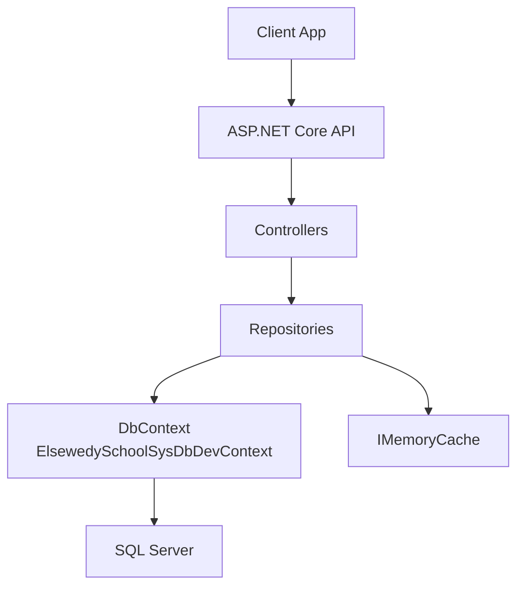
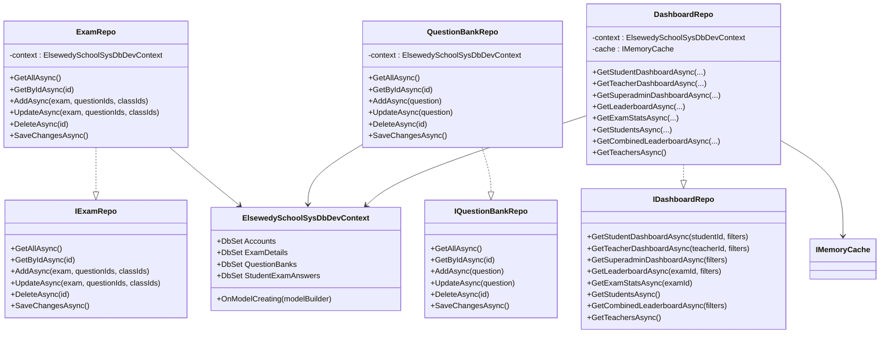
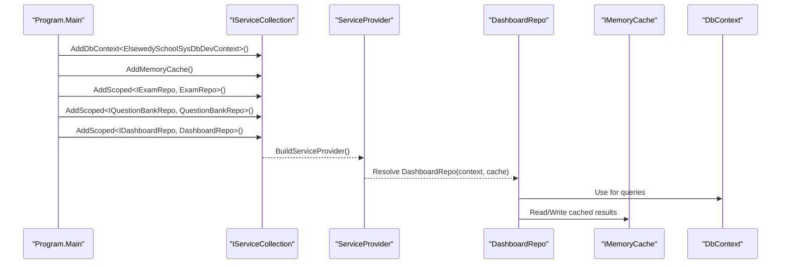
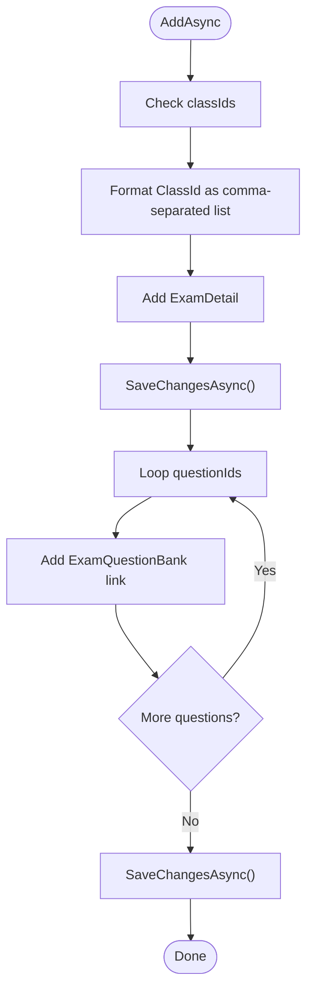
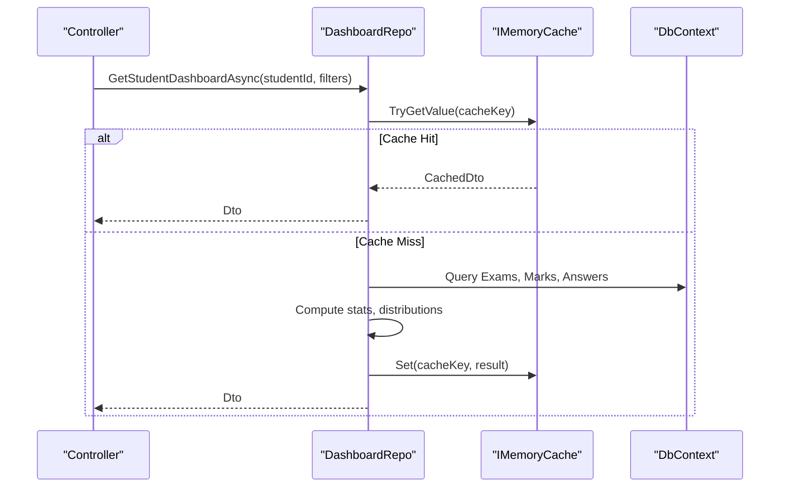
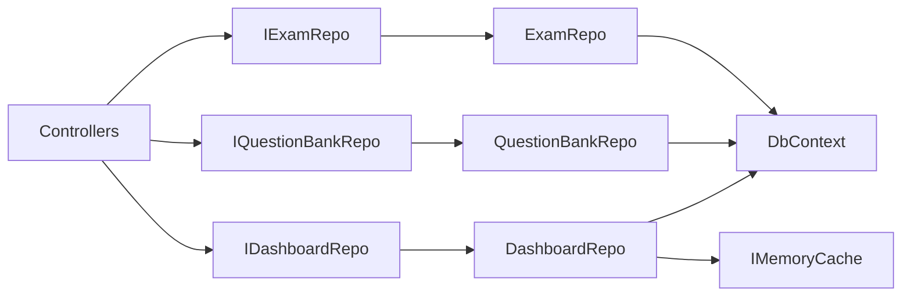

# Data Access Patterns

<cite>
**Referenced Files in This Document**
- [Program.cs](file://server/Api/Program.cs)
- [appsettings.json](file://server/Api/appsettings.json)
- [ElsewedySchoolSysDbDevContext.cs](file://server/Api/Models/ElsewedySchoolSysDbDevContext.cs)
- [IExamRepo.cs](file://server/Api/Repositories/Interfaces/IExamRepo.cs)
- [ExamRepo.cs](file://server/Api/Repositories/Implementation/ExamRepo.cs)
- [IQuestionBankRepo.cs](file://server/Api/Repositories/Interfaces/IQuestionBankRepo.cs)
- [QuestionBankRepo.cs](file://server/Api/Repositories/Implementation/QuestionBankRepo.cs)
- [IDashboardRepo.cs](file://server/Api/Repositories/Interfaces/IDashboardRepo.cs)
- [DashboardRepo.cs](file://server/Api/Repositories/Implementation/DashboardRepo.cs)
- [ExamDetail.cs](file://server/Api/Models/ExamDetail.cs)
- [QuestionBank.cs](file://server/Api/Models/QuestionBank.cs)
- [ExamQuestionBank.cs](file://server/Api/Models/ExamQuestionBank.cs)
- [DashboardDTOs.cs](file://server/Api/DTOs/DashboardDTOs.cs)
</cite>

## Table of Contents
1. [Introduction](#introduction)
2. [Project Structure](#project-structure)
3. [Core Components](#core-components)
4. [Architecture Overview](#architecture-overview)
5. [Detailed Component Analysis](#detailed-component-analysis)
6. [Dependency Analysis](#dependency-analysis)
7. [Performance Considerations](#performance-considerations)
8. [Troubleshooting Guide](#troubleshooting-guide)
9. [Conclusion](#conclusion)

## Introduction
This document explains the data access patterns used in the Exam-Hub system, focusing on repository implementation and Entity Framework usage. It covers:
- Repository pattern with interfaces and concrete classes for data abstraction
- DbContext configuration, connection string setup, and dependency injection integration
- Query composition techniques, LINQ usage patterns, and performance optimization strategies
- Examples of complex queries, joins, aggregations, and asynchronous operations
- Transaction management, error handling, and logging within the data access layer
- Caching strategies and performance monitoring approaches

## Project Structure
The server-side API uses a layered approach:
- Controllers (API endpoints) depend on repositories via dependency injection
- Repositories implement domain-specific data access logic using EF Core
- Models represent database entities; DTOs represent API responses
- Program configures services, DbContext, caching, authentication, and DI for repositories

**Diagram sources**
- [Program.cs:30-36](file://server/Api/Program.cs#L30-L36)
- [Program.cs:104-107](file://server/Api/Program.cs#L104-L107)
- [DashboardRepo.cs:17-21](file://server/Api/Repositories/Implementation/DashboardRepo.cs#L17-L21)

**Section sources**
- [Program.cs:17-36](file://server/Api/Program.cs#L17-L36)
- [appsettings.json:1-18](file://server/Api/appsettings.json#L1-L18)

## Core Components
- DbContext: Central EF Core context exposing DbSets for all entities and model configuration
- Repositories: Interfaces and implementations encapsulating CRUD and complex query logic
- DTOs: Strongly-typed response models for dashboards and leaderboards
- DI Integration: Registration of DbContext, MemoryCache, and repository services

Key responsibilities:
- ElsewedySchoolSysDbDevContext: Defines entity mappings, relationships, and constraints
- IExamRepo / ExamRepo: Exam CRUD and question linking
- IQuestionBankRepo / QuestionBankRepo: Question bank CRUD
- IDashboardRepo / DashboardRepo: Complex dashboard queries, aggregations, leaderboards, and caching

**Section sources**
- [ElsewedySchoolSysDbDevContext.cs:7-138](file://server/Api/Models/ElsewedySchoolSysDbDevContext.cs#L7-L138)
- [IExamRepo.cs:5-13](file://server/Api/Repositories/Interfaces/IExamRepo.cs#L5-L13)
- [ExamRepo.cs:6-139](file://server/Api/Repositories/Implementation/ExamRepo.cs#L6-L139)
- [IQuestionBankRepo.cs:3-11](file://server/Api/Repositories/Interfaces/IQuestionBankRepo.cs#L3-L11)
- [QuestionBankRepo.cs:7-47](file://server/Api/Repositories/Implementation/QuestionBankRepo.cs#L7-L47)
- [IDashboardRepo.cs:5-45](file://server/Api/Repositories/Interfaces/IDashboardRepo.cs#L5-L45)
- [DashboardRepo.cs:9-21](file://server/Api/Repositories/Implementation/DashboardRepo.cs#L9-L21)

## Architecture Overview
The application follows a clean separation between API controllers and data access logic through repositories. Dependency injection wires everything together at startup.

**Diagram sources**
- [ElsewedySchoolSysDbDevContext.cs:7-138](file://server/Api/Models/ElsewedySchoolSysDbDevContext.cs#L7-L138)
- [IExamRepo.cs:5-13](file://server/Api/Repositories/Interfaces/IExamRepo.cs#L5-L13)
- [ExamRepo.cs:6-139](file://server/Api/Repositories/Implementation/ExamRepo.cs#L6-L139)
- [IQuestionBankRepo.cs:3-11](file://server/Api/Repositories/Interfaces/IQuestionBankRepo.cs#L3-L11)
- [QuestionBankRepo.cs:7-47](file://server/Api/Repositories/Implementation/QuestionBankRepo.cs#L7-L47)
- [IDashboardRepo.cs:5-45](file://server/Api/Repositories/Interfaces/IDashboardRepo.cs#L5-L45)
- [DashboardRepo.cs:9-21](file://server/Api/Repositories/Implementation/DashboardRepo.cs#L9-L21)

## Detailed Component Analysis

### DbContext Configuration and Connection String Setup
- The DbContext is registered with SQL Server provider using a connection string from configuration.
- Connection string is defined in appsettings.json under ConnectionStrings.DefaultConnection.
- Model configuration includes collation, table names, indexes, relationships, and constraints.

Key points:
- UseSqlServer configured with builder.Configuration.GetConnectionString("DefaultConnection")
- Collation set to Arabic_100_CI_AI for consistent sorting/searching
- Extensive OnModelCreating mapping for entities and relationships

**Section sources**
- [Program.cs:30-33](file://server/Api/Program.cs#L30-L33)
- [appsettings.json:1-4](file://server/Api/appsettings.json#L1-L4)
- [ElsewedySchoolSysDbDevContext.cs:140-143](file://server/Api/Models/ElsewedySchoolSysDbDevContext.cs#L140-L143)

### Dependency Injection Integration
- Services.AddDbContext registers the DbContext as scoped.
- AddMemoryCache enables in-memory caching for dashboard queries.
- Repositories are registered as scoped dependencies: IExamRepo, IQuestionBankRepo, IDashboardRepo.

**Diagram sources**
- [Program.cs:30-36](file://server/Api/Program.cs#L30-L36)
- [Program.cs:104-107](file://server/Api/Program.cs#L104-L107)
- [DashboardRepo.cs:17-21](file://server/Api/Repositories/Implementation/DashboardRepo.cs#L17-L21)

**Section sources**
- [Program.cs:30-36](file://server/Api/Program.cs#L30-L36)
- [Program.cs:104-107](file://server/Api/Program.cs#L104-L107)

### Repository Pattern Implementation

#### IExamRepo and ExamRepo
Responsibilities:
- Fetch exams with subject and related questions
- Manage many-to-many links between exams and questions via ExamQuestionBank
- Update/remove question links during exam updates
- Provide SaveChangesAsync for transactional commits

LINQ patterns:
- Include for eager loading Subject
- Manual population of ExamQuestionBanks by querying links and questions separately
- Dictionary lookups for efficient mapping

Complexity considerations:
- GetAllAsync performs multiple queries: exams, links, questions; O(n) per exam link processing
- UpdateAsync computes differences between current and new question sets; O(m + n) where m = existing links, n = new IDs

Error handling:
- Null checks before adding/removing links
- No explicit try/catch; exceptions propagate to caller

Transactions:
- SaveChangesAsync wraps multiple changes; callers should coordinate transactions if needed

**Diagram sources**
- [ExamRepo.cs:66-87](file://server/Api/Repositories/Implementation/ExamRepo.cs#L66-L87)

**Section sources**
- [IExamRepo.cs:5-13](file://server/Api/Repositories/Interfaces/IExamRepo.cs#L5-L13)
- [ExamRepo.cs:6-139](file://server/Api/Repositories/Implementation/ExamRepo.cs#L6-L139)

#### IQuestionBankRepo and QuestionBankRepo
Responsibilities:
- Basic CRUD for QuestionBank entities
- Simple async methods delegating to DbContext

LINQ patterns:
- ToListAsync for enumeration
- FindAsync for single-entity retrieval

Error handling:
- DeleteAsync retrieves entity first; null-safe removal

Transactions:
- SaveChangesAsync exposed for batching changes

**Section sources**
- [IQuestionBankRepo.cs:3-11](file://server/Api/Repositories/Interfaces/IQuestionBankRepo.cs#L3-L11)
- [QuestionBankRepo.cs:7-47](file://server/Api/Repositories/Implementation/QuestionBankRepo.cs#L7-L47)

#### IDashboardRepo and DashboardRepo
Responsibilities:
- Aggregate student/teacher/superadmin dashboards
- Compute pass/fail percentages, average scores, score distributions
- Build leaderboards grouped by student or class
- Apply filters by grade, class, subject, search term, date range
- Cache results using IMemoryCache

LINQ patterns:
- AsNoTracking for read-only queries
- Join for combining ExamQuestionBanks with QuestionBanks
- GroupBy for aggregations across students and exams
- Select projections to minimize payload
- EF.Functions.Like for search filtering

Caching strategy:
- Cache keys include version, prefix, id, and filter parameters
- Cache duration set to 2 minutes
- Empty results also cached to prevent repeated computation

Complex queries examples:
- GetStudentDashboardAsync: fetches exams, marks map, answers, computes per-exam scores and averages
- GetLeaderboardAsync: builds leaderboard entries, ranks students, optionally groups by class
- GetCombinedLeaderboardAsync: aggregates performance across multiple exams

**Diagram sources**
- [DashboardRepo.cs:109-146](file://server/Api/Repositories/Implementation/DashboardRepo.cs#L109-L146)
- [DashboardRepo.cs:23-26](file://server/Api/Repositories/Implementation/DashboardRepo.cs#L23-L26)

**Section sources**
- [IDashboardRepo.cs:5-45](file://server/Api/Repositories/Interfaces/IDashboardRepo.cs#L5-L45)
- [DashboardRepo.cs:9-21](file://server/Api/Repositories/Implementation/DashboardRepo.cs#L9-L21)
- [DashboardRepo.cs:109-246](file://server/Api/Repositories/Implementation/DashboardRepo.cs#L109-L246)
- [DashboardRepo.cs:505-565](file://server/Api/Repositories/Implementation/DashboardRepo.cs#L505-L565)
- [DashboardRepo.cs:793-857](file://server/Api/Repositories/Implementation/DashboardRepo.cs#L793-L857)

### Query Composition Techniques and LINQ Usage Patterns
- Eager loading: Include(e => e.Subject) to reduce N+1 queries
- Read-only tracking: AsNoTracking for performance on read-heavy dashboards
- Joins: .Join(_context.QuestionBanks, ...) to combine exam-question marks efficiently
- Aggregations: GroupBy(...).Sum/Average to compute totals and averages
- Filtering: Where clauses with optional filters applied via ApplyFilters helper
- Projections: Select anonymous types or DTOs to limit transferred data

Examples:
- Marks map construction: Join ExamQuestionBanks with QuestionBanks to get per-question marks
- Answer aggregation: Group by AccountId then compute earned marks based on question marks
- Leaderboard ranking: OrderByDescending and assign rank sequentially

**Section sources**
- [ExamRepo.cs:15-39](file://server/Api/Repositories/Implementation/ExamRepo.cs#L15-L39)
- [DashboardRepo.cs:141-165](file://server/Api/Repositories/Implementation/DashboardRepo.cs#L141-L165)
- [DashboardRepo.cs:513-523](file://server/Api/Repositories/Implementation/DashboardRepo.cs#L513-L523)
- [DashboardRepo.cs:670-705](file://server/Api/Repositories/Implementation/DashboardRepo.cs#L670-L705)

### Performance Optimization Strategies
- AsNoTracking for read-only queries to avoid change tracking overhead
- Minimize data transfer via Select projections
- Batch operations: Separate queries for links and questions, then map in memory
- Caching: IMemoryCache with short TTL for dashboard endpoints
- Avoid N+1: Preload related entities or use manual population strategies

Recommendations:
- Consider indexed columns for frequently filtered fields (e.g., GradeId, ClassId)
- Evaluate pagination for large datasets (leaderboards, student lists)
- Monitor slow queries with EF Core logging and SQL profiling

**Section sources**
- [DashboardRepo.cs:50-72](file://server/Api/Repositories/Implementation/DashboardRepo.cs#L50-L72)
- [DashboardRepo.cs:114-126](file://server/Api/Repositories/Implementation/DashboardRepo.cs#L114-L126)
- [DashboardRepo.cs:17-21](file://server/Api/Repositories/Implementation/DashboardRepo.cs#L17-L21)

### Transactions Management
- SaveChangesAsync is exposed by repositories to commit changes
- For multi-step operations (e.g., AddAsync), ensure atomicity by grouping changes and calling SaveChanges once
- Consider wrapping controller actions in explicit transactions when coordinating multiple repositories

Best practices:
- Keep unit-of-work boundaries clear within repository methods
- Avoid long-running transactions that hold connections open

**Section sources**
- [ExamRepo.cs:135-138](file://server/Api/Repositories/Implementation/ExamRepo.cs#L135-L138)
- [QuestionBankRepo.cs:43-46](file://server/Api/Repositories/Implementation/QuestionBankRepo.cs#L43-L46)

### Error Handling and Logging
- Exceptions from EF Core propagate to upper layers; consider global exception middleware in controllers
- Logging configuration exists in appsettings.json; can be extended with Serilog or Application Insights
- Seed operation includes try/catch with warning log for skipped seeding

Recommendations:
- Add structured logging around repository calls
- Implement retry policies for transient failures
- Validate inputs before executing EF queries to reduce errors

**Section sources**
- [Program.cs:128-139](file://server/Api/Program.cs#L128-L139)
- [appsettings.json:11-16](file://server/Api/appsettings.json#L11-L16)

### Caching Strategies and Performance Monitoring
- In-memory caching via IMemoryCache with versioned keys and time-based expiration
- Cache empty results to prevent repeated computation
- Cache key includes filter parameters to ensure correctness

Monitoring approaches:
- Enable EF Core logging to capture generated SQL
- Use Application Insights or similar APM tools to track latency and throughput
- Instrument cache hit/miss rates

**Section sources**
- [DashboardRepo.cs:17-21](file://server/Api/Repositories/Implementation/DashboardRepo.cs#L17-L21)
- [DashboardRepo.cs:23-26](file://server/Api/Repositories/Implementation/DashboardRepo.cs#L23-L26)
- [DashboardRepo.cs:111-112](file://server/Api/Repositories/Implementation/DashboardRepo.cs#L111-L112)

## Dependency Analysis
Repositories depend on DbContext and, for dashboard queries, IMemoryCache. Controllers depend on repositories via DI.

**Diagram sources**
- [Program.cs:104-107](file://server/Api/Program.cs#L104-L107)
- [ExamRepo.cs:6-13](file://server/Api/Repositories/Implementation/ExamRepo.cs#L6-L13)
- [QuestionBankRepo.cs:7-14](file://server/Api/Repositories/Implementation/QuestionBankRepo.cs#L7-L14)
- [DashboardRepo.cs:9-21](file://server/Api/Repositories/Implementation/DashboardRepo.cs#L9-L21)

**Section sources**
- [Program.cs:104-107](file://server/Api/Program.cs#L104-L107)

## Performance Considerations
- Prefer AsNoTracking for read-only scenarios
- Use Select projections to reduce payload size
- Cache expensive dashboard computations
- Index frequently queried columns (GradeId, ClassId, SubjectId)
- Avoid unnecessary Includes; prefer manual population when appropriate
- Monitor query execution plans and optimize joins/groupings

[No sources needed since this section provides general guidance]

## Troubleshooting Guide
Common issues and resolutions:
- Slow dashboard queries: Verify AsNoTracking usage, check cache hits, review join complexity
- N+1 queries: Ensure Includes or manual preloading for related entities
- Stale cache: Adjust cache version or TTL when schema/data changes
- Connection errors: Validate connection string and network reachability
- Seeding failures: Inspect logs for skipped seeding and fix underlying DB issues

Actionable steps:
- Enable detailed EF Core logging
- Use SQL Profiler to analyze generated queries
- Validate input filters to prevent excessive scans
- Review index coverage for filtered columns

**Section sources**
- [Program.cs:128-139](file://server/Api/Program.cs#L128-L139)
- [appsettings.json:11-16](file://server/Api/appsettings.json#L11-L16)

## Conclusion
The Exam-Hub system implements a robust data access layer using the repository pattern and Entity Framework. Repositories abstract database interactions, while DbContext centralizes configuration and relationships. DashboardRepo leverages advanced LINQ patterns, caching, and aggregations to deliver high-performance analytics. By following the recommended practices—AsNoTracking, selective projections, caching, and proper transaction boundaries—the system achieves scalability and maintainability. Continuous monitoring and indexing will further enhance performance as data grows.

[No sources needed since this section summarizes without analyzing specific files]