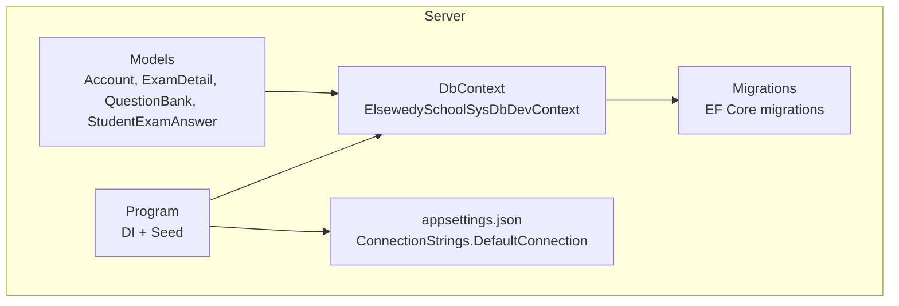
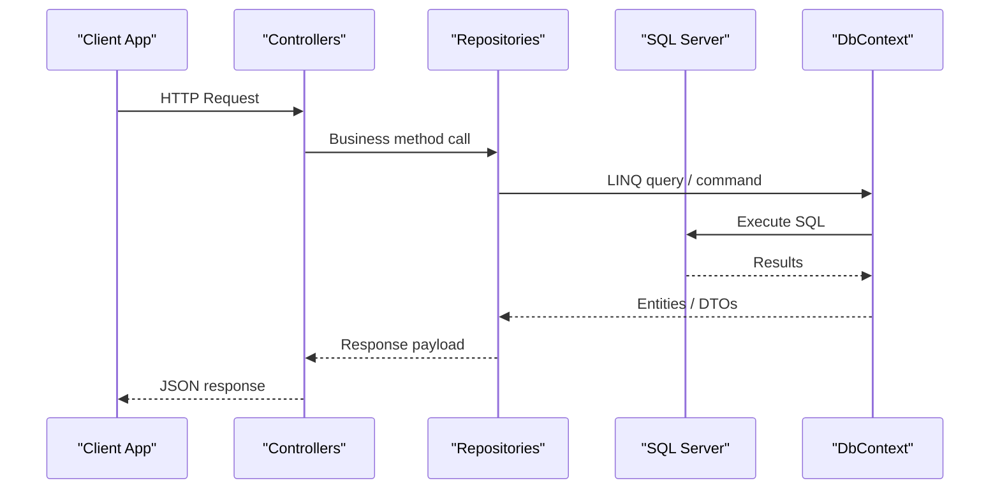
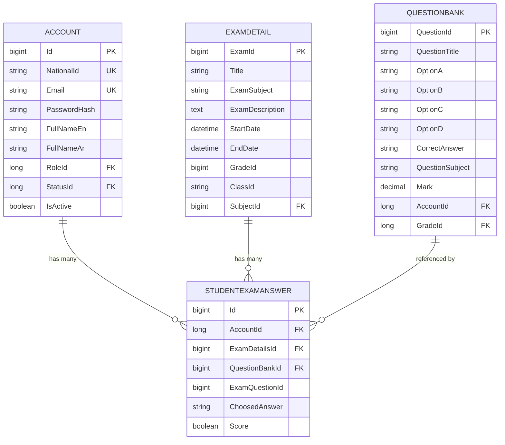
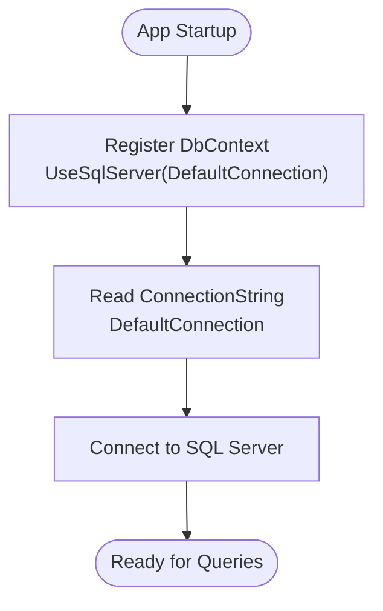
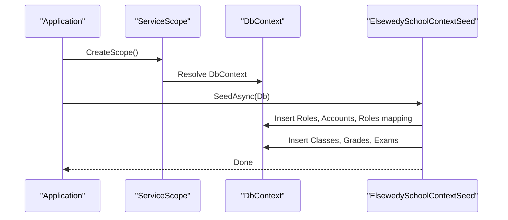
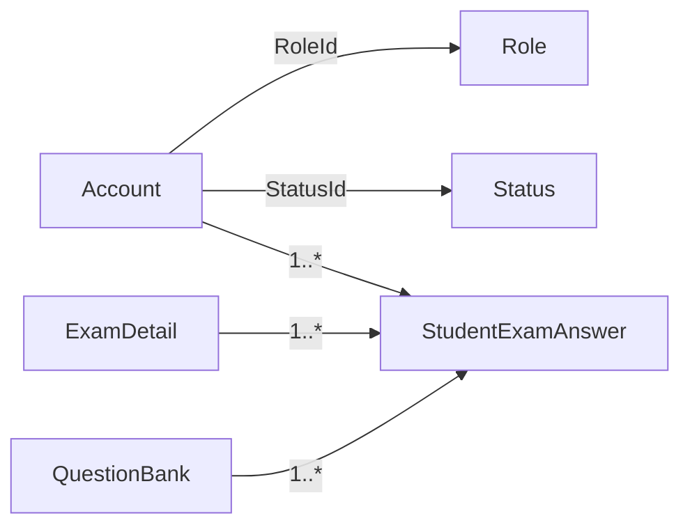

# Database Design

<cite>
**Referenced Files in This Document**
- [Account.cs](file://server/Api/Models/Account.cs)
- [ExamDetail.cs](file://server/Api/Models/ExamDetail.cs)
- [QuestionBank.cs](file://server/Api/Models/QuestionBank.cs)
- [StudentExamAnswer.cs](file://server/Api/Models/StudentExamAnswer.cs)
- [ElsewedySchoolSysDbDevContext.cs](file://server/Api/Models/ElsewedySchoolSysDbDevContext.cs)
- [appsettings.json](file://server/Api/appsettings.json)
- [Program.cs](file://server/Api/Program.cs)
- [20260123184911_InitialCreate.cs](file://server/Api/Migrations/20260123184911_InitialCreate.cs)
- [ElsewedySchoolContextSeed.cs](file://server/Api/models/ElsewedySchoolContextSeed.cs)
</cite>

## Table of Contents
1. [Introduction](#introduction)
2. [Project Structure](#project-structure)
3. [Core Components](#core-components)
4. [Architecture Overview](#architecture-overview)
5. [Detailed Component Analysis](#detailed-component-analysis)
6. [Dependency Analysis](#dependency-analysis)
7. [Performance Considerations](#performance-considerations)
8. [Troubleshooting Guide](#troubleshooting-guide)
9. [Conclusion](#conclusion)
10. [Appendices](#appendices)

## Introduction
This document describes the database design for the Exam-Hub system, focusing on Entity Framework Core models and SQL Server schema. It details entity relationships among Account, ExamDetail, QuestionBank, StudentExamAnswer, and related entities; documents primary and foreign key constraints, indexes, and validation rules defined via annotations and Fluent API; explains migration strategy and schema change management; covers context configuration, connection string setup, and seeding; provides examples of complex queries and data access patterns; and addresses performance, indexing strategies, backup/recovery, and data lifecycle considerations.

## Project Structure
The database layer is implemented with EF Core inside the server project:
- Models define entities and relationships.
- A DbContext configures tables, keys, indexes, and relationships using Fluent API.
- Migrations capture schema changes over time.
- Program registers the DbContext and seeds initial data at startup.
- appsettings holds the SQL Server connection string.

**Diagram sources**
- [Account.cs:6-81](file://server/Api/Models/Account.cs#L6-L81)
- [ExamDetail.cs:6-30](file://server/Api/Models/ExamDetail.cs#L6-L30)
- [QuestionBank.cs:7-46](file://server/Api/Models/QuestionBank.cs#L7-L46)
- [StudentExamAnswer.cs:6-26](file://server/Api/Models/StudentExamAnswer.cs#L6-L26)
- [ElsewedySchoolSysDbDevContext.cs:140-738](file://server/Api/Models/ElsewedySchoolSysDbDevContext.cs#L140-L738)
- [Program.cs:30-33](file://server/Api/Program.cs#L30-L33)
- [appsettings.json:1-4](file://server/Api/appsettings.json#L1-L4)

**Section sources**
- [Account.cs:6-81](file://server/Api/Models/Account.cs#L6-L81)
- [ExamDetail.cs:6-30](file://server/Api/Models/ExamDetail.cs#L6-L30)
- [QuestionBank.cs:7-46](file://server/Api/Models/QuestionBank.cs#L7-L46)
- [StudentExamAnswer.cs:6-26](file://server/Api/Models/StudentExamAnswer.cs#L6-L26)
- [ElsewedySchoolSysDbDevContext.cs:140-738](file://server/Api/Models/ElsewedySchoolSysDbDevContext.cs#L140-L738)
- [Program.cs:30-33](file://server/Api/Program.cs#L30-L33)
- [appsettings.json:1-4](file://server/Api/appsettings.json#L1-L4)

## Core Components
- Account: Represents users (students, teachers, admins). Includes identity fields, role/status references, and navigation to exam answers and results.
- ExamDetail: Represents an exam instance with metadata, scheduling, and optional class targeting.
- QuestionBank: Stores reusable questions with options, correct answer, subject, marks, and ownership.
- StudentExamAnswer: Records a student’s selected answer per question within an exam, with uniqueness constraints to prevent duplicate submissions.

Key responsibilities:
- Data integrity through primary keys and foreign keys.
- Query performance via unique and non-clustered indexes.
- Validation enforced by model properties and Fluent API configurations.

**Section sources**
- [Account.cs:6-81](file://server/Api/Models/Account.cs#L6-L81)
- [ExamDetail.cs:6-30](file://server/Api/Models/ExamDetail.cs#L6-L30)
- [QuestionBank.cs:7-46](file://server/Api/Models/QuestionBank.cs#L7-L46)
- [StudentExamAnswer.cs:6-26](file://server/Api/Models/StudentExamAnswer.cs#L6-L26)

## Architecture Overview
The application uses ASP.NET Core with EF Core against SQL Server. The DbContext defines the canonical mapping between C# models and SQL Server tables. Migrations manage schema evolution. Program wires DI, authentication, and seeding.

**Diagram sources**
- [Program.cs:30-33](file://server/Api/Program.cs#L30-L33)
- [ElsewedySchoolSysDbDevContext.cs:140-738](file://server/Api/Models/ElsewedySchoolSysDbDevContext.cs#L140-L738)

## Detailed Component Analysis

### Entity Relationship Model
The following diagram shows the core entities and their relationships relevant to exams and answers.

**Diagram sources**
- [Account.cs:6-81](file://server/Api/Models/Account.cs#L6-L81)
- [ExamDetail.cs:6-30](file://server/Api/Models/ExamDetail.cs#L6-L30)
- [QuestionBank.cs:7-46](file://server/Api/Models/QuestionBank.cs#L7-L46)
- [StudentExamAnswer.cs:6-26](file://server/Api/Models/StudentExamAnswer.cs#L6-L26)
- [ElsewedySchoolSysDbDevContext.cs:154-181](file://server/Api/Models/ElsewedySchoolSysDbDevContext.cs#L154-L181)
- [ElsewedySchoolSysDbDevContext.cs:375-391](file://server/Api/Models/ElsewedySchoolSysDbDevContext.cs#L375-L391)
- [ElsewedySchoolSysDbDevContext.cs:573-586](file://server/Api/Models/ElsewedySchoolSysDbDevContext.cs#L573-L586)
- [ElsewedySchoolSysDbDevContext.cs:717-738](file://server/Api/Models/ElsewedySchoolSysDbDevContext.cs#L717-L738)

### Primary Keys, Foreign Keys, and Indexes
- Account
  - Primary Key: Id
  - Unique Indexes: Email, NationalId
  - Foreign Keys: RoleId -> Role.Id, StatusId -> Status.Id
  - Column constraints: Email length, NationalId length, default values for CreatedAt and IsActive
- ExamDetail
  - Primary Key: ExamId (mapped to Exam_ID)
  - Optional FK: SubjectId -> Status.Id (via Status navigation)
  - Class targeting stored as a delimited string in ClassId
- QuestionBank
  - Primary Key: QuestionId (mapped to Question_ID)
  - Optional FKs: AccountId, GradeId
  - NotMapped property ClassId excluded from persistence
- StudentExamAnswer
  - Primary Key: Id
  - Foreign Keys: AccountId -> Account.Id, ExamDetailsId -> ExamDetail.ExamId, QuestionBankId -> QuestionBank.QuestionId
  - Unique Index: Composite index on (AccountId, ExamDetailsId, QuestionBankId) with a filter requiring both ExamDetailsId and QuestionBankId to be non-null

Validation and defaults are configured in Fluent API and via attributes such as [NotMapped].

**Section sources**
- [ElsewedySchoolSysDbDevContext.cs:154-181](file://server/Api/Models/ElsewedySchoolSysDbDevContext.cs#L154-L181)
- [ElsewedySchoolSysDbDevContext.cs:375-391](file://server/Api/Models/ElsewedySchoolSysDbDevContext.cs#L375-L391)
- [ElsewedySchoolSysDbDevContext.cs:573-586](file://server/Api/Models/ElsewedySchoolSysDbDevContext.cs#L573-L586)
- [ElsewedySchoolSysDbDevContext.cs:717-738](file://server/Api/Models/ElsewedySchoolSysDbDevContext.cs#L717-L738)
- [QuestionBank.cs:40-41](file://server/Api/Models/QuestionBank.cs#L40-L41)

### Data Validation Rules
- Length limits: Email and NationalId have maximum lengths.
- Defaults: Created timestamps and status flags use server defaults or model defaults.
- Uniqueness: Email and NationalId must be unique; composite uniqueness prevents duplicate answers per student/exam/question.
- Non-persisted fields: ClassId on QuestionBank is not mapped to the database.

These rules are enforced by EF Core validations and SQL Server constraints generated from Fluent API.

**Section sources**
- [ElsewedySchoolSysDbDevContext.cs:154-181](file://server/Api/Models/ElsewedySchoolSysDbDevContext.cs#L154-L181)
- [ElsewedySchoolSysDbDevContext.cs:717-738](file://server/Api/Models/ElsewedySchoolSysDbDevContext.cs#L717-L738)
- [QuestionBank.cs:40-41](file://server/Api/Models/QuestionBank.cs#L40-L41)

### Migration Strategy and Schema Changes
- Migrations are used to evolve the schema incrementally.
- Recent migration demonstrates:
  - Removing a legacy junction table (Exam_Class).
  - Renaming columns and indexes (e.g., QuestionbankId to QuestionBankID).
  - Adding a nullable ExamQuestionId column to StudentExamAnswer.
  - Changing Exam_Details.ClassId from numeric to string to support comma-separated class IDs.
  - Creating a filtered unique index on StudentExamAnswer to enforce one answer per student/exam/question when both foreign keys are present.

Operational guidance:
- Generate migrations after model changes.
- Review generated Up/Down methods before applying.
- Test migrations on development databases first.
- Use version control to track migration history.

**Section sources**
- [20260123184911_InitialCreate.cs:1-140](file://server/Api/Migrations/20260123184911_InitialCreate.cs#L1-L140)

### Database Context Configuration and Connection String
- The DbContext is registered in Program with UseSqlServer pointing to the DefaultConnection string.
- Connection string resides in appsettings.json under ConnectionStrings.DefaultConnection.
- Collation is set to Arabic_100_CI_AI for case-insensitive, accent-insensitive Arabic sorting.

**Diagram sources**
- [Program.cs:30-33](file://server/Api/Program.cs#L30-L33)
- [appsettings.json:1-4](file://server/Api/appsettings.json#L1-L4)
- [ElsewedySchoolSysDbDevContext.cs:140-142](file://server/Api/Models/ElsewedySchoolSysDbDevContext.cs#L140-L142)

**Section sources**
- [Program.cs:30-33](file://server/Api/Program.cs#L30-L33)
- [appsettings.json:1-4](file://server/Api/appsettings.json#L1-L4)
- [ElsewedySchoolSysDbDevContext.cs:140-142](file://server/Api/Models/ElsewedySchoolSysDbDevContext.cs#L140-L142)

### Seeding Data Initialization
- Seeding runs at application startup within a scope.
- Seeds roles, accounts, account-role mappings, classes, grades, and sample exam details.
- Ensures required reference data (Status) exists before creating dependent records.
- Uses simple hashing for password storage during seed.

**Diagram sources**
- [Program.cs:127-140](file://server/Api/Program.cs#L127-L140)
- [ElsewedySchoolContextSeed.cs:10-169](file://server/Api/models/ElsewedySchoolContextSeed.cs#L10-L169)

**Section sources**
- [Program.cs:127-140](file://server/Api/Program.cs#L127-L140)
- [ElsewedySchoolContextSeed.cs:10-169](file://server/Api/models/ElsewedySchoolContextSeed.cs#L10-L169)

### Complex Queries and Navigation Examples
- Retrieve all answers for a student across multiple exams:
  - Navigate from Account to StudentExamAnswers and join ExamDetail and QuestionBank as needed.
- Find unanswered questions for a student in a specific exam:
  - Filter StudentExamAnswer by AccountId and ExamDetailsId, then compare against available QuestionBank entries.
- Compute score per student per exam:
  - Group StudentExamAnswer by AccountId and ExamDetailsId, sum Score where applicable, and join to ExamDetail for metadata.
- List exams assigned to a class:
  - Filter ExamDetail by ClassId containing the target class ID substring.

Note: These are conceptual examples illustrating typical EF Core usage patterns based on the defined relationships.

[No sources needed since this section provides general guidance]

## Dependency Analysis
The following diagram highlights dependencies among core entities and their constraints.

**Diagram sources**
- [Account.cs:6-81](file://server/Api/Models/Account.cs#L6-L81)
- [ExamDetail.cs:6-30](file://server/Api/Models/ExamDetail.cs#L6-L30)
- [QuestionBank.cs:7-46](file://server/Api/Models/QuestionBank.cs#L7-L46)
- [StudentExamAnswer.cs:6-26](file://server/Api/Models/StudentExamAnswer.cs#L6-L26)
- [ElsewedySchoolSysDbDevContext.cs:154-181](file://server/Api/Models/ElsewedySchoolSysDbDevContext.cs#L154-L181)
- [ElsewedySchoolSysDbDevContext.cs:717-738](file://server/Api/Models/ElsewedySchoolSysDbDevContext.cs#L717-L738)

**Section sources**
- [Account.cs:6-81](file://server/Api/Models/Account.cs#L6-L81)
- [ExamDetail.cs:6-30](file://server/Api/Models/ExamDetail.cs#L6-L30)
- [QuestionBank.cs:7-46](file://server/Api/Models/QuestionBank.cs#L7-L46)
- [StudentExamAnswer.cs:6-26](file://server/Api/Models/StudentExamAnswer.cs#L6-L26)
- [ElsewedySchoolSysDbDevContext.cs:154-181](file://server/Api/Models/ElsewedySchoolSysDbDevContext.cs#L154-L181)
- [ElsewedySchoolSysDbDevContext.cs:717-738](file://server/Api/Models/ElsewedySchoolSysDbDevContext.cs#L717-L738)

## Performance Considerations
Indexing strategy:
- Unique indexes on Account.Email and Account.NationalId ensure fast lookups and uniqueness.
- Composite unique index on StudentExamAnswer(AccountId, ExamDetailsId, QuestionBankId) with a filter prevents duplicates and optimizes common queries for a student’s answers per exam.
- Non-clustered index on Role.RoleName supports role-based queries.

Query optimization tips:
- Use Include only when necessary to avoid N+1 issues.
- Project to DTOs for read-heavy endpoints to reduce payload size.
- Leverage the filtered unique index to short-circuit duplicate checks.

Storage and types:
- Use appropriate decimal precision for scores and marks.
- Avoid unnecessary large text fields; consider splitting content if frequently queried.

[No sources needed since this section provides general guidance]

## Troubleshooting Guide
Common issues and resolutions:
- Duplicate answer submission:
  - Cause: Attempting to insert a StudentExamAnswer that violates the filtered unique index.
  - Resolution: Check existing answers before insert or handle constraint violation errors gracefully.
- Missing reference data:
  - Cause: Referencing Role or Status without pre-seeded records.
  - Resolution: Ensure seeding runs successfully or add explicit validation and error messages.
- Class-based exam visibility:
  - Cause: ClassId stored as a delimited string may cause slow substring searches.
  - Resolution: Consider normalizing class-exam relationships if performance degrades.

**Section sources**
- [ElsewedySchoolSysDbDevContext.cs:717-738](file://server/Api/Models/ElsewedySchoolSysDbDevContext.cs#L717-L738)
- [ElsewedySchoolContextSeed.cs:10-169](file://server/Api/models/ElsewedySchoolContextSeed.cs#L10-L169)

## Conclusion
The Exam-Hub database leverages EF Core Fluent API to define robust constraints, indexes, and relationships centered around Account, ExamDetail, QuestionBank, and StudentExamAnswer. Migrations provide a controlled path for schema evolution, while seeding ensures a functional baseline. With careful indexing and query design, the system can scale effectively while maintaining data integrity and performance.

[No sources needed since this section summarizes without analyzing specific files]

## Appendices

### Backup and Recovery Procedures
- Regular full backups of the SQL Server database.
- Transaction log backups for point-in-time recovery.
- Validate restore procedures periodically.
- Maintain separate dev/test/prod environments with isolated connection strings.

[No sources needed since this section provides general guidance]

### Data Lifecycle Management and Archival Policies
- Retention policy: Archive completed exam answers after a defined period to reduce active table size.
- Soft deletes: Consider adding IsDeleted flags for auditability where appropriate.
- Purging: Implement scheduled jobs to move or delete archived data safely.

[No sources needed since this section provides general guidance]