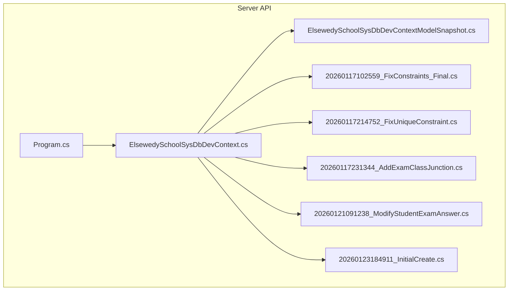
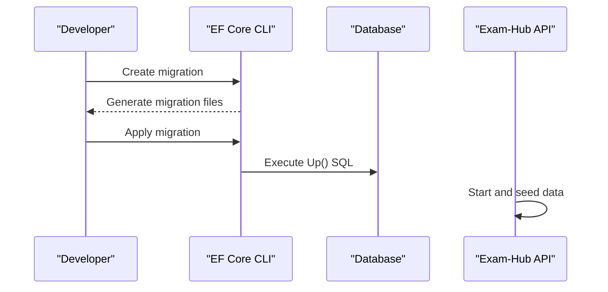
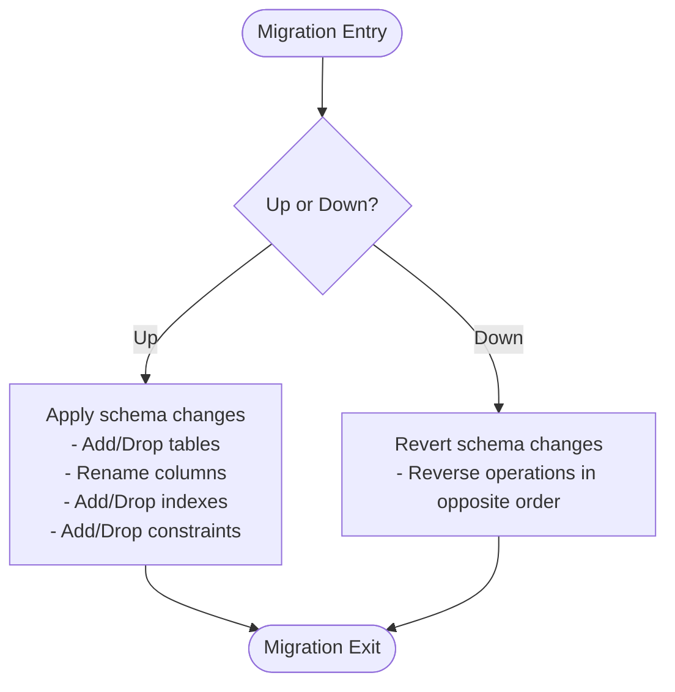
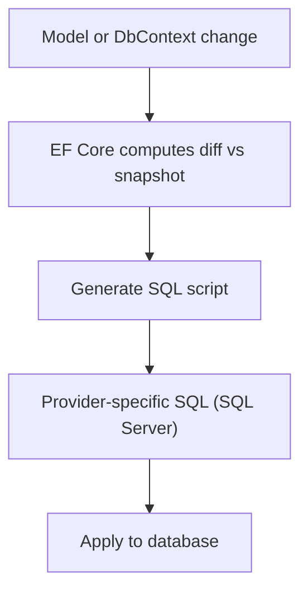
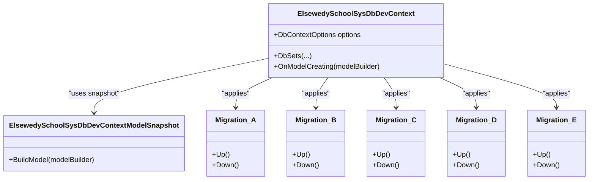

# Database Migrations

<cite>
**Referenced Files in This Document**
- [Program.cs](file://server/Api/Program.cs)
- [ElsewedySchoolSysDbDevContext.cs](file://server/Api/Models/ElsewedySchoolSysDbDevContext.cs)
- [20260123184911_InitialCreate.cs](file://server/Api/Migrations/20260123184911_InitialCreate.cs)
- [20260117102559_FixConstraints_Final.cs](file://server/Api/Migrations/20260117102559_FixConstraints_Final.cs)
- [20260117214752_FixUniqueConstraint.cs](file://server/Api/Migrations/20260117214752_FixUniqueConstraint.cs)
- [20260117231344_AddExamClassJunction.cs](file://server/Api/Migrations/20260117231344_AddExamClassJunction.cs)
- [20260121091238_ModifyStudentExamAnswer.cs](file://server/Api/Migrations/20260121091238_ModifyStudentExamAnswer.cs)
- [ElsewedySchoolSysDbDevContextModelSnapshot.cs](file://server/Api/Migrations/ElsewedySchoolSysDbDevContextModelSnapshot.cs)
</cite>

## Table of Contents
1. [Introduction](#introduction)
2. [Project Structure](#project-structure)
3. [Core Components](#core-components)
4. [Architecture Overview](#architecture-overview)
5. [Detailed Component Analysis](#detailed-component-analysis)
6. [Dependency Analysis](#dependency-analysis)
7. [Performance Considerations](#performance-considerations)
8. [Troubleshooting Guide](#troubleshooting-guide)
9. [Conclusion](#conclusion)

## Introduction
This document explains the Entity Framework Core migration strategy for the Exam-Hub system, focusing on how database schema changes are versioned, generated, applied, and rolled back. It covers naming conventions, file structure, Up() and Down() methods, SQL generation, common migration operations, conflict resolution, branching strategies, deployment considerations, and how to inspect migration history.

## Project Structure
The EF Core migrations live under the server API project:
- DbContext and model configuration: server/Api/Models/ElsewedySchoolSysDbDevContext.cs
- Migration files and snapshot: server/Api/Migrations/*
- Application startup (seeding only; migrations are not auto-applied at runtime): server/Api/Program.cs

**Diagram sources**
- [Program.cs:127-140](file://server/Api/Program.cs#L127-L140)
- [ElsewedySchoolSysDbDevContext.cs:7-16](file://server/Api/Models/ElsewedySchoolSysDbDevContext.cs#L7-L16)
- [ElsewedySchoolSysDbDevContextModelSnapshot.cs:13-24](file://server/Api/Migrations/ElsewedySchoolSysDbDevContextModelSnapshot.cs#L13-L24)

**Section sources**
- [Program.cs:127-140](file://server/Api/Program.cs#L127-L140)
- [ElsewedySchoolSysDbDevContext.cs:7-16](file://server/Api/Models/ElsewedySchoolSysDbDevContext.cs#L7-L16)
- [ElsewedySchoolSysDbDevContextModelSnapshot.cs:13-24](file://server/Api/Migrations/ElsewedySchoolSysDbDevContextModelSnapshot.cs#L13-L24)

## Core Components
- DbContext: ElsewedySchoolSysDbDevContext defines all entity mappings and relationships used by EF Core to generate migrations and SQL.
- Model Snapshot: ElsewedySchoolSysDbDevContextModelSnapshot captures the current model state and is used by EF Core to compute differences between versions.
- Migration Files: Each migration is a class with Up() and Down() methods that describe incremental schema changes.

Key responsibilities:
- DbContext: Declares DbSets and configures keys, indexes, constraints, column names, defaults, and relationships.
- Snapshot: Auto-generated representation of the model used for diffing.
- Migrations: Human-readable, versioned scripts for applying or reverting schema changes.

**Section sources**
- [ElsewedySchoolSysDbDevContext.cs:7-16](file://server/Api/Models/ElsewedySchoolSysDbDevContext.cs#L7-L16)
- [ElsewedySchoolSysDbDevContext.cs:140-143](file://server/Api/Models/ElsewedySchoolSysDbDevContext.cs#L140-L143)
- [ElsewedySchoolSysDbDevContextModelSnapshot.cs:13-24](file://server/Api/Migrations/ElsewedySchoolSysDbDevContextModelSnapshot.cs#L13-L24)

## Architecture Overview
EF Core migration workflow in this project:
- Developers modify models or DbContext configuration.
- A new migration is created using EF Core tooling.
- The migration contains Up() and Down() methods describing schema changes.
- Migrations are applied to the target database using EF Core commands.
- The application does not auto-apply migrations at startup; seeding runs after app start.

[No sources needed since this diagram shows conceptual workflow, not actual code structure]

## Detailed Component Analysis

### Migration Strategy and Naming Conventions
- Timestamp-based prefixes: Each migration file starts with a UTC-like timestamp followed by a descriptive PascalCase name (for example, AddExamClassJunction).
- Descriptive names: Names reflect the intent of the change (for example, FixConstraints_Final, ModifyStudentExamAnswer).
- One logical change per migration: Prefer small, focused migrations to simplify rollback and review.

Current migration set:
- 20260117102559_FixConstraints_Final.cs
- 20260117214752_FixUniqueConstraint.cs
- 20260117231344_AddExamClassJunction.cs
- 20260121091238_ModifyStudentExamAnswer.cs
- 20260123184911_InitialCreate.cs

**Section sources**
- [20260117102559_FixConstraints_Final.cs:8-8](file://server/Api/Migrations/20260117102559_FixConstraints_Final.cs#L8-L8)
- [20260117214752_FixUniqueConstraint.cs:8-8](file://server/Api/Migrations/20260117214752_FixUniqueConstraint.cs#L8-L8)
- [20260117231344_AddExamClassJunction.cs:8-8](file://server/Api/Migrations/20260117231344_AddExamClassJunction.cs#L8-L8)
- [20260121091238_ModifyStudentExamAnswer.cs:8-8](file://server/Api/Migrations/20260121091238_ModifyStudentExamAnswer.cs#L8-L8)
- [20260123184911_InitialCreate.cs:8-8](file://server/Api/Migrations/20260123184911_InitialCreate.cs#L8-L8)

### Migration File Structure: Up() and Down()
Each migration implements:
- Up(): Applies the intended schema change.
- Down(): Reverts the change when rolling back.

Examples from the codebase:
- Adding a junction table and unique constraint: see AddExamClassJunction.
- Renaming columns and adding filtered unique indexes: see ModifyStudentExamAnswer and InitialCreate.
- Dropping and recreating foreign key constraints and cleaning orphan rows: see FixConstraints_Final.
- Replacing an old unique index with a new filtered one: see FixUniqueConstraint.

**Diagram sources**
- [20260117231344_AddExamClassJunction.cs:11-48](file://server/Api/Migrations/20260117231344_AddExamClassJunction.cs#L11-L48)
- [20260121091238_ModifyStudentExamAnswer.cs:11-63](file://server/Api/Migrations/20260121091238_ModifyStudentExamAnswer.cs#L11-L63)
- [20260123184911_InitialCreate.cs:11-55](file://server/Api/Migrations/20260123184911_InitialCreate.cs#L11-L55)
- [20260117102559_FixConstraints_Final.cs:11-32](file://server/Api/Migrations/20260117102559_FixConstraints_Final.cs#L11-L32)

**Section sources**
- [20260117231344_AddExamClassJunction.cs:11-56](file://server/Api/Migrations/20260117231344_AddExamClassJunction.cs#L11-L56)
- [20260121091238_ModifyStudentExamAnswer.cs:11-116](file://server/Api/Migrations/20260121091238_ModifyStudentExamAnswer.cs#L11-L116)
- [20260123184911_InitialCreate.cs:11-137](file://server/Api/Migrations/20260123184911_InitialCreate.cs#L11-L137)
- [20260117102559_FixConstraints_Final.cs:11-54](file://server/Api/Migrations/20260117102559_FixConstraints_Final.cs#L11-L54)

### SQL Generation Process
EF Core translates migration operations into provider-specific SQL (SQL Server in this project). Typical transformations include:
- CreateTable -> CREATE TABLE
- DropTable -> DROP TABLE
- AddColumn/AlterColumn -> ALTER TABLE ... ADD/ALTER COLUMN
- AddIndex/CreateIndex -> CREATE INDEX
- AddForeignKey/AddConstraint -> ALTER TABLE ... ADD CONSTRAINT
- Sql() -> Raw SQL execution

Raw SQL usage in this project:
- Conditional drops and adds of constraints via sys.foreign_keys checks.
- Data cleanup before enforcing constraints.
- Dropping shadow properties if present.

**Diagram sources**
- [ElsewedySchoolSysDbDevContextModelSnapshot.cs:13-24](file://server/Api/Migrations/ElsewedySchoolSysDbDevContextModelSnapshot.cs#L13-L24)
- [20260117102559_FixConstraints_Final.cs:14-31](file://server/Api/Migrations/20260117102559_FixConstraints_Final.cs#L14-L31)

**Section sources**
- [ElsewedySchoolSysDbDevContextModelSnapshot.cs:13-24](file://server/Api/Migrations/ElsewedySchoolSysDbDevContextModelSnapshot.cs#L13-L24)
- [20260117102559_FixConstraints_Final.cs:14-31](file://server/Api/Migrations/20260117102559_FixConstraints_Final.cs#L14-L31)

### Common Migration Operations

#### Adding Tables
Example: Creating a junction table for exams and classes with primary key, foreign keys, and a unique constraint.

**Section sources**
- [20260117231344_AddExamClassJunction.cs:13-48](file://server/Api/Migrations/20260117231344_AddExamClassJunction.cs#L13-L48)

#### Modifying Columns
Example: Renaming columns and altering types to align with model changes.

**Section sources**
- [20260121091238_ModifyStudentExamAnswer.cs:27-30](file://server/Api/Migrations/20260121091238_ModifyStudentExamAnswer.cs#L27-L30)
- [20260123184911_InitialCreate.cs:24-27](file://server/Api/Migrations/20260123184911_InitialCreate.cs#L24-L27)
- [20260123184911_InitialCreate.cs:40-47](file://server/Api/Migrations/20260123184911_InitialCreate.cs#L40-L47)

#### Creating Indexes and Unique Constraints
Example: Creating filtered unique indexes to enforce business rules without blocking nulls.

**Section sources**
- [20260121091238_ModifyStudentExamAnswer.cs:50-55](file://server/Api/Migrations/20260121091238_ModifyStudentExamAnswer.cs#L50-L55)
- [20260123184911_InitialCreate.cs:49-54](file://server/Api/Migrations/20260123184911_InitialCreate.cs#L49-L54)
- [20260117214752_FixUniqueConstraint.cs:15-20](file://server/Api/Migrations/20260117214752_FixUniqueConstraint.cs#L15-L20)

#### Establishing Relationships
Example: Adding foreign keys and cascading deletes where appropriate.

**Section sources**
- [20260117231344_AddExamClassJunction.cs:24-37](file://server/Api/Migrations/20260117231344_AddExamClassJunction.cs#L24-L37)
- [20260121091238_ModifyStudentExamAnswer.cs:57-62](file://server/Api/Migrations/20260121091238_ModifyStudentExamAnswer.cs#L57-L62)
- [20260117102559_FixConstraints_Final.cs:28-31](file://server/Api/Migrations/20260117102559_FixConstraints_Final.cs#L28-L31)

### Version Control Approach
- Store migration files in source control alongside the codebase.
- Keep snapshots committed so EF Core can compute diffs reliably.
- Avoid editing applied migrations; instead, create a new migration to fix issues.

**Section sources**
- [ElsewedySchoolSysDbDevContextModelSnapshot.cs:1-24](file://server/Api/Migrations/ElsewedySchoolSysDbDevContextModelSnapshot.cs#L1-L24)

### Creating, Applying, and Rolling Back Migrations

#### Create a New Migration
Use EF Core CLI to compare the current model against the snapshot and generate a new migration file.

- Command: dotnet ef migrations add <MigrationName> --context ElsewedySchoolSysDbDevContext --project server/Api/QuizesApi.csproj

Notes:
- Ensure the correct context is specified.
- Run from the solution root or the API project directory.

#### Apply Migrations
Apply pending migrations to the target database.

- Command: dotnet ef database update --context ElsewedySchoolSysDbDevContext --project server/Api/QuizesApi.csproj

Notes:
- Use connection string configured in appsettings.
- For production, run in CI/CD or as a pre-deploy step.

#### Rollback Migrations
Roll back to a specific migration.

- Command: dotnet ef database update <TargetMigration> --context ElsewedySchoolSysDbDevContext --project server/Api/QuizesApi.csproj

Notes:
- Target migration must be one already applied.
- Down() methods should be idempotent and safe to execute.

#### Inspect Pending and Applied Migrations
- List pending migrations: dotnet ef migrations list --context ElsewedySchoolSysDbDevContext --project server/Api/QuizesApi.csproj
- Inspect SQL without applying: dotnet ef migrations script --context ElsewedySchoolSysDbDevContext --project server/Api/QuizesApi.csproj

**Section sources**
- [Program.cs:127-140](file://server/Api/Program.cs#L127-L140)

### Migration History Table and Inspection
EF Core maintains a migration history table (typically __EFMigrationsHistory) to track applied migrations. You can inspect it directly in your database to verify which migrations have been applied.

Common queries:
- SELECT * FROM __EFMigrationsHistory ORDER BY AppliedOn DESC;

To view the current model snapshot and understand what EF Core sees:
- Open ElsewedySchoolSysDbDevContextModelSnapshot.cs to see the full model definition used for diffing.

**Section sources**
- [ElsewedySchoolSysDbDevContextModelSnapshot.cs:13-24](file://server/Api/Migrations/ElsewedySchoolSysDbDevContextModelSnapshot.cs#L13-L24)

## Dependency Analysis
The following diagram shows how the DbContext, snapshot, and migrations relate:

**Diagram sources**
- [ElsewedySchoolSysDbDevContext.cs:7-16](file://server/Api/Models/ElsewedySchoolSysDbDevContext.cs#L7-L16)
- [ElsewedySchoolSysDbDevContextModelSnapshot.cs:13-24](file://server/Api/Migrations/ElsewedySchoolSysDbDevContextModelSnapshot.cs#L13-L24)
- [20260117102559_FixConstraints_Final.cs:8-8](file://server/Api/Migrations/20260117102559_FixConstraints_Final.cs#L8-L8)
- [20260117214752_FixUniqueConstraint.cs:8-8](file://server/Api/Migrations/20260117214752_FixUniqueConstraint.cs#L8-L8)
- [20260117231344_AddExamClassJunction.cs:8-8](file://server/Api/Migrations/20260117231344_AddExamClassJunction.cs#L8-L8)
- [20260121091238_ModifyStudentExamAnswer.cs:8-8](file://server/Api/Migrations/20260121091238_ModifyStudentExamAnswer.cs#L8-L8)
- [20260123184911_InitialCreate.cs:8-8](file://server/Api/Migrations/20260123184911_InitialCreate.cs#L8-L8)

**Section sources**
- [ElsewedySchoolSysDbDevContext.cs:7-16](file://server/Api/Models/ElsewedySchoolSysDbDevContext.cs#L7-L16)
- [ElsewedySchoolSysDbDevContextModelSnapshot.cs:13-24](file://server/Api/Migrations/ElsewedySchoolSysDbDevContextModelSnapshot.cs#L13-L24)

## Performance Considerations
- Batch large data changes: Use raw SQL within migrations for bulk updates/deletes to avoid long-running transactions.
- Avoid heavy work in Up(): Keep migrations fast and transactional; offload heavy tasks to background jobs if necessary.
- Index wisely: Only add indexes that support query patterns; consider filtered indexes for partial uniqueness.
- Minimize locking: Perform schema changes during low-traffic windows; use online operations where supported.

[No sources needed since this section provides general guidance]

## Troubleshooting Guide

### Migration Conflicts Resolution
- If multiple developers create migrations concurrently:
  - Merge carefully and ensure ordering reflects dependencies.
  - Re-generate the snapshot by creating a new migration after resolving conflicts.
- If a migration fails mid-way:
  - Inspect __EFMigrationsHistory to determine the last successfully applied migration.
  - Repair the database manually if needed, then create a corrective migration rather than editing an applied one.

### Branching Strategies
- Feature branches: Each feature should produce its own migration; merge into main after review.
- Hotfixes: Create a separate branch and migration; apply to production first, then merge back.
- Never edit applied migrations: Always create a new migration to fix issues.

### Deployment Considerations
- Do not auto-apply migrations at runtime in production unless explicitly required by your pipeline.
- Run migrations as part of CI/CD before deploying the application.
- Validate connection strings and permissions for the database user.
- Test migrations in staging with representative data volumes.

### Inspecting Applied Migrations
- Query the history table: SELECT * FROM __EFMigrationsHistory ORDER BY AppliedOn DESC;
- Compare the snapshot with the current model to detect drift.

**Section sources**
- [Program.cs:127-140](file://server/Api/Program.cs#L127-L140)
- [ElsewedySchoolSysDbDevContextModelSnapshot.cs:13-24](file://server/Api/Migrations/ElsewedySchoolSysDbDevContextModelSnapshot.cs#L13-L24)

## Conclusion
The Exam-Hub system uses standard EF Core migrations with timestamp-prefixed, descriptive filenames and explicit Up()/Down() methods. The DbContext and snapshot drive SQL generation, while migrations encapsulate incremental schema changes. By following the recommended practices—small focused migrations, careful conflict resolution, and disciplined branching—you can evolve the database safely and predictably across environments.