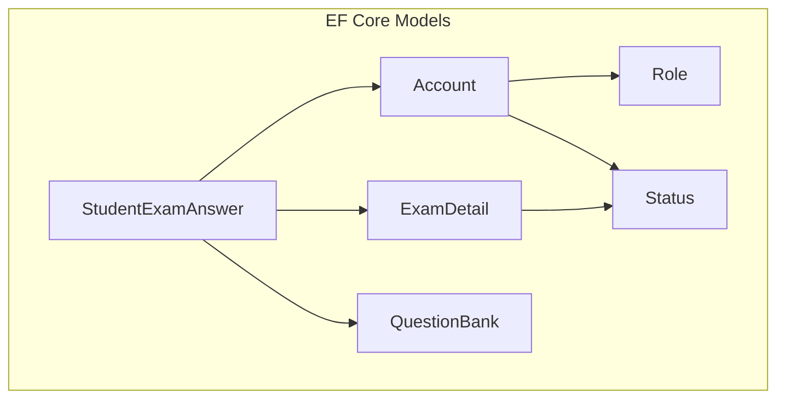
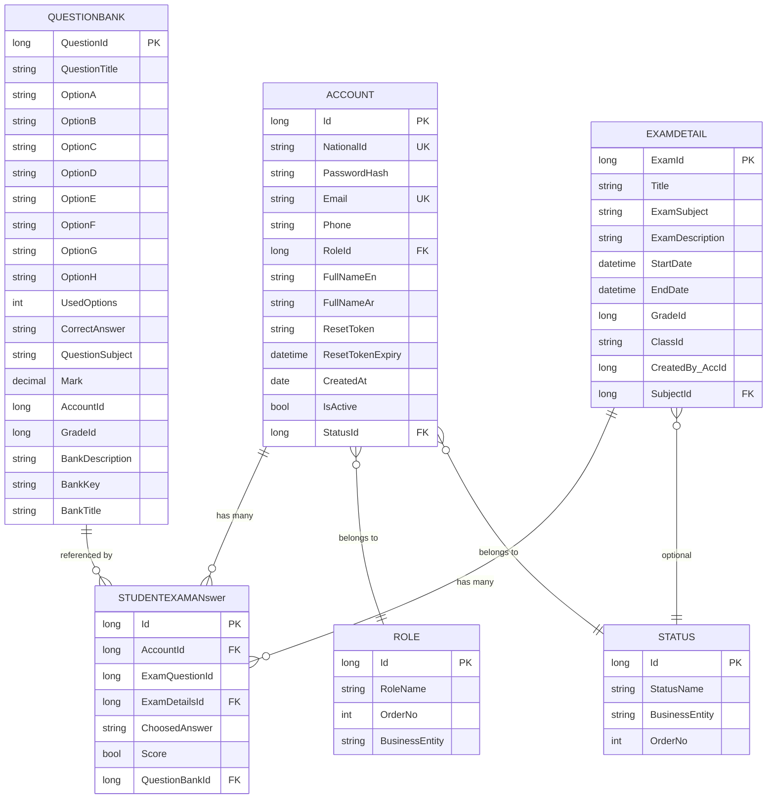
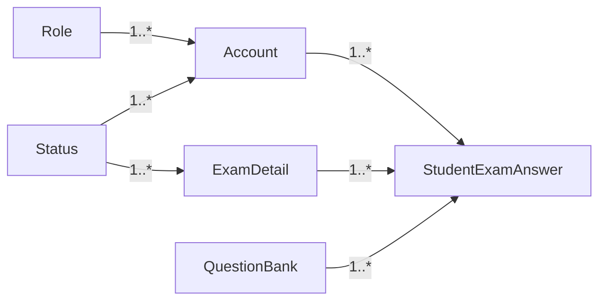

# Entity Models & Relationships

<cite>
**Referenced Files in This Document**
- [Account.cs](file://server/Api/Models/Account.cs)
- [ExamDetail.cs](file://server/Api/Models/ExamDetail.cs)
- [ExamDetailPartials.cs](file://server/Api/Models/ExamDetailPartials.cs)
- [QuestionBank.cs](file://server/Api/Models/QuestionBank.cs)
- [StudentExamAnswer.cs](file://server/Api/Models/StudentExamAnswer.cs)
- [Role.cs](file://server/Api/Models/Role.cs)
- [Status.cs](file://server/Api/Models/Status.cs)
- [ElsewedySchoolSysDbDevContext.cs](file://server/Api/Models/ElsewedySchoolSysDbDevContext.cs)
</cite>

## Table of Contents
1. [Introduction](#introduction)
2. [Project Structure](#project-structure)
3. [Core Components](#core-components)
4. [Architecture Overview](#architecture-overview)
5. [Detailed Component Analysis](#detailed-component-analysis)
6. [Dependency Analysis](#dependency-analysis)
7. [Performance Considerations](#performance-considerations)
8. [Troubleshooting Guide](#troubleshooting-guide)
9. [Conclusion](#conclusion)
10. [Appendices](#appendices)

## Introduction
This document provides comprehensive entity model documentation for the Exam-Hub database with a focus on Entity Framework Core models and their relationships. It covers core entities: Account, ExamDetail, QuestionBank, StudentExamAnswer, Role, and Status. For each entity, it details properties, data types, validation rules, primary keys, foreign key relationships, navigation properties, and cardinality constraints. It also explains Fluent API configurations and data annotations used for mapping and validation, includes relationship diagrams, common query patterns using navigation properties, and discusses entity lifecycle management and change tracking behavior.

## Project Structure
The relevant EF Core models are located under server/Api/Models. The DbContext configuration that wires up tables, columns, indexes, and relationships is centralized in ElsewedySchoolSysDbDevDevContext.

**Diagram sources**
- [Account.cs:6-81](file://server/Api/Models/Account.cs#L6-L81)
- [Role.cs:6-17](file://server/Api/Models/Role.cs#L6-L17)
- [Status.cs:6-55](file://server/Api/Models/Status.cs#L6-L55)
- [ExamDetail.cs:6-30](file://server/Api/Models/ExamDetail.cs#L6-L30)
- [QuestionBank.cs:7-46](file://server/Api/Models/QuestionBank.cs#L7-L46)
- [StudentExamAnswer.cs:6-26](file://server/Api/Models/StudentExamAnswer.cs#L6-L26)

**Section sources**
- [ElsewedySchoolSysDbDevContext.cs:140-738](file://server/Api/Models/ElsewedySchoolSysDbDevContext.cs#L140-L738)

## Core Components
This section summarizes the core entities and their responsibilities within the exam domain.

- Account: Represents users (students, teachers, admins). Contains identity fields, role/status references, timestamps, and many-to-many-like collections via one-to-many relationships to other entities.
- Role: Defines user roles with ordering and business context; linked to accounts.
- Status: Shared status lookup referenced by multiple entities including accounts and exams.
- ExamDetail: Describes an exam instance with title, subject, description, time window, grade/class targeting, and creator reference; linked to status and answers.
- QuestionBank: Stores reusable questions with options, correct answer, subject, marks, and optional metadata; not mapped to a class field but included in queries.
- StudentExamAnswer: Records a student’s chosen answer for a question within an exam; enforces uniqueness per account/exam/question.

Key relationships:
- Account has many StudentExamAnswers (one-to-many).
- ExamDetail has many StudentExamAnswers (one-to-many).
- QuestionBank is referenced by StudentExamAnswer (one-to-many from QuestionBank perspective).
- Account belongs to Role (many-to-one).
- Account belongs to Status (many-to-one).
- ExamDetail optionally belongs to Status (many-to-one).

Validation and mapping highlights:
- Unique constraints on Account.Email and Account.NationalId.
- Unique composite index on StudentExamAnswer(AccountId, ExamDetailsId, QuestionBankId).
- Column name mappings and default values configured via Fluent API.
- NotMapped property on QuestionBank.ClassId and ExamDetail.ExamQuestionBanks to exclude from persistence while supporting application logic.

**Section sources**
- [Account.cs:6-81](file://server/Api/Models/Account.cs#L6-L81)
- [Role.cs:6-17](file://server/Api/Models/Role.cs#L6-L17)
- [Status.cs:6-55](file://server/Api/Models/Status.cs#L6-L55)
- [ExamDetail.cs:6-30](file://server/Api/Models/ExamDetail.cs#L6-L30)
- [ExamDetailPartials.cs:5-9](file://server/Api/Models/ExamDetailPartials.cs#L5-L9)
- [QuestionBank.cs:7-46](file://server/Api/Models/QuestionBank.cs#L7-L46)
- [StudentExamAnswer.cs:6-26](file://server/Api/Models/StudentExamAnswer.cs#L6-L26)
- [ElsewedySchoolSysDbDevContext.cs:154-181](file://server/Api/Models/ElsewedySchoolSysDbDevContext.cs#L154-L181)
- [ElsewedySchoolSysDbDevContext.cs:375-391](file://server/Api/Models/ElsewedySchoolSysDbDevContext.cs#L375-L391)
- [ElsewedySchoolSysDbDevContext.cs:573-586](file://server/Api/Models/ElsewedySchoolSysDbDevContext.cs#L573-L586)
- [ElsewedySchoolSysDbDevContext.cs:717-738](file://server/Api/Models/ElsewedySchoolSysDbDevContext.cs#L717-L738)

## Architecture Overview
The following diagram shows how the core entities relate at the model level and how they map to the database through EF Core.

**Diagram sources**
- [Account.cs:6-81](file://server/Api/Models/Account.cs#L6-L81)
- [Role.cs:6-17](file://server/Api/Models/Role.cs#L6-L17)
- [Status.cs:6-55](file://server/Api/Models/Status.cs#L6-L55)
- [ExamDetail.cs:6-30](file://server/Api/Models/ExamDetail.cs#L6-L30)
- [QuestionBank.cs:7-46](file://server/Api/Models/QuestionBank.cs#L7-L46)
- [StudentExamAnswer.cs:6-26](file://server/Api/Models/StudentExamAnswer.cs#L6-L26)
- [ElsewedySchoolSysDbDevContext.cs:154-181](file://server/Api/Models/ElsewedySchoolSysDbDevContext.cs#L154-L181)
- [ElsewedySchoolSysDbDevContext.cs:375-391](file://server/Api/Models/ElsewedySchoolSysDbDevContext.cs#L375-L391)
- [ElsewedySchoolSysDbDevContext.cs:573-586](file://server/Api/Models/ElsewedySchoolSysDbDevContext.cs#L573-L586)
- [ElsewedySchoolSysDbDevContext.cs:717-738](file://server/Api/Models/ElsewedySchoolSysDbDevContext.cs#L717-L738)

## Detailed Component Analysis

### Account
- Primary Key: Id
- Important Properties:
  - NationalId (unique), Email (unique, max length), PasswordHash, Phone, FullNameEn, FullNameAr
  - RoleId (FK to Role), StatusId (FK to Status)
  - ResetToken, ResetTokenExpiry, CreatedAt (default value), IsActive (default true)
- Navigation Properties:
  - Role (required), Status (required)
  - Collections: AttendanceRecords, Grades, InterviewScoreAccounts, InterviewScoreInterviewers, Logins, Notifications, Projects, Reports, StudentExamAnswers, StudentTasks, SubordinateTickets, TeamMembers, Teams (supervisor/team leader), TblTasks, TaskSubmissions, etc.
  - Optional single-entity extensions: AdmissionProfile, CapstoneSupervisorExtension, ReviewerSupervisorExtension, StudentExtension, SuperAdminExtension, StudentExamResult
- Validation and Mapping:
  - Unique indexes on Email and NationalId
  - Column name mappings (e.g., FullNameEN, FullNameAR, Created_at)
  - Default values for StatusId and IsActive
  - Relationship constraints with Role and Status using Fluent API

Common usage:
- Querying a student’s exam answers via Account.StudentExamAnswers
- Loading related Role and Status eagerly or via lazy loading

**Section sources**
- [Account.cs:6-81](file://server/Api/Models/Account.cs#L6-L81)
- [ElsewedySchoolSysDbDevContext.cs:154-181](file://server/Api/Models/ElsewedySchoolSysDbDevContext.cs#L154-L181)

### Role
- Primary Key: Id
- Properties: RoleName (max length), OrderNo, BusinessEntity
- Navigation: Accounts (collection)
- Notes:
  - Index on RoleName for lookups
  - Referenced by Account.RoleId

**Section sources**
- [Role.cs:6-17](file://server/Api/Models/Role.cs#L6-L17)
- [ElsewedySchoolSysDbDevContext.cs:645-650](file://server/Api/Models/ElsewedySchoolSysDbDevContext.cs#L645-L650)

### Status
- Primary Key: Id
- Properties: StatusName, BusinessEntity, OrderNo
- Navigation: Many collections across the system, including Accounts and ExamDetails
- Notes:
  - Centralized status lookup used by multiple entities
  - Default values often set to a baseline status in dependent entities

**Section sources**
- [Status.cs:6-55](file://server/Api/Models/Status.cs#L6-L55)
- [ElsewedySchoolSysDbDevContext.cs:712-715](file://server/Api/Models/ElsewedySchoolSysDbDevContext.cs#L712-L715)

### ExamDetail
- Primary Key: ExamId (mapped to column Exam_ID)
- Properties: Title, ExamSubject, ExamDescription, StartDate, EndDate, GradeId, ClassId, CreatedBy_AccId, SubjectId (FK to Status)
- Navigation:
  - Subject (Status) optional
  - StudentExamAnswers (collection)
  - ExamQuestionBanks (NotMapped collection for application use)
- Mapping:
  - Column name mappings for all key fields
  - Relationship to Status via SubjectId

**Section sources**
- [ExamDetail.cs:6-30](file://server/Api/Models/ExamDetail.cs#L6-L30)
- [ExamDetailPartials.cs:5-9](file://server/Api/Models/ExamDetailPartials.cs#L5-L9)
- [ElsewedySchoolSysDbDevContext.cs:375-391](file://server/Api/Models/ElsewedySchoolSysDbDevContext.cs#L375-L391)

### QuestionBank
- Primary Key: QuestionId (mapped to column Question_ID)
- Properties: QuestionTitle, Options A–H, UsedOptions, CorrectAnswer, QuestionSubject, Mark, AccountId, GradeId, BankDescription, BankKey, BankTitle
- Mapping:
  - Column name mappings for Question_Title, Question_Subject, AccountId, Grade_ID
  - ClassId marked NotMapped (not persisted)
- Notes:
  - Reusable question repository; marks stored as decimal
  - Optional association to Account and Grade for categorization

**Section sources**
- [QuestionBank.cs:7-46](file://server/Api/Models/QuestionBank.cs#L7-L46)
- [ElsewedySchoolSysDbDevContext.cs:573-586](file://server/Api/Models/ElsewedySchoolSysDbDevContext.cs#L573-L586)

### StudentExamAnswer
- Primary Key: Id
- Properties: AccountId, ExamQuestionId, ExamDetailsId, ChoosedAnswer, Score, QuestionBankId
- Navigation:
  - Account (required)
  - ExamDetailNav (optional)
  - QuestionBank (optional)
- Constraints:
  - Unique composite index on (AccountId, ExamDetailsId, QuestionBankId) to prevent duplicate answers per student/exam/question
- Mapping:
  - Column name mappings for QuestionBankID, ExamDetailsID, ExamQuestionID
  - Relationships to Account, ExamDetail, QuestionBank defined via Fluent API

**Section sources**
- [StudentExamAnswer.cs:6-26](file://server/Api/Models/StudentExamAnswer.cs#L6-L26)
- [ElsewedySchoolSysDbDevContext.cs:717-738](file://server/Api/Models/ElsewedySchoolSysDbDevContext.cs#L717-L738)

## Dependency Analysis
The following dependency graph illustrates direct relationships between the core entities and how they are wired in the DbContext.

**Diagram sources**
- [ElsewedySchoolSysDbDevContext.cs:154-181](file://server/Api/Models/ElsewedySchoolSysDbDevContext.cs#L154-L181)
- [ElsewedySchoolSysDbDevContext.cs:375-391](file://server/Api/Models/ElsewedySchoolSysDbDevContext.cs#L375-L391)
- [ElsewedySchoolSysDbDevContext.cs:717-738](file://server/Api/Models/ElsewedySchoolSysDbDevContext.cs#L717-L738)

**Section sources**
- [ElsewedySchoolSysDbDevContext.cs:154-181](file://server/Api/Models/ElsewedySchoolSysDbDevContext.cs#L154-L181)
- [ElsewedySchoolSysDbDevContext.cs:375-391](file://server/Api/Models/ElsewedySchoolSysDbDevContext.cs#L375-L391)
- [ElsewedySchoolSysDbDevContext.cs:717-738](file://server/Api/Models/ElsewedySchoolSysDbDevContext.cs#L717-L738)

## Performance Considerations
- Use eager loading (Include) when retrieving Account with its related StudentExamAnswers to avoid N+1 queries.
- Leverage the unique composite index on StudentExamAnswer to ensure fast lookups and enforce integrity.
- Avoid loading large collections unnecessarily; project only required fields when possible.
- Be mindful of default values and nullable fields to reduce unnecessary updates and null checks.

[No sources needed since this section provides general guidance]

## Troubleshooting Guide
Common issues and resolutions:
- Duplicate answer errors: Occur when inserting StudentExamAnswer with the same (AccountId, ExamDetailsId, QuestionBankId). Ensure uniqueness checks before insert or handle constraint violations gracefully.
- Missing related entities: If Account.RoleId or Account.StatusId are invalid, inserts will fail due to FK constraints. Validate inputs against Role and Status tables.
- Column mapping mismatches: Ensure DTOs and queries align with mapped column names (e.g., Exam_ID, Question_ID, QuestionBankID, ExamDetailsID).
- NotMapped properties: Do not expect ClassId on QuestionBank or ExamQuestionBanks on ExamDetail to be persisted; these are for application-level use only.

**Section sources**
- [ElsewedySchoolSysDbDevContext.cs:154-181](file://server/Api/Models/ElsewedySchoolSysDbDevContext.cs#L154-L181)
- [ElsewedySchoolSysDbDevContext.cs:717-738](file://server/Api/Models/ElsewedySchoolSysDbDevContext.cs#L717-L738)
- [QuestionBank.cs:40-41](file://server/Api/Models/QuestionBank.cs#L40-L41)
- [ExamDetailPartials.cs:7-8](file://server/Api/Models/ExamDetailPartials.cs#L7-L8)

## Conclusion
The Exam-Hub entity model centers around Account, Role, Status, ExamDetail, QuestionBank, and StudentExamAnswer. Relationships are primarily one-to-many, with strong referential integrity enforced via Fluent API and database constraints. Unique indexes protect critical business rules such as preventing duplicate answers. Proper use of navigation properties and careful querying strategies will yield efficient and maintainable code.

[No sources needed since this section summarizes without analyzing specific files]

## Appendices

### Entity Lifecycle Management and Change Tracking
- Adding new records:
  - Create entity instances and add them via DbSet.Add or context.Add.
  - For StudentExamAnswer, ensure AccountId, ExamDetailsId, and QuestionBankId are valid and unique together.
- Updating records:
  - Modify properties on tracked entities; EF Core tracks changes automatically.
  - For partial updates, consider attaching entities and marking specific properties as modified if necessary.
- Deleting records:
  - Remove via DbSet.Remove or context.Remove.
  - Cascade behaviors are defined per relationship; verify delete behavior for dependent entities like StudentExamAnswer.
- Detached vs Attached:
  - Entities loaded via queries are attached and tracked.
  - Newly created entities become tracked upon Add.
  - Use AsNoTracking for read-only queries to improve performance.

[No sources needed since this section provides general guidance]

### Common Query Patterns and Navigation Property Usage
Examples of typical queries using navigation properties:
- Get a student’s answers for a specific exam:
  - Use Account.StudentExamAnswers filtered by ExamDetailsId.
- Load exam details with answers:
  - Include StudentExamAnswers when querying ExamDetail to avoid N+1 queries.
- Retrieve questions used in an exam:
  - Join StudentExamAnswer with QuestionBank to analyze attempted questions.

Note: These patterns rely on the navigation properties defined in the models and relationships configured in the DbContext.

[No sources needed since this section provides general guidance]