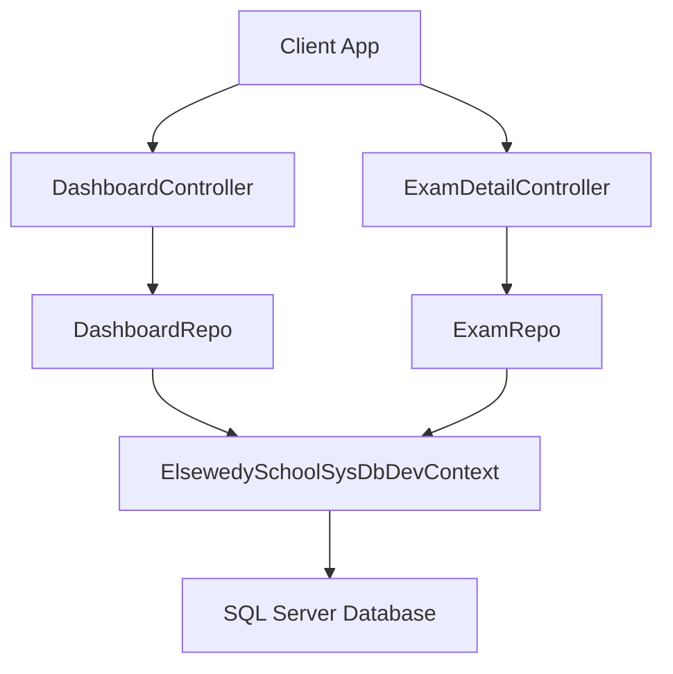
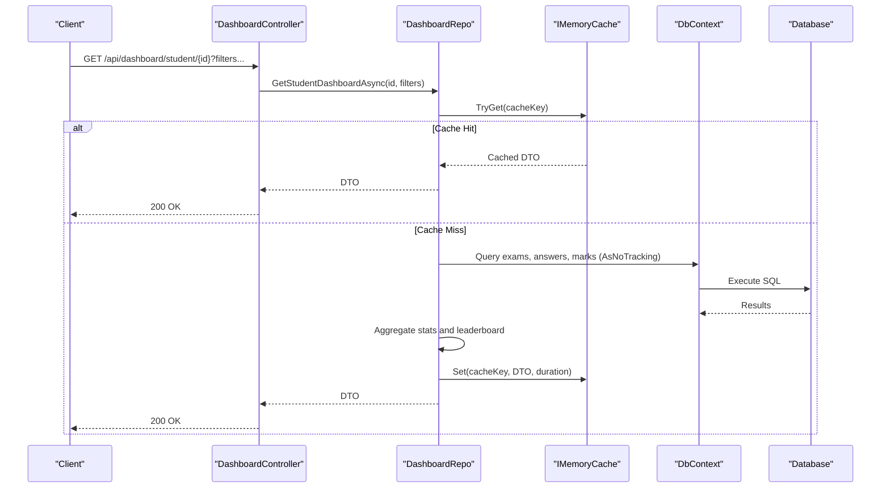
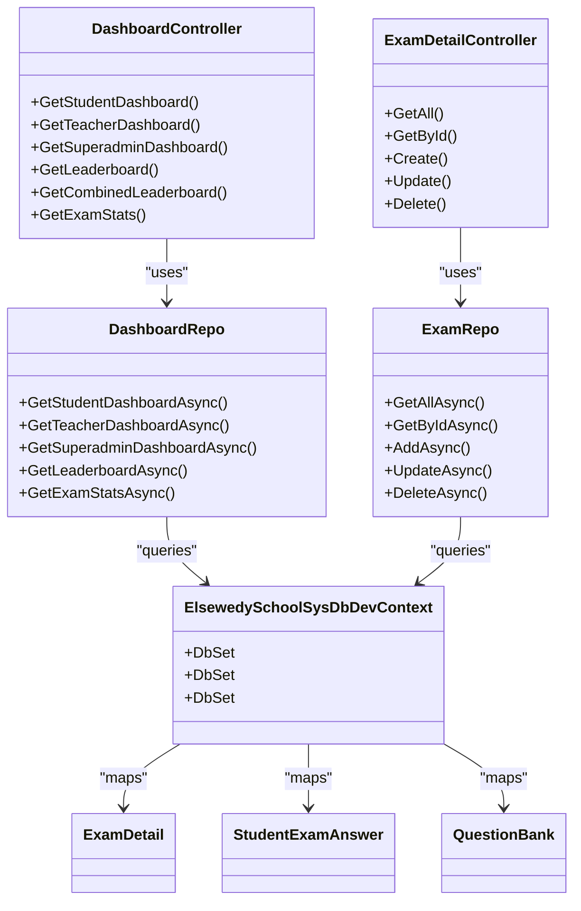

# Performance Optimization

<cite>
**Referenced Files in This Document**
- [ElsewedySchoolSysDbDevContext.cs](file://server/Api/Models/ElsewedySchoolSysDbDevContext.cs)
- [ExamRepo.cs](file://server/Api/Repositories/Implementation/ExamRepo.cs)
- [DashboardRepo.cs](file://server/Api/Repositories/Implementation/DashboardRepo.cs)
- [DashboardController.cs](file://server/Api/Controllers/DashboardController.cs)
- [ExamDetailController.cs](file://server/Api/Controllers/ExamDetailController.cs)
- [ExamDetail.cs](file://server/Api/Models/ExamDetail.cs)
- [StudentExamAnswer.cs](file://server/Api/Models/StudentExamAnswer.cs)
- [QuestionBank.cs](file://server/Api/Models/QuestionBank.cs)
- [appsettings.Development.json](file://server/Api/appsettings.Development.json)
- [appsettings.Production.json](file://server/Api/appsettings.Production.json)
</cite>

## Table of Contents
1. [Introduction](#introduction)
2. [Project Structure](#project-structure)
3. [Core Components](#core-components)
4. [Architecture Overview](#architecture-overview)
5. [Detailed Component Analysis](#detailed-component-analysis)
6. [Dependency Analysis](#dependency-analysis)
7. [Performance Considerations](#performance-considerations)
8. [Troubleshooting Guide](#troubleshooting-guide)
9. [Conclusion](#conclusion)

## Introduction
This document provides performance optimization guidance for the Exam-Hub database and its data access layer. It focuses on query optimization, indexing strategies, connection pooling configuration, async/await patterns, batch operations, profiling techniques, execution plan analysis, memory management, lazy vs eager loading trade-offs, and application-level caching. The recommendations are grounded in the current codebase to ensure practical applicability.

## Project Structure
The server-side API is built with ASP.NET Core and Entity Framework Core. Key layers:
- Controllers expose REST endpoints for dashboards and exam details.
- Repositories encapsulate EF queries and orchestrate data fetching.
- Models define entities and relationships.
- Context configures collation and model mapping.
- Configuration files define connection strings.

**Diagram sources**
- [DashboardController.cs:11-22](file://server/Api/Controllers/DashboardController.cs#L11-L22)
- [ExamDetailController.cs:11-22](file://server/Api/Controllers/ExamDetailController.cs#L11-L22)
- [DashboardRepo.cs:9-21](file://server/Api/Repositories/Implementation/DashboardRepo.cs#L9-L21)
- [ExamRepo.cs:6-13](file://server/Api/Repositories/Implementation/ExamRepo.cs#L6-L13)
- [ElsewedySchoolSysDbDevContext.cs:7-16](file://server/Api/Models/ElsewedySchoolSysDbDevContext.cs#L7-L16)

**Section sources**
- [DashboardController.cs:11-22](file://server/Api/Controllers/DashboardController.cs#L11-L22)
- [ExamDetailController.cs:11-22](file://server/Api/Controllers/ExamDetailController.cs#L11-L22)
- [DashboardRepo.cs:9-21](file://server/Api/Repositories/Implementation/DashboardRepo.cs#L9-L21)
- [ExamRepo.cs:6-13](file://server/Api/Repositories/Implementation/ExamRepo.cs#L6-L13)
- [ElsewedySchoolSysDbDevContext.cs:7-16](file://server/Api/Models/ElsewedySchoolSysDbDevContext.cs#L7-L16)

## Core Components
- DbContext and Model Mapping: Defines entity sets, collation, indexes, and relationships.
- Dashboard Repository: Implements dashboard aggregation, leaderboards, and caching.
- Exam Repository: Manages exam CRUD and question linking.
- Controllers: Expose endpoints and apply authorization and filtering.

Key observations:
- Heavy use of AsNoTracking for read-only queries improves throughput by bypassing change tracking.
- Caching via IMemoryCache reduces repeated expensive computations.
- Manual population of related entities avoids N+1 issues in some paths but can be optimized further.

**Section sources**
- [ElsewedySchoolSysDbDevContext.cs:140-143](file://server/Api/Models/ElsewedySchoolSysDbDevContext.cs#L140-L143)
- [DashboardRepo.cs:1-21](file://server/Api/Repositories/Implementation/DashboardRepo.cs#L1-L21)
- [ExamRepo.cs:1-13](file://server/Api/Repositories/Implementation/ExamRepo.cs#L1-L13)
- [DashboardController.cs:11-22](file://server/Api/Controllers/DashboardController.cs#L11-L22)
- [ExamDetailController.cs:11-22](file://server/Api/Controllers/ExamDetailController.cs#L11-L22)

## Architecture Overview
The system follows a layered architecture:
- Controllers handle HTTP requests, validation, and authorization.
- Repositories implement domain logic and EF queries.
- DbContext manages database interactions.
- Memory cache accelerates dashboard reads.

**Diagram sources**
- [DashboardController.cs:85-136](file://server/Api/Controllers/DashboardController.cs#L85-L136)
- [DashboardRepo.cs:109-246](file://server/Api/Repositories/Implementation/DashboardRepo.cs#L109-L246)

**Section sources**
- [DashboardController.cs:85-136](file://server/Api/Controllers/DashboardController.cs#L85-L136)
- [DashboardRepo.cs:109-246](file://server/Api/Repositories/Implementation/DashboardRepo.cs#L109-L246)

## Detailed Component Analysis

### Indexing Strategies
Current index usage and opportunities:
- Unique constraints and non-clustered indexes exist for Account.Email, Account.NationalId, Section.SectionName, Role.RoleName, and StudentExamAnswer composite unique key.
- Many foreign keys and filter columns lack explicit indexes, which may lead to scans on large tables like StudentExamAnswers and ExamDetails.

Recommended indexes:
- Clustered Indexes
  - StudentExamAnswer: Consider a clustered index on (AccountId, ExamDetailsId) if most queries filter by student and exam; otherwise keep default heap or PK-based clustered index and add non-clustered covering indexes.
  - ExamDetails: If frequent range queries on StartDate/EndDate occur, consider a clustered index on (StartDate, EndDate) or a non-clustered index on those columns depending on primary key strategy.

- Non-Clustered Indexes
  - StudentExamAnswer(ExamDetailsId), StudentExamAnswer(AccountId), StudentExamAnswer(QuestionBankId).
  - ExamDetails(GradeId), ExamDetails(CreatedBy_AccId), ExamDetails(SubjectId), ExamDetails(ClassId).
  - QuestionBank(QuestionSubject), QuestionBank(Mark), QuestionBank(AccountId), QuestionBank(GradeId).
  - Accounts(RoleId), Accounts(StatusId).
  - TblClasses(GradeId).

- Composite Indexes
  - StudentExamAnswer(AccountId, ExamDetailsId, QuestionBankId) for lookups by student/exam/question.
  - ExamDetails(GradeId, SubjectId, StartDate, EndDate) for filtered dashboard queries.
  - ExamQuestionBanks(ExamId, QuestionId) for efficient joins between exams and questions.

- Filtered Indexes
  - StudentExamAnswer where Score = true to optimize pass/fail analytics.
  - ExamDetails where GradeId is not null for grade-scoped dashboards.

Evidence from code:
- Unique indexes and composite unique constraint are defined in the context.
- Non-clustered index on Role.RoleName exists.

**Section sources**
- [ElsewedySchoolSysDbDevContext.cs:154-181](file://server/Api/Models/ElsewedySchoolSysDbDevContext.cs#L154-L181)
- [ElsewedySchoolSysDbDevContext.cs:645-650](file://server/Api/Models/ElsewedySchoolSysDbDevContext.cs#L645-L650)
- [ElsewedySchoolSysDbDevContext.cs:665-672](file://server/Api/Models/ElsewedySchoolSysDbDevContext.cs#L665-L672)
- [ElsewedySchoolSysDbDevContext.cs:717-738](file://server/Api/Models/ElsewedySchoolSysDbDevContext.cs#L717-L738)

### Query Optimization Techniques
Avoiding N+1 Queries:
- In ExamRepo.GetAllAsync and GetByIdAsync, manual population of ExamQuestionBanks and QuestionBanks occurs after initial queries. While this avoids EF’s automatic N+1, it still performs multiple round-trips. Optimize by batching question fetches using Contains and ToDictionary, then populate in-memory.

Appropriate JOINs:
- DashboardRepo uses LINQ Join to combine ExamQuestionBanks with QuestionBanks for mark calculation, which translates to efficient SQL joins. Prefer these over separate queries when aggregating scores.

Projection Queries:
- Use Select to project only needed fields (e.g., { Id, FullNameEn }) to reduce payload and improve performance. Already used in several places within DashboardRepo.

Batch Operations:
- AddAsync in ExamRepo loops through questionIds and adds each link individually. Replace with bulk insert patterns (e.g., EF Core bulk extensions or raw SQL) to reduce transaction overhead.

Caching:
- DashboardRepo leverages IMemoryCache with versioned keys and short TTLs. Ensure cache invalidation on write operations (exam updates/deletes) to maintain consistency.

Read-Only Optimization:
- Extensive use of AsNoTracking across dashboard queries avoids change tracking overhead. Continue this pattern for all read-heavy endpoints.

**Section sources**
- [ExamRepo.cs:15-39](file://server/Api/Repositories/Implementation/ExamRepo.cs#L15-L39)
- [ExamRepo.cs:41-64](file://server/Api/Repositories/Implementation/ExamRepo.cs#L41-L64)
- [ExamRepo.cs:66-87](file://server/Api/Repositories/Implementation/ExamRepo.cs#L66-L87)
- [DashboardRepo.cs:50-107](file://server/Api/Repositories/Implementation/DashboardRepo.cs#L50-L107)
- [DashboardRepo.cs:109-246](file://server/Api/Repositories/Implementation/DashboardRepo.cs#L109-L246)

### Connection Pooling Configuration
Connection string configuration:
- Development and production settings define DefaultConnection pointing to SQL Server.
- No explicit pool size or timeout parameters are configured; defaults apply.

Recommendations:
- Tune Min Pool Size and Max Pool Size based on expected concurrency.
- Set Connect Timeout and Command Timeout appropriately.
- Enable MultipleActiveResultSets (MARS) only if required; otherwise disable for performance.
- Consider enabling TCP KeepAlive and SSL encryption in production.

Example configuration keys to add:
- ConnectionStrings.DefaultConnection should include pool sizing and timeouts.

**Section sources**
- [appsettings.Development.json:1-12](file://server/Api/appsettings.Development.json#L1-L12)
- [appsettings.Production.json:1-11](file://server/Api/appsettings.Production.json#L1-L11)

### Async/Await Patterns
- All repository methods are async and return Task<T>, promoting non-blocking I/O.
- Controllers await repository calls and propagate exceptions to return appropriate status codes.
- Avoid blocking calls like .Result or .Wait(); ensure asynchronous flows throughout.

Best practices:
- Use ConfigureAwait(false) in libraries if applicable.
- Avoid long-running synchronous work inside async methods.
- Leverage cancellation tokens for long queries.

**Section sources**
- [ExamRepo.cs:15-139](file://server/Api/Repositories/Implementation/ExamRepo.cs#L15-L139)
- [DashboardRepo.cs:109-800](file://server/Api/Repositories/Implementation/DashboardRepo.cs#L109-L800)
- [DashboardController.cs:85-376](file://server/Api/Controllers/DashboardController.cs#L85-L376)

### Batch Operations
Current patterns:
- ExamRepo.AddAsync inserts links one by one.
- ExamRepo.UpdateAsync removes and adds links incrementally.

Optimization:
- Use bulk insert/update APIs (EF Core Bulk Extensions or Dapper) to minimize round trips.
- Group deletions and additions and execute in batches.
- Wrap related changes in a single transaction to ensure consistency.

**Section sources**
- [ExamRepo.cs:66-120](file://server/Api/Repositories/Implementation/ExamRepo.cs#L66-L120)

### Database Profiling Tools and Execution Plan Analysis
Tools:
- SQL Server Profiler or Extended Events to capture slow queries.
- Query Store to analyze historical performance.
- SSMS Execution Plans to identify scans, sorts, and missing indexes.

Process:
- Identify high CPU/time queries from logs or monitoring.
- Analyze plans for table/index scans and implicit conversions.
- Validate index effectiveness and adjust coverage.

Application-level logging:
- Add structured logging around repository calls to correlate request IDs with SQL statements.

[No sources needed since this section provides general guidance]

### Memory Management and Lazy vs Eager Loading
- Prefer projection queries to limit object graph size.
- Use AsNoTracking for read-only scenarios to avoid change tracker memory overhead.
- Avoid lazy loading; explicitly Include or project required data.
- For large datasets, paginate results and stream responses.

Trade-offs:
- Eager loading reduces round trips but increases memory usage.
- Projection minimizes memory but requires careful field selection.

**Section sources**
- [DashboardRepo.cs:114-126](file://server/Api/Repositories/Implementation/DashboardRepo.cs#L114-L126)
- [ExamRepo.cs:17-19](file://server/Api/Repositories/Implementation/ExamRepo.cs#L17-L19)

### Caching Strategies at Application Level
- IMemoryCache is used with versioned keys and short TTLs for dashboard endpoints.
- Ensure cache invalidation on writes (Create/Update/Delete) to prevent stale data.
- Consider distributed caching (Redis) for multi-instance deployments.

Cache key design:
- Include filter parameters and user context to isolate caches per tenant/user.

**Section sources**
- [DashboardRepo.cs:1-26](file://server/Api/Repositories/Implementation/DashboardRepo.cs#L1-L26)
- [DashboardRepo.cs:109-246](file://server/Api/Repositories/Implementation/DashboardRepo.cs#L109-L246)

## Dependency Analysis
The following diagram shows core dependencies among controllers, repositories, models, and context.

**Diagram sources**
- [DashboardController.cs:11-22](file://server/Api/Controllers/DashboardController.cs#L11-L22)
- [ExamDetailController.cs:11-22](file://server/Api/Controllers/ExamDetailController.cs#L11-L22)
- [DashboardRepo.cs:9-21](file://server/Api/Repositories/Implementation/DashboardRepo.cs#L9-L21)
- [ExamRepo.cs:6-13](file://server/Api/Repositories/Implementation/ExamRepo.cs#L6-L13)
- [ElsewedySchoolSysDbDevContext.cs:18-137](file://server/Api/Models/ElsewedySchoolSysDbDevContext.cs#L18-L137)
- [ExamDetail.cs:6-30](file://server/Api/Models/ExamDetail.cs#L6-L30)
- [StudentExamAnswer.cs:6-26](file://server/Api/Models/StudentExamAnswer.cs#L6-L26)
- [QuestionBank.cs:7-46](file://server/Api/Models/QuestionBank.cs#L7-L46)

**Section sources**
- [DashboardController.cs:11-22](file://server/Api/Controllers/DashboardController.cs#L11-L22)
- [ExamDetailController.cs:11-22](file://server/Api/Controllers/ExamDetailController.cs#L11-L22)
- [DashboardRepo.cs:9-21](file://server/Api/Repositories/Implementation/DashboardRepo.cs#L9-L21)
- [ExamRepo.cs:6-13](file://server/Api/Repositories/Implementation/ExamRepo.cs#L6-L13)
- [ElsewedySchoolSysDbDevContext.cs:18-137](file://server/Api/Models/ElsewedySchoolSysDbDevContext.cs#L18-L137)
- [ExamDetail.cs:6-30](file://server/Api/Models/ExamDetail.cs#L6-L30)
- [StudentExamAnswer.cs:6-26](file://server/Api/Models/StudentExamAnswer.cs#L6-L26)
- [QuestionBank.cs:7-46](file://server/Api/Models/QuestionBank.cs#L7-L46)

## Performance Considerations
- Prioritize targeted indexes on frequently filtered/joined columns.
- Replace incremental inserts with bulk operations.
- Maintain AsNoTracking for read-heavy endpoints.
- Use projections to minimize payload sizes.
- Implement robust cache invalidation policies.
- Monitor connection pool metrics and tune pool sizes.
- Profile slow queries and validate execution plans regularly.

[No sources needed since this section provides general guidance]

## Troubleshooting Guide
Common issues and resolutions:
- Slow dashboard loads: Verify cache hits, check query plans for scans, ensure proper indexes on filter columns.
- High memory usage: Confirm AsNoTracking usage, avoid unnecessary Includes, and project minimal fields.
- Deadlocks or contention: Review transaction scopes, avoid long-held locks, and normalize update patterns.
- Stale data: Ensure cache invalidation on write operations.

Diagnostic steps:
- Enable detailed logging around repository calls.
- Capture SQL statements and execution plans for problematic endpoints.
- Validate connection string parameters and pool settings.

**Section sources**
- [DashboardController.cs:132-136](file://server/Api/Controllers/DashboardController.cs#L132-L136)
- [ExamDetailController.cs:192-197](file://server/Api/Controllers/ExamDetailController.cs#L192-L197)

## Conclusion
The Exam-Hub application demonstrates strong foundations for performance: async/await patterns, AsNoTracking usage, and application-level caching. To further optimize:
- Introduce targeted indexes and composite indexes aligned with query patterns.
- Replace incremental inserts with bulk operations.
- Refine projection queries and enforce strict pagination.
- Tune connection pooling and monitor execution plans continuously.
These steps will enhance throughput, reduce latency, and improve scalability under load.

[No sources needed since this section summarizes without analyzing specific files]