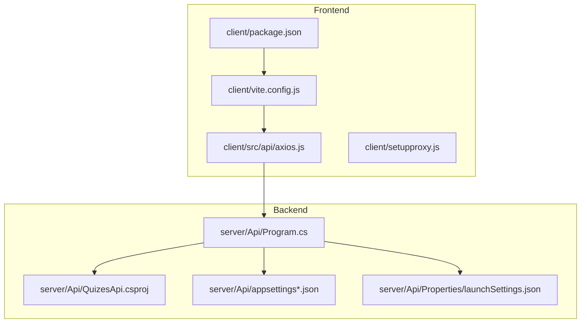
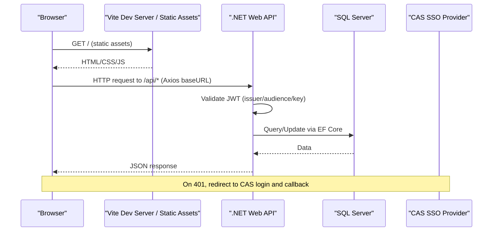
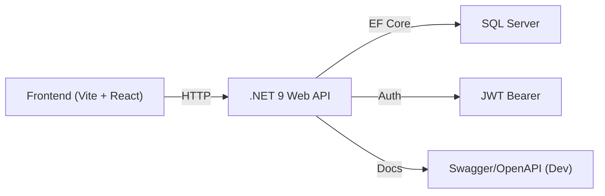

# Deployment Guide

<cite>
**Referenced Files in This Document**
- [README.md](file://README.md)
- [client/package.json](file://client/package.json)
- [client/vite.config.js](file://client/vite.config.js)
- [client/src/api/axios.js](file://client/src/api/axios.js)
- [client/setupproxy.js](file://client/setupproxy.js)
- [server/Api/QuizesApi.csproj](file://server/Api/QuizesApi.csproj)
- [server/Api/appsettings.json](file://server/Api/appsettings.json)
- [server/Api/appsettings.Development.json](file://server/Api/appsettings.Development.json)
- [server/Api/appsettings.Production.json](file://server/Api/appsettings.Production.json)
- [server/Api/Program.cs](file://server/Api/Program.cs)
- [server/Api/Properties/launchSettings.json](file://server/Api/Properties/launchSettings.json)
- [server/Api/Models/EmailSetting.cs](file://server/Api/Models/EmailSetting.cs)
</cite>

## Table of Contents
1. Introduction
2. Project Structure
3. Core Components
4. Architecture Overview
5. Detailed Component Analysis
6. Dependency Analysis
7. Performance Considerations
8. Troubleshooting Guide
9. Conclusion
10. Appendices

## Introduction
This deployment guide explains how to build, configure, containerize, and operate the Exam-Hub application in production. It covers both frontend (React + Vite) and backend (.NET 9 Web API), environment-specific configuration, security settings (JWT, CAS SSO), reverse proxy and SSL, monitoring/logging, performance tuning, scaling strategies, CI/CD considerations, and operational maintenance.

## Project Structure
Exam-Hub is a monorepo with:
- Frontend: React app built with Vite under client/.
- Backend: .NET 9 Web API under server/Api/.

**Diagram sources**
- [client/package.json:1-35](file://client/package.json#L1-L35)
- [client/vite.config.js:1-12](file://client/vite.config.js#L1-L12)
- [client/src/api/axios.js:1-62](file://client/src/api/axios.js#L1-L62)
- [client/setupproxy.js:1-17](file://client/setupproxy.js#L1-L17)
- [server/Api/QuizesApi.csproj:1-26](file://server/Api/QuizesApi.csproj#L1-L26)
- [server/Api/Program.cs:1-146](file://server/Api/Program.cs#L1-L146)
- [server/Api/appsettings.json:1-18](file://server/Api/appsettings.json#L1-L18)
- [server/Api/appsettings.Development.json:1-12](file://server/Api/appsettings.Development.json#L1-L12)
- [server/Api/appsettings.Production.json:1-11](file://server/Api/appsettings.Production.json#L1-L11)
- [server/Api/Properties/launchSettings.json:1-38](file://server/Api/Properties/launchSettings.json#L1-L38)

**Section sources**
- [README.md:1-75](file://README.md#L1-L75)

## Core Components
- Frontend build tooling: Vite with React plugin; development server port configured.
- Frontend API client: Axios instance using environment variables for base URL and CAS endpoints.
- Backend runtime: .NET 9 Web API with JWT Bearer authentication, CORS, Swagger (dev only), EF Core SQL Server, and repository DI.
- Configuration: Environment-specific appsettings files and launch profiles.

Key responsibilities:
- Build pipeline: npm scripts for dev/build/preview; vite config for plugins and dev server.
- Runtime: Program.cs wires up services, auth, CORS, DB context, controllers, and seeding.
- Security: JWT validation parameters and role claim mapping; CAS SSO integration via environment variables.

**Section sources**
- [client/package.json:6-10](file://client/package.json#L6-L10)
- [client/vite.config.js:5-11](file://client/vite.config.js#L5-L11)
- [client/src/api/axios.js:7-10](file://client/src/api/axios.js#L7-L10)
- [server/Api/Program.cs:17-108](file://server/Api/Program.cs#L17-L108)
- [server/Api/Program.cs:110-142](file://server/Api/Program.cs#L110-L142)

## Architecture Overview
High-level request flow from browser to API and database:

**Diagram sources**
- [client/src/api/axios.js:7-10](file://client/src/api/axios.js#L7-L10)
- [client/src/api/axios.js:30-57](file://client/src/api/axios.js#L30-L57)
- [server/Api/Program.cs:43-81](file://server/Api/Program.cs#L43-L81)
- [server/Api/Program.cs:30-33](file://server/Api/Program.cs#L30-L33)

## Detailed Component Analysis

### Frontend Build and Asset Optimization
- Scripts: dev, build, preview are defined in package.json.
- Vite config enables React plugin and sets dev server port.
- Production builds output optimized static assets served by your web server or CDN.

Recommendations:
- Use environment variables for API base URL and CAS endpoints at build time.
- Enable gzip/brotli compression on your reverse proxy for static assets.
- Cache static assets aggressively with immutable filenames (handled by Vite).

**Section sources**
- [client/package.json:6-10](file://client/package.json#L6-L10)
- [client/vite.config.js:5-11](file://client/vite.config.js#L5-L11)

### Frontend API Client and SSO Flow
- Axios baseURL uses an environment variable with a default fallback.
- Interceptors attach Authorization headers and handle 401 by redirecting to CAS SSO.
- Development proxy forwards /api requests to local backend.

Operational notes:
- Ensure VITE_API_BASE_URL points to the production API endpoint.
- Ensure VITE_CAS_URL and VITE_CAS_API_URL are set for SSO login/logout flows.
- In production, do not rely on setupproxy.js; use a reverse proxy instead.

**Section sources**
- [client/src/api/axios.js:7-10](file://client/src/api/axios.js#L7-L10)
- [client/src/api/axios.js:12-25](file://client/src/api/axios.js#L12-L25)
- [client/src/api/axios.js:29-57](file://client/src/api/axios.js#L29-L57)
- [client/setupproxy.js:1-17](file://client/setupproxy.js#L1-L17)

### Backend Service Registration and Security
- Registers controllers, JSON naming policy, Swagger (development), EF Core SQL Server, MemoryCache, JWT Bearer, authorization policies, CORS, and repositories.
- JWT validation enforces issuer, audience, lifetime, and signing key. Role claims are normalized for authorization.
- CORS policy allows any origin in current configuration; tighten for production.

Security recommendations:
- Store JWT Key securely via environment variables or secret managers.
- Restrict CORS to known origins.
- Enable HTTPS redirection in production.

**Section sources**
- [server/Api/Program.cs:17-36](file://server/Api/Program.cs#L17-L36)
- [server/Api/Program.cs:43-81](file://server/Api/Program.cs#L43-L81)
- [server/Api/Program.cs:92-102](file://server/Api/Program.cs#L92-L102)
- [server/Api/Program.cs:112-116](file://server/Api/Program.cs#L112-L116)

### Database and Migrations
- EF Core SQL Server context is configured from connection string.
- Connection strings are provided in environment-specific appsettings files.
- Seed data runs on startup with error handling to avoid blocking startup.

Operational guidance:
- Apply migrations before running the app in production.
- Use a dedicated service account with least privilege.
- Back up databases regularly and test restore procedures.

**Section sources**
- [server/Api/Program.cs:30-33](file://server/Api/Program.cs#L30-L33)
- [server/Api/appsettings.json:1-4](file://server/Api/appsettings.json#L1-L4)
- [server/Api/appsettings.Development.json:1-5](file://server/Api/appsettings.Development.json#L1-L5)
- [server/Api/appsettings.Production.json:1-4](file://server/Api/appsettings.Production.json#L1-L4)
- [server/Api/Program.cs:127-140](file://server/Api/Program.cs#L127-L140)

### Configuration Management
- appsettings.json provides defaults for connection strings, JWT, logging, and allowed hosts.
- appsettings.Development.json and appsettings.Production.json override per environment.
- Launch profiles define local ports and environment variables for development.

Best practices:
- Never commit secrets; use environment variables or secret managers.
- Keep JWT Key out of source control.
- Align ASP.NET Core environment variable with deployment target.

**Section sources**
- [server/Api/appsettings.json:1-18](file://server/Api/appsettings.json#L1-L18)
- [server/Api/appsettings.Development.json:1-12](file://server/Api/appsettings.Development.json#L1-L12)
- [server/Api/appsettings.Production.json:1-11](file://server/Api/appsettings.Production.json#L1-L11)
- [server/Api/Properties/launchSettings.json:1-38](file://server/Api/Properties/launchSettings.json#L1-L38)

### Email Settings
- EmailSetting model includes SMTP server, port, username, password, and sender email fields.
- Configure these values through secure configuration management when enabling email features.

**Section sources**
- [server/Api/Models/EmailSetting.cs:1-20](file://server/Api/Models/EmailSetting.cs#L1-L20)

## Dependency Analysis
External dependencies relevant to deployment:
- Frontend: React, Vite, Axios, Recharts, etc.
- Backend: .NET 9, EF Core SQL Server, JWT Bearer, AutoMapper, BCrypt, ClosedXML, OpenAPI/Swagger.

**Diagram sources**
- [client/package.json:12-32](file://client/package.json#L12-L32)
- [server/Api/QuizesApi.csproj:9-23](file://server/Api/QuizesApi.csproj#L9-L23)
- [server/Api/Program.cs:26-33](file://server/Api/Program.cs#L26-L33)

**Section sources**
- [client/package.json:12-32](file://client/package.json#L12-L32)
- [server/Api/QuizesApi.csproj:1-26](file://server/Api/QuizesApi.csproj#L1-L26)

## Performance Considerations
- Backend
  - Memory cache is enabled; consider distributed caching (Redis) for multi-instance deployments.
  - Tune EF Core query patterns and add indexes where needed.
  - Disable Swagger in production.
- Frontend
  - Serve static assets via CDN or edge caching.
  - Enable compression (gzip/brotli) at the reverse proxy.
  - Minimize bundle size; lazy-load routes and heavy components.

[No sources needed since this section provides general guidance]

## Troubleshooting Guide
Common issues and resolutions:
- 401 Unauthorized redirects loop
  - Verify VITE_CAS_URL and VITE_CAS_API_URL are correct.
  - Ensure CAS callback URL matches the deployed origin.
  - Confirm JWT Key and Issuer/Audience match between backend and token provider.
- CORS errors
  - Update CORS policy to allow specific origins in production.
- API connectivity
  - Check VITE_API_BASE_URL points to the production API host.
  - Ensure reverse proxy routes /api to the backend correctly.
- Database connection failures
  - Validate DefaultConnection string and network access to SQL Server.
  - Ensure migrations have been applied.
- Swagger in production
  - Ensure Swagger is disabled outside development environments.

**Section sources**
- [client/src/api/axios.js:29-57](file://client/src/api/axios.js#L29-L57)
- [server/Api/Program.cs:92-102](file://server/Api/Program.cs#L92-L102)
- [server/Api/Program.cs:112-116](file://server/Api/Program.cs#L112-L116)
- [server/Api/appsettings.json:1-4](file://server/Api/appsettings.json#L1-L4)

## Conclusion
By following this guide, you can build and deploy Exam-Hub securely and efficiently. Focus on environment-specific configuration, strict security settings, proper reverse proxy and SSL termination, robust logging and monitoring, and scalable infrastructure patterns.

[No sources needed since this section summarizes without analyzing specific files]

## Appendices

### A. Build and Run Commands
- Frontend
  - Install dependencies and run dev server: see scripts in package.json.
  - Build for production: see scripts in package.json.
- Backend
  - Restore packages and run: see project file and README instructions.

**Section sources**
- [client/package.json:6-10](file://client/package.json#L6-L10)
- [README.md:38-54](file://README.md#L38-L54)

### B. Environment Variables Checklist
- Frontend
  - VITE_API_BASE_URL: Base URL for backend API.
  - VITE_CAS_URL: CAS login endpoint.
  - VITE_CAS_API_URL: CAS logout endpoint.
- Backend
  - ASPNETCORE_ENVIRONMENT: Development | Production
  - ConnectionStrings:DefaultConnection: SQL Server connection string.
  - Jwt:Key, Jwt:Issuer, Jwt:Audience: JWT configuration.
  - AllowedHosts: Hosts allowed to serve the API.

**Section sources**
- [client/src/api/axios.js:7-10](file://client/src/api/axios.js#L7-L10)
- [client/src/api/axios.js:40-44](file://client/src/api/axios.js#L40-L44)
- [server/Api/appsettings.json:1-18](file://server/Api/appsettings.json#L1-L18)
- [server/Api/Properties/launchSettings.json:1-38](file://server/Api/Properties/launchSettings.json#L1-L38)

### C. Reverse Proxy, SSL, and Load Balancing
- Reverse proxy
  - Route /api to the backend service.
  - Forward headers like X-Forwarded-Proto and X-Forwarded-For if required.
- SSL/TLS
  - Terminate TLS at the reverse proxy or configure Kestrel with certificates.
  - Enforce HTTPS redirection in production.
- Load balancing
  - Place multiple backend instances behind a load balancer.
  - Use sticky sessions only if necessary; prefer stateless design.

[No sources needed since this section provides general guidance]

### D. Monitoring and Logging
- Backend
  - Use structured logging providers (e.g., Serilog) and ship logs to a central system.
  - Expose health checks and metrics endpoints.
- Frontend
  - Capture user-facing errors and report to a monitoring service.
  - Track performance metrics (page load, API latency).

[No sources needed since this section provides general guidance]

### E. Containerization Options
- Multi-stage Docker builds
  - Stage 1: Build frontend with Node/Vite and produce static assets.
  - Stage 2: Build backend with .NET SDK and publish self-contained or framework-dependent image.
- Orchestration
  - Deploy containers via Kubernetes or container platforms.
  - Manage secrets via platform secret stores.

[No sources needed since this section provides general guidance]

### F. CI/CD Pipeline Setup
- Stages
  - Lint and test frontend.
  - Build frontend artifacts.
  - Lint, test, and build backend.
  - Publish artifacts and deploy to target environment.
- Secrets and configs
  - Inject environment variables and secrets at runtime.
  - Rotate JWT keys and database credentials regularly.

[No sources needed since this section provides general guidance]

### G. Maintenance Procedures
- Database
  - Schedule backups and verify restore processes.
  - Monitor migration status and apply planned migrations during deployments.
- Application
  - Perform rolling updates for zero-downtime deployments.
  - Review logs and alerts; tune performance based on metrics.

[No sources needed since this section provides general guidance]