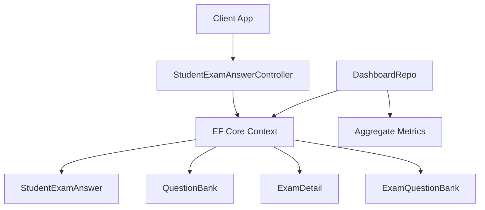
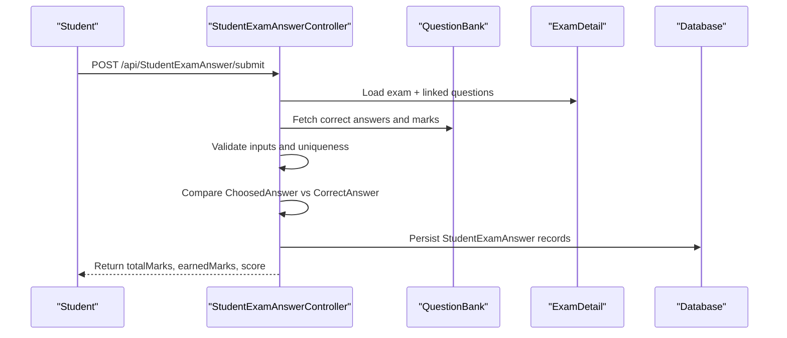
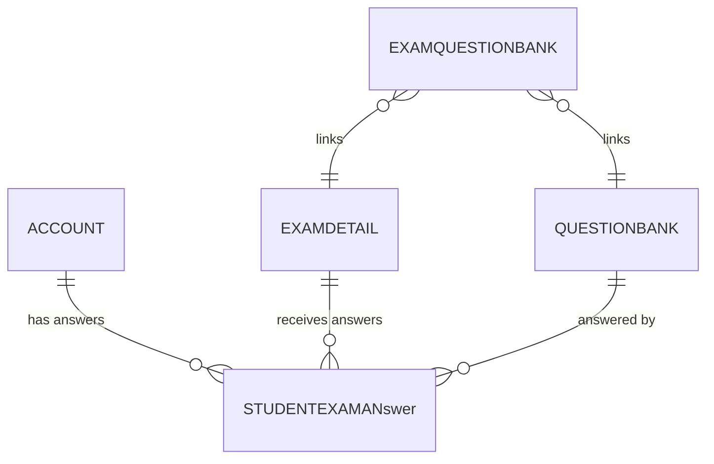
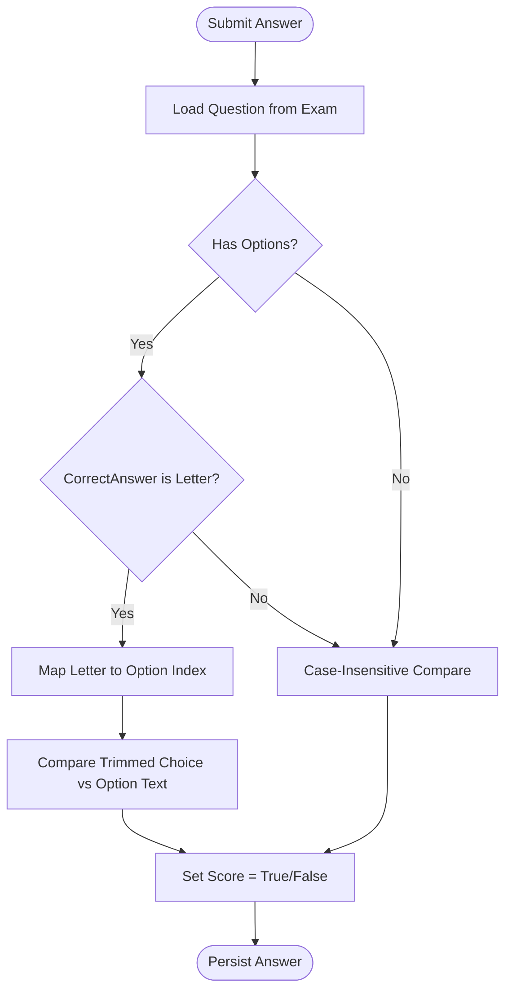
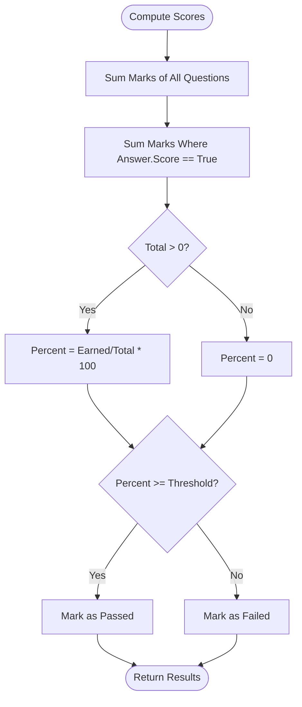
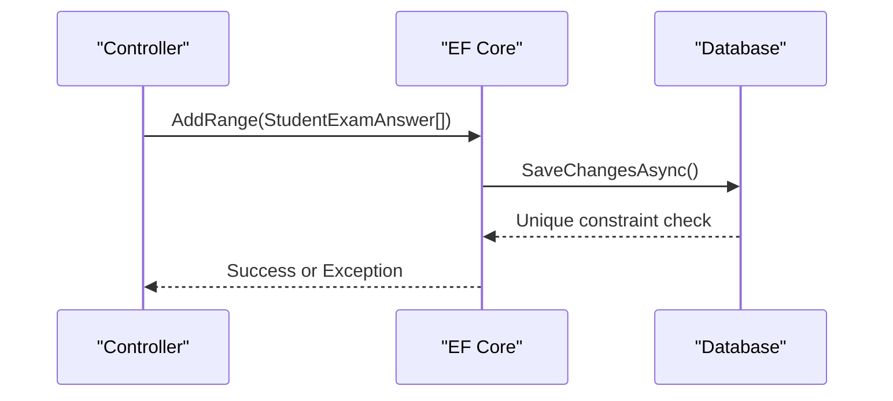
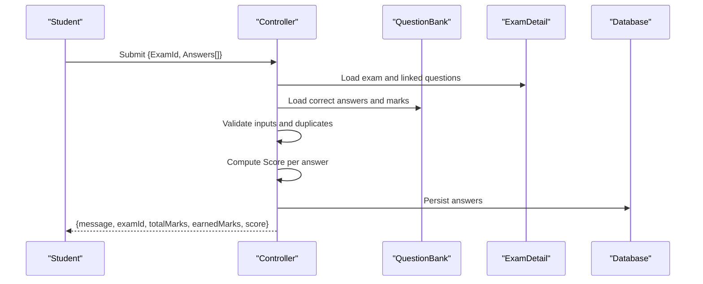
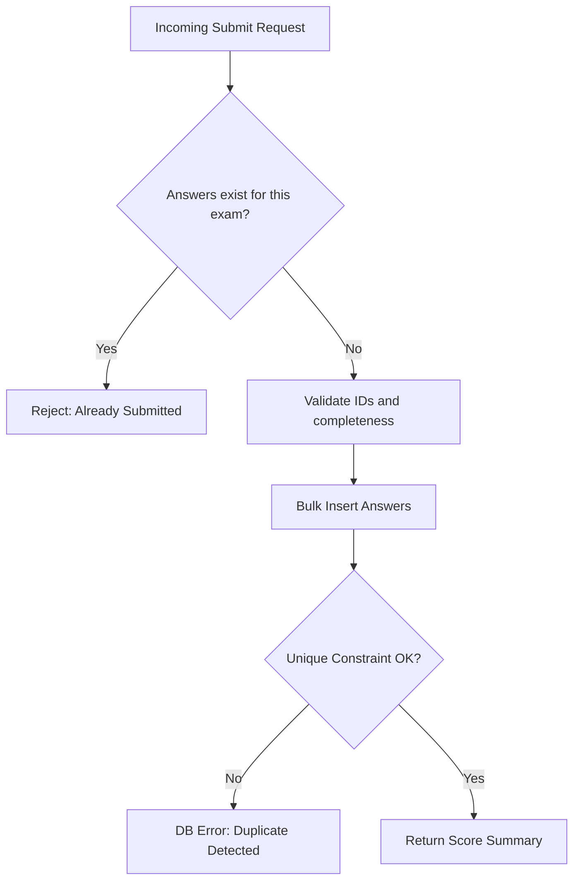
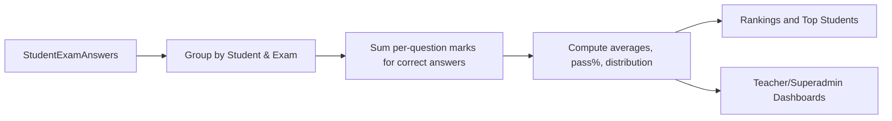
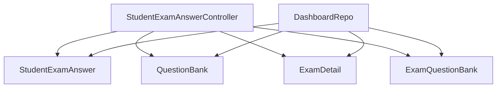

# Answer Collection & Scoring

<cite>
**Referenced Files in This Document**
- [StudentExamAnswer.cs](file://server/Api/Models/StudentExamAnswer.cs)
- [QuestionBank.cs](file://server/Api/Models/QuestionBank.cs)
- [ExamDetail.cs](file://server/Api/Models/ExamDetail.cs)
- [ExamQuestionBank.cs](file://server/Api/Models/ExamQuestionBank.cs)
- [StudentExamResult.cs](file://server/Api/Models/StudentExamResult.cs)
- [StudentExamAnswerController.cs](file://server/Api/Controllers/StudentExamAnswerController.cs)
- [DashboardRepo.cs](file://server/Api/Repositories/Implementation/DashboardRepo.cs)
- [20260121091238_ModifyStudentExamAnswer.cs](file://server/Api/Migrations/20260121091238_ModifyStudentExamAnswer.cs)
</cite>

## Table of Contents
1. Introduction
2. Project Structure
3. Core Components
4. Architecture Overview
5. Detailed Component Analysis
6. Dependency Analysis
7. Performance Considerations
8. Troubleshooting Guide
9. Conclusion
10. Appendices

## Introduction
This document explains the answer collection and scoring mechanism for exams, focusing on how student answers are captured, validated, scored against the question bank, persisted, and later retrieved or aggregated for reporting. It covers data models, automatic scoring logic, result calculation (including per-question marks), persistence strategy, submission workflows, concurrency safeguards, error handling, and export/reporting capabilities.

## Project Structure
The answer collection and scoring feature spans:
- API controllers that accept submissions and return results
- Domain models representing answers, questions, exams, and exam-question mappings
- A repository layer that computes aggregate performance metrics and leaderboards
- Database migrations that define constraints and indexes to ensure integrity

**Diagram sources**
- [StudentExamAnswerController.cs:199-332](file://server/Api/Controllers/StudentExamAnswerController.cs#L199-L332)
- [DashboardRepo.cs:109-246](file://server/Api/Repositories/Implementation/DashboardRepo.cs#L109-L246)

**Section sources**
- [StudentExamAnswerController.cs:199-332](file://server/Api/Controllers/StudentExamAnswerController.cs#L199-L332)
- [DashboardRepo.cs:109-246](file://server/Api/Repositories/Implementation/DashboardRepo.cs#L109-L246)

## Core Components
- StudentExamAnswer: Stores a student’s chosen answer for a specific question within an exam, along with whether it is correct.
- QuestionBank: Holds question text, options, correct answer, and mark allocation per question.
- ExamDetail: Represents an exam instance with title, subject, and time window.
- ExamQuestionBank: Links an exam to the set of questions included in that exam.
- StudentExamResult: A legacy model for subject-level scores; current scoring uses per-answer correctness and per-question marks rather than this model.

Key relationships:
- An ExamDetail includes multiple ExamQuestionBank entries, each pointing to a QuestionBank.
- A StudentExamAnswer links AccountId to ExamDetailsId and QuestionBankId, recording ChoosedAnswer and Score.

**Section sources**
- [StudentExamAnswer.cs:6-26](file://server/Api/Models/StudentExamAnswer.cs#L6-L26)
- [QuestionBank.cs:7-46](file://server/Api/Models/QuestionBank.cs#L7-L46)
- [ExamDetail.cs:6-30](file://server/Api/Models/ExamDetail.cs#L6-L30)
- [ExamQuestionBank.cs:6-13](file://server/Api/Models/ExamQuestionBank.cs#L6-L13)
- [StudentExamResult.cs:6-19](file://server/Api/Models/StudentExamResult.cs#L6-L19)

## Architecture Overview
The system supports two primary flows:
- Submission flow: Students submit answers via an API endpoint; the server validates, compares against correct answers, persists results, and returns immediate scoring feedback.
- Reporting flow: Dashboards and leaderboards compute per-student and aggregate scores by summing per-question marks for correct answers and dividing by total exam marks.

**Diagram sources**
- [StudentExamAnswerController.cs:199-332](file://server/Api/Controllers/StudentExamAnswerController.cs#L199-L332)
- [DashboardRepo.cs:109-246](file://server/Api/Repositories/Implementation/DashboardRepo.cs#L109-L246)

## Detailed Component Analysis

### StudentExamAnswer Model and Relationships
- Fields include identifiers for the student (AccountId), the exam (ExamDetailsId), the question (QuestionBankId), the chosen answer (ChoosedAnswer), and correctness flag (Score).
- Navigation properties link to Account, ExamDetail, and QuestionBank.
- The migration adds a unique constraint over (AccountId, ExamDetailsID, QuestionbankId) when both foreign keys are present, preventing duplicate answers per question per exam per student.

**Diagram sources**
- [StudentExamAnswer.cs:6-26](file://server/Api/Models/StudentExamAnswer.cs#L6-L26)
- [ExamQuestionBank.cs:6-13](file://server/Api/Models/ExamQuestionBank.cs#L6-L13)
- [20260121091238_ModifyStudentExamAnswer.cs:45-55](file://server/Api/Migrations/20260121091238_ModifyStudentExamAnswer.cs#L45-L55)

**Section sources**
- [StudentExamAnswer.cs:6-26](file://server/Api/Models/StudentExamAnswer.cs#L6-L26)
- [20260121091238_ModifyStudentExamAnswer.cs:45-55](file://server/Api/Migrations/20260121091238_ModifyStudentExamAnswer.cs#L45-L55)

### Automatic Scoring Algorithm
- For each submitted answer, the controller loads the corresponding question from the exam’s question set.
- If the question has multiple-choice options, the algorithm interprets the stored correct answer:
  - If the correct answer is a single letter (A–H), it maps to the option index and compares the trimmed student choice against the option text.
  - Otherwise, it performs a case-insensitive string comparison between the student’s chosen answer and the stored correct answer.
- The boolean Score field is set to true if the comparison matches; otherwise false.

**Diagram sources**
- [StudentExamAnswerController.cs:258-306](file://server/Api/Controllers/StudentExamAnswerController.cs#L258-L306)

**Section sources**
- [StudentExamAnswerController.cs:258-306](file://server/Api/Controllers/StudentExamAnswerController.cs#L258-L306)

### Result Calculation and Mark Allocation
- Per-exam totals:
  - Total marks equal the sum of marks across all questions linked to the exam via ExamQuestionBank.
  - Earned marks equal the sum of marks for questions where the student’s answer Score is true.
- Percentage score:
  - Calculated as (earnedMarks / totalMarks) * 100, rounded to two decimals.
- Dashboard and leaderboard calculations:
  - Aggregate metrics group answers by student and exam, compute earned marks using per-question marks, then derive percentages and pass/fail status based on a threshold.

**Diagram sources**
- [StudentExamAnswerController.cs:320-331](file://server/Api/Controllers/StudentExamAnswerController.cs#L320-L331)
- [DashboardRepo.cs:175-228](file://server/Api/Repositories/Implementation/DashboardRepo.cs#L175-L228)

**Section sources**
- [StudentExamAnswerController.cs:320-331](file://server/Api/Controllers/StudentExamAnswerController.cs#L320-L331)
- [DashboardRepo.cs:175-228](file://server/Api/Repositories/Implementation/DashboardRepo.cs#L175-L228)

### Data Persistence Strategy
- Answers are persisted as individual rows per question per exam per student.
- Uniqueness constraint ensures one answer per (student, exam, question) tuple, enforced at the database level.
- Foreign key relationships tie answers to exams and questions.
- Bulk insert is used to save multiple answers in a single transaction.

**Diagram sources**
- [StudentExamAnswerController.cs:309-318](file://server/Api/Controllers/StudentExamAnswerController.cs#L309-L318)
- [20260121091238_ModifyStudentExamAnswer.cs:45-55](file://server/Api/Migrations/20260121091238_ModifyStudentExamAnswer.cs#L45-L55)

**Section sources**
- [StudentExamAnswerController.cs:309-318](file://server/Api/Controllers/StudentExamAnswerController.cs#L309-L318)
- [20260121091238_ModifyStudentExamAnswer.cs:45-55](file://server/Api/Migrations/20260121091238_ModifyStudentExamAnswer.cs#L45-L55)

### Answer Submission Workflow
- Endpoint: POST /api/StudentExamAnswer/submit
- Inputs:
  - ExamId
  - AccountId (from token or payload)
  - Answers array with QuestionId and Answer values
- Validation:
  - Ensures account exists and exam exists.
  - Prevents duplicate submissions for the same exam.
  - Validates that submitted QuestionIds belong to the exam.
  - Fills missing questions with empty answers to ensure completeness.
- Scoring and persistence:
  - Compares answers against correct answers and marks.
  - Persists answers and returns totalMarks, earnedMarks, and percentage score.

**Diagram sources**
- [StudentExamAnswerController.cs:199-332](file://server/Api/Controllers/StudentExamAnswerController.cs#L199-L332)

**Section sources**
- [StudentExamAnswerController.cs:199-332](file://server/Api/Controllers/StudentExamAnswerController.cs#L199-L332)

### Result Retrieval APIs
- GET /api/StudentExamAnswer/student/{accountId}/exams
  - Returns all exams for a student where answers exist, including per-question details and computed scores.
- GET /api/StudentExamAnswer/student/{accountId}/exam/{examId}
  - Returns detailed results for a specific exam, including per-question options, correct answers, and user responses.

Both endpoints:
- Populate exam questions via ExamQuestionBank links.
- Compute total and earned marks and percentage score.
- Include per-question metadata and correctness flags.

**Section sources**
- [StudentExamAnswerController.cs:45-126](file://server/Api/Controllers/StudentExamAnswerController.cs#L45-L126)
- [StudentExamAnswerController.cs:128-197](file://server/Api/Controllers/StudentExamAnswerController.cs#L128-L197)

### Concurrent Submission Handling and Data Integrity
- Concurrency safeguard:
  - A pre-check queries existing answers for the same student and exam; if any exist, submission is rejected to prevent duplicates.
- Database integrity:
  - Unique constraint on (AccountId, ExamDetailsID, QuestionbankId) prevents duplicate answers even under concurrent writes.
- Transactional persistence:
  - Bulk add and save changes occur in a single call to reduce partial state risk.

**Diagram sources**
- [StudentExamAnswerController.cs:229-233](file://server/Api/Controllers/StudentExamAnswerController.cs#L229-L233)
- [20260121091238_ModifyStudentExamAnswer.cs:45-55](file://server/Api/Migrations/20260121091238_ModifyStudentExamAnswer.cs#L45-L55)

**Section sources**
- [StudentExamAnswerController.cs:229-233](file://server/Api/Controllers/StudentExamAnswerController.cs#L229-L233)
- [20260121091238_ModifyStudentExamAnswer.cs:45-55](file://server/Api/Migrations/20260121091238_ModifyStudentExamAnswer.cs#L45-L55)

### Error Recovery Mechanisms
- Input validation errors return BadRequest with descriptive messages.
- Missing exam or invalid IDs return NotFound or BadRequest.
- Database exceptions during save are caught and returned as StatusCode 500 with message and inner exception details.

**Section sources**
- [StudentExamAnswerController.cs:202-225](file://server/Api/Controllers/StudentExamAnswerController.cs#L202-L225)
- [StudentExamAnswerController.cs:309-318](file://server/Api/Controllers/StudentExamAnswerController.cs#L309-L318)

### Export Capabilities and Aggregate Metrics
- Individual student results:
  - Use the retrieval endpoints above to fetch per-exam and per-question details for a given student.
- Aggregate performance metrics:
  - Dashboard repository methods compute:
    - Per-exam average scores, pass/fail counts, and pass percentages.
    - Leaderboard rankings per exam with top students.
    - Overall pass percentages and score distributions across exams.
  - These metrics rely on grouping answers by student and exam, summing per-question marks for correct answers, and comparing against total marks.

**Diagram sources**
- [DashboardRepo.cs:109-246](file://server/Api/Repositories/Implementation/DashboardRepo.cs#L109-L246)
- [DashboardRepo.cs:248-391](file://server/Api/Repositories/Implementation/DashboardRepo.cs#L248-L391)
- [DashboardRepo.cs:393-503](file://server/Api/Repositories/Implementation/DashboardRepo.cs#L393-L503)
- [DashboardRepo.cs:505-565](file://server/Api/Repositories/Implementation/DashboardRepo.cs#L505-L565)

**Section sources**
- [DashboardRepo.cs:109-246](file://server/Api/Repositories/Implementation/DashboardRepo.cs#L109-L246)
- [DashboardRepo.cs:248-391](file://server/Api/Repositories/Implementation/DashboardRepo.cs#L248-L391)
- [DashboardRepo.cs:393-503](file://server/Api/Repositories/Implementation/DashboardRepo.cs#L393-L503)
- [DashboardRepo.cs:505-565](file://server/Api/Repositories/Implementation/DashboardRepo.cs#L505-L565)

## Dependency Analysis
- Controller depends on:
  - EF Core context for querying ExamDetail, ExamQuestionBank, and QuestionBank.
  - Models for mapping entities and DTOs for request/response payloads.
- Repository depends on:
  - Same models and context to compute dashboards and leaderboards.
- Data integrity relies on:
  - Migration-defined unique constraints and foreign keys.

**Diagram sources**
- [StudentExamAnswerController.cs:199-332](file://server/Api/Controllers/StudentExamAnswerController.cs#L199-L332)
- [DashboardRepo.cs:109-246](file://server/Api/Repositories/Implementation/DashboardRepo.cs#L109-L246)

**Section sources**
- [StudentExamAnswerController.cs:199-332](file://server/Api/Controllers/StudentExamAnswerController.cs#L199-L332)
- [DashboardRepo.cs:109-246](file://server/Api/Repositories/Implementation/DashboardRepo.cs#L109-L246)

## Performance Considerations
- Efficient loading:
  - Controllers and repositories use batched queries to load exam questions and marks, minimizing N+1 queries.
- In-memory aggregation:
  - After fetching necessary data, aggregations are performed in memory to compute scores and distributions efficiently.
- Caching:
  - Dashboard metrics are cached with short TTLs to reduce repeated heavy computations.

[No sources needed since this section provides general guidance]

## Troubleshooting Guide
Common issues and resolutions:
- Duplicate submission attempts:
  - Cause: Multiple requests for the same exam by the same student.
  - Resolution: Server rejects after detecting existing answers; ensure client idempotency and disable resubmit UI.
- Invalid question IDs:
  - Cause: Submitted QuestionId not linked to the exam.
  - Resolution: Validate against exam’s question set before submission.
- Database constraint violations:
  - Cause: Concurrent writes bypassing application checks.
  - Resolution: Rely on unique constraint; handle 500 errors gracefully and retry with backoff.
- Missing answers:
  - Cause: Client omitted some questions.
  - Resolution: Server fills missing questions with empty answers; ensure UI sends all questions.

**Section sources**
- [StudentExamAnswerController.cs:229-252](file://server/Api/Controllers/StudentExamAnswerController.cs#L229-L252)
- [StudentExamAnswerController.cs:309-318](file://server/Api/Controllers/StudentExamAnswerController.cs#L309-L318)

## Conclusion
The answer collection and scoring system captures student responses per question, validates them against the question bank, and computes accurate per-exam scores using per-question marks. Robust constraints and validations protect data integrity under concurrent access. Retrieval endpoints provide detailed individual results, while dashboard and leaderboard services deliver aggregate performance metrics for teachers and administrators.

[No sources needed since this section summarizes without analyzing specific files]

## Appendices

### API Reference Summary
- Submit answers:
  - Method: POST
  - Path: /api/StudentExamAnswer/submit
  - Body: { ExamId, AccountId, Answers[] }
  - Response: { message, examId, totalMarks, earnedMarks, score }
- Get student exams:
  - Method: GET
  - Path: /api/StudentExamAnswer/student/{accountId}/exams
  - Response: Array of exam summaries with per-question details and scores
- Get student exam answers:
  - Method: GET
  - Path: /api/StudentExamAnswer/student/{accountId}/exam/{examId}
  - Response: Exam summary with per-question details and scores

**Section sources**
- [StudentExamAnswerController.cs:199-332](file://server/Api/Controllers/StudentExamAnswerController.cs#L199-L332)
- [StudentExamAnswerController.cs:45-126](file://server/Api/Controllers/StudentExamAnswerController.cs#L45-L126)
- [StudentExamAnswerController.cs:128-197](file://server/Api/Controllers/StudentExamAnswerController.cs#L128-L197)