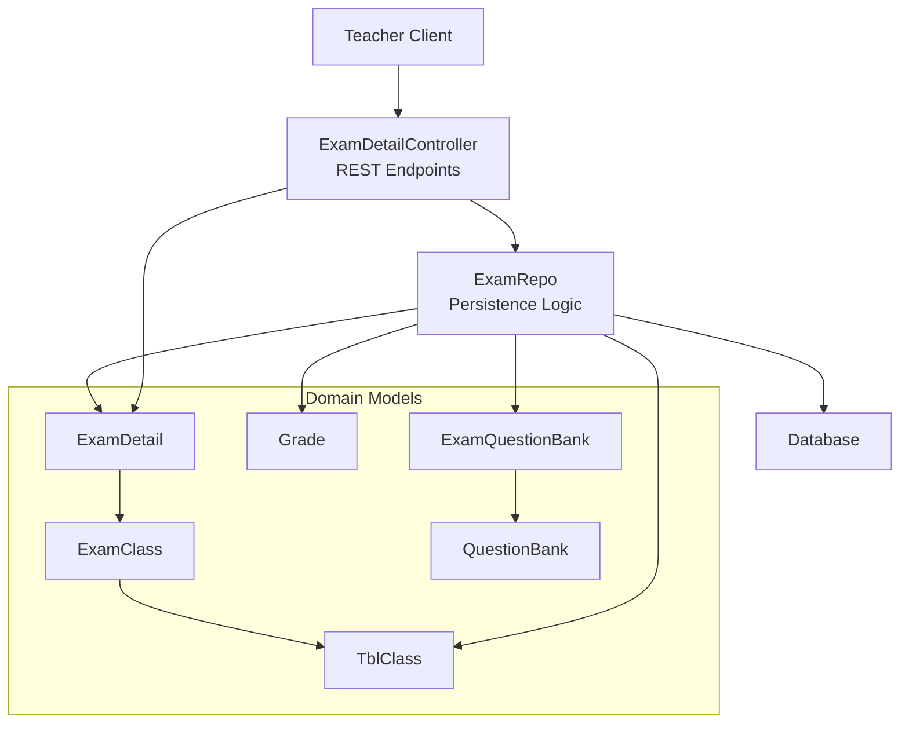
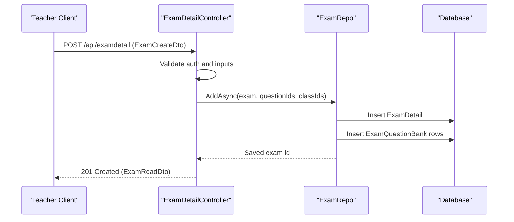
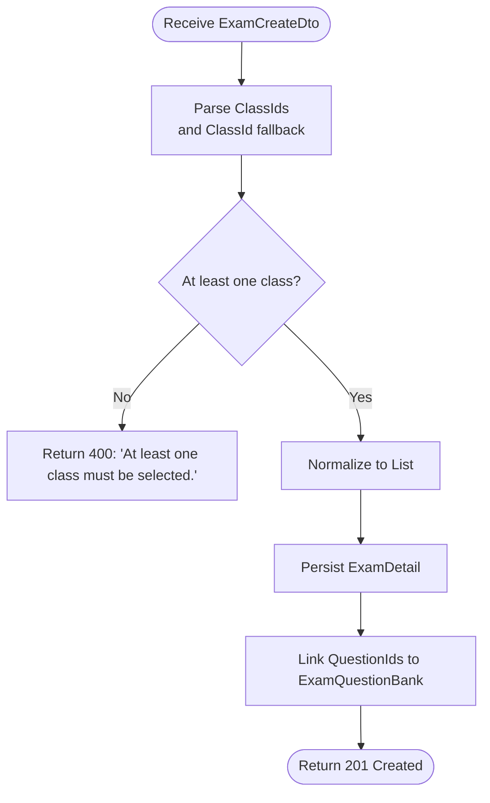
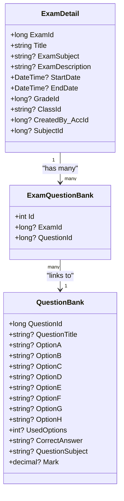
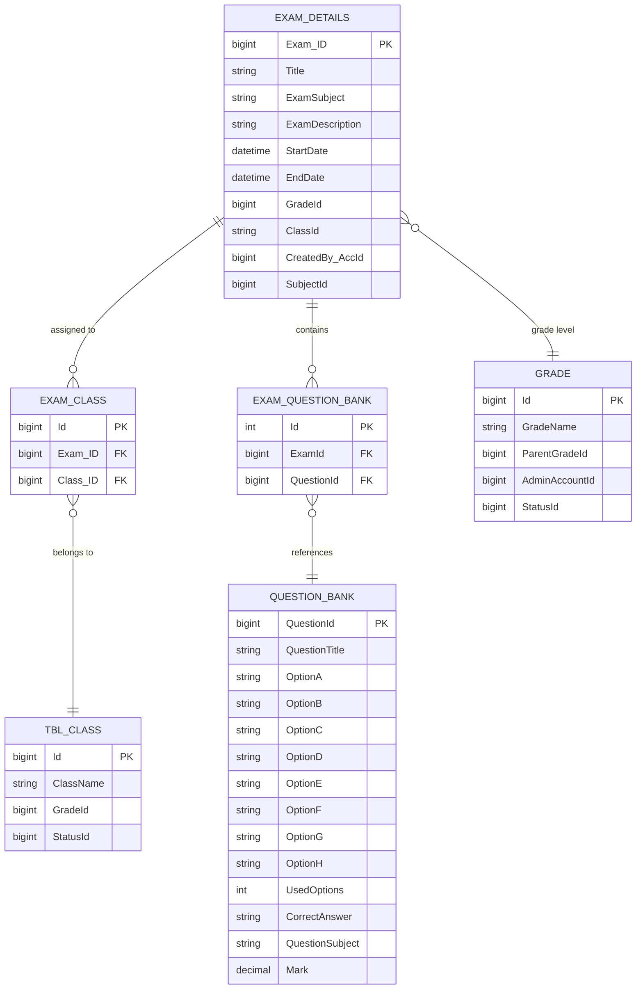
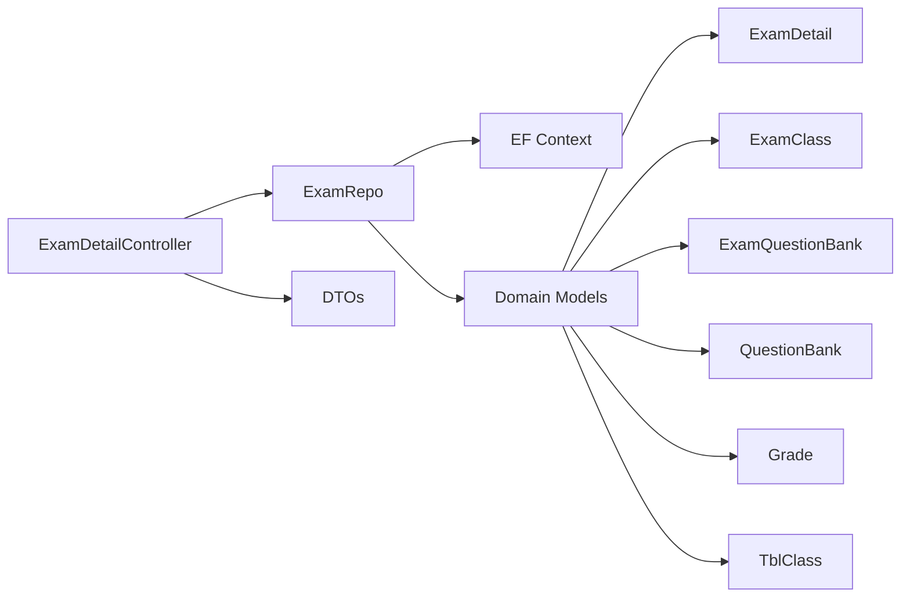

# Exam Creation & Configuration

<cite>
**Referenced Files in This Document**
- [ExamCreateDto.cs](file://server/Api/DTOs/ExamCreateDto.cs)
- [ExamReadDTO.cs](file://server/Api/DTOs/ExamReadDTO.cs)
- [ExamDetailController.cs](file://server/Api/Controllers/ExamDetailController.cs)
- [ExamRepo.cs](file://server/Api/Repositories/Implementation/ExamRepo.cs)
- [ExamDetail.cs](file://server/Api/Models/ExamDetail.cs)
- [ExamClass.cs](file://server/Api/Models/ExamClass.cs)
- [ExamQuestionBank.cs](file://server/Api/Models/ExamQuestionBank.cs)
- [QuestionBank.cs](file://server/Api/Models/QuestionBank.cs)
- [Grade.cs](file://server/Api/Models/Grade.cs)
- [TblClass.cs](file://server/Api/Models/TblClass.cs)
- [20260117231344_AddExamClassJunction.cs](file://server/Api/Migrations/20260117231344_AddExamClassJunction.cs)
</cite>

## Table of Contents
1. [Introduction](#introduction)
2. [Project Structure](#project-structure)
3. [Core Components](#core-components)
4. [Architecture Overview](#architecture-overview)
5. [Detailed Component Analysis](#detailed-component-analysis)
6. [Dependency Analysis](#dependency-analysis)
7. [Performance Considerations](#performance-considerations)
8. [Troubleshooting Guide](#troubleshooting-guide)
9. [Conclusion](#conclusion)

## Introduction
This document explains the exam creation and configuration subsystem for teachers. It covers how to create an exam with a title, subject selection, grade assignment, and distribution to one or more classes. It also documents the question bank integration (selecting questions), scheduling options (start/end dates and time constraints), API usage examples, error handling, validation feedback, and the database relationships between exams, subjects, grades, and classes.

## Project Structure
The exam creation flow is implemented in the server-side ASP.NET Core API:
- DTOs define the input/output contracts for creating and reading exams.
- The controller exposes REST endpoints for creating, updating, listing, and deleting exams.
- The repository handles persistence and links exams to questions and classes.
- Models represent entities such as exams, classes, grades, and question bank items.
- Migrations define the relational schema, including the junction table for multi-class assignment.

**Diagram sources**
- [ExamDetailController.cs:110-198](file://server/Api/Controllers/ExamDetailController.cs#L110-L198)
- [ExamRepo.cs:66-87](file://server/Api/Repositories/Implementation/ExamRepo.cs#L66-L87)
- [ExamDetail.cs:6-30](file://server/Api/Models/ExamDetail.cs#L6-L30)
- [ExamClass.cs:6-24](file://server/Api/Models/ExamClass.cs#L6-L24)
- [ExamQuestionBank.cs:6-13](file://server/Api/Models/ExamQuestionBank.cs#L6-L13)
- [QuestionBank.cs:7-46](file://server/Api/Models/QuestionBank.cs#L7-L46)
- [Grade.cs:6-25](file://server/Api/Models/Grade.cs#L6-L25)
- [TblClass.cs:6-15](file://server/Api/Models/TblClass.cs#L6-L15)

**Section sources**
- [ExamDetailController.cs:110-198](file://server/Api/Controllers/ExamDetailController.cs#L110-L198)
- [ExamRepo.cs:66-87](file://server/Api/Repositories/Implementation/ExamRepo.cs#L66-L87)

## Core Components
- ExamCreateDto: Input contract for creating an exam, including title, subject, grade, class distribution, scheduling, author identity, and selected question IDs.
- ExamDetail: Domain model representing an exam, including metadata, scheduling, and references to subject and class assignments.
- ExamClass: Junction entity linking an exam to one or more classes.
- ExamQuestionBank: Junction entity linking an exam to selected questions from the question bank.
- QuestionBank: Repository of reusable questions with options, correct answers, marks, and subject tags.
- Grade and TblClass: Reference entities for grade levels and classes.
- ExamDetailController: REST API exposing Create, Update, Get, Delete, and auxiliary endpoints.
- ExamRepo: Data access layer that persists exams, links questions, and manages class assignments.

Key responsibilities:
- Validate and normalize inputs (e.g., account ID, class IDs).
- Persist exam details and associate multiple classes.
- Link selected questions from the question bank.
- Return structured responses and errors.

**Section sources**
- [ExamCreateDto.cs:1-19](file://server/Api/DTOs/ExamCreateDto.cs#L1-L19)
- [ExamDetail.cs:6-30](file://server/Api/Models/ExamDetail.cs#L6-L30)
- [ExamClass.cs:6-24](file://server/Api/Models/ExamClass.cs#L6-L24)
- [ExamQuestionBank.cs:6-13](file://server/Api/Models/ExamQuestionBank.cs#L6-L13)
- [QuestionBank.cs:7-46](file://server/Api/Models/QuestionBank.cs#L7-L46)
- [Grade.cs:6-25](file://server/Api/Models/Grade.cs#L6-L25)
- [TblClass.cs:6-15](file://server/Api/Models/TblClass.cs#L6-L15)
- [ExamDetailController.cs:110-198](file://server/Api/Controllers/ExamDetailController.cs#L110-L198)
- [ExamRepo.cs:66-87](file://server/Api/Repositories/Implementation/ExamRepo.cs#L66-L87)

## Architecture Overview
The teacher creates an exam via a POST request to the exam endpoint. The controller validates the request, determines the authenticated teacher’s account, normalizes class selections, persists the exam, links selected questions, and returns the created exam. Students later see only exams assigned to their class.

**Diagram sources**
- [ExamDetailController.cs:110-198](file://server/Api/Controllers/ExamDetailController.cs#L110-L198)
- [ExamRepo.cs:66-87](file://server/Api/Repositories/Implementation/ExamRepo.cs#L66-L87)

## Detailed Component Analysis

### ExamCreateDto and Validation Rules
- Title: Required string identifying the exam.
- SubjectId and ExamSubject: Either can be provided; backward compatibility supports both numeric ID and name.
- ExamDescription: Free-text description of the exam.
- GradeId and Grade: Either can be provided; backward compatibility supports both numeric ID and name.
- ClassId and ClassIds: Supports single legacy field and new multi-class list. At least one class must be selected.
- StartDate and EndDate: Scheduling window for when students can take the exam.
- CreatedBy_AccID and CreatedBy: Author identity; controller resolves from token or payload.
- QuestionIds: List of question IDs from the question bank to include in the exam.

Validation behavior:
- Account resolution: If not present in token, falls back to payload fields. Returns a clear error if unresolved.
- Class selection: Requires at least one class ID; accepts mixed types and parses safely.
- Date constraints: StartDate and EndDate are required by the DTO; business rules should enforce StartDate <= EndDate.

Example API call (POST):
- Endpoint: POST /api/examdetail
- Body fields: title, subjectId or examSubject, examDescription, gradeId or grade, classIds (array), startDate, endDate, createdBy_AccID, questionIds (array).

Expected success response:
- Status: 201 Created
- Body: ExamReadDto containing examId, title, subjectName, description, start/end dates, gradeId, subjectId, classId (string representation), questions array, totalMarks.

Error scenarios:
- Missing or invalid account: 400 Bad Request with message indicating inability to determine account.
- No class selected: 400 Bad Request with message requiring at least one class.
- Database or unexpected failure: 500 Internal Server Error with detailed message.

**Section sources**
- [ExamCreateDto.cs:1-19](file://server/Api/DTOs/ExamCreateDto.cs#L1-L19)
- [ExamDetailController.cs:110-198](file://server/Api/Controllers/ExamDetailController.cs#L110-L198)
- [ExamReadDTO.cs:5-19](file://server/Api/DTOs/ExamReadDTO.cs#L5-L19)

### Multi-Class Assignment Capability
A single exam can be distributed to multiple classes simultaneously. The implementation supports:
- A dedicated junction table Exam_Class linking exams to classes.
- Backward compatibility where the legacy ClassId field may store a comma-separated list of class IDs.
- Controller logic that normalizes ClassIds into a list and passes it to the repository.

Notes:
- The migration defines a proper junction table with unique constraints on (Exam_ID, Class_ID).
- The current repository code sets a comma-separated string in ExamDetail.ClassId for multi-class support. For full normalization, consider persisting via ExamClass records instead of a delimited string.

**Diagram sources**
- [ExamDetailController.cs:143-183](file://server/Api/Controllers/ExamDetailController.cs#L143-L183)
- [ExamRepo.cs:66-87](file://server/Api/Repositories/Implementation/ExamRepo.cs#L66-L87)

**Section sources**
- [ExamDetailController.cs:143-183](file://server/Api/Controllers/ExamDetailController.cs#L143-L183)
- [ExamRepo.cs:66-87](file://server/Api/Repositories/Implementation/ExamRepo.cs#L66-L87)
- [20260117231344_AddExamClassJunction.cs:13-48](file://server/Api/Migrations/20260117231344_AddExamClassJunction.cs#L13-L48)

### Question Bank Integration
Teachers select questions from the available question bank by providing QuestionIds in the request body. The system:
- Persists each selected question as a link in ExamQuestionBank tied to the newly created exam.
- Includes linked questions in the read response, mapping question properties and calculating total marks.

Constraints and considerations:
- Ensure all QuestionIds exist in the question bank before linking.
- Marks per question contribute to the exam’s TotalMarks.

**Diagram sources**
- [ExamDetail.cs:6-30](file://server/Api/Models/ExamDetail.cs#L6-L30)
- [ExamQuestionBank.cs:6-13](file://server/Api/Models/ExamQuestionBank.cs#L6-L13)
- [QuestionBank.cs:7-46](file://server/Api/Models/QuestionBank.cs#L7-L46)

**Section sources**
- [ExamRepo.cs:76-87](file://server/Api/Repositories/Implementation/ExamRepo.cs#L76-L87)
- [ExamDetailController.cs:255-288](file://server/Api/Controllers/ExamDetailController.cs#L255-L288)

### Scheduling Options
- StartDate and EndDate define the exam availability window.
- The controller maps these to UTC when returning ExamReadDto.
- Business rule recommendation: Enforce StartDate <= EndDate on the client and server side.

Usage example:
- Include startDate and endDate in ISO 8601 format in the request body.
- The response will return standardized UTC timestamps.

**Section sources**
- [ExamCreateDto.cs:12-13](file://server/Api/DTOs/ExamCreateDto.cs#L12-L13)
- [ExamDetailController.cs:266-267](file://server/Api/Controllers/ExamDetailController.cs#L266-L267)

### API Examples and Error Handling

Create exam (POST /api/examdetail):
- Success: 201 Created with ExamReadDto.
- Errors:
  - 400 Bad Request: Unable to determine account ID.
  - 400 Bad Request: At least one class must be selected.
  - 500 Internal Server Error: Unexpected exception with message details.

Get exam by ID (GET /api/examdetail/{id}):
- Success: 200 OK with ExamReadDto.
- Not found: 404 Not Found.
- Access denied: 403 Forbidden if student is not assigned to the exam’s class.

List exams (GET /api/examdetail):
- Filters by student class if applicable; otherwise returns all exams for teachers/admins.

Subjects endpoint (GET /api/examdetail/subjects):
- Returns a list of subjects used for exams.

**Section sources**
- [ExamDetailController.cs:24-69](file://server/Api/Controllers/ExamDetailController.cs#L24-L69)
- [ExamDetailController.cs:71-108](file://server/Api/Controllers/ExamDetailController.cs#L71-L108)
- [ExamDetailController.cs:110-198](file://server/Api/Controllers/ExamDetailController.cs#L110-L198)
- [ExamDetailController.cs:291-299](file://server/Api/Controllers/ExamDetailController.cs#L291-L299)

### Database Schema Relationships
- ExamDetail stores core exam metadata, scheduling, and references to subject and grade.
- Exam_Class is a junction table linking exams to classes, ensuring a single exam can be assigned to multiple classes.
- ExamQuestionBank links exams to questions from the question bank.
- Grade and TblClass provide reference data for grade levels and classes.

**Diagram sources**
- [ExamDetail.cs:6-30](file://server/Api/Models/ExamDetail.cs#L6-L30)
- [ExamClass.cs:6-24](file://server/Api/Models/ExamClass.cs#L6-L24)
- [TblClass.cs:6-15](file://server/Api/Models/TblClass.cs#L6-L15)
- [ExamQuestionBank.cs:6-13](file://server/Api/Models/ExamQuestionBank.cs#L6-L13)
- [QuestionBank.cs:7-46](file://server/Api/Models/QuestionBank.cs#L7-L46)
- [Grade.cs:6-25](file://server/Api/Models/Grade.cs#L6-L25)
- [20260117231344_AddExamClassJunction.cs:13-48](file://server/Api/Migrations/20260117231344_AddExamClassJunction.cs#L13-L48)

**Section sources**
- [ExamDetail.cs:6-30](file://server/Api/Models/ExamDetail.cs#L6-L30)
- [ExamClass.cs:6-24](file://server/Api/Models/ExamClass.cs#L6-L24)
- [TblClass.cs:6-15](file://server/Api/Models/TblClass.cs#L6-L15)
- [ExamQuestionBank.cs:6-13](file://server/Api/Models/ExamQuestionBank.cs#L6-L13)
- [QuestionBank.cs:7-46](file://server/Api/Models/QuestionBank.cs#L7-L46)
- [Grade.cs:6-25](file://server/Api/Models/Grade.cs#L6-L25)
- [20260117231344_AddExamClassJunction.cs:13-48](file://server/Api/Migrations/20260117231344_AddExamClassJunction.cs#L13-L48)

## Dependency Analysis
- Controllers depend on repositories for data operations and on EF context for additional queries (e.g., subjects).
- Repositories depend on EF context and domain models.
- Models define relationships and navigation properties.
- DTOs decouple API contracts from internal models.

**Diagram sources**
- [ExamDetailController.cs:1-22](file://server/Api/Controllers/ExamDetailController.cs#L1-L22)
- [ExamRepo.cs:1-13](file://server/Api/Repositories/Implementation/ExamRepo.cs#L1-L13)
- [ExamDetail.cs:6-30](file://server/Api/Models/ExamDetail.cs#L6-L30)
- [ExamClass.cs:6-24](file://server/Api/Models/ExamClass.cs#L6-L24)
- [ExamQuestionBank.cs:6-13](file://server/Api/Models/ExamQuestionBank.cs#L6-L13)
- [QuestionBank.cs:7-46](file://server/Api/Models/QuestionBank.cs#L7-L46)
- [Grade.cs:6-25](file://server/Api/Models/Grade.cs#L6-L25)
- [TblClass.cs:6-15](file://server/Api/Models/TblClass.cs#L6-L15)

**Section sources**
- [ExamDetailController.cs:1-22](file://server/Api/Controllers/ExamDetailController.cs#L1-L22)
- [ExamRepo.cs:1-13](file://server/Api/Repositories/Implementation/ExamRepo.cs#L1-L13)

## Performance Considerations
- Minimize N+1 queries when loading exams with questions; prefer eager loading or batched queries.
- Avoid storing large comma-separated strings in ClassId; use the junction table consistently.
- Index frequently queried columns (e.g., ExamId, ClassId, QuestionId) to improve lookup performance.
- Validate and filter question IDs early to reduce unnecessary database writes.

[No sources needed since this section provides general guidance]

## Troubleshooting Guide
Common issues and resolutions:
- Authentication failures: Ensure the request includes a valid token with a resolvable account identifier. The controller returns a 400 error if it cannot determine the account.
- Missing class selection: Provide at least one class ID in ClassIds or ClassId. The controller enforces this and returns a 400 error otherwise.
- Access denied for students: Students can only view exams assigned to their class. Verify the student’s class assignment and the exam’s class distribution.
- Unexpected server errors: Inspect the 500 response message for inner exception details and stack traces logged by the controller.

Operational tips:
- Log and monitor controller diagnostics and error messages during exam creation.
- Validate date ranges (StartDate <= EndDate) on the client and server.
- Confirm that all QuestionIds exist in the question bank before submission.

**Section sources**
- [ExamDetailController.cs:110-198](file://server/Api/Controllers/ExamDetailController.cs#L110-L198)
- [ExamDetailController.cs:71-108](file://server/Api/Controllers/ExamDetailController.cs#L71-L108)

## Conclusion
The exam creation subsystem enables teachers to build exams with clear metadata, schedule them within defined windows, and distribute them to one or more classes. Questions are integrated from the question bank, and the API provides robust validation and error handling. The database schema supports multi-class distribution through a junction table and links exams to questions. Following the recommended practices ensures reliable operation and scalability.

[No sources needed since this section summarizes without analyzing specific files]