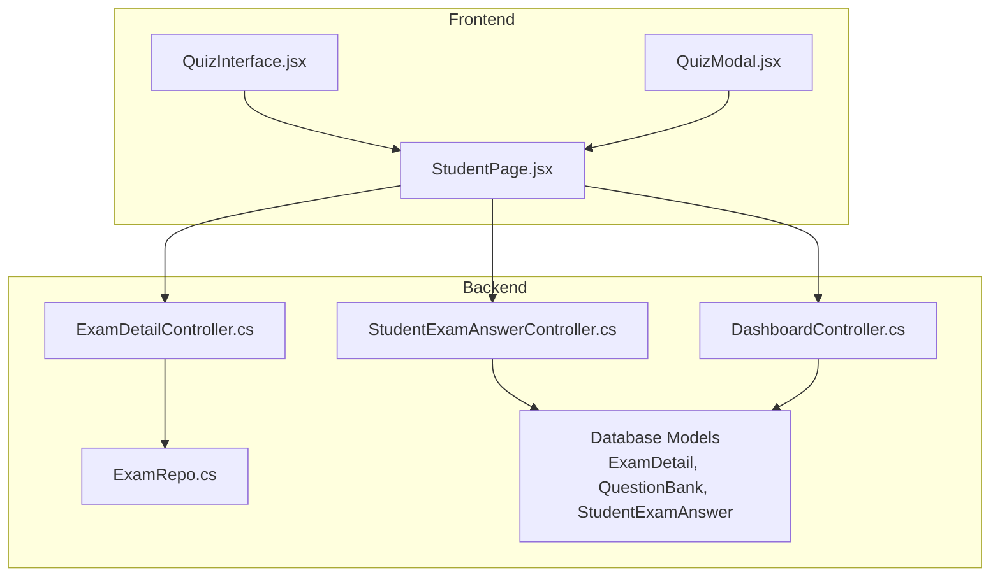
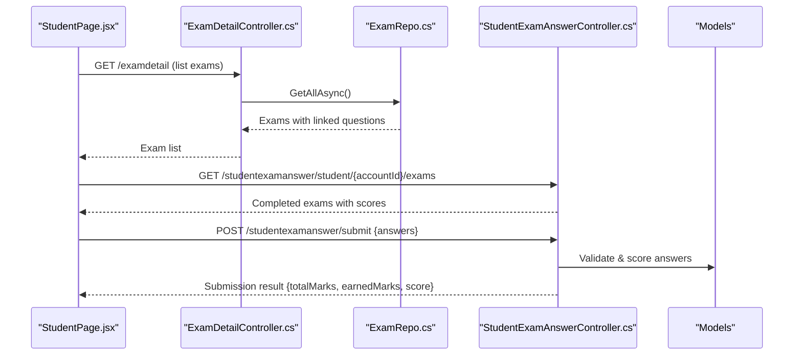
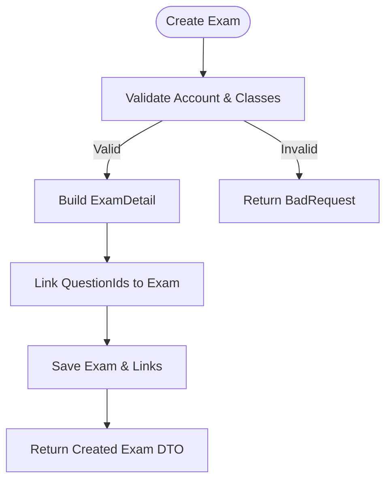
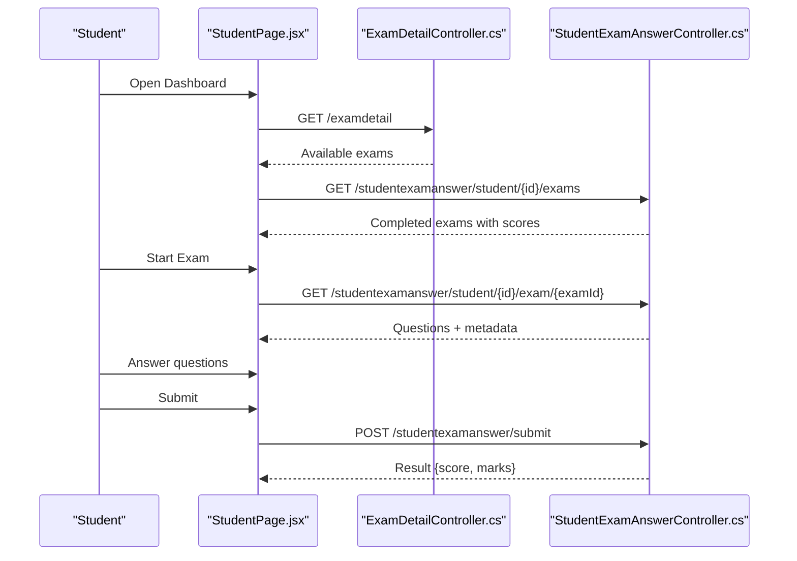
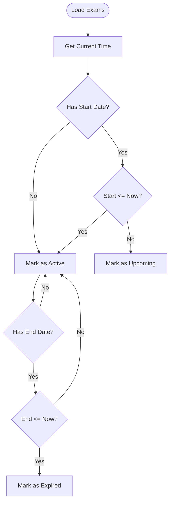
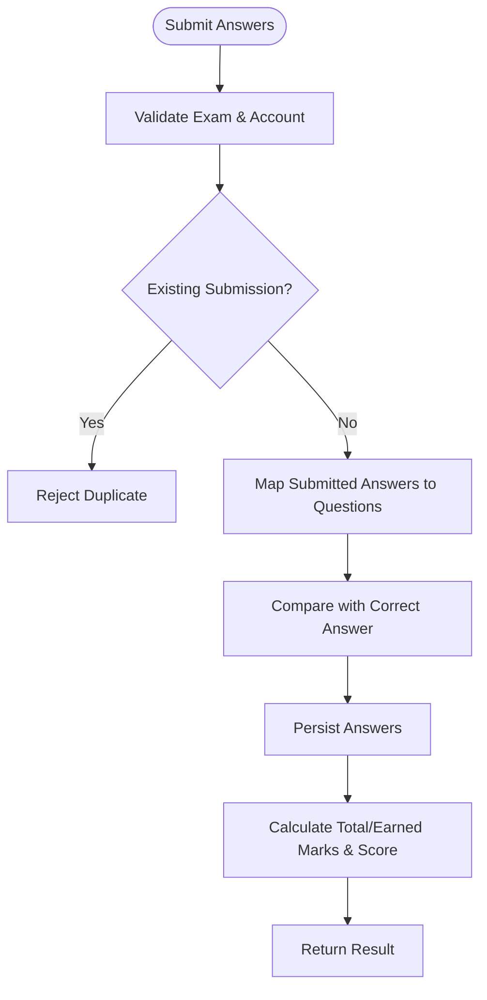
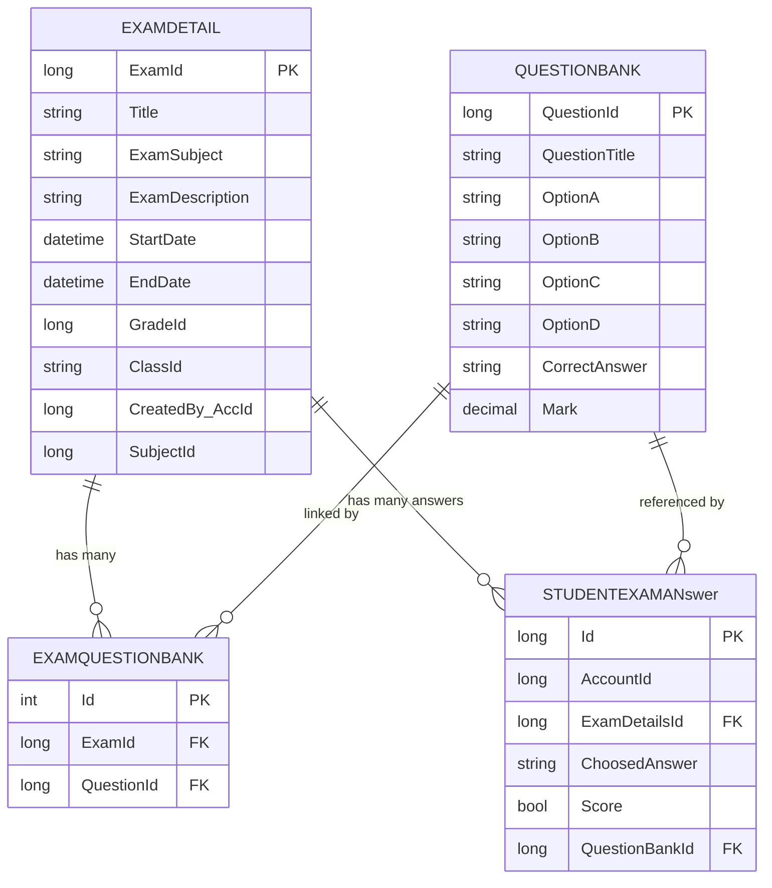
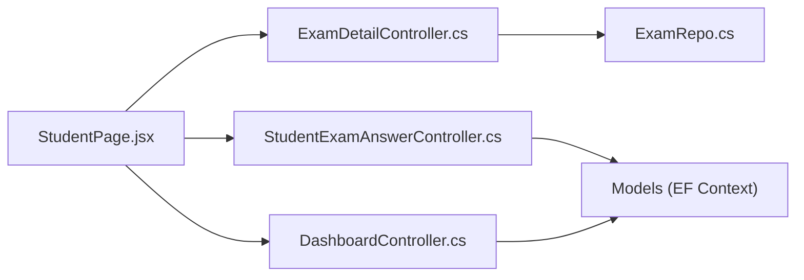

# Exam Management System

<cite>
**Referenced Files in This Document**
- [ExamDetailController.cs](file://server/Api/Controllers/ExamDetailController.cs)
- [StudentExamAnswerController.cs](file://server/Api/Controllers/StudentExamAnswerController.cs)
- [DashboardController.cs](file://server/Api/Controllers/DashboardController.cs)
- [ExamRepo.cs](file://server/Api/Repositories/Implementation/ExamRepo.cs)
- [ExamDetail.cs](file://server/Api/Models/ExamDetail.cs)
- [StudentExamAnswer.cs](file://server/Api/Models/StudentExamAnswer.cs)
- [QuestionBank.cs](file://server/Api/Models/QuestionBank.cs)
- [ExamQuestionBank.cs](file://server/Api/Models/ExamQuestionBank.cs)
- [ExamCreateDto.cs](file://server/Api/DTOs/ExamCreateDto.cs)
- [QuizInterface.jsx](file://client/src/components/QuizInterface.jsx)
- [StudentPage.jsx](file://client/src/pages/StudentPage.jsx)
- [QuizModal.jsx](file://client/src/components/QuizModal.jsx)
</cite>

## Table of Contents
1. Introduction
2. Project Structure
3. Core Components
4. Architecture Overview
5. Detailed Component Analysis
6. Dependency Analysis
7. Performance Considerations
8. Troubleshooting Guide
9. Conclusion

## Introduction
This document explains the complete lifecycle of academic examinations in the Exam-Hub application, from exam creation and scheduling to student exam-taking, submission, scoring, and reporting. It covers teacher and student interfaces, status management, timing controls, result calculation, relationships between exams, questions, and answers, and provides examples of CRUD operations, scheduling APIs, and real-time progress tracking. It also addresses security measures and result validation processes implemented in the system.

## Project Structure
The system is a full-stack web application:
- Backend (ASP.NET Core): RESTful APIs for exam management, answer submission, and dashboard/reporting endpoints.
- Frontend (React): Teacher and student dashboards, quiz interface, modal dialogs, and state management for timers and submissions.

**Diagram sources**
- [StudentPage.jsx:115-246](file://client/src/pages/StudentPage.jsx#L115-L246)
- [ExamDetailController.cs:24-108](file://server/Api/Controllers/ExamDetailController.cs#L24-L108)
- [StudentExamAnswerController.cs:45-126](file://server/Api/Controllers/StudentExamAnswerController.cs#L45-L126)
- [DashboardController.cs:24-78](file://server/Api/Controllers/DashboardController.cs#L24-L78)
- [ExamRepo.cs:15-39](file://server/Api/Repositories/Implementation/ExamRepo.cs#L15-L39)

**Section sources**
- [StudentPage.jsx:115-246](file://client/src/pages/StudentPage.jsx#L115-L246)
- [ExamDetailController.cs:24-108](file://server/Api/Controllers/ExamDetailController.cs#L24-L108)
- [StudentExamAnswerController.cs:45-126](file://server/Api/Controllers/StudentExamAnswerController.cs#L45-L126)
- [DashboardController.cs:24-78](file://server/Api/Controllers/DashboardController.cs#L24-L78)
- [ExamRepo.cs:15-39](file://server/Api/Repositories/Implementation/ExamRepo.cs#L15-L39)

## Core Components
- Exam CRUD and scheduling via ExamDetailController: create, read, update, delete exams; assign classes; link questions; filter by class access.
- Answer submission and scoring via StudentExamAnswerController: validate submissions, compute correctness, persist answers, return scores.
- Dashboard and reporting via DashboardController: lookup data, leaderboards, statistics, and role-based access.
- Repository layer via ExamRepo: data access for exams and question linking.
- Frontend components: StudentPage orchestrates exam flow; QuizInterface renders questions and handles UI interactions; QuizModal displays prompts.

**Section sources**
- [ExamDetailController.cs:110-253](file://server/Api/Controllers/ExamDetailController.cs#L110-L253)
- [StudentExamAnswerController.cs:199-332](file://server/Api/Controllers/StudentExamAnswerController.cs#L199-L332)
- [DashboardController.cs:80-375](file://server/Api/Controllers/DashboardController.cs#L80-L375)
- [ExamRepo.cs:66-138](file://server/Api/Repositories/Implementation/ExamRepo.cs#L66-L138)
- [StudentPage.jsx:355-584](file://client/src/pages/StudentPage.jsx#L355-L584)
- [QuizInterface.jsx:1-201](file://client/src/components/QuizInterface.jsx#L1-L201)
- [QuizModal.jsx:1-25](file://client/src/components/QuizModal.jsx#L1-L25)

## Architecture Overview
The system follows a layered architecture:
- API Controllers expose REST endpoints for exam management, answer submission, and dashboard queries.
- Repositories encapsulate database operations and populate related entities.
- Models define domain entities such as exams, questions, and answers.
- React frontend manages user flows, timers, and form submissions.

**Diagram sources**
- [ExamDetailController.cs:24-69](file://server/Api/Controllers/ExamDetailController.cs#L24-L69)
- [ExamRepo.cs:15-39](file://server/Api/Repositories/Implementation/ExamRepo.cs#L15-L39)
- [StudentExamAnswerController.cs:45-126](file://server/Api/Controllers/StudentExamAnswerController.cs#L45-L126)
- [StudentExamAnswerController.cs:199-332](file://server/Api/Controllers/StudentExamAnswerController.cs#L199-L332)
- [StudentPage.jsx:115-246](file://client/src/pages/StudentPage.jsx#L115-L246)

## Detailed Component Analysis

### Exam Creation, Configuration, and Scheduling (Teacher Interface)
- Create exam: Accepts title, subject, description, grade, class assignments, start/end dates, and question IDs. Validates account existence and ensures at least one class is selected. Creates an exam and links multiple questions.
- Update exam: Updates fields and synchronizes question links by removing old and adding new ones. Supports multi-class assignment via comma-separated ClassId.
- Delete exam: Removes exam and associated question links.
- Access control: Teachers can view all exams; students see only exams assigned to their class based on ClassId filtering.

**Diagram sources**
- [ExamDetailController.cs:110-198](file://server/Api/Controllers/ExamDetailController.cs#L110-L198)
- [ExamRepo.cs:66-87](file://server/Api/Repositories/Implementation/ExamRepo.cs#L66-L87)
- [ExamCreateDto.cs:1-19](file://server/Api/DTOs/ExamCreateDto.cs#L1-L19)

**Section sources**
- [ExamDetailController.cs:110-253](file://server/Api/Controllers/ExamDetailController.cs#L110-L253)
- [ExamRepo.cs:66-138](file://server/Api/Repositories/Implementation/ExamRepo.cs#L66-L138)
- [ExamCreateDto.cs:1-19](file://server/Api/DTOs/ExamCreateDto.cs#L1-L19)

### Student Exam-Taking Experience
- Fetch available and completed exams: The frontend retrieves exams and completed results, categorizing them by active/upcoming/expired states using start/end dates.
- Start exam: Loads detailed exam with questions mapped to MCQ/TF/fill types, shuffles questions, and initializes timer based on deadline.
- Submit exam: Collects answers from the form, validates presence, sends payload to backend, updates local state, and shows success or auto-submit feedback.

**Diagram sources**
- [StudentPage.jsx:115-246](file://client/src/pages/StudentPage.jsx#L115-L246)
- [StudentPage.jsx:355-584](file://client/src/pages/StudentPage.jsx#L355-L584)
- [ExamDetailController.cs:24-108](file://server/Api/Controllers/ExamDetailController.cs#L24-L108)
- [StudentExamAnswerController.cs:45-126](file://server/Api/Controllers/StudentExamAnswerController.cs#L45-L126)
- [StudentExamAnswerController.cs:199-332](file://server/Api/Controllers/StudentExamAnswerController.cs#L199-L332)

**Section sources**
- [StudentPage.jsx:115-246](file://client/src/pages/StudentPage.jsx#L115-L246)
- [StudentPage.jsx:355-584](file://client/src/pages/StudentPage.jsx#L355-L584)
- [QuizInterface.jsx:1-201](file://client/src/components/QuizInterface.jsx#L1-L201)
- [QuizModal.jsx:1-25](file://client/src/components/QuizModal.jsx#L1-L25)

### Exam Status Management and Timing Controls
- Status classification: Active, upcoming, expired based on current time vs start/end dates. Expired exams are treated as missed and shown in completed with zero score.
- Timer: Client-side countdown that auto-submits when time reaches zero; prevents leaving page during active exam via beforeunload and visibility change handlers.

**Diagram sources**
- [StudentPage.jsx:148-231](file://client/src/pages/StudentPage.jsx#L148-L231)

**Section sources**
- [StudentPage.jsx:148-231](file://client/src/pages/StudentPage.jsx#L148-L231)
- [StudentPage.jsx:317-337](file://client/src/pages/StudentPage.jsx#L317-L337)
- [StudentPage.jsx:90-113](file://client/src/pages/StudentPage.jsx#L90-L113)

### Result Calculation Mechanisms
- Correctness evaluation: Compares chosen answer with correct answer; supports letter indices (A-D) and text matches.
- Scoring: Computes total marks from linked questions and earned marks from correct answers; returns percentage score rounded to two decimals.
- Persistence: Stores each answer with choice and boolean score flag; prevents duplicate submissions per exam.

**Diagram sources**
- [StudentExamAnswerController.cs:199-332](file://server/Api/Controllers/StudentExamAnswerController.cs#L199-L332)

**Section sources**
- [StudentExamAnswerController.cs:199-332](file://server/Api/Controllers/StudentExamAnswerController.cs#L199-L332)

### Relationship Between Exams, Questions, and Student Answers
- ExamDetail holds exam metadata and links to multiple QuestionBank entries via ExamQuestionBank.
- StudentExamAnswer records per-question choices and correctness for a given exam and student.
- Dashboard endpoints aggregate performance across exams and provide leaderboards and statistics.

**Diagram sources**
- [ExamDetail.cs:6-30](file://server/Api/Models/ExamDetail.cs#L6-L30)
- [QuestionBank.cs:7-46](file://server/Api/Models/QuestionBank.cs#L7-L46)
- [ExamQuestionBank.cs:6-13](file://server/Api/Models/ExamQuestionBank.cs#L6-L13)
- [StudentExamAnswer.cs:6-26](file://server/Api/Models/StudentExamAnswer.cs#L6-L26)

**Section sources**
- [ExamDetail.cs:6-30](file://server/Api/Models/ExamDetail.cs#L6-L30)
- [QuestionBank.cs:7-46](file://server/Api/Models/QuestionBank.cs#L7-L46)
- [ExamQuestionBank.cs:6-13](file://server/Api/Models/ExamQuestionBank.cs#L6-L13)
- [StudentExamAnswer.cs:6-26](file://server/Api/Models/StudentExamAnswer.cs#L6-L26)

### Example Operations and APIs
- Create exam: POST /api/examdetail with ExamCreateDto including Title, SubjectId/ExamSubject, Description, GradeId/Grade, ClassIds/ClassId, StartDate, EndDate, CreatedBy_AccID, and QuestionIds.
- Read exams: GET /api/examdetail lists exams filtered by class for students; GET /api/examdetail/{id} returns details with questions.
- Update exam: PUT /api/examdetail/{id} with updated fields and synchronized QuestionIds.
- Delete exam: DELETE /api/examdetail/{id}.
- Get student exams/results: GET /api/studentexamanswer/student/{accountId}/exams and GET /api/studentexamanswer/student/{accountId}/exam/{examId}.
- Submit answers: POST /api/studentexamanswer/submit with ExamId, AccountId, and Answers array.
- Dashboard lookups: GET /api/dashboard/lookup-data for grades, classes, subjects; GET /api/dashboard/leaderboard/{examId} for rankings; GET /api/dashboard/exam/{examId}/stats for statistics.

**Section sources**
- [ExamDetailController.cs:24-108](file://server/Api/Controllers/ExamDetailController.cs#L24-L108)
- [ExamDetailController.cs:110-253](file://server/Api/Controllers/ExamDetailController.cs#L110-L253)
- [StudentExamAnswerController.cs:45-126](file://server/Api/Controllers/StudentExamAnswerController.cs#L45-L126)
- [StudentExamAnswerController.cs:199-332](file://server/Api/Controllers/StudentExamAnswerController.cs#L199-L332)
- [DashboardController.cs:24-78](file://server/Api/Controllers/DashboardController.cs#L24-L78)
- [DashboardController.cs:236-375](file://server/Api/Controllers/DashboardController.cs#L236-L375)

### Real-Time Progress Tracking
- Timer countdown: Client-side interval decrements seconds until zero; triggers auto-submit when time runs out.
- Success feedback: Displays temporary success message upon submission; moves exam to completed section.
- Review mode: Renders past exams with correct/incorrect indicators and user answers.

**Section sources**
- [StudentPage.jsx:317-337](file://client/src/pages/StudentPage.jsx#L317-L337)
- [StudentPage.jsx:516-584](file://client/src/pages/StudentPage.jsx#L516-L584)
- [QuizInterface.jsx:119-129](file://client/src/components/QuizInterface.jsx#L119-L129)
- [QuizInterface.jsx:131-199](file://client/src/components/QuizInterface.jsx#L131-L199)

### Security Measures and Anti-Cheating Features
- Role-based access: Controllers check roles (Teacher, Superadmin, Admin, Board) to allow teachers to view all exams and restrict student access to assigned classes.
- Class-based filtering: Students see only exams where their class ID is included in the exam’s ClassId list.
- Duplicate submission prevention: Server rejects repeated submissions for the same exam per student.
- Browser safeguards: Prevents leaving the page during active exams and warns if tab loses focus.

**Section sources**
- [ExamDetailController.cs:24-69](file://server/Api/Controllers/ExamDetailController.cs#L24-L69)
- [ExamDetailController.cs:71-108](file://server/Api/Controllers/ExamDetailController.cs#L71-L108)
- [StudentExamAnswerController.cs:229-233](file://server/Api/Controllers/StudentExamAnswerController.cs#L229-L233)
- [StudentPage.jsx:90-113](file://client/src/pages/StudentPage.jsx#L90-L113)

### Export Capabilities and Reporting Features
- Leaderboards: Retrieve ranked student performance per exam with optional filters (grade, class, date range).
- Statistics: Get pass/fail rates and other metrics for specific exams.
- Lookup data: Fetch grades, classes, and subjects for filtering and display.
- Note: Dedicated export endpoints are not present in the analyzed controllers; reporting is provided through leaderboard and stats endpoints which can be consumed by external tools for export.

**Section sources**
- [DashboardController.cs:236-375](file://server/Api/Controllers/DashboardController.cs#L236-L375)
- [DashboardController.cs:24-78](file://server/Api/Controllers/DashboardController.cs#L24-L78)

## Dependency Analysis
- Controllers depend on repositories and EF context for data access.
- ExamRepo manually populates related entities due to explicit Include usage patterns.
- Frontend depends on API responses and maps them to internal structures for rendering and submission.

**Diagram sources**
- [ExamDetailController.cs:15-22](file://server/Api/Controllers/ExamDetailController.cs#L15-L22)
- [ExamRepo.cs:8-13](file://server/Api/Repositories/Implementation/ExamRepo.cs#L8-L13)
- [StudentExamAnswerController.cs:15-20](file://server/Api/Controllers/StudentExamAnswerController.cs#L15-L20)
- [DashboardController.cs:15-22](file://server/Api/Controllers/DashboardController.cs#L15-L22)
- [StudentPage.jsx:115-246](file://client/src/pages/StudentPage.jsx#L115-L246)

**Section sources**
- [ExamDetailController.cs:15-22](file://server/Api/Controllers/ExamDetailController.cs#L15-L22)
- [ExamRepo.cs:8-13](file://server/Api/Repositories/Implementation/ExamRepo.cs#L8-L13)
- [StudentExamAnswerController.cs:15-20](file://server/Api/Controllers/StudentExamAnswerController.cs#L15-L20)
- [DashboardController.cs:15-22](file://server/Api/Controllers/DashboardController.cs#L15-L22)
- [StudentPage.jsx:115-246](file://client/src/pages/StudentPage.jsx#L115-L246)

## Performance Considerations
- N+1 query mitigation: Repositories batch-load related entities to reduce round trips.
- Efficient filtering: Class-based filtering on the server reduces unnecessary data transfer to students.
- Client-side caching: Local state maintains exam lists and completed results to avoid redundant requests.
- Timer efficiency: Single interval used for countdown; cleanup on component unmount prevents leaks.

[No sources needed since this section provides general guidance]

## Troubleshooting Guide
- Network errors: Frontend catches network failures and displays user-friendly messages; ensure server is running and CORS/proxy settings are correct.
- Validation errors: Backend returns BadRequest for invalid payloads (e.g., missing account, duplicate submission); inspect response messages.
- Authentication issues: Ensure token contains valid claims; parse token to extract AccountId correctly.
- Database constraints: Errors during save indicate constraint violations; check migrations and data integrity.

**Section sources**
- [StudentPage.jsx:233-246](file://client/src/pages/StudentPage.jsx#L233-L246)
- [StudentExamAnswerController.cs:200-233](file://server/Api/Controllers/StudentExamAnswerController.cs#L200-L233)
- [ExamDetailController.cs:192-198](file://server/Api/Controllers/ExamDetailController.cs#L192-L198)

## Conclusion
The Exam-Hub application provides a robust exam management system supporting end-to-end workflows for teachers and students. It enables exam creation with flexible scheduling, secure access control, real-time timing, accurate scoring, and comprehensive reporting. The separation of concerns across controllers, repositories, models, and frontend components ensures maintainability and scalability. While dedicated export endpoints are not present, reporting APIs support integration with external tools for exporting results and generating reports.

[No sources needed since this section summarizes without analyzing specific files]