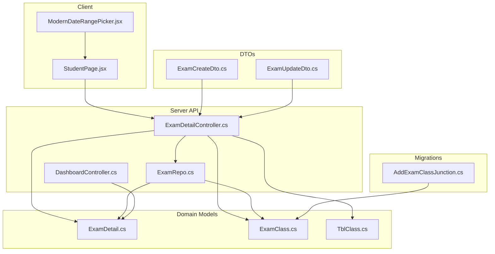
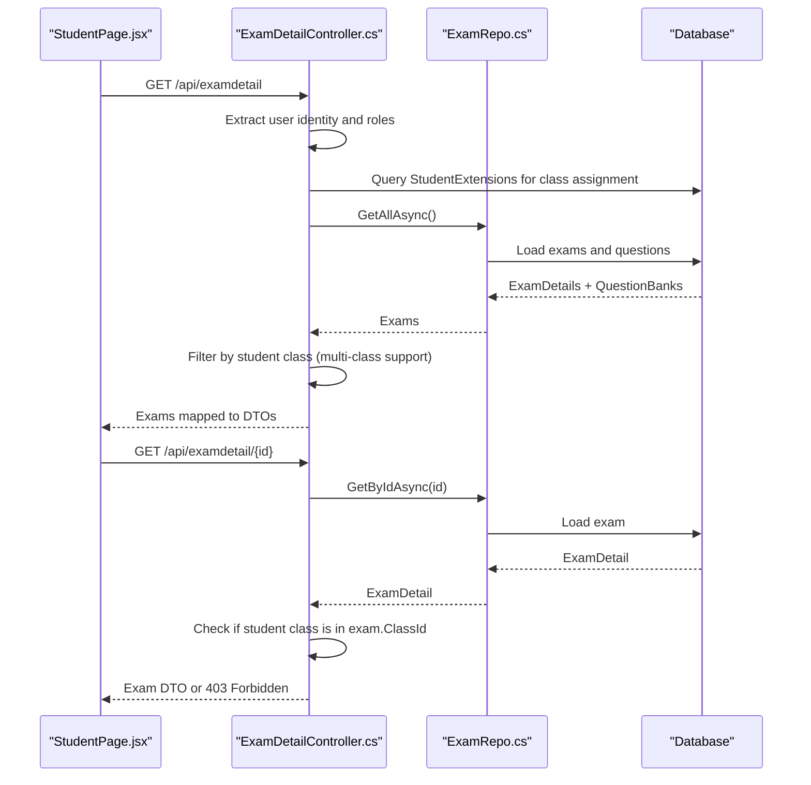
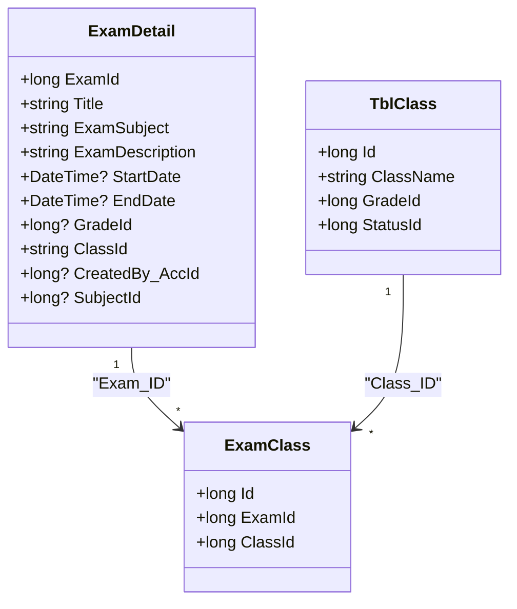
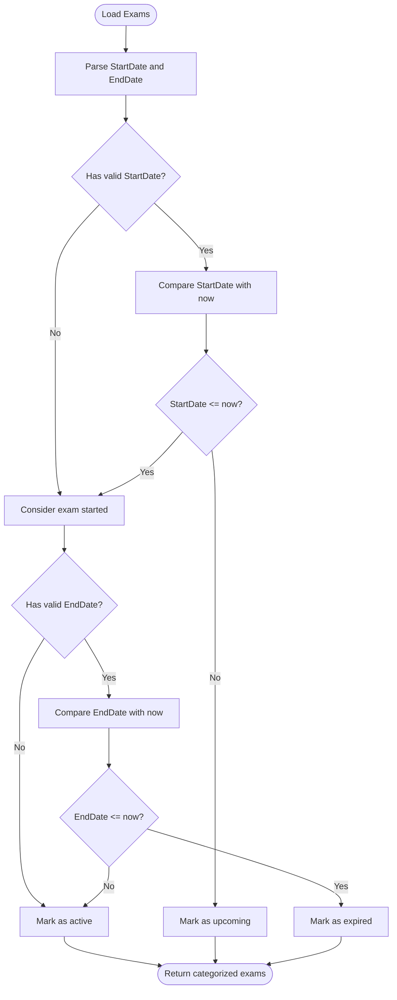
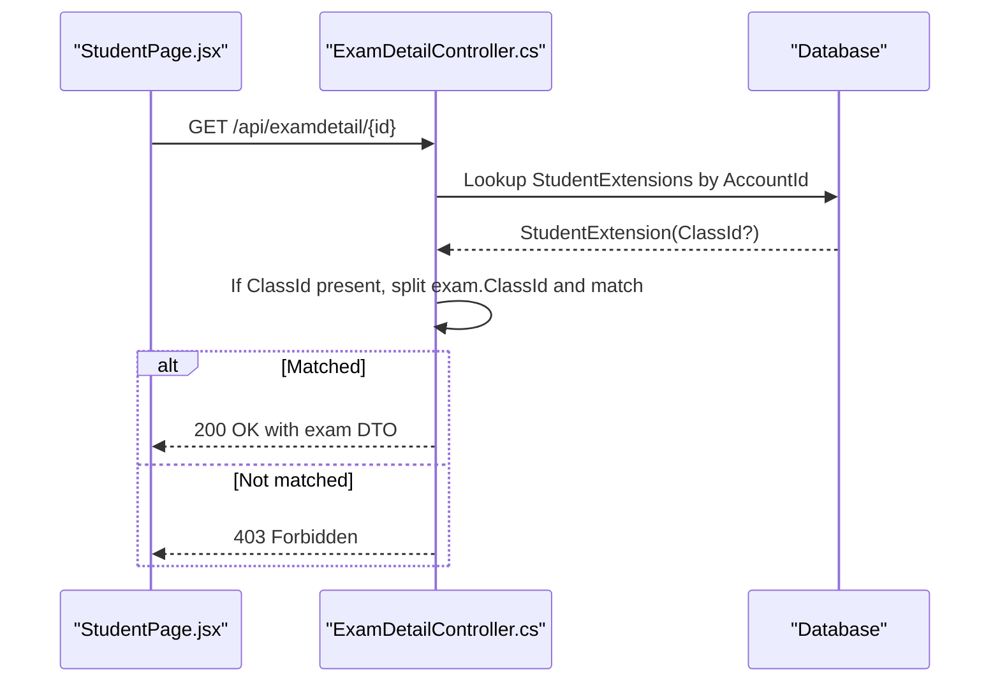
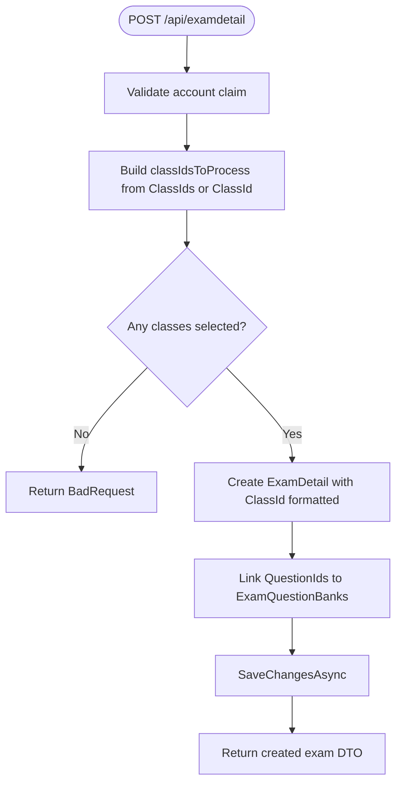
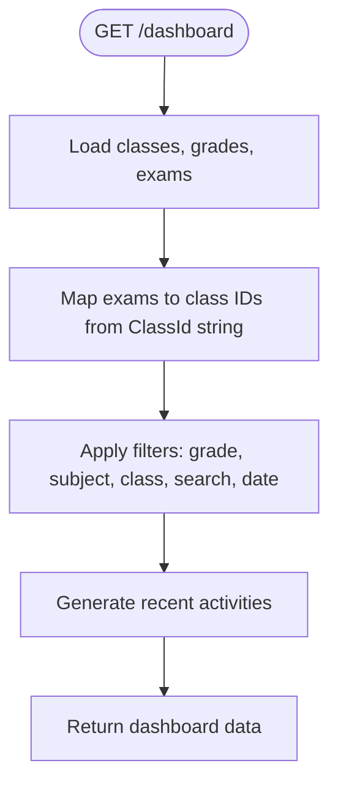
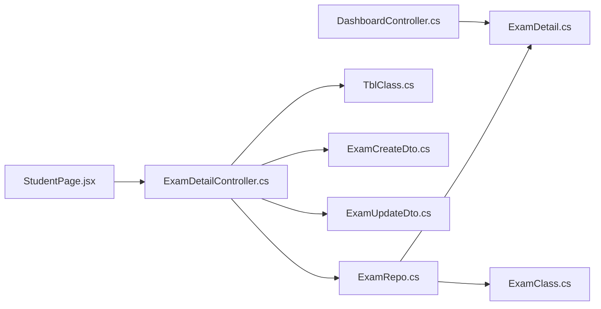

# Exam Scheduling & Distribution

<cite>
**Referenced Files in This Document**
- [ExamDetailController.cs](file://server/Api/Controllers/ExamDetailController.cs)
- [ExamRepo.cs](file://server/Api/Repositories/Implementation/ExamRepo.cs)
- [ExamClass.cs](file://server/Api/Models/ExamClass.cs)
- [ExamDetail.cs](file://server/Api/Models/ExamDetail.cs)
- [TblClass.cs](file://server/Api/Models/TblClass.cs)
- [20260117231344_AddExamClassJunction.cs](file://server/Api/Migrations/20260117231344_AddExamClassJunction.cs)
- [ExamCreateDto.cs](file://server/Api/DTOs/ExamCreateDto.cs)
- [ExamUpdateDto.cs](file://server/Api/DTOs/ExamUpdateDto.cs)
- [DashboardController.cs](file://server/Api/Controllers/DashboardController.cs)
- [StudentPage.jsx](file://client/src/pages/StudentPage.jsx)
- [ModernDateRangePicker.jsx](file://client/src/components/ModernDateRangePicker.jsx)
</cite>

## Table of Contents
1. [Introduction](#introduction)
2. [Project Structure](#project-structure)
3. [Core Components](#core-components)
4. [Architecture Overview](#architecture-overview)
5. [Detailed Component Analysis](#detailed-component-analysis)
6. [Dependency Analysis](#dependency-analysis)
7. [Performance Considerations](#performance-considerations)
8. [Troubleshooting Guide](#troubleshooting-guide)
9. [Conclusion](#conclusion)

## Introduction
This document explains the exam scheduling and distribution system with a focus on multi-class support, scheduling logic, access control, and reporting. The system allows a single exam to be assigned to multiple classes simultaneously using a junction table and a comma-separated class ID field for backward compatibility. It also enforces availability windows based on start and end dates and ensures only authorized students can access their assigned exams.

## Project Structure
The relevant parts of the codebase are organized into:
- API controllers that handle HTTP requests and enforce authorization and filtering
- Repository layer that persists exam data and question mappings
- Domain models representing exams, classes, and the exam-to-class relationship
- Data transfer objects (DTOs) for creating and updating exams with multi-class support
- Client-side pages that categorize exams by scheduled status and render UI controls for scheduling

**Diagram sources**
- [ExamDetailController.cs:1-302](file://server/Api/Controllers/ExamDetailController.cs#L1-L302)
- [ExamRepo.cs:1-140](file://server/Api/Repositories/Implementation/ExamRepo.cs#L1-L140)
- [ExamDetail.cs:1-31](file://server/Api/Models/ExamDetail.cs#L1-L31)
- [ExamClass.cs:1-26](file://server/Api/Models/ExamClass.cs#L1-L26)
- [TblClass.cs:1-16](file://server/Api/Models/TblClass.cs#L1-L16)
- [20260117231344_AddExamClassJunction.cs:1-59](file://server/Api/Migrations/20260117231344_AddExamClassJunction.cs#L1-L59)
- [ExamCreateDto.cs:1-19](file://server/Api/DTOs/ExamCreateDto.cs#L1-L19)
- [ExamUpdateDto.cs:1-19](file://server/Api/DTOs/ExamUpdateDto.cs#L1-L19)
- [StudentPage.jsx:144-231](file://client/src/pages/StudentPage.jsx#L144-L231)
- [ModernDateRangePicker.jsx:1-400](file://client/src/components/ModernDateRangePicker.jsx#L1-L400)

**Section sources**
- [ExamDetailController.cs:1-302](file://server/Api/Controllers/ExamDetailController.cs#L1-L302)
- [ExamRepo.cs:1-140](file://server/Api/Repositories/Implementation/ExamRepo.cs#L1-L140)
- [ExamDetail.cs:1-31](file://server/Api/Models/ExamDetail.cs#L1-L31)
- [ExamClass.cs:1-26](file://server/Api/Models/ExamClass.cs#L1-L26)
- [TblClass.cs:1-16](file://server/Api/Models/TblClass.cs#L1-L16)
- [20260117231344_AddExamClassJunction.cs:1-59](file://server/Api/Migrations/20260117231344_AddExamClassJunction.cs#L1-L59)
- [ExamCreateDto.cs:1-19](file://server/Api/DTOs/ExamCreateDto.cs#L1-L19)
- [ExamUpdateDto.cs:1-19](file://server/Api/DTOs/ExamUpdateDto.cs#L1-L19)
- [StudentPage.jsx:144-231](file://client/src/pages/StudentPage.jsx#L144-L231)
- [ModernDateRangePicker.jsx:1-400](file://client/src/components/ModernDateRangePicker.jsx#L1-L400)

## Core Components
- Multi-class assignment model: Exams store a comma-separated list of class IDs for broad compatibility while a dedicated junction table exists for normalized relationships.
- Scheduling fields: StartDate and EndDate define when an exam is available to students.
- Access control: Students see only exams assigned to their class; teachers and admins have broader visibility.
- Reporting: Dashboard endpoints parse and filter exams by class and other criteria.

Key responsibilities:
- Controller: Validates roles, filters exams by student class, enforces per-exam access checks, maps DTOs, and handles create/update/delete operations.
- Repository: Persists exams, links questions, and updates class assignments via the comma-separated ClassId field.
- Models: Define exam metadata, class entities, and the junction table structure.
- DTOs: Accept both single and multiple class IDs during creation and update.
- Client: Categorizes exams as active, upcoming, or expired based on current time and schedules.

**Section sources**
- [ExamDetailController.cs:24-108](file://server/Api/Controllers/ExamDetailController.cs#L24-L108)
- [ExamRepo.cs:66-120](file://server/Api/Repositories/Implementation/ExamRepo.cs#L66-L120)
- [ExamDetail.cs:8-26](file://server/Api/Models/ExamDetail.cs#L8-L26)
- [ExamClass.cs:6-24](file://server/Api/Models/ExamClass.cs#L6-L24)
- [TblClass.cs:6-14](file://server/Api/Models/TblClass.cs#L6-L14)
- [ExamCreateDto.cs:1-19](file://server/Api/DTOs/ExamCreateDto.cs#L1-L19)
- [ExamUpdateDto.cs:1-19](file://server/Api/DTOs/ExamUpdateDto.cs#L1-L19)
- [StudentPage.jsx:144-231](file://client/src/pages/StudentPage.jsx#L144-L231)

## Architecture Overview
The system uses a layered architecture:
- Presentation layer (React client) renders exam lists and scheduling inputs.
- API layer (ASP.NET Core controller) validates claims, applies role-based and class-based filters, and delegates persistence to repositories.
- Data layer (EF Core repository) interacts with the database, including the Exam_Details table and the Exam_Class junction table.

**Diagram sources**
- [ExamDetailController.cs:24-108](file://server/Api/Controllers/ExamDetailController.cs#L24-L108)
- [ExamRepo.cs:15-64](file://server/Api/Repositories/Implementation/ExamRepo.cs#L15-L64)
- [StudentPage.jsx:144-231](file://client/src/pages/StudentPage.jsx#L144-L231)

## Detailed Component Analysis

### Multi-Class Support Architecture
Exams can be assigned to multiple classes through two mechanisms:
- Comma-separated ClassId string stored in Exam_Details for backward compatibility and simple matching.
- A normalized junction table Exam_Class linking Exam_Details to Tbl_Class rows.

**Diagram sources**
- [ExamDetail.cs:8-26](file://server/Api/Models/ExamDetail.cs#L8-L26)
- [ExamClass.cs:6-24](file://server/Api/Models/ExamClass.cs#L6-L24)
- [TblClass.cs:6-14](file://server/Api/Models/TblClass.cs#L6-L14)

#### How multi-class assignment works
- Creation: The controller accepts either a single ClassId or a list ClassIds. The repository formats them into a comma-separated string like ",1,2,3," and stores it in ExamDetail.ClassId.
- Reading: The controller splits the comma-separated string to check if a student’s class ID is present.
- Junction table: The migration creates Exam_Class with unique constraints on (Exam_ID, Class_ID), enabling normalized relationships and referential integrity.

**Section sources**
- [ExamDetailController.cs:110-198](file://server/Api/Controllers/ExamDetailController.cs#L110-L198)
- [ExamRepo.cs:66-87](file://server/Api/Repositories/Implementation/ExamRepo.cs#L66-L87)
- [20260117231344_AddExamClassJunction.cs:12-48](file://server/Api/Migrations/20260117231344_AddExamClassJunction.cs#L12-L48)

### Scheduling Logic and Availability
Scheduling is controlled by StartDate and EndDate:
- If StartDate is null or invalid, the exam is considered started immediately.
- If EndDate is null or invalid, the exam never expires.
- The client categorizes exams into active, upcoming, and expired lists based on these rules.

**Diagram sources**
- [StudentPage.jsx:144-231](file://client/src/pages/StudentPage.jsx#L144-L231)

**Section sources**
- [StudentPage.jsx:144-231](file://client/src/pages/StudentPage.jsx#L144-L231)
- [ExamDetail.cs:16-18](file://server/Api/Models/ExamDetail.cs#L16-L18)

### Distribution Mechanism and Authorization
Access to exams is enforced at the API level:
- Teachers and admins can view all exams.
- Students are filtered to exams where their assigned class ID appears in the exam’s comma-separated ClassId.
- Per-exam access checks return 403 Forbidden if a student tries to access an exam not assigned to their class.

**Diagram sources**
- [ExamDetailController.cs:71-108](file://server/Api/Controllers/ExamDetailController.cs#L71-L108)

**Section sources**
- [ExamDetailController.cs:24-108](file://server/Api/Controllers/ExamDetailController.cs#L24-L108)

### Bulk Class Assignment
Bulk assignment is supported via the Create endpoint:
- Accepts ClassIds array (supports both numeric IDs and names).
- Normalizes values to long IDs and constructs the comma-separated ClassId string.
- Creates a single exam linked to multiple classes.

**Diagram sources**
- [ExamDetailController.cs:110-198](file://server/Api/Controllers/ExamDetailController.cs#L110-L198)
- [ExamRepo.cs:66-87](file://server/Api/Repositories/Implementation/ExamRepo.cs#L66-L87)
- [ExamCreateDto.cs:1-19](file://server/Api/DTOs/ExamCreateDto.cs#L1-L19)

**Section sources**
- [ExamDetailController.cs:110-198](file://server/Api/Controllers/ExamDetailController.cs#L110-L198)
- [ExamRepo.cs:66-87](file://server/Api/Repositories/Implementation/ExamRepo.cs#L66-L87)
- [ExamCreateDto.cs:1-19](file://server/Api/DTOs/ExamCreateDto.cs#L1-L19)

### Scheduling Conflicts Resolution
There is no explicit conflict detection in the examined code. To prevent overlapping exams for the same class:
- Add server-side validation to detect overlapping StartDate/EndDate for the same ClassId.
- Enforce uniqueness or warning rules at the controller or repository layer before persisting changes.
- Optionally add database-level constraints or triggers to prevent conflicting schedules.

[No sources needed since this section provides general guidance]

### Automated Exam Availability Updates
Automated updates are not implemented in the examined code. Recommended approaches:
- Use a background job or scheduler to mark exams as active/expired based on StartDate/EndDate.
- Update cached views or flags to reduce client-side computation.
- Emit notifications to students when exams become available or expire.

[No sources needed since this section provides general guidance]

### Security Measures
- Role-based visibility: Teachers and admins can view all exams; students are restricted by class assignment.
- Per-exam authorization: Access checks ensure students cannot open exams not assigned to their class.
- Time-window enforcement: Client categorization relies on StartDate/EndDate; server-side checks should also validate timing for sensitive actions (e.g., submitting answers).

**Section sources**
- [ExamDetailController.cs:24-108](file://server/Api/Controllers/ExamDetailController.cs#L24-L108)
- [StudentPage.jsx:144-231](file://client/src/pages/StudentPage.jsx#L144-L231)

### Reporting Features
Reporting capabilities include:
- Dashboard controller parses and groups class names and grades, mapping exams to class IDs.
- Filtering supports class, grade, subject, search term, and date range.
- Recent activity includes exam creation events with timestamps.

**Diagram sources**
- [DashboardController.cs:39-74](file://server/Api/Controllers/DashboardController.cs#L39-L74)
- [DashboardRepo.cs:650-692](file://server/Api/Repositories/Implementation/DashboardRepo.cs#L650-L692)

**Section sources**
- [DashboardController.cs:39-74](file://server/Api/Controllers/DashboardController.cs#L39-L74)
- [DashboardRepo.cs:650-692](file://server/Api/Repositories/Implementation/DashboardRepo.cs#L650-L692)

## Dependency Analysis
The exam scheduling and distribution system exhibits clear separation of concerns:
- Controllers depend on repositories and EF context for data operations.
- Repositories encapsulate EF queries and persistence logic.
- Models define domain entities and relationships.
- DTOs decouple API contracts from internal models.
- Client components consume APIs and apply local scheduling logic.

**Diagram sources**
- [ExamDetailController.cs:1-302](file://server/Api/Controllers/ExamDetailController.cs#L1-L302)
- [ExamRepo.cs:1-140](file://server/Api/Repositories/Implementation/ExamRepo.cs#L1-L140)
- [ExamDetail.cs:1-31](file://server/Api/Models/ExamDetail.cs#L1-L31)
- [ExamClass.cs:1-26](file://server/Api/Models/ExamClass.cs#L1-L26)
- [TblClass.cs:1-16](file://server/Api/Models/TblClass.cs#L1-L16)
- [ExamCreateDto.cs:1-19](file://server/Api/DTOs/ExamCreateDto.cs#L1-L19)
- [ExamUpdateDto.cs:1-19](file://server/Api/DTOs/ExamUpdateDto.cs#L1-L19)
- [DashboardController.cs:39-74](file://server/Api/Controllers/DashboardController.cs#L39-L74)

**Section sources**
- [ExamDetailController.cs:1-302](file://server/Api/Controllers/ExamDetailController.cs#L1-L302)
- [ExamRepo.cs:1-140](file://server/Api/Repositories/Implementation/ExamRepo.cs#L1-L140)
- [ExamDetail.cs:1-31](file://server/Api/Models/ExamDetail.cs#L1-L31)
- [ExamClass.cs:1-26](file://server/Api/Models/ExamClass.cs#L1-L26)
- [TblClass.cs:1-16](file://server/Api/Models/TblClass.cs#L1-L16)
- [ExamCreateDto.cs:1-19](file://server/Api/DTOs/ExamCreateDto.cs#L1-L19)
- [ExamUpdateDto.cs:1-19](file://server/Api/DTOs/ExamUpdateDto.cs#L1-L19)
- [DashboardController.cs:39-74](file://server/Api/Controllers/DashboardController.cs#L39-L74)

## Performance Considerations
- Avoid N+1 queries: The repository manually populates question links; consider eager loading or optimized projections for large datasets.
- Indexing: Ensure indexes exist on frequently filtered columns such as ClassId substrings and StartDate/EndDate.
- Pagination: Implement pagination for exam lists to reduce payload size.
- Caching: Cache static lookups (classes, subjects) and computed dashboards where appropriate.

[No sources needed since this section provides general guidance]

## Troubleshooting Guide
Common issues and resolutions:
- Students see no exams: Verify StudentExtensions has a valid ClassId and that the exam’s ClassId contains that class ID.
- 403 Forbidden on exam detail: Confirm the student’s class is included in the exam’s ClassId list.
- Bulk assignment fails: Ensure ClassIds are valid numeric IDs and at least one class is provided.
- Scheduling anomalies: Check timezone handling and date parsing; treat null StartDate as started and null EndDate as never expiring.

**Section sources**
- [ExamDetailController.cs:24-108](file://server/Api/Controllers/ExamDetailController.cs#L24-L108)
- [StudentPage.jsx:144-231](file://client/src/pages/StudentPage.jsx#L144-L231)

## Conclusion
The exam scheduling and distribution system provides robust multi-class support, clear scheduling semantics, and strong authorization controls. While the junction table exists for normalized relationships, the current implementation primarily uses a comma-separated ClassId field for simplicity. Reporting features enable administrators to track exam assignments across classes. Future enhancements should include explicit conflict detection, automated availability updates, and stronger server-side scheduling enforcement.