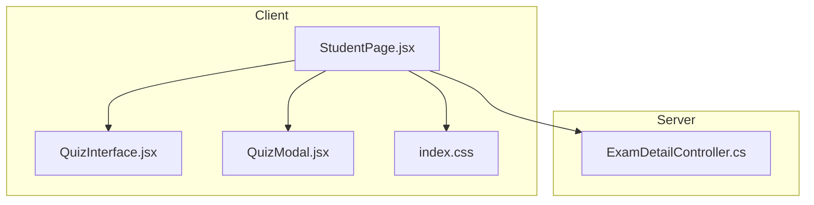
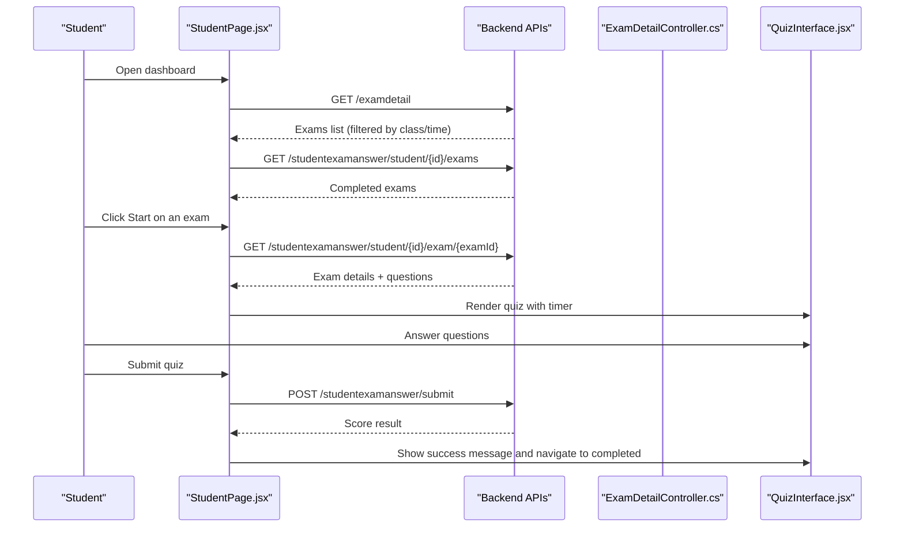
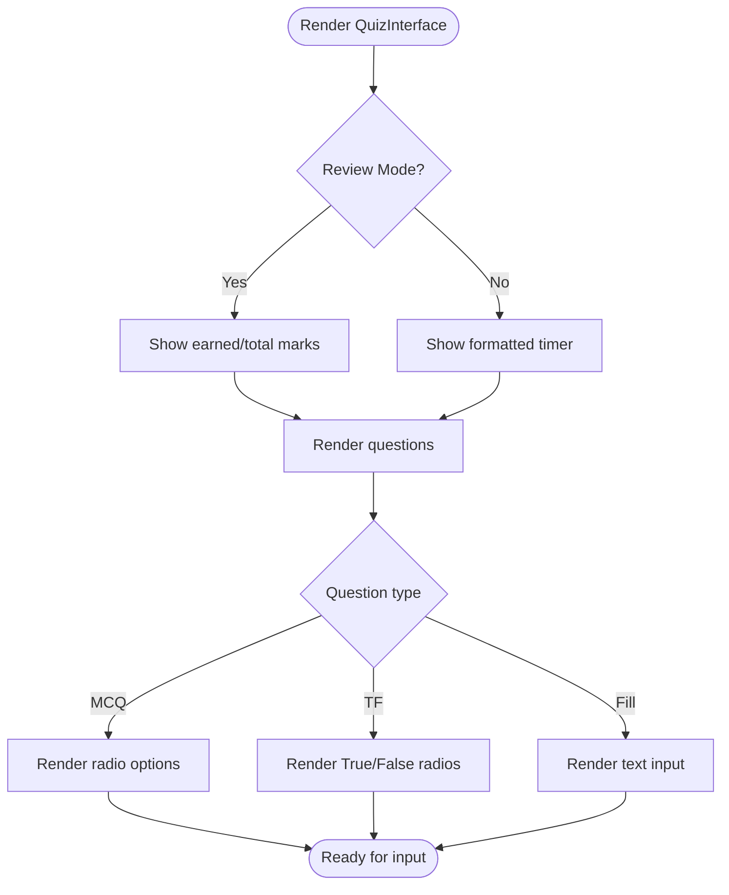
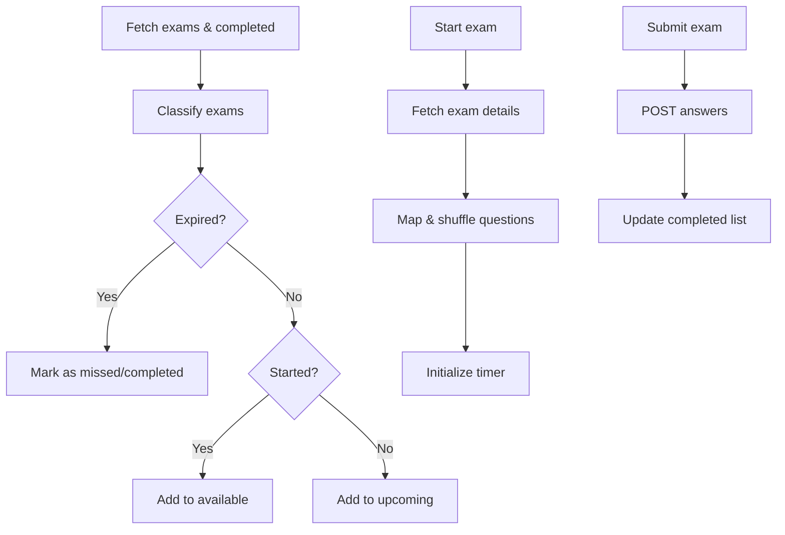
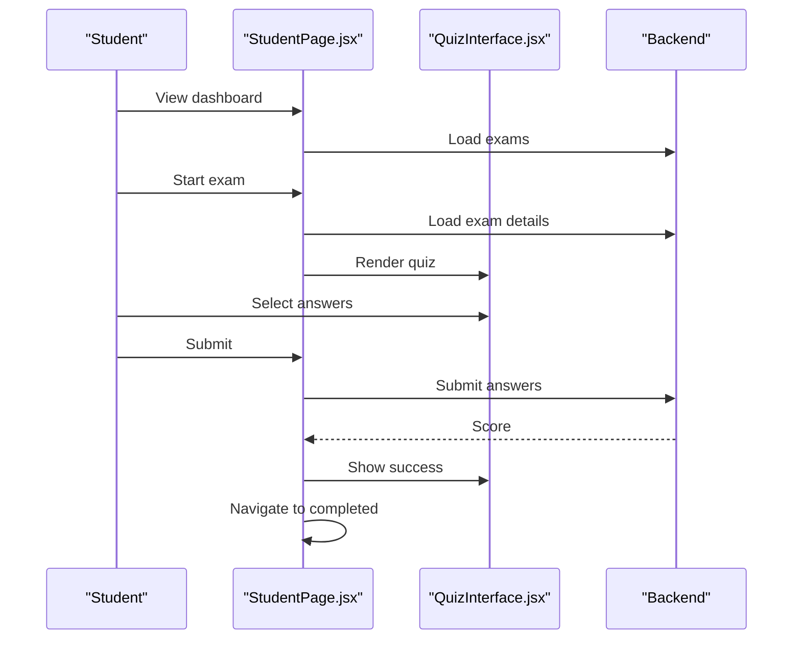
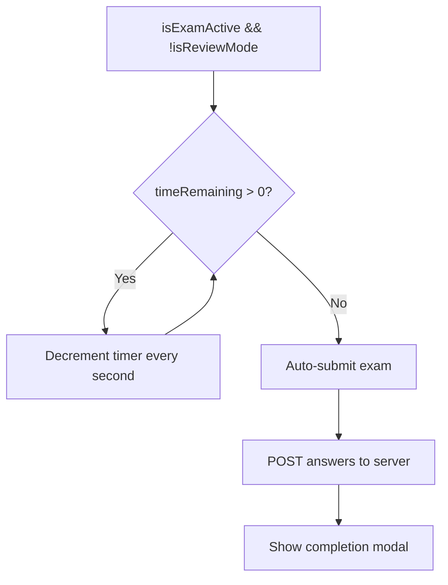
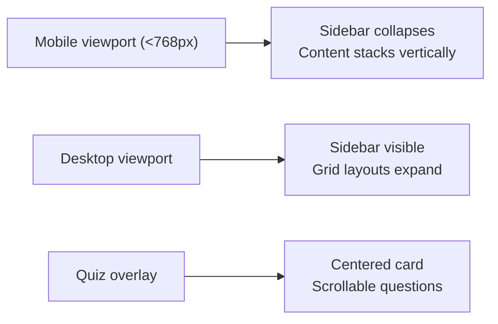
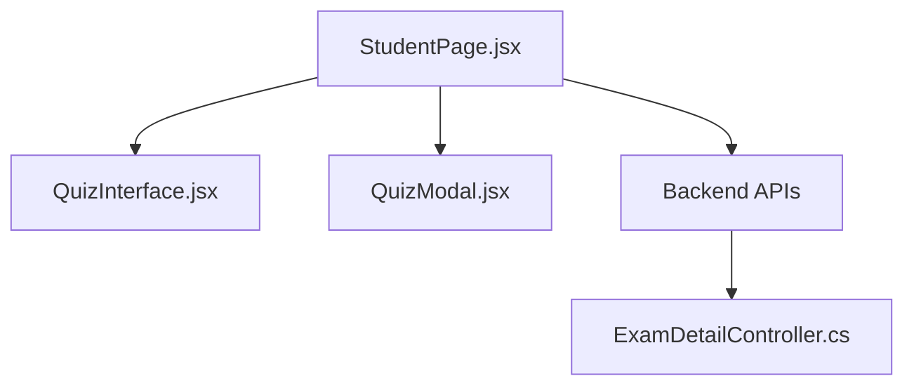

# Student Exam Interface

<cite>
**Referenced Files in This Document**
- [StudentPage.jsx](file://client/src/pages/StudentPage.jsx)
- [QuizInterface.jsx](file://client/src/components/QuizInterface.jsx)
- [QuizModal.jsx](file://client/src/components/QuizModal.jsx)
- [ExamDetailController.cs](file://server/Api/Controllers/ExamDetailController.cs)
- [index.css](file://client/src/index.css)
</cite>

## Table of Contents
1. [Introduction](#introduction)
2. [Project Structure](#project-structure)
3. [Core Components](#core-components)
4. [Architecture Overview](#architecture-overview)
5. [Detailed Component Analysis](#detailed-component-analysis)
6. [Dependency Analysis](#dependency-analysis)
7. [Performance Considerations](#performance-considerations)
8. [Troubleshooting Guide](#troubleshooting-guide)
9. [Conclusion](#conclusion)

## Introduction
This document explains the student-facing exam interface, focusing on how students discover available exams, take quizzes, and review results. It covers the QuizInterface component architecture, exam availability logic (including class-based filtering and timing constraints), user experience flow, real-time features (progress, timer, auto-submit), responsive design, accessibility considerations, and examples of navigation and submission.

## Project Structure
The student exam experience is primarily implemented in the client-side React application with a supporting server controller for exam visibility:

- Client
  - pages/StudentPage.jsx: Orchestrates data fetching, state management, exam lifecycle, and renders UI sections including the quiz view.
  - components/QuizInterface.jsx: Renders the active or review-mode quiz, question types, and submit behavior.
  - components/QuizModal.jsx: Provides reusable confirmation/cancel modals used during exam flows.
  - index.css: Global styles including quiz overlay, question cards, form controls, and responsive breakpoints.
- Server
  - Api/Controllers/ExamDetailController.cs: Applies role-based and class-based filters to determine which exams are visible to students.

**Diagram sources**
- [StudentPage.jsx:1-100](file://client/src/pages/StudentPage.jsx#L1-L100)
- [QuizInterface.jsx:1-40](file://client/src/components/QuizInterface.jsx#L1-L40)
- [QuizModal.jsx:1-25](file://client/src/components/QuizModal.jsx#L1-L25)
- [ExamDetailController.cs:39-63](file://server/Api/Controllers/ExamDetailController.cs#L39-L63)
- [index.css:306-340](file://client/src/index.css#L306-L340)

**Section sources**
- [StudentPage.jsx:1-100](file://client/src/pages/StudentPage.jsx#L1-L100)
- [ExamDetailController.cs:39-63](file://server/Api/Controllers/ExamDetailController.cs#L39-L63)
- [index.css:306-340](file://client/src/index.css#L306-L340)

## Core Components
- StudentPage.jsx
  - Manages authentication, fetches available/upcoming/completed exams, handles start/review/submit flows, and maintains the active exam state and timer.
  - Renders Sidebar, DashboardView, ProfilePage, and QuizInterface based on current section.
- QuizInterface.jsx
  - Pure presentation component that renders questions (MCQ, True/False, Fill-in-the-blank), supports rich text content, displays score/timer, and triggers submit via props.
- QuizModal.jsx
  - Reusable modal for confirm/cancel prompts used throughout the student flow.
- ExamDetailController.cs
  - Enforces exam visibility rules for students based on class assignments and roles.

Key responsibilities:
- Data orchestration and state: StudentPage.jsx
- Question rendering and interaction: QuizInterface.jsx
- Modal interactions: QuizModal.jsx
- Server-side access control: ExamDetailController.cs

**Section sources**
- [StudentPage.jsx:1-100](file://client/src/pages/StudentPage.jsx#L1-L100)
- [QuizInterface.jsx:1-40](file://client/src/components/QuizInterface.jsx#L1-L40)
- [QuizModal.jsx:1-25](file://client/src/components/QuizModal.jsx#L1-L25)
- [ExamDetailController.cs:39-63](file://server/Api/Controllers/ExamDetailController.cs#L39-L63)

## Architecture Overview
The student exam interface follows a container/presentational pattern:

- Container (StudentPage.jsx)
  - Fetches exam lists and details from the backend.
  - Computes categories (available, upcoming, completed).
  - Controls exam lifecycle: start, review, submit, and transitions between sections.
  - Implements timer countdown and auto-submit when time expires.
- Presentational (QuizInterface.jsx)
  - Renders the quiz header (title, subject, question count, timer/score), question list, and submit area.
  - Supports review mode with correct/incorrect indicators.
- Modal (QuizModal.jsx)
  - Used for warnings and confirmations during exam sessions.
- Server Access Control (ExamDetailController.cs)
  - Filters exams by student’s assigned class(es) and enforces role-based visibility.

**Diagram sources**
- [StudentPage.jsx:355-454](file://client/src/pages/StudentPage.jsx#L355-L454)
- [StudentPage.jsx:460-584](file://client/src/pages/StudentPage.jsx#L460-L584)
- [ExamDetailController.cs:39-63](file://server/Api/Controllers/ExamDetailController.cs#L39-L63)
- [QuizInterface.jsx:131-199](file://client/src/components/QuizInterface.jsx#L131-L199)

## Detailed Component Analysis

### QuizInterface Component
Purpose:
- Renders the active quiz or review mode.
- Displays question text with rich text support.
- Handles MCQ, True/False, and Fill-in-the-blank inputs.
- Shows timer or score depending on mode.
- Triggers submit via prop callback.

Key behaviors:
- Rich text conversion for questions/options/images.
- Review mode highlights correct/incorrect answers and shows user’s previous answer.
- Success message shown briefly when time runs out or after successful submission.

**Diagram sources**
- [QuizInterface.jsx:15-117](file://client/src/components/QuizInterface.jsx#L15-L117)
- [QuizInterface.jsx:131-199](file://client/src/components/QuizInterface.jsx#L131-L199)

**Section sources**
- [QuizInterface.jsx:15-117](file://client/src/components/QuizInterface.jsx#L15-L117)
- [QuizInterface.jsx:131-199](file://client/src/components/QuizInterface.jsx#L131-L199)

### StudentPage Orchestration and Exam Availability Logic
Responsibilities:
- Fetches exams and completed attempts.
- Classifies exams into available, upcoming, and missed/completed.
- Starts an exam by fetching detailed questions, shuffling them, and initializing the timer.
- Submits answers, updates local state, and navigates to completed section.
- Prevents accidental tab switching during active exams and warns users.

Exam availability classification:
- Expired if endDate <= now.
- Active if startDate <= now (or null start treated as started).
- Upcoming if startDate > now.

Class-based filtering (server):
- Students see only exams assigned to their class(es).
- If no class is assigned, students see no exams.

**Diagram sources**
- [StudentPage.jsx:148-231](file://client/src/pages/StudentPage.jsx#L148-L231)
- [StudentPage.jsx:355-454](file://client/src/pages/StudentPage.jsx#L355-L454)
- [StudentPage.jsx:460-584](file://client/src/pages/StudentPage.jsx#L460-L584)
- [ExamDetailController.cs:39-63](file://server/Api/Controllers/ExamDetailController.cs#L39-L63)

**Section sources**
- [StudentPage.jsx:148-231](file://client/src/pages/StudentPage.jsx#L148-L231)
- [StudentPage.jsx:355-454](file://client/src/pages/StudentPage.jsx#L355-L454)
- [StudentPage.jsx:460-584](file://client/src/pages/StudentPage.jsx#L460-L584)
- [ExamDetailController.cs:39-63](file://server/Api/Controllers/ExamDetailController.cs#L39-L63)

### User Experience Flow
End-to-end flow:
1. Student logs in and lands on the dashboard.
2. Available exams are displayed; clicking Start loads the quiz.
3. During the quiz:
   - Timer counts down.
   - Student selects answers (radio buttons for MCQ/TF, text input for fill).
   - Tab switching is discouraged with warnings.
4. On submit (manual or auto at time-up), answers are sent to the server.
5. Student sees a success message and is moved to the completed exams list.
6. From completed exams, student can review past attempts with correct/incorrect feedback.

**Diagram sources**
- [StudentPage.jsx:355-454](file://client/src/pages/StudentPage.jsx#L355-L454)
- [StudentPage.jsx:460-584](file://client/src/pages/StudentPage.jsx#L460-L584)
- [QuizInterface.jsx:131-199](file://client/src/components/QuizInterface.jsx#L131-L199)

**Section sources**
- [StudentPage.jsx:355-454](file://client/src/pages/StudentPage.jsx#L355-L454)
- [StudentPage.jsx:460-584](file://client/src/pages/StudentPage.jsx#L460-L584)
- [QuizInterface.jsx:131-199](file://client/src/components/QuizInterface.jsx#L131-L199)

### Real-Time Features
- Progress tracking:
  - The quiz form groups answers per question using consistent naming, enabling collection at submit time.
- Timer functionality:
  - Countdown interval decrements every second; when it reaches zero, auto-submit is triggered.
- Auto-save capabilities:
  - No explicit periodic save is implemented; answers are collected from the live form DOM at submit time.
- Focus protection:
  - Warns if the user tries to switch tabs while an exam is active.

**Diagram sources**
- [StudentPage.jsx:317-337](file://client/src/pages/StudentPage.jsx#L317-L337)
- [StudentPage.jsx:460-584](file://client/src/pages/StudentPage.jsx#L460-L584)

**Section sources**
- [StudentPage.jsx:317-337](file://client/src/pages/StudentPage.jsx#L317-L337)
- [StudentPage.jsx:460-584](file://client/src/pages/StudentPage.jsx#L460-L584)

### Responsive Design and Accessibility
Responsive design:
- Quiz overlay and interface adapt to screen size with centered layout and scrollable content.
- Mobile-friendly grid layouts and typography adjustments are applied across the app.

Accessibility:
- Buttons include aria-label attributes where appropriate.
- Radio inputs and labels are properly associated for keyboard/screen reader use.
- Focus states are styled for interactive elements.

**Diagram sources**
- [index.css:1198-1230](file://client/src/index.css#L1198-L1230)
- [index.css:306-340](file://client/src/index.css#L306-L340)

**Section sources**
- [index.css:1198-1230](file://client/src/index.css#L1198-L1230)
- [index.css:306-340](file://client/src/index.css#L306-L340)

### Examples: Navigation, Selection, Submission
- Navigating through questions:
  - Questions are rendered sequentially within a single page; students scroll to answer each one.
- Selecting answers:
  - MCQ: Radio buttons inside labeled option blocks.
  - True/False: Two radio options.
  - Fill-in-the-blank: Text input field.
- Submitting responses:
  - Manual: Click “Submit Quiz” button.
  - Automatic: Timer reaches zero and auto-submit is invoked.

**Section sources**
- [QuizInterface.jsx:30-117](file://client/src/components/QuizInterface.jsx#L30-L117)
- [QuizInterface.jsx:157-199](file://client/src/components/QuizInterface.jsx#L157-L199)
- [StudentPage.jsx:460-584](file://client/src/pages/StudentPage.jsx#L460-L584)

## Dependency Analysis
- StudentPage.jsx depends on:
  - QuizInterface.jsx for rendering the quiz.
  - QuizModal.jsx for confirmations.
  - Backend endpoints for exam listing, details, and submission.
- QuizInterface.jsx is decoupled from data fetching; it receives props and calls back to parent for submission.
- ExamDetailController.cs enforces server-side visibility rules before data reaches the client.

**Diagram sources**
- [StudentPage.jsx:1-100](file://client/src/pages/StudentPage.jsx#L1-L100)
- [QuizInterface.jsx:1-40](file://client/src/components/QuizInterface.jsx#L1-L40)
- [QuizModal.jsx:1-25](file://client/src/components/QuizModal.jsx#L1-L25)
- [ExamDetailController.cs:39-63](file://server/Api/Controllers/ExamDetailController.cs#L39-L63)

**Section sources**
- [StudentPage.jsx:1-100](file://client/src/pages/StudentPage.jsx#L1-L100)
- [ExamDetailController.cs:39-63](file://server/Api/Controllers/ExamDetailController.cs#L39-L63)

## Performance Considerations
- Rendering efficiency:
  - QuizInterface renders all questions in a single pass; consider virtualization if question sets grow large.
- Timer performance:
  - Interval-based countdown is lightweight; ensure cleanup on unmount to avoid leaks.
- Network requests:
  - Batch initial data fetches (exams, completed, lookup data) to reduce round trips.
- Memory usage:
  - Avoid storing unnecessary copies of large datasets; leverage memoization where applicable.

[No sources needed since this section provides general guidance]

## Troubleshooting Guide
Common issues and resolutions:
- Exams not visible to students:
  - Verify student has a valid class assignment; otherwise, they will see no exams.
- Timer stops unexpectedly:
  - Ensure the component remains mounted and intervals are cleared on unmount.
- Submission fails:
  - Check network connectivity and error messages returned by the backend; validate payload structure.
- Review mode incorrect highlighting:
  - Confirm correct/userAnswer mapping for MCQ indices and boolean normalization for TF.

Operational tips:
- Use browser dev tools to inspect network requests and payloads.
- Validate token parsing and user ID extraction when starting or submitting exams.

**Section sources**
- [ExamDetailController.cs:39-63](file://server/Api/Controllers/ExamDetailController.cs#L39-L63)
- [StudentPage.jsx:460-584](file://client/src/pages/StudentPage.jsx#L460-L584)

## Conclusion
The student exam interface combines a robust container component (StudentPage.jsx) with a focused presentational quiz renderer (QuizInterface.jsx) to deliver a clear, accessible, and responsive exam-taking experience. Server-side class-based filtering ensures students only see relevant exams, while client-side timers and submission flows provide real-time feedback and secure handoff of answers. The system is designed for clarity, usability, and maintainability, with room for enhancements such as auto-save and progressive rendering for very large question sets.