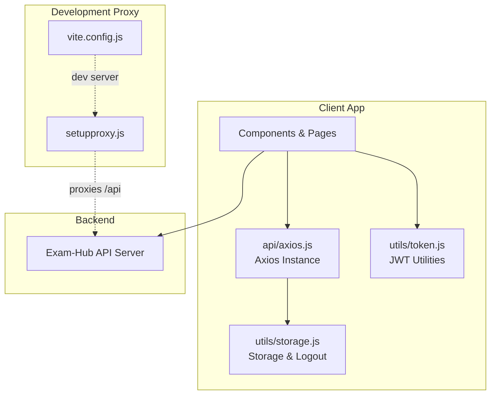
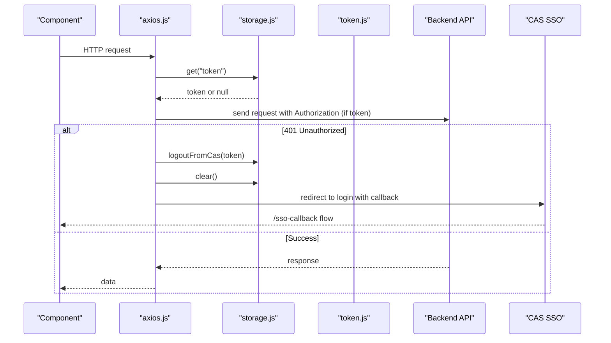
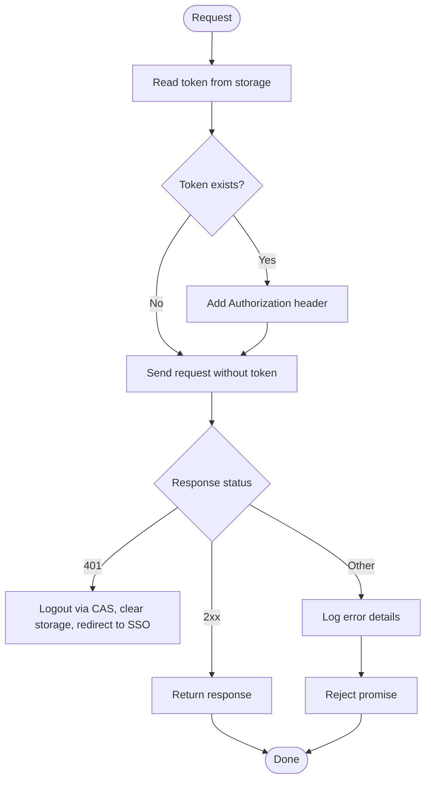
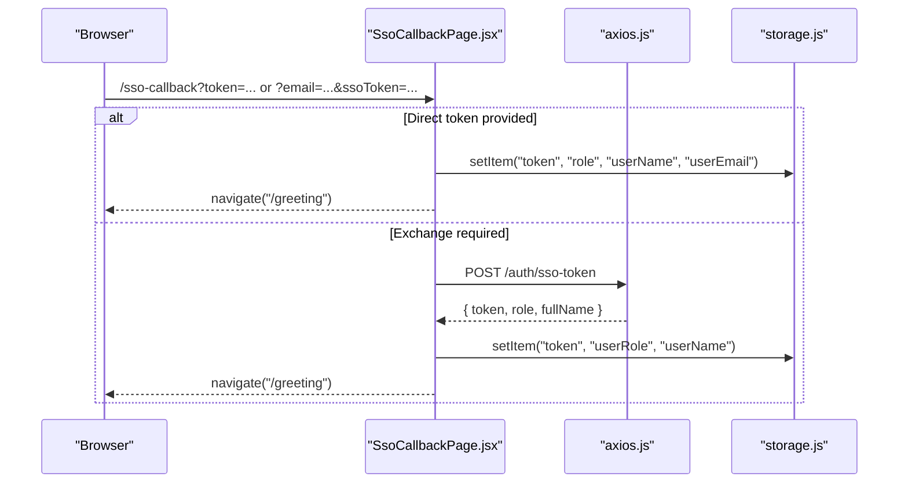
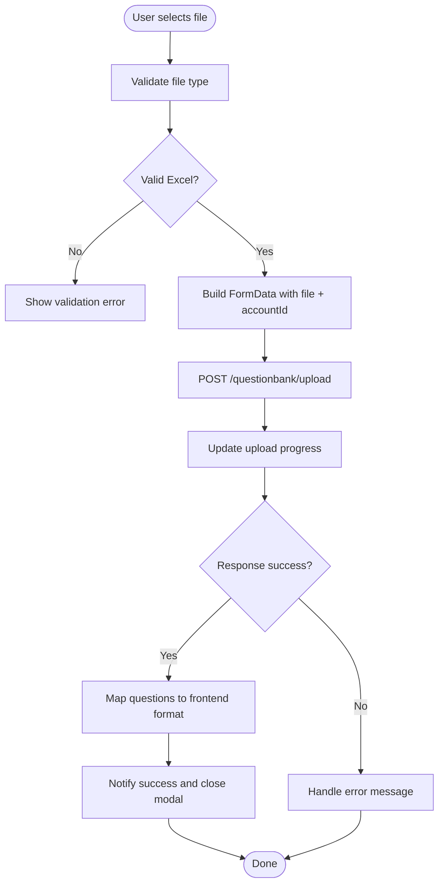
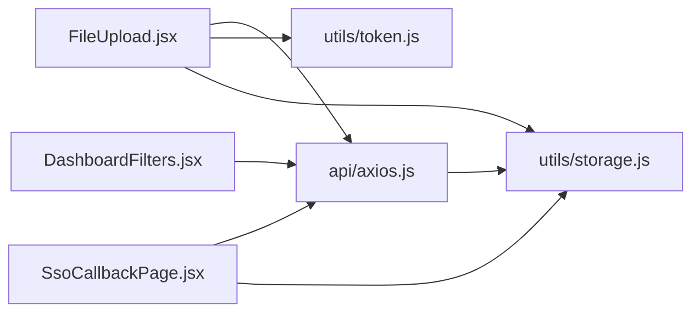

# API Integration Layer

<cite>
**Referenced Files in This Document**
- [axios.js](file://client/src/api/axios.js)
- [storage.js](file://client/src/utils/storage.js)
- [token.js](file://client/src/utils/token.js)
- [SsoCallbackPage.jsx](file://client/src/pages/SsoCallbackPage.jsx)
- [FileUpload.jsx](file://client/src/components/FileUpload.jsx)
- [DashboardFilters.jsx](file://client/src/components/DashboardFilters.jsx)
- [vite.config.js](file://client/vite.config.js)
- [setupproxy.js](file://client/setupproxy.js)
</cite>

## Table of Contents
1. [Introduction](#introduction)
2. [Project Structure](#project-structure)
3. [Core Components](#core-components)
4. [Architecture Overview](#architecture-overview)
5. [Detailed Component Analysis](#detailed-component-analysis)
6. [Dependency Analysis](#dependency-analysis)
7. [Performance Considerations](#performance-considerations)
8. [Troubleshooting Guide](#troubleshooting-guide)
9. [Conclusion](#conclusion)

## Introduction
This document explains the client-side API integration layer for Exam-Hub, focusing on Axios configuration and HTTP client setup. It covers:
- Centralized Axios instance configuration
- Request/response interceptors
- Authentication token management with JWT utilities
- Secure storage mechanisms for tokens
- Error handling strategies and SSO/CAS redirect flows
- Examples of API service calls, error response handling, and loading state management
- CORS considerations and proxy configuration for development

The goal is to provide a clear, maintainable pattern for all API communication across the application.

## Project Structure
The API integration layer lives under the client package and is composed of:
- A centralized Axios instance that configures base URL, timeouts, and interceptors
- Token utilities for safe JWT decoding and user ID extraction
- Storage utilities for secure token persistence and logout orchestration
- Pages and components that consume the API via the centralized instance

**Diagram sources**
- [axios.js:7-10](file://client/src/api/axios.js#L7-L10)
- [storage.js:8-67](file://client/src/utils/storage.js#L8-L67)
- [token.js:6-30](file://client/src/utils/token.js#L6-L30)
- [vite.config.js:5-11](file://client/vite.config.js#L5-L11)
- [setupproxy.js:3-16](file://client/setupproxy.js#L3-L16)

**Section sources**
- [axios.js:1-62](file://client/src/api/axios.js#L1-L62)
- [storage.js:1-88](file://client/src/utils/storage.js#L1-L88)
- [token.js:1-31](file://client/src/utils/token.js#L1-L31)
- [vite.config.js:1-12](file://client/vite.config.js#L1-L12)
- [setupproxy.js:1-17](file://client/setupproxy.js#L1-L17)

## Core Components
- Centralized Axios instance:
  - Base URL from environment variables with a production fallback
  - Global timeout
  - Request interceptor to attach Authorization header when a token exists
  - Response interceptor to handle 401 errors, trigger CAS logout, clear local storage, and redirect to SSO callback
- Storage utility:
  - Transparent localStorage/sessionStorage selection based on a persist flag
  - Methods to set/get/remove/clear auth-related items
  - Logout helper that revokes SSO tokens via an external endpoint
- Token utility:
  - Safe JWT payload parsing (URL-safe base64 decoding)
  - User ID extraction from multiple claim names

**Section sources**
- [axios.js:7-61](file://client/src/api/axios.js#L7-L61)
- [storage.js:8-85](file://client/src/utils/storage.js#L8-L85)
- [token.js:6-30](file://client/src/utils/token.js#L6-L30)

## Architecture Overview
The API integration follows a layered approach:
- Components call the centralized axios instance
- The request interceptor injects the Bearer token if present
- The response interceptor centralizes error handling and authentication flows
- Storage and token utilities encapsulate persistence and JWT operations

**Diagram sources**
- [axios.js:12-57](file://client/src/api/axios.js#L12-L57)
- [storage.js:69-85](file://client/src/utils/storage.js#L69-L85)
- [SsoCallbackPage.jsx:10-63](file://client/src/pages/SsoCallbackPage.jsx#L10-L63)

## Detailed Component Analysis

### Centralized Axios Instance
Responsibilities:
- Configure baseURL and timeout
- Attach Authorization header automatically using stored token
- Handle 401 responses by logging out via CAS, clearing storage, and redirecting to SSO callback
- Log detailed error information for debugging

Key behaviors:
- Environment-driven base URL with a production fallback
- Timeout to prevent hanging requests
- Single source of truth for headers and error handling

**Diagram sources**
- [axios.js:7-57](file://client/src/api/axios.js#L7-L57)

**Section sources**
- [axios.js:7-61](file://client/src/api/axios.js#L7-L61)

### Storage Utility
Responsibilities:
- Provide a unified interface over localStorage and sessionStorage
- Manage a persist flag to switch between persistent and ephemeral storage
- Clear all auth-related keys during logout
- Call CAS logout endpoint to revoke SSO tokens

Security notes:
- Tokens are stored in either localStorage or sessionStorage depending on the persist flag
- Logout clears both storages to ensure no stale credentials remain

**Section sources**
- [storage.js:8-67](file://client/src/utils/storage.js#L8-L67)
- [storage.js:69-85](file://client/src/utils/storage.js#L69-L85)

### Token Utility
Responsibilities:
- Safely decode JWT payloads (URL-safe base64)
- Extract user ID from multiple possible claim names

Usage patterns:
- Decode token to derive accountId for backend calls
- Validate presence before accessing claims

**Section sources**
- [token.js:6-30](file://client/src/utils/token.js#L6-L30)

### SSO Callback Flow
Responsibilities:
- Exchange CAS-provided tokens or email for an internal API token
- Persist token, role, and user info
- Navigate to the app’s greeting page

Integration points:
- Uses the centralized axios instance to exchange tokens
- Persists values via storage utility

**Diagram sources**
- [SsoCallbackPage.jsx:10-63](file://client/src/pages/SsoCallbackPage.jsx#L10-L63)
- [axios.js:7-10](file://client/src/api/axios.js#L7-L10)
- [storage.js:20-30](file://client/src/utils/storage.js#L20-L30)

**Section sources**
- [SsoCallbackPage.jsx:1-67](file://client/src/pages/SsoCallbackPage.jsx#L1-L67)

### Example: File Upload with Loading State and Error Handling
Highlights:
- Uses FormData for multipart uploads
- Attaches accountId extracted from the token payload
- Shows upload progress and handles errors gracefully
- Downloads template as a blob

**Diagram sources**
- [FileUpload.jsx:19-164](file://client/src/components/FileUpload.jsx#L19-L164)
- [token.js:6-30](file://client/src/utils/token.js#L6-L30)
- [storage.js:20-30](file://client/src/utils/storage.js#L20-L30)

**Section sources**
- [FileUpload.jsx:1-268](file://client/src/components/FileUpload.jsx#L1-L268)
- [token.js:6-30](file://client/src/utils/token.js#L6-L30)
- [storage.js:20-30](file://client/src/utils/storage.js#L20-L30)

### Example: Dashboard Filters Using the API
Highlights:
- Demonstrates importing and using the centralized axios instance
- Integrates with UI filters and debounced updates

Note: In this component, the API instance is imported but not directly invoked within the shown snippet; it serves as a reference for consistent usage patterns across the app.

**Section sources**
- [DashboardFilters.jsx:1-321](file://client/src/components/DashboardFilters.jsx#L1-L321)

## Dependency Analysis
The following diagram shows how components depend on the API layer and supporting utilities.

**Diagram sources**
- [DashboardFilters.jsx:2](file://client/src/components/DashboardFilters.jsx#L2)
- [FileUpload.jsx:2-4](file://client/src/components/FileUpload.jsx#L2-L4)
- [SsoCallbackPage.jsx:3-4](file://client/src/pages/SsoCallbackPage.jsx#L3-L4)
- [axios.js:2](file://client/src/api/axios.js#L2)

**Section sources**
- [DashboardFilters.jsx:1-321](file://client/src/components/DashboardFilters.jsx#L1-L321)
- [FileUpload.jsx:1-268](file://client/src/components/FileUpload.jsx#L1-L268)
- [SsoCallbackPage.jsx:1-67](file://client/src/pages/SsoCallbackPage.jsx#L1-L67)
- [axios.js:1-62](file://client/src/api/axios.js#L1-L62)

## Performance Considerations
- Timeouts:
  - A global timeout prevents long-running requests from blocking the UI.
- Interceptors:
  - Avoid heavy logic in interceptors to keep request/response cycles fast.
- Storage access:
  - Reading/writing storage is synchronous; minimize repeated reads by caching values where appropriate.
- Upload progress:
  - Use onUploadProgress to update UI incrementally without re-rendering large trees.

[No sources needed since this section provides general guidance]

## Troubleshooting Guide
Common issues and resolutions:
- 401 Unauthorized:
  - The response interceptor triggers CAS logout, clears storage, and redirects to the SSO callback. Ensure VITE_CAS_URL is configured correctly.
- Missing Authorization header:
  - Verify that a token exists in storage before making authenticated requests.
- CORS errors in development:
  - Use the development proxy to route /api requests to the backend. Confirm proxy target and changeOrigin settings.
- Token parsing failures:
  - Ensure tokens are valid JWTs and use the provided parseToken utility to safely decode payloads.

Operational tips:
- Inspect console logs for detailed error information captured by the response interceptor.
- For SSO flows, confirm that the callback URL matches the configured path (/sso-callback).

**Section sources**
- [axios.js:29-57](file://client/src/api/axios.js#L29-L57)
- [setupproxy.js:3-16](file://client/setupproxy.js#L3-L16)
- [token.js:6-30](file://client/src/utils/token.js#L6-L30)

## Conclusion
The Exam-Hub client integrates with the backend through a single, well-configured Axios instance. This centralization ensures consistent authentication, error handling, and security practices. Token management is isolated in dedicated utilities, and storage abstraction supports flexible persistence strategies. Development-time proxying simplifies local development and avoids CORS issues. Following these patterns will keep API communication clean, predictable, and maintainable across the application.

[No sources needed since this section summarizes without analyzing specific files]