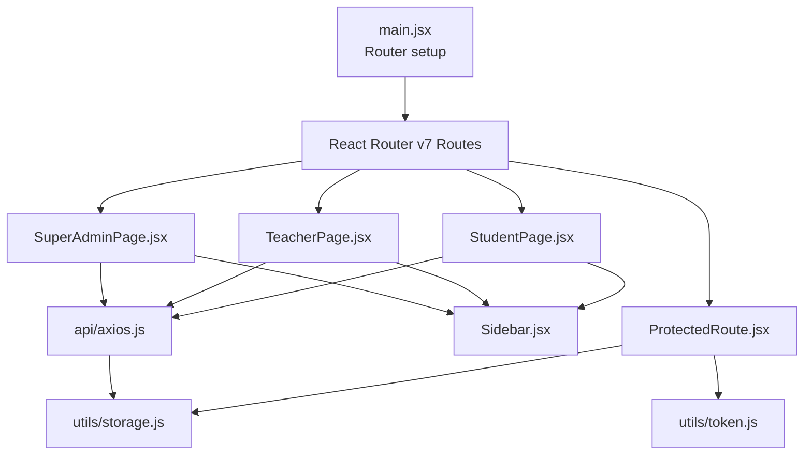
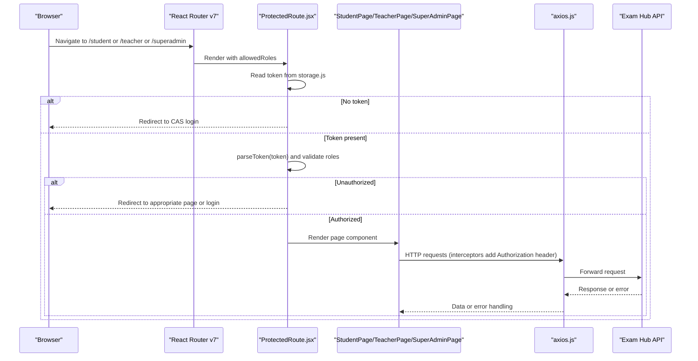
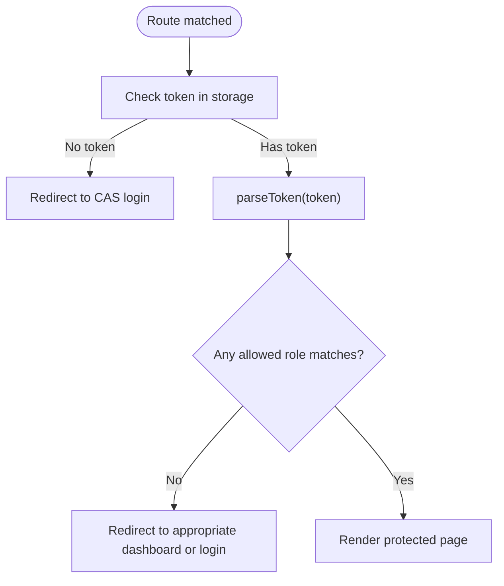
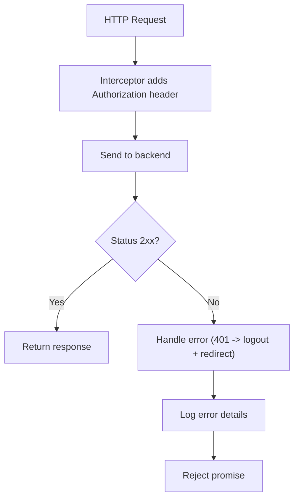
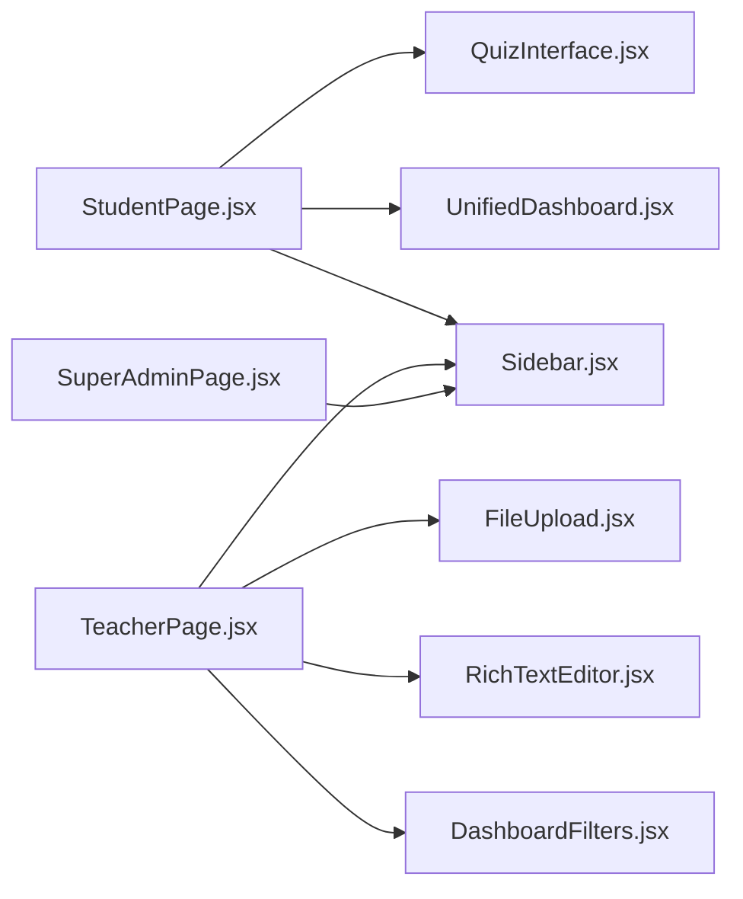
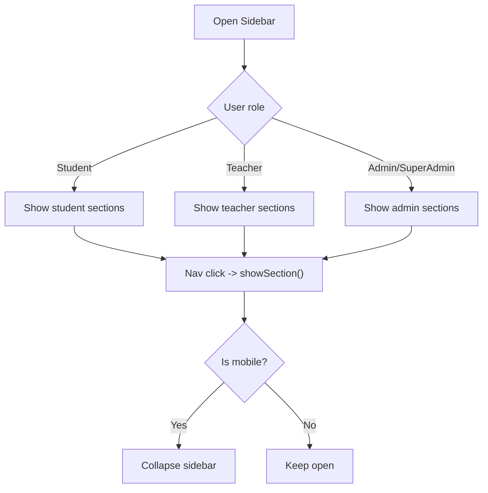
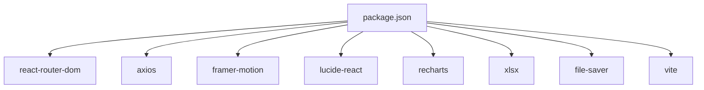

# Frontend Architecture

<cite>
**Referenced Files in This Document**
- [main.jsx](file://client/src/main.jsx)
- [App.jsx](file://client/src/App.jsx)
- [package.json](file://client/package.json)
- [vite.config.js](file://client/vite.config.js)
- [axios.js](file://client/src/api/axios.js)
- [ProtectedRoute.jsx](file://client/src/components/ProtectedRoute.jsx)
- [storage.js](file://client/src/utils/storage.js)
- [token.js](file://client/src/utils/token.js)
- [Sidebar.jsx](file://client/src/components/Sidebar.jsx)
- [Sidebar.css](file://client/src/components/Sidebar.css)
- [StudentPage.jsx](file://client/src/pages/StudentPage.jsx)
- [TeacherPage.jsx](file://client/src/pages/TeacherPage.jsx)
- [SuperAdminPage.jsx](file://client/src/pages/SuperAdminPage.jsx)
- [ErrorBoundary.jsx](file://client/src/components/ErrorBoundary.jsx)
- [setupproxy.js](file://client/setupproxy.js)
</cite>

## Table of Contents
1. [Introduction](#introduction)
2. [Project Structure](#project-structure)
3. [Core Components](#core-components)
4. [Architecture Overview](#architecture-overview)
5. [Detailed Component Analysis](#detailed-component-analysis)
6. [Dependency Analysis](#dependency-analysis)
7. [Performance Considerations](#performance-considerations)
8. [Troubleshooting Guide](#troubleshooting-guide)
9. [Conclusion](#conclusion)

## Introduction
This document describes the frontend architecture of the Exam-Hub React application built with Vite and React Router v7. It explains the component organization, routing strategy, protected routes, state management patterns, API integration via Axios (including authentication token handling and error responses), the sidebar navigation system, responsive design, and performance best practices. The goal is to provide a clear mental model for both new contributors and experienced developers working on this codebase.

## Project Structure
The client application follows a feature-oriented structure:
- Entry point and routing are defined at the app root.
- Pages represent role-based dashboards and flows (Student, Teacher, SuperAdmin).
- Shared components live under src/components (e.g., Sidebar, ProtectedRoute, ErrorBoundary).
- Utilities encapsulate storage and token parsing logic.
- API layer is centralized through an Axios instance with interceptors.

**Diagram sources**
- [main.jsx:17-56](file://client/src/main.jsx#L17-L56)
- [ProtectedRoute.jsx:1-89](file://client/src/components/ProtectedRoute.jsx#L1-L89)
- [StudentPage.jsx:1-100](file://client/src/pages/StudentPage.jsx#L1-L100)
- [TeacherPage.jsx:1-60](file://client/src/pages/TeacherPage.jsx#L1-L60)
- [SuperAdminPage.jsx:1-40](file://client/src/pages/SuperAdminPage.jsx#L1-L40)
- [Sidebar.jsx:1-35](file://client/src/components/Sidebar.jsx#L1-L35)
- [axios.js:1-10](file://client/src/api/axios.js#L1-L10)
- [storage.js:1-20](file://client/src/utils/storage.js#L1-L20)
- [token.js:1-20](file://client/src/utils/token.js#L1-L20)

**Section sources**
- [main.jsx:17-56](file://client/src/main.jsx#L17-L56)
- [package.json:12-21](file://client/package.json#L12-L21)
- [vite.config.js:5-11](file://client/vite.config.js#L5-L11)

## Core Components
- Routing and App shell:
  - main.jsx defines all routes using createBrowserRouter from react-router-dom v7.
  - App.jsx currently returns null; the router provider renders pages directly.
- Protected routes:
  - ProtectedRoute.jsx enforces access control by validating tokens and roles.
- API integration:
  - axios.js provides a configured Axios instance with request/response interceptors for auth and error handling.
- Storage and tokens:
  - storage.js abstracts localStorage/sessionStorage selection and persistence toggling.
  - token.js safely decodes JWT payloads and extracts user identifiers.
- UI layout:
  - Sidebar.jsx implements role-aware navigation and responsive behavior.
  - Sidebar.css styles the sidebar, including mobile overlay and transitions.
- Error resilience:
  - ErrorBoundary.jsx catches render errors and shows a fallback UI.

**Section sources**
- [main.jsx:17-56](file://client/src/main.jsx#L17-L56)
- [App.jsx:1-6](file://client/src/App.jsx#L1-L6)
- [ProtectedRoute.jsx:1-89](file://client/src/components/ProtectedRoute.jsx#L1-L89)
- [axios.js:1-61](file://client/src/api/axios.js#L1-L61)
- [storage.js:1-52](file://client/src/utils/storage.js#L1-L52)
- [token.js:1-30](file://client/src/utils/token.js#L1-L30)
- [Sidebar.jsx:1-219](file://client/src/components/Sidebar.jsx#L1-L219)
- [Sidebar.css:1-258](file://client/src/components/Sidebar.css#L1-L258)
- [ErrorBoundary.jsx:1-61](file://client/src/components/ErrorBoundary.jsx#L1-L61)

## Architecture Overview
The application uses a modern component-based architecture:
- React Router v7 manages top-level navigation and route guards.
- Role-based pages encapsulate domain-specific state and data fetching.
- Shared UI components (Sidebar, charts, modals, etc.) are reused across pages.
- Axios interceptors centralize authentication and error handling.
- Local storage utilities manage tokens and session persistence.

**Diagram sources**
- [main.jsx:17-56](file://client/src/main.jsx#L17-L56)
- [ProtectedRoute.jsx:5-89](file://client/src/components/ProtectedRoute.jsx#L5-L89)
- [axios.js:12-58](file://client/src/api/axios.js#L12-L58)
- [storage.js:1-52](file://client/src/utils/storage.js#L1-L52)
- [token.js:1-30](file://client/src/utils/token.js#L1-L30)

## Detailed Component Analysis

### Routing and Protected Routes
- Route definitions:
  - Public routes include login, SSO callback, greeting, and signed-out pages.
  - Protected routes wrap StudentPage, TeacherPage, SuperAdminPage, and StudentDetailsPage with allowedRoles.
- Access control:
  - ProtectedRoute reads the token from storage, parses it, and checks roles against allowedRoles.
  - If no token exists, it redirects to the CAS login URL with a callback.
  - On unauthorized access, it attempts to redirect to the correct dashboard based on stored roles.

**Diagram sources**
- [ProtectedRoute.jsx:5-89](file://client/src/components/ProtectedRoute.jsx#L5-L89)
- [main.jsx:17-56](file://client/src/main.jsx#L17-L56)

**Section sources**
- [main.jsx:17-56](file://client/src/main.jsx#L17-L56)
- [ProtectedRoute.jsx:5-89](file://client/src/components/ProtectedRoute.jsx#L5-L89)

### API Integration Layer (Axios)
- Base configuration:
  - baseURL is set from environment variables or defaults to the production API base.
  - Timeout is configured for request lifecycle.
- Request interceptor:
  - Reads the token from storage and attaches Authorization header when present.
- Response interceptor:
  - Handles 401 Unauthorized by invoking logout flow and redirecting to CAS login.
  - Logs detailed error information for debugging.

**Diagram sources**
- [axios.js:7-10](file://client/src/api/axios.js#L7-L10)
- [axios.js:12-25](file://client/src/api/axios.js#L12-L25)
- [axios.js:29-58](file://client/src/api/axios.js#L29-L58)

**Section sources**
- [axios.js:1-61](file://client/src/api/axios.js#L1-L61)
- [storage.js:1-52](file://client/src/utils/storage.js#L1-L52)

### State Management Approaches
- Local component state:
  - Each page (StudentPage, TeacherPage, SuperAdminPage) manages its own state using useState, useMemo, and useEffect.
- Data fetching:
  - Pages fetch data via api.get/post calls and handle loading/error states locally.
- Session caching:
  - TeacherPage caches some data in sessionStorage to improve perceived performance.
- No global store:
  - The project does not use Redux or other global state libraries; state is kept close to where it is used.

**Section sources**
- [StudentPage.jsx:15-100](file://client/src/pages/StudentPage.jsx#L15-L100)
- [TeacherPage.jsx:21-60](file://client/src/pages/TeacherPage.jsx#L21-L60)
- [SuperAdminPage.jsx:16-40](file://client/src/pages/SuperAdminPage.jsx#L16-L40)

### Component Hierarchy and Composition
- Page-level components:
  - StudentPage, TeacherPage, SuperAdminPage orchestrate their respective features.
- Reusable UI components:
  - Sidebar provides navigation and responsive behavior.
  - UnifiedDashboard, DashboardView, DashboardFilters, and chart components are composed within pages.
  - Modals and editors (QuizModal, RichTextEditor, FileUpload) are shared across pages.
- Prop passing and event handling:
  - Pages pass handlers like showSection, handleLogout, and userRole down to Sidebar.
  - Students and teachers compose quiz interfaces and modal dialogs with callbacks.

**Diagram sources**
- [StudentPage.jsx:1-100](file://client/src/pages/StudentPage.jsx#L1-L100)
- [TeacherPage.jsx:1-60](file://client/src/pages/TeacherPage.jsx#L1-L60)
- [SuperAdminPage.jsx:1-40](file://client/src/pages/SuperAdminPage.jsx#L1-L40)
- [Sidebar.jsx:1-35](file://client/src/components/Sidebar.jsx#L1-L35)

**Section sources**
- [StudentPage.jsx:1-100](file://client/src/pages/StudentPage.jsx#L1-L100)
- [TeacherPage.jsx:1-60](file://client/src/pages/TeacherPage.jsx#L1-L60)
- [SuperAdminPage.jsx:1-40](file://client/src/pages/SuperAdminPage.jsx#L1-L40)
- [Sidebar.jsx:1-35](file://client/src/components/Sidebar.jsx#L1-L35)

### Sidebar Navigation System
- Role-aware menu items:
  - Displays different sections for students, teachers, and admins/superadmins.
- Responsive behavior:
  - Collapses into a hamburger menu on small screens with an overlay.
- Active state and badges:
  - Highlights current section and shows counts (e.g., available exams).
- Logout action:
  - Triggers CAS logout flow after confirmation.

**Diagram sources**
- [Sidebar.jsx:27-65](file://client/src/components/Sidebar.jsx#L27-L65)
- [Sidebar.jsx:100-203](file://client/src/components/Sidebar.jsx#L100-L203)
- [Sidebar.css:240-258](file://client/src/components/Sidebar.css#L240-L258)

**Section sources**
- [Sidebar.jsx:1-219](file://client/src/components/Sidebar.jsx#L1-L219)
- [Sidebar.css:1-258](file://client/src/components/Sidebar.css#L1-L258)

### Responsive Design Patterns
- Mobile-first CSS:
  - Sidebar collapses off-screen on small viewports and slides in when opened.
  - Overlay ensures focus remains on navigation on mobile.
- Breakpoints:
  - Uses 768px breakpoint to switch between collapsed and expanded states.
- Touch-friendly interactions:
  - Hamburger button and large tap targets for nav items.

**Section sources**
- [Sidebar.css:11-57](file://client/src/components/Sidebar.css#L11-L57)
- [Sidebar.css:240-258](file://client/src/components/Sidebar.css#L240-L258)

### Example: Component Composition and Event Handling
- Composition:
  - StudentPage composes Sidebar, QuizModal, and UnifiedDashboard to render the student experience.
- Props:
  - Sidebar receives currentSection, showSection, handleLogout, userRole, and exam counts.
- Events:
  - Clicking a nav item triggers showSection(section) to update the active view.
  - Logout triggers handleLogout which clears storage and redirects to CAS.

**Section sources**
- [StudentPage.jsx:778-787](file://client/src/pages/StudentPage.jsx#L778-L787)
- [Sidebar.jsx:27-45](file://client/src/components/Sidebar.jsx#L27-L45)

## Dependency Analysis
Key dependencies and their roles:
- react-router-dom: Provides routing and navigation primitives.
- axios: HTTP client with interceptors for auth and error handling.
- framer-motion, lucide-react, recharts: UI animations, icons, and charts.
- xlsx, file-saver: Export and file handling utilities.
- vite: Build tool and dev server configuration.

**Diagram sources**
- [package.json:12-32](file://client/package.json#L12-L32)

**Section sources**
- [package.json:12-32](file://client/package.json#L12-L32)

## Performance Considerations
- Memoization:
  - Use useMemo for derived data (e.g., subject metadata, filtered lists) to avoid unnecessary recalculations.
- Efficient data fetching:
  - Parallel requests with Promise.all/Promise.allSettled reduce waterfall delays.
- Local caching:
  - sessionStorage caching for heavy datasets (e.g., students, quizzes) improves perceived performance.
- Avoid heavy computations in render:
  - Preprocess backend data into normalized structures before rendering.
- Minimize re-renders:
  - Lift minimal state up only when necessary; keep state local to components that need it.
- Network timeouts and error boundaries:
  - Configure axios timeouts and wrap critical UI trees with ErrorBoundary to prevent crashes.

[No sources needed since this section provides general guidance]

## Troubleshooting Guide
Common issues and resolutions:
- Unauthorized redirects:
  - Ensure token exists in storage and is valid; check parseToken behavior and role claims.
  - Verify CAS URL and callback URL configuration.
- API failures:
  - Inspect axios response interceptor logs for status codes and messages.
  - Confirm proxy configuration in development (setupproxy.js) if calling /api endpoints.
- Storage inconsistencies:
  - Clear both localStorage and sessionStorage when logging out; verify storage.clear usage.
- Render errors:
  - Wrap page components with ErrorBoundary to catch and display friendly errors.

**Section sources**
- [ProtectedRoute.jsx:5-89](file://client/src/components/ProtectedRoute.jsx#L5-L89)
- [axios.js:29-58](file://client/src/api/axios.js#L29-L58)
- [storage.js:42-52](file://client/src/utils/storage.js#L42-L52)
- [setupproxy.js:1-17](file://client/setupproxy.js#L1-L17)
- [ErrorBoundary.jsx:1-61](file://client/src/components/ErrorBoundary.jsx#L1-L61)

## Conclusion
Exam-Hub’s frontend is a modern, component-driven React application powered by Vite and React Router v7. It employs role-based routing with ProtectedRoute, centralized API handling via Axios interceptors, and localized state management per page. The Sidebar provides a responsive, role-aware navigation experience. By leveraging memoization, parallel data fetching, and local caching, the app balances performance and maintainability. Following the patterns outlined here will help extend and optimize the application effectively.

[No sources needed since this section summarizes without analyzing specific files]