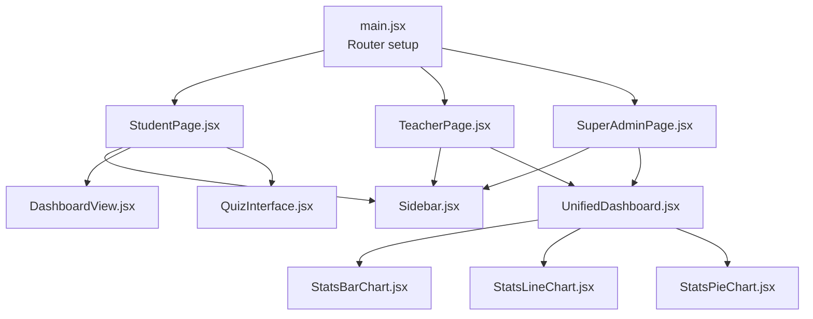
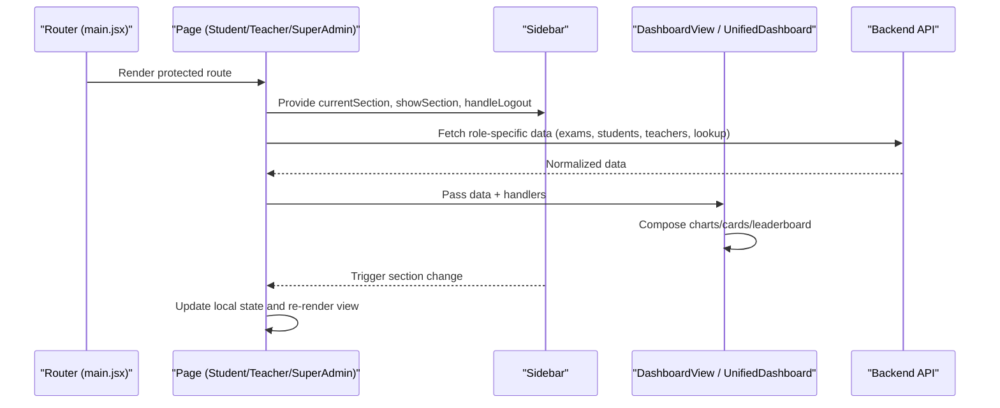
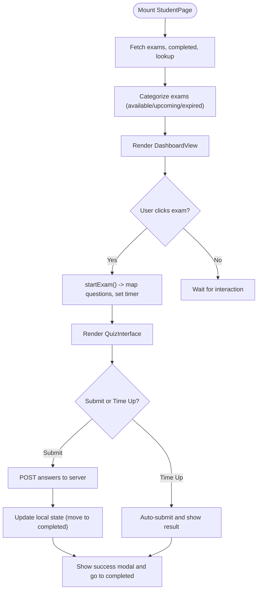
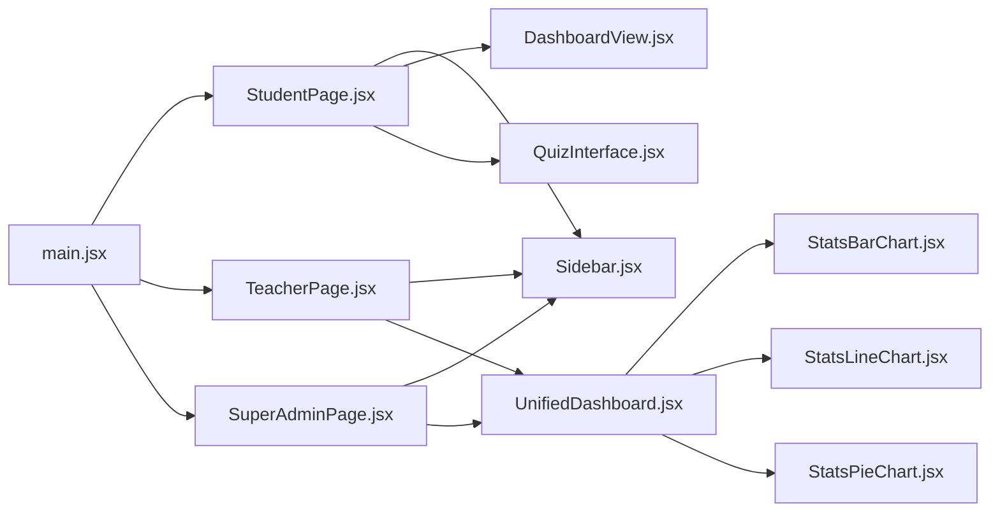

# React Component Structure

<cite>
**Referenced Files in This Document**
- [main.jsx](file://client/src/main.jsx)
- [App.jsx](file://client/src/App.jsx)
- [StudentPage.jsx](file://client/src/pages/StudentPage.jsx)
- [TeacherPage.jsx](file://client/src/pages/TeacherPage.jsx)
- [SuperAdminPage.jsx](file://client/src/pages/SuperAdminPage.jsx)
- [Sidebar.jsx](file://client/src/components/Sidebar.jsx)
- [DashboardView.jsx](file://client/src/components/DashboardView.jsx)
- [UnifiedDashboard.jsx](file://client/src/components/UnifiedDashboard.jsx)
- [QuizInterface.jsx](file://client/src/components/QuizInterface.jsx)
- [StatsBarChart.jsx](file://client/src/components/charts/StatsBarChart.jsx)
- [StatsLineChart.jsx](file://client/src/components/charts/StatsLineChart.jsx)
- [StatsPieChart.jsx](file://client/src/components/charts/StatsPieChart.jsx)
</cite>

## Table of Contents
1. [Introduction](#introduction)
2. [Project Structure](#project-structure)
3. [Core Components](#core-components)
4. [Architecture Overview](#architecture-overview)
5. [Detailed Component Analysis](#detailed-component-analysis)
6. [Dependency Analysis](#dependency-analysis)
7. [Performance Considerations](#performance-considerations)
8. [Troubleshooting Guide](#troubleshooting-guide)
9. [Conclusion](#conclusion)

## Introduction
This document explains the modern, component-based architecture of the Exam-Hub React client. It focuses on how page-level components (StudentPage, TeacherPage, SuperAdminPage) compose reusable UI and chart components, how navigation is handled via a shared Sidebar, and how state flows between pages and child components. It also covers prop interfaces, lifecycle patterns, event handling, data fetching strategies, and reusability principles that keep the codebase clear and scalable.

## Project Structure
The application uses a feature-oriented layout:
- Pages live under src/pages and represent role-specific entry points.
- Shared UI components live under src/components, including charts under src/components/charts.
- Routing is configured at the app root to protect routes by role and render the appropriate page.

**Diagram sources**
- [main.jsx:17-56](file://client/src/main.jsx#L17-L56)
- [StudentPage.jsx:1-14](file://client/src/pages/StudentPage.jsx#L1-L14)
- [TeacherPage.jsx:1-20](file://client/src/pages/TeacherPage.jsx#L1-L20)
- [SuperAdminPage.jsx:1-15](file://client/src/pages/SuperAdminPage.jsx#L1-L15)
- [UnifiedDashboard.jsx:1-12](file://client/src/components/UnifiedDashboard.jsx#L1-L12)
- [StatsBarChart.jsx:1-10](file://client/src/components/charts/StatsBarChart.jsx#L1-L10)
- [StatsLineChart.jsx:1-10](file://client/src/components/charts/StatsLineChart.jsx#L1-L10)
- [StatsPieChart.jsx:1-10](file://client/src/components/charts/StatsPieChart.jsx#L1-L10)

**Section sources**
- [main.jsx:17-56](file://client/src/main.jsx#L17-L56)
- [App.jsx:1-6](file://client/src/App.jsx#L1-L6)

## Core Components
- Page-level containers: StudentPage, TeacherPage, SuperAdminPage manage role-specific state, fetch data, and compose subcomponents.
- Navigation: Sidebar renders role-aware navigation and triggers section changes via callbacks.
- Dashboards: DashboardView (student quiz listing) and UnifiedDashboard (role-based analytics with filters and charts).
- Quiz flow: QuizInterface renders questions, handles review mode, and integrates with timers and submission.
- Charts: StatsBarChart, StatsLineChart, StatsPieChart are reusable visualization components driven by props.

Key responsibilities:
- Data fetching: Each page fetches relevant endpoints and normalizes data for UI consumption.
- State management: Local state per page; child components receive data and callbacks via props.
- Event handling: Navigation, logout, exam start/submit, filter changes, and modal interactions.
- Reusability: Shared UI and chart components accept well-defined props and remain presentation-focused.

**Section sources**
- [StudentPage.jsx:15-113](file://client/src/pages/StudentPage.jsx#L15-L113)
- [TeacherPage.jsx:21-94](file://client/src/pages/TeacherPage.jsx#L21-L94)
- [SuperAdminPage.jsx:16-75](file://client/src/pages/SuperAdminPage.jsx#L16-L75)
- [Sidebar.jsx:27-65](file://client/src/components/Sidebar.jsx#L27-L65)
- [UnifiedDashboard.jsx:13-41](file://client/src/components/UnifiedDashboard.jsx#L13-L41)
- [QuizInterface.jsx:3-13](file://client/src/components/QuizInterface.jsx#L3-L13)

## Architecture Overview
The routing layer protects routes based on roles and mounts the correct page. Pages embed a shared Sidebar and render either a student dashboard or an admin/teacher unified dashboard. The unified dashboard composes cards, leaderboards, and charts, while the student dashboard composes quiz listings and the quiz interface.

**Diagram sources**
- [main.jsx:17-56](file://client/src/main.jsx#L17-L56)
- [StudentPage.jsx:115-246](file://client/src/pages/StudentPage.jsx#L115-L246)
- [TeacherPage.jsx:97-245](file://client/src/pages/TeacherPage.jsx#L97-L245)
- [SuperAdminPage.jsx:77-137](file://client/src/pages/SuperAdminPage.jsx#L77-L137)
- [UnifiedDashboard.jsx:88-199](file://client/src/components/UnifiedDashboard.jsx#L88-L199)

## Detailed Component Analysis

### StudentPage
Responsibilities:
- Manages sections: dashboard, available exams, completed exams, quiz, profile.
- Fetches exams, completed exams, and lookup data; categorizes exams into available/upcoming/completed.
- Starts and submits exams, enforces time limits, prevents tab switching during active exams, and shows confirmation modals.
- Composes Sidebar, DashboardView, QuizInterface, ProfilePage, and error boundary.

State and lifecycle highlights:
- Uses useEffect for data fetching and side effects (beforeunload, visibilitychange).
- Uses useMemo for derived subject metadata and processed exam lists.
- Uses useCallback for submitExam to stabilize references.
- Timer effect drives countdown and auto-submit when time reaches zero.

Event handling:
- showModal/handleModalConfirm/handleModalCancel provide promise-based confirm dialogs.
- handleLogout clears storage and redirects to SSO logout.
- startExam maps backend question formats to frontend expectations and shuffles questions.
- submitExam collects answers from form fields and posts results, then updates local state.

Data flow:
- Fetches from /examdetail, /studentexamanswer/student/{id}/exams, /dashboard/lookup-data.
- Normalizes and transforms data for DashboardView and QuizInterface.

**Diagram sources**
- [StudentPage.jsx:115-246](file://client/src/pages/StudentPage.jsx#L115-L246)
- [StudentPage.jsx:355-454](file://client/src/pages/StudentPage.jsx#L355-L454)
- [StudentPage.jsx:460-584](file://client/src/pages/StudentPage.jsx#L460-L584)
- [StudentPage.jsx:778-787](file://client/src/pages/StudentPage.jsx#L778-L787)

**Section sources**
- [StudentPage.jsx:15-113](file://client/src/pages/StudentPage.jsx#L15-L113)
- [StudentPage.jsx:115-246](file://client/src/pages/StudentPage.jsx#L115-L246)
- [StudentPage.jsx:355-454](file://client/src/pages/StudentPage.jsx#L355-L454)
- [StudentPage.jsx:460-584](file://client/src/pages/StudentPage.jsx#L460-L584)
- [StudentPage.jsx:778-787](file://client/src/pages/StudentPage.jsx#L778-L787)

### TeacherPage
Responsibilities:
- Manages quizzes, question banks, students, and teacher-specific views.
- Fetches quizzes, question banks, lookup data, and students; caches some data in sessionStorage.
- Provides quiz editor flows, question bank selection, and student score views.
- Composes Sidebar, DashboardView, UnifiedDashboard, RichTextEditor, FileUpload, and other UI components.

State and lifecycle highlights:
- useEffect initializes super-admin view flags and fetches data on mount.
- Uses Promise.allSettled to robustly handle multiple API calls.
- Maintains complex local state for quiz editing, bank selection, and filtering.

Event handling:
- Modal helpers for confirmations.
- Logout clears storage and redirects to SSO logout.
- Section navigation resets related state to avoid stale data.

Data flow:
- Fetches /examdetail, /questionbank, /dashboard/lookup-data, /dashboard/students, /examdetail/subjects.
- Normalizes class IDs and grade names for consistent display and filtering.

**Section sources**
- [TeacherPage.jsx:21-94](file://client/src/pages/TeacherPage.jsx#L21-L94)
- [TeacherPage.jsx:97-245](file://client/src/pages/TeacherPage.jsx#L97-L245)
- [TeacherPage.jsx:247-341](file://client/src/pages/TeacherPage.jsx#L247-L341)

### SuperAdminPage
Responsibilities:
- Aggregates system-wide data: all exams, teachers, students, and lookup data.
- Renders UnifiedDashboard for analytics and provides dedicated Teachers and Students views.
- Supports filtering by grade/class/date and navigating to student details.

State and lifecycle highlights:
- useEffect initializes user role and profile, then fetches data using Promise.allSettled.
- useMemo computes current view based on currentSection and data dependencies.

Event handling:
- Logout clears storage and redirects to SSO logout.
- Filters update selected exam and trigger leaderboard/chart refreshes.

**Section sources**
- [SuperAdminPage.jsx:16-75](file://client/src/pages/SuperAdminPage.jsx#L16-L75)
- [SuperAdminPage.jsx:77-137](file://client/src/pages/SuperAdminPage.jsx#L77-L137)
- [SuperAdminPage.jsx:139-187](file://client/src/pages/SuperAdminPage.jsx#L139-L187)
- [SuperAdminPage.jsx:189-574](file://client/src/pages/SuperAdminPage.jsx#L189-L574)

### Sidebar
Role-aware navigation:
- Accepts currentSection, showSection, handleLogout, userRole, isExamActive, and availableExamsCount.
- Prevents navigation during active exams and collapses on mobile after selection.
- Renders different menu items for Student, Teacher, and Admin roles.

Integration with routing:
- Does not directly use react-router; instead, it delegates navigation to the parent page’s showSection handler, which updates local state and renders the appropriate view.

**Section sources**
- [Sidebar.jsx:27-65](file://client/src/components/Sidebar.jsx#L27-L65)
- [Sidebar.jsx:66-219](file://client/src/components/Sidebar.jsx#L66-L219)

### DashboardView (Student)
Purpose:
- Displays available quizzes with status indicators (expired, starts soon, time left).
- Delegates starting a quiz to onStartQuiz callback provided by StudentPage.

Props:
- quizData, subjectInfo, currentSubject, onStartQuiz, onShowSubject, onBackToSubjects, getTimeUntilDeadline.

Behavior:
- Computes deadlines and start times to determine interactivity and visual cues.
- Empty state messaging when no quizzes are available.

**Section sources**
- [DashboardView.jsx:3-11](file://client/src/components/DashboardView.jsx#L3-L11)
- [DashboardView.jsx:12-186](file://client/src/components/DashboardView.jsx#L12-L186)

### UnifiedDashboard (Teacher/Admin/SuperAdmin)
Purpose:
- Central analytics hub with filters, cards, leaderboard, and charts.
- Dynamically selects endpoints based on user role and filters.

Data fetching:
- fetchDashboardData builds query params from filters and selected exam, then calls role-specific endpoints.
- fetchLeaderboard prioritizes specific exam leaderboard or combined leaderboard based on context.

Composition:
- Composes DashboardFilters, DashboardCards, DashboardLeaderboard, and chart components.

**Section sources**
- [UnifiedDashboard.jsx:13-41](file://client/src/components/UnifiedDashboard.jsx#L13-L41)
- [UnifiedDashboard.jsx:88-199](file://client/src/components/UnifiedDashboard.jsx#L88-L199)
- [UnifiedDashboard.jsx:201-296](file://client/src/components/UnifiedDashboard.jsx#L201-L296)
- [UnifiedDashboard.jsx:441-500](file://client/src/components/UnifiedDashboard.jsx#L441-L500)

### QuizInterface
Purpose:
- Renders questions in take or review mode, supports MCQ, True/False, and Fill-in-the-blank types.
- Integrates with timer display and submission flow.

Props:
- currentQuiz, isReviewMode, formatTimerDisplay, timeRemaining, submitQuiz, backToDashboard.

Lifecycle and events:
- Shows success message briefly when time runs out in non-review mode.
- Submits via form submission handler when not in review mode.

**Section sources**
- [QuizInterface.jsx:3-13](file://client/src/components/QuizInterface.jsx#L3-L13)
- [QuizInterface.jsx:119-129](file://client/src/components/QuizInterface.jsx#L119-L129)
- [QuizInterface.jsx:131-201](file://client/src/components/QuizInterface.jsx#L131-L201)

### Chart Components
- StatsBarChart: Bar chart with gradient cells, tooltip, and responsive container. Props: data, title.
- StatsLineChart: Area chart for trends; switches to bar chart for single-exam view. Props: data, title, userRole, selectedExamId.
- StatsPieChart: Donut chart showing pass/fail percentages with normalized values. Props: passPercentage, failPercentage, title.

These components are pure presentational layers consuming normalized data from UnifiedDashboard.

**Section sources**
- [StatsBarChart.jsx:3-107](file://client/src/components/charts/StatsBarChart.jsx#L3-L107)
- [StatsLineChart.jsx:3-182](file://client/src/components/charts/StatsLineChart.jsx#L3-L182)
- [StatsPieChart.jsx:3-134](file://client/src/components/charts/StatsPieChart.jsx#L3-L134)

## Dependency Analysis
Routing and protection:
- Routes are defined in main.jsx with ProtectedRoute enforcing allowed roles per path.

Component composition:
- Pages depend on Sidebar for navigation and on dashboards for content.
- UnifiedDashboard depends on filters, cards, leaderboard, and chart components.
- StudentPage depends on DashboardView and QuizInterface for exam workflows.

External integrations:
- Axios client used across pages and UnifiedDashboard for API calls.
- Token parsing utilities used to extract user identity and claims.

**Diagram sources**
- [main.jsx:17-56](file://client/src/main.jsx#L17-L56)
- [StudentPage.jsx:1-14](file://client/src/pages/StudentPage.jsx#L1-L14)
- [TeacherPage.jsx:1-20](file://client/src/pages/TeacherPage.jsx#L1-L20)
- [SuperAdminPage.jsx:1-15](file://client/src/pages/SuperAdminPage.jsx#L1-L15)
- [UnifiedDashboard.jsx:1-12](file://client/src/components/UnifiedDashboard.jsx#L1-L12)

**Section sources**
- [main.jsx:17-56](file://client/src/main.jsx#L17-L56)

## Performance Considerations
- Use memoization: StudentPage uses useMemo for derived data; UnifiedDashboard recomputes only when dependencies change.
- Efficient data fetching: TeacherPage and SuperAdminPage use Promise.allSettled to parallelize requests and handle partial failures gracefully.
- Conditional rendering: Charts and dashboards render empty states when data is missing to avoid unnecessary computations.
- Responsive sidebar: Collapses on mobile and avoids navigation during active exams to reduce overhead.

[No sources needed since this section provides general guidance]

## Troubleshooting Guide
Common issues and where to look:
- Network errors during data fetch: Check catch blocks in StudentPage, TeacherPage, SuperAdminPage, and UnifiedDashboard for error messages and fallback behavior.
- Unauthorized access: Ensure token exists and parseToken yields a valid userId; pages redirect to login if missing.
- Exam submission failures: Review submitExam logic in StudentPage for answer collection and payload construction; verify endpoint responses and validation errors.
- Leaderboard not updating: Verify UnifiedDashboard’s fetchLeaderboard logic and selectedExamId dependency; ensure filters and grades are correctly mapped.

**Section sources**
- [StudentPage.jsx:233-246](file://client/src/pages/StudentPage.jsx#L233-L246)
- [StudentPage.jsx:564-584](file://client/src/pages/StudentPage.jsx#L564-L584)
- [UnifiedDashboard.jsx:193-199](file://client/src/components/UnifiedDashboard.jsx#L193-L199)
- [UnifiedDashboard.jsx:291-296](file://client/src/components/UnifiedDashboard.jsx#L291-L296)

## Conclusion
Exam-Hub’s React architecture follows a clean separation of concerns:
- Pages orchestrate data and state, composing reusable UI and chart components.
- Sidebar centralizes navigation and role-based menus without tight coupling to routing.
- UnifiedDashboard encapsulates analytics logic and composes smaller presentational components.
- Consistent prop interfaces, lifecycle patterns, and error handling make the system maintainable and scalable.

[No sources needed since this section summarizes without analyzing specific files]