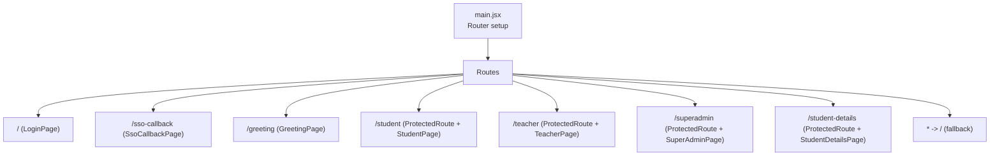
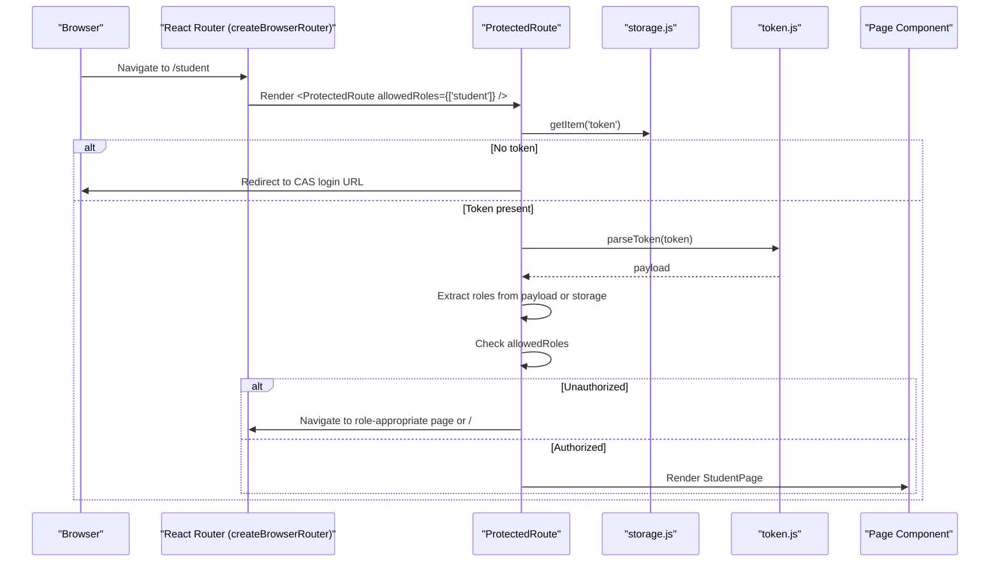
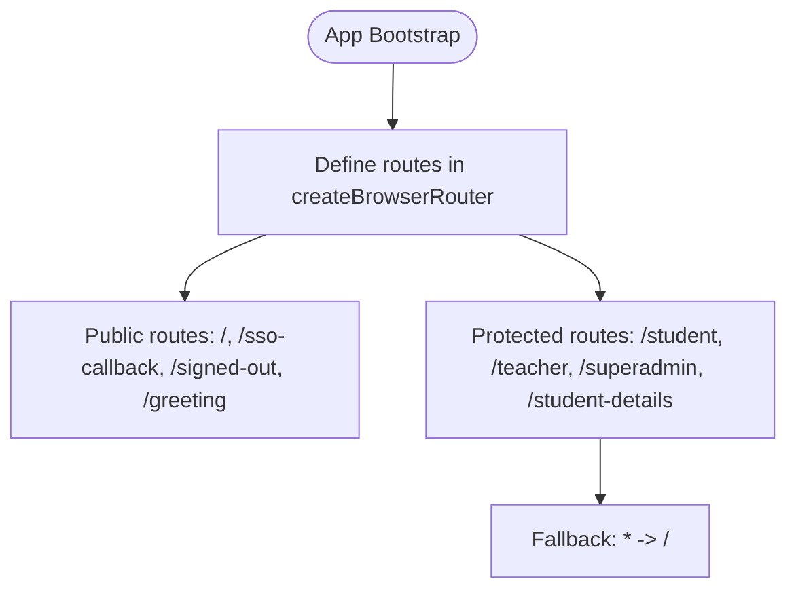
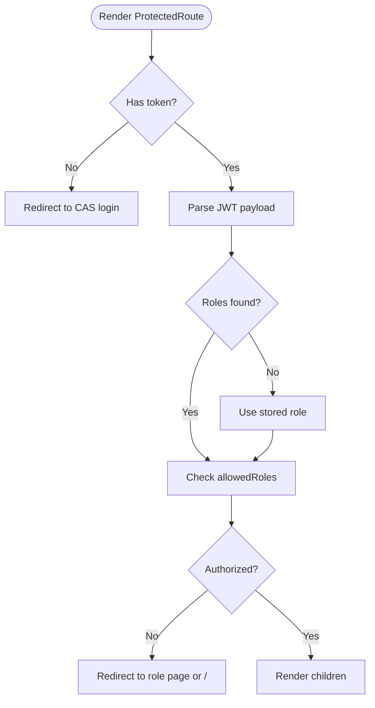
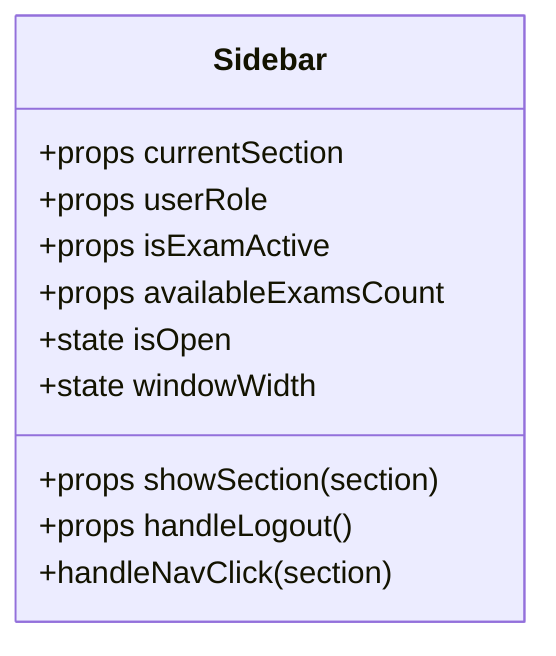
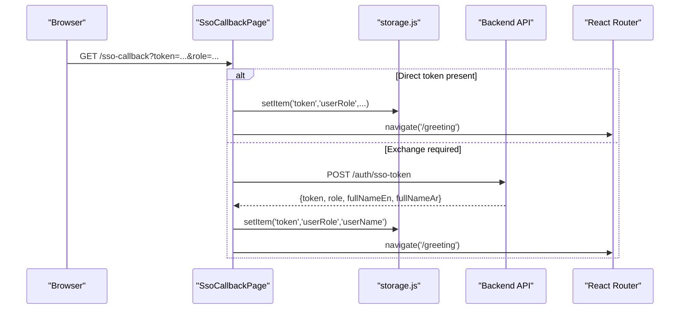
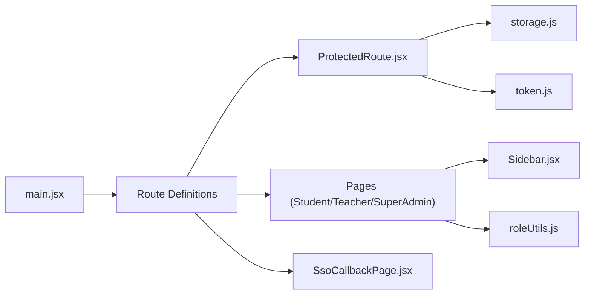

# Routing & Navigation

<cite>
**Referenced Files in This Document**
- [main.jsx](file://client/src/main.jsx)
- [App.jsx](file://client/src/App.jsx)
- [ProtectedRoute.jsx](file://client/src/components/ProtectedRoute.jsx)
- [roleUtils.js](file://client/src/utils/roleUtils.js)
- [Sidebar.jsx](file://client/src/components/Sidebar.jsx)
- [storage.js](file://client/src/utils/storage.js)
- [token.js](file://client/src/utils/token.js)
- [SsoCallbackPage.jsx](file://client/src/pages/SsoCallbackPage.jsx)
- [StudentPage.jsx](file://client/src/pages/StudentPage.jsx)
- [TeacherPage.jsx](file://client/src/pages/TeacherPage.jsx)
- [SuperAdminPage.jsx](file://client/src/pages/SuperAdminPage.jsx)
</cite>

## Table of Contents
1. [Introduction](#introduction)
2. [Project Structure](#project-structure)
3. [Core Components](#core-components)
4. [Architecture Overview](#architecture-overview)
5. [Detailed Component Analysis](#detailed-component-analysis)
6. [Dependency Analysis](#dependency-analysis)
7. [Performance Considerations](#performance-considerations)
8. [Troubleshooting Guide](#troubleshooting-guide)
9. [Conclusion](#conclusion)

## Introduction
This document explains the routing and navigation system in Exam-Hub, focusing on React Router v7 usage, route configuration, protected routes, role-based access control, sidebar navigation integration, dynamic menu generation based on user roles, and navigation state management. It also covers authentication flow integration with routing, redirect logic, programmatic navigation, route parameters handling, nested routing patterns, and security considerations for protected routes.

## Project Structure
The routing layer is defined at application bootstrap and uses React Router v7’s createBrowserRouter to declare top-level routes. Protected routes are enforced via a custom component that validates tokens and roles. The Sidebar component drives internal section navigation within pages and adapts its menu items based on user roles.

**Diagram sources**
- [main.jsx:17-56](file://client/src/main.jsx#L17-L56)

**Section sources**
- [main.jsx:1-63](file://client/src/main.jsx#L1-L63)

## Core Components
- Route configuration: Declared in main.jsx using createBrowserRouter. Each route maps a path to an element, with protected routes wrapping page components in ProtectedRoute.
- ProtectedRoute: Validates presence of a token, parses roles from JWT or storage, enforces allowedRoles, and redirects users to appropriate pages when unauthorized.
- Role utilities: Helper functions to check user roles consistently across the app.
- Sidebar: Renders role-aware navigation items and manages internal section state within pages.

Key responsibilities:
- App entry point: minimal; actual routing lives in main.jsx.
- SSO callback: processes CAS tokens and exchanges them for an API JWT, storing credentials and navigating to greeting.
- Pages: integrate useNavigate for programmatic navigation and maintain internal sections via local state.

**Section sources**
- [main.jsx:17-56](file://client/src/main.jsx#L17-L56)
- [ProtectedRoute.jsx:1-90](file://client/src/components/ProtectedRoute.jsx#L1-L90)
- [roleUtils.js:1-21](file://client/src/utils/roleUtils.js#L1-L21)
- [Sidebar.jsx:1-219](file://client/src/components/Sidebar.jsx#L1-L219)
- [SsoCallbackPage.jsx:1-67](file://client/src/pages/SsoCallbackPage.jsx#L1-L67)

## Architecture Overview
The routing architecture combines declarative routes with runtime authorization checks:

**Diagram sources**
- [main.jsx:17-56](file://client/src/main.jsx#L17-L56)
- [ProtectedRoute.jsx:1-90](file://client/src/components/ProtectedRoute.jsx#L1-L90)
- [storage.js:1-88](file://client/src/utils/storage.js#L1-L88)
- [token.js:1-31](file://client/src/utils/token.js#L1-L31)

## Detailed Component Analysis

### Route Configuration in main.jsx
- Uses createBrowserRouter to define routes.
- Public routes: /, /sso-callback, /signed-out, /greeting.
- Protected routes: /student, /teacher, /superadmin, /student-details wrapped with ProtectedRoute and allowedRoles arrays.
- Fallback route redirects unknown paths to /.

**Diagram sources**
- [main.jsx:17-56](file://client/src/main.jsx#L17-L56)

**Section sources**
- [main.jsx:17-56](file://client/src/main.jsx#L17-L56)

### ProtectedRoute Implementation
- Checks for token in storage; if missing, redirects to CAS login with callback URL.
- Parses JWT payload to extract roles from multiple claim names.
- Falls back to stored role if token parsing fails.
- Enforces allowedRoles; if unauthorized, redirects to role-specific pages (/superadmin, /teacher, /student) or home.

**Diagram sources**
- [ProtectedRoute.jsx:1-90](file://client/src/components/ProtectedRoute.jsx#L1-L90)
- [token.js:1-31](file://client/src/utils/token.js#L1-L31)
- [storage.js:1-88](file://client/src/utils/storage.js#L1-L88)

**Section sources**
- [ProtectedRoute.jsx:1-90](file://client/src/components/ProtectedRoute.jsx#L1-L90)

### Role-Based Access Control with roleUtils.js
- Provides helper functions to determine if a user has specific roles (student, teacher, superadmin/admin).
- Normalizes roles by checking both array and single-role formats.
- Includes fallback stubs for other roles used in templates.

Usage examples:
- Conditional rendering in UI components.
- Guarding features or sections within pages.

**Section sources**
- [roleUtils.js:1-21](file://client/src/utils/roleUtils.js#L1-L21)

### Sidebar Navigation Integration and Dynamic Menu Generation
- Receives currentSection, showSection, handleLogout, userRole, and exam-related flags as props.
- Computes role flags (isStudent, isTeacher, isAdmin) from userRole.
- Conditionally renders menu items per role:
  - Students: Dashboard, Available Exams, Completed Exams.
  - Teachers: Manage Exams, Question Banks, Students.
  - Admins: All Exams, Teachers, Students.
- Manages mobile responsiveness and closes sidebar on mobile after navigation.

**Diagram sources**
- [Sidebar.jsx:1-219](file://client/src/components/Sidebar.jsx#L1-L219)

**Section sources**
- [Sidebar.jsx:1-219](file://client/src/components/Sidebar.jsx#L1-L219)

### Authentication Flow Integration with Routing
- SsoCallbackPage handles CAS callbacks:
  - If token provided directly, stores token and role, then navigates to /greeting.
  - Otherwise, exchanges ssoToken/email for an API JWT via backend, stores credentials, and navigates to /greeting.
  - On errors or missing data, falls back to /.

**Diagram sources**
- [SsoCallbackPage.jsx:1-67](file://client/src/pages/SsoCallbackPage.jsx#L1-L67)
- [storage.js:1-88](file://client/src/utils/storage.js#L1-L88)

**Section sources**
- [SsoCallbackPage.jsx:1-67](file://client/src/pages/SsoCallbackPage.jsx#L1-L67)

### Programmatic Navigation Examples
- useNavigate hook is used in pages to programmatically redirect:
  - StudentPage: navigates to / on missing token; navigates internally via showSection for UI sections.
  - TeacherPage: navigates to / on missing token; manages internal sections like quiz editor and question bank selector.
  - SuperAdminPage: navigates to / on missing token; manages internal sections like students and student detail views.

Examples:
- Redirect to login when no token is present.
- Switch internal sections without changing URL (e.g., dashboard, available exams, completed exams).

**Section sources**
- [StudentPage.jsx:1-800](file://client/src/pages/StudentPage.jsx#L1-L800)
- [TeacherPage.jsx:1-800](file://client/src/pages/TeacherPage.jsx#L1-L800)
- [SuperAdminPage.jsx:1-620](file://client/src/pages/SuperAdminPage.jsx#L1-L620)

### Route Parameters Handling
- Current routes do not define dynamic segments (e.g., /student/:id).
- For future needs, add params in createBrowserRouter and read them via useParams in components.
- Example pattern:
  - Route: { path: '/student-details/:id', element: <StudentDetailsPage /> }
  - Component: const { id } = useParams();

[No sources needed since this section provides conceptual guidance]

### Nested Routing Patterns
- The app currently uses flat routes with internal section state managed within each page rather than nested routes.
- To implement nested routing:
  - Define parent routes with Outlet in child components.
  - Use NavLink for nested navigation links.
  - Keep role guards at parent level where appropriate.

[No sources needed since this section provides conceptual guidance]

## Dependency Analysis
The routing system depends on several utilities and components:

**Diagram sources**
- [main.jsx:17-56](file://client/src/main.jsx#L17-L56)
- [ProtectedRoute.jsx:1-90](file://client/src/components/ProtectedRoute.jsx#L1-L90)
- [storage.js:1-88](file://client/src/utils/storage.js#L1-L88)
- [token.js:1-31](file://client/src/utils/token.js#L1-L31)
- [Sidebar.jsx:1-219](file://client/src/components/Sidebar.jsx#L1-L219)
- [roleUtils.js:1-21](file://client/src/utils/roleUtils.js#L1-L21)
- [SsoCallbackPage.jsx:1-67](file://client/src/pages/SsoCallbackPage.jsx#L1-L67)

**Section sources**
- [main.jsx:17-56](file://client/src/main.jsx#L17-L56)
- [ProtectedRoute.jsx:1-90](file://client/src/components/ProtectedRoute.jsx#L1-L90)
- [storage.js:1-88](file://client/src/utils/storage.js#L1-L88)
- [token.js:1-31](file://client/src/utils/token.js#L1-L31)
- [Sidebar.jsx:1-219](file://client/src/components/Sidebar.jsx#L1-L219)
- [roleUtils.js:1-21](file://client/src/utils/roleUtils.js#L1-L21)
- [SsoCallbackPage.jsx:1-67](file://client/src/pages/SsoCallbackPage.jsx#L1-L67)

## Performance Considerations
- Avoid heavy computations inside render paths for ProtectedRoute; keep role extraction lightweight.
- Cache parsed roles in context or store if frequently accessed.
- Minimize re-renders in Sidebar by memoizing computed role flags and menu items.
- Use lazy loading for route components to reduce initial bundle size.

[No sources needed since this section provides general guidance]

## Troubleshooting Guide
Common issues and resolutions:
- Missing token leads to CAS redirect: Ensure SsoCallbackPage successfully stores token and role before navigating.
- Invalid JWT payload: Verify token format and claim names; ProtectedRoute falls back to stored role but may still redirect.
- Unauthorized access despite valid token: Confirm allowedRoles match the user’s roles; update ProtectedRoute or route definitions accordingly.
- Sidebar not updating: Ensure userRole prop is correctly passed and normalized; verify role flags computation.

**Section sources**
- [ProtectedRoute.jsx:1-90](file://client/src/components/ProtectedRoute.jsx#L1-L90)
- [SsoCallbackPage.jsx:1-67](file://client/src/pages/SsoCallbackPage.jsx#L1-L67)
- [Sidebar.jsx:1-219](file://client/src/components/Sidebar.jsx#L1-L219)

## Conclusion
Exam-Hub’s routing and navigation system leverages React Router v7’s createBrowserRouter for declarative route configuration, a robust ProtectedRoute component for token and role validation, and a role-aware Sidebar for dynamic navigation. The SSO callback integrates seamlessly with routing to establish sessions and direct users to appropriate pages. For scalability, consider adopting nested routing patterns and parameterized routes while maintaining strict authorization checks at both route and component levels.