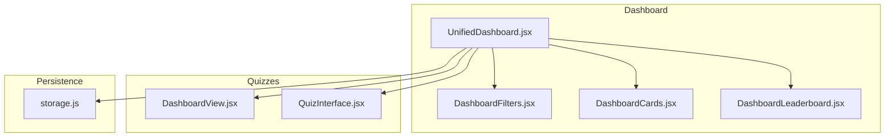
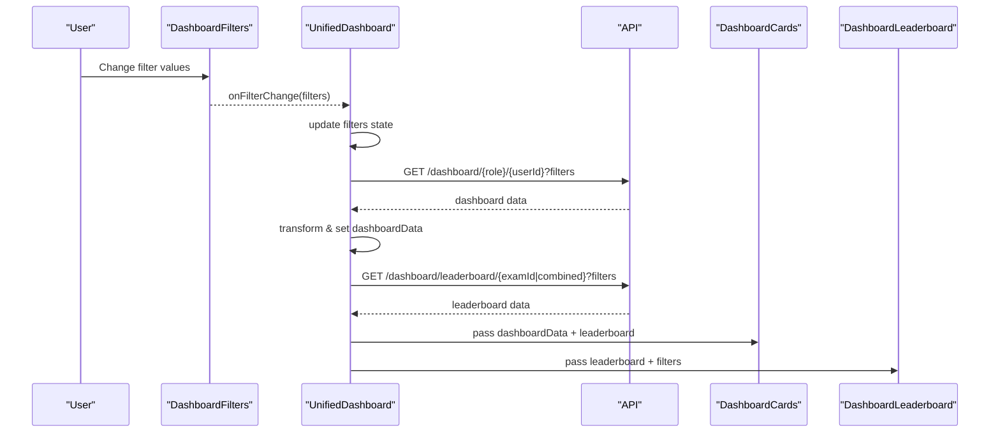
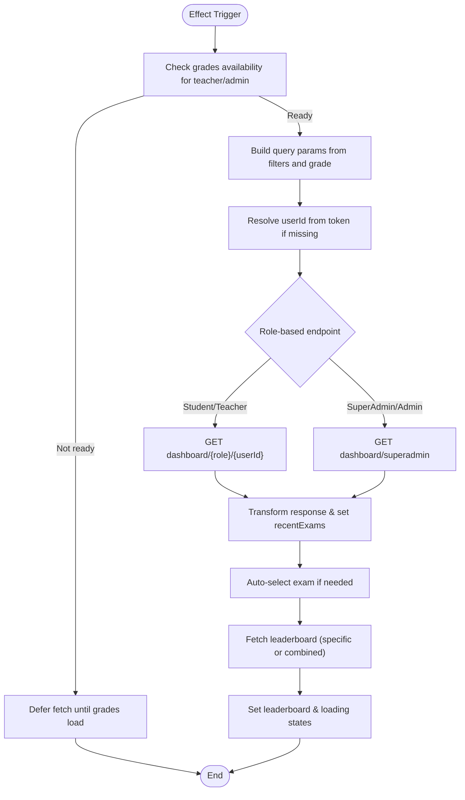
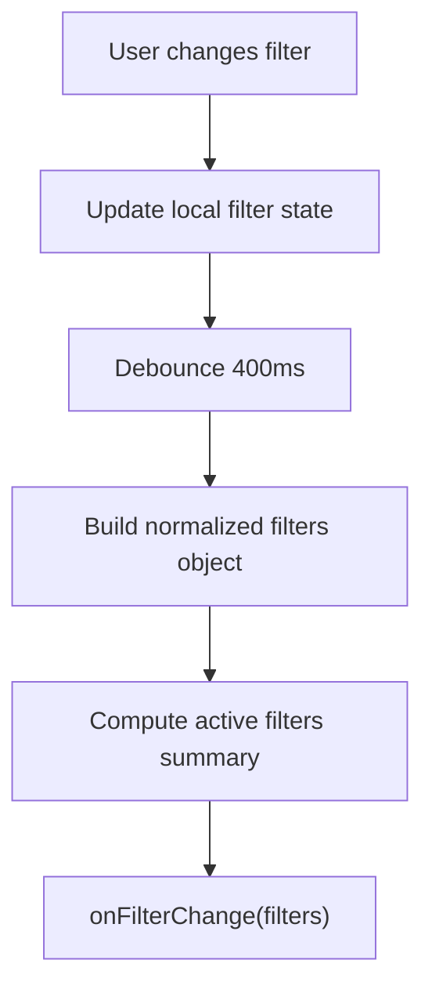
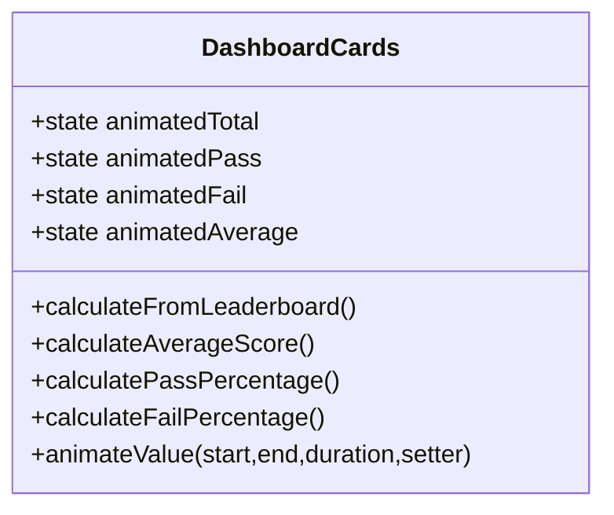
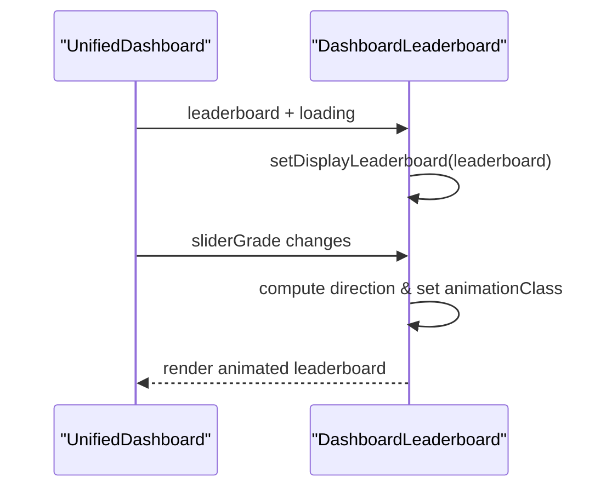
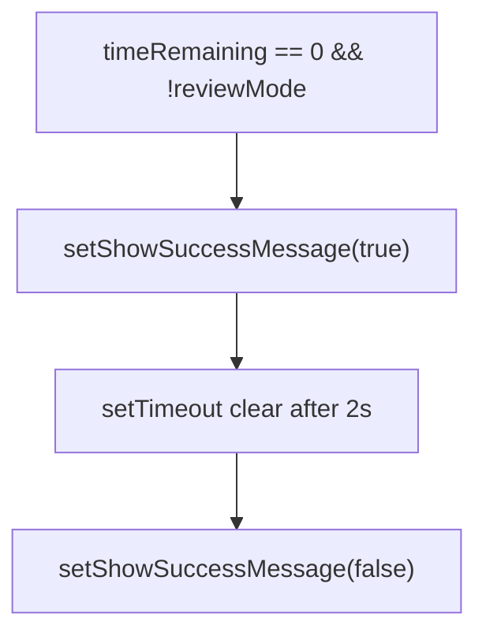
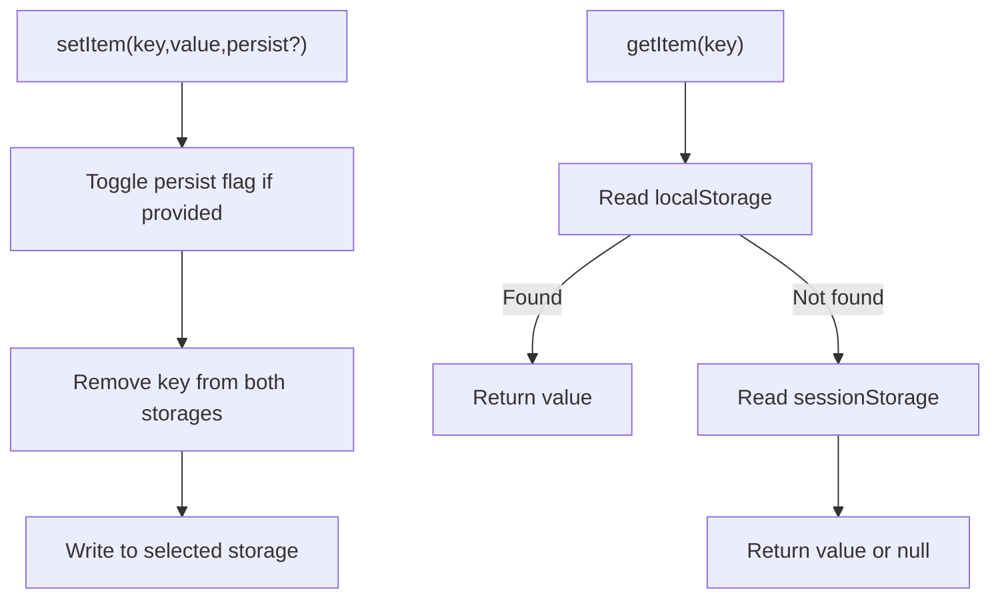
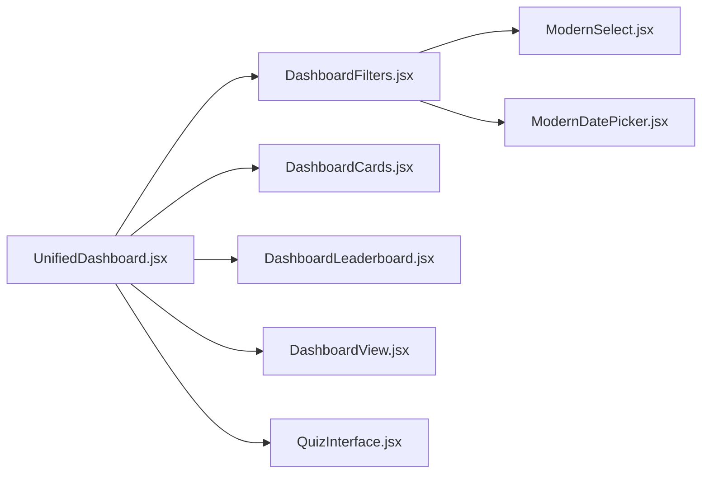

# State Management

<cite>
**Referenced Files in This Document**
- [UnifiedDashboard.jsx](file://client/src/components/UnifiedDashboard.jsx)
- [DashboardView.jsx](file://client/src/components/DashboardView.jsx)
- [QuizInterface.jsx](file://client/src/components/QuizInterface.jsx)
- [DashboardFilters.jsx](file://client/src/components/DashboardFilters.jsx)
- [DashboardCards.jsx](file://client/src/components/DashboardCards.jsx)
- [DashboardLeaderboard.jsx](file://client/src/components/DashboardLeaderboard.jsx)
- [storage.js](file://client/src/utils/storage.js)
</cite>

## Table of Contents
1. [Introduction](#introduction)
2. [Project Structure](#project-structure)
3. [Core Components](#core-components)
4. [Architecture Overview](#architecture-overview)
5. [Detailed Component Analysis](#detailed-component-analysis)
6. [Dependency Analysis](#dependency-analysis)
7. [Performance Considerations](#performance-considerations)
8. [Troubleshooting Guide](#troubleshooting-guide)
9. [Conclusion](#conclusion)

## Introduction
This document explains the state management approach used across Exam-Hub’s React components with a focus on:
- Local component state via useState
- Side effects and data synchronization via useEffect
- Persistent storage integration using localStorage/sessionStorage through a shared utility
- Patterns for form state handling, derived state, and performance optimization for large datasets

The primary patterns observed are:
- Parent-driven state in UnifiedDashboard that orchestrates API calls and filter selection
- Child-local state in DashboardFilters for UI interactions and debounced updates
- Presentation-only state in DashboardView and QuizInterface for rendering and user feedback
- A centralized storage utility to abstract persistence and authentication-related keys

[No sources needed since this section provides general guidance]

## Project Structure
Exam-Hub organizes state logic primarily within feature components and a small set of utilities:
- UnifiedDashboard: central state owner for dashboard data, filters, leaderboard, and exam selection
- DashboardFilters: local form state with debounced propagation to parent
- DashboardCards, DashboardLeaderboard: derived and animated presentation state
- DashboardView: pure rendering of quiz list based on props
- QuizInterface: local UI state (e.g., success message) and review-mode display
- storage.js: persistent storage abstraction for tokens and auth flags

**Diagram sources**
- [UnifiedDashboard.jsx:1-505](file://client/src/components/UnifiedDashboard.jsx#L1-L505)
- [DashboardFilters.jsx:1-321](file://client/src/components/DashboardFilters.jsx#L1-L321)
- [DashboardCards.jsx:1-414](file://client/src/components/DashboardCards.jsx#L1-L414)
- [DashboardLeaderboard.jsx:1-502](file://client/src/components/DashboardLeaderboard.jsx#L1-L502)
- [DashboardView.jsx:1-186](file://client/src/components/DashboardView.jsx#L1-L186)
- [QuizInterface.jsx:1-201](file://client/src/components/QuizInterface.jsx#L1-L201)
- [storage.js:1-88](file://client/src/utils/storage.js#L1-L88)

**Section sources**
- [UnifiedDashboard.jsx:1-505](file://client/src/components/UnifiedDashboard.jsx#L1-L505)
- [DashboardFilters.jsx:1-321](file://client/src/components/DashboardFilters.jsx#L1-L321)
- [DashboardCards.jsx:1-414](file://client/src/components/DashboardCards.jsx#L1-L414)
- [DashboardLeaderboard.jsx:1-502](file://client/src/components/DashboardLeaderboard.jsx#L1-L502)
- [DashboardView.jsx:1-186](file://client/src/components/DashboardView.jsx#L1-L186)
- [QuizInterface.jsx:1-201](file://client/src/components/QuizInterface.jsx#L1-L201)
- [storage.js:1-88](file://client/src/utils/storage.js#L1-L88)

## Core Components
- UnifiedDashboard
  - Owns global dashboard state: filters, selected exam, loading/error states, leaderboard, recent exams, and grade slider index
  - Uses useEffect to trigger data fetching when filters or context changes
  - Derives active grade from a slider when no explicit grade is selected
  - Resolves user identity from token-based utilities and persists session via storage
- DashboardFilters
  - Maintains local form state for grade, class, subject, dates, group-by, and selected exam
  - Debounces filter changes before notifying the parent
  - Builds an “active filters” summary for UX clarity
- DashboardCards
  - Computes derived metrics (average score, pass/fail percentages) from dashboard data and leaderboard
  - Animates numeric transitions using requestAnimationFrame
- DashboardLeaderboard
  - Manages local display state and slide animations for grade transitions
  - Highlights current user and top ranks
- DashboardView
  - Pure presentational component; renders available quizzes and computes time-to-deadline visuals
- QuizInterface
  - Local UI state for success messages and review-mode rendering
  - Uses useEffect to show temporary success feedback when timer reaches zero
- storage.js
  - Provides unified access to localStorage/sessionStorage with a persist flag
  - Centralizes clearing and authentication key management

**Section sources**
- [UnifiedDashboard.jsx:13-78](file://client/src/components/UnifiedDashboard.jsx#L13-L78)
- [UnifiedDashboard.jsx:88-199](file://client/src/components/UnifiedDashboard.jsx#L88-L199)
- [UnifiedDashboard.jsx:201-296](file://client/src/components/UnifiedDashboard.jsx#L201-L296)
- [DashboardFilters.jsx:7-69](file://client/src/components/DashboardFilters.jsx#L7-L69)
- [DashboardCards.jsx:9-135](file://client/src/components/DashboardCards.jsx#L9-L135)
- [DashboardCards.jsx:146-219](file://client/src/components/DashboardCards.jsx#L146-L219)
- [DashboardLeaderboard.jsx:4-26](file://client/src/components/DashboardLeaderboard.jsx#L4-L26)
- [DashboardView.jsx:12-160](file://client/src/components/DashboardView.jsx#L12-L160)
- [QuizInterface.jsx:11-27](file://client/src/components/QuizInterface.jsx#L11-L27)
- [QuizInterface.jsx:119-129](file://client/src/components/QuizInterface.jsx#L119-L129)
- [storage.js:8-67](file://client/src/utils/storage.js#L8-L67)

## Architecture Overview
UnifiedDashboard acts as the state hub for the dashboard experience. It coordinates:
- Filter state (from DashboardFilters)
- Data fetching (dashboard stats and leaderboard)
- Derived selections (auto-selecting exams when appropriate)
- Passing normalized data down to child components

**Diagram sources**
- [UnifiedDashboard.jsx:39-57](file://client/src/components/UnifiedDashboard.jsx#L39-L57)
- [UnifiedDashboard.jsx:88-199](file://client/src/components/UnifiedDashboard.jsx#L88-L199)
- [UnifiedDashboard.jsx:201-296](file://client/src/components/UnifiedDashboard.jsx#L201-L296)
- [DashboardFilters.jsx:27-69](file://client/src/components/DashboardFilters.jsx#L27-L69)

**Section sources**
- [UnifiedDashboard.jsx:39-57](file://client/src/components/UnifiedDashboard.jsx#L39-L57)
- [UnifiedDashboard.jsx:88-199](file://client/src/components/UnifiedDashboard.jsx#L88-L199)
- [UnifiedDashboard.jsx:201-296](file://client/src/components/UnifiedDashboard.jsx#L201-L296)
- [DashboardFilters.jsx:27-69](file://client/src/components/DashboardFilters.jsx#L27-L69)

## Detailed Component Analysis

### UnifiedDashboard: Orchestrator of Dashboard State
- Local state includes filters, selected exam, loading/error flags, leaderboard, recent exams, and grade slider index
- useEffect triggers fetchDashboardData whenever role, userId, filters, selectedExamId, grade slider, or grades change
- Auto-selection logic selects a meaningful exam if leaderboard is empty for students
- Fetch flow:
  - Build query params from filters and resolved grade
  - Resolve userId from token utilities if not provided
  - Route endpoint by role (student/teacher/superadmin/admin/board)
  - Transform response to consistent shape and set recent exams
  - Update selected exam if it disappeared from recent exams
- Leaderboard fetch prioritizes specific exam; otherwise falls back to combined leaderboard for teachers/admins/superadmins
- Error handling sets error state and offers retry

**Diagram sources**
- [UnifiedDashboard.jsx:39-78](file://client/src/components/UnifiedDashboard.jsx#L39-L78)
- [UnifiedDashboard.jsx:88-199](file://client/src/components/UnifiedDashboard.jsx#L88-L199)
- [UnifiedDashboard.jsx:201-296](file://client/src/components/UnifiedDashboard.jsx#L201-L296)

**Section sources**
- [UnifiedDashboard.jsx:13-78](file://client/src/components/UnifiedDashboard.jsx#L13-L78)
- [UnifiedDashboard.jsx:88-199](file://client/src/components/UnifiedDashboard.jsx#L88-L199)
- [UnifiedDashboard.jsx:201-296](file://client/src/components/UnifiedDashboard.jsx#L201-L296)

### DashboardFilters: Form State and Debounced Updates
- Local state holds grade, class, subject, start/end dates, groupBy, and selected exam
- Synchronizes with parent-provided currentFilters via useEffect
- Debounces filter changes (400ms) before emitting updated filters upward
- Builds an active filters summary for visual feedback
- Handles cascading behavior (e.g., resetting class when grade changes)

**Diagram sources**
- [DashboardFilters.jsx:7-25](file://client/src/components/DashboardFilters.jsx#L7-L25)
- [DashboardFilters.jsx:27-69](file://client/src/components/DashboardFilters.jsx#L27-L69)

**Section sources**
- [DashboardFilters.jsx:7-69](file://client/src/components/DashboardFilters.jsx#L7-L69)

### DashboardCards: Derived Metrics and Animated Numbers
- Calculates average score, pass percentage, fail percentage from dashboard data and leaderboard
- Uses refs to track current animated values and requestAnimationFrame for smooth transitions
- Ensures fail percentage equals 100 minus pass percentage for consistency
- Role-specific labels adjust card semantics (e.g., “Total Exams Created” vs “Total Exams Taken”)

**Diagram sources**
- [DashboardCards.jsx:4-31](file://client/src/components/DashboardCards.jsx#L4-L31)
- [DashboardCards.jsx:33-135](file://client/src/components/DashboardCards.jsx#L33-L135)
- [DashboardCards.jsx:146-219](file://client/src/components/DashboardCards.jsx#L146-L219)

**Section sources**
- [DashboardCards.jsx:4-31](file://client/src/components/DashboardCards.jsx#L4-L31)
- [DashboardCards.jsx:33-135](file://client/src/components/DashboardCards.jsx#L33-L135)
- [DashboardCards.jsx:146-219](file://client/src/components/DashboardCards.jsx#L146-L219)

### DashboardLeaderboard: Display State and Grade Slider Animation
- Tracks animation class for slide transitions when grade changes
- Mirrors incoming leaderboard into local display state to support animations
- Renders top entries with medals and highlights current user

**Diagram sources**
- [DashboardLeaderboard.jsx:4-26](file://client/src/components/DashboardLeaderboard.jsx#L4-L26)

**Section sources**
- [DashboardLeaderboard.jsx:4-26](file://client/src/components/DashboardLeaderboard.jsx#L4-L26)

### DashboardView: Presentational State and Time Calculations
- Receives quiz data and renders cards with dynamic timers and status
- Computes time remaining and determines clickability based on start/end times
- No local state beyond props; purely presentational

**Section sources**
- [DashboardView.jsx:12-160](file://client/src/components/DashboardView.jsx#L12-L160)

### QuizInterface: Local UI Feedback and Review Mode
- Local state toggles a success message when timer reaches zero outside review mode
- Review mode displays correct/incorrect indicators and disables inputs
- Uses useEffect to manage timed success message visibility

**Diagram sources**
- [QuizInterface.jsx:119-129](file://client/src/components/QuizInterface.jsx#L119-L129)

**Section sources**
- [QuizInterface.jsx:11-27](file://client/src/components/QuizInterface.jsx#L11-L27)
- [QuizInterface.jsx:119-129](file://client/src/components/QuizInterface.jsx#L119-L129)

### Storage Utility: Persistent State Abstraction
- Abstracts localStorage vs sessionStorage based on a persist flag
- Clears all auth-related keys and supports CAS logout
- Provides isAuthenticated check based on token presence

**Diagram sources**
- [storage.js:8-67](file://client/src/utils/storage.js#L8-L67)

**Section sources**
- [storage.js:8-67](file://client/src/utils/storage.js#L8-L67)

## Dependency Analysis
- UnifiedDashboard depends on:
  - DashboardFilters for filter state and events
  - DashboardCards and DashboardLeaderboard for visualization
  - Token utilities for user ID resolution
  - storage.js indirectly via token retrieval in some flows
- DashboardFilters depends on ModernSelect and ModernDatePicker for controlled inputs
- DashboardCards derives state from UnifiedDashboard’s data and leaderboard
- DashboardLeaderboard depends on UnifiedDashboard for leaderboard data and grade slider controls
- QuizInterface and DashboardView are decoupled presentational consumers of props

**Diagram sources**
- [UnifiedDashboard.jsx:1-12](file://client/src/components/UnifiedDashboard.jsx#L1-L12)
- [DashboardFilters.jsx:1-5](file://client/src/components/DashboardFilters.jsx#L1-L5)

**Section sources**
- [UnifiedDashboard.jsx:1-12](file://client/src/components/UnifiedDashboard.jsx#L1-L12)
- [DashboardFilters.jsx:1-5](file://client/src/components/DashboardFilters.jsx#L1-L5)

## Performance Considerations
- Debounced filter updates reduce unnecessary re-renders and API calls
- Derived computations in DashboardCards avoid redundant calculations by computing once per data change
- Animated number transitions use requestAnimationFrame for smooth UI without blocking main thread
- Conditional fetching in UnifiedDashboard avoids requests when prerequisites (grades) are not ready
- For large datasets:
  - Prefer server-side pagination/filtering where possible
  - Normalize leaderboard arrays to stable IDs to improve reconciliation
  - Avoid deep cloning in render paths; compute derived values in memoized functions if needed
  - Use virtualization for very long lists (e.g., leaderboards) to limit DOM nodes

[No sources needed since this section provides general guidance]

## Troubleshooting Guide
- Empty leaderboard or missing data:
  - Verify filters and selected exam are correctly passed
  - Ensure grades lookup data is loaded before fetching for teacher/admin roles
- User identity issues:
  - Confirm token exists and userId can be resolved from token claims
  - Fallback to nameidentifier claim if standard claim is absent
- Network errors:
  - Check error state and retry functionality
  - Validate endpoint construction and query parameters
- Storage inconsistencies:
  - Ensure persist flag is set consistently
  - Clear all auth-related keys during logout to prevent stale sessions

**Section sources**
- [UnifiedDashboard.jsx:88-199](file://client/src/components/UnifiedDashboard.jsx#L88-L199)
- [UnifiedDashboard.jsx:201-296](file://client/src/components/UnifiedDashboard.jsx#L201-L296)
- [storage.js:69-85](file://client/src/utils/storage.js#L69-L85)

## Conclusion
Exam-Hub employs a pragmatic mix of local component state, derived state, and side effects to manage complex dashboard and quiz experiences:
- UnifiedDashboard centralizes orchestration and data flow
- DashboardFilters encapsulates form state with debounced updates
- DashboardCards and DashboardLeaderboard handle derived and animated presentation state
- QuizInterface and DashboardView remain focused on rendering and user feedback
- storage.js provides a clean abstraction for persistence and authentication

These patterns balance simplicity and scalability while maintaining responsiveness and clarity for users.

[No sources needed since this section summarizes without analyzing specific files]