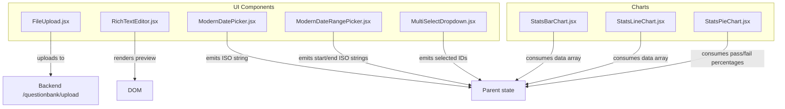
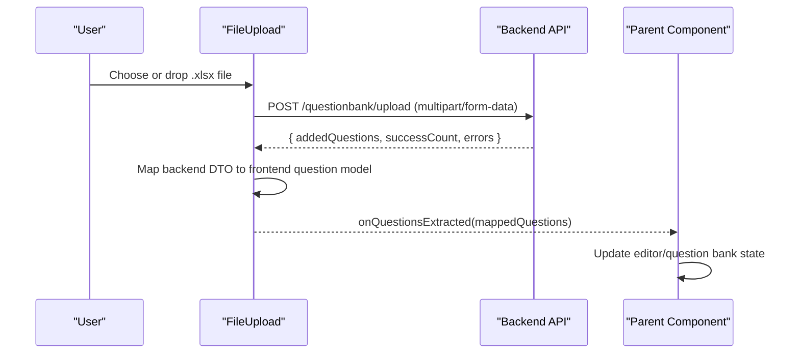
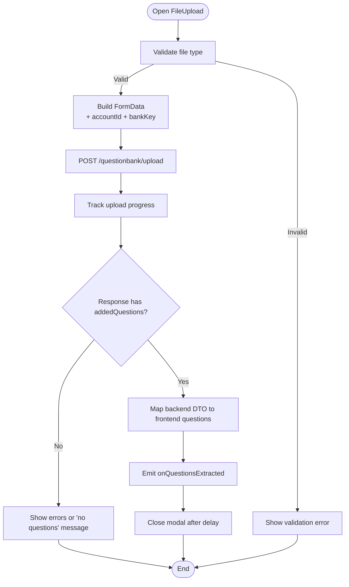
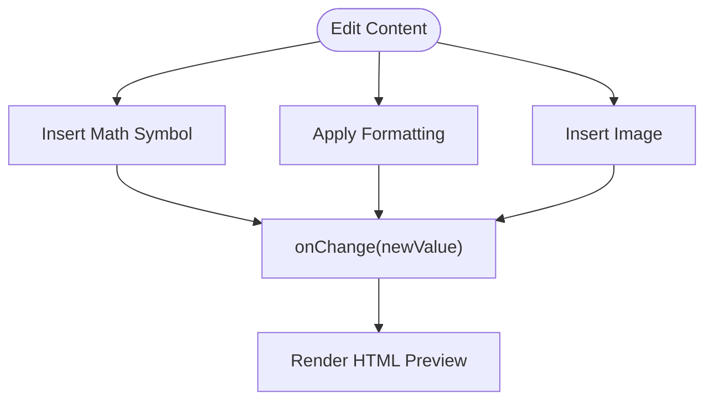
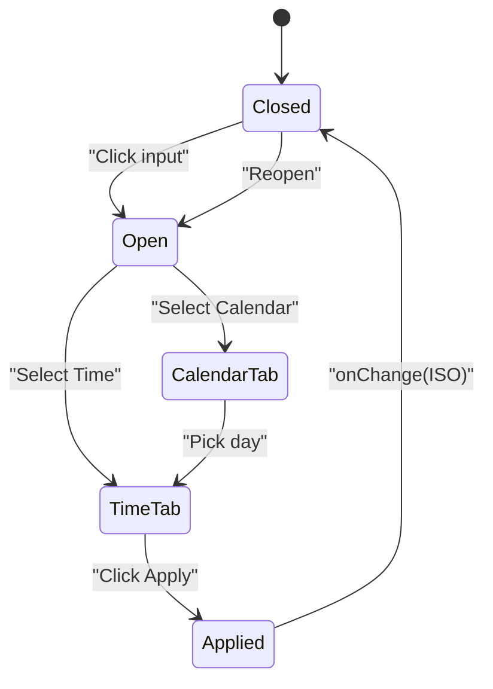
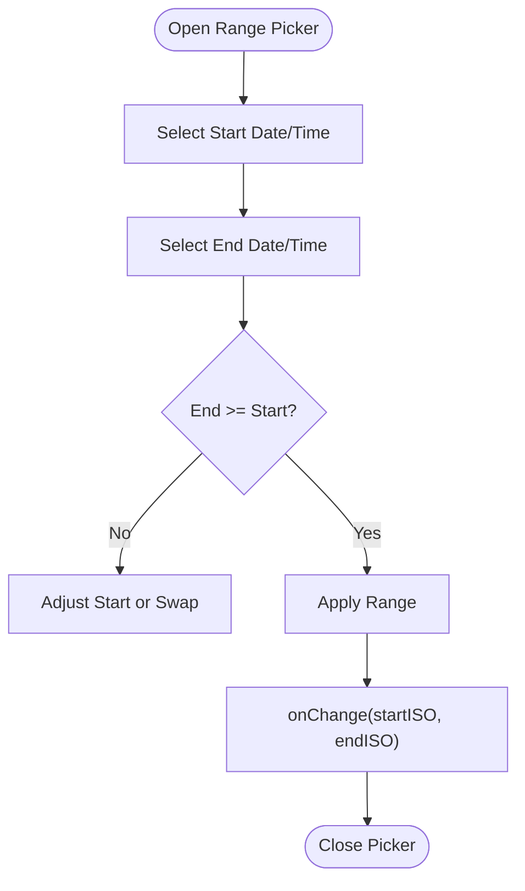
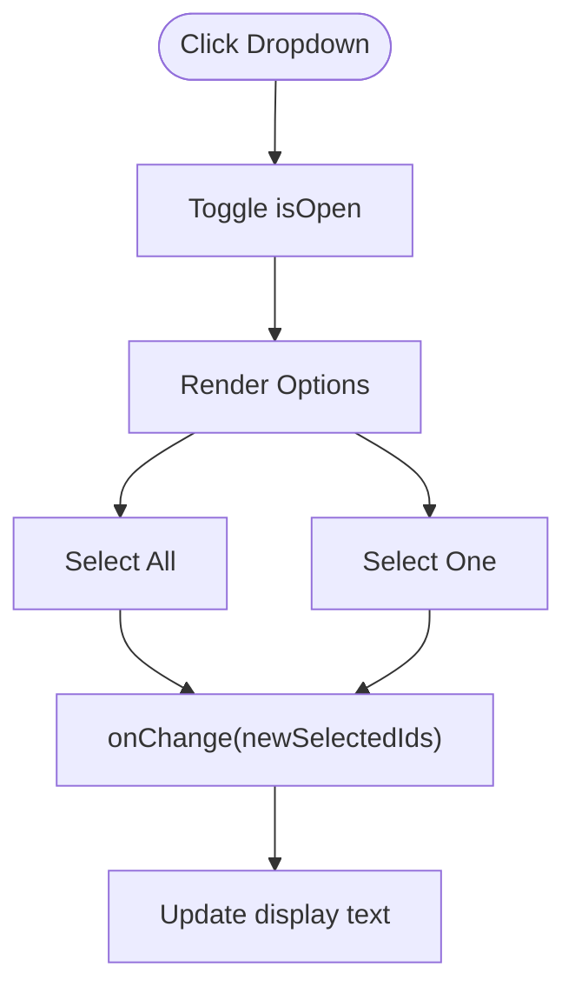
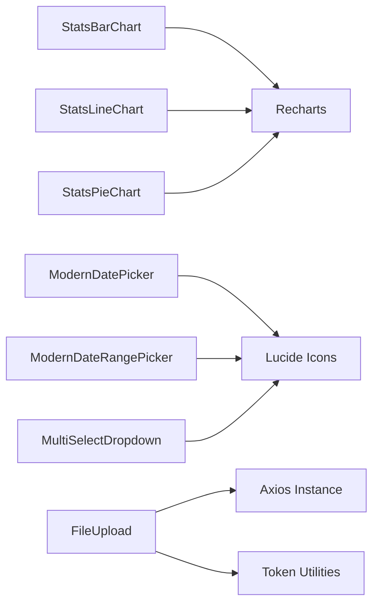

# UI Component Library

<cite>
**Referenced Files in This Document**
- [FileUpload.jsx](file://client/src/components/FileUpload.jsx)
- [RichTextEditor.jsx](file://client/src/components/RichTextEditor.jsx)
- [ModernDatePicker.jsx](file://client/src/components/ModernDatePicker.jsx)
- [ModernDateRangePicker.jsx](file://client/src/components/ModernDateRangePicker.jsx)
- [MultiSelectDropdown.jsx](file://client/src/components/MultiSelectDropdown.jsx)
- [StatsBarChart.jsx](file://client/src/components/charts/StatsBarChart.jsx)
- [StatsLineChart.jsx](file://client/src/components/charts/StatsLineChart.jsx)
- [StatsPieChart.jsx](file://client/src/components/charts/StatsPieChart.jsx)
</cite>

## Table of Contents
1. [Introduction](#introduction)
2. [Project Structure](#project-structure)
3. [Core Components](#core-components)
4. [Architecture Overview](#architecture-overview)
5. [Detailed Component Analysis](#detailed-component-analysis)
6. [Dependency Analysis](#dependency-analysis)
7. [Performance Considerations](#performance-considerations)
8. [Troubleshooting Guide](#troubleshooting-guide)
9. [Conclusion](#conclusion)

## Introduction
This document describes the custom UI component library used in Exam-Hub for reusable user interactions and data visualization. It covers:
- File upload with Excel processing
- Rich text editing for content creation
- Date and date range selection with time support
- Multi-value selection dropdowns
- Chart components for bar, line, and pie/donut visualizations

The focus is on prop interfaces, customization options, styling approaches, accessibility considerations, composition patterns, theme integration, and responsive design.

## Project Structure
The UI components are organized under client/src/components, with charts grouped under a charts subdirectory. Each component is a self-contained React function component that can be composed into pages and dashboards.

**Diagram sources**
- [FileUpload.jsx:1-268](file://client/src/components/FileUpload.jsx#L1-L268)
- [RichTextEditor.jsx:1-437](file://client/src/components/RichTextEditor.jsx#L1-L437)
- [ModernDatePicker.jsx:1-395](file://client/src/components/ModernDatePicker.jsx#L1-L395)
- [ModernDateRangePicker.jsx:1-505](file://client/src/components/ModernDateRangePicker.jsx#L1-L505)
- [MultiSelectDropdown.jsx:1-263](file://client/src/components/MultiSelectDropdown.jsx#L1-L263)
- [StatsBarChart.jsx:1-107](file://client/src/components/charts/StatsBarChart.jsx#L1-L107)
- [StatsLineChart.jsx:1-182](file://client/src/components/charts/StatsLineChart.jsx#L1-L182)
- [StatsPieChart.jsx:1-134](file://client/src/components/charts/StatsPieChart.jsx#L1-L134)

**Section sources**
- [FileUpload.jsx:1-268](file://client/src/components/FileUpload.jsx#L1-L268)
- [RichTextEditor.jsx:1-437](file://client/src/components/RichTextEditor.jsx#L1-L437)
- [ModernDatePicker.jsx:1-395](file://client/src/components/ModernDatePicker.jsx#L1-L395)
- [ModernDateRangePicker.jsx:1-505](file://client/src/components/ModernDateRangePicker.jsx#L1-L505)
- [MultiSelectDropdown.jsx:1-263](file://client/src/components/MultiSelectDropdown.jsx#L1-L263)
- [StatsBarChart.jsx:1-107](file://client/src/components/charts/StatsBarChart.jsx#L1-L107)
- [StatsLineChart.jsx:1-182](file://client/src/components/charts/StatsLineChart.jsx#L1-L182)
- [StatsPieChart.jsx:1-134](file://client/src/components/charts/StatsPieChart.jsx#L1-L134)

## Core Components
This section summarizes each component’s purpose, props, behavior, and usage patterns.

- FileUpload
  - Purpose: Upload an Excel file to extract questions; maps backend results to frontend question format.
  - Key props: onQuestionsExtracted, onClose, bankKey.
  - Behavior: Validates .xlsx, uploads via multipart form, shows progress, handles errors/success, auto-closes after success.
  - Integration: Uses axios instance and token utilities to attach account context.

- RichTextEditor
  - Purpose: Markdown-like editor with math symbols, formatting, image insertion, and live preview.
  - Key props: value, onChange, placeholder, autoFocus.
  - Behavior: Inserts formatted text or images at caret, supports keyboard shortcuts (Ctrl/Cmd+B/I/U), renders HTML preview.

- ModernDatePicker
  - Purpose: Single date and time picker with calendar and time tabs.
  - Key props: value, onChange, label, placeholder, required.
  - Behavior: Emits ISO string; supports AM/PM, hour/minute inputs, month navigation, and click-outside-to-close.

- ModernDateRangePicker
  - Purpose: Start/end date and time range picker with presets.
  - Key props: startDate, endDate, onChange, label.
  - Behavior: Enforces valid ranges, supports presets (today/tomorrow/week), emits two ISO strings.

- MultiSelectDropdown
  - Purpose: Multi-value selection with select-all and ellipsis display.
  - Key props: options, selectedIds, onChange, label, placeholder, disabled, id.
  - Behavior: Toggles selections, derives “all selected” state, displays count when many items are selected.

- StatsBarChart
  - Purpose: Bar chart for distribution data.
  - Props: data (array with Name/Value), title.
  - Behavior: Responsive container, gradient cells, tooltip, empty state.

- StatsLineChart
  - Purpose: Line/Area chart for trends, switching to bar for single exam view.
  - Props: data, title, userRole, selectedExamId.
  - Behavior: Shows student vs class average based on role; uses gradients and legends.

- StatsPieChart
  - Purpose: Donut chart for pass/fail rates.
  - Props: passPercentage, failPercentage, title.
  - Behavior: Normalizes values, ensures both segments render, shows center percentage.

**Section sources**
- [FileUpload.jsx:6-164](file://client/src/components/FileUpload.jsx#L6-L164)
- [RichTextEditor.jsx:3-178](file://client/src/components/RichTextEditor.jsx#L3-L178)
- [ModernDatePicker.jsx:4-116](file://client/src/components/ModernDatePicker.jsx#L4-L116)
- [ModernDateRangePicker.jsx:4-136](file://client/src/components/ModernDateRangePicker.jsx#L4-L136)
- [MultiSelectDropdown.jsx:4-86](file://client/src/components/MultiSelectDropdown.jsx#L4-L86)
- [StatsBarChart.jsx:3-106](file://client/src/components/charts/StatsBarChart.jsx#L3-L106)
- [StatsLineChart.jsx:3-181](file://client/src/components/charts/StatsLineChart.jsx#L3-L181)
- [StatsPieChart.jsx:3-133](file://client/src/components/charts/StatsPieChart.jsx#L3-L133)

## Architecture Overview
The UI layer composes these components within pages and dashboards. Charts consume normalized data arrays from parent state. The FileUpload component integrates with the backend API to import questions and returns mapped data to the parent.

**Diagram sources**
- [FileUpload.jsx:19-164](file://client/src/components/FileUpload.jsx#L19-L164)

## Detailed Component Analysis

### FileUpload
- Prop interface
  - onQuestionsExtracted: Function receiving an array of mapped questions.
  - onClose: Function to close the modal.
  - bankKey: Optional key appended to FormData.
- Data flow
  - Validates file type (.xlsx).
  - Builds FormData with file, accountId (from token), and optional bankKey.
  - Uploads with progress tracking; maps backend response to frontend question shape.
  - Emits mapped questions via onQuestionsExtracted and closes after success.
- Customization
  - Styling is inline; consider extracting styles to CSS variables for theming.
  - Error and success messages are rendered inline; can be externalized.
- Accessibility
  - Modal has aria-label on close button and Escape key handler.
  - Input is hidden but triggered by buttons; ensure focus management if refactored.
- Responsiveness
  - Modal width adapts using min() and viewport units.
- Error handling
  - Displays server error messages when available; resets state in finally block.

**Diagram sources**
- [FileUpload.jsx:19-164](file://client/src/components/FileUpload.jsx#L19-L164)

**Section sources**
- [FileUpload.jsx:6-164](file://client/src/components/FileUpload.jsx#L6-L164)
- [FileUpload.jsx:180-208](file://client/src/components/FileUpload.jsx#L180-L208)

### RichTextEditor
- Prop interface
  - value: String content (Markdown-like).
  - onChange: Function to update content.
  - placeholder: Placeholder text.
  - autoFocus: Boolean to focus on mount.
- Features
  - Math symbol panel with insertions at caret.
  - Formatting toolbar (bold, italic, underline, superscript, subscript, fraction).
  - Image insertion via FileReader base64.
  - Live preview rendering HTML from markdown-like syntax.
- Keyboard shortcuts
  - Ctrl/Cmd+B/I/U trigger formatting.
- Customization
  - Inline styles define colors and layout; consider CSS variables for theme integration.
- Accessibility
  - Buttons have titles; preview uses dangerouslySetInnerHTML—sanitize externally if needed.
- Responsiveness
  - Toolbar wraps; textarea resizes vertically.

**Diagram sources**
- [RichTextEditor.jsx:69-154](file://client/src/components/RichTextEditor.jsx#L69-L154)
- [RichTextEditor.jsx:156-178](file://client/src/components/RichTextEditor.jsx#L156-L178)

**Section sources**
- [RichTextEditor.jsx:3-178](file://client/src/components/RichTextEditor.jsx#L3-L178)
- [RichTextEditor.jsx:373-402](file://client/src/components/RichTextEditor.jsx#L373-L402)

### ModernDatePicker
- Prop interface
  - value: ISO string or timestamp.
  - onChange: Function receiving ISO string.
  - label: Accessible label text.
  - placeholder: Fallback text when no date selected.
  - required: Visual indicator for required field.
- Behavior
  - Calendar tab for selecting day; auto-switches to time tab.
  - Time tab supports hours, minutes, AM/PM toggles.
  - Applies changes and closes picker; formats display with locale settings.
- Customization
  - Colors defined locally; can be extracted to theme tokens.
- Accessibility
  - Label associates with input area; focus management could be improved with refs and focus traps.
- Responsiveness
  - Picker dropdown adapts to container width; grid-based calendar layout.

**Diagram sources**
- [ModernDatePicker.jsx:54-104](file://client/src/components/ModernDatePicker.jsx#L54-L104)

**Section sources**
- [ModernDatePicker.jsx:4-116](file://client/src/components/ModernDatePicker.jsx#L4-L116)
- [ModernDatePicker.jsx:182-395](file://client/src/components/ModernDatePicker.jsx#L182-L395)

### ModernDateRangePicker
- Prop interface
  - startDate: ISO string for start.
  - endDate: ISO string for end.
  - onChange: Function receiving (startISO, endISO).
  - label: Accessible label text.
- Behavior
  - Two-step selection: start then end; enforces ordering.
  - Presets: today, tomorrow, next week.
  - Separate time editors for start and end with AM/PM.
- Customization
  - Local color tokens; consider theme integration.
- Accessibility
  - Labels present; interactive sections need ARIA roles for panels and tabs.
- Responsiveness
  - Grid-based calendar; time inputs scale within container.

**Diagram sources**
- [ModernDateRangePicker.jsx:56-136](file://client/src/components/ModernDateRangePicker.jsx#L56-L136)

**Section sources**
- [ModernDateRangePicker.jsx:4-136](file://client/src/components/ModernDateRangePicker.jsx#L4-L136)
- [ModernDateRangePicker.jsx:138-187](file://client/src/components/ModernDateRangePicker.jsx#L138-L187)
- [ModernDateRangePicker.jsx:243-505](file://client/src/components/ModernDateRangePicker.jsx#L243-L505)

### MultiSelectDropdown
- Prop interface
  - options: Array of objects with id/value and label/name.
  - selectedIds: Array of selected option identifiers.
  - onChange: Function receiving updated selectedIds array.
  - label: Accessible label text.
  - placeholder: Text when nothing selected.
  - disabled: Disables interaction.
  - id: Button id for label association.
- Behavior
  - Toggle open/close; select all or individual options.
  - Display logic: shows up to two labels, otherwise count.
- Customization
  - Inline styles; consider CSS variables for theme.
- Accessibility
  - Button has id; label htmlFor connects; keyboard navigation not implemented.
- Responsiveness
  - Dropdown list scrolls; max height constrains long lists.

**Diagram sources**
- [MultiSelectDropdown.jsx:44-86](file://client/src/components/MultiSelectDropdown.jsx#L44-L86)

**Section sources**
- [MultiSelectDropdown.jsx:4-86](file://client/src/components/MultiSelectDropdown.jsx#L4-L86)
- [MultiSelectDropdown.jsx:88-263](file://client/src/components/MultiSelectDropdown.jsx#L88-L263)

### StatsBarChart
- Prop interface
  - data: Array of objects with Name and Value.
  - title: Chart title.
- Behavior
  - Renders bars with gradient fills; shows empty state when no data.
  - Uses ResponsiveContainer for sizing.
- Customization
  - Gradients defined internally; can be exposed via props for theming.
- Accessibility
  - Tooltip provides hover details; consider adding aria-labels to chart wrapper.
- Responsiveness
  - Width and height adapt to container; minHeight ensures visibility.

**Section sources**
- [StatsBarChart.jsx:3-106](file://client/src/components/charts/StatsBarChart.jsx#L3-L106)

### StatsLineChart
- Prop interface
  - data: Array of objects with Title, StudentScore, AverageScore.
  - title: Chart title.
  - userRole: "student" or other roles.
  - selectedExamId: If provided and only one item, renders as bar chart.
- Behavior
  - Role-aware series: student sees personal score and class average; others see average only.
  - Switches to bar chart for single exam selection.
- Customization
  - Gradient definitions internal; consider exposing colors via props.
- Accessibility
  - Legend and tooltips provide context; add aria-labels to chart containers.
- Responsiveness
  - ResponsiveContainer scales chart to fit container.

**Section sources**
- [StatsLineChart.jsx:3-181](file://client/src/components/charts/StatsLineChart.jsx#L3-L181)

### StatsPieChart
- Prop interface
  - passPercentage: Number between 0 and 100.
  - failPercentage: Number between 0 and 100; derived if inconsistent.
  - title: Chart title.
- Behavior
  - Normalizes values to ensure both segments exist; shows donut with center percentage.
- Customization
  - Gradients internal; can be themed via props.
- Accessibility
  - Legend and tooltip provide info; consider aria-labels for chart container.
- Responsiveness
  - ResponsiveContainer adapts size; innerRadius/outerRadius create donut.

**Section sources**
- [StatsPieChart.jsx:3-133](file://client/src/components/charts/StatsPieChart.jsx#L3-L133)

## Dependency Analysis
- External libraries
  - Recharts: Used by chart components for responsive charts, axes, tooltips, legends, and gradients.
  - Lucide icons: Used by date pickers and multi-select dropdown for iconography.
- Internal dependencies
  - FileUpload depends on axios instance and token utilities to attach authentication context.
  - Other components are mostly self-contained and rely on parent state for data binding.

**Diagram sources**
- [StatsBarChart.jsx:1-107](file://client/src/components/charts/StatsBarChart.jsx#L1-L107)
- [StatsLineChart.jsx:1-182](file://client/src/components/charts/StatsLineChart.jsx#L1-L182)
- [StatsPieChart.jsx:1-134](file://client/src/components/charts/StatsPieChart.jsx#L1-L134)
- [ModernDatePicker.jsx:1-395](file://client/src/components/ModernDatePicker.jsx#L1-L395)
- [ModernDateRangePicker.jsx:1-505](file://client/src/components/ModernDateRangePicker.jsx#L1-L505)
- [MultiSelectDropdown.jsx:1-263](file://client/src/components/MultiSelectDropdown.jsx#L1-L263)
- [FileUpload.jsx:1-5](file://client/src/components/FileUpload.jsx#L1-L5)

**Section sources**
- [StatsBarChart.jsx:1-107](file://client/src/components/charts/StatsBarChart.jsx#L1-L107)
- [StatsLineChart.jsx:1-182](file://client/src/components/charts/StatsLineChart.jsx#L1-L182)
- [StatsPieChart.jsx:1-134](file://client/src/components/charts/StatsPieChart.jsx#L1-L134)
- [ModernDatePicker.jsx:1-395](file://client/src/components/ModernDatePicker.jsx#L1-L395)
- [ModernDateRangePicker.jsx:1-505](file://client/src/components/ModernDateRangePicker.jsx#L1-L505)
- [MultiSelectDropdown.jsx:1-263](file://client/src/components/MultiSelectDropdown.jsx#L1-L263)
- [FileUpload.jsx:1-5](file://client/src/components/FileUpload.jsx#L1-L5)

## Performance Considerations
- FileUpload
  - Upload progress updates frequently; consider debouncing if needed.
  - Mapping large question sets may cause re-renders; memoize mapping logic if necessary.
- RichTextEditor
  - Live preview uses regex replacements; for very large content, consider throttling preview updates.
  - Base64 image insertion increases payload size; warn users about image size limits.
- Date Pickers
  - Frequent state updates on time inputs; consider controlled inputs with minimal re-renders.
- MultiSelectDropdown
  - Rendering many options can be expensive; virtualize if list grows large.
- Charts
  - Recharts ResponsiveContainer recalculates sizes; avoid excessive re-renders by memoizing data.
  - Gradients and tooltips add overhead; limit data points where possible.

[No sources needed since this section provides general guidance]

## Troubleshooting Guide
- FileUpload
  - Validation error: Ensure uploaded files are .xlsx; check MIME types.
  - No questions added: Verify backend template and fields; inspect result.errors.
  - Token issues: Confirm token presence and AccountId extraction.
- RichTextEditor
  - Preview not updating: Ensure onChange is wired and value is controlled.
  - Images not showing: Check base64 encoding and browser security policies.
- ModernDatePicker / ModernDateRangePicker
  - Time not applied: Verify AM/PM conversion and hour wrapping logic.
  - Range invalid: Ensure end date is after start; adjust automatically or enforce constraints.
- MultiSelectDropdown
  - Selection not reflected: Ensure selectedIds are passed down and onChange updates parent state.
  - Many options slow: Consider pagination or virtualization.
- Charts
  - Empty states: Provide non-empty data arrays or handle empty gracefully.
  - Misaligned axes: Ensure data keys match configuration (Name/Value, Title, etc.).

**Section sources**
- [FileUpload.jsx:23-30](file://client/src/components/FileUpload.jsx#L23-L30)
- [FileUpload.jsx:157-163](file://client/src/components/FileUpload.jsx#L157-L163)
- [RichTextEditor.jsx:130-154](file://client/src/components/RichTextEditor.jsx#L130-L154)
- [ModernDatePicker.jsx:66-97](file://client/src/components/ModernDatePicker.jsx#L66-L97)
- [ModernDateRangePicker.jsx:96-129](file://client/src/components/ModernDateRangePicker.jsx#L96-L129)
- [MultiSelectDropdown.jsx:59-69](file://client/src/components/MultiSelectDropdown.jsx#L59-L69)
- [StatsBarChart.jsx:12-13](file://client/src/components/charts/StatsBarChart.jsx#L12-L13)
- [StatsLineChart.jsx:4-5](file://client/src/components/charts/StatsLineChart.jsx#L4-L5)
- [StatsPieChart.jsx:4-13](file://client/src/components/charts/StatsPieChart.jsx#L4-L13)

## Conclusion
The Exam-Hub UI component library provides cohesive, reusable building blocks for file uploads, rich content editing, date selection, multi-value selections, and data visualization. Components emphasize inline styling and local color tokens, which can be migrated to CSS variables for consistent theming. Accessibility improvements include better ARIA attributes, focus management, and keyboard navigation. Responsiveness is achieved through flexible layouts, grid systems, and responsive chart containers. For scalability, consider extracting styles, memoizing heavy computations, and virtualizing large lists.

[No sources needed since this section summarizes without analyzing specific files]