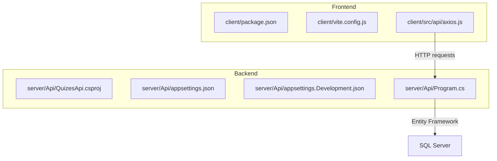
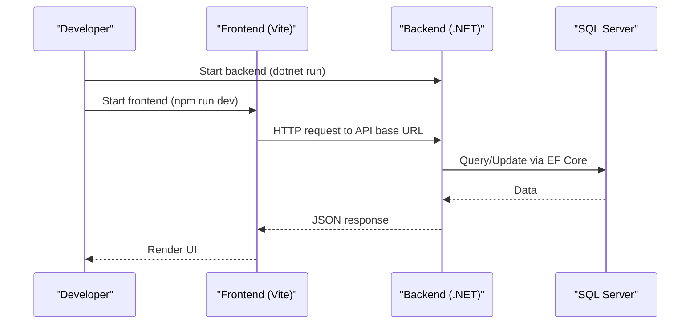
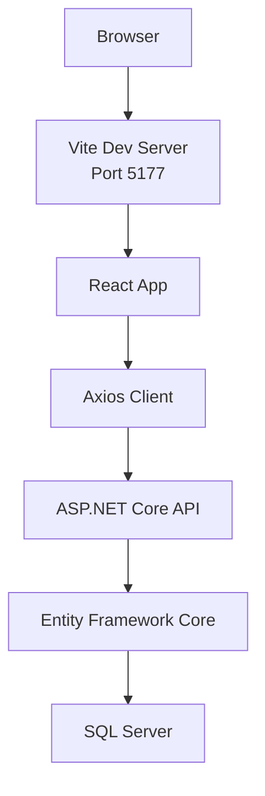

# Getting Started

<cite>
**Referenced Files in This Document**
- [README.md](file://README.md)
- [client/package.json](file://client/package.json)
- [client/vite.config.js](file://client/vite.config.js)
- [client/src/api/axios.js](file://client/src/api/axios.js)
- [server/Api/QuizesApi.csproj](file://server/Api/QuizesApi.csproj)
- [server/Api/appsettings.json](file://server/Api/appsettings.json)
- [server/Api/appsettings.Development.json](file://server/Api/appsettings.Development.json)
- [server/Api/Program.cs](file://server/Api/Program.cs)
</cite>

## Table of Contents
1. [Introduction](#introduction)
2. [Project Structure](#project-structure)
3. [Prerequisites](#prerequisites)
4. [Environment Configuration](#environment-configuration)
5. [Backend Setup (Server)](#backend-setup-server)
6. [Frontend Setup (Client)](#frontend-setup-client)
7. [Development Workflow](#development-workflow)
8. [Architecture Overview](#architecture-overview)
9. [Troubleshooting Guide](#troubleshooting-guide)
10. [Conclusion](#conclusion)

## Introduction
This guide helps you set up and run the Exam-Hub application locally for development. The system is a monorepo with:
- Frontend: React + Vite (JavaScript)
- Backend: .NET 9 Web API (C#)
- Database: SQL Server (via Entity Framework Core)

You will install prerequisites, configure environment variables, start the backend server, then start the frontend client, and finally access the app in your browser.

## Project Structure
At a high level:
- client/: Frontend source code, build configuration, and dependencies
- server/Api/: Backend API project, configuration files, models, controllers, and database context

**Diagram sources**
- [client/package.json:1-35](file://client/package.json#L1-L35)
- [client/vite.config.js:1-12](file://client/vite.config.js#L1-L12)
- [client/src/api/axios.js:1-62](file://client/src/api/axios.js#L1-L62)
- [server/Api/QuizesApi.csproj:1-26](file://server/Api/QuizesApi.csproj#L1-L26)
- [server/Api/appsettings.json:1-18](file://server/Api/appsettings.json#L1-L18)
- [server/Api/appsettings.Development.json:1-12](file://server/Api/appsettings.Development.json#L1-L12)
- [server/Api/Program.cs:1-146](file://server/Api/Program.cs#L1-L146)

**Section sources**
- [README.md:1-75](file://README.md#L1-L75)

## Prerequisites
Install the following tools before proceeding:

- .NET SDK 9.x
  - Required by the backend (.NET 9 target framework).
  - Verify installation: `dotnet --info`

- Node.js and npm
  - Required by the frontend (Vite + React).
  - Recommended: Node.js LTS version.
  - Verify installation: `node --version`, `npm --version`

- SQL Server
  - A running SQL Server instance accessible from your machine.
  - You need connection details (server name, database, user, password).
  - Ensure TCP/IP is enabled and firewall allows connections to the SQL Server port.

Notes:
- The backend uses Entity Framework Core with SQL Server provider.
- The frontend runs on Vite and communicates with the backend via HTTP.

**Section sources**
- [server/Api/QuizesApi.csproj:1-26](file://server/Api/QuizesApi.csproj#L1-L26)
- [client/package.json:1-35](file://client/package.json#L1-L35)

## Environment Configuration
Configure both backend and frontend to point to your local SQL Server and API endpoints.

### Backend Configuration
- Connection string
  - Update the default connection string to point to your local SQL Server instance.
  - File locations:
    - Production defaults: [server/Api/appsettings.json:1-18](file://server/Api/appsettings.json#L1-L18)
    - Development overrides: [server/Api/appsettings.Development.json:1-12](file://server/Api/appsettings.Development.json#L1-L12)
  - Key fields to adjust:
    - Server: Replace placeholder with your local SQL Server host (e.g., localhost or .\SQLEXPRESS).
    - Database: Use your local database name.
    - User Id / Password: Provide valid SQL credentials.
    - Encrypt: Set appropriately for your environment.

- JWT settings
  - If you are using local authentication flows, ensure the JWT key, issuer, and audience match your expectations.
  - Location: [server/Api/appsettings.json:1-18](file://server/Api/appsettings.json#L1-L18)

- CORS
  - By default, the backend enables a permissive CORS policy that allows any origin during development.
  - Location: [server/Api/Program.cs:92-102](file://server/Api/Program.cs#L92-L102)

### Frontend Configuration
- API base URL
  - The frontend reads an environment variable for the API base URL.
  - Variable: `VITE_API_BASE_URL`
  - Default fallback: a production endpoint if not set.
  - Location: [client/src/api/axios.js:1-62](file://client/src/api/axios.js#L1-L62)
  - To use your local backend, create a file at `client/.env.development` with:
    - `VITE_API_BASE_URL=http://localhost:<port>/api`
  - Confirm the backend’s listening port and route prefix in Program.cs.

- Development server port
  - Vite dev server runs on port 5177 by default.
  - Location: [client/vite.config.js:1-12](file://client/vite.config.js#L1-L12)

- Proxying (optional)
  - If you prefer relative paths (/api), configure a proxy in Vite so requests to `/api` are forwarded to the backend.
  - See Vite documentation for proxy configuration.

**Section sources**
- [server/Api/appsettings.json:1-18](file://server/Api/appsettings.json#L1-L18)
- [server/Api/appsettings.Development.json:1-12](file://server/Api/appsettings.Development.json#L1-L12)
- [server/Api/Program.cs:92-102](file://server/Api/Program.cs#L92-L102)
- [client/src/api/axios.js:1-62](file://client/src/api/axios.js#L1-L62)
- [client/vite.config.js:1-12](file://client/vite.config.js#L1-L12)

## Backend Setup (Server)
Follow these steps to build and run the backend API:

1. Navigate to the backend project directory:
   - `cd server/Api`

2. Restore NuGet packages:
   - `dotnet restore`

3. Run the application:
   - `dotnet run`

4. Verify it started:
   - Check console output for the listening URL (for example, http://localhost:5000 or another port configured by launchSettings).
   - If Swagger UI is available in development, open it in your browser.

Important notes:
- The backend targets .NET 9.
- It registers controllers, Swagger/OpenAPI in development, and dependency injection for repositories.
- It configures JWT authentication and role-based authorization policies.
- It seeds roles and test accounts on startup (non-fatal if seeding fails).

**Section sources**
- [server/Api/QuizesApi.csproj:1-26](file://server/Api/QuizesApi.csproj#L1-L26)
- [server/Api/Program.cs:1-146](file://server/Api/Program.cs#L1-L146)

## Frontend Setup (Client)
Follow these steps to build and run the frontend:

1. Navigate to the frontend directory:
   - `cd client`

2. Install dependencies:
   - `npm install`

3. Start the development server:
   - `npm run dev`

4. Access the app:
   - Open your browser to the Vite dev server URL shown in the console (default port 5177).

Notes:
- The frontend uses React and Vite.
- Scripts are defined in package.json.
- Ensure the API base URL points to your running backend.

**Section sources**
- [client/package.json:1-35](file://client/package.json#L1-L35)
- [client/vite.config.js:1-12](file://client/vite.config.js#L1-L12)

## Development Workflow
Typical workflow while developing:

1. Start the backend:
   - `cd server/Api && dotnet run`

2. Start the frontend:
   - `cd client && npm run dev`

3. Access the application:
   - Frontend URL: http://localhost:5177 (or the port shown by Vite)
   - Backend URL: as printed by dotnet run (for example, http://localhost:5000)

4. Authentication flow:
   - On unauthorized responses, the frontend redirects to the configured CAS login URL and returns via a callback route.
   - Ensure `VITE_CAS_URL` is set if you rely on this behavior.

**Diagram sources**
- [client/src/api/axios.js:1-62](file://client/src/api/axios.js#L1-L62)
- [server/Api/Program.cs:1-146](file://server/Api/Program.cs#L1-L146)

## Architecture Overview
High-level components and their interactions:

**Diagram sources**
- [client/vite.config.js:1-12](file://client/vite.config.js#L1-L12)
- [client/src/api/axios.js:1-62](file://client/src/api/axios.js#L1-L62)
- [server/Api/Program.cs:1-146](file://server/Api/Program.cs#L1-L146)

## Troubleshooting Guide

- Cannot connect to SQL Server
  - Symptoms: Errors when starting the backend or running migrations.
  - Checks:
    - Ensure SQL Server is running and reachable.
    - Validate the connection string in [appsettings.json:1-18](file://server/Api/appsettings.json#L1-L18) and [appsettings.Development.json:1-12](file://server/Api/appsettings.Development.json#L1-L12).
    - Confirm TCP/IP is enabled and firewall rules allow inbound connections.
    - Verify SQL user permissions for the specified database.

- Backend does not start or crashes on startup
  - Symptoms: Console errors about missing services or invalid configuration.
  - Checks:
    - Ensure .NET 9 SDK is installed.
    - Verify all required packages are restored (`dotnet restore`).
    - Review logs for JWT configuration issues; confirm key, issuer, and audience values.

- Frontend cannot reach the backend
  - Symptoms: Network errors or CORS errors in the browser console.
  - Checks:
    - Confirm `VITE_API_BASE_URL` points to the correct backend URL.
    - Ensure the backend is running and accessible at that URL.
    - During development, CORS is allowed for any origin; verify no strict policies block requests.

- Port conflicts
  - Symptoms: Vite or .NET cannot bind to the expected port.
  - Fixes:
    - Change Vite port in [vite.config.js:1-12](file://client/vite.config.js#L1-L12).
    - Adjust Kestrel/launch settings for the backend if needed.

- Authentication redirect loop or 401 errors
  - Symptoms: Redirects to CAS login repeatedly or pages show unauthorized.
  - Checks:
    - Ensure `VITE_CAS_URL` is correctly set.
    - Verify token handling and storage logic in the frontend.
    - Confirm backend JWT validation parameters match your tokens.

- Swagger UI not available
  - Symptoms: Cannot open Swagger in development.
  - Checks:
    - Ensure you are running in the Development environment.
    - Confirm Swagger is enabled in [Program.cs:112-116](file://server/Api/Program.cs#L112-L116).

**Section sources**
- [server/Api/appsettings.json:1-18](file://server/Api/appsettings.json#L1-L18)
- [server/Api/appsettings.Development.json:1-12](file://server/Api/appsettings.Development.json#L1-L12)
- [client/src/api/axios.js:1-62](file://client/src/api/axios.js#L1-L62)
- [client/vite.config.js:1-12](file://client/vite.config.js#L1-L12)
- [server/Api/Program.cs:112-116](file://server/Api/Program.cs#L112-L116)

## Conclusion
You now have everything needed to set up and run Exam-Hub locally. Install the prerequisites, configure the database connection and API endpoints, start the backend, then start the frontend. Use the troubleshooting section to resolve common setup issues. For further customization, review the configuration files and environment variables referenced above.