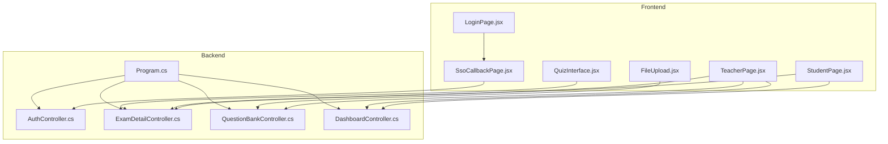
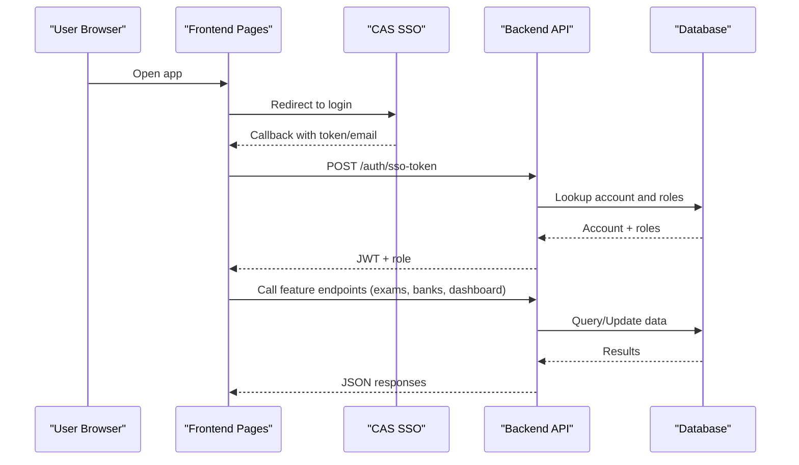
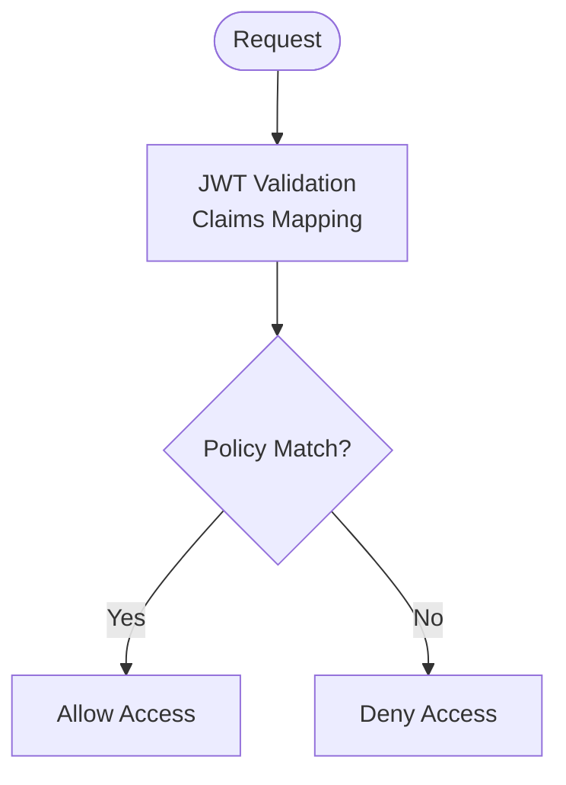
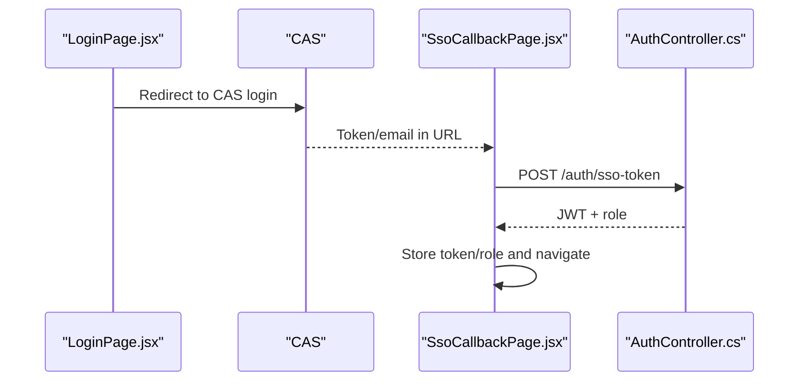
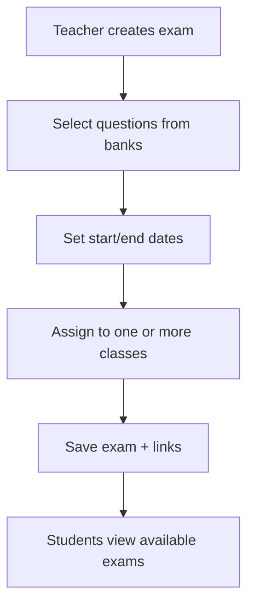
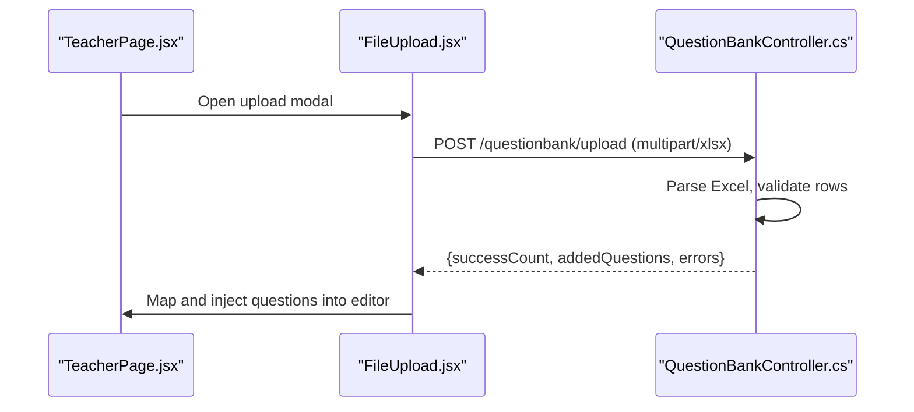
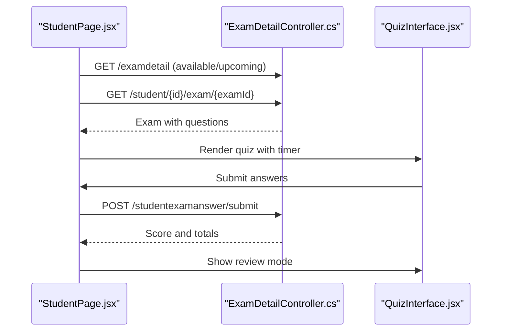
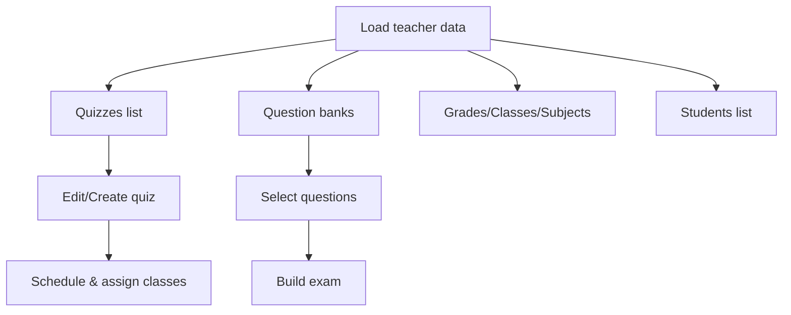
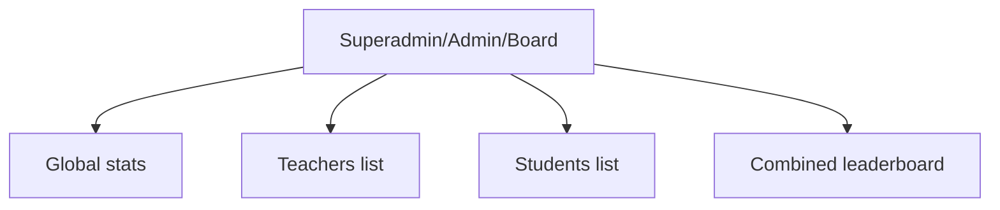
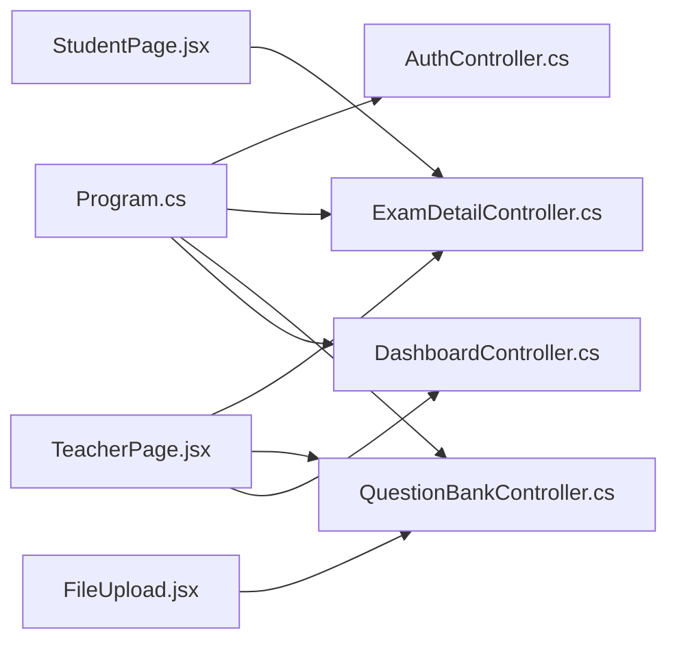

# Core Features Summary

<cite>
**Referenced Files in This Document**   
- [README.md](file://README.md)
- [Program.cs](file://server/Api/Program.cs)
- [AuthController.cs](file://server/Api/Controllers/AuthController.cs)
- [ExamDetailController.cs](file://server/Api/Controllers/ExamDetailController.cs)
- [QuestionBankController.cs](file://server/Api/Controllers/QuestionBankController.cs)
- [DashboardController.cs](file://server/Api/Controllers/DashboardController.cs)
- [LoginPage.jsx](file://client/src/pages/LoginPage.jsx)
- [SsoCallbackPage.jsx](file://client/src/pages/SsoCallbackPage.jsx)
- [StudentPage.jsx](file://client/src/pages/StudentPage.jsx)
- [TeacherPage.jsx](file://client/src/pages/TeacherPage.jsx)
- [QuizInterface.jsx](file://client/src/components/QuizInterface.jsx)
- [FileUpload.jsx](file://client/src/components/FileUpload.jsx)
</cite>

## Table of Contents
1. Introduction
2. Project Structure
3. Core Components
4. Architecture Overview
5. Detailed Component Analysis
6. Dependency Analysis
7. Performance Considerations
8. Troubleshooting Guide
9. Conclusion

## Introduction
This document summarizes Exam-Hub’s core features: multi-role user management (Students, Teachers, Administrators), exam creation and distribution with question bank management, student exam-taking interface with progress tracking and analytics, teacher dashboard for monitoring and reporting, administrator oversight, Excel-based question import, real-time analytics, and integrated authentication with CAS SSO support.

## Project Structure
Exam-Hub is a monorepo with a React/Vite frontend and a .NET Core backend exposing REST APIs. The frontend provides role-based pages and components; the backend implements authentication, authorization, exam/question management, and dashboards.

**Diagram sources**
- [Program.cs:17-108](file://server/Api/Program.cs#L17-L108)
- [AuthController.cs:12-26](file://server/Api/Controllers/AuthController.cs#L12-L26)
- [ExamDetailController.cs:11-22](file://server/Api/Controllers/ExamDetailController.cs#L11-L22)
- [QuestionBankController.cs:10-19](file://server/Api/Controllers/QuestionBankController.cs#L10-L19)
- [DashboardController.cs:11-22](file://server/Api/Controllers/DashboardController.cs#L11-L22)
- [LoginPage.jsx:6-28](file://client/src/pages/LoginPage.jsx#L6-L28)
- [SsoCallbackPage.jsx:6-63](file://client/src/pages/SsoCallbackPage.jsx#L6-L63)
- [StudentPage.jsx:15-39](file://client/src/pages/StudentPage.jsx#L15-L39)
- [TeacherPage.jsx:21-55](file://client/src/pages/TeacherPage.jsx#L21-L55)
- [QuizInterface.jsx:1-10](file://client/src/components/QuizInterface.jsx#L1-L10)
- [FileUpload.jsx:6-11](file://client/src/components/FileUpload.jsx#L6-L11)

**Section sources**
- [README.md:5-23](file://README.md#L5-L23)

## Core Components
- Multi-role user management: Students, Teachers, and Superadmin/Admin/Board roles are enforced via JWT policies and claims mapping.
- Exam lifecycle: Create, schedule, link questions from banks, distribute to classes, take, submit, review, and analyze results.
- Question bank management: CRUD operations and bulk import via Excel templates.
- Student portal: Available/upcoming/completed exams, timed taking interface, auto-submit on timeout, review mode with feedback.
- Teacher dashboard: Manage quizzes, select questions from banks, monitor students, generate reports.
- Administrator interface: Global oversight, teachers/students listing, system-wide settings.
- Authentication: CAS SSO integration with token exchange and JWT issuance.

**Section sources**
- [Program.cs:43-90](file://server/Api/Program.cs#L43-L90)
- [AuthController.cs:118-249](file://server/Api/Controllers/AuthController.cs#L118-L249)
- [ExamDetailController.cs:24-69](file://server/Api/Controllers/ExamDetailController.cs#L24-L69)
- [QuestionBankController.cs:145-271](file://server/Api/Controllers/QuestionBankController.cs#L145-L271)
- [StudentPage.jsx:116-246](file://client/src/pages/StudentPage.jsx#L116-L246)
- [TeacherPage.jsx:97-245](file://client/src/pages/TeacherPage.jsx#L97-L245)
- [DashboardController.cs:24-78](file://server/Api/Controllers/DashboardController.cs#L24-L78)

## Architecture Overview
The system uses JWT-based authentication with role policies. Frontend routes users through CAS SSO, exchanges tokens, and calls backend endpoints secured by policies. Data flows through controllers to repositories and database models.

**Diagram sources**
- [LoginPage.jsx:9-28](file://client/src/pages/LoginPage.jsx#L9-L28)
- [SsoCallbackPage.jsx:10-63](file://client/src/pages/SsoCallbackPage.jsx#L10-L63)
- [AuthController.cs:251-313](file://server/Api/Controllers/AuthController.cs#L251-L313)
- [Program.cs:43-90](file://server/Api/Program.cs#L43-L90)

## Detailed Component Analysis

### Multi-Role User Management and Authorization
- Role policies: StudentOnly, TeacherOnly, SuperadminOnly, TeacherOrAdmin defined in server startup.
- Claims mapping: Role and AccountId normalized from various claim names for consistent access control.
- Frontend role checks: Utility functions determine user roles to render appropriate UI.

**Diagram sources**
- [Program.cs:43-90](file://server/Api/Program.cs#L43-L90)

**Section sources**
- [Program.cs:43-90](file://server/Api/Program.cs#L43-L90)
- [roleUtils.js:1-20](file://client/src/utils/roleUtils.js#L1-L20)

### Integrated Authentication with CAS SSO
- Login page redirects to CAS and handles token presence.
- SSO callback exchanges email or SSO token for an Exams JWT, stores token and role locally, and navigates to the app.

**Diagram sources**
- [LoginPage.jsx:9-28](file://client/src/pages/LoginPage.jsx#L9-L28)
- [SsoCallbackPage.jsx:10-63](file://client/src/pages/SsoCallbackPage.jsx#L10-L63)
- [AuthController.cs:251-313](file://server/Api/Controllers/AuthController.cs#L251-L313)

**Section sources**
- [LoginPage.jsx:9-28](file://client/src/pages/LoginPage.jsx#L9-L28)
- [SsoCallbackPage.jsx:10-63](file://client/src/pages/SsoCallbackPage.jsx#L10-L63)
- [AuthController.cs:251-313](file://server/Api/Controllers/AuthController.cs#L251-L313)

### Exam Creation and Distribution Workflow
- Teachers create exams with title, subject, grade/class, scheduling dates, and selected questions from question banks.
- Backend validates account, resolves class assignments (multi-class support), persists exam and links questions.
- Students see only exams assigned to their class based on stored class ID.

**Diagram sources**
- [ExamDetailController.cs:110-198](file://server/Api/Controllers/ExamDetailController.cs#L110-L198)
- [ExamDetailController.cs:24-69](file://server/Api/Controllers/ExamDetailController.cs#L24-L69)

**Section sources**
- [ExamDetailController.cs:110-198](file://server/Api/Controllers/ExamDetailController.cs#L110-L198)
- [ExamDetailController.cs:24-69](file://server/Api/Controllers/ExamDetailController.cs#L24-L69)

### Question Bank Management and Excel Import
- Teachers can list, create, update, delete questions and upload Excel templates to bulk-import questions.
- Upload endpoint parses .xlsx, maps fields, validates required data, and returns added questions with counts and errors.
- Frontend FileUpload component supports drag-and-drop, progress indication, template download, and result mapping.

**Diagram sources**
- [FileUpload.jsx:19-163](file://client/src/components/FileUpload.jsx#L19-L163)
- [QuestionBankController.cs:145-271](file://server/Api/Controllers/QuestionBankController.cs#L145-L271)

**Section sources**
- [QuestionBankController.cs:145-271](file://server/Api/Controllers/QuestionBankController.cs#L145-L271)
- [FileUpload.jsx:19-163](file://client/src/components/FileUpload.jsx#L19-L163)

### Student Portal: Exam Taking, Progress Tracking, Analytics
- Students fetch available/upcoming/exam details, shuffle questions, and take timed exams.
- Timer auto-submits when time runs out; submission collects answers and posts to backend.
- Review mode shows correct/incorrect indicators and scores.

**Diagram sources**
- [StudentPage.jsx:355-584](file://client/src/pages/StudentPage.jsx#L355-L584)
- [QuizInterface.jsx:131-199](file://client/src/components/QuizInterface.jsx#L131-L199)

**Section sources**
- [StudentPage.jsx:355-584](file://client/src/pages/StudentPage.jsx#L355-L584)
- [QuizInterface.jsx:131-199](file://client/src/components/QuizInterface.jsx#L131-L199)

### Teacher Dashboard: Monitoring, Reporting, Question Banks
- Loads quizzes, question banks, lookup data (grades/classes/subjects), and students.
- Provides interfaces to edit quizzes, select questions from banks, and manage schedules.
- Integrates with dashboard endpoints for statistics and leaderboards.

**Diagram sources**
- [TeacherPage.jsx:97-245](file://client/src/pages/TeacherPage.jsx#L97-L245)

**Section sources**
- [TeacherPage.jsx:97-245](file://client/src/pages/TeacherPage.jsx#L97-L245)
- [DashboardController.cs:24-78](file://server/Api/Controllers/DashboardController.cs#L24-L78)

### Administrator Interface: System Oversight and Settings
- Superadmin/Admin/Board endpoints provide global dashboards, teacher/student lists, and combined leaderboards.
- Access controlled via role policies.

**Diagram sources**
- [DashboardController.cs:201-234](file://server/Api/Controllers/DashboardController.cs#L201-L234)
- [DashboardController.cs:346-374](file://server/Api/Controllers/DashboardController.cs#L346-L374)

**Section sources**
- [DashboardController.cs:201-234](file://server/Api/Controllers/DashboardController.cs#L201-L234)
- [DashboardController.cs:346-374](file://server/Api/Controllers/DashboardController.cs#L346-L374)

## Dependency Analysis
- Controllers depend on repositories and EF Core context for data access.
- Program.cs wires DI, JWT auth, CORS, Swagger, and seeds test data.
- Frontend pages call backend endpoints via axios and rely on stored JWT for authorization.

**Diagram sources**
- [Program.cs:104-108](file://server/Api/Program.cs#L104-L108)
- [StudentPage.jsx:116-146](file://client/src/pages/StudentPage.jsx#L116-L146)
- [TeacherPage.jsx:97-124](file://client/src/pages/TeacherPage.jsx#L97-L124)
- [FileUpload.jsx:57-64](file://client/src/components/FileUpload.jsx#L57-L64)

**Section sources**
- [Program.cs:104-108](file://server/Api/Program.cs#L104-L108)

## Performance Considerations
- Use of memory cache services configured in server startup.
- Efficient DTOs and repository patterns reduce payload size and improve clarity.
- Frontend caching of lookup data and students via session storage reduces repeated network calls.

[No sources needed since this section provides general guidance]

## Troubleshooting Guide
- Authentication issues: Verify CAS redirect URLs, token presence, and JWT configuration (issuer/audience/key). Check claims mapping for Role and AccountId.
- Exam access: Ensure student has a valid class assignment; otherwise, they will not see any exams.
- Excel upload: Confirm file type (.xlsx), required columns, and that Correct Answer is present; check error messages returned by the upload endpoint.
- Network errors: Validate server running status and CORS policy.

**Section sources**
- [Program.cs:43-90](file://server/Api/Program.cs#L43-L90)
- [QuestionBankController.cs:145-171](file://server/Api/Controllers/QuestionBankController.cs#L145-L171)
- [ExamDetailController.cs:24-69](file://server/Api/Controllers/ExamDetailController.cs#L24-L69)

## Conclusion
Exam-Hub delivers a robust, role-aware platform for managing academic exams. It integrates CAS SSO, supports bulk question imports, provides a rich student exam experience with timing and review, and equips teachers and administrators with comprehensive dashboards and reporting tools.