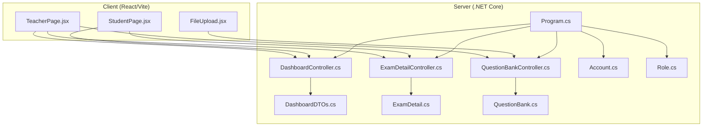
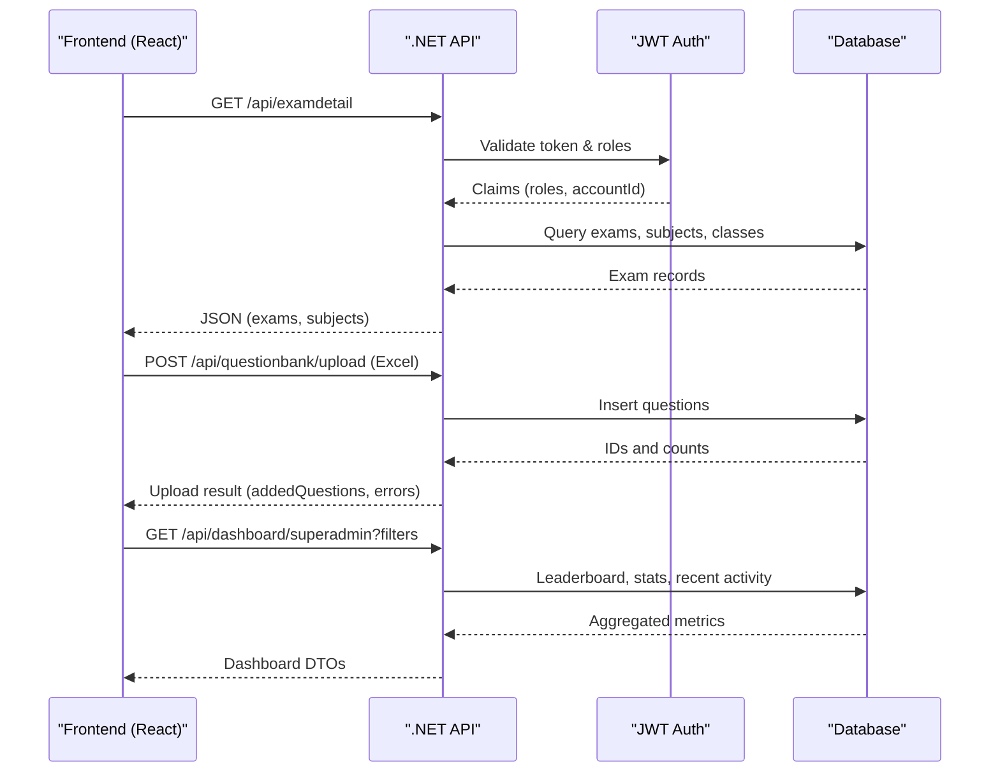
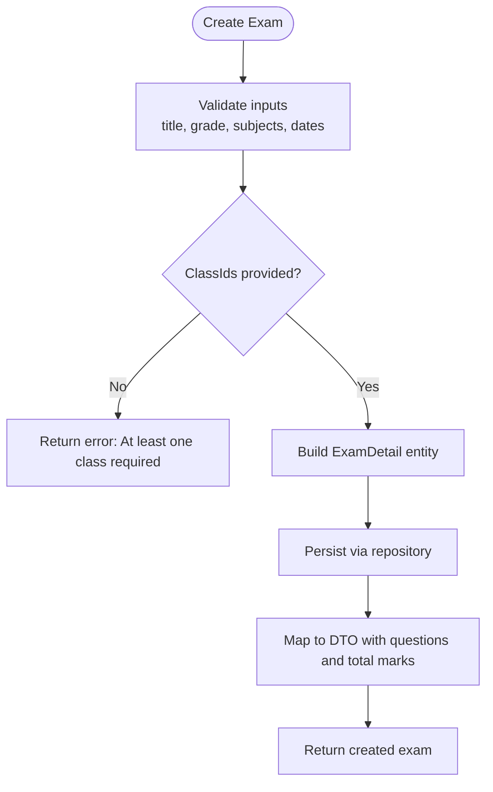
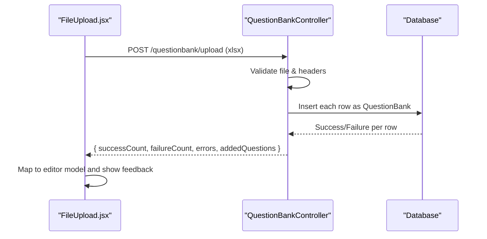
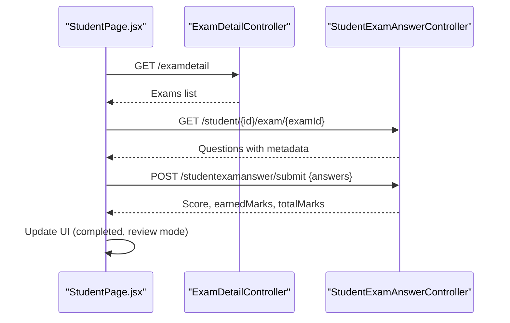
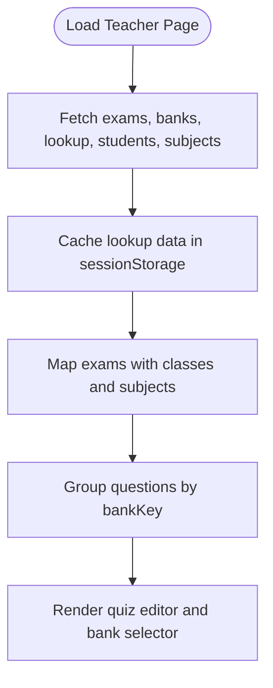
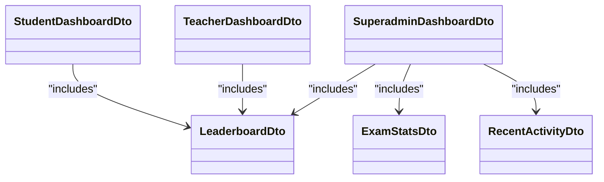
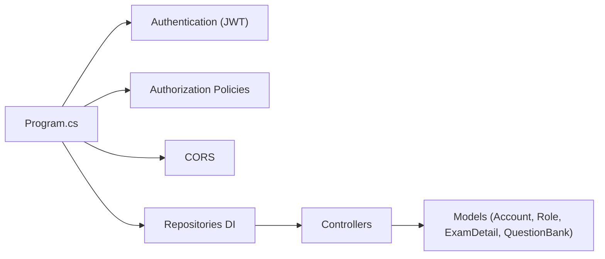

# Project Overview

<cite>
**Referenced Files in This Document**
- [README.md](file://README.md)
- [Program.cs](file://server/Api/Program.cs)
- [DashboardController.cs](file://server/Api/Controllers/DashboardController.cs)
- [ExamDetailController.cs](file://server/Api/Controllers/ExamDetailController.cs)
- [QuestionBankController.cs](file://server/Api/Controllers/QuestionBankController.cs)
- [DashboardDTOs.cs](file://server/Api/DTOs/DashboardDTOs.cs)
- [Account.cs](file://server/Api/Models/Account.cs)
- [Role.cs](file://server/Api/Models/Role.cs)
- [ExamDetail.cs](file://server/Api/Models/ExamDetail.cs)
- [QuestionBank.cs](file://server/Api/Models/QuestionBank.cs)
- [TeacherPage.jsx](file://client/src/pages/TeacherPage.jsx)
- [StudentPage.jsx](file://client/src/pages/StudentPage.jsx)
- [FileUpload.jsx](file://client/src/components/FileUpload.jsx)
</cite>

## Table of Contents
1. Introduction
2. Project Structure
3. Core Components
4. Architecture Overview
5. Detailed Component Analysis
6. Dependency Analysis
7. Performance Considerations
8. Troubleshooting Guide
9. Conclusion

## Introduction
Exam-Hub is a full-stack web application for Exam Management that helps schools and institutions organize academic examinations, manage question banks, and analyze student performance. It provides role-based experiences:
- Student Portal: take exams, review results, and track progress.
- Teacher Dashboard: create and distribute exams, curate questions from the Question Bank System, and view analytics.
- Administrator capabilities: oversee global dashboards, teacher/student lists, and system-wide insights.

The system uses a monorepo architecture with a React/Vite frontend and a .NET Core backend API. Authentication and authorization are handled via JWT tokens with role-based policies (Student, Teacher, Superadmin/Admin/Board).

Practical examples:
- Creating an exam: Teachers select grade/class, add questions from the Question Bank System, set start/end times, and publish.
- Managing question banks: Teachers upload Excel templates or create questions manually; questions are grouped by bank keys and subjects.
- Viewing analytics: Administrators and teachers access dashboards showing pass/fail rates, score distributions, leaderboards, and recent activity.

**Section sources**
- [README.md:1-23](file://README.md#L1-L23)

## Project Structure
The repository follows a clear monorepo layout:
- client: React + Vite SPA with pages for Students and Teachers, reusable components, and API integration.
- server: .NET Core Web API with controllers, DTOs, models, repositories, and configuration.

**Diagram sources**
- [Program.cs:17-108](file://server/Api/Program.cs#L17-L108)
- [DashboardController.cs:11-22](file://server/Api/Controllers/DashboardController.cs#L11-L22)
- [ExamDetailController.cs:11-22](file://server/Api/Controllers/ExamDetailController.cs#L11-L22)
- [QuestionBankController.cs:10-19](file://server/Api/Controllers/QuestionBankController.cs#L10-L19)
- [DashboardDTOs.cs:39-168](file://server/Api/DTOs/DashboardDTOs.cs#L39-L168)
- [ExamDetail.cs:6-30](file://server/Api/Models/ExamDetail.cs#L6-L30)
- [QuestionBank.cs:7-46](file://server/Api/Models/QuestionBank.cs#L7-L46)
- [Account.cs:6-81](file://server/Api/Models/Account.cs#L6-L81)
- [Role.cs:6-17](file://server/Api/Models/Role.cs#L6-L17)

**Section sources**
- [README.md:5-23](file://README.md#L5-L23)

## Core Components
- Exam Management: Create, update, delete, and filter exams; assign to classes; control availability windows; map subjects and grades.
- Question Bank System: CRUD for questions, bulk upload via Excel, grouping by bank key, subject, and grade.
- Student Portal: View available/upcoming/completed exams, take timed exams, submit answers, and review results.
- Teacher Dashboard: Manage quizzes, build exams from question banks, view students and performance data.
- Real-time Analytics: Dashboards with leaderboard, score distribution, pass/fail percentages, and recent activity.

Key implementation highlights:
- Role-based access via JWT and policies configured at startup.
- Multi-class assignment support for exams.
- Excel-based question import with template download and validation.
- Dashboard endpoints for student, teacher, and superadmin views.

**Section sources**
- [Program.cs:43-108](file://server/Api/Program.cs#L43-L108)
- [ExamDetailController.cs:24-69](file://server/Api/Controllers/ExamDetailController.cs#L24-L69)
- [QuestionBankController.cs:21-48](file://server/Api/Controllers/QuestionBankController.cs#L21-L48)
- [DashboardController.cs:80-234](file://server/Api/Controllers/DashboardController.cs#L80-L234)
- [TeacherPage.jsx:97-245](file://client/src/pages/TeacherPage.jsx#L97-L245)
- [StudentPage.jsx:115-246](file://client/src/pages/StudentPage.jsx#L115-L246)

## Architecture Overview
The system exposes REST APIs consumed by the React SPA. The server configures authentication, CORS, Swagger, and dependency injection for repositories. Controllers orchestrate business logic using DTOs and models.

**Diagram sources**
- [Program.cs:17-108](file://server/Api/Program.cs#L17-L108)
- [ExamDetailController.cs:24-69](file://server/Api/Controllers/ExamDetailController.cs#L24-L69)
- [QuestionBankController.cs:145-271](file://server/Api/Controllers/QuestionBankController.cs#L145-L271)
- [DashboardController.cs:197-234](file://server/Api/Controllers/DashboardController.cs#L197-L234)

## Detailed Component Analysis

### Exam Management
- Endpoints: list, get by id, create, update, delete; also fetch subjects.
- Access control: Students see only exams assigned to their class; teachers can see all exams; admins unrestricted.
- Class assignment: Supports multi-class string mapping; creation validates at least one class.

**Diagram sources**
- [ExamDetailController.cs:110-198](file://server/Api/Controllers/ExamDetailController.cs#L110-L198)
- [ExamDetailController.cs:255-289](file://server/Api/Controllers/ExamDetailController.cs#L255-L289)
- [ExamDetail.cs:6-30](file://server/Api/Models/ExamDetail.cs#L6-L30)

**Section sources**
- [ExamDetailController.cs:24-108](file://server/Api/Controllers/ExamDetailController.cs#L24-L108)
- [ExamDetailController.cs:110-245](file://server/Api/Controllers/ExamDetailController.cs#L110-L245)
- [ExamDetailController.cs:291-299](file://server/Api/Controllers/ExamDetailController.cs#L291-L299)
- [ExamDetail.cs:6-30](file://server/Api/Models/ExamDetail.cs#L6-L30)

### Question Bank System
- Endpoints: list, get by id, create, update, delete, upload Excel, download template.
- Upload flow: Validates file type, reads rows, maps fields, infers question types, persists, returns summary and added questions.
- Frontend integration: FileUpload component handles drag-and-drop, progress, and mapping uploaded questions into editor format.

**Diagram sources**
- [QuestionBankController.cs:145-271](file://server/Api/Controllers/QuestionBankController.cs#L145-L271)
- [QuestionBankController.cs:329-386](file://server/Api/Controllers/QuestionBankController.cs#L329-L386)
- [FileUpload.jsx:19-163](file://client/src/components/FileUpload.jsx#L19-L163)
- [QuestionBank.cs:7-46](file://server/Api/Models/QuestionBank.cs#L7-L46)

**Section sources**
- [QuestionBankController.cs:21-48](file://server/Api/Controllers/QuestionBankController.cs#L21-L48)
- [QuestionBankController.cs:81-143](file://server/Api/Controllers/QuestionBankController.cs#L81-L143)
- [QuestionBankController.cs:145-271](file://server/Api/Controllers/QuestionBankController.cs#L145-L271)
- [QuestionBankController.cs:272-327](file://server/Api/Controllers/QuestionBankController.cs#L272-L327)
- [QuestionBankController.cs:329-386](file://server/Api/Controllers/QuestionBankController.cs#L329-L386)
- [FileUpload.jsx:19-163](file://client/src/components/FileUpload.jsx#L19-L163)

### Student Portal
- Features: Fetch available/upcoming/completed exams, start timed exams, auto-submit on timeout, review past attempts.
- Data handling: Normalizes correct answers and user answers, shuffles questions, calculates time remaining, and submits answers.

**Diagram sources**
- [StudentPage.jsx:115-246](file://client/src/pages/StudentPage.jsx#L115-L246)
- [StudentPage.jsx:355-584](file://client/src/pages/StudentPage.jsx#L355-L584)
- [ExamDetailController.cs:24-108](file://server/Api/Controllers/ExamDetailController.cs#L24-L108)

**Section sources**
- [StudentPage.jsx:115-246](file://client/src/pages/StudentPage.jsx#L115-L246)
- [StudentPage.jsx:355-584](file://client/src/pages/StudentPage.jsx#L355-L584)

### Teacher Dashboard
- Features: Load lookup data (grades, classes, subjects), manage quizzes, build exams from question banks, view students and performance.
- Integration: Uses multiple endpoints concurrently and caches lookup data in session storage for performance.

**Diagram sources**
- [TeacherPage.jsx:97-245](file://client/src/pages/TeacherPage.jsx#L97-L245)

**Section sources**
- [TeacherPage.jsx:97-245](file://client/src/pages/TeacherPage.jsx#L97-L245)

### Real-time Analytics and Dashboards
- Endpoints: Student dashboard, teacher dashboard, superadmin dashboard, leaderboard, combined leaderboard, exam stats, teachers/students lists.
- DTOs: Structured responses for scores, pass/fail percentages, score distribution, recent activity, and rankings.

**Diagram sources**
- [DashboardDTOs.cs:39-168](file://server/Api/DTOs/DashboardDTOs.cs#L39-L168)
- [DashboardController.cs:80-234](file://server/Api/Controllers/DashboardController.cs#L80-L234)

**Section sources**
- [DashboardController.cs:80-234](file://server/Api/Controllers/DashboardController.cs#L80-L234)
- [DashboardDTOs.cs:39-168](file://server/Api/DTOs/DashboardDTOs.cs#L39-L168)

## Dependency Analysis
- Authentication and Authorization: JWT Bearer scheme with role claims mapped to standard claim types; policies enforce StudentOnly, TeacherOnly, SuperadminOnly, TeacherOrAdmin.
- CORS: Allows frontend origins during development.
- DI: Repositories injected into controllers for separation of concerns.
- Models: Account and Role define identity and permissions; ExamDetail and QuestionBank represent core entities.

**Diagram sources**
- [Program.cs:43-108](file://server/Api/Program.cs#L43-L108)
- [Account.cs:6-81](file://server/Api/Models/Account.cs#L6-L81)
- [Role.cs:6-17](file://server/Api/Models/Role.cs#L6-L17)
- [ExamDetail.cs:6-30](file://server/Api/Models/ExamDetail.cs#L6-L30)
- [QuestionBank.cs:7-46](file://server/Api/Models/QuestionBank.cs#L7-L46)

**Section sources**
- [Program.cs:43-108](file://server/Api/Program.cs#L43-L108)

## Performance Considerations
- Session caching: Teacher page caches lookup data and student lists in sessionStorage to reduce repeated requests.
- Memory cache: Server registers memory cache service for potential future caching needs.
- Efficient queries: Controllers use projections and filtering to minimize payload size.
- Bulk operations: Excel upload processes rows in batches and reports partial failures without aborting entire uploads.

[No sources needed since this section provides general guidance]

## Troubleshooting Guide
Common issues and resolutions:
- Missing or invalid token: Ensure login succeeded and token contains valid claims; re-authenticate if necessary.
- Unauthorized access: Verify role claims match policy requirements (e.g., StudentOnly, TeacherOnly, SuperadminOnly).
- CORS errors: Confirm frontend origin is allowed; check browser console for blocked requests.
- Excel upload failures: Validate file format (.xlsx), ensure required columns exist, and check row-level errors returned by the endpoint.
- Date range validation: For dashboard endpoints, ensure startDate is not after endDate.

**Section sources**
- [Program.cs:43-108](file://server/Api/Program.cs#L43-L108)
- [QuestionBankController.cs:145-171](file://server/Api/Controllers/QuestionBankController.cs#L145-L171)
- [DashboardController.cs:95-135](file://server/Api/Controllers/DashboardController.cs#L95-L135)

## Conclusion
Exam-Hub delivers a robust Exam Management platform with a modern React/Vite frontend and a scalable .NET Core backend. It supports multi-role users, flexible exam creation and distribution, a powerful Question Bank System, and comprehensive analytics through dashboards and leaderboards. The monorepo structure simplifies development and deployment while maintaining clear separation between client and server responsibilities.

[No sources needed since this section summarizes without analyzing specific files]