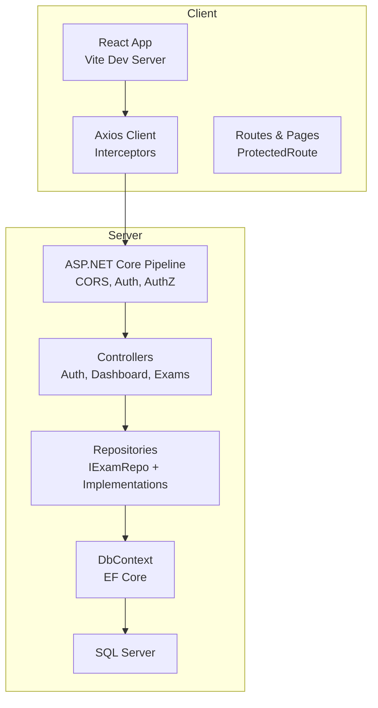
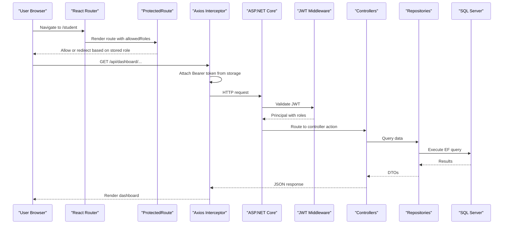
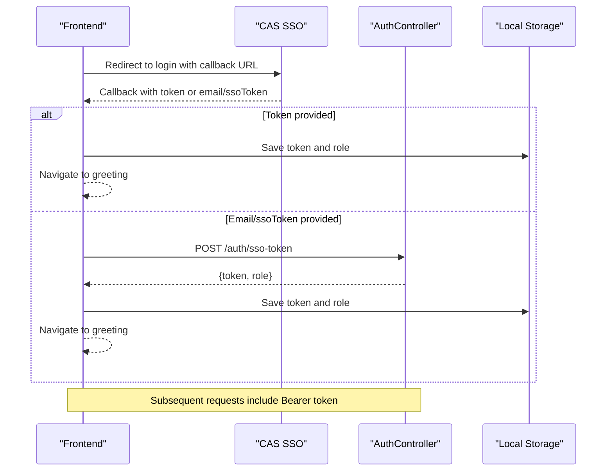
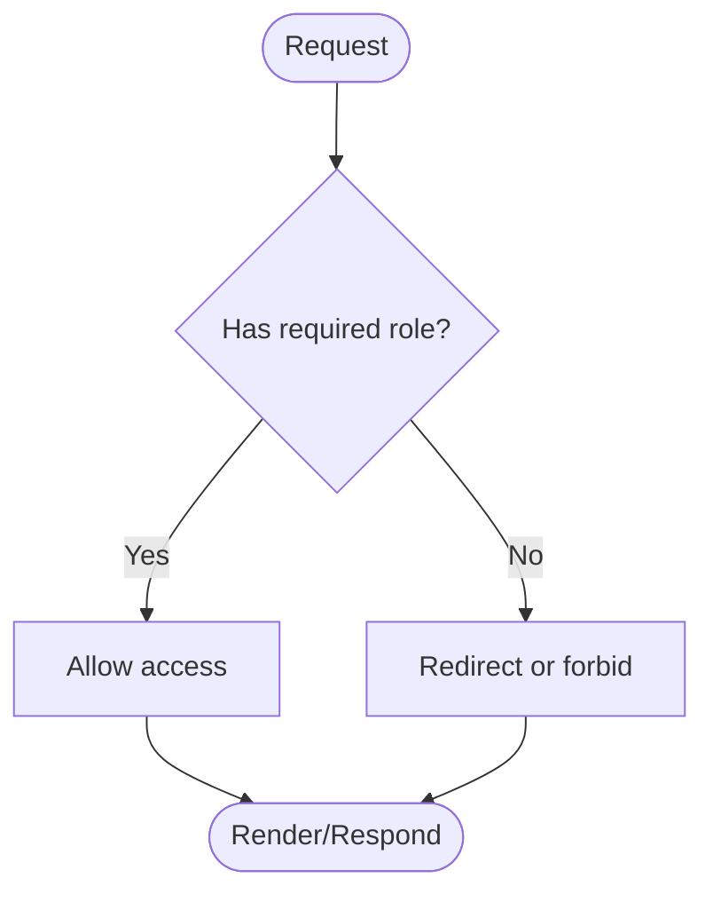
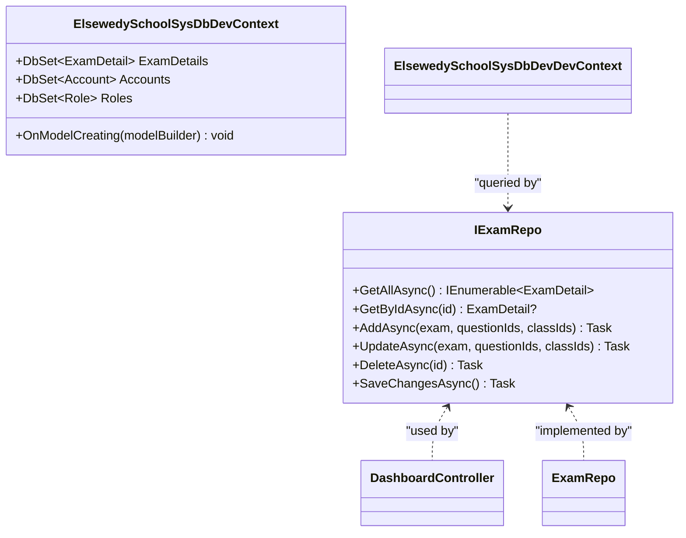
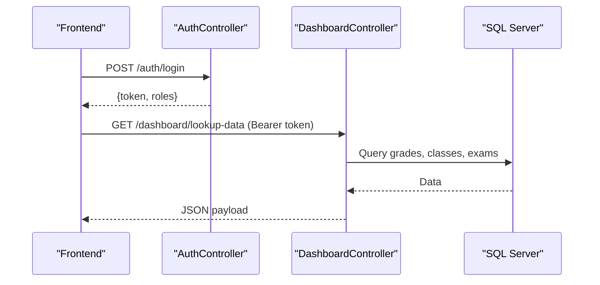
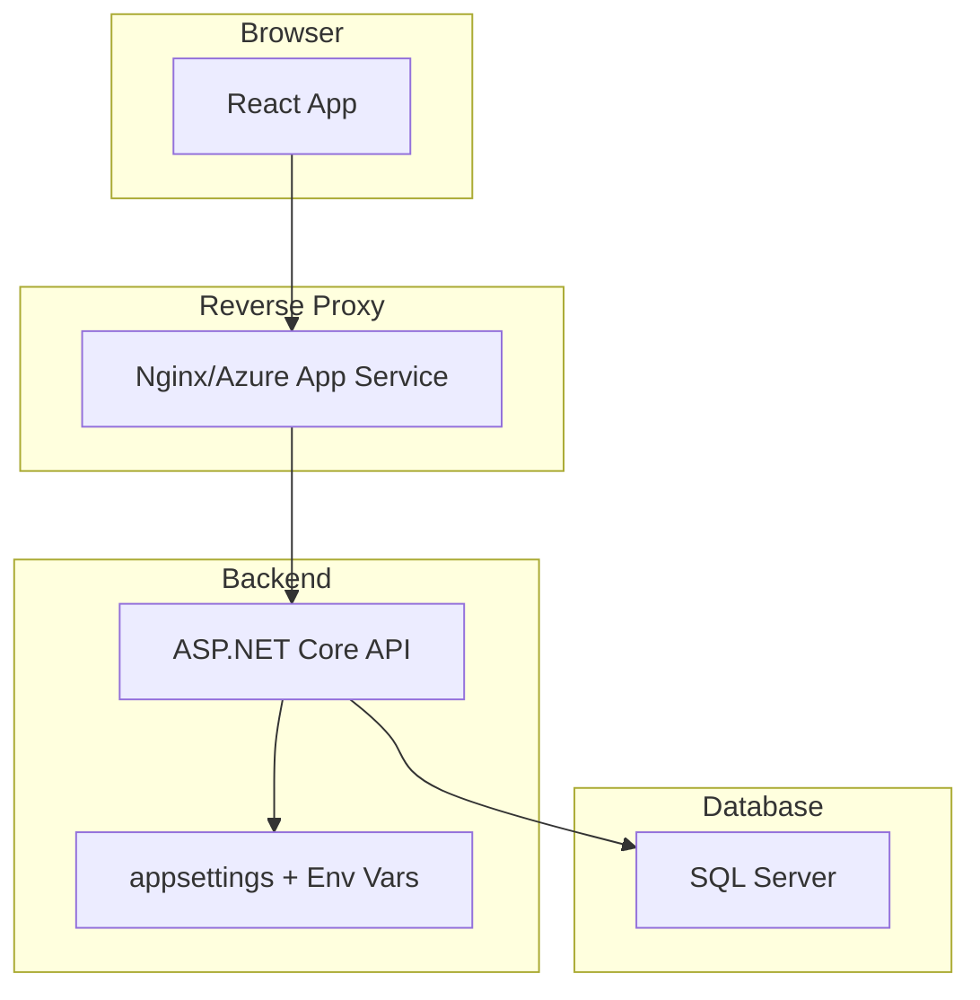
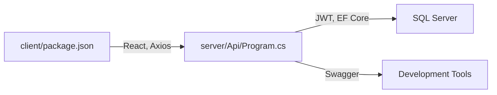

# System Architecture Overview

<cite>
**Referenced Files in This Document**
- [README.md](file://README.md)
- [client/package.json](file://client/package.json)
- [client/vite.config.js](file://client/vite.config.js)
- [client/src/main.jsx](file://client/src/main.jsx)
- [client/src/api/axios.js](file://client/src/api/axios.js)
- [client/src/pages/SsoCallbackPage.jsx](file://client/src/pages/SsoCallbackPage.jsx)
- [server/QuizesApi.sln](file://server/QuizesApi.sln)
- [server/Api/Program.cs](file://server/Api/Program.cs)
- [server/Api/Controllers/AuthController.cs](file://server/Api/Controllers/AuthController.cs)
- [server/Api/Controllers/DashboardController.cs](file://server/Api/Controllers/DashboardController.cs)
- [server/Api/Models/ElsewedySchoolSysDbDevContext.cs](file://server/Api/Models/ElsewedySchoolSysDbDevContext.cs)
- [server/Api/Repositories/Interfaces/IExamRepo.cs](file://server/Api/Repositories/Interfaces/IExamRepo.cs)
</cite>

## Table of Contents
1. Introduction
2. Project Structure
3. Core Components
4. Architecture Overview
5. Detailed Component Analysis
6. Dependency Analysis
7. Performance Considerations
8. Troubleshooting Guide
9. Conclusion

## Introduction
This document explains the full-stack architecture of Exam-Hub, a monorepo containing a React/Vite frontend and a .NET Core backend. The system follows a layered architecture: presentation (React components), business logic (Controllers and Services via Repositories), data access (Entity Framework DbContext), and database (SQL Server). Authentication uses JWT tokens with CAS SSO integration for single sign-on. Role-based access control is enforced both on the client and server sides to protect routes and API endpoints.

## Project Structure
The repository is organized as a monorepo with two primary directories:
- client: React application built with Vite, using Axios for HTTP calls and React Router for navigation.
- server: .NET Core Web API solution exposing REST endpoints, configured with JWT authentication, CORS, Swagger, and Entity Framework for SQL Server.

**Diagram sources**
- [client/src/api/axios.js:1-62](file://client/src/api/axios.js#L1-L62)
- [client/src/main.jsx:17-56](file://client/src/main.jsx#L17-L56)
- [server/Api/Program.cs:17-125](file://server/Api/Program.cs#L17-L125)
- [server/Api/Controllers/DashboardController.cs:11-22](file://server/Api/Controllers/DashboardController.cs#L11-L22)
- [server/Api/Repositories/Interfaces/IExamRepo.cs:5-13](file://server/Api/Repositories/Interfaces/IExamRepo.cs#L5-L13)
- [server/Api/Models/ElsewedySchoolSysDbDevContext.cs:7-10](file://server/Api/Models/ElsewedySchoolSysDbDevContext.cs#L7-L10)

**Section sources**
- [README.md:5-23](file://README.md#L5-L23)
- [client/package.json:1-35](file://client/package.json#L1-L35)
- [client/vite.config.js:1-12](file://client/vite.config.js#L1-L12)
- [server/QuizesApi.sln:1-26](file://server/QuizesApi.sln#L1-L26)

## Core Components
- Frontend Presentation Layer: React pages and components manage UI state and user interactions. Routes are protected by role checks.
- API Controllers: Handle HTTP requests, enforce authorization, and orchestrate business logic.
- Repositories: Encapsulate data access operations against EF Core DbContext.
- Data Access Layer: DbContext maps entities to SQL Server tables and manages queries and relationships.
- Authentication & Authorization: JWT bearer tokens validate requests; policies restrict access by roles.

Key responsibilities:
- Axios interceptors attach JWT tokens to outgoing requests and handle 401 redirects to CAS SSO.
- Program configures JWT validation, role mapping, CORS, and dependency injection for repositories.
- Controllers implement endpoints for authentication, dashboard data, and exam management.
- DbContext defines entity mappings and relationships to SQL Server.

**Section sources**
- [client/src/api/axios.js:12-58](file://client/src/api/axios.js#L12-L58)
- [server/Api/Program.cs:43-107](file://server/Api/Program.cs#L43-L107)
- [server/Api/Controllers/DashboardController.cs:24-78](file://server/Api/Controllers/DashboardController.cs#L24-L78)
- [server/Api/Models/ElsewedySchoolSysDbDevContext.cs:18-137](file://server/Api/Models/ElsewedySchoolSysDbDevContext.cs#L18-L137)

## Architecture Overview
The system uses a layered architecture with clear separation of concerns:
- Presentation: React components render views and collect user input.
- Business Logic: Controllers coordinate workflows and enforce authorization policies.
- Data Access: Repositories encapsulate queries and updates via EF Core.
- Database: SQL Server stores accounts, roles, exams, answers, and related entities.

**Diagram sources**
- [client/src/main.jsx:17-56](file://client/src/main.jsx#L17-L56)
- [client/src/api/axios.js:12-58](file://client/src/api/axios.js#L12-L58)
- [server/Api/Program.cs:43-125](file://server/Api/Program.cs#L43-L125)
- [server/Api/Controllers/DashboardController.cs:24-78](file://server/Api/Controllers/DashboardController.cs#L24-L78)

## Detailed Component Analysis

### Authentication Flow (CAS SSO + JWT)
The flow supports both direct CAS token delivery and token exchange via the backend:
- If CAS returns a token directly, the client stores it and navigates to the greeting page.
- Otherwise, the client exchanges an email or SSO token with the backend to obtain an Exams-specific JWT.
- On subsequent requests, Axios attaches the JWT; if unauthorized, the client redirects to CAS login.

**Diagram sources**
- [client/src/pages/SsoCallbackPage.jsx:10-63](file://client/src/pages/SsoCallbackPage.jsx#L10-L63)
- [client/src/api/axios.js:29-58](file://client/src/api/axios.js#L29-L58)
- [server/Api/Controllers/AuthController.cs:251-313](file://server/Api/Controllers/AuthController.cs#L251-L313)

**Section sources**
- [client/src/pages/SsoCallbackPage.jsx:10-63](file://client/src/pages/SsoCallbackPage.jsx#L10-L63)
- [client/src/api/axios.js:29-58](file://client/src/api/axios.js#L29-L58)
- [server/Api/Controllers/AuthController.cs:251-313](file://server/Api/Controllers/AuthController.cs#L251-L313)

### Role-Based Access Control (RBAC)
- Client-side protection: Routes specify allowed roles; ProtectedRoute enforces access based on stored role.
- Server-side protection: Policies define role requirements; controllers apply [Authorize] and role constraints.

**Diagram sources**
- [client/src/main.jsx:22-53](file://client/src/main.jsx#L22-L53)
- [server/Api/Program.cs:83-90](file://server/Api/Program.cs#L83-L90)
- [server/Api/Controllers/DashboardController.cs:201-203](file://server/Api/Controllers/DashboardController.cs#L201-L203)

**Section sources**
- [client/src/main.jsx:22-53](file://client/src/main.jsx#L22-L53)
- [server/Api/Program.cs:83-90](file://server/Api/Program.cs#L83-L90)
- [server/Api/Controllers/DashboardController.cs:201-203](file://server/Api/Controllers/DashboardController.cs#L201-L203)

### Data Access Layer and Repository Pattern
- Controllers depend on repository interfaces to decouple business logic from data access.
- Repositories use EF Core DbContext to query and update entities.
- Example interface defines CRUD operations for exam-related entities.

**Diagram sources**
- [server/Api/Repositories/Interfaces/IExamRepo.cs:5-13](file://server/Api/Repositories/Interfaces/IExamRepo.cs#L5-L13)
- [server/Api/Models/ElsewedySchoolSysDbDevContext.cs:18-137](file://server/Api/Models/ElsewedySchoolSysDbDevContext.cs#L18-L137)

**Section sources**
- [server/Api/Repositories/Interfaces/IExamRepo.cs:5-13](file://server/Api/Repositories/Interfaces/IExamRepo.cs#L5-L13)
- [server/Api/Models/ElsewedySchoolSysDbDevContext.cs:18-137](file://server/Api/Models/ElsewedySchoolSysDbDevContext.cs#L18-L137)

### API Endpoints and Controller Responsibilities
- AuthController: Handles registration, login, profile retrieval/update, and SSO token exchange. Generates JWTs with claims including roles.
- DashboardController: Provides lookup data, student/teacher/superadmin dashboards, leaderboards, and statistics. Enforces authorization via attributes and policies.

**Diagram sources**
- [server/Api/Controllers/AuthController.cs:118-249](file://server/Api/Controllers/AuthController.cs#L118-L249)
- [server/Api/Controllers/DashboardController.cs:24-78](file://server/Api/Controllers/DashboardController.cs#L24-L78)

**Section sources**
- [server/Api/Controllers/AuthController.cs:118-249](file://server/Api/Controllers/AuthController.cs#L118-L249)
- [server/Api/Controllers/DashboardController.cs:24-78](file://server/Api/Controllers/DashboardController.cs#L24-L78)

### Deployment Topology and Environment Configuration
- Frontend runs on a Vite dev server during development; production builds static assets served by a web server.
- Backend runs as an ASP.NET Core Kestrel service behind a reverse proxy in production.
- Environment variables configure:
  - API base URL and timeout for Axios.
  - CAS SSO URL and callback handling.
  - JWT issuer, audience, and signing key for token validation.
  - Connection string for SQL Server.

[No sources needed since this diagram shows conceptual deployment topology]

**Section sources**
- [client/vite.config.js:5-11](file://client/vite.config.js#L5-L11)
- [client/src/api/axios.js:7-10](file://client/src/api/axios.js#L7-L10)
- [client/src/api/axios.js:41-43](file://client/src/api/axios.js#L41-L43)
- [server/Api/Program.cs:30-33](file://server/Api/Program.cs#L30-L33)
- [server/Api/Program.cs:48-61](file://server/Api/Program.cs#L48-L61)

## Dependency Analysis
- Client dependencies: React, React Router, Axios, Recharts, Vite plugin for React.
- Server dependencies: ASP.NET Core, JWT Bearer, EF Core with SQL Server, Swagger/OpenAPI, MemoryCache.
- Coupling: Controllers depend on repository interfaces; repositories depend on DbContext; DbContext depends on SQL Server connection string.

**Diagram sources**
- [client/package.json:12-32](file://client/package.json#L12-L32)
- [server/Api/Program.cs:20-36](file://server/Api/Program.cs#L20-L36)

**Section sources**
- [client/package.json:12-32](file://client/package.json#L12-L32)
- [server/Api/Program.cs:20-36](file://server/Api/Program.cs#L20-L36)

## Performance Considerations
- Use caching where appropriate (e.g., MemoryCache configured in Program) to reduce repeated queries for lookup data.
- Optimize EF queries by selecting only necessary fields and avoiding N+1 queries.
- Configure CORS narrowly in production to allow only trusted origins.
- Ensure JWT expiration times balance security and user experience.
- Monitor API latency and database performance under load.

[No sources needed since this section provides general guidance]

## Troubleshooting Guide
- 401 Unauthorized: Indicates missing or invalid JWT; ensure token is stored and attached by Axios; verify CAS redirect flow and token exchange endpoint.
- CORS errors: Confirm that the frontend origin is allowed by the CORS policy and that the correct base URL is used.
- Role mismatches: Verify that roles are present in JWT claims and mapped correctly; check client-side role storage and route guards.
- Database connectivity: Validate connection strings and ensure migrations are applied before running the API.

**Section sources**
- [client/src/api/axios.js:29-58](file://client/src/api/axios.js#L29-L58)
- [server/Api/Program.cs:92-102](file://server/Api/Program.cs#L92-L102)
- [server/Api/Controllers/AuthController.cs:118-249](file://server/Api/Controllers/AuthController.cs#L118-L249)

## Conclusion
Exam-Hub’s architecture separates concerns across presentation, business logic, data access, and database layers. The frontend communicates with the backend through secure REST APIs protected by JWT and role-based policies. CAS SSO integrates seamlessly with the backend to issue domain-specific tokens. Clear configuration and environment variables support consistent behavior across development and production environments.

[No sources needed since this section summarizes without analyzing specific files]