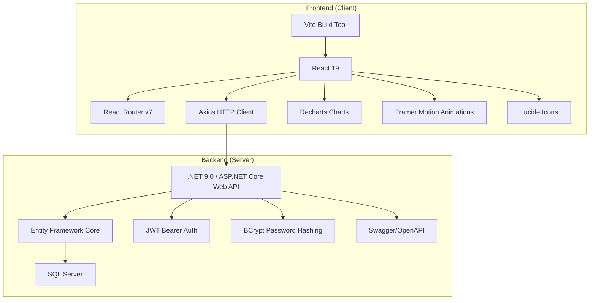
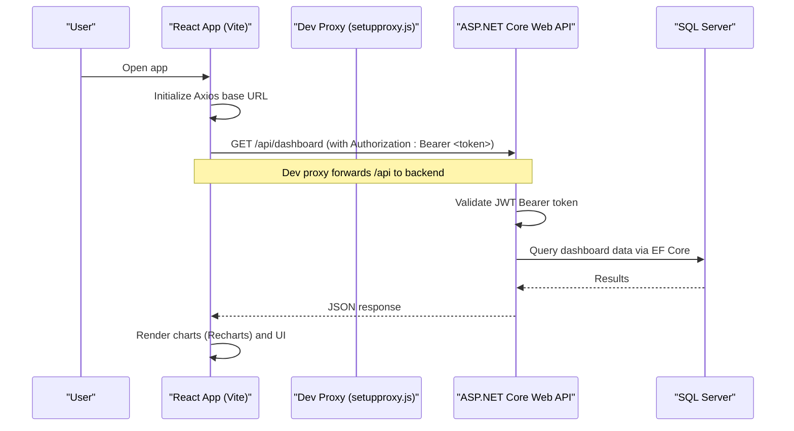
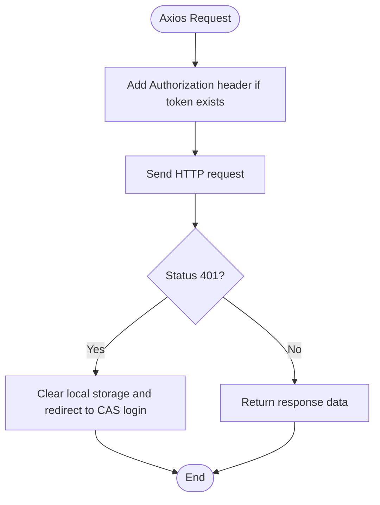
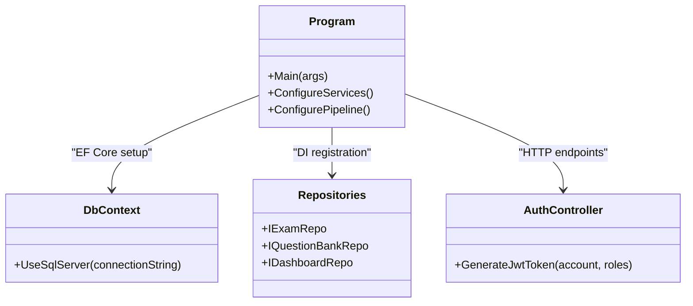
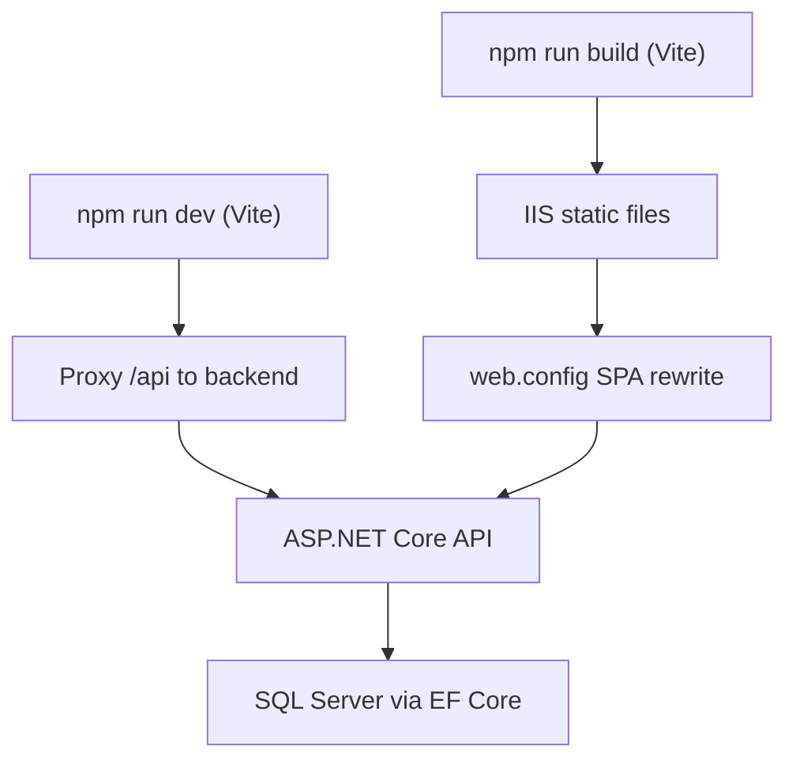

# Technology Stack

<cite>
**Referenced Files in This Document**
- [README.md](file://README.md)
- [client/package.json](file://client/package.json)
- [client/vite.config.js](file://client/vite.config.js)
- [client/src/api/axios.js](file://client/src/api/axios.js)
- [client/src/utils/token.js](file://client/src/utils/token.js)
- [client/src/components/ProtectedRoute.jsx](file://client/src/components/ProtectedRoute.jsx)
- [client/public/web.config](file://client/public/web.config)
- [server/Api/QuizesApi.csproj](file://server/Api/QuizesApi.csproj)
- [server/Api/Program.cs](file://server/Api/Program.cs)
</cite>

## Table of Contents
1. [Introduction](#introduction)
2. [Project Structure](#project-structure)
3. [Core Components](#core-components)
4. [Architecture Overview](#architecture-overview)
5. [Detailed Component Analysis](#detailed-component-analysis)
6. [Dependency Analysis](#dependency-analysis)
7. [Performance Considerations](#performance-considerations)
8. [Troubleshooting Guide](#troubleshooting-guide)
9. [Conclusion](#conclusion)

## Introduction
This section documents Exam-Hub’s technology stack and the rationale behind each choice. The application is a monorepo with a React-based frontend and a .NET Core backend exposing an ASP.NET Core Web API. The frontend uses Vite for fast builds, React Router v7 for routing, Recharts for data visualization, Axios for HTTP requests, Framer Motion for animations, and Lucide Icons for UI elements. The backend runs on .NET 9.0, uses Entity Framework Core with SQL Server, JWT Bearer authentication, BCrypt for password hashing, and Swagger/OpenAPI for documentation.

## Project Structure
The repository follows a clear separation between client and server:
- Client (React + Vite): modern SPA with componentized UI, routing, stateless HTTP calls via Axios, and environment-driven configuration.
- Server (.NET 9.0 Web API): controllers, repositories, EF Core models/migrations, JWT auth, and Swagger.



**Diagram sources**
- [client/package.json:12-21](file://client/package.json#L12-L21)
- [client/vite.config.js:1-11](file://client/vite.config.js#L1-L11)
- [server/Api/QuizesApi.csproj:1-25](file://server/Api/QuizesApi.csproj#L1-L25)

**Section sources**
- [README.md:5-23](file://README.md#L5-L23)

## Core Components
- Frontend framework: React 19 with Vite as the build tool.
- Routing: React Router v7 for declarative routes and navigation.
- Data visualization: Recharts for charts and dashboards.
- HTTP client: Axios with interceptors for token injection and error handling.
- Animations: Framer Motion for smooth UI transitions.
- Icons: Lucide React for consistent iconography.
- Backend: .NET 9.0 Web API with ASP.NET Core middleware pipeline.
- ORM and database: Entity Framework Core with SQL Server provider.
- Authentication: JWT Bearer tokens; roles mapped to claims.
- Security: BCrypt for secure password hashing.
- Documentation: Swagger/OpenAPI for interactive API docs.

Rationale highlights:
- React 19 + Vite provide a modern, fast developer experience and optimized production builds.
- React Router v7 aligns with current best practices for route-based rendering and nested layouts.
- Recharts offers a flexible charting solution suitable for exam analytics dashboards.
- Axios centralizes request/response logic, enabling consistent auth header injection and global error handling.
- Framer Motion enhances UX without heavy custom animation code.
- Lucide provides lightweight, accessible icons that integrate cleanly with React.
- .NET 9.0 and ASP.NET Core deliver high-performance APIs with strong ecosystem support.
- EF Core abstracts database interactions while allowing migrations and schema control.
- SQL Server is a robust, enterprise-grade relational database.
- JWT Bearer enables stateless, scalable authentication across services.
- BCrypt ensures passwords are securely hashed.
- Swagger improves API discoverability and testing during development.

**Section sources**
- [client/package.json:12-32](file://client/package.json#L12-L32)
- [client/vite.config.js:1-11](file://client/vite.config.js#L1-L11)
- [server/Api/QuizesApi.csproj:1-25](file://server/Api/QuizesApi.csproj#L1-L25)

## Architecture Overview
The frontend communicates with the backend over HTTP(S). During development, the client proxies API calls to the backend. In production, the frontend consumes the hosted API endpoints. Authentication is handled via JWT Bearer tokens issued by the backend and validated by both the server and client-side guards.



**Diagram sources**
- [client/src/api/axios.js:7-10](file://client/src/api/axios.js#L7-L10)
- [client/setupproxy.js:1-17](file://client/setupproxy.js#L1-L17)
- [server/Api/Program.cs:43-81](file://server/Api/Program.cs#L43-L81)

## Detailed Component Analysis

### Frontend Stack Details
- React 19: Latest stable release providing improved performance and concurrent features.
- Vite: Fast dev server and optimized builds; configured to run on port 5177.
- React Router v7: Declarative routing with protected routes based on roles.
- Axios: Centralized HTTP client with request interceptor adding Authorization headers and response interceptor handling 401 redirects to CAS SSO.
- Recharts: Used in dashboard components for bar, line, and pie charts.
- Framer Motion: Provides motion primitives for UI transitions.
- Lucide React: Icon library integrated into UI components.

Key behaviors:
- Axios base URL is driven by environment variables; defaults to a production endpoint when not set.
- ProtectedRoute enforces role-based access using token payload parsing and fallback storage checks.
- Token utilities safely decode URL-safe base64 payloads and extract user identifiers from multiple claim names.



**Diagram sources**
- [client/src/api/axios.js:12-25](file://client/src/api/axios.js#L12-L25)
- [client/src/api/axios.js:29-57](file://client/src/api/axios.js#L29-L57)

**Section sources**
- [client/package.json:12-21](file://client/package.json#L12-L21)
- [client/vite.config.js:5-10](file://client/vite.config.js#L5-L10)
- [client/src/api/axios.js:7-10](file://client/src/api/axios.js#L7-L10)
- [client/src/api/axios.js:12-25](file://client/src/api/axios.js#L12-L25)
- [client/src/api/axios.js:29-57](file://client/src/api/axios.js#L29-L57)
- [client/src/utils/token.js:6-19](file://client/src/utils/token.js#L6-L19)
- [client/src/utils/token.js:26-30](file://client/src/utils/token.js#L26-L30)
- [client/src/components/ProtectedRoute.jsx:1-14](file://client/src/components/ProtectedRoute.jsx#L1-L14)
- [client/src/components/ProtectedRoute.jsx:16-44](file://client/src/components/ProtectedRoute.jsx#L16-L44)
- [client/src/components/ProtectedRoute.jsx:46-89](file://client/src/components/ProtectedRoute.jsx#L46-L89)

### Backend Stack Details
- .NET 9.0 Web API: High-performance server framework with built-in dependency injection and middleware pipeline.
- Entity Framework Core: Object-relational mapping with SQL Server provider; migrations manage schema evolution.
- SQL Server: Enterprise relational database used for persistence.
- JWT Bearer Authentication: Stateless token validation with role and identity claim mapping.
- BCrypt: Secure password hashing for account credentials.
- Swagger/OpenAPI: Interactive API documentation enabled in development.

Key behaviors:
- Program configures controllers, JSON naming policies, Swagger, EF Core context, memory cache, CORS, authentication, authorization policies, and repository DI.
- JWT validation accepts multiple issuers/audiences and maps legacy claim names to standard claim types.
- Controllers generate JWT tokens with issuer, audience, claims, expiration, and signing credentials.



**Diagram sources**
- [server/Api/Program.cs:17-24](file://server/Api/Program.cs#L17-L24)
- [server/Api/Program.cs:30-36](file://server/Api/Program.cs#L30-L36)
- [server/Api/Program.cs:43-81](file://server/Api/Program.cs#L43-L81)
- [server/Api/Program.cs:104-107](file://server/Api/Program.cs#L104-L107)
- [server/Api/Controllers/AuthController.cs:380-412](file://server/Api/Controllers/AuthController.cs#L380-L412)

**Section sources**
- [server/Api/QuizesApi.csproj:1-25](file://server/Api/QuizesApi.csproj#L1-L25)
- [server/Api/Program.cs:17-24](file://server/Api/Program.cs#L17-L24)
- [server/Api/Program.cs:30-36](file://server/Api/Program.cs#L30-L36)
- [server/Api/Program.cs:43-81](file://server/Api/Program.cs#L43-L81)
- [server/Api/Program.cs:104-107](file://server/Api/Program.cs#L104-L107)
- [server/Api/Controllers/AuthController.cs:380-412](file://server/Api/Controllers/AuthController.cs#L380-L412)

### Version Compatibility Requirements
- Frontend:
  - React 19 requires compatible versions of react-router-dom, framer-motion, and lucide-react.
  - Vite plugin for React must be aligned with the React version.
- Backend:
  - .NET 9.0 targets require matching Microsoft.AspNetCore.* packages and EF Core providers at compatible versions.
  - JWT Bearer and Identity packages should match the .NET runtime version.

Evidence:
- package.json declares React 19.x, react-router-dom 7.x, framer-motion 12.x, lucide-react 0.562.x, axios 1.x, vite 7.x, and @vitejs/plugin-react 5.x.
- QuizesApi.csproj targets net9.0 and includes Microsoft.AspNetCore.Authentication.JwtBearer, Identity, OpenApi, EF Core, and SQL Server packages at 9.x versions.

**Section sources**
- [client/package.json:12-32](file://client/package.json#L12-L32)
- [server/Api/QuizesApi.csproj:1-25](file://server/Api/QuizesApi.csproj#L1-L25)

### How Technologies Work Together
- Development workflow:
  - Vite serves the React app and proxies /api requests to the backend.
  - Axios attaches JWT tokens to requests; backend validates them via JWT Bearer.
  - ProtectedRoute enforces role-based access using parsed token claims.
- Production workflow:
  - Static files served by IIS (web.config handles SPA fallback).
  - API hosted separately; CORS allows frontend consumption.
  - Swagger available in development for API exploration.



**Diagram sources**
- [client/vite.config.js:5-10](file://client/vite.config.js#L5-L10)
- [client/setupproxy.js:1-17](file://client/setupproxy.js#L1-L17)
- [client/public/web.config:1-31](file://client/public/web.config#L1-L31)
- [server/Api/Program.cs:112-125](file://server/Api/Program.cs#L112-L125)

**Section sources**
- [client/setupproxy.js:1-17](file://client/setupproxy.js#L1-L17)
- [client/public/web.config:1-31](file://client/public/web.config#L1-L31)
- [server/Api/Program.cs:112-125](file://server/Api/Program.cs#L112-L125)

## Dependency Analysis
Frontend dependencies:
- Runtime: react, react-dom, react-router-dom, axios, recharts, framer-motion, lucide-react.
- Build/dev: vite, @vitejs/plugin-react, eslint and related plugins.

Backend dependencies:
- Runtime: Microsoft.AspNetCore.Authentication.JwtBearer, Microsoft.AspNetCore.Identity.EntityFrameworkCore, Microsoft.AspNetCore.OpenApi, Microsoft.EntityFrameworkCore, Microsoft.EntityFrameworkCore.SqlServer.
- Tools: Microsoft.EntityFrameworkCore.Tools, Swashbuckle.AspNetCore, AutoMapper.Extensions.Microsoft.DependencyInjection, ClosedXML, BCrypt.Net-Next.

```mermaid
graph LR
FE_Pkg["client/package.json"] --> FE_Runtime["react, react-dom, react-router-dom, axios, recharts, framer-motion, lucide-react"]
FE_Pkg --> FE_Build["vite, @vitejs/plugin-react, eslint*"]
BE_Pkg["server/Api/QuizesApi.csproj"] --> BE_Runtime["Microsoft.AspNetCore.*", "Microsoft.EntityFrameworkCore*", "Swashbuckle.AspNetCore"]
BE_Pkg --> BE_Tools["Microsoft.EntityFrameworkCore.Tools", "AutoMapper.Extensions.Microsoft.DependencyInjection", "ClosedXML", "BCrypt.Net-Next"]
```

**Diagram sources**
- [client/package.json:12-32](file://client/package.json#L12-L32)
- [server/Api/QuizesApi.csproj:9-23](file://server/Api/QuizesApi.csproj#L9-L23)

**Section sources**
- [client/package.json:12-32](file://client/package.json#L12-L32)
- [server/Api/QuizesApi.csproj:9-23](file://server/Api/QuizesApi.csproj#L9-L23)

## Performance Considerations
- Frontend:
  - Vite provides fast HMR and optimized builds; ensure minimal bundle size by tree-shaking unused modules.
  - Use lazy loading for routes and heavy components where appropriate.
  - Recharts renders efficiently; avoid unnecessary re-renders by memoizing chart data.
- Backend:
  - MemoryCache is registered for performance-sensitive lookups.
  - JSON serialization uses camelCase policy for consistency with frontend expectations.
  - Enable only necessary middleware in production; keep Swagger disabled outside development.

[No sources needed since this section provides general guidance]

## Troubleshooting Guide
Common issues and resolutions:
- 401 Unauthorized:
  - Frontend clears storage and redirects to CAS login when receiving 401 responses.
  - Ensure token is present in localStorage/sessionStorage and correctly attached to requests.
- Route fallback in IIS:
  - web.config rewrites unknown routes to index.html; verify rules exclude /api paths.
- Token parsing errors:
  - parseToken handles URL-safe base64 and missing padding; validate token format and claim names.
- CORS errors:
  - Backend allows any origin in development; restrict in production to known domains.

**Section sources**
- [client/src/api/axios.js:29-57](file://client/src/api/axios.js#L29-L57)
- [client/public/web.config:11-23](file://client/public/web.config#L11-L23)
- [client/src/utils/token.js:6-19](file://client/src/utils/token.js#L6-L19)
- [server/Api/Program.cs:92-102](file://server/Api/Program.cs#L92-L102)

## Conclusion
Exam-Hub combines a modern React/Vite frontend with a robust .NET 9.0 Web API backend. The chosen technologies provide a fast developer experience, scalable architecture, and strong security through JWT Bearer and BCrypt. Recharts and Framer Motion enhance the user experience, while Swagger streamlines API development and testing. With clear separation of concerns and well-defined integration points, the stack supports efficient examination management workflows.

[No sources needed since this section summarizes without analyzing specific files]