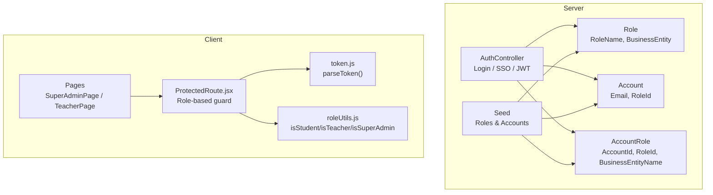
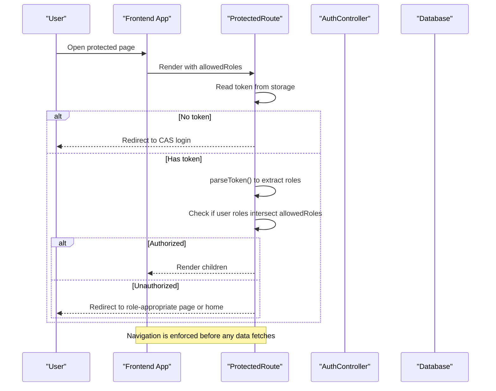
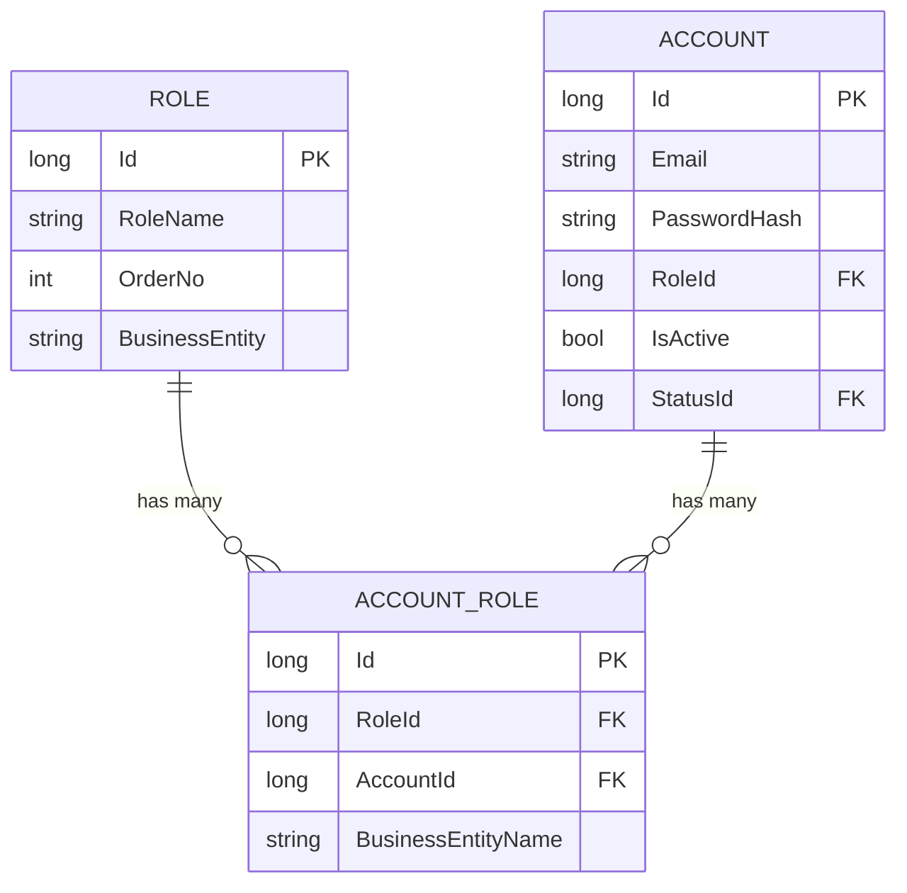
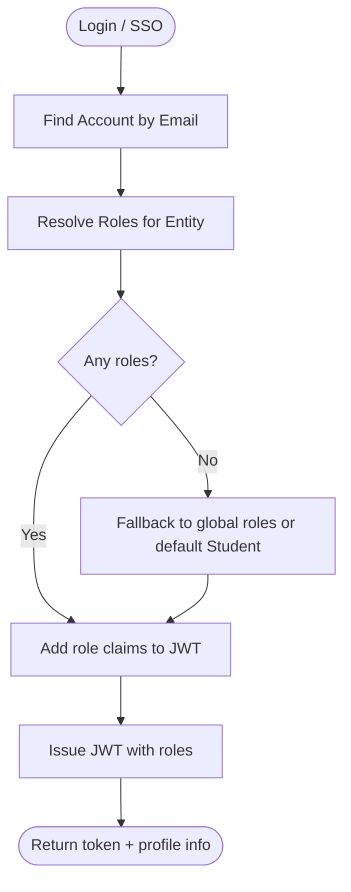
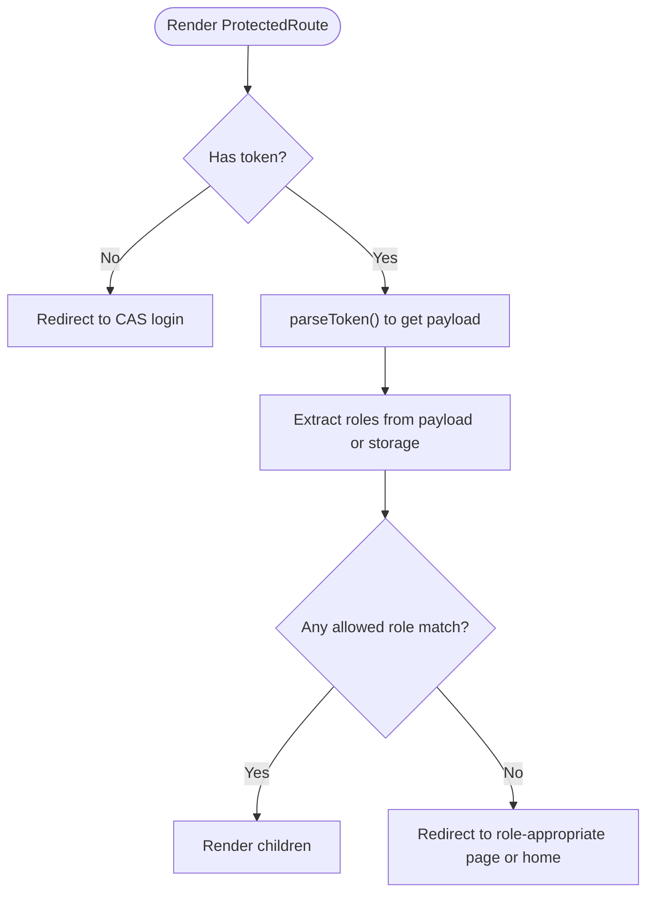
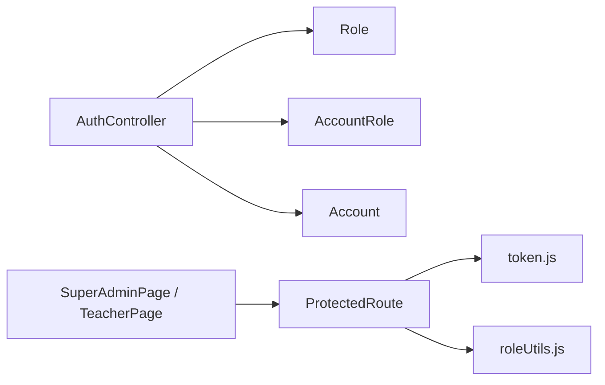

# User Roles and Permissions

<cite>
**Referenced Files in This Document**
- [AuthController.cs](file://server/Api/Controllers/AuthController.cs)
- [Role.cs](file://server/Api/Models/Role.cs)
- [Account.cs](file://server/Api/Models/Account.cs)
- [AccountRole.cs](file://server/Api/Models/AccountRole.cs)
- [ElsewedySchoolContextSeed.cs](file://server/Api/Models/ElsewedySchoolContextSeed.cs)
- [ProtectedRoute.jsx](file://client/src/components/ProtectedRoute.jsx)
- [roleUtils.js](file://client/src/utils/roleUtils.js)
- [token.js](file://client/src/utils/token.js)
- [SuperAdminPage.jsx](file://client/src/pages/SuperAdminPage.jsx)
- [TeacherPage.jsx](file://client/src/pages/TeacherPage.jsx)
</cite>

## Table of Contents
1. Introduction
2. Project Structure
3. Core Components
4. Architecture Overview
5. Detailed Component Analysis
6. Dependency Analysis
7. Performance Considerations
8. Troubleshooting Guide
9. Conclusion

## Introduction
This document explains Exam-Hub’s role-based access control (RBAC) system across the backend and frontend. It covers:
- The three primary roles: Student, Teacher, and Administrator (including Super Admin/Board).
- How roles are defined and stored in the database.
- How JWT tokens carry role claims for authorization.
- How the frontend ProtectedRoute enforces role-based navigation.
- Permission hierarchy and examples of role-specific UI elements, protected routes, and API endpoint access patterns.
- Guidance on adding new roles and implementing permission checks throughout the application.

## Project Structure
Exam-Hub implements RBAC with a clear separation between server-side identity management and client-side route protection:
- Server: Role definitions, account-role mappings, login flow, and JWT issuance.
- Client: Token parsing, role extraction, route guards, and role-aware UI rendering.

**Diagram sources**
- [AuthController.cs:118-249](file://server/Api/Controllers/AuthController.cs#L118-L249)
- [Role.cs:6-17](file://server/Api/Models/Role.cs#L6-L17)
- [Account.cs:6-33](file://server/Api/Models/Account.cs#L6-L33)
- [AccountRole.cs:6-15](file://server/Api/Models/AccountRole.cs#L6-L15)
- [ElsewedySchoolContextSeed.cs:10-21](file://server/Api/Models/ElsewedySchoolContextSeed.cs#L10-L21)
- [ProtectedRoute.jsx:5-89](file://client/src/components/ProtectedRoute.jsx#L5-L89)
- [token.js:6-30](file://client/src/utils/token.js#L6-L30)
- [roleUtils.js:1-21](file://client/src/utils/roleUtils.js#L1-L21)

**Section sources**
- [AuthController.cs:118-249](file://server/Api/Controllers/AuthController.cs#L118-L249)
- [ProtectedRoute.jsx:5-89](file://client/src/components/ProtectedRoute.jsx#L5-L89)
- [token.js:6-30](file://client/src/utils/token.js#L6-L30)
- [roleUtils.js:1-21](file://client/src/utils/roleUtils.js#L1-L21)

## Core Components
- Role model: Stores role names and their business entity scope.
- Account and AccountRole: Link users to roles within a specific business entity context.
- Auth controller: Authenticates users, resolves roles, and issues JWTs with role claims.
- Frontend guard: ProtectedRoute reads token claims and enforces allowed roles per route.
- Utilities: Parse token payload and provide helper predicates for role checks.

Key responsibilities:
- Backend defines roles and issues tokens with role claims.
- Frontend enforces navigation and UI visibility based on those roles.

**Section sources**
- [Role.cs:6-17](file://server/Api/Models/Role.cs#L6-L17)
- [Account.cs:6-33](file://server/Api/Models/Account.cs#L6-L33)
- [AccountRole.cs:6-15](file://server/Api/Models/AccountRole.cs#L6-L15)
- [AuthController.cs:381-420](file://server/Api/Controllers/AuthController.cs#L381-L420)
- [ProtectedRoute.jsx:5-89](file://client/src/components/ProtectedRoute.jsx#L5-L89)
- [roleUtils.js:1-21](file://client/src/utils/roleUtils.js#L1-L21)

## Architecture Overview
The RBAC flow spans authentication, token issuance, and client-side enforcement:

**Diagram sources**
- [ProtectedRoute.jsx:5-89](file://client/src/components/ProtectedRoute.jsx#L5-L89)
- [token.js:6-30](file://client/src/utils/token.js#L6-L30)

**Section sources**
- [ProtectedRoute.jsx:5-89](file://client/src/components/ProtectedRoute.jsx#L5-L89)
- [token.js:6-30](file://client/src/utils/token.js#L6-L30)

## Detailed Component Analysis

### Database Schema for Roles and Users
- Role: Holds role name and business entity context.
- Account: Represents a user with a default RoleId and status.
- AccountRole: Many-to-many mapping linking an Account to a Role within a BusinessEntityName.
- Seed: Initializes standard roles and sample accounts for development.

**Diagram sources**
- [Role.cs:6-17](file://server/Api/Models/Role.cs#L6-L17)
- [Account.cs:6-33](file://server/Api/Models/Account.cs#L6-L33)
- [AccountRole.cs:6-15](file://server/Api/Models/AccountRole.cs#L6-L15)

**Section sources**
- [Role.cs:6-17](file://server/Api/Models/Role.cs#L6-L17)
- [Account.cs:6-33](file://server/Api/Models/Account.cs#L6-L33)
- [AccountRole.cs:6-15](file://server/Api/Models/AccountRole.cs#L6-L15)
- [ElsewedySchoolContextSeed.cs:10-21](file://server/Api/Models/ElsewedySchoolContextSeed.cs#L10-L21)
- [ElsewedySchoolContextSeed.cs:32-59](file://server/Api/Models/ElsewedySchoolContextSeed.cs#L32-L59)

### Authentication and JWT Role Claims
- Login and SSO flows resolve roles by joining AccountRole with Role for the target business entity.
- If no entity-scoped roles exist, it falls back to global roles; if still none, defaults to Student.
- JWT includes multiple role claims via ClaimTypes.Role, one per distinct role.

**Diagram sources**
- [AuthController.cs:118-249](file://server/Api/Controllers/AuthController.cs#L118-L249)
- [AuthController.cs:381-420](file://server/Api/Controllers/AuthController.cs#L381-L420)

**Section sources**
- [AuthController.cs:118-249](file://server/Api/Controllers/AuthController.cs#L118-L249)
- [AuthController.cs:381-420](file://server/Api/Controllers/AuthController.cs#L381-L420)

### Frontend Role Enforcement: ProtectedRoute
- Reads token from storage and parses payload to extract roles from multiple claim formats.
- Compares user roles against route-level allowedRoles.
- On unauthorized access, redirects to the appropriate role-based page or home.

**Diagram sources**
- [ProtectedRoute.jsx:5-89](file://client/src/components/ProtectedRoute.jsx#L5-L89)
- [token.js:6-30](file://client/src/utils/token.js#L6-L30)

**Section sources**
- [ProtectedRoute.jsx:5-89](file://client/src/components/ProtectedRoute.jsx#L5-L89)
- [token.js:6-30](file://client/src/utils/token.js#L6-L30)

### Role-Specific UI Elements and Pages
- Super Admin Page: Provides system-wide oversight, teacher and student management views, and filters.
- Teacher Page: Supports exam creation/editing, question bank usage, and student performance monitoring.
- Both pages read token-derived user information and present role-appropriate sections.

Examples of role-specific behavior:
- Super Admin: Displays all exams, teachers, and students; can filter and drill into details.
- Teacher: Creates quizzes, selects questions from banks, and monitors results.

**Section sources**
- [SuperAdminPage.jsx:16-137](file://client/src/pages/SuperAdminPage.jsx#L16-L137)
- [TeacherPage.jsx:21-245](file://client/src/pages/TeacherPage.jsx#L21-L245)

### Permission Hierarchy and Examples
- Administrators (including Board/Super Admin): Full system oversight and management capabilities.
- Teachers: Create and manage exams, monitor student performance.
- Students: Take exams and view their own results.

Access patterns:
- Route-level: Wrap routes with ProtectedRoute and specify allowedRoles (e.g., ["admin", "board", "superadmin"], ["teacher"], ["student"]).
- UI-level: Use role utilities to show/hide features conditionally.
- API-level: Ensure endpoints enforce role checks server-side where applicable.

Note: In this codebase, route-level enforcement is implemented via ProtectedRoute. Additional server-side authorization can be added to controllers for fine-grained endpoint protection.

**Section sources**
- [ProtectedRoute.jsx:5-89](file://client/src/components/ProtectedRoute.jsx#L5-L89)
- [roleUtils.js:1-21](file://client/src/utils/roleUtils.js#L1-L21)

### Adding New Roles and Extending Permissions
To add a new role:
1. Define the role in the database seed or via admin tooling so that Role records exist for the relevant business entity.
2. Assign the role to accounts through AccountRole entries scoped to the business entity.
3. Update login/SSO flows to include the new role in JWT claims (already handled by iterating roles and adding role claims).
4. Add route protection: wrap routes with ProtectedRoute and include the new role in allowedRoles.
5. Add UI checks using roleUtils or custom helpers to show/hide features.

Implementation references:
- Role and AccountRole models define the schema for roles and assignments.
- Auth controller adds role claims to JWT during token generation.
- ProtectedRoute enforces allowed roles at the route level.

**Section sources**
- [Role.cs:6-17](file://server/Api/Models/Role.cs#L6-L17)
- [AccountRole.cs:6-15](file://server/Api/Models/AccountRole.cs#L6-L15)
- [AuthController.cs:381-420](file://server/Api/Controllers/AuthController.cs#L381-L420)
- [ProtectedRoute.jsx:5-89](file://client/src/components/ProtectedRoute.jsx#L5-L89)

## Dependency Analysis
The RBAC system has clear dependencies:
- AuthController depends on Role, Account, and AccountRole to resolve and issue roles.
- Frontend ProtectedRoute depends on token parsing utilities and local storage.
- Pages depend on ProtectedRoute for navigation security and on role utilities for conditional UI.

**Diagram sources**
- [AuthController.cs:118-249](file://server/Api/Controllers/AuthController.cs#L118-L249)
- [Role.cs:6-17](file://server/Api/Models/Role.cs#L6-L17)
- [AccountRole.cs:6-15](file://server/Api/Models/AccountRole.cs#L6-L15)
- [Account.cs:6-33](file://server/Api/Models/Account.cs#L6-L33)
- [ProtectedRoute.jsx:5-89](file://client/src/components/ProtectedRoute.jsx#L5-L89)
- [token.js:6-30](file://client/src/utils/token.js#L6-L30)
- [roleUtils.js:1-21](file://client/src/utils/roleUtils.js#L1-L21)

**Section sources**
- [AuthController.cs:118-249](file://server/Api/Controllers/AuthController.cs#L118-L249)
- [ProtectedRoute.jsx:5-89](file://client/src/components/ProtectedRoute.jsx#L5-L89)

## Performance Considerations
- Role resolution occurs once per login/SSO; subsequent navigations rely on cached tokens.
- ProtectedRoute performs lightweight token parsing and role checks; avoid heavy computations inside route guards.
- Prefer server-side filtering for large datasets (e.g., dashboards) to reduce client-side processing.

[No sources needed since this section provides general guidance]

## Troubleshooting Guide
Common issues and resolutions:
- Missing token: ProtectedRoute redirects to CAS login; ensure the environment variable for CAS URL is configured.
- Invalid or malformed token: Parsing fails; fallback to stored role if available; otherwise redirect to home.
- No roles found: Login flow falls back to global roles or defaults to Student; verify AccountRole assignments for the correct business entity.
- Unauthorized navigation: Allowed roles do not match user roles; adjust route configuration or assign appropriate roles.

Operational references:
- Token parsing and error handling in ProtectedRoute.
- Role resolution and fallback logic in AuthController.

**Section sources**
- [ProtectedRoute.jsx:5-89](file://client/src/components/ProtectedRoute.jsx#L5-L89)
- [AuthController.cs:118-249](file://server/Api/Controllers/AuthController.cs#L118-L249)

## Conclusion
Exam-Hub’s RBAC system combines a robust backend role model with a flexible frontend guard:
- Roles are modeled explicitly and assigned per business entity.
- JWTs carry role claims derived from AccountRole relationships.
- ProtectedRoute enforces navigation permissions and redirects appropriately.
- The hierarchy supports administrators, teachers, and students with clear boundaries.
Extensibility is straightforward: add roles, assign them to users, protect routes, and render role-specific UI.

[No sources needed since this section summarizes without analyzing specific files]