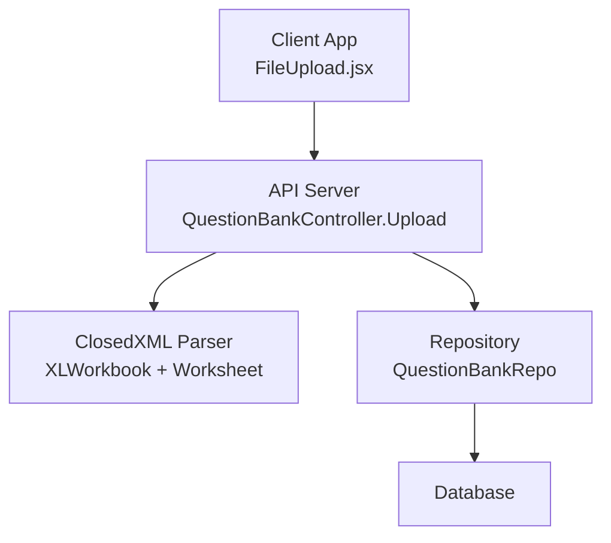
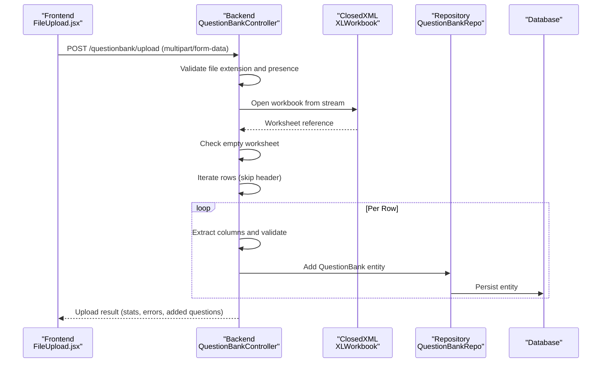
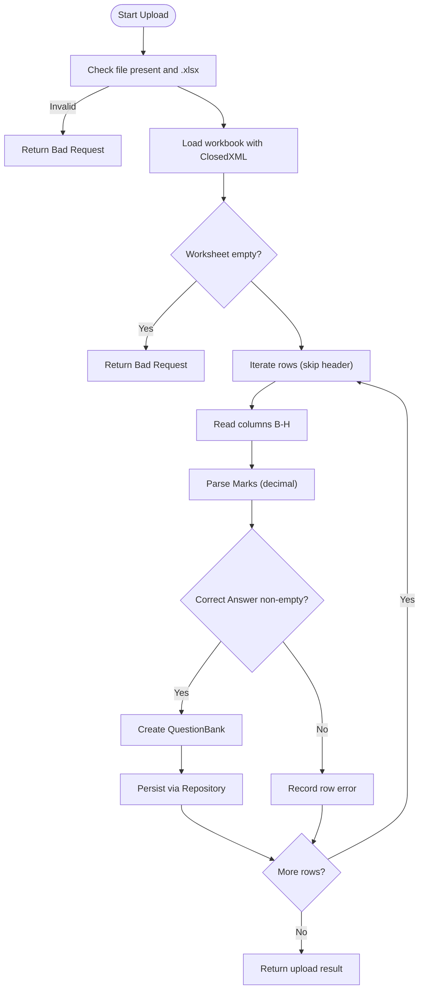
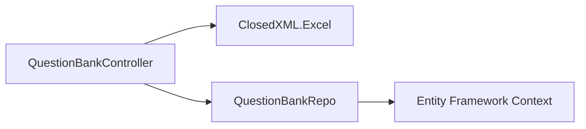

# Excel File Processing Pipeline

<cite>
**Referenced Files in This Document**
- [QuestionBankController.cs](file://server/Api/Controllers/QuestionBankController.cs)
- [QuestionUploadResultDto.cs](file://server/Api/DTOs/QuestionUploadResultDto.cs)
- [QuestionBank.cs](file://server/Api/Models/QuestionBank.cs)
- [QuestionBankRepo.cs](file://server/Api/Repositories/Implementation/QuestionBankRepo.cs)
- [FileUpload.jsx](file://client/src/components/FileUpload.jsx)
- [QuizesApi.csproj](file://server/Api/QuizesApi.csproj)
</cite>

## Table of Contents
1. [Introduction](#introduction)
2. [Project Structure](#project-structure)
3. [Core Components](#core-components)
4. [Architecture Overview](#architecture-overview)
5. [Detailed Component Analysis](#detailed-component-analysis)
6. [Dependency Analysis](#dependency-analysis)
7. [Performance Considerations](#performance-considerations)
8. [Troubleshooting Guide](#troubleshooting-guide)
9. [Conclusion](#conclusion)

## Introduction
This document explains the end-to-end Excel file processing pipeline used to import questions into the Question Bank System. It covers the complete workflow from client-side upload through server-side validation, parsing with ClosedXML, data extraction, and persistence. It also documents the required Excel template format, column mappings, validation rules, error handling strategies, and performance considerations for large files.

## Project Structure
The Excel upload feature spans both frontend and backend:
- Frontend: A React component handles file selection, type validation, progress indication, and mapping of uploaded results back to the application’s question model.
- Backend: An ASP.NET Core controller receives the file, validates it, parses it using ClosedXML, extracts rows into domain models, and persists them via a repository.

**Diagram sources**
- [FileUpload.jsx:19-64](file://client/src/components/FileUpload.jsx#L19-L64)
- [QuestionBankController.cs:145-270](file://server/Api/Controllers/QuestionBankController.cs#L145-L270)
- [QuestionBankRepo.cs:26-45](file://server/Api/Repositories/Implementation/QuestionBankRepo.cs#L26-L45)

**Section sources**
- [FileUpload.jsx:19-64](file://client/src/components/FileUpload.jsx#L19-L64)
- [QuestionBankController.cs:145-270](file://server/Api/Controllers/QuestionBankController.cs#L145-L270)
- [QuestionBankRepo.cs:26-45](file://server/Api/Repositories/Implementation/QuestionBankRepo.cs#L26-L45)

## Core Components
- QuestionBankController.Upload: Entry point for file upload; performs file extension check, workbook loading, row iteration, field extraction, basic validation, and persistence.
- ClosedXML integration: Used to open .xlsx workbooks, access worksheets, iterate rows, and read cell values.
- QuestionUploadResultDto: Aggregates processing statistics (total processed, success/failure counts), per-row errors, and added questions.
- QuestionBank model: Domain entity representing a question with options, correct answer, marks, and metadata.
- QuestionBankRepo: Data access layer that adds entities and commits changes.
- FileUpload.jsx: Client-side UI for uploading files, validating types, showing progress, and mapping backend responses to internal question structures.

**Section sources**
- [QuestionBankController.cs:145-270](file://server/Api/Controllers/QuestionBankController.cs#L145-L270)
- [QuestionUploadResultDto.cs:6-13](file://server/Api/DTOs/QuestionUploadResultDto.cs#L6-L13)
- [QuestionBank.cs:7-46](file://server/Api/Models/QuestionBank.cs#L7-L46)
- [QuestionBankRepo.cs:26-45](file://server/Api/Repositories/Implementation/QuestionBankRepo.cs#L26-L45)
- [FileUpload.jsx:19-64](file://client/src/components/FileUpload.jsx#L19-L64)

## Architecture Overview
The upload flow is a straightforward request-response pipeline:
- The client sends a multipart/form-data POST with an .xlsx file.
- The server validates the file extension and emptiness, loads the workbook, reads the first worksheet, skips the header row, and iterates through data rows.
- For each row, the server extracts fields by column index, applies minimal validation, constructs a QuestionBank entity, and persists it.
- The response includes aggregated statistics and details of successfully added questions.

**Diagram sources**
- [QuestionBankController.cs:145-270](file://server/Api/Controllers/QuestionBankController.cs#L145-L270)
- [QuestionBankRepo.cs:26-45](file://server/Api/Repositories/Implementation/QuestionBankRepo.cs#L26-L45)

## Detailed Component Analysis

### Upload Endpoint Workflow
The upload endpoint performs these steps:
- Validates that a file is provided and has an .xlsx extension.
- Loads the entire file into memory via MemoryStream and opens it with ClosedXML.
- Reads the first worksheet and checks if it contains any rows.
- Skips the header row and iterates through remaining rows.
- For each row:
  - Extracts Question Text (column B), Correct Answer (column C), Marks (column D), Options A–D (columns E–H).
  - Parses Marks as decimal; defaults to 1 if zero or invalid.
  - Ensures Correct Answer is not blank; otherwise records a row-level error.
  - Creates a QuestionBank entity and persists it.
- Aggregates success/failure counts and returns a structured result.

**Diagram sources**
- [QuestionBankController.cs:145-270](file://server/Api/Controllers/QuestionBankController.cs#L145-L270)

**Section sources**
- [QuestionBankController.cs:145-270](file://server/Api/Controllers/QuestionBankController.cs#L145-L270)

### Excel Template Requirements and Column Mappings
The system expects an .xlsx file with the following structure:
- Header row (row 1):
  - Column A: Question Type
  - Column B: Question Text
  - Column C: Correct Answer
  - Column D: Marks
  - Column E: Option A
  - Column F: Option B
  - Column G: Option C
  - Column H: Option D
- Data rows start at row 2.

Notes:
- The current parser reads columns B–H and ignores Column A (Question Type).
- Correct Answer must be non-blank.
- Marks is parsed as decimal; if zero or unparseable, it defaults to 1.
- Options A–D are optional strings; they are stored as-is.

Template generation:
- The server provides a downloadable template with headers and sample rows for MCQ, True/False, and Fill Blank question types.

**Section sources**
- [QuestionBankController.cs:329-380](file://server/Api/Controllers/QuestionBankController.cs#L329-L380)
- [QuestionBankController.cs:189-218](file://server/Api/Controllers/QuestionBankController.cs#L189-L218)

### Validation Rules
- File-level:
  - File must be provided and non-empty.
  - File extension must be .xlsx.
  - Worksheet must contain at least one data row after the header.
- Row-level:
  - Correct Answer must not be blank; otherwise, the row fails and is recorded in Errors.
  - Marks is coerced to decimal; zero or invalid values default to 1.
  - Rows with blank Question Text are skipped without incrementing failure count.

**Section sources**
- [QuestionBankController.cs:148-152](file://server/Api/Controllers/QuestionBankController.cs#L148-L152)
- [QuestionBankController.cs:186-187](file://server/Api/Controllers/QuestionBankController.cs#L186-L187)
- [QuestionBankController.cs:196-202](file://server/Api/Controllers/QuestionBankController.cs#L196-L202)
- [QuestionBankController.cs:223-224](file://server/Api/Controllers/QuestionBankController.cs#L223-L224)

### Data Extraction and Mapping
- Columns mapped:
  - Column B → QuestionTitle
  - Column C → CorrectAnswer
  - Column D → Mark (decimal)
  - Columns E–H → OptionA–OptionD
- Additional fields:
  - UsedOptions is set to 4 during upload.
  - QuestionSubject is set to a default value during upload.
  - GradeId and ClassId are taken from query parameters.
  - AccountId is derived from claims; if missing or invalid, the code attempts to proceed but may fail on database constraints.

**Section sources**
- [QuestionBankController.cs:196-218](file://server/Api/Controllers/QuestionBankController.cs#L196-L218)
- [QuestionBank.cs:9-46](file://server/Api/Models/QuestionBank.cs#L9-L46)

### Error Handling Mechanisms
- File-level errors:
  - Missing or empty file → Bad Request.
  - Invalid file extension → Bad Request.
  - Empty worksheet → Bad Request.
- Row-level errors:
  - Each row is wrapped in try/catch; exceptions increment FailureCount and append a descriptive message including the row number.
- Global errors:
  - Exceptions outside row processing return a 500 status with error details.

**Section sources**
- [QuestionBankController.cs:148-152](file://server/Api/Controllers/QuestionBankController.cs#L148-L152)
- [QuestionBankController.cs:186-187](file://server/Api/Controllers/QuestionBankController.cs#L186-L187)
- [QuestionBankController.cs:230-234](file://server/Api/Controllers/QuestionBankController.cs#L230-L234)
- [QuestionBankController.cs:266-270](file://server/Api/Controllers/QuestionBankController.cs#L266-L270)

### Client-Side Processing and Mapping
- Accepts only .xlsx MIME types.
- Sends the file along with optional accountId and bankKey.
- Displays upload progress and maps backend-added questions to the frontend’s internal question model:
  - Infers question type based on options and correct answer content.
  - Normalizes correct answer to index for MCQ or boolean/string for other types.

**Section sources**
- [FileUpload.jsx:23-30](file://client/src/components/FileUpload.jsx#L23-L30)
- [FileUpload.jsx:37-64](file://client/src/components/FileUpload.jsx#L37-L64)
- [FileUpload.jsx:70-143](file://client/src/components/FileUpload.jsx#L70-L143)

## Dependency Analysis
The core dependencies for the Excel processing pipeline are:
- ClosedXML library for reading .xlsx files.
- ASP.NET Core MVC for handling HTTP requests and responses.
- Entity Framework via the repository for persistence.

**Diagram sources**
- [QuestionBankController.cs:5](file://server/Api/Controllers/QuestionBankController.cs#L5)
- [QuestionBankRepo.cs:1-4](file://server/Api/Repositories/Implementation/QuestionBankRepo.cs#L1-L4)
- [QuizesApi.csproj:12](file://server/Api/QuizesApi.csproj#L12)

**Section sources**
- [QuizesApi.csproj:12](file://server/Api/QuizesApi.csproj#L12)
- [QuestionBankController.cs:5](file://server/Api/Controllers/QuestionBankController.cs#L5)
- [QuestionBankRepo.cs:1-4](file://server/Api/Repositories/Implementation/QuestionBankRepo.cs#L1-L4)

## Performance Considerations
Current implementation characteristics:
- Entire file is loaded into a MemoryStream before being opened by ClosedXML.
- Workbook and worksheet are fully materialized; all rows are enumerated.
- No explicit file size limit is enforced at the controller level.
- No streaming or chunked processing is implemented.

Recommendations for large files:
- Enforce maximum file size at the server configuration level to prevent excessive memory usage.
- Consider streaming parsers or incremental processing to reduce peak memory consumption.
- Batch inserts with periodic SaveChanges to avoid holding too many entities in memory.
- Use background jobs for heavy uploads and provide polling endpoints for progress/status.
- Add rate limiting and concurrency controls to protect the server under load.

[No sources needed since this section provides general guidance]

## Troubleshooting Guide
Common issues and resolutions:
- Invalid file format:
  - Cause: Uploading a non-.xlsx file.
  - Resolution: Download the template and ensure the file is saved as .xlsx.
- Empty file or empty worksheet:
  - Cause: Uploaded file has no data rows.
  - Resolution: Ensure at least one data row exists below the header.
- Missing Correct Answer:
  - Cause: Column C is blank for a given row.
  - Resolution: Provide a valid correct answer for each question.
- Incorrect Marks value:
  - Cause: Non-numeric or zero value in Column D.
  - Resolution: Enter a positive numeric value; zero will default to 1.
- Blank Question Text:
  - Cause: Column B is empty.
  - Resolution: Provide meaningful question text; such rows are skipped.
- Authentication-related failures:
  - Cause: Missing or invalid account claim leading to null AccountId.
  - Resolution: Ensure proper authentication and valid token claims.

**Section sources**
- [QuestionBankController.cs:148-152](file://server/Api/Controllers/QuestionBankController.cs#L148-L152)
- [QuestionBankController.cs:186-187](file://server/Api/Controllers/QuestionBankController.cs#L186-L187)
- [QuestionBankController.cs:196-202](file://server/Api/Controllers/QuestionBankController.cs#L196-L202)
- [QuestionBankController.cs:223-224](file://server/Api/Controllers/QuestionBankController.cs#L223-L224)

## Conclusion
The Excel upload pipeline provides a straightforward mechanism to import questions using a standardized .xlsx template. It leverages ClosedXML for parsing, enforces basic validation rules, and persists data via a repository. While functional, the current implementation loads the entire file into memory and lacks explicit size limits and streaming optimizations. For production-scale usage, consider adding file size restrictions, streaming or batched processing, and robust error reporting to improve reliability and performance.