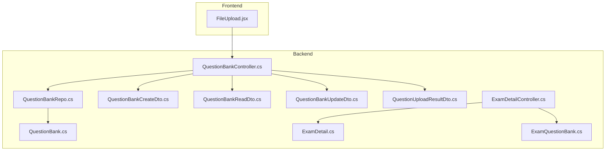
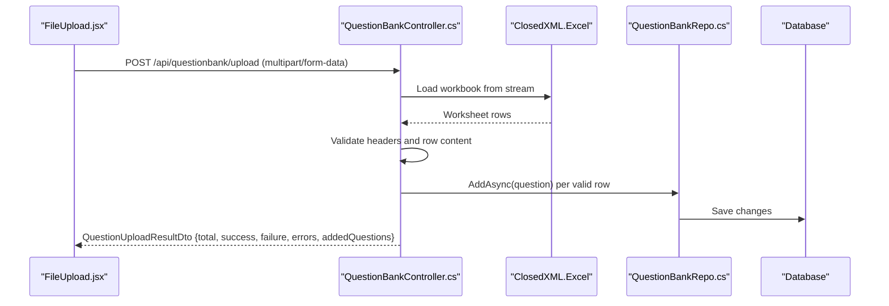
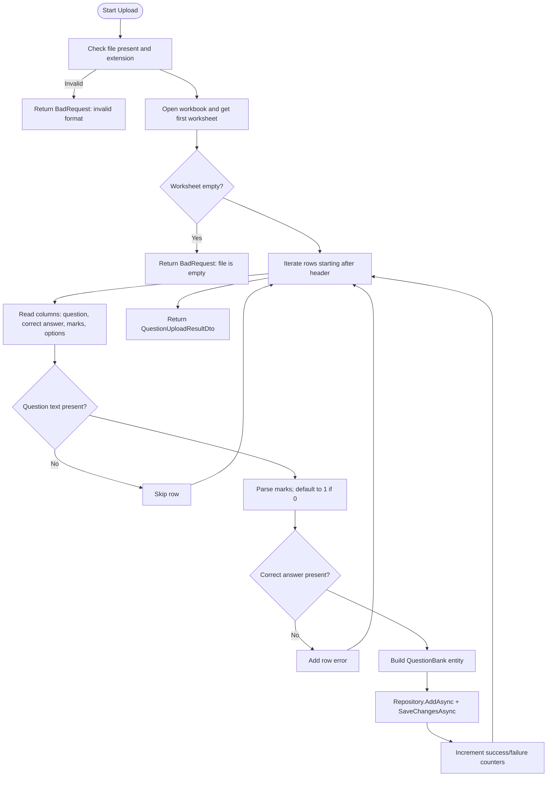
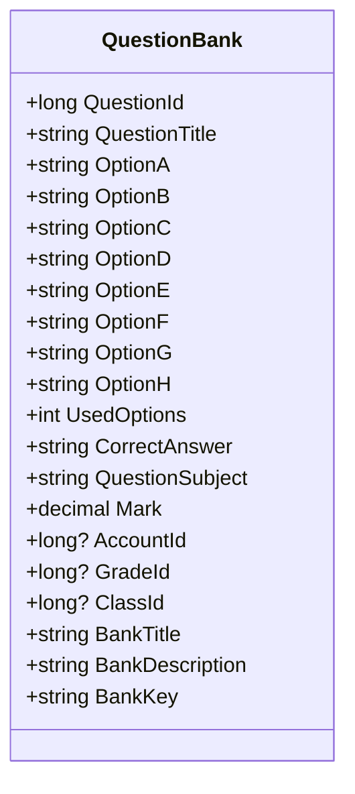
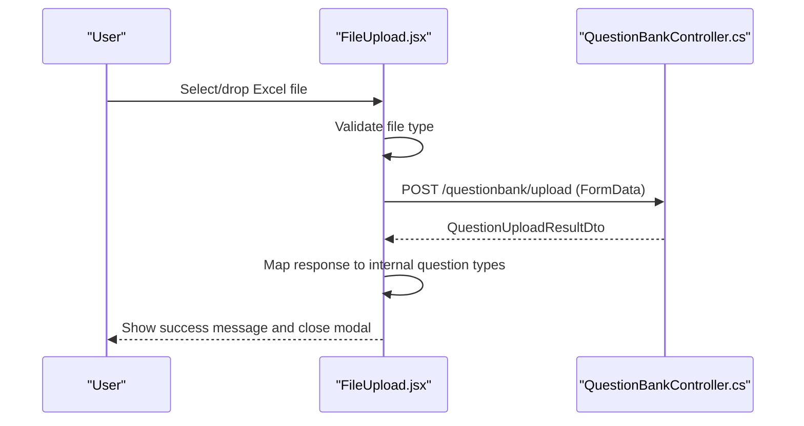
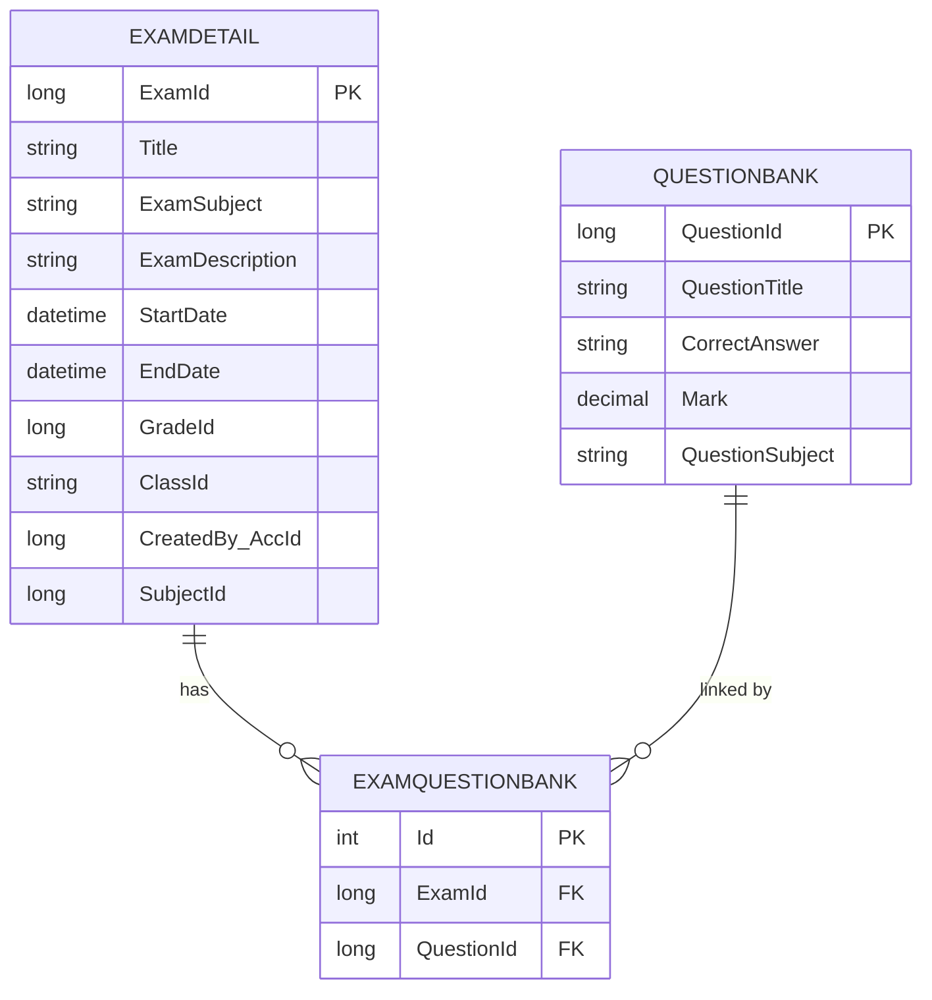
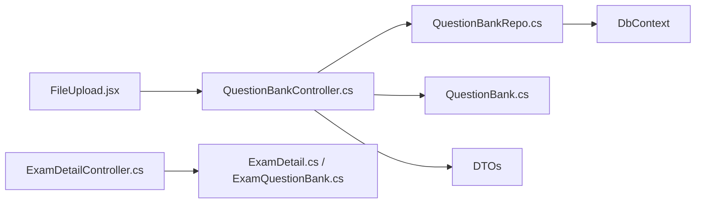

# Question Bank System

<cite>
**Referenced Files in This Document**
- [README.md](file://README.md)
- [FILE_UPLOAD_GUIDE.md](file://client/FILE_UPLOAD_GUIDE.md)
- [QuestionBankController.cs](file://server/Api/Controllers/QuestionBankController.cs)
- [QuestionBankRepo.cs](file://server/Api/Repositories/Implementation/QuestionBankRepo.cs)
- [QuestionBank.cs](file://server/Api/Models/QuestionBank.cs)
- [QuestionBankCreateDto.cs](file://server/Api/DTOs/QuestionBankCreateDto.cs)
- [QuestionBankReadDto.cs](file://server/Api/DTOs/QuestionBankReadDto.cs)
- [QuestionBankUpdateDto.cs](file://server/Api/DTOs/QuestionBankUpdateDto.cs)
- [QuestionUploadResultDto.cs](file://server/Api/DTOs/QuestionUploadResultDto.cs)
- [FileUpload.jsx](file://client/src/components/FileUpload.jsx)
- [ExamDetailController.cs](file://server/Api/Controllers/ExamDetailController.cs)
- [ExamDetail.cs](file://server/Api/Models/ExamDetail.cs)
- [ExamQuestionBank.cs](file://server/Api/Models/ExamQuestionBank.cs)
</cite>

## Table of Contents
1. [Introduction](#introduction)
2. [Project Structure](#project-structure)
3. [Core Components](#core-components)
4. [Architecture Overview](#architecture-overview)
5. [Detailed Component Analysis](#detailed-component-analysis)
6. [Dependency Analysis](#dependency-analysis)
7. [Performance Considerations](#performance-considerations)
8. [Troubleshooting Guide](#troubleshooting-guide)
9. [Conclusion](#conclusion)
10. [Appendices](#appendices)

## Introduction
This document explains the Excel-based question import and management system for the Exam-Hub application. It covers how Excel files are uploaded, validated, parsed, and stored as questions; the data model and metadata for questions; API endpoints for CRUD operations and bulk import/export; validation rules and error handling; and how imported questions integrate with exam creation.

The system is a monorepo with a React/Vite frontend and a .NET Core backend exposing REST APIs. The core functionality for this document centers on:
- Uploading Excel templates to create or update questions
- Managing questions via REST endpoints
- Linking questions to exams during exam creation

[No sources needed since this section summarizes without analyzing specific files]

## Project Structure
At a high level:
- Frontend (React/Vite): Provides file upload UI, template download, and progress feedback.
- Backend (.NET Core): Exposes controllers for question bank operations and exam management, repositories for data access, models for persistence, DTOs for API contracts, and an Excel processing pipeline using ClosedXML.

**Diagram sources**
- [FileUpload.jsx:1-268](file://client/src/components/FileUpload.jsx#L1-L268)
- [QuestionBankController.cs:1-389](file://server/Api/Controllers/QuestionBankController.cs#L1-L389)
- [QuestionBankRepo.cs:1-49](file://server/Api/Repositories/Implementation/QuestionBankRepo.cs#L1-L49)
- [QuestionBank.cs:1-47](file://server/Api/Models/QuestionBank.cs#L1-L47)
- [QuestionBankCreateDto.cs:1-24](file://server/Api/DTOs/QuestionBankCreateDto.cs#L1-L24)
- [QuestionBankReadDto.cs:1-25](file://server/Api/DTOs/QuestionBankReadDto.cs#L1-L25)
- [QuestionBankUpdateDto.cs:1-24](file://server/Api/DTOs/QuestionBankUpdateDto.cs#L1-L24)
- [QuestionUploadResultDto.cs:1-15](file://server/Api/DTOs/QuestionUploadResultDto.cs#L1-L15)
- [ExamDetailController.cs:1-302](file://server/Api/Controllers/ExamDetailController.cs#L1-L302)
- [ExamDetail.cs:1-31](file://server/Api/Models/ExamDetail.cs#L1-L31)
- [ExamQuestionBank.cs:1-14](file://server/Api/Models/ExamQuestionBank.cs#L1-L14)

**Section sources**
- [README.md:1-75](file://README.md#L1-L75)

## Core Components
- QuestionBankController: REST endpoints for listing, retrieving, creating, updating, deleting questions; uploading Excel files; and providing a downloadable template.
- QuestionBankRepo: Data access layer over Entity Framework for QuestionBank entities.
- QuestionBank model: Represents a question with options, correct answer, subject, marks, and optional metadata like grade/class/account/bank fields.
- DTOs: Strongly-typed request/response contracts for create/update/read/upload results.
- FileUpload component: Frontend UI for drag-and-drop or browse uploads, template download, progress indication, and mapping server responses to internal question types.
- ExamDetailController: Manages exams and links selected questions to exams during creation/update.

Key responsibilities:
- Validate and parse Excel files into QuestionBank entities
- Persist questions and return structured upload results
- Provide template generation for consistent imports
- Integrate questions into exams through repository methods

**Section sources**
- [QuestionBankController.cs:1-389](file://server/Api/Controllers/QuestionBankController.cs#L1-L389)
- [QuestionBankRepo.cs:1-49](file://server/Api/Repositories/Implementation/QuestionBankRepo.cs#L1-L49)
- [QuestionBank.cs:1-47](file://server/Api/Models/QuestionBank.cs#L1-L47)
- [QuestionBankCreateDto.cs:1-24](file://server/Api/DTOs/QuestionBankCreateDto.cs#L1-L24)
- [QuestionBankReadDto.cs:1-25](file://server/Api/DTOs/QuestionBankReadDto.cs#L1-L25)
- [QuestionBankUpdateDto.cs:1-24](file://server/Api/DTOs/QuestionBankUpdateDto.cs#L1-L24)
- [QuestionUploadResultDto.cs:1-15](file://server/Api/DTOs/QuestionUploadResultDto.cs#L1-L15)
- [FileUpload.jsx:1-268](file://client/src/components/FileUpload.jsx#L1-L268)
- [ExamDetailController.cs:1-302](file://server/Api/Controllers/ExamDetailController.cs#L1-L302)

## Architecture Overview
The Excel import flow connects the frontend upload UI to the backend controller, which uses ClosedXML to read rows, validate content, construct QuestionBank entities, and persist them via the repository. Upload results include success/failure counts and per-row errors.

**Diagram sources**
- [FileUpload.jsx:19-163](file://client/src/components/FileUpload.jsx#L19-L163)
- [QuestionBankController.cs:145-271](file://server/Api/Controllers/QuestionBankController.cs#L145-L271)
- [QuestionBankRepo.cs:26-45](file://server/Api/Repositories/Implementation/QuestionBankRepo.cs#L26-L45)

## Detailed Component Analysis

### Excel Upload Pipeline
Responsibilities:
- Accept multipart file upload
- Enforce allowed file extension
- Parse Excel using ClosedXML
- Skip header row and iterate data rows
- Validate required fields (question text, correct answer)
- Default missing marks to 1
- Construct QuestionBank entities with metadata (subject, grade/class/account)
- Persist each valid row and collect per-row errors
- Return aggregated upload result

Validation and parsing logic highlights:
- Empty file check
- Row iteration skipping header
- Required field checks
- Numeric parsing for marks with fallback default
- Error aggregation per row

**Diagram sources**
- [QuestionBankController.cs:145-271](file://server/Api/Controllers/QuestionBankController.cs#L145-L271)

**Section sources**
- [QuestionBankController.cs:145-271](file://server/Api/Controllers/QuestionBankController.cs#L145-L271)

### Question Data Model and Metadata
The QuestionBank model includes:
- Identification: QuestionId
- Content: QuestionTitle, OptionA–OptionH, CorrectAnswer, UsedOptions
- Classification: QuestionSubject
- Scoring: Mark
- Contextual metadata: AccountId, GradeId, ClassId (ClassId is not mapped), BankTitle/BankDescription/BankKey

Notes:
- UsedOptions indicates how many options are active for MCQ-style questions.
- ClassId is marked as not mapped, indicating it may be used at runtime but not persisted directly by EF.

**Diagram sources**
- [QuestionBank.cs:1-47](file://server/Api/Models/QuestionBank.cs#L1-L47)

**Section sources**
- [QuestionBank.cs:1-47](file://server/Api/Models/QuestionBank.cs#L1-L47)

### DTOs and API Contracts
- QuestionBankCreateDto: Input for single question creation with all option fields, correct answer, subject, mark, and contextual metadata.
- QuestionBankReadDto: Output representation including all options, correct answer, subject, mark, and metadata.
- QuestionBankUpdateDto: Partial update payload mirroring create fields.
- QuestionUploadResultDto: Aggregated upload result with total processed, success/failure counts, per-row errors, and list of added questions.

These DTOs ensure clear boundaries between client requests/responses and internal models.

**Section sources**
- [QuestionBankCreateDto.cs:1-24](file://server/Api/DTOs/QuestionBankCreateDto.cs#L1-L24)
- [QuestionBankReadDto.cs:1-25](file://server/Api/DTOs/QuestionBankReadDto.cs#L1-L25)
- [QuestionBankUpdateDto.cs:1-24](file://server/Api/DTOs/QuestionBankUpdateDto.cs#L1-L24)
- [QuestionUploadResultDto.cs:1-15](file://server/Api/DTOs/QuestionUploadResultDto.cs#L1-L15)

### Frontend Upload Workflow
The FileUpload component:
- Validates file type on the client side
- Builds FormData with file and optional accountId/bankKey
- Posts to /questionbank/upload with upload progress tracking
- Maps returned questions to internal types (MCQ, True/False, Fill Blank) based on options and correct answer values
- Displays success/error messages and closes modal after successful upload

**Diagram sources**
- [FileUpload.jsx:19-163](file://client/src/components/FileUpload.jsx#L19-L163)
- [QuestionBankController.cs:145-271](file://server/Api/Controllers/QuestionBankController.cs#L145-L271)

**Section sources**
- [FileUpload.jsx:1-268](file://client/src/components/FileUpload.jsx#L1-L268)

### Template Download Endpoint
The controller provides a GET endpoint that generates an Excel template with:
- Headers: Question Type, Question Text, Correct Answer, Marks, Option A–D
- Sample rows for MCQ, True/False, and Fill Blank
- Styled headers and sample data

This ensures consistent formatting for user-provided files.

**Section sources**
- [QuestionBankController.cs:329-386](file://server/Api/Controllers/QuestionBankController.cs#L329-L386)

### Question CRUD Endpoints
- GET /api/questionbank: List all questions (mapped to QuestionBankReadDto)
- GET /api/questionbank/{id}: Retrieve a single question
- POST /api/questionbank: Create a new question with validation
- PUT /api/questionbank/{id}: Update an existing question
- DELETE /api/questionbank/{id}: Delete a question

All endpoints map to/from DTOs and use the repository for persistence.

**Section sources**
- [QuestionBankController.cs:21-143](file://server/Api/Controllers/QuestionBankController.cs#L21-L143)
- [QuestionBankController.cs:272-327](file://server/Api/Controllers/QuestionBankController.cs#L272-L327)
- [QuestionBankRepo.cs:16-45](file://server/Api/Repositories/Implementation/QuestionBankRepo.cs#L16-L45)

### Bulk Import/Export
- Bulk Import: POST /api/questionbank/upload accepts .xlsx files, parses rows, validates, persists, and returns aggregated results.
- Export: No dedicated export endpoint is implemented in the analyzed code. Questions can be retrieved via GET /api/questionbank and exported by clients if needed.

**Section sources**
- [QuestionBankController.cs:145-271](file://server/Api/Controllers/QuestionBankController.cs#L145-L271)
- [QuestionBankController.cs:21-48](file://server/Api/Controllers/QuestionBankController.cs#L21-L48)

### Search Functionality
No search-specific endpoint is implemented in the analyzed code. Clients can retrieve all questions and perform client-side filtering.

**Section sources**
- [QuestionBankController.cs:21-48](file://server/Api/Controllers/QuestionBankController.cs#L21-L48)

### Relationship Between Question Banks and Exam Creation
During exam creation:
- The exam controller accepts a list of question IDs and associates them with the exam via repository methods.
- The ExamQuestionBank model represents the link between an exam and a question.
- The exam DTO includes associated questions and total marks computed from linked questions.

**Diagram sources**
- [ExamDetail.cs:1-31](file://server/Api/Models/ExamDetail.cs#L1-L31)
- [ExamQuestionBank.cs:1-14](file://server/Api/Models/ExamQuestionBank.cs#L1-L14)
- [QuestionBank.cs:1-47](file://server/Api/Models/QuestionBank.cs#L1-L47)
- [ExamDetailController.cs:110-190](file://server/Api/Controllers/ExamDetailController.cs#L110-L190)

**Section sources**
- [ExamDetailController.cs:110-190](file://server/Api/Controllers/ExamDetailController.cs#L110-L190)
- [ExamDetail.cs:1-31](file://server/Api/Models/ExamDetail.cs#L1-L31)
- [ExamQuestionBank.cs:1-14](file://server/Api/Models/ExamQuestionBank.cs#L1-L14)

## Dependency Analysis
- Controllers depend on repositories for data operations.
- Repositories depend on Entity Framework context for database interactions.
- DTOs decouple API contracts from domain models.
- Frontend depends on backend endpoints for upload, template download, and question retrieval.

**Diagram sources**
- [FileUpload.jsx:1-268](file://client/src/components/FileUpload.jsx#L1-L268)
- [QuestionBankController.cs:1-389](file://server/Api/Controllers/QuestionBankController.cs#L1-L389)
- [QuestionBankRepo.cs:1-49](file://server/Api/Repositories/Implementation/QuestionBankRepo.cs#L1-L49)
- [QuestionBank.cs:1-47](file://server/Api/Models/QuestionBank.cs#L1-L47)
- [ExamDetailController.cs:1-302](file://server/Api/Controllers/ExamDetailController.cs#L1-L302)
- [ExamDetail.cs:1-31](file://server/Api/Models/ExamDetail.cs#L1-L31)
- [ExamQuestionBank.cs:1-14](file://server/Api/Models/ExamQuestionBank.cs#L1-L14)

**Section sources**
- [QuestionBankController.cs:1-389](file://server/Api/Controllers/QuestionBankController.cs#L1-L389)
- [QuestionBankRepo.cs:1-49](file://server/Api/Repositories/Implementation/QuestionBankRepo.cs#L1-L49)
- [FileUpload.jsx:1-268](file://client/src/components/FileUpload.jsx#L1-L268)

## Performance Considerations
- Use batched persistence where possible to reduce round trips.
- Avoid unnecessary object mappings in tight loops.
- Consider streaming large Excel files to memory efficiently.
- Index frequently queried fields (e.g., QuestionSubject, GradeId) in the database.
- Cache static template generation if accessed frequently.

[No sources needed since this section provides general guidance]

## Troubleshooting Guide
Common issues and resolutions:
- Invalid file format: Ensure the uploaded file is .xlsx.
- Empty file: Verify the file contains at least one data row beyond the header.
- Missing question text or correct answer: Rows with these fields blank are skipped or recorded as errors.
- Incorrect marks value: Non-numeric or zero values default to 1; ensure numeric values for accurate scoring.
- Authentication claims: If AccountId cannot be resolved from tokens, inserts may fail due to constraints; ensure proper authentication.

Error handling patterns:
- Controller-level try/catch returns HTTP 500 with detailed messages when exceptions occur.
- Per-row errors are collected and included in the upload result for granular feedback.

**Section sources**
- [QuestionBankController.cs:145-271](file://server/Api/Controllers/QuestionBankController.cs#L145-L271)
- [QuestionBankController.cs:81-143](file://server/Api/Controllers/QuestionBankController.cs#L81-L143)
- [QuestionBankController.cs:272-327](file://server/Api/Controllers/QuestionBankController.cs#L272-L327)

## Conclusion
The Exam-Hub question bank system provides a robust Excel-based import pipeline with clear validation, structured error reporting, and straightforward CRUD operations. Questions are modeled with rich metadata and integrated into exams during creation. While search and export features are not implemented in the analyzed code, the design supports client-side extensions. For improved quality assurance, consider adding duplicate detection, stricter validation rules, and automated tests for the upload pipeline.

[No sources needed since this section summarizes without analyzing specific files]

## Appendices

### Excel File Format Specification
Expected columns:
- Question Type: MCQ, True/False, Fill Blank
- Question Text: The question content
- Correct Answer: Value matching the expected answer
- Marks: Numeric points (defaults to 1 if missing or zero)
- Option A–D: Options for MCQ questions

Examples and tips are provided in the user guide.

**Section sources**
- [FILE_UPLOAD_GUIDE.md:17-89](file://client/FILE_UPLOAD_GUIDE.md#L17-L89)

### API Endpoints Summary
- GET /api/questionbank: List all questions
- GET /api/questionbank/{id}: Get question by ID
- POST /api/questionbank: Create a question
- PUT /api/questionbank/{id}: Update a question
- DELETE /api/questionbank/{id}: Delete a question
- POST /api/questionbank/upload: Upload Excel file for bulk import
- GET /api/questionbank/template: Download template Excel file

**Section sources**
- [QuestionBankController.cs:21-48](file://server/Api/Controllers/QuestionBankController.cs#L21-L48)
- [QuestionBankController.cs:81-143](file://server/Api/Controllers/QuestionBankController.cs#L81-L143)
- [QuestionBankController.cs:145-271](file://server/Api/Controllers/QuestionBankController.cs#L145-L271)
- [QuestionBankController.cs:272-327](file://server/Api/Controllers/QuestionBankController.cs#L272-L327)
- [QuestionBankController.cs:329-386](file://server/Api/Controllers/QuestionBankController.cs#L329-L386)