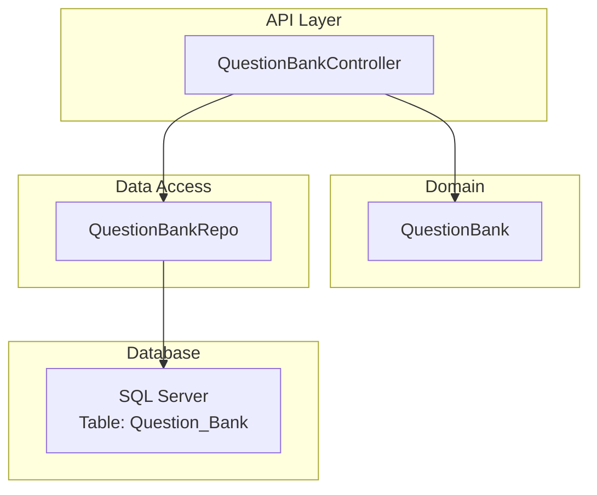
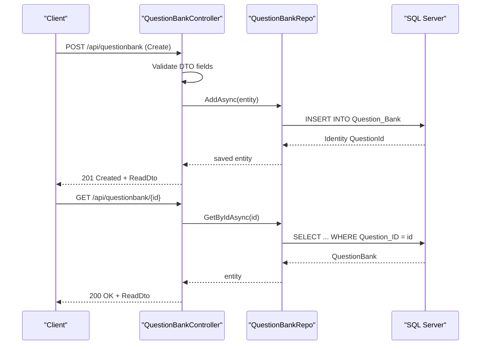
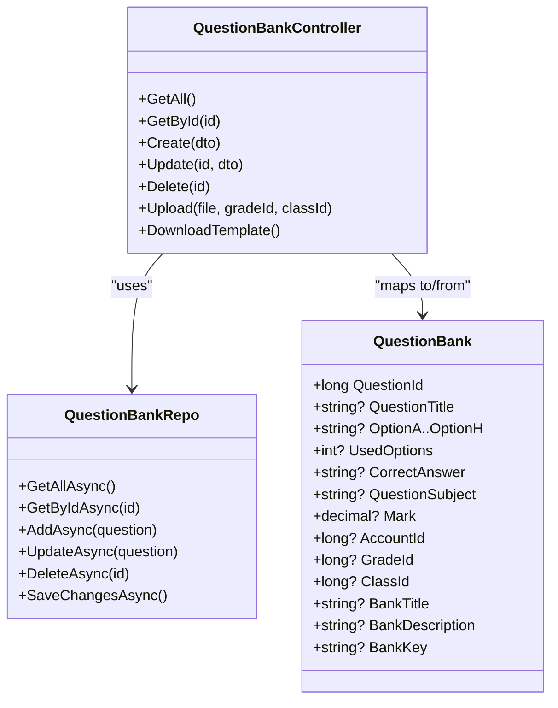

# Question Data Model & Structure

<cite>
**Referenced Files in This Document**
- [QuestionBank.cs](file://server/Api/Models/QuestionBank.cs)
- [QuestionBankCreateDto.cs](file://server/Api/DTOs/QuestionBankCreateDto.cs)
- [QuestionBankReadDto.cs](file://server/Api/DTOs/QuestionBankReadDto.cs)
- [QuestionBankUpdateDto.cs](file://server/Api/DTOs/QuestionBankUpdateDto.cs)
- [QuestionBankController.cs](file://server/Api/Controllers/QuestionBankController.cs)
- [QuestionBankRepo.cs](file://server/Api/Repositories/Implementation/QuestionBankRepo.cs)
- [20260123184911_InitialCreate.Designer.cs](file://server/Api/Migrations/20260123184911_InitialCreate.Designer.cs)
- [ExamQuestionBankPartials.cs](file://server/Api/Models/ExamQuestionBankPartials.cs)
</cite>

## Table of Contents
1. Introduction
2. Project Structure
3. Core Components
4. Architecture Overview
5. Detailed Component Analysis
6. Dependency Analysis
7. Performance Considerations
8. Troubleshooting Guide
9. Conclusion
10. Appendices

## Introduction
This document explains the question data model and structure used by the Question Bank System. It focuses on the QuestionBank entity schema, the DTO pattern for Create/Read/Update operations, field constraints and validation rules, business logic around options and correct answers, database relationships and indexing, and examples for different question types (MCQ, True/False, Fill Blank). It also clarifies how the UsedOptions field controls which answer options are active.

## Project Structure
The relevant parts of the codebase for this topic reside under server/Api:
- Models define the domain entities (e.g., QuestionBank).
- DTOs define request/response contracts for API endpoints.
- Controllers implement HTTP endpoints and orchestrate business logic.
- Repositories encapsulate data access via Entity Framework.
- Migrations define the database schema and constraints.

**Diagram sources**
- [QuestionBankController.cs:10-19](file://server/Api/Controllers/QuestionBankController.cs#L10-L19)
- [QuestionBankRepo.cs:7-14](file://server/Api/Repositories/Implementation/QuestionBankRepo.cs#L7-L14)
- [20260123184911_InitialCreate.Designer.cs:1213-1284](file://server/Api/Migrations/20260123184911_InitialCreate.Designer.cs#L1213-L1284)

**Section sources**
- [QuestionBankController.cs:10-19](file://server/Api/Controllers/QuestionBankController.cs#L10-L19)
- [QuestionBankRepo.cs:7-14](file://server/Api/Repositories/Implementation/QuestionBankRepo.cs#L7-L14)

## Core Components
- QuestionBank entity defines the persistent question record with fields for title, options A–H, used options flag, correct answer, subject, mark, grade/class/account references, and bank metadata.
- DTOs separate API contracts from the domain model:
  - QuestionBankCreateDto for creation requests.
  - QuestionBankReadDto for responses.
  - QuestionBankUpdateDto for updates.
- Controller exposes CRUD endpoints plus upload and template download.
- Repository provides EF-based persistence operations.

Key responsibilities:
- Controller validates inputs and maps between DTOs and entities.
- Repository abstracts EF context usage for queries and mutations.
- Migrations define column types, identity, and primary key.

**Section sources**
- [QuestionBank.cs:7-46](file://server/Api/Models/QuestionBank.cs#L7-L46)
- [QuestionBankCreateDto.cs:3-24](file://server/Api/DTOs/QuestionBankCreateDto.cs#L3-L24)
- [QuestionBankReadDto.cs:3-25](file://server/Api/DTOs/QuestionBankReadDto.cs#L3-L25)
- [QuestionBankUpdateDto.cs:3-24](file://server/Api/DTOs/QuestionBankUpdateDto.cs#L3-L24)
- [QuestionBankController.cs:21-143](file://server/Api/Controllers/QuestionBankController.cs#L21-L143)
- [QuestionBankRepo.cs:16-46](file://server/Api/Repositories/Implementation/QuestionBankRepo.cs#L16-L46)

## Architecture Overview
The system follows a layered architecture:
- API layer (Controller) handles HTTP requests, performs basic validation, and coordinates operations.
- Domain layer (Model) represents the question entity.
- Data access layer (Repository) uses Entity Framework to persist changes.
- Database stores questions with an identity primary key and nvarchar(max) text columns.

**Diagram sources**
- [QuestionBankController.cs:81-143](file://server/Api/Controllers/QuestionBankController.cs#L81-L143)
- [QuestionBankController.cs:50-79](file://server/Api/Controllers/QuestionBankController.cs#L50-L79)
- [QuestionBankRepo.cs:16-29](file://server/Api/Repositories/Implementation/QuestionBankRepo.cs#L16-L29)
- [20260123184911_InitialCreate.Designer.cs:1213-1284](file://server/Api/Migrations/20260123184911_InitialCreate.Designer.cs#L1213-L1284)

## Detailed Component Analysis

### QuestionBank Entity Schema
The QuestionBank entity models a single question with the following properties:
- Identifier and ownership:
  - QuestionId: long, identity primary key.
  - AccountId: long?, optional owner reference.
- Content:
  - QuestionTitle: string? (mapped to Question_Title).
  - OptionA through OptionH: string? (answer choices).
  - CorrectAnswer: string? (the accepted answer value).
  - QuestionSubject: string? (mapped to Question_Subject).
  - Mark: decimal?(5,2), optional scoring.
- Classification and grouping:
  - GradeId: long? (mapped to Grade_ID).
  - ClassId: long?, not mapped to a column (used at application level).
  - UsedOptions: int?, number of active options among A–H.
- Bank metadata:
  - BankTitle, BankDescription, BankKey: string? (grouping/categorization).

Notes:
- All text fields are stored as nvarchar(max) in the database.
- The table name is Question_Bank; column names may differ from property names due to mapping.
- ClassId is marked NotMapped and is not persisted.

**Section sources**
- [QuestionBank.cs:7-46](file://server/Api/Models/QuestionBank.cs#L7-L46)
- [20260123184911_InitialCreate.Designer.cs:1213-1284](file://server/Api/Migrations/20260123184911_InitialCreate.Designer.cs#L1213-L1284)

### DTO Pattern: Create, Read, Update
- QuestionBankCreateDto:
  - Required fields include QuestionTitle, OptionA, OptionB, CorrectAnswer, QuestionSubject, Mark, UsedOptions.
  - Optional fields include OptionC–H, GradeId, ClassId, BankTitle, BankDescription, BankKey, AccountId.
- QuestionBankReadDto:
  - Mirrors the response shape returned by the API, including all options, UsedOptions, CorrectAnswer, Subject, Mark, bank metadata, and identifiers.
  - Defaults UsedOptions to 4 when reading if null.
- QuestionBankUpdateDto:
  - Similar to Create but used to update existing records; controller preserves existing values for optional fields unless provided.

Mapping behavior:
- Controller maps DTOs to QuestionBank on create/update and back to ReadDto on read.
- On read, UsedOptions defaults to 4 if null to ensure consistent client behavior.

**Section sources**
- [QuestionBankCreateDto.cs:3-24](file://server/Api/DTOs/QuestionBankCreateDto.cs#L3-L24)
- [QuestionBankReadDto.cs:3-25](file://server/Api/DTOs/QuestionBankReadDto.cs#L3-L25)
- [QuestionBankUpdateDto.cs:3-24](file://server/Api/DTOs/QuestionBankUpdateDto.cs#L3-L24)
- [QuestionBankController.cs:21-79](file://server/Api/Controllers/QuestionBankController.cs#L21-L79)

### Field Constraints and Validation Rules
- Controller-level validation:
  - QuestionTitle must be non-empty for Create and Update; otherwise returns BadRequest.
  - Upload endpoint enforces .xlsx format and non-empty file.
  - During upload, rows without question text are skipped; missing CorrectAnswer raises an error per row.
- Defaulting and normalization:
  - UsedOptions defaults to 4 when reading or uploading if not set.
  - Mark defaults to 1 during upload if empty or zero.
- Database-level characteristics:
  - All text fields are nvarchar(max); no length constraints enforced at the database level.
  - Primary key is auto-incremented bigint Question_ID.
  - No explicit unique constraints on Question_Bank columns are defined in migrations.

Business rules applied in controller:
- AccountId is derived from claims when present; if absent or invalid, it may be omitted or set to null depending on flow.
- For updates, optional fields preserve existing values unless explicitly provided.

**Section sources**
- [QuestionBankController.cs:81-143](file://server/Api/Controllers/QuestionBankController.cs#L81-L143)
- [QuestionBankController.cs:145-271](file://server/Api/Controllers/QuestionBankController.cs#L145-L271)
- [QuestionBankController.cs:272-319](file://server/Api/Controllers/QuestionBankController.cs#L272-L319)
- [20260123184911_InitialCreate.Designer.cs:1213-1284](file://server/Api/Migrations/20260123184911_InitialCreate.Designer.cs#L1213-L1284)

### Business Logic: UsedOptions and Active Options
- UsedOptions indicates how many of the A–H options are considered active for a given question.
- In read responses, if UsedOptions is null, it is normalized to 4 to maintain backward compatibility.
- During upload, if not provided, UsedOptions is set to 4.
- Typical usage:
  - MCQ with 4 options: UsedOptions = 4; only A–D are considered.
  - MCQ with 6 options: UsedOptions = 6; A–F are considered.
  - True/False: Typically UsedOptions = 2; A and B represent True/False.
  - Fill Blank: Often UsedOptions = 0 or 1; options may be ignored or only one option used.

Note: The system does not enforce that the number of filled options matches UsedOptions; clients should ensure consistency.

**Section sources**
- [QuestionBankController.cs:21-79](file://server/Api/Controllers/QuestionBankController.cs#L21-L79)
- [QuestionBankController.cs:145-271](file://server/Api/Controllers/QuestionBankController.cs#L145-L271)

### Database Relationships and Indexing Strategy
- Table: Question_Bank
  - Primary Key: Question_ID (bigint, identity).
  - Columns:
    - AccountId (bigint, nullable)
    - Grade_ID (bigint, nullable)
    - Question_Title, Question_Subject (nvarchar(max))
    - OptionA–OptionH (nvarchar(max))
    - CorrectAnswer (nvarchar(max))
    - Mark (decimal(5,2), nullable)
    - UsedOptions (int, nullable)
    - BankTitle, BankDescription, BankKey (nvarchar(max))
- Relationships:
  - ExamQuestionBank partial model references QuestionBank and ExamDetail as navigation properties (NotMapped), indicating logical associations used in exam composition.
- Indexing:
  - No additional indexes on Question_Bank are defined in the referenced migration snapshot beyond the primary key.
  - If frequent filtering by Subject, Grade, or Account is expected, consider adding indexes on those columns in future migrations.

**Section sources**
- [20260123184911_InitialCreate.Designer.cs:1213-1284](file://server/Api/Migrations/20260123184911_InitialCreate.Designer.cs#L1213-L1284)
- [ExamQuestionBankPartials.cs:5-12](file://server/Api/Models/ExamQuestionBankPartials.cs#L5-L12)

### Examples: Question Types and Data Structures
Below are conceptual examples showing how to populate fields for common question types. These illustrate typical values and how UsedOptions controls active options.

- Multiple Choice Question (MCQ) with 4 options:
  - QuestionTitle: "What is the capital of France?"
  - OptionA: "London"
  - OptionB: "Paris"
  - OptionC: "Berlin"
  - OptionD: "Madrid"
  - UsedOptions: 4
  - CorrectAnswer: "Paris"
  - QuestionSubject: "Geography"
  - Mark: 1

- True/False:
  - QuestionTitle: "The earth is flat."
  - OptionA: "True"
  - OptionB: "False"
  - UsedOptions: 2
  - CorrectAnswer: "False"
  - QuestionSubject: "Science"
  - Mark: 1

- Fill Blank:
  - QuestionTitle: "H2O is the chemical formula for ____."
  - OptionA: "Water"
  - UsedOptions: 1 (or 0 if options are ignored)
  - CorrectAnswer: "Water"
  - QuestionSubject: "Chemistry"
  - Mark: 1

These examples align with the template generation logic that includes sample rows for MCQ, True/False, and Fill Blank.

**Section sources**
- [QuestionBankController.cs:329-386](file://server/Api/Controllers/QuestionBankController.cs#L329-L386)

## Dependency Analysis
- Controller depends on:
  - IQuestionBankRepo for data operations.
  - DTOs for input/output contracts.
  - Claims for AccountId resolution.
- Repository depends on:
  - ElsewedySchoolSysDbDevContext (EF DbContext) to access QuestionBanks DbSet.
- Migrations define the database schema used by EF.

**Diagram sources**
- [QuestionBankController.cs:10-19](file://server/Api/Controllers/QuestionBankController.cs#L10-L19)
- [QuestionBankRepo.cs:7-14](file://server/Api/Repositories/Implementation/QuestionBankRepo.cs#L7-L14)
- [QuestionBank.cs:7-46](file://server/Api/Models/QuestionBank.cs#L7-L46)

**Section sources**
- [QuestionBankController.cs:10-19](file://server/Api/Controllers/QuestionBankController.cs#L10-L19)
- [QuestionBankRepo.cs:7-14](file://server/Api/Repositories/Implementation/QuestionBankRepo.cs#L7-L14)

## Performance Considerations
- Text storage: All text fields use nvarchar(max), which can grow large. Avoid storing very long strings in options or titles.
- Indexing: No secondary indexes on frequently filtered columns (e.g., QuestionSubject, Grade_ID, AccountId). Consider adding indexes if querying by these fields becomes common.
- Read normalization: UsedOptions defaulting to 4 on read avoids null handling overhead on clients but adds minor mapping cost.
- Bulk upload: The upload endpoint processes rows sequentially; for large files, consider batching saves and robust error handling to improve throughput.

[No sources needed since this section provides general guidance]

## Troubleshooting Guide
Common issues and resolutions:
- Missing QuestionTitle:
  - Symptom: BadRequest on Create/Update.
  - Resolution: Ensure QuestionTitle is provided and non-empty.
- Invalid file format on upload:
  - Symptom: BadRequest for non-.xlsx files or empty files.
  - Resolution: Provide a valid .xlsx file with content.
- Missing CorrectAnswer during upload:
  - Symptom: Row-level error; failure count increments.
  - Resolution: Provide a non-empty CorrectAnswer for each row.
- Null UsedOptions on read:
  - Behavior: Defaults to 4.
  - Resolution: Set UsedOptions explicitly when creating/updating if you need a different default.
- AccountId issues:
  - Symptom: Potential constraint violations if AccountId is invalid or missing where required.
  - Resolution: Ensure claims provide a valid AccountId or handle absence appropriately in your integration.

**Section sources**
- [QuestionBankController.cs:81-143](file://server/Api/Controllers/QuestionBankController.cs#L81-L143)
- [QuestionBankController.cs:145-271](file://server/Api/Controllers/QuestionBankController.cs#L145-L271)
- [QuestionBankController.cs:272-319](file://server/Api/Controllers/QuestionBankController.cs#L272-L319)

## Conclusion
The Question Bank System models questions using a flexible QuestionBank entity with up to eight answer options and a UsedOptions flag to control which options are active. The DTO pattern cleanly separates API contracts from the domain model, while the controller applies validation and normalization rules. The database schema uses wide text columns and an identity primary key, with no extra indexes beyond the primary key. For optimal performance and scalability, consider adding indexes on commonly queried fields and enforcing stricter validation or constraints at the database level if needed.

[No sources needed since this section summarizes without analyzing specific files]

## Appendices

### Appendix A: Entity-to-Database Mapping Summary
- Table: Question_Bank
- Columns and types (from migration snapshot):
  - Question_ID: bigint (identity, PK)
  - AccountId: bigint (nullable)
  - Grade_ID: bigint (nullable)
  - Question_Title: nvarchar(max)
  - Question_Subject: nvarchar(max)
  - OptionA–OptionH: nvarchar(max)
  - CorrectAnswer: nvarchar(max)
  - Mark: decimal(5,2) (nullable)
  - UsedOptions: int (nullable)
  - BankTitle, BankDescription, BankKey: nvarchar(max)

**Section sources**
- [20260123184911_InitialCreate.Designer.cs:1213-1284](file://server/Api/Migrations/20260123184911_InitialCreate.Designer.cs#L1213-L1284)