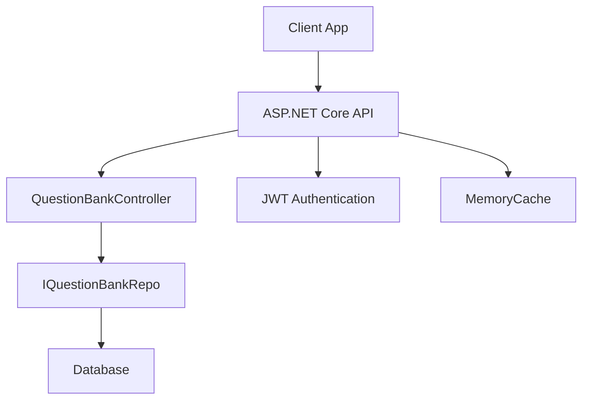
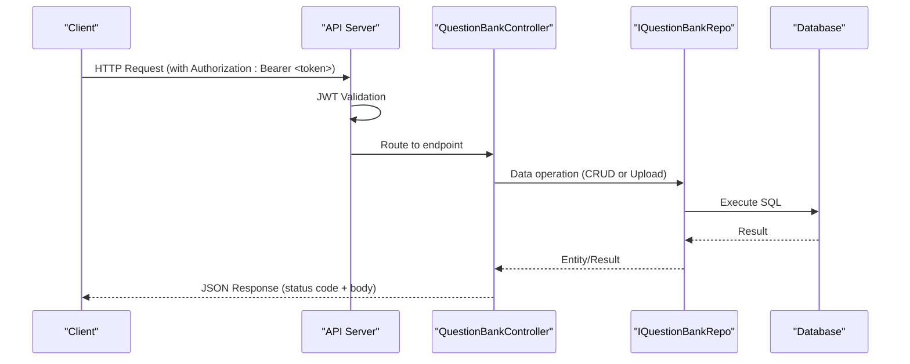
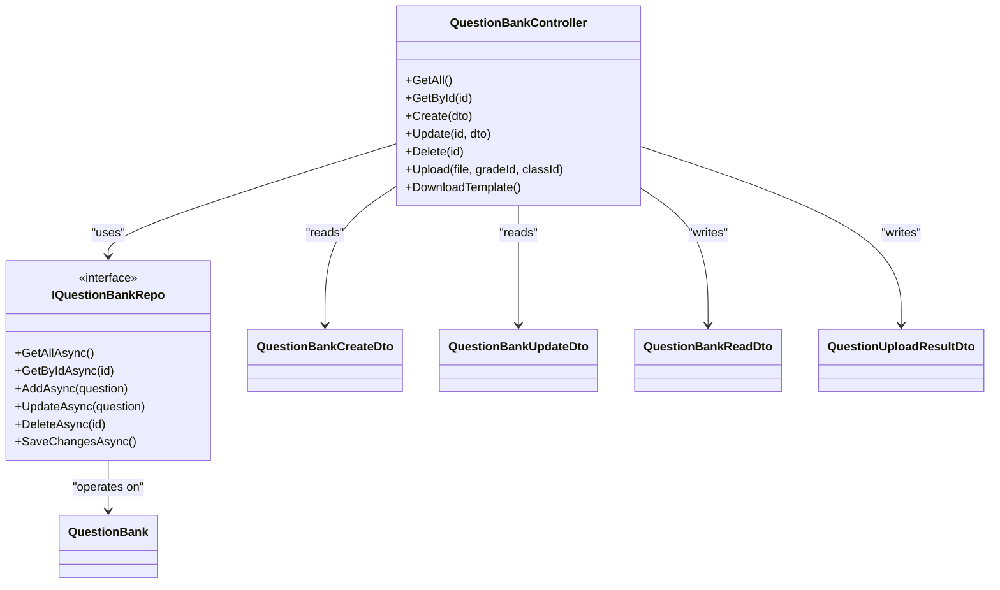

# Question Management APIs

<cite>
**Referenced Files in This Document**
- [QuestionBankController.cs](file://server/Api/Controllers/QuestionBankController.cs)
- [QuestionBankCreateDto.cs](file://server/Api/DTOs/QuestionBankCreateDto.cs)
- [QuestionBankReadDto.cs](file://server/Api/DTOs/QuestionBankReadDto.cs)
- [QuestionBankUpdateDto.cs](file://server/Api/DTOs/QuestionBankUpdateDto.cs)
- [QuestionUploadResultDto.cs](file://server/Api/DTOs/QuestionUploadResultDto.cs)
- [IQuestionBankRepo.cs](file://server/Api/Repositories/Interfaces/IQuestionBankRepo.cs)
- [QuestionBank.cs](file://server/Api/Models/QuestionBank.cs)
- [Program.cs](file://server/Api/Program.cs)
</cite>

## Table of Contents
1. [Introduction](#introduction)
2. [Project Structure](#project-structure)
3. [Core Components](#core-components)
4. [Architecture Overview](#architecture-overview)
5. [Detailed Component Analysis](#detailed-component-analysis)
6. [Dependency Analysis](#dependency-analysis)
7. [Performance Considerations](#performance-considerations)
8. [Troubleshooting Guide](#troubleshooting-guide)
9. [Conclusion](#conclusion)

## Introduction
This document provides comprehensive API documentation for question management endpoints in the Question Bank System. It covers all RESTful operations for creating, reading, updating, deleting, bulk uploading, and downloading a template for questions. For each endpoint, it specifies HTTP methods, URL patterns, request/response schemas, authentication requirements, status codes, query parameters, filtering/search capabilities (if any), pagination support, error response formats, and client integration examples.

## Project Structure
The Question Bank APIs are implemented as an ASP.NET Core Web API controller with DTOs for input/output contracts and repository interfaces for data access. Authentication is configured via JWT Bearer tokens, and CORS is enabled for frontend integration.

**Diagram sources**
- [QuestionBankController.cs:10-19](file://server/Api/Controllers/QuestionBankController.cs#L10-L19)
- [IQuestionBankRepo.cs:1-12](file://server/Api/Repositories/Interfaces/IQuestionBankRepo.cs#L1-L12)
- [Program.cs:43-81](file://server/Api/Program.cs#L43-L81)
- [Program.cs:35-36](file://server/Api/Program.cs#L35-L36)

**Section sources**
- [QuestionBankController.cs:10-19](file://server/Api/Controllers/QuestionBankController.cs#L10-L19)
- [Program.cs:43-81](file://server/Api/Program.cs#L43-L81)

## Core Components
- Controller: QuestionBankController exposes REST endpoints for question CRUD and file upload/template download.
- DTOs:
  - QuestionBankCreateDto: Request schema for creating a new question.
  - QuestionBankUpdateDto: Request schema for updating an existing question.
  - QuestionBankReadDto: Response schema for question details.
  - QuestionUploadResultDto: Response schema for bulk upload results.
- Repository Interface: IQuestionBankRepo defines data access operations used by the controller.
- Model: QuestionBank represents the database entity shape used internally.

Key responsibilities:
- Validate inputs and map to domain models.
- Enforce authentication claims for AccountId where applicable.
- Persist changes via repository and return standardized responses.

**Section sources**
- [QuestionBankController.cs:21-389](file://server/Api/Controllers/QuestionBankController.cs#L21-L389)
- [QuestionBankCreateDto.cs:1-24](file://server/Api/DTOs/QuestionBankCreateDto.cs#L1-L24)
- [QuestionBankUpdateDto.cs:1-24](file://server/Api/DTOs/QuestionBankUpdateDto.cs#L1-L24)
- [QuestionBankReadDto.cs:1-25](file://server/Api/DTOs/QuestionBankReadDto.cs#L1-L25)
- [QuestionUploadResultDto.cs:1-15](file://server/Api/DTOs/QuestionUploadResultDto.cs#L1-L15)
- [IQuestionBankRepo.cs:1-12](file://server/Api/Repositories/Interfaces/IQuestionBankRepo.cs#L1-L12)
- [QuestionBank.cs:1-47](file://server/Api/Models/QuestionBank.cs#L1-L47)

## Architecture Overview
The API uses JWT-based authentication and returns JSON payloads. The controller delegates persistence to a repository layer. Memory cache is registered but not actively used by these endpoints.

**Diagram sources**
- [Program.cs:43-81](file://server/Api/Program.cs#L43-L81)
- [QuestionBankController.cs:21-389](file://server/Api/Controllers/QuestionBankController.cs#L21-L389)
- [IQuestionBankRepo.cs:1-12](file://server/Api/Repositories/Interfaces/IQuestionBankRepo.cs#L1-L12)

## Detailed Component Analysis

### Base Information
- Base route: /api/questionbank
- Authentication: JWT Bearer token required on all endpoints. Claims include user identity; AccountId is extracted from token claims when needed.
- Content-Type: application/json for JSON endpoints; multipart/form-data for file uploads.
- Versioning: No explicit versioning in routes; consider adding a version prefix if needed.

### Endpoints

#### GET /api/questionbank
- Description: List all questions.
- Authentication: Required (Bearer token).
- Query Parameters: None defined in implementation.
- Filtering/Search: Not implemented.
- Pagination: Not implemented.
- Success Response: Array of QuestionBankReadDto objects.
- Error Responses:
  - 500 Internal Server Error: Unexpected server error.

Example Request:
- Method: GET
- Headers: Authorization: Bearer <token>
- URL: /api/questionbank

Example Response:
- Status: 200 OK
- Body: Array of QuestionBankReadDto

**Section sources**
- [QuestionBankController.cs:21-48](file://server/Api/Controllers/QuestionBankController.cs#L21-L48)
- [QuestionBankReadDto.cs:1-25](file://server/Api/DTOs/QuestionBankReadDto.cs#L1-L25)

#### GET /api/questionbank/{id}
- Description: Get a single question by ID.
- Authentication: Required (Bearer token).
- Path Parameter: id (long).
- Success Response: Single QuestionBankReadDto object.
- Error Responses:
  - 404 Not Found: Question does not exist.
  - 500 Internal Server Error: Unexpected server error.

Example Request:
- Method: GET
- Headers: Authorization: Bearer <token>
- URL: /api/questionbank/123

Example Response:
- Status: 200 OK
- Body: QuestionBankReadDto

**Section sources**
- [QuestionBankController.cs:50-79](file://server/Api/Controllers/QuestionBankController.cs#L50-L79)
- [QuestionBankReadDto.cs:1-25](file://server/Api/DTOs/QuestionBankReadDto.cs#L1-L25)

#### POST /api/questionbank
- Description: Create a new question.
- Authentication: Required (Bearer token).
- Request Body: QuestionBankCreateDto.
- Validation:
  - QuestionTitle is required.
  - AccountId is derived from token claims; if missing or invalid, behavior depends on downstream constraints.
- Success Response: Created resource location and body.
- Error Responses:
  - 400 Bad Request: Missing required fields.
  - 500 Internal Server Error: Unexpected server error.

Example Request:
- Method: POST
- Headers: Authorization: Bearer <token>, Content-Type: application/json
- Body: QuestionBankCreateDto

Example Response:
- Status: 201 Created
- Location: /api/questionbank/{id}
- Body: QuestionBankReadDto

**Section sources**
- [QuestionBankController.cs:81-143](file://server/Api/Controllers/QuestionBankController.cs#L81-L143)
- [QuestionBankCreateDto.cs:1-24](file://server/Api/DTOs/QuestionBankCreateDto.cs#L1-L24)

#### PUT /api/questionbank/{id}
- Description: Update an existing question.
- Authentication: Required (Bearer token).
- Path Parameter: id (long).
- Request Body: QuestionBankUpdateDto.
- Validation:
  - QuestionTitle is required.
  - Optional fields preserve existing values if not provided.
- Success Response: No content.
- Error Responses:
  - 404 Not Found: Question does not exist.
  - 400 Bad Request: Missing required fields.
  - 500 Internal Server Error: Unexpected server error.

Example Request:
- Method: PUT
- Headers: Authorization: Bearer <token>, Content-Type: application/json
- URL: /api/questionbank/123
- Body: QuestionBankUpdateDto

Example Response:
- Status: 204 No Content

**Section sources**
- [QuestionBankController.cs:272-319](file://server/Api/Controllers/QuestionBankController.cs#L272-L319)
- [QuestionBankUpdateDto.cs:1-24](file://server/Api/DTOs/QuestionBankUpdateDto.cs#L1-L24)

#### DELETE /api/questionbank/{id}
- Description: Delete a question by ID.
- Authentication: Required (Bearer token).
- Path Parameter: id (long).
- Success Response: No content.
- Error Responses:
  - 500 Internal Server Error: Unexpected server error.

Example Request:
- Method: DELETE
- Headers: Authorization: Bearer <token>
- URL: /api/questionbank/123

Example Response:
- Status: 204 No Content

**Section sources**
- [QuestionBankController.cs:321-327](file://server/Api/Controllers/QuestionBankController.cs#L321-L327)

#### POST /api/questionbank/upload
- Description: Bulk upload questions from an Excel (.xlsx) file.
- Authentication: Required (Bearer token).
- Request:
  - Content-Type: multipart/form-data
  - Form Field: file (Excel .xlsx)
  - Query Parameters:
    - gradeId (optional long): Applied to uploaded rows.
    - classId (optional long): Applied to uploaded rows.
- Validation:
  - File must be present and non-empty.
  - File extension must be .xlsx.
  - Rows are processed; empty rows skipped; missing correct answer causes row failure.
- Success Response: QuestionUploadResultDto with counts and errors list.
- Error Responses:
  - 400 Bad Request: Invalid file or empty file.
  - 500 Internal Server Error: Unexpected server error.

Example Request:
- Method: POST
- Headers: Authorization: Bearer <token>
- URL: /api/questionbank/upload?gradeId=1&classId=2
- Body: multipart/form-data with file field

Example Response:
- Status: 200 OK
- Body: QuestionUploadResultDto

**Section sources**
- [QuestionBankController.cs:145-271](file://server/Api/Controllers/QuestionBankController.cs#L145-L271)
- [QuestionUploadResultDto.cs:1-15](file://server/Api/DTOs/QuestionUploadResultDto.cs#L1-L15)

#### GET /api/questionbank/template
- Description: Download a template Excel file for bulk upload.
- Authentication: Required (Bearer token).
- Success Response: Excel file (application/vnd.openxmlformats-officedocument.spreadsheetml.sheet).
- Error Responses:
  - 500 Internal Server Error: Unexpected server error.

Example Request:
- Method: GET
- Headers: Authorization: Bearer <token>
- URL: /api/questionbank/template

Example Response:
- Status: 200 OK
- Body: Binary Excel file

**Section sources**
- [QuestionBankController.cs:329-386](file://server/Api/Controllers/QuestionBankController.cs#L329-L386)

### Request/Response Schemas

- QuestionBankCreateDto
  - Fields:
    - QuestionTitle: string (required)
    - OptionA..OptionH: strings (some optional)
    - UsedOptions: integer
    - CorrectAnswer: string (required)
    - QuestionSubject: string
    - Mark: decimal
    - GradeId: long? (optional)
    - ClassId: long? (optional)
    - BankTitle: string? (optional)
    - BankDescription: string? (optional)
    - BankKey: string? (optional)
    - AccountId: long? (optional; typically derived from token)

- QuestionBankUpdateDto
  - Same fields as create, with optional semantics for updates.

- QuestionBankReadDto
  - Fields:
    - QuestionId: long
    - QuestionTitle: string
    - OptionA..OptionH: strings
    - UsedOptions: integer
    - CorrectAnswer: string
    - QuestionSubject: string
    - Mark: decimal
    - BankTitle: string? (optional)
    - BankDescription: string? (optional)
    - BankKey: string? (optional)
    - GradeId: long? (optional)
    - AccountId: long? (optional)
    - ClassId: long? (optional)

- QuestionUploadResultDto
  - Fields:
    - TotalProcessed: integer
    - SuccessCount: integer
    - FailureCount: integer
    - Errors: array of strings
    - AddedQuestions: array of QuestionBankReadDto

**Section sources**
- [QuestionBankCreateDto.cs:1-24](file://server/Api/DTOs/QuestionBankCreateDto.cs#L1-L24)
- [QuestionBankUpdateDto.cs:1-24](file://server/Api/DTOs/QuestionBankUpdateDto.cs#L1-L24)
- [QuestionBankReadDto.cs:1-25](file://server/Api/DTOs/QuestionBankReadDto.cs#L1-L25)
- [QuestionUploadResultDto.cs:1-15](file://server/Api/DTOs/QuestionUploadResultDto.cs#L1-L15)

### Authentication Requirements
- All endpoints require a valid JWT Bearer token.
- Token validation includes issuer, audience, lifetime, and signing key checks.
- AccountId is extracted from token claims during creation and upload operations.

**Section sources**
- [Program.cs:43-81](file://server/Api/Program.cs#L43-L81)
- [QuestionBankController.cs:89-97](file://server/Api/Controllers/QuestionBankController.cs#L89-L97)
- [QuestionBankController.cs:154-163](file://server/Api/Controllers/QuestionBankController.cs#L154-L163)

### Status Codes Summary
- 200 OK: Successful retrieval or processing.
- 201 Created: New question created successfully.
- 204 No Content: Successful update or delete.
- 400 Bad Request: Validation failures or invalid input.
- 404 Not Found: Resource not found.
- 500 Internal Server Error: Unexpected server error.

**Section sources**
- [QuestionBankController.cs:21-389](file://server/Api/Controllers/QuestionBankController.cs#L21-L389)

### Query Parameters, Filtering, Search, and Pagination
- Query Parameters:
  - /api/questionbank/upload accepts optional gradeId and classId to apply to uploaded rows.
- Filtering/Search:
  - Not implemented on list endpoints.
- Pagination:
  - Not implemented on list endpoints.

**Section sources**
- [QuestionBankController.cs:145-147](file://server/Api/Controllers/QuestionBankController.cs#L145-L147)

### Rate Limiting and Caching
- Rate Limiting:
  - Not implemented in the current configuration.
- Caching:
  - MemoryCache is registered but not used by these endpoints.

**Section sources**
- [Program.cs:35-36](file://server/Api/Program.cs#L35-L36)

### API Versioning
- No explicit versioning in routes. Consider adding a version prefix (e.g., /api/v1/questionbank) for future compatibility.

[No sources needed since this section provides general guidance]

## Dependency Analysis
The controller depends on the repository interface for data operations and relies on JWT authentication middleware. DTOs define the contract between client and server.

**Diagram sources**
- [QuestionBankController.cs:10-389](file://server/Api/Controllers/QuestionBankController.cs#L10-L389)
- [IQuestionBankRepo.cs:1-12](file://server/Api/Repositories/Interfaces/IQuestionBankRepo.cs#L1-L12)
- [QuestionBankCreateDto.cs:1-24](file://server/Api/DTOs/QuestionBankCreateDto.cs#L1-L24)
- [QuestionBankUpdateDto.cs:1-24](file://server/Api/DTOs/QuestionBankUpdateDto.cs#L1-L24)
- [QuestionBankReadDto.cs:1-25](file://server/Api/DTOs/QuestionBankReadDto.cs#L1-L25)
- [QuestionUploadResultDto.cs:1-15](file://server/Api/DTOs/QuestionUploadResultDto.cs#L1-L15)
- [QuestionBank.cs:1-47](file://server/Api/Models/QuestionBank.cs#L1-L47)

**Section sources**
- [QuestionBankController.cs:10-389](file://server/Api/Controllers/QuestionBankController.cs#L10-L389)
- [IQuestionBankRepo.cs:1-12](file://server/Api/Repositories/Interfaces/IQuestionBankRepo.cs#L1-L12)

## Performance Considerations
- Bulk Upload:
  - Uses streaming to read Excel files; processes rows sequentially.
  - Errors per row are captured without aborting the entire batch.
- Database Operations:
  - SaveChanges is called after batch insert to reduce transaction overhead.
- Caching:
  - MemoryCache is available but not utilized by these endpoints; consider caching read-heavy lists if needed.
- Rate Limiting:
  - Not implemented; consider adding middleware to protect endpoints from abuse.

[No sources needed since this section provides general guidance]

## Troubleshooting Guide
Common issues and resolutions:
- 401 Unauthorized:
  - Ensure a valid JWT Bearer token is included in the Authorization header.
- 400 Bad Request:
  - Validate required fields (e.g., QuestionTitle, CorrectAnswer).
  - Ensure file format is .xlsx for upload.
- 404 Not Found:
  - Verify the question ID exists before update/delete.
- 500 Internal Server Error:
  - Check server logs for stack traces and inner exception messages.

Error response format:
- JSON object with message field describing the error.

**Section sources**
- [QuestionBankController.cs:81-143](file://server/Api/Controllers/QuestionBankController.cs#L81-L143)
- [QuestionBankController.cs:145-271](file://server/Api/Controllers/QuestionBankController.cs#L145-L271)
- [QuestionBankController.cs:272-319](file://server/Api/Controllers/QuestionBankController.cs#L272-L319)
- [QuestionBankController.cs:329-386](file://server/Api/Controllers/QuestionBankController.cs#L329-L386)

## Conclusion
The Question Bank System provides a complete set of RESTful endpoints for managing questions, including CRUD operations, bulk upload via Excel, and template download. Authentication is enforced via JWT, and responses follow consistent error handling patterns. While pagination, filtering, search, rate limiting, and caching are not currently implemented, the architecture supports future enhancements. Clients should ensure proper authentication headers and handle standard HTTP status codes accordingly.

[No sources needed since this section summarizes without analyzing specific files]