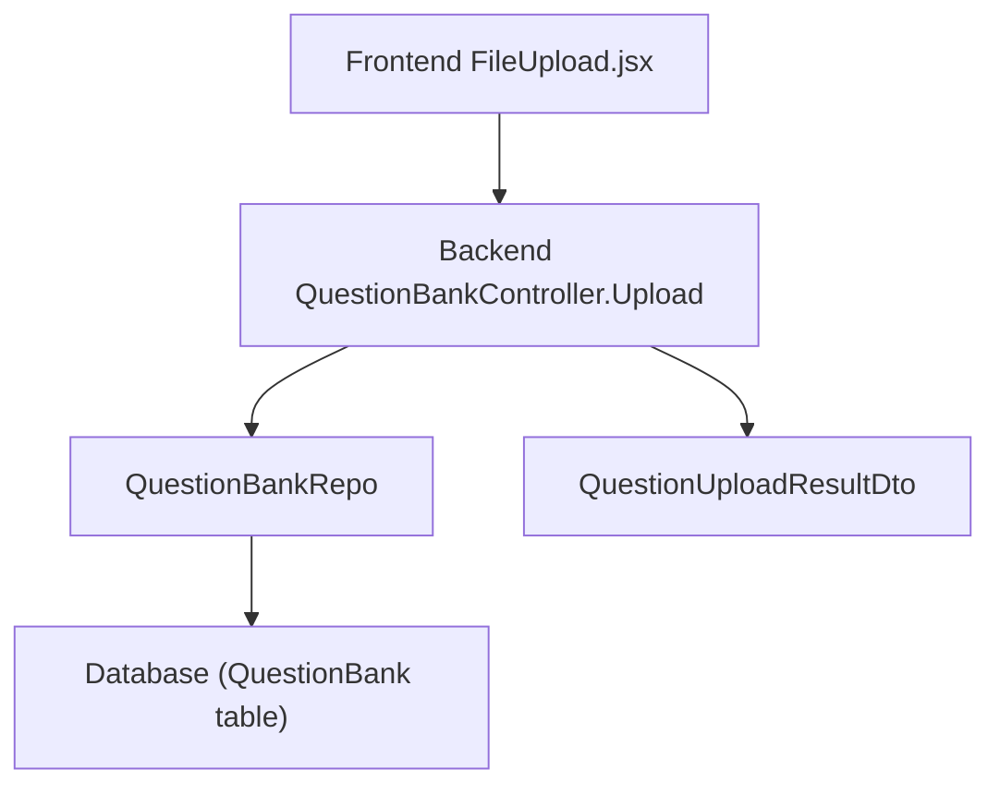
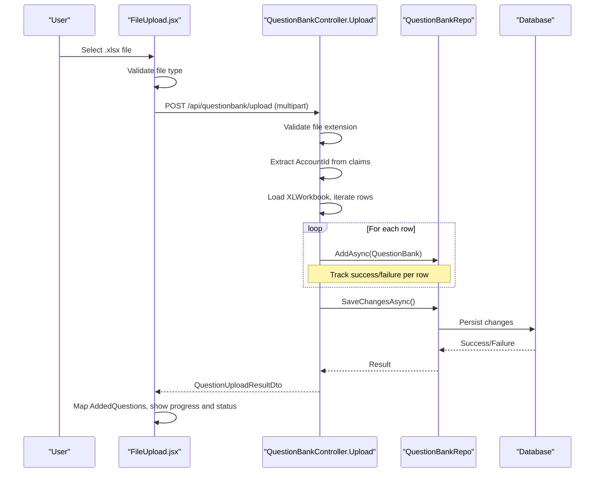
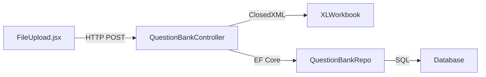

# Upload & Import Workflows

<cite>
**Referenced Files in This Document**
- [FileUpload.jsx](file://client/src/components/FileUpload.jsx)
- [QuestionBankController.cs](file://server/Api/Controllers/QuestionBankController.cs)
- [QuestionUploadResultDto.cs](file://server/Api/DTOs/QuestionUploadResultDto.cs)
- [QuestionBankRepo.cs](file://server/Api/Repositories/Implementation/QuestionBankRepo.cs)
- [QuestionBank.cs](file://server/Api/Models/QuestionBank.cs)
</cite>

## Table of Contents
1. [Introduction](#introduction)
2. [Project Structure](#project-structure)
3. [Core Components](#core-components)
4. [Architecture Overview](#architecture-overview)
5. [Detailed Component Analysis](#detailed-component-analysis)
6. [Dependency Analysis](#dependency-analysis)
7. [Performance Considerations](#performance-considerations)
8. [Troubleshooting Guide](#troubleshooting-guide)
9. [Conclusion](#conclusion)

## Introduction
This document explains the end-to-end upload and import workflow for adding questions to the Question Bank via Excel files. It covers:
- Frontend file selection, validation, and multipart upload
- Backend API handling, file format validation, row parsing, and persistence
- Response structure with success/failure counts and processed question details
- Authentication context extraction and permission considerations
- Error handling, retry strategies, progress tracking, transaction behavior, and data consistency during bulk imports

## Project Structure
The upload flow spans two layers:
- Frontend React component that validates and uploads an Excel file
- Backend ASP.NET Core controller that parses the Excel workbook, validates rows, persists valid questions, and returns a structured result

**Diagram sources**
- [FileUpload.jsx:19-64](file://client/src/components/FileUpload.jsx#L19-L64)
- [QuestionBankController.cs:145-270](file://server/Api/Controllers/QuestionBankController.cs#L145-L270)
- [QuestionBankRepo.cs:26-45](file://server/Api/Repositories/Implementation/QuestionBankRepo.cs#L26-L45)
- [QuestionUploadResultDto.cs:6-13](file://server/Api/DTOs/QuestionUploadResultDto.cs#L6-L13)

**Section sources**
- [FileUpload.jsx:19-64](file://client/src/components/FileUpload.jsx#L19-L64)
- [QuestionBankController.cs:145-270](file://server/Api/Controllers/QuestionBankController.cs#L145-L270)

## Core Components
- Frontend FileUpload component: Validates file type, builds FormData, extracts user account context from token, posts to /questionbank/upload, tracks upload progress, maps backend response into UI-friendly question objects, and shows success/error states.
- Backend QuestionBankController.Upload: Accepts multipart file, validates extension, reads Excel workbook, iterates rows, constructs QuestionBank entities, persists them, and returns a QuestionUploadResultDto.
- Repository layer: Adds entities and commits changes via SaveChangesAsync.
- Data model: QuestionBank entity fields used by upload mapping.
- DTO: Structured upload result including totals, errors, and added questions.

**Section sources**
- [FileUpload.jsx:19-163](file://client/src/components/FileUpload.jsx#L19-L163)
- [QuestionBankController.cs:145-270](file://server/Api/Controllers/QuestionBankController.cs#L145-L270)
- [QuestionBankRepo.cs:26-45](file://server/Api/Repositories/Implementation/QuestionBankRepo.cs#L26-L45)
- [QuestionBank.cs:7-46](file://server/Api/Models/QuestionBank.cs#L7-L46)
- [QuestionUploadResultDto.cs:6-13](file://server/Api/DTOs/QuestionUploadResultDto.cs#L6-L13)

## Architecture Overview
The upload process is a synchronous HTTP request with multipart form data. The frontend performs client-side validation and progress reporting; the backend performs server-side validation, row-by-row processing, and batch persistence.

**Diagram sources**
- [FileUpload.jsx:19-64](file://client/src/components/FileUpload.jsx#L19-L64)
- [QuestionBankController.cs:145-270](file://server/Api/Controllers/QuestionBankController.cs#L145-L270)
- [QuestionBankRepo.cs:26-45](file://server/Api/Repositories/Implementation/QuestionBankRepo.cs#L26-L45)

## Detailed Component Analysis

### Frontend: FileUpload Component
Responsibilities:
- File validation: Accepts only Excel formats (.xlsx). Rejects other types with user-facing error.
- Multipart upload: Builds FormData with file, optional accountId extracted from stored token, and optional bankKey.
- Progress tracking: Uses onUploadProgress to update a progress bar during transfer.
- Response handling: Maps backend-added questions into UI-friendly structures and displays success or error messages.
- Template download: Provides a way to download a template Excel file.

Key behaviors:
- Client-side MIME type check before sending
- Token-based accountId extraction for context
- Mapping of backend question fields to frontend expectations (type inference based on options and correct answer)

**Section sources**
- [FileUpload.jsx:19-64](file://client/src/components/FileUpload.jsx#L19-L64)
- [FileUpload.jsx:68-163](file://client/src/components/FileUpload.jsx#L68-L163)
- [FileUpload.jsx:180-208](file://client/src/components/FileUpload.jsx#L180-L208)

### Backend: Upload Endpoint
Responsibilities:
- Accept multipart file and optional query parameters (gradeId, classId)
- Validate file presence and extension (.xlsx)
- Extract AccountId from authentication claims
- Parse Excel workbook using ClosedXML
- Iterate rows starting after header, skip empty question text
- Construct QuestionBank entities with mapped fields
- Persist all valid entities in one SaveChangesAsync call
- Return QuestionUploadResultDto with aggregated metrics and added questions

Validation and processing:
- File-level: null/empty check, extension check
- Row-level: required question text, default marks if missing, required correct answer enforced
- Context: AccountId derived from claims; grade/class can be set from query params

Error handling:
- Per-row exceptions are caught, counted as failures, and recorded with row number
- Overall endpoint wraps processing in try/catch to return 500 on unexpected errors

Transaction behavior:
- All successful rows are buffered and persisted together via a single SaveChangesAsync call
- If SaveChangesAsync fails, none of the buffered inserts are committed (EF Core default behavior within a single request scope without explicit transactions)

**Section sources**
- [QuestionBankController.cs:145-270](file://server/Api/Controllers/QuestionBankController.cs#L145-L270)

### Repository Layer
Responsibilities:
- AddAsync: Enqueues entity for insertion
- SaveChangesAsync: Commits pending changes to the database

Notes:
- No explicit transaction wrapping is implemented here; EF Core manages unit-of-work semantics per SaveChangesAsync call
- Bulk operations rely on buffering entities and committing once

**Section sources**
- [QuestionBankRepo.cs:26-45](file://server/Api/Repositories/Implementation/QuestionBankRepo.cs#L26-L45)

### Data Model and DTO
- QuestionBank model defines fields used during upload mapping (title, options, correct answer, marks, account/grade/class identifiers, bank metadata)
- QuestionUploadResultDto provides:
  - TotalProcessed: total rows considered
  - SuccessCount: successfully inserted rows
  - FailureCount: failed rows
  - Errors: list of error messages per failure
  - AddedQuestions: list of persisted questions mapped to read DTO

**Section sources**
- [QuestionBank.cs:7-46](file://server/Api/Models/QuestionBank.cs#L7-L46)
- [QuestionUploadResultDto.cs:6-13](file://server/Api/DTOs/QuestionUploadResultDto.cs#L6-L13)

## Dependency Analysis
The upload flow depends on:
- Frontend axios configuration for making authenticated requests
- Backend authentication middleware to populate User claims
- ClosedXML library for Excel parsing
- Entity Framework Core for persistence

**Diagram sources**
- [FileUpload.jsx:57-64](file://client/src/components/FileUpload.jsx#L57-L64)
- [QuestionBankController.cs:145-184](file://server/Api/Controllers/QuestionBankController.cs#L145-L184)
- [QuestionBankRepo.cs:26-45](file://server/Api/Repositories/Implementation/QuestionBankRepo.cs#L26-L45)

**Section sources**
- [QuestionBankController.cs:145-184](file://server/Api/Controllers/QuestionBankController.cs#L145-L184)
- [QuestionBankRepo.cs:26-45](file://server/Api/Repositories/Implementation/QuestionBankRepo.cs#L26-L45)

## Performance Considerations
- Large Excel files: The current implementation loads the entire workbook into memory and processes rows sequentially. For very large files, consider streaming or chunked processing to reduce memory usage.
- Single SaveChangesAsync: Committing all inserts at once reduces round-trips but increases transaction size. For extremely large batches, consider batching with smaller SaveChangesAsync calls to limit transaction size and improve resilience.
- Validation early: Client-side validation reduces unnecessary network traffic; server-side validation ensures integrity.

[No sources needed since this section provides general guidance]

## Troubleshooting Guide
Common issues and resolutions:
- Invalid file type: Ensure the uploaded file is .xlsx. The frontend checks MIME type; the backend checks extension.
- Empty file or no rows: Backend returns a bad request if the workbook has no used rows.
- Missing question text: Rows with empty question text are skipped.
- Missing correct answer: Rows without a correct answer cause a failure entry with a descriptive message.
- Authentication context: If AccountId cannot be parsed from claims, inserts may fail due to foreign key constraints. Ensure the user is authenticated and the token contains a valid AccountId claim.
- Network errors: The frontend catches errors and displays messages from the response payload.

Retry mechanisms:
- Frontend does not implement automatic retries; users can re-upload after fixing errors.
- Backend processes rows independently; partial failures do not abort the entire import.

Progress tracking:
- Frontend updates progress during upload using onUploadProgress. Processing time is not reflected in progress; consider server-side streaming or polling endpoints for long-running imports in future enhancements.

**Section sources**
- [FileUpload.jsx:23-35](file://client/src/components/FileUpload.jsx#L23-L35)
- [FileUpload.jsx:57-64](file://client/src/components/FileUpload.jsx#L57-L64)
- [FileUpload.jsx:157-163](file://client/src/components/FileUpload.jsx#L157-L163)
- [QuestionBankController.cs:148-187](file://server/Api/Controllers/QuestionBankController.cs#L148-L187)
- [QuestionBankController.cs:191-235](file://server/Api/Controllers/QuestionBankController.cs#L191-L235)

## Conclusion
The upload and import workflow provides a robust path to add multiple questions via Excel. The frontend handles user interaction and basic validation, while the backend enforces strict validation, processes rows in bulk, and returns a comprehensive result. Current transaction behavior persists all valid rows atomically within a single SaveChangesAsync call. For large-scale imports, consider implementing chunked processing and explicit transactions to improve performance and reliability.

[No sources needed since this section summarizes without analyzing specific files]